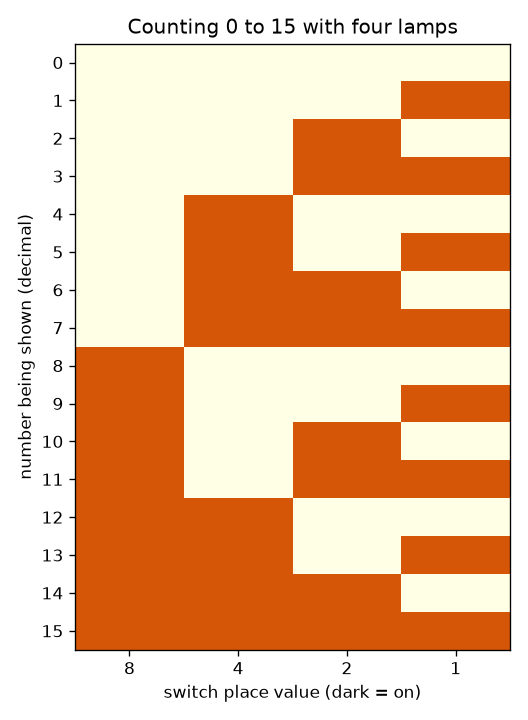
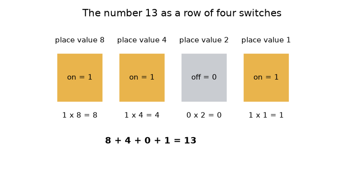

# సెషన్ 1: స్విచ్‌లు, దీపాలు మరియు బైనరీలో లెక్కించడం

[Session 1 — हिन्दी](README.hi.md)

*స్థాయి 1 (భావనాత్మక ఇంటరాక్టివ్ నమూనా) · సుమారు 60 నిమిషాలు · openbinary*

> ఇది సరళీకరించిన ఒక విద్యా నమూనా (educational model). ఇది ధృవీకరించబడిన డిజైన్ సాధనం కాదు; నిజమైన నిర్మాణాలు, విద్యుత్ ఇన్‌స్టాలేషన్‌లు, వాహనాలు, పారిశ్రామిక ప్రక్రియలు లేదా వైద్య నిర్ణయాల కోసం దీనిని ఉపయోగించకూడదు.

**ముందస్తు జ్ఞానం (Prerequisites)**

- పూర్ణ సంఖ్యలు మరియు దశాంశ పద్ధతిలో స్థాన విలువ (place value) (ఒకట్లు, పదులు, వందలు).
- మీరు PRIMER.md చదివి `python start.py 1` ఒకసారి రన్ చేశారు.

**అభ్యాస లక్ష్యాలు (Learning objectives).** ఈ సెషన్ తర్వాత మీరు చేయగలరు:

- ఆన్/ఆఫ్ స్విచ్‌ల వరుస ఒక సంఖ్యను ఎలా నిల్వ చేయగలదో వివరించడం.
- స్థాన విలువలను ఉపయోగించి స్విచ్‌ల నమూనాను (pattern) దశాంశ సంఖ్యగా, మళ్ళీ వెనక్కి మార్చడం.
- నాలుగు స్విచ్‌లపై 0 నుండి 15 వరకు లెక్కించి, ఆ నమూనాను వివరించడం.
- n స్విచ్‌లు ఎన్ని సంఖ్యలను ఉంచగలవో, లెక్క అతిపెద్ద సంఖ్యను దాటితే ఏమి జరుగుతుందో చెప్పడం.

## A. వాస్తవ ప్రపంచ సమస్య
ఒక లైట్ స్విచ్ ఆన్ లేదా ఆఫ్; మధ్యలో ఏమీ ఉండదు. ఒక కంప్యూటర్ అటువంటి అపారమైన సంఖ్యలో స్విచ్‌లతో నిర్మించబడింది, అయినా అది ఫోటోలు, పాటలు, బ్యాంక్ బ్యాలెన్స్‌లను నిల్వ చేస్తుంది. 'ఆన్', 'ఆఫ్' మాత్రమే తెలిసిన ఒకటి 13 వంటి సంఖ్యను ఎలా ఉంచగలదు? నాలుగు దీపాలు, నాలుగు స్విచ్‌లతో ఈ సెషన్ దానికి సమాధానం ఇస్తుంది. పూర్ణ సంఖ్యలు ఎలా నిల్వ చేయబడతాయో దాని సరళీకరించిన విద్యా నమూనా ఇది; నిజమైన కంప్యూటర్లు ఇదే ఆలోచనను ఇంకా చాలా బిట్‌లతో ఉపయోగిస్తాయి.

## B. భావన మరియు సిద్ధాంతం
దశాంశ సంఖ్య 345లో ప్రతి అంకె దాని కుడివైపు అంకె కంటే పది రెట్లు విలువైనది: 3 వందలు, 4 పదులు, 5 ఒకట్లు. బైనరీ (binary) ఇదే పనిని 2 అనే సంఖ్యతో చేస్తుంది. ఒక *బిట్ (bit)* అంటే 0 (స్విచ్ ఆఫ్) లేదా 1 (స్విచ్ ఆన్) అయిన ఒక అంకె. నాలుగు బిట్‌లలో ఎడమ నుండి కుడికి స్థానాల విలువలు 8, 4, 2, 1. ఆన్‌లో ఉన్న స్విచ్‌ల స్థాన విలువల మొత్తమే ఆ సంఖ్య. కాబట్టి 1101 అంటే 8 + 4 + 0 + 1 = 13. మీరు జోడించే ప్రతి స్విచ్ నమూనాల సంఖ్యను రెట్టింపు చేస్తుంది, ఎందుకంటే ప్రతి పాత నమూనా ఇప్పుడు కొత్త స్విచ్ ఆఫ్ లేదా ఆన్‌తో రావచ్చు. నాలుగు స్విచ్‌లు 16 నమూనాలను ఇస్తాయి, అవి 0 (అన్నీ ఆఫ్) నుండి 15 (అన్నీ ఆన్) వరకు లెక్కిస్తాయి. 15కి ఒకటి కలపడానికి ఐదవ స్విచ్ కావాలి; నాలుగు మాత్రమే ఉంటే, లెక్క చుట్టి (wrap around) 0కి తిరిగి వస్తుంది.

| చిహ్నం | అర్థం | యూనిట్ |
|---|---|---|
| b_k | k-వ స్విచ్ స్థితి: 0 (ఆఫ్) లేదా 1 (ఆన్) | యూనిట్ లేదు (ఒక బిట్) |
| 2^k | స్విచ్ k యొక్క స్థాన విలువ | యూనిట్ లేదు |
| n | స్విచ్‌ల (బిట్‌ల) సంఖ్య | లెక్క |
| N | స్విచ్‌లు చూపించే పూర్ణ సంఖ్య | యూనిట్ లేదు |

**ఊహలు (Assumptions)**

- స్విచ్‌లు ఆదర్శమైనవి (ideal): ఎల్లప్పుడూ పూర్తిగా ఆన్ లేదా పూర్తిగా ఆఫ్.
- 0 నుండి పైకి ఉన్న పూర్ణ సంఖ్యలను మాత్రమే మనం నిల్వ చేస్తాం (ఋణ సంఖ్యలు సెషన్ 3లో వస్తాయి).
- ఎడమవైపు చివరి స్విచ్‌కు అతిపెద్ద స్థాన విలువ ఉంటుంది.

$$ N=\sum_{k=0}^{n-1} b_k\,2^{k} $$

$$ \text{number of patterns}=2^{n},\qquad \text{largest number}=2^{n}-1 $$

$$ 1101_2 = 1\cdot 8+1\cdot 4+0\cdot 2+1\cdot 1=13 $$

## C. దృశ్య వివరణ
మొదటి చిత్రం 13 అనే సంఖ్యను 8, 4, 2, 1 స్థాన విలువలతో నాలుగు స్విచ్‌లుగా చూపిస్తుంది: మొదటి, రెండవ, నాలుగవ స్విచ్‌ల పైన ఉన్న దీపాలు ఆన్‌లో ఉన్నాయి, కింద 8 + 4 + 0 + 1 = 13 అనే మొత్తం రాయబడింది. రెండవ చిత్రం 0 నుండి 15 వరకు పూర్తి లెక్కింపు పట్టిక, ప్రతి సంఖ్యకు ఒక వరుస, ప్రతి స్విచ్‌కు ఒక నిలువు వరుస. కుడివైపు నిలువు వరుసను కిందికి చూడండి: అది ప్రతి వరుసలో మారుతుంది. తర్వాతి నిలువు వరుస ప్రతి రెండు వరుసలకు మారుతుంది, తర్వాత నాలుగు, తర్వాత ఎనిమిది — 0, 1 అంకెలు మాత్రమే ఉన్న ఓడోమీటర్ (odometer) చక్రాల్లా.

*0 నుండి 15 వరకు లెక్కించడం: ప్రతి సంఖ్యకు ఒక వరుస, ముదురు చతురస్రాలు ఆన్‌లో ఉన్న దీపాలు.*

*8, 4, 2, 1 స్థాన విలువలతో నాలుగు స్విచ్‌లుగా 13 అనే సంఖ్య.*

## D. ఇంటరాక్టివ్ సిమ్యులేషన్
పాఠాన్ని రన్ చేయండి (`python start.py 1`), తర్వాత లైవ్ యాప్‌ను తెరవండి: [సెషన్ 1: నాలుగు స్విచ్‌లు, నాలుగు దీపాలు](https://krunalpanchal1995.github.io/pan-iit-oss/openbinary/session-01/) (లేదా ఈ ఫోల్డర్‌లోని `app.html`). నాలుగు స్విచ్ స్లైడర్‌లను మార్చి దీపాలను, మొత్తాన్ని గమనించండి. తర్వాత గ్రాఫ్ వ్యూ తెరిచి 0 నుండి 15 వరకు ప్రతి సంఖ్యకు ఎన్ని దీపాలు ఆన్‌లో ఉన్నాయో చూడండి.

**సవాలు.** దీపాలపై 13 అనే సంఖ్యను చూపించండి (నమూనా 1101).

## E. సాధించిన ఉదాహరణ మరియు ప్రయోగం
**సమస్య.** 1101 స్విచ్‌లు ఏ సంఖ్యను చూపిస్తాయి? తర్వాత 12 అనే సంఖ్యను స్విచ్‌లుగా చూపించండి.

1. స్విచ్‌ల పైన స్థాన విలువలు రాయండి: 8, 4, 2, 1.
2. ఆన్‌లో ఉన్న స్విచ్‌లు మొదటి, రెండవ, నాలుగవది; కాబట్టి 8 + 4 + 1 కలిపి, మూడవదానికి 0 కలపండి: 8 + 4 + 0 + 1 = 13.
3. 12 కోసం సరిపోయే అతిపెద్ద స్థాన విలువను తీసుకోండి: 8 సరిపోతుంది (12 - 8 = 4), 4 సరిపోతుంది (4 - 4 = 0), 2 మరియు 1 సరిపోవు.
4. కాబట్టి 12 అంటే 8 + 4 = 1100 (మొదటి, రెండవ స్విచ్ ఆన్).
5. సరిచూడండి: 8 + 4 + 0 + 0 = 12.

**సమాధానం.** 1101 చూపించేది 13, మరియు 12ని 1100 అని రాస్తారు.

**ప్రయోగం.** నాలుగు చిన్న వస్తువులను తీసుకోండి (ఉదాహరణకు నాలుగు నాణేలు), బొమ్మ (heads) అంటే ఆన్ అని నిర్ణయించండి. 1101 అమర్చి ఒక స్నేహితుడిని సంఖ్య చదవమని అడగండి; తర్వాత 9ని చూపించమని అడగండి. నిజమైన స్విచ్‌లు పరిపూర్ణం కావు: ఒక యాంత్రిక స్విచ్ స్థిరపడే ముందు మినుకుమినుకుమనవచ్చు (దీనిని బౌన్స్ (bounce) అంటారు), నిజమైన దీపం వెలగడానికి సమయం పడుతుంది. ప్రతి స్విచ్ తక్షణమే, స్పష్టంగా 0 లేదా 1 అని నమూనా ఊహిస్తుంది.

## F. మూల్యాంకనం మరియు డిజైన్ సవాలు
**ప్రశ్న రకం A: భావనాత్మక.** ఇంకొక స్విచ్ జోడించడం వేర్వేరు నమూనాల సంఖ్యను సరిగ్గా రెట్టింపు ఎందుకు చేస్తుంది?

సూచన

మీ దగ్గర ఇప్పటికే ఉన్న ప్రతి నమూనాను తీసుకొని, కొత్త స్విచ్‌ను ఎన్ని రకాలుగా అమర్చవచ్చో అడగండి.

దశలవారీ పరిష్కారం

ప్రతి పాత నమూనాను కొత్త స్విచ్ ఆఫ్ లేదా ఆన్‌తో కలపవచ్చు, ఇది ప్రతి పాతదానికి రెండు కొత్త నమూనాలను ఇస్తుంది. నాలుగు స్విచ్‌లు 16 నమూనాలు, ఐదు 32. కాబట్టి n స్విచ్‌లు 2^n నమూనాలను ఇస్తాయి, లెక్కింపు 0 నుండి మొదలవుతుంది కాబట్టి అతిపెద్ద సంఖ్య 2^n - 1.

**ప్రశ్న రకం B: సంఖ్యాత్మక.** 1011 స్విచ్‌లను దశాంశ సంఖ్యగా చదవండి, 12ని స్విచ్‌లుగా రాయండి. ప్రతి ఫలితం సహేతుకమో సరిచూడండి (sanity check).

సూచన

8, 4, 2, 1 స్థాన విలువలను ఉపయోగించండి.

దశలవారీ పరిష్కారం

1011 = 8 + 0 + 2 + 1 = 11. 12 కోసం: 8 + 4 = 12, కాబట్టి నమూనా 1100. సరిచూపు: 11 అనేది 15 కంటే తక్కువ (4 స్విచ్‌లపై అతిపెద్దది), 1100 మొత్తం మళ్ళీ 12 అవుతుంది.

**ప్రశ్న రకం C: గ్రాఫ్ మరియు సిమ్యులేషన్ వ్యాఖ్యానం.** ఆన్‌లో ఉన్న దీపాలు వర్సెస్ సంఖ్య గ్రాఫ్‌లో, 0 మరియు 15 మధ్య ఎన్ని సంఖ్యలకు సరిగ్గా రెండు దీపాలు ఆన్‌లో ఉన్నాయి? గ్రాఫ్‌లో అత్యధిక బిందువు ఏది, అది ఎక్కడ వస్తుంది?

సూచన

ఎత్తు 2 వద్ద ఉన్న చుక్కలను లెక్కించండి, అన్ని స్విచ్‌లు ఆన్‌లో ఉన్న సంఖ్య కోసం చూడండి.

దశలవారీ పరిష్కారం

ఆరు సంఖ్యలకు సరిగ్గా రెండు దీపాలు ఆన్‌లో ఉన్నాయి: 3, 5, 6, 9, 10, 12. గ్రాఫ్ 15 వద్ద అత్యధికం (4 దీపాలు), అక్కడ అన్ని స్విచ్‌లు ఆన్; 0 వద్ద అత్యల్పం (0 దీపాలు). ఎత్తులు 0 నుండి 4 వద్ద లెక్కలు 1, 4, 6, 4, 1.

**ప్రశ్న రకం D: డిజైన్ మరియు ఆప్టిమైజేషన్ (optimisation) సవాలు.** డిజైన్: ఒక హాల్‌లో 0 నుండి 99 వరకు సంఖ్యలు వేసిన 100 సీట్లు ఉన్నాయి. ఒక బోర్డు సీటు సంఖ్యను దీపాలపై చూపించాలి. కనీస దీపాల సంఖ్య ఎంత? దాని కంటే ఎక్కువ దీపాలు వాడడంలోని ఒక ట్రేడ్-ఆఫ్ (trade-off) చెప్పండి.

సూచన

2^n కనీసం 100 అయ్యే అతి చిన్న n ను కనుగొనండి.

దశలవారీ పరిష్కారం

6 దీపాలు 64 నమూనాలు మాత్రమే ఇస్తాయి, అది సరిపోదు. 7 దీపాలు 128 నమూనాలను ఇస్తాయి, అది 0 నుండి 99 వరకు కవర్ చేస్తుంది; కాబట్టి 7 దీపాలు సరిపోతాయి, 7 అతి చిన్న సంఖ్య. 8 లేదా ఎక్కువ దీపాలు వాడితే ఎక్కువ భాగాలకు, వైరింగ్‌కు ఖర్చవుతుంది, నమూనాలు మాత్రమే వృథా అవుతాయి; తక్కువ వాడడం అసాధ్యం. ఊహ: ప్రతి బిట్‌కు ఒక దీపం, గరిష్ఠ సీటు సంఖ్య స్థిరమైనది, తెలిసినది.

[RUBRIC.md](../../RUBRIC.md)తో మిమ్మల్ని మీరు స్కోర్ చేసుకోండి. కాగితంపై చేయడానికి [కార్యాచరణ పత్రం](activity_sheet.md) ప్రింట్ చేయండి.

## సాధారణ అపోహలు
| సాధారణ అపోహ | నిజానికి సరైనది |
|---|---|
| బైనరీ వేరే రకమైన సంఖ్య. | అది వేరే విధంగా రాసిన అదే సంఖ్య. బైనరీలో 1101 మరియు దశాంశంలో 13 ఒకే పరిమాణం. |
| బైనరీలో 2 అనే అంకె ఉంది. | బైనరీ అంకెలు 0 మరియు 1 మాత్రమే; ఒక స్థానం 2కి చేరినప్పుడు తర్వాతి స్థానానికి క్యారీ (carry) చేస్తారు, దశాంశంలో 9 + 1 క్యారీ చేసినట్లే. |
| ఎడమవైపు చివరి స్విచ్ విలువ 1. | ఎడమవైపు చివరిదే అతిపెద్ద స్థానం (నాలుగు స్విచ్‌లపై 8); కుడివైపు చివరిదాని విలువ 1. |
| అతిపెద్ద సంఖ్యను దాటి లెక్కిస్తే ఇంకా పెద్ద సంఖ్య వస్తుంది. | నాలుగు స్విచ్‌లు 16ని చూపించలేవు; లెక్క 0000కి చుట్టి వస్తుంది, కారు ఓడోమీటర్ తిరిగి మొదలైనట్లే. |

## పదకోశం (Glossary)
- **బిట్ (bit)**: ఒక బైనరీ అంకె: 0 (ఆఫ్) లేదా 1 (ఆన్)
- **బైనరీ (binary)**: 0, 1 అనే రెండు అంకెలు మాత్రమే, 1, 2, 4, 8, ... స్థాన విలువలు కలిగిన సంఖ్యా వ్యవస్థ
- **స్థాన విలువ (place value)**: ఒక అంకె ఉన్న స్థానం వల్ల దానికి ఉండే విలువ
- **నమూనా (pattern)**: అన్ని స్విచ్‌ల ఒక నిర్దిష్ట అమరిక
- **చుట్టి రావడం (wrap around)**: అతిపెద్ద సంఖ్యను దాటి మళ్ళీ 0కి రావడం

## ముగింపు
1. [exercises.md](exercises.md)లోని మూడు కోడింగ్ పనులు చేయండి.
2. మీ మార్పుల తర్వాత `python start.py 1` మళ్ళీ రన్ చేయండి. అది చెక్‌పాయింట్‌తో (checkpoint) ముగుస్తుంది; అది `PASS` అని ప్రింట్ చేసినప్పుడు మీరు పూర్తి చేశారు. (చెక్‌పాయింట్ మాత్రమే: `python start.py check 1`.)

తర్వాత: [సెషన్ 2](../session-02/README.md)
