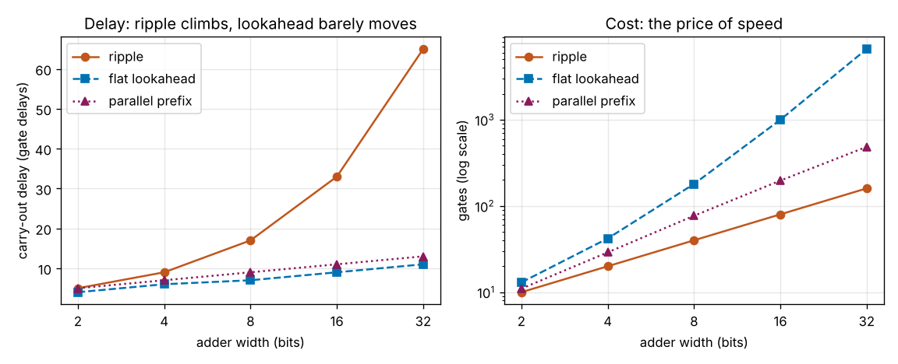
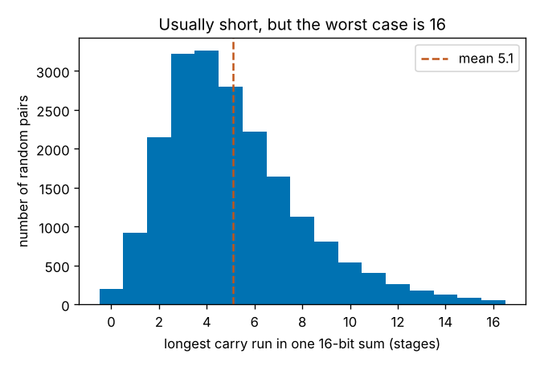

# Session 4: A carry-lookahead adder

*Level 3 (simulation and validation) · about 90 minutes · openbinary*

> This is a simplified educational model. It is not a validated design tool and must not be used for real structures, electrical installations, vehicles, industrial processes or medical decisions.

**Prerequisites**

- Session 2: gates and truth tables.
- Session 3: the gate-level simulator, the ripple-carry adder and its delay of 2n + 1 gate delays.

**Learning objectives.** After this session you can:

- Say what a stage generates, propagates or kills, and write g and p from a and b.
- Write every carry directly in terms of g, p and the carry in, and say which stage a carry came from.
- Build a flat carry-lookahead adder and a parallel-prefix adder in the simulator and check them against Python.
- Read gate delays and gate counts from the simulator and say what the speed costs.
- Choose the cheapest design that meets a delay budget and a gate budget.

## A. Real-world problem
Session 3 built an adder that is correct for every input, but its carry ripples: the last carry waits for every carry before it, so the delay is 2n + 1 gate delays. A 16-bit ripple adder needs 33 gate delays and a 32-bit one needs 65, far too slow for the adder inside a processor that has to finish in one clock tick. How can an adder get its carries without waiting for them? We work out what each stage will generate and propagate, write every carry in terms of those signals, and build two faster adders in the same simulator. Each is checked against Python's own addition, and we count honestly what the speed costs in gates. This is a simplified educational model: ideal gates with two inputs and one unit of delay each, no wires, no fan-out limit, no clock and no real chip timing.

## B. Concept and theory
Look at one stage with inputs a and b and ask what it does to a carry that arrives. If a = b = 1 it **generates** a carry whatever arrives: g = a AND b. If a and b differ it **propagates**: an arriving carry passes straight through, so p = a XOR b. If a = b = 0 it **kills** an arriving carry, and g = p = 0. The carry out of the stage is c_next = g OR (p AND c), and the sum bit is p XOR c. The key fact is that g and p use only the stage's own inputs, so they are ready after one gate delay in every stage at once.

Now substitute c_next = g + p c into itself. For example c4 = g3 + p3 g2 + p3 p2 g1 + p3 p2 p1 g0 + p3 p2 p1 p0 c_in (+ is OR, writing two symbols together is AND). Every term uses only g, p and the carry in, so all carries can be computed at the same time instead of one after another. At most one term can be 1, because a stage that generates has p = 0 and blocks every term that starts further down. So each carry has exactly one source: a stage that generated it with every stage above it passing it on, or the carry in itself.

With two-input gates an AND of 17 signals still needs 5 levels, and an OR of 17 terms another 5, so lookahead is not instant. The **flat lookahead adder** builds every term and every OR in full, joining the shallowest wires first; it is the textbook idea with no sharing, fast but expensive in gates. The **parallel-prefix adder** is smarter. A group of stages has its own generate G and propagate P, and a high group joins the group below it with G = G_high + P_high G_low and P = P_high P_low. Joining at distances 1, 2, 4, 8, ... (the Kogge-Stone pattern) makes every stage's group reach back to stage 0 after log2(n) rounds, two gate delays per round, so doubling the width adds exactly 2 gate delays. No circuit of two-input gates can do better than ceil(log2(2n + 1)) levels for the last carry, because that carry depends on all 2n + 1 inputs.

| Symbol | Meaning | Unit |
|---|---|---|
| a, b | input bits of one stage | 0 or 1 |
| g, p | generate (a AND b) and propagate (a XOR b) of a stage | 0 or 1 |
| c_in, c_i | carry in, and carry into stage i | 0 or 1 |
| G, P | generate and propagate of a group of stages | 0 or 1 |
| n | adder width | bits |
| T(n) | delay of the last carry out | gate delays |
| gates | number of gates in the circuit | count |

**Assumptions**

- Every gate has two inputs and a delay of 1 unit; wires are free and there is no limit on how many gates one wire can feed.
- Depth is the longest path, so T(n) is the worst case over all inputs.
- Numbers are unsigned and fixed-width; the carry out of the top stage is reported.
- No clock or memory: the circuit is purely combinational.

$$ g_i=a_ib_i,\qquad p_i=a_i\oplus b_i $$

$$ c_{i+1}=g_i+p_ic_i,\qquad s_i=p_i\oplus c_i $$

$$ c_{i+1}=g_i+p_ig_{i-1}+p_ip_{i-1}g_{i-2}+\dots+p_i\cdots p_0\,c_{in} $$

$$ (G,P)=(G_h+P_hG_l,\;P_hP_l) $$

$$ T_{\text{ripple}}(n)=2n+1,\qquad T_{\text{prefix}}(2^k)=2k+3,\qquad T\ge\lceil\log_2(2n+1)\rceil $$

## C. Visual explanation
The first figure shows, on the left, the carry-out delay against the width for the three adders, read from the simulator's depth counter, and on the right the number of gates on a logarithmic axis. At 16 bits the ripple adder needs 33 gate delays, the flat lookahead adder 9 and the prefix adder 11; at 32 bits it is 65, 11 and 13. The ripple line climbs steeply while the two lookahead lines hardly move. The right-hand panel is the price: at 16 bits that is 80 gates for ripple, 1000 for flat lookahead and 197 for the prefix adder, and at 32 bits the flat design needs 6608 gates against 485 for the prefix adder. The second figure shows how long the carry chain really is in 20000 random 16-bit sums: usually about 5 stages, with a mean of 5.1. It is rarely 16, but a clocked circuit cannot know that the carries have finished early, so the clock must allow for the worst case.

*Carry-out delay and gate count against width: the lookahead adders are much faster and cost more gates.*

*The longest carry run in random 16-bit sums is usually short, but the worst case is 16 stages.*

## D. Interactive simulation
Run the lesson (`python start.py 4`), then open the live app: [Session 4: carries in parallel](https://krunalpanchal1995.github.io/pan-iit-oss/openbinary/session-04/) (or `app.html` in this folder). Set two 8-bit numbers and a carry in. Each stage shows G, P or K, the carry that arrives, and the sum bit, and the orange bar shows which stage the last carry came from and which stages passed it on. Switch to the delay and gate views and use the width slider to compare the three adders; the readout gives the delay in nanoseconds at 0.5 ns per gate.

**Challenge.** Find the smallest width where a ripple adder needs more than 20 gate delays (10 ns at 0.5 ns per gate) but the prefix adder still stays within 20.

## E. Worked example and experiment
**Problem.** Add 11 + 5 on four bits using the lookahead equations, with carry in 0, and say where the last carry comes from.

1. Write the inputs: a = 1011 and b = 0101.
2. Generate g = a AND b = 0001 (only stage 0 has two ones) and propagate p = a XOR b = 1110 (stages 1, 2 and 3 have one 1 each).
3. All the carries from the equations: c1 = g0 + p0 c_in = 1 + 0 = 1; c2 = g1 + p1 g0 + p1 p0 c_in = 0 + 1 + 0 = 1; c3 = g2 + p2 g1 + p2 p1 g0 + ... = 0 + 0 + 1 = 1; c4 = g3 + p3 g2 + p3 p2 g1 + p3 p2 p1 g0 + ... = 0 + 0 + 0 + 1 = 1.
4. The sum bits are s_i = p_i XOR c_i, with c_0 = c_in = 0: s0 = 0 XOR 0 = 0, s1 = 1 XOR 1 = 0, s2 = 1 XOR 1 = 0, s3 = 1 XOR 1 = 0.
5. The result is 0000 with carry out 1, which is 16, and 11 + 5 = 16. The only term of c4 that is 1 is p3 p2 p1 g0: stage 0 generated the carry and stages 1, 2 and 3 passed it on.

**Answer.** 11 + 5 = 16: sum bits 0000, carry out 1, and the last carry comes from stage 0.

**Experiment.** Add 4999 + 1 on paper. Rippling, you write 0, carry, write 0, carry, write 0, carry, write 5: four steps in a row. Looking ahead, you notice at once that the units pair 9 + 1 generates a carry and the 9s in the tens and hundreds will pass it on (a digit pair that sums to 9 is the decimal "propagate"), so you can write 5000 in one go. That is exactly what g and p let the adder do. Real adders differ from the model: gates have different delays, wires add delay, one gate cannot drive an unlimited number of others, and real designs often mix ripple blocks with lookahead. The model counts delay in unit steps of two-input gates and ignores all of that.

## Real-world application and mini-project: Choose the adder for a 32-bit processor
A small processor needs a 32-bit adder whose carry out must be ready within 7.5 ns, at 0.5 ns per gate delay (15 gate delays), and the chip area allows at most 1000 gates for the adder. Use `build_ripple`, `build_flat` and `build_prefix` from Session 4 at 32 bits. Check each design against Python, read its gates and carry-out delay, convert the delay to nanoseconds, and decide which design meets both budgets.

**Deliverable:** A script that builds the three 32-bit adders, checks each against Python on 20000 random pairs plus corner cases and the prefix adder on 200000, prints a table of gates, carry-out delay and time in nanoseconds, prints which designs meet 15 gate delays and 1000 gates, finds the widest ripple adder within 15 gate delays, and saves a picture of the delay and gate curves.

**Success looks like:** No mismatches in any check. The table shows ripple 160 gates, 65 gate delays, 32.5 ns; flat 6608 gates, 11 gate delays, 5.5 ns; prefix 485 gates, 13 gate delays, 6.5 ns. Only the prefix adder meets both budgets (ripple is too slow, flat uses too many gates), the widest ripple adder within 15 gate delays is 7 bits, and the prefix adder is 5 times faster than ripple (65 / 13) for about 3 times the gates (485 / 160).

## F. Assessment and design challenge
**Question type A: Conceptual.** Why can a lookahead adder find the carry out of stage 3 without waiting for the carries out of stages 0, 1 and 2? What do generate and propagate mean?

Hint

Write c4 with the substitution c_next = g + p c, and see which signals it uses.

Step-by-step solution

A stage generates a carry when a = b = 1 (g = a AND b) and propagates one when a and b differ (p = a XOR b); both depend only on that stage's own inputs, so every stage has them after one gate delay. Substituting c_next = g + p c again and again gives c4 = g3 + p3 g2 + p3 p2 g1 + p3 p2 p1 g0 + p3 p2 p1 p0 c_in. This uses only g, p and the carry in, never c1, c2 or c3, so it can be built next to them instead of after them. The price is more gates.

**Question type B: Numerical.** Use the equations to find the carry out of stage 3 (c4) for a = 1101 (13) and b = 0111 (7) with carry in 0. Which stage did it come from? Sanity check with ordinary addition.

Hint

First find g = a AND b and p = a XOR b, bit by bit.

Step-by-step solution

a = 1101 and b = 0111, so g = 0101 (stages 0 and 2 have two ones) and p = 1010 (stages 1 and 3 have one 1). Then c4 = g3 + p3 g2 + p3 p2 g1 + p3 p2 p1 g0 + p3 p2 p1 p0 c_in = 0 + 1 + 0 + 0 + 0 = 1, and the term that is 1 is p3 g2: stage 2 generated a carry and stage 3 passed it on. Check: 13 + 7 = 20 = 16 + 4, so there is a carry out of the top stage and the four sum bits are 0100.

**Question type C: Graph and simulation interpretation.** From the delay graph, how many gate delays does the carry out take at 16 bits and at 32 bits for the ripple, flat and prefix adders? What happens to each when the width doubles?

Hint

Read the three lines at 16 and at 32 and subtract.

Step-by-step solution

At 16 bits: ripple 33, flat 9, prefix 11. At 32 bits: ripple 65, flat 11, prefix 13. Doubling the width from 16 to 32 adds 32 gate delays to the ripple adder (it nearly doubles, since T = 2n + 1) but only 2 to each lookahead adder, because one more round of combining is enough. So the gap between ripple and lookahead keeps widening with the width.

**Question type D: Design and optimisation challenge.** Design: a 32-bit adder must have its carry out ready within 7.5 ns at 0.5 ns per gate delay, using at most 1000 gates. Which of the ripple, flat and prefix designs would you choose? What would change if the budget were 10 gate delays?

Hint

Convert the time to gate delays first: 7.5 / 0.5.

Step-by-step solution

7.5 / 0.5 = 15 gate delays. Ripple takes 65 (160 gates), so it is too slow. Flat takes 11 gate delays but 6608 gates, so it is too big. Prefix takes 13 gate delays with 485 gates, so only the prefix adder meets both limits. With a budget of 10 gate delays none of the three designs works at 32 bits (the fastest, flat, needs 11), so you would have to narrow the adder (flat at 16 bits needs 9) or find a different design; even then no circuit of two-input gates can beat ceil(log2 65) = 7 levels for a 32-bit carry out.

Score yourself with [RUBRIC.md](../../RUBRIC.md). Print the [activity sheet](activity_sheet.md) to work on paper.

## Common misconceptions
| Common misconception | What is actually true |
|---|---|
| Generate and propagate mean the same thing. | Generate (a = b = 1) makes a new carry; propagate (a and b differ) only passes on a carry that arrives. A stage with a = b = 0 kills it. |
| A lookahead adder skips stages or guesses the answer. | It computes every carry exactly, all at the same time, from g, p and the carry in. The result is identical to the ripple adder for every input. |
| If the carries are computed in parallel the delay no longer depends on the width. | It still grows, by 2 gate delays for each doubling, because a gate has only two inputs and a carry depends on all the inputs. |
| A faster adder is always better. | Speed costs gates: at 32 bits the flat lookahead adder uses 6608 gates against 160 for ripple, so the best choice depends on the budgets. |
| The ripple adder always takes 33 gate delays at 16 bits. | 33 is the worst case over all inputs. A typical pair has a carry chain of about 5 stages, but the clock must allow for the worst case. |

## Glossary
- **generate**: a stage with a = b = 1 makes a carry on its own (g = a AND b)
- **propagate**: a stage whose inputs differ passes an arriving carry on (p = a XOR b)
- **kill**: a stage with a = b = 0 stops an arriving carry
- **carry-lookahead adder**: an adder that writes each carry in terms of g, p and the carry in so they are found at the same time
- **parallel-prefix adder**: a lookahead adder that joins groups of stages at distances 1, 2, 4, ... so the delay grows with log2(n)
- **depth**: the number of gates on the longest path to a wire, in gate delays
- **critical path**: the longest path through a circuit; it sets the speed
- **fan-in**: the number of inputs of a gate; here always 2

## Finish
1. Do the three coding tasks in [exercises.md](exercises.md).
2. Run `python start.py 4` again after your changes. It ends with the checkpoint; when it prints `PASS`, you are done. (Checkpoint only: `python start.py check 4`.)

Next: [Session 5: A multiplier from gates](../session-05/README.md).
