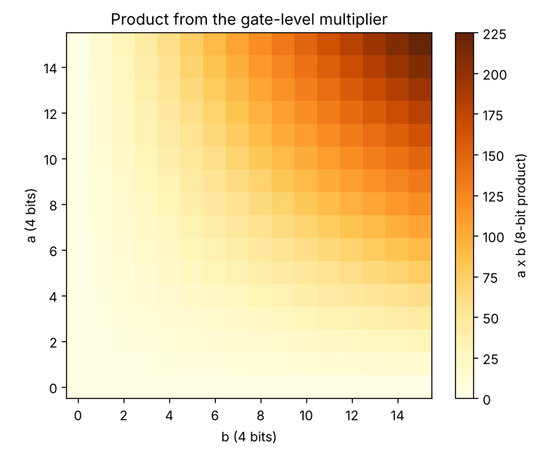
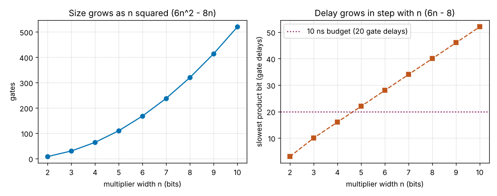

# Session 5: A multiplier from gates

*Level 3 (simulation and validation) · about 90 minutes · openbinary*

> This is a simplified educational model. It is not a validated design tool and must not be used for real structures, electrical installations, vehicles, industrial processes or medical decisions.

**Prerequisites**

- Session 2: gates and truth tables.
- Session 3: the gate-level simulator, the half adder, the full adder and gate delays.

**Learning objectives.** After this session you can:

- Multiply two binary numbers on paper as shifted partial products added column by column.
- Make the partial products with AND gates and add them with half and full adders in the simulator.
- Check a 4 x 4 multiplier against Python's own product for all 256 input pairs.
- Say why the product of two n-bit numbers needs 2n bits.
- Read the gate count and delay of the multiplier from the simulator and explain how both grow with the width.

## A. Real-world problem
The adder of Session 3 can add and subtract, but a processor also has to multiply: to scale a sound, to mix colours, to work out an address. There is no multiply gate. Yet two 4-bit numbers can be multiplied with nothing more than AND gates and the half and full adders we already have. How, and what does it cost? We build the multiplier in the gate simulator, test it on all 256 input pairs against Python's own multiplication, and then ask how many gates it needs, how long its slowest product bit takes, and why the answer needs twice as many bits as the inputs. This is a simplified educational model for unsigned numbers: ideal gates with one unit of delay each, no wires, no clock and no real chip timing.

## B. Concept and theory
Multiplying on paper, you multiply the top number by each digit of the bottom number and add the rows, each shifted one place further left. In binary every digit is 0 or 1, so each row is either 0 or a copy of a, shifted: row j is a x b_j shifted j places. These rows are the partial products. Bit i of row j is a_i AND b_j, so a 4 x 4 multiplier makes its 16 partial-product bits with 16 AND gates, all at once. The rows are then added column by column: in each column add the ones that fall in it and the carry from the column before, write the last bit of the total and carry the rest. On paper a carry can be as big as 3 for 4 bits; in the circuit each half adder (two bits) or full adder (two bits and a carry) passes on a single carry bit, and a bit alone in its column passes straight through.

Adding the rows one after another with a regular grid of adder cells gives the **array multiplier**. Each row after the first needs n cells: n half adders and n(n - 2) full adders in all for an n x n multiplier, plus the n^2 AND gates, so the gate count is 6n^2 - 8n. It grows with the square of the width: doubling n multiplies the gates by more than 4 (5 from 4 to 8 bits), tending to 4 for wide multipliers. The slowest path runs down through the rows and across, and in the simulator it takes 6n - 8 gate delays for n >= 3, growing in step with n. Because a and b are each at most 2^n - 1, the product is at most (2^n - 1)^2 which is below 2^(2n): it needs 2n bits and cannot overflow if you keep them all. A narrow chip that keeps only the low n bits gets most answers wrong: 15 x 15 = 225 becomes 1 on four bits.

| Symbol | Meaning | Unit |
|---|---|---|
| a, b | the two unsigned inputs | n-bit numbers |
| a_i, b_j | bit i of a and bit j of b | 0 or 1 |
| n | width of each input | bits |
| pp_j | partial product j: a shifted left j places if b_j is 1, else 0 | number |
| p | the product a x b, 2n bits wide | 2n-bit number |
| T(n) | delay of the slowest product bit | gate delays |

**Assumptions**

- Inputs are unsigned whole numbers of n bits; signed multiplication is not covered.
- Every gate has two inputs and a delay of 1 unit; wires are free.
- The product keeps all 2n bits, so it never overflows.
- No clock or memory: the circuit is purely combinational.

$$ a\times b=\sum_{j=0}^{n-1} b_j\,(a\ll j),\qquad \text{bit } i \text{ of row } j = a_i\wedge b_j $$

$$ 0\le a\times b\le (2^n-1)^2<2^{2n} $$

$$ \text{gates}(n)=n^2+2n+5\,n(n-2)=6n^2-8n $$

$$ T(n)=6n-8\ \text{gate delays}\quad(n\ge 3) $$

## C. Visual explanation
The first figure is the product table of all 256 pairs of 4-bit numbers as read from the gate-level multiplier: a up the side and b along the bottom, darker for bigger products. It is symmetric about the diagonal, because a x b = b x a, it is zero along the first row and column (31 of the 256 products are zero), and it climbs to 225 at the top right corner, which needs all 8 product bits. The second figure shows the size and the delay of the array multiplier against n. The gates curve bends upwards: 64 gates at n = 4 and 320 at n = 8, five times as many for twice the width. The delay is a straight line: 16 gate delays at n = 4 and 40 at n = 8. The dotted line is a delay budget of 20 gate delays (10 ns at 0.5 ns per gate): the line crosses it between n = 4 and n = 5.

*All 256 products from the gate-level multiplier: symmetric, zero on the edges, up to 225.*

*Gates grow with n squared and delay grows in step with n.*

## D. Interactive simulation
Run the lesson (`python start.py 5`), then open the live app: [Session 5: a 4-bit multiplier](https://krunalpanchal1995.github.io/pan-iit-oss/openbinary/session-05/) (or `app.html` in this folder). Set a and b with the sliders and watch the partial products appear as rows of AND results, then the column totals, carries and product bits. Switch to the gates and delay views and move the width slider to see how the multiplier grows; the readout gives the time in nanoseconds at 0.5 ns per gate.

**Challenge.** Find the widest multiplier whose slowest product bit is ready within 20 gate delays (10 ns at 0.5 ns per gate). Use the width slider.

## E. Worked example and experiment
**Problem.** Multiply 7 x 3 with the AND-gate partial products and the column method, and check the answer.

1. Write the inputs: a = 0111 and b = 0011, so b0 = 1 and b1 = 1 and the other bits of b are 0.
2. The partial products are row 0 = a = 0111 and row 1 = a shifted one place = 01110; rows 2 and 3 are all zeros.
3. Column 0: only a0 AND b0 = 1, so the product bit is 1. Column 1: a1b0 = 1 and a0b1 = 1, two ones, total 2, so bit 0 and carry 1.
4. Column 2: a2b0 = 1 and a1b1 = 1 plus the carry 1, total 3, so bit 1 and carry 1. Column 3: a2b1 = 1 plus the carry 1, total 2, so bit 0 and carry 1.
5. Column 4: no ones plus the carry 1, total 1, so bit 1; the higher columns are 0. Reading the bits from column 7 down gives 00010101.

**Answer.** 7 x 3 = 00010101 = 21, and 7 x 3 = 21 in ordinary arithmetic.

**Experiment.** Multiply 23 x 14 on paper in decimal with partial products and notice that you do the same two things: make one shifted row for each digit of 14, then add the rows. In binary each digit is only 0 or 1, so each row is either nothing or a copy, which is exactly what an AND gate decides. Then try 5 x 8 in the app: 8 is 1000, so only one row is not zero and the answer is a shifted by 3 places, a multiplication that needs only wires. Real multipliers differ from the model: gates have different delays, wires add delay, real chips add the rows in a tree of adders to save time, and signed numbers need extra care. The model counts delay in unit gate steps and keeps to unsigned numbers.

## Real-world application and mini-project: Build and test an 8 x 8 multiplier
A small calculator chip must multiply two 8-bit unsigned numbers (0 to 255) and show the result. Use `build_multiplier(8)`, `multiply` and `mismatches` from Session 5. Test it on every pair of inputs against Python's `*`, count its gates, read the delay of its slowest product bit, count how many of the 65536 products do not fit in 8 bits, and decide the widest array multiplier whose slowest product bit is ready within 20 ns if one gate takes 0.5 ns.

**Deliverable:** A script that checks all 65536 input pairs against Python, prints the number of gates, the number of product bits, the delay of the slowest product bit in gate delays and in ns, the number of products above 255, and the widest width that meets the 20 ns budget, and saves a picture of the gates and delay against n.

**Success looks like:** Every one of the 65536 pairs matches Python, the multiplier has 320 gates and 16 product bits, the slowest product bit is ready after 40 gate delays (20 ns), 63568 of the 65536 products (97.0 %) are above 255 and so need more than 8 bits, and the widest width within 20 ns is 8 bits (a 9-bit multiplier needs 46 gate delays, 23 ns).

## F. Assessment and design challenge
**Question type A: Conceptual.** Why does the product of two 4-bit numbers need 8 bits, and why does multiplying by 8 need no adder at all?

Hint

Find the largest product, and write 8 in binary.

Step-by-step solution

The largest 4-bit number is 15, and 15 x 15 = 225, which is above 15 and needs 8 bits (225 = 11100001). In general (2^n - 1)^2 is below 2^(2n), so 2n bits are always enough and never overflow. Eight is 1000 in binary, so only b3 is 1 and only one partial product is not zero: it is a shifted left three places. There is nothing to add, so multiplying by a power of two is just a shift, which needs wires and no adder.

**Question type B: Numerical.** Multiply 13 x 11 by partial products: write each row, add them, and give the product in binary. Sanity check with decimal arithmetic.

Hint

13 is 1101 and 11 is 1011; the rows come from the 1 bits of 11 (b0, b1 and b3).

Step-by-step solution

b = 1011 has b0 = 1, b1 = 1, b2 = 0 and b3 = 1. The rows are 1101 (13), 11010 (26), 0 and 1101000 (104). Adding: 13 + 26 = 39 and 39 + 104 = 143, which is 10001111 in binary (128 + 8 + 4 + 2 + 1). Check: 13 x 11 = 143.

**Question type C: Graph and simulation interpretation.** From the size and delay graph, how many gates and how many gate delays does the multiplier have at n = 4 and at n = 8? What happens to each when the width doubles?

Hint

Read both curves at n = 4 and n = 8 and divide.

Step-by-step solution

At n = 4 there are 64 gates and the slowest bit takes 16 gate delays; at n = 8 there are 320 gates and 40 gate delays. Doubling the width multiplies the gates by 5 (more than 4, tending to 4, because the gates grow with n squared: 6n^2 - 8n) and the delay by 2.5 (more than 2, tending to 2, because the delay grows in step with n: 6n - 8). So width is expensive in size and fairly gentle in delay.

**Question type D: Design and optimisation challenge.** Design: each gate takes 0.5 ns and the product of an array multiplier must be ready within 10 ns. What is the widest multiplier allowed? What would you change to go wider?

Hint

Solve (6n - 8) x 0.5 <= 10, using T(n) = 6n - 8.

Step-by-step solution

10 / 0.5 = 20 gate delays, and 6n - 8 <= 20 gives n <= 4.67, so the widest is 4 bits (16 gate delays = 8 ns; 5 bits needs 22 gate delays = 11 ns). To go wider, use faster adders in the rows (the carry-lookahead adders of Session 4 shorten the carry chain), add the partial products in a tree of adders instead of one row after another, or give the multiplier two clock cycles. The trade-off is more gates and a more complicated layout for less delay.

Score yourself with [RUBRIC.md](../../RUBRIC.md). Print the [activity sheet](activity_sheet.md) to work on paper.

## Common misconceptions
| Common misconception | What is actually true |
|---|---|
| A multiplier needs a new kind of gate. | It needs only AND gates for the partial products and the same half and full adders as the adder of Session 3. |
| The product of two n-bit numbers fits in n bits. | It needs 2n bits: 15 x 15 = 225 needs 8 bits, and 63568 of the 65536 products of 8-bit numbers are above 255. |
| Multiplying is as cheap as adding. | An 8 x 8 multiplier has 320 gates and a delay of 40 gate delays; an 8-bit ripple adder has 40 gates and a delay of 17. |
| Doubling the width doubles the number of gates. | The gate count grows with the square of the width: 64 gates at 4 bits and 320 at 8 bits, five times as many for twice the width. |
| Multiplying by 8 means adding eight copies. | 8 is 1000 in binary, so only one partial product is not zero and the product is a shifted by three places. |

## Glossary
- **partial product**: the first number times one bit of the second, shifted into place: either 0 or a copy of a
- **shift**: moving all bits some places to the left, which multiplies by a power of two
- **array multiplier**: a grid of AND gates and adder cells that adds the partial products row by row
- **product width**: the number of bits needed for a x b, which is 2n for two n-bit inputs
- **column addition**: adding the bits in one column and the carry from the column before, as on paper
- **gate count**: the number of gates in a circuit, a measure of its size

## Finish
1. Do the three coding tasks in [exercises.md](exercises.md).
2. Run `python start.py 5` again after your changes. It ends with the checkpoint; when it prints `PASS`, you are done. (Checkpoint only: `python start.py check 5`.)

Next: the [roadmap](../../promo/roadmap.md). Session 6 is yours to build.
