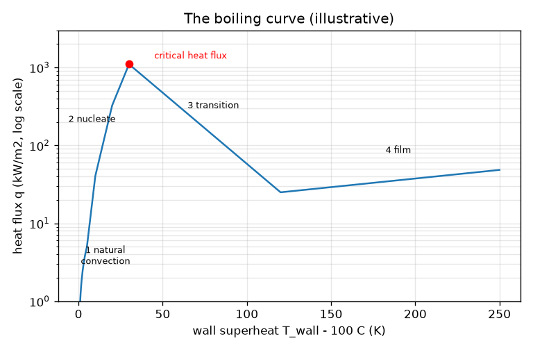
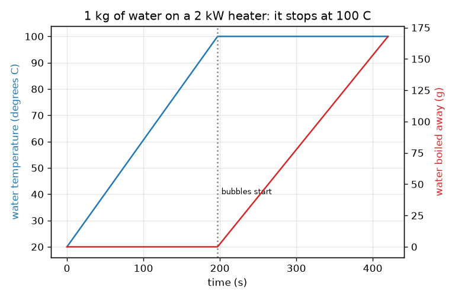

# सत्र 1: पानी का बर्तन 100 C पर क्यों अटक जाता है

*स्तर 1 (वैचारिक इंटरैक्टिव मॉडल) · लगभग 60 मिनट · openboiling*

> यह एक सरलीकृत शैक्षिक मॉडल है। यह कोई प्रमाणित डिज़ाइन उपकरण नहीं है और इसका उपयोग वास्तविक संरचनाओं, विद्युत स्थापनाओं, वाहनों, औद्योगिक प्रक्रियाओं या चिकित्सा संबंधी निर्णयों के लिए नहीं किया जाना चाहिए।

**पूर्वापेक्षाएँ (Prerequisites)**

- अंकगणित और ग्राफ़ पढ़ना।
- आपने PRIMER.md पढ़ लिया है और `python start.py 1` एक बार चला लिया है।

**सीखने के उद्देश्य (Learning objectives)।** इस सत्र के बाद आप:

- समझा सकेंगे कि पानी उबलने पर तापमान बढ़ना क्यों रुक जाता है।
- शक्ति (power) और द्रव्यमान (mass) से क्वथनांक (boiling point) तक पहुँचने का समय और उबलकर उड़ गया द्रव्यमान गणना कर सकेंगे।
- क्वथन वक्र (boiling curve) के चार चरणों के नाम बता सकेंगे और बता सकेंगे कि किसमें बुलबुले होते हैं।
- क्वथनांक से ऊपर सतह के तापमान के सापेक्ष ऊष्मा फ्लक्स (heat flux) का ग्राफ़ पढ़ सकेंगे।

## A. वास्तविक दुनिया की समस्या
आप पानी का एक बर्तन चूल्हे पर रखते हैं। कुछ मिनटों तक वह बस गर्म होता जाता है। फिर तली पर बुलबुले दिखाई देते हैं और तापमान बढ़ना रुक जाता है, जबकि हीटर अब भी ऊर्जा डाल रहा है। ऊर्जा कहाँ जाती है? और बुलबुले पानी के बीच में नहीं, बल्कि गर्म सतह पर ही क्यों बनना शुरू होते हैं? (केवल सामान्य शिक्षा के लिए: यह वास्तविक तापन उपकरण चलाने की सलाह नहीं है।)

## B. अवधारणा और सिद्धांत
ऊष्मा (heat) ऊर्जा है, जिसे जूल (J) में मापा जाता है; शक्ति (power) प्रति सेकंड ऊर्जा है, वाट (W) में। m किलोग्राम पानी को तापमान अंतर dT से गर्म करने के लिए m cp dT ऊर्जा चाहिए, जहाँ cp = 4186 J/(kg K) वह ऊर्जा है जो 1 kg को 1 K गर्म करने के लिए चाहिए। क्वथनांक पर (सामान्य वायुदाब पर 100 C) पानी को भाप में बदलने के लिए प्रति किलोग्राम अतिरिक्त ऊर्जा L = 2.257 million J चाहिए; ऐसा होते समय पानी 100 C पर ही बना रहता है। बुलबुले हीटर की सतह पर बनते हैं क्योंकि धातु को छूने वाला पानी दूर के पानी से अधिक गर्म होता है। अब कल्पना कीजिए कि धातु को क्वथनांक से dT केल्विन ऊपर रखा गया है और उससे निकलने वाला ऊष्मा फ्लक्स q, वाट प्रति वर्ग मीटर में, मापा जा रहा है। क्वथन वक्र q को dT के सापेक्ष दर्शाता है और इसके चार चरण हैं: प्राकृतिक संवहन (natural convection) (कोई बुलबुले नहीं), न्यूक्लिएट क्वथन (nucleate boiling) (बुलबुले, बहुत तेज़ वृद्धि), क्रांतिक ऊष्मा फ्लक्स (critical heat flux) और उसके बाद संक्रमण क्वथन (transition boiling) (फ्लक्स घटता है), और फ़िल्म क्वथन (film boiling) (वाष्प की एक परत सतह को ऊष्मारोधी बना देती है)।

| प्रतीक | अर्थ | इकाई |
|---|---|---|
| m | पानी का द्रव्यमान | kg |
| cp | द्रव पानी की विशिष्ट ऊष्मा (4186) | J/(kg K) |
| L | वाष्पन की गुप्त ऊष्मा (2.257e6) | J/kg |
| P | हीटर की शक्ति | W |
| eta | पानी तक पहुँचने वाली शक्ति का अंश (0.85) | कोई इकाई नहीं |
| dT | क्वथनांक से ऊपर सतह का तापमान | K |
| q | सतह से निकलने वाला ऊष्मा फ्लक्स | W/m2 |

**मान्यताएँ (Assumptions)**

- सामान्य वायुदाब पर पानी, क्वथनांक 100 C।
- पानी का तापमान एकसमान; दक्षता (efficiency) eta के अलावा कमरे में कोई ऊष्मा हानि नहीं।
- क्वथन वक्र की संख्याएँ उदाहरण मात्र हैं; वास्तविक मान सतह पर निर्भर करते हैं।

$$ t_{\mathrm{boil}}=\frac{m\,c_p\,(100-T_0)}{\eta\,P} $$

$$ \dot m_{\mathrm{steam}}=\frac{\eta\,P}{L}\qquad(\text{once the water is at }100\,^\circ\mathrm{C}) $$

$$ q=\frac{\text{heat leaving the surface}}{\text{area}}\quad[\mathrm{W/m^2}] $$

## C. दृश्य व्याख्या
पहला चित्र 2 kW हीटर पर 1 kg पानी दिखाता है: तापमान एक सीधी रेखा में बढ़ता है, फिर 197 s के बाद 100 C पर सपाट हो जाता है, जबकि उबलकर उड़े द्रव्यमान का लाल वक्र ऊपर उठना शुरू करता है। दूसरा चित्र लघुगणकीय (logarithmic) फ्लक्स अक्ष पर क्वथन वक्र है। यह न्यूक्लिएट चरण में तेज़ी से बढ़ता है और 30 K पर लगभग 1100 kW/m2 के शिखर तक पहुँचता है, 120 K पर लगभग 25 kW/m2 के न्यूनतम तक गिरता है और फ़िल्म क्वथन में फिर धीरे-धीरे बढ़ता है। ध्यान दें कि क्वथनांक से 200 K ऊपर की सतह लगभग उतना ही ऊष्मा फ्लक्स वहन करती है जितना केवल 10 K ऊपर की सतह (लगभग 38 और 41 kW/m2)।

*क्वथन वक्र, इसके चार चरण और क्रांतिक ऊष्मा फ्लक्स (उदाहरण के लिए संख्याएँ)।*

*2 kW हीटर पर 1 kg पानी: 197 s के बाद तापमान 100 C पर रुक जाता है जबकि उबलकर उड़ा द्रव्यमान बढ़ता है।*

## D. इंटरैक्टिव सिमुलेशन
पाठ चलाइए (`python start.py 1`), फिर लाइव ऐप खोलिए: [सत्र 1: बर्तन गर्म कीजिए और क्वथन वक्र खोजिए](https://krunalpanchal1995.github.io/pan-iit-oss/openboiling/session-01/) (या इसी फ़ोल्डर में `app.html`)। हीटर की शक्ति बढ़ाइए और क्वथन का समय घटते देखिए; समय स्लाइडर को क्वथनांक से आगे खींचिए और देखिए कि तापमान सपाट हो जाता है और पानी का स्तर घटता है। फिर क्वथन-वक्र दृश्य खोलिए और सतह स्लाइडर को चारों चरणों से गुज़ारिए।

**चुनौती।** गर्म करना शुरू करने के 3 मिनट के भीतर पानी को उबालिए और तब तक गर्म करते रहिए जब तक कम से कम 50 g उबलकर उड़ न जाए।

## E. हल किया गया उदाहरण और प्रयोग
**समस्या।** 20 C पर 1 kg पानी, 2000 W हीटर पर जिसकी दक्षता 0.85 है। यह कब उबलेगा, और 5 मिनट बाद कितना पानी उबलकर उड़ चुका होगा?

1. गर्म करने की ऊर्जा: m cp dT = 1 * 4186 * 80 = 334 880 J।
2. उपयोगी शक्ति: 0.85 * 2000 = 1700 W।
3. उबलने का समय: 334 880 / 1700 = 197 s (3 मिनट 17 सेकंड)।
4. अगले 300 s के दौरान ऊर्जा 1700 * 300 = 510 000 J है, और यह सब भाप बनाने में जाती है।
5. उबलकर उड़ा द्रव्यमान: 510 000 / 2.257e6 = 0.226 kg।

**उत्तर।** यह 197 s के बाद उबलता है; 5 मिनट बाद भी यह 100 C पर है और 226 g (22.6 प्रतिशत) उबलकर उड़ चुका है।

**प्रयोग।** 1 लीटर पानी को ज्ञात शक्ति (लेबल से पढ़िए) वाली प्लेट पर केतली या बर्तन में गर्म कीजिए, तली पर हर जगह बुलबुले दिखने तक का समय नापिए, और 5 मिनट उबालने से पहले और बाद में बर्तन तौलिए। आपको मॉडल के लगभग 20 प्रतिशत के भीतर का समय और मॉडल के करीब द्रव्यमान हानि मिलनी चाहिए। अंतर: असली हीटर कमरे और बर्तन में ऊर्जा खोता है, इसलिए असली दक्षता 0.85 से कम होती है; 100 C से बहुत पहले छोटे हवा के बुलबुले दिखते हैं क्योंकि घुली हुई हवा पानी से बाहर निकलती है, जिसे मॉडल अनदेखा करता है।

## F. मूल्यांकन और डिज़ाइन चुनौती
**प्रश्न प्रकार A: वैचारिक।** पानी उबलने के बाद भी हीटर 2000 W देता रहता है, फिर भी तापमान 100 C पर ही रहता है। ऊर्जा कहाँ जाती है?

संकेत

सोचिए कि बर्तन से क्या बाहर निकलता है।

चरण-दर-चरण हल

यह गुप्त ऊष्मा (latent heat) में जाती है: वह ऊर्जा जो द्रव पानी को भाप में बदलती है। प्रत्येक किलोग्राम के लिए लगभग 2.257 million जूल चाहिए, और भाप वह ऊर्जा अपने साथ ले जाती है। स्थिर दाब पर उबलते पानी का तापमान नहीं बढ़ सकता, इसलिए सारी अतिरिक्त ऊर्जा वाष्प बन जाती है, eta P / L किलोग्राम प्रति सेकंड की दर से।

**प्रश्न प्रकार B: संख्यात्मक।** 20 C पर 1.5 kg पानी, 1800 W हीटर पर (दक्षता 0.85)। उबलने में कितना समय लगेगा, और अगले 2 मिनट में कितना उबलकर उड़ जाएगा?

संकेत

t = m cp dT / (eta P) का उपयोग कीजिए, फिर द्रव्यमान दर eta P / L।

चरण-दर-चरण हल

समय = 1.5 * 4186 * 80 / (0.85 * 1800) = 502 320 / 1530 = 328 s (लगभग 5.5 मिनट)। फिर उबला द्रव्यमान = 0.85 * 1800 * 120 / 2.257e6 = 183 600 / 2.257e6 = 0.081 kg = 81 g। जाँच: 2 मिनट उबालने से पानी का केवल लगभग 5 प्रतिशत निकलता है, जो 328 s के गर्म करने से अपेक्षित मात्रा से बहुत कम है, क्योंकि L, cp का 540 गुना है।

**प्रश्न प्रकार C: ग्राफ़ और सिमुलेशन की व्याख्या।** क्वथन वक्र पर, क्वथनांक से 10 K ऊपर, 60 K ऊपर और 200 K ऊपर की सतहों के ऊष्मा फ्लक्स की तुलना कीजिए। हर एक के चरण का नाम बताइए। क्या आश्चर्यजनक है?

संकेत

क्वथन-वक्र दृश्य के रीडआउट का, या lesson.py द्वारा छापी गई संख्याओं का उपयोग कीजिए।

चरण-दर-चरण हल

10 K: न्यूक्लिएट क्वथन, लगभग 41 kW/m2। 60 K: संक्रमण क्वथन, लगभग 312 kW/m2 (तीनों में सबसे बड़ा, पर शिखर के पार)। 200 K: फ़िल्म क्वथन, लगभग 38 kW/m2। आश्चर्यजनक यह है कि 200 K वाली सतह, जो 190 K अधिक गर्म है, लगभग उतना ही ऊष्मा फ्लक्स वहन करती है जितना 10 K वाली: वाष्प परत उसे ऊष्मारोधी बना देती है। वक्र एकदिष्ट (monotonic) नहीं है।

**प्रश्न प्रकार D: डिज़ाइन और अनुकूलन चुनौती।** डिज़ाइन: ऐसी हीटर शक्ति चुनिए कि 1 लीटर (1 kg) पानी 20 C से 3 मिनट में उबल जाए, फिर बताइए कि उसी शक्ति पर छोड़ देने पर 10 मिनट में आप कितना पानी खो देंगे। उबाल बनाए रखने का बेहतर तरीका सुझाइए।

संकेत

t = m cp dT / (eta P) को P के लिए हल कीजिए, फिर द्रव्यमान दर के लिए eta P / L का उपयोग कीजिए।

चरण-दर-चरण हल

P = 334 880 / (0.85 * 180) = 2189 W, यानी 2.2 kW का हीटर। उसी शक्ति पर छोड़ने पर उबलकर उड़ने की दर 0.85 * 2189 / 2.257e6 = 0.82 g/s है, इसलिए 10 मिनट में लगभग 495 g: आधा पानी। बेहतर: उबाल शुरू होते ही शक्ति कम कर दीजिए। धीमा उबाल बनाए रखने के लिए आपको केवल इतनी शक्ति चाहिए कि ऊष्मा हानियों की पूर्ति हो और आप जितनी भाप स्वीकार करते हैं उतनी बने; उदाहरण के लिए एक चौथाई शक्ति से लगभग एक चौथाई पानी ही खोता है। समझौता (trade-off): तेज़ शुरुआत बनाम पानी की हानि और ऊर्जा का उपयोग। मान्यताएँ: स्थिर दक्षता, कोई ढक्कन नहीं।

[RUBRIC.md](../../RUBRIC.md) से स्वयं को अंक दीजिए। कागज़ पर काम करने के लिए [गतिविधि पत्रक](activity_sheet.md) प्रिंट कीजिए।

## आम भ्रांतियाँ
| आम भ्रांति | वास्तव में क्या सच है |
|---|---|
| पानी इसलिए उबलता है क्योंकि उसे लंबे समय तक गर्म किया गया है। | यह तब उबलता है जब यह क्वथन तापमान तक पहुँचता है; उसके बाद और गर्म करने से अधिक भाप बनती है, अधिक गर्म द्रव नहीं। |
| 100 C से बहुत पहले दिखने वाले बुलबुले का अर्थ है कि पानी पहले ही उबल रहा है। | वे ज़्यादातर घुली हुई हवा है जो विलयन से बाहर आ रही है; असली क्वथन के बुलबुले भाप से भरे होते हैं और पूरी तली पर छा जाते हैं। |
| अधिक गर्म सतह हमेशा पानी में अधिक ऊष्मा पहुँचाती है। | क्रांतिक ऊष्मा फ्लक्स के बाद वाष्प परत के कारण फ्लक्स घटता है; बहुत गर्म सतह मध्यम गर्म सतह से कम ऊष्मा स्थानांतरित कर सकती है। |
| ऊर्जा की दृष्टि से 100 C पर उबलता पानी और 100 C पर भाप एक समान हैं। | भाप में अतिरिक्त गुप्त ऊष्मा होती है, 2.257 million जूल प्रति किलोग्राम, जो उसी पानी को 0 C से 100 C तक गर्म करने की ऊर्जा के पाँच गुना से भी अधिक है। |

## शब्दावली
- **विशिष्ट ऊष्मा (specific heat)**: किसी पदार्थ के 1 kg को 1 K गर्म करने के लिए आवश्यक ऊर्जा (पानी के लिए 4186 J/(kg K))
- **गुप्त ऊष्मा (latent heat)**: स्थिर तापमान पर 1 kg द्रव को वाष्प में बदलने के लिए आवश्यक ऊर्जा
- **ऊष्मा फ्लक्स (heat flux)**: किसी सतह से प्रति सेकंड प्रति इकाई क्षेत्रफल निकलने वाली ऊष्मा, W/m2 में
- **अतिताप (superheat)**: सतह क्वथनांक से कितने केल्विन ऊपर है
- **क्वथन वक्र (boiling curve)**: सतह के अतिताप के सापेक्ष ऊष्मा फ्लक्स का ग्राफ़
- **क्रांतिक ऊष्मा फ्लक्स (critical heat flux)**: क्वथन वक्र का शिखर, सबसे बड़ा फ्लक्स जो न्यूक्लिएट क्वथन वहन कर सकता है

## समापन
1. [exercises.md](exercises.md) में दिए तीन कोडिंग कार्य कीजिए।
2. अपने बदलावों के बाद `python start.py 1` फिर से चलाइए। यह चेकपॉइंट (checkpoint) पर समाप्त होता है; जब यह `PASS` छापे, तो आपका काम पूरा है। (केवल चेकपॉइंट: `python start.py check 1`।)

अगला: [सत्र 2](../session-02/README.md)
