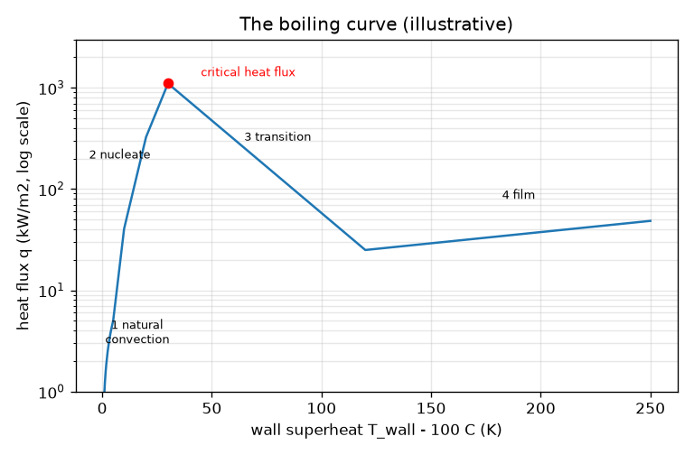
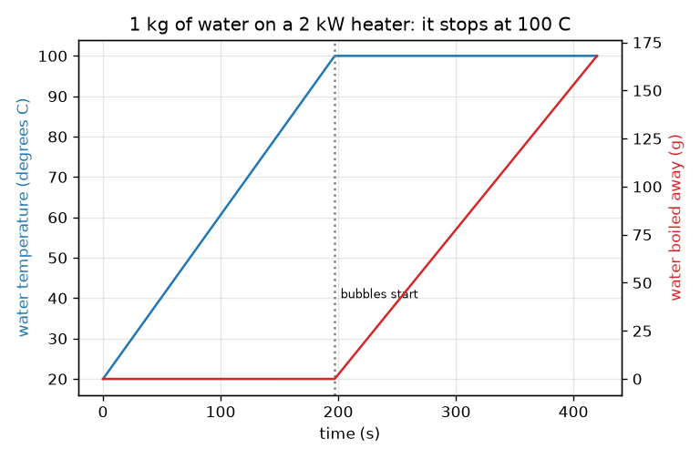

# സെഷൻ 1: ഒരു പാത്രം വെള്ളം 100 C-ൽ കുടുങ്ങിനിൽക്കുന്നത് എന്തുകൊണ്ട്

[Session 1 — हिन्दी](README.hi.md)

*ലെവൽ 1 (ആശയപരമായ ഇന്ററാക്ടീവ് മോഡൽ) · ഏകദേശം 60 മിനിറ്റ് · openboiling*

> ഇത് പഠനാവശ്യത്തിനുള്ള ലളിതമാക്കിയ ഒരു മോഡലാണ്. ഇത് സാധൂകരിക്കപ്പെട്ട ഒരു ഡിസൈൻ ഉപകരണമല്ല; യഥാർത്ഥ ഘടനകൾ, വൈദ്യുത ഇൻസ്റ്റലേഷനുകൾ, വാഹനങ്ങൾ, വ്യാവസായിക പ്രക്രിയകൾ അല്ലെങ്കിൽ വൈദ്യശാസ്ത്ര തീരുമാനങ്ങൾ എന്നിവയ്ക്കായി ഇത് ഉപയോഗിക്കരുത്.

**മുൻ‌അറിവ് (Prerequisites)**

- ഗണിതക്രിയകളും ഗ്രാഫ് വായിക്കാനുള്ള കഴിവും.
- നിങ്ങൾ PRIMER.md വായിച്ചിട്ടുണ്ട്, `python start.py 1` ഒരിക്കൽ റൺ ചെയ്തിട്ടുണ്ട്.

**പഠന ലക്ഷ്യങ്ങൾ (Learning objectives).** ഈ സെഷനു ശേഷം നിങ്ങൾക്ക് കഴിയും:

- വെള്ളം തിളയ്ക്കുമ്പോൾ താപനില ഉയരുന്നത് നിൽക്കുന്നത് എന്തുകൊണ്ടെന്ന് വിശദീകരിക്കാൻ.
- പവറിൽ നിന്നും പിണ്ഡത്തിൽ നിന്നും, തിളനിലയിൽ എത്താനുള്ള സമയവും തിളച്ചുപോയ പിണ്ഡവും കണക്കാക്കാൻ.
- തിളയ്ക്കൽ വക്രത്തിന്റെ (boiling curve) നാല് ഘട്ടങ്ങൾക്ക് പേര് നൽകാനും ഏതിലാണ് കുമിളകൾ ഉള്ളതെന്ന് പറയാനും.
- തിളനിലയ്ക്ക് മുകളിലുള്ള ഉപരിതല താപനിലയ്‌ക്കെതിരെ താപ ഫ്ലക്സിന്റെ (heat flux) ഗ്രാഫ് വായിക്കാൻ.

## A. യഥാർത്ഥ ലോക പ്രശ്നം
നിങ്ങൾ ഒരു പാത്രം വെള്ളം അടുപ്പിൽ വയ്ക്കുന്നു. കുറച്ചു മിനിറ്റുകൾ അത് ചൂടായിക്കൊണ്ടിരിക്കുന്നു. പിന്നെ അടിയിൽ കുമിളകൾ പ്രത്യക്ഷപ്പെടുന്നു, ഹീറ്റർ ഇപ്പോഴും ഊർജ്ജം പകർന്നുകൊണ്ടിരുന്നിട്ടും താപനില ഉയരുന്നത് നിൽക്കുന്നു. ആ ഊർജ്ജം എവിടേക്കാണ് പോകുന്നത്? കുമിളകൾ വെള്ളത്തിന്റെ നടുവിലല്ല, ചൂടുള്ള ഉപരിതലത്തിൽ തുടങ്ങുന്നത് എന്തുകൊണ്ട്? (പൊതുവിദ്യാഭ്യാസത്തിന് മാത്രം: യഥാർത്ഥ ചൂടാക്കൽ ഉപകരണങ്ങൾ പ്രവർത്തിപ്പിക്കുന്നതിനുള്ള ഉപദേശമല്ല ഇത്.)

## B. ആശയവും സിദ്ധാന്തവും
താപം (heat) ഊർജ്ജമാണ്, ജൂളിൽ (J) അളക്കുന്നു; പവർ (power) എന്നത് ഒരു സെക്കൻഡിലെ ഊർജ്ജമാണ്, വാട്ടിൽ (W). m കിലോഗ്രാം വെള്ളം dT താപനില വ്യത്യാസത്തിൽ ചൂടാക്കാൻ m cp dT വേണം; ഇവിടെ cp = 4186 J/(kg K) എന്നത് 1 kg-ന് 1 K ഉയരാൻ എത്ര ഊർജ്ജം വേണമെന്നതാണ്. തിളനിലയിൽ (സാധാരണ വായുമർദ്ദത്തിൽ 100 C) വെള്ളത്തെ നീരാവിയാക്കാൻ ഓരോ കിലോഗ്രാമിനും L = 2.257 ദശലക്ഷം J അധിക ഊർജ്ജം വേണം; ഇത് നടക്കുമ്പോൾ വെള്ളം 100 C-ൽ തന്നെ നിൽക്കുന്നു. ലോഹത്തിൽ തൊടുന്ന വെള്ളം അകലെയുള്ള വെള്ളത്തേക്കാൾ ചൂടുള്ളതിനാൽ കുമിളകൾ ഹീറ്റർ ഉപരിതലത്തിൽ രൂപപ്പെടുന്നു. ഇനി ലോഹത്തെ തിളനിലയ്ക്ക് dT കെൽവിൻ മുകളിൽ പിടിച്ചുനിർത്തി അതിൽ നിന്ന് പുറത്തുപോകുന്ന താപ ഫ്ലക്സ് q, ചതുരശ്ര മീറ്ററിന് വാട്ടിൽ, അളക്കുന്നതായി സങ്കൽപ്പിക്കുക. തിളയ്ക്കൽ വക്രം q-നെ dT-ക്കെതിരെ വരയ്ക്കുന്നു, അതിന് നാല് ഘട്ടങ്ങളുണ്ട്: സ്വാഭാവിക സംവഹനം (natural convection) (കുമിളകളില്ല), ന്യൂക്ലിയേറ്റ് തിളയ്ക്കൽ (nucleate boiling) (കുമിളകൾ, വളരെ കുത്തനെയുള്ള ഉയർച്ച), ക്രിട്ടിക്കൽ താപ ഫ്ലക്സും (critical heat flux) തുടർന്ന് ട്രാൻസിഷൻ തിളയ്ക്കലും (transition boiling) (ഫ്ലക്സ് കുറയുന്നു), ഫിലിം തിളയ്ക്കൽ (film boiling) (ഒരു നീരാവിപ്പുതപ്പ് ഉപരിതലത്തെ ഇൻസുലേറ്റ് ചെയ്യുന്നു).

| ചിഹ്നം | അർത്ഥം | യൂണിറ്റ് |
|---|---|---|
| m | വെള്ളത്തിന്റെ പിണ്ഡം | kg |
| cp | ദ്രാവക ജലത്തിന്റെ വിശിഷ്ട താപം (specific heat) (4186) | J/(kg K) |
| L | ബാഷ്പീകരണ ലീനതാപം (latent heat of vaporisation) (2.257e6) | J/kg |
| P | ഹീറ്റർ പവർ | W |
| eta | വെള്ളത്തിൽ എത്തുന്ന പവറിന്റെ ഭാഗം (0.85) | യൂണിറ്റില്ല |
| dT | തിളനിലയ്ക്ക് മുകളിലുള്ള ഉപരിതല താപനില | K |
| q | ഉപരിതലത്തിൽ നിന്ന് പോകുന്ന താപ ഫ്ലക്സ് | W/m2 |

**അനുമാനങ്ങൾ (Assumptions)**

- സാധാരണ വായുമർദ്ദത്തിലുള്ള വെള്ളം, തിളനില 100 C.
- വെള്ളത്തിന് ഏകീകൃത താപനില; ക്ഷമത (efficiency) eta വഴിയല്ലാതെ മുറിയിലേക്ക് താപനഷ്ടമില്ല.
- തിളയ്ക്കൽ വക്രത്തിലെ സംഖ്യകൾ ഉദാഹരണത്തിനുള്ളവയാണ്; യഥാർത്ഥ മൂല്യങ്ങൾ ഉപരിതലത്തെ ആശ്രയിച്ചിരിക്കുന്നു.

$$ t_{\mathrm{boil}}=\frac{m\,c_p\,(100-T_0)}{\eta\,P} $$

$$ \dot m_{\mathrm{steam}}=\frac{\eta\,P}{L}\qquad(\text{once the water is at }100\,^\circ\mathrm{C}) $$

$$ q=\frac{\text{heat leaving the surface}}{\text{area}}\quad[\mathrm{W/m^2}] $$

## C. ദൃശ്യ വിശദീകരണം
ആദ്യത്തെ ചിത്രം 2 kW ഹീറ്ററിലെ 1 kg വെള്ളം കാണിക്കുന്നു: താപനില ഒരു നേർരേഖയിൽ കയറുന്നു, പിന്നെ 197 s-ന് ശേഷം 100 C-ൽ പരന്നുപോകുന്നു, അതേസമയം തിളച്ചുപോയ പിണ്ഡത്തിന്റെ ചുവന്ന വക്രം ഉയരാൻ തുടങ്ങുന്നു. രണ്ടാമത്തെ ചിത്രം ലോഗരിതമിക് ഫ്ലക്സ് അക്ഷത്തിലുള്ള തിളയ്ക്കൽ വക്രമാണ്. ന്യൂക്ലിയേറ്റ് ഘട്ടത്തിൽ അത് 30 K-ൽ ഏകദേശം 1100 kW/m2 എന്ന ഉച്ചസ്ഥാനം വരെ കുത്തനെ ഉയരുന്നു, 120 K-ൽ ഏകദേശം 25 kW/m2 എന്ന കുറഞ്ഞ നിലയിലേക്ക് താഴുന്നു, ഫിലിം തിളയ്ക്കലിൽ വീണ്ടും പതുക്കെ ഉയരുന്നു. തിളനിലയ്ക്ക് 200 K മുകളിലുള്ള ഉപരിതലം വെറും 10 K മുകളിലുള്ള ഒന്നിന്റെ ഏകദേശം അതേ താപ ഫ്ലക്സ് വഹിക്കുന്നു എന്നത് ശ്രദ്ധിക്കുക (ഏകദേശം 38, 41 kW/m2).

*നാല് ഘട്ടങ്ങളും ക്രിട്ടിക്കൽ താപ ഫ്ലക്സും ഉള്ള തിളയ്ക്കൽ വക്രം (ഉദാഹരണ സംഖ്യകൾ).*

*2 kW ഹീറ്ററിലെ 1 kg വെള്ളം: 197 s-ന് ശേഷം താപനില 100 C-ൽ നിൽക്കുന്നു, തിളച്ചുപോയ പിണ്ഡം വർദ്ധിക്കുന്നു.*

## D. ഇന്ററാക്ടീവ് സിമുലേഷൻ
പാഠം റൺ ചെയ്യുക (`python start.py 1`), എന്നിട്ട് ലൈവ് ആപ്പ് തുറക്കുക: [സെഷൻ 1: പാത്രം ചൂടാക്കി തിളയ്ക്കൽ വക്രം കണ്ടെത്തുക](https://krunalpanchal1995.github.io/pan-iit-oss/openboiling/session-01/) (അല്ലെങ്കിൽ ഈ ഫോൾഡറിലെ `app.html`). ഹീറ്റർ പവർ കൂട്ടി തിളയ്ക്കാനുള്ള സമയം കുറയുന്നത് കാണുക; സമയ സ്ലൈഡർ തിളനിലയ്ക്കപ്പുറം വലിച്ച് താപനില പരന്നുപോകുന്നതും ജലനിരപ്പ് താഴുന്നതും കാണുക. പിന്നെ തിളയ്ക്കൽ-വക്ര വ്യൂ തുറന്ന് ഉപരിതല സ്ലൈഡർ നാല് ഘട്ടങ്ങളിലൂടെയും നീക്കുക.

**വെല്ലുവിളി.** ചൂടാക്കി 3 മിനിറ്റിനുള്ളിൽ വെള്ളം തിളപ്പിക്കുക, കുറഞ്ഞത് 50 g തിളച്ചുപോകുന്നതുവരെ ചൂടാക്കൽ തുടരുക.

## E. ചെയ്തുകാണിച്ച ഉദാഹരണവും പരീക്ഷണവും
**പ്രശ്നം.** 20 C-ലുള്ള 1 kg വെള്ളം 0.85 ക്ഷമതയുള്ള 2000 W ഹീറ്ററിൽ. എപ്പോൾ തിളയ്ക്കും, 5 മിനിറ്റിന് ശേഷം എത്ര വെള്ളം തിളച്ചുപോയിരിക്കും?

1. ചൂടാക്കാനുള്ള ഊർജ്ജം: m cp dT = 1 * 4186 * 80 = 334 880 J.
2. ഉപയോഗപ്രദമായ പവർ: 0.85 * 2000 = 1700 W.
3. തിളയ്ക്കാനുള്ള സമയം: 334 880 / 1700 = 197 s (3 മിനിറ്റ് 17 സെക്കൻഡ്).
4. അടുത്ത 300 s-ൽ ഊർജ്ജം 1700 * 300 = 510 000 J, അതെല്ലാം നീരാവി ഉണ്ടാക്കുന്നു.
5. തിളച്ചുപോയ പിണ്ഡം: 510 000 / 2.257e6 = 0.226 kg.

**ഉത്തരം.** 197 s-ന് ശേഷം അത് തിളയ്ക്കുന്നു; 5 മിനിറ്റിന് ശേഷവും അത് 100 C-ൽ തന്നെയാണ്, 226 g (22.6 ശതമാനം) തിളച്ചുപോയിരിക്കുന്നു.

**പരീക്ഷണം.** അറിയാവുന്ന പവറുള്ള (ലേബലിൽ നിന്ന് വായിക്കുക) ഒരു പ്ലേറ്റിൽ കെറ്റിലിലോ പാത്രത്തിലോ 1 ലിറ്റർ വെള്ളം ചൂടാക്കുക, അടിയിലെല്ലായിടത്തും കുമിളകൾ പ്രത്യക്ഷപ്പെടുന്നതുവരെയുള്ള സമയം അളക്കുക, 5 മിനിറ്റ് തിളപ്പിക്കുന്നതിന് മുമ്പും ശേഷവും പാത്രം തൂക്കുക. മോഡലിന്റെ ഏകദേശം 20 ശതമാനത്തിനുള്ളിൽ ഒരു സമയവും മോഡലിനോട് അടുത്ത ഒരു പിണ്ഡനഷ്ടവും നിങ്ങൾ കണ്ടെത്തണം. വ്യത്യാസങ്ങൾ: യഥാർത്ഥ ഹീറ്റർ മുറിയിലേക്കും പാത്രത്തിലേക്കും ഊർജ്ജം നഷ്ടപ്പെടുത്തുന്നു, അതിനാൽ യഥാർത്ഥ ക്ഷമത 0.85-നേക്കാൾ കുറവാണ്; ലയിച്ചിരിക്കുന്ന വായു വെള്ളത്തിൽ നിന്ന് പുറത്തുവരുന്നതിനാൽ 100 C-ന് വളരെ മുമ്പുതന്നെ ചെറിയ വായുക്കുമിളകൾ പ്രത്യക്ഷപ്പെടുന്നു, മോഡൽ ഇത് അവഗണിക്കുന്നു.

## F. മൂല്യനിർണ്ണയവും ഡിസൈൻ വെല്ലുവിളിയും
**ചോദ്യ തരം A: ആശയപരം.** വെള്ളം തിളയ്ക്കാൻ തുടങ്ങിയ ശേഷവും ഹീറ്റർ 2000 W നൽകിക്കൊണ്ടിരിക്കുന്നു, എന്നിട്ടും താപനില 100 C-ൽ നിൽക്കുന്നു. ഊർജ്ജം എവിടേക്ക് പോകുന്നു?

സൂചന

പാത്രത്തിൽ നിന്ന് എന്താണ് പുറത്തുപോകുന്നതെന്ന് ചിന്തിക്കുക.

പടിപടിയായുള്ള പരിഹാരം

അത് ലീനതാപത്തിലേക്ക് പോകുന്നു: ദ്രാവക ജലത്തെ നീരാവിയാക്കുന്ന ഊർജ്ജം. ഓരോ കിലോഗ്രാമിനും ഏകദേശം 2.257 ദശലക്ഷം ജൂൾ വേണം, നീരാവി ആ ഊർജ്ജം കൊണ്ടുപോകുന്നു. സ്ഥിരമർദ്ദത്തിൽ തിളയ്ക്കുന്ന വെള്ളത്തിന്റെ താപനില ഉയരാൻ കഴിയില്ല, അതിനാൽ അധിക ഊർജ്ജമെല്ലാം സെക്കൻഡിൽ eta P / L കിലോഗ്രാം നിരക്കിൽ നീരാവിയാകുന്നു.

**ചോദ്യ തരം B: സംഖ്യാപരം.** 20 C-ലുള്ള 1.5 kg വെള്ളം 1800 W ഹീറ്ററിൽ (ക്ഷമത 0.85). തിളയ്ക്കാൻ എത്ര സമയം, അടുത്ത 2 മിനിറ്റിൽ എത്ര തിളച്ചുപോകും?

സൂചന

t = m cp dT / (eta P) ഉപയോഗിക്കുക, പിന്നെ പിണ്ഡനിരക്ക് eta P / L.

പടിപടിയായുള്ള പരിഹാരം

സമയം = 1.5 * 4186 * 80 / (0.85 * 1800) = 502 320 / 1530 = 328 s (ഏകദേശം 5.5 മിനിറ്റ്). പിന്നെ തിളച്ച പിണ്ഡം = 0.85 * 1800 * 120 / 2.257e6 = 183 600 / 2.257e6 = 0.081 kg = 81 g. യുക്തിപരിശോധന: 2 മിനിറ്റ് തിളയ്ക്കൽ വെള്ളത്തിന്റെ ഏകദേശം 5 ശതമാനം മാത്രമേ നീക്കം ചെയ്യുന്നുള്ളൂ, 328 s ചൂടാക്കൽ സൂചിപ്പിക്കുന്നതിനേക്കാൾ വളരെ കുറവ്, കാരണം L, cp-യുടെ 540 മടങ്ങാണ്.

**ചോദ്യ തരം C: ഗ്രാഫ്, സിമുലേഷൻ വ്യാഖ്യാനം.** തിളയ്ക്കൽ വക്രത്തിൽ, തിളനിലയ്ക്ക് 10 K മുകളിലും 60 K മുകളിലും 200 K മുകളിലും ഉള്ള ഉപരിതലങ്ങളുടെ താപ ഫ്ലക്സ് താരതമ്യം ചെയ്യുക. ഓരോന്നിന്റെയും ഘട്ടത്തിന് പേര് നൽകുക. എന്താണ് ആശ്ചര്യകരം?

സൂചന

തിളയ്ക്കൽ-വക്ര വ്യൂവിലെ റീഡൗട്ടോ lesson.py പ്രിന്റ് ചെയ്യുന്ന സംഖ്യകളോ ഉപയോഗിക്കുക.

പടിപടിയായുള്ള പരിഹാരം

10 K: ന്യൂക്ലിയേറ്റ് തിളയ്ക്കൽ, ഏകദേശം 41 kW/m2. 60 K: ട്രാൻസിഷൻ തിളയ്ക്കൽ, ഏകദേശം 312 kW/m2 (മൂന്നിൽ ഏറ്റവും വലുത്, പക്ഷേ ഉച്ചസ്ഥാനം കഴിഞ്ഞു). 200 K: ഫിലിം തിളയ്ക്കൽ, ഏകദേശം 38 kW/m2. 190 K കൂടുതൽ ചൂടുള്ള 200 K-ലെ ഉപരിതലം 10 K-ലേതിന്റെ ഏകദേശം അതേ താപ ഫ്ലക്സ് വഹിക്കുന്നു എന്നത് ആശ്ചര്യകരമാണ്: നീരാവിപ്പുതപ്പ് അതിനെ ഇൻസുലേറ്റ് ചെയ്യുന്നു. വക്രം ഏകദിശാപരമല്ല (not monotonic).

**ചോദ്യ തരം D: ഡിസൈൻ, ഒപ്റ്റിമൈസേഷൻ വെല്ലുവിളി.** ഡിസൈൻ: 20 C-ൽ നിന്ന് 1 ലിറ്റർ (1 kg) വെള്ളം 3 മിനിറ്റിൽ തിളയ്ക്കുന്ന തരത്തിൽ ഒരു ഹീറ്റർ പവർ തിരഞ്ഞെടുക്കുക, പിന്നെ ആ പവറിൽ വിട്ടാൽ 10 മിനിറ്റിൽ എത്ര വെള്ളം നഷ്ടപ്പെടുമെന്ന് പറയുക. തിളയ്ക്കൽ നിലനിർത്താൻ മെച്ചപ്പെട്ട ഒരു മാർഗം നിർദ്ദേശിക്കുക.

സൂചന

t = m cp dT / (eta P) എന്നതിൽ നിന്ന് P കണ്ടെത്തുക, പിന്നെ പിണ്ഡനിരക്കിന് eta P / L ഉപയോഗിക്കുക.

പടിപടിയായുള്ള പരിഹാരം

P = 334 880 / (0.85 * 180) = 2189 W, അതായത് 2.2 kW ഹീറ്റർ. ആ പവറിൽ വിട്ടാൽ, തിളച്ചുപോകൽ നിരക്ക് 0.85 * 2189 / 2.257e6 = 0.82 g/s, അതിനാൽ 10 മിനിറ്റിൽ ഏകദേശം 495 g: വെള്ളത്തിന്റെ പകുതി. മെച്ചപ്പെട്ടത്: തിളയ്ക്കൽ തുടങ്ങിയാൽ പവർ കുറയ്ക്കുക. മൃദുവായ തിളയ്ക്കൽ നിലനിർത്താൻ താപനഷ്ടങ്ങളും നിങ്ങൾ അംഗീകരിക്കുന്ന നീരാവിയും നികത്താൻ മാത്രം പവർ മതി, ഉദാഹരണത്തിന് നാലിലൊന്ന് പവർ ഏകദേശം നാലിലൊന്ന് വെള്ളം മാത്രമേ നഷ്ടപ്പെടുത്തൂ. വിട്ടുവീഴ്ച (trade-off): വേഗത്തിലുള്ള തുടക്കം ഒരു വശത്ത്, ജലനഷ്ടവും ഊർജ്ജ ഉപയോഗവും മറുവശത്ത്. അനുമാനങ്ങൾ: സ്ഥിരമായ ക്ഷമത, മൂടിയില്ല.

[RUBRIC.md](../../RUBRIC.md) ഉപയോഗിച്ച് സ്വയം സ്കോർ ചെയ്യുക. കടലാസിൽ പ്രവർത്തിക്കാൻ [ആക്ടിവിറ്റി ഷീറ്റ്](activity_sheet.md) പ്രിന്റ് ചെയ്യുക.

## സാധാരണ തെറ്റിദ്ധാരണകൾ
| സാധാരണ തെറ്റിദ്ധാരണ | യഥാർത്ഥത്തിൽ ശരിയായത് |
|---|---|
| ദീർഘനേരം ചൂടാക്കിയതിനാലാണ് വെള്ളം തിളയ്ക്കുന്നത്. | തിളനിലയിൽ എത്തുമ്പോഴാണ് അത് തിളയ്ക്കുന്നത്; അതിനുശേഷം കൂടുതൽ ചൂടാക്കൽ കൂടുതൽ നീരാവി ഉണ്ടാക്കുന്നു, കൂടുതൽ ചൂടുള്ള ദ്രാവകമല്ല. |
| 100 C-ന് വളരെ മുമ്പ് പ്രത്യക്ഷപ്പെടുന്ന കുമിളകൾ വെള്ളം ഇതിനകം തിളയ്ക്കുന്നു എന്നാണ് അർത്ഥമാക്കുന്നത്. | അവ മിക്കവാറും ലായനിയിൽ നിന്ന് പുറത്തുവരുന്ന ലയിച്ച വായുവാണ്; യഥാർത്ഥ തിളയ്ക്കൽ കുമിളകൾ നീരാവി നിറഞ്ഞവയാണ്, അടിഭാഗം മുഴുവൻ നിറയ്ക്കുന്നു. |
| കൂടുതൽ ചൂടുള്ള ഉപരിതലം എപ്പോഴും വെള്ളത്തിലേക്ക് കൂടുതൽ താപം കൊണ്ടുപോകുന്നു. | ക്രിട്ടിക്കൽ താപ ഫ്ലക്സ് കഴിഞ്ഞാൽ നീരാവിപ്പുതപ്പ് ഫ്ലക്സ് കുറയ്ക്കുന്നു; വളരെ ചൂടുള്ള ഉപരിതലത്തിന് മിതമായി ചൂടുള്ളതിനേക്കാൾ കുറവ് താപം കൈമാറാൻ കഴിയും. |
| ഊർജ്ജത്തിന്റെ കാര്യത്തിൽ 100 C-ലെ തിളയ്ക്കുന്ന വെള്ളവും 100 C-ലെ നീരാവിയും ഒന്നുതന്നെ. | നീരാവി അധിക ലീനതാപം, കിലോഗ്രാമിന് 2.257 ദശലക്ഷം ജൂൾ, സൂക്ഷിക്കുന്നു; അതേ വെള്ളം 0 C-ൽ നിന്ന് 100 C-ലേക്ക് ചൂടാക്കാൻ വേണ്ട ഊർജ്ജത്തിന്റെ അഞ്ചിരട്ടിയിലധികം. |

## പദാവലി
- **വിശിഷ്ട താപം (specific heat)**: ഒരു വസ്തുവിന്റെ 1 kg 1 K ചൂടാക്കാൻ വേണ്ട ഊർജ്ജം (വെള്ളത്തിന് 4186 J/(kg K))
- **ലീനതാപം (latent heat)**: സ്ഥിര താപനിലയിൽ 1 kg ദ്രാവകത്തെ ബാഷ്പമാക്കാൻ വേണ്ട ഊർജ്ജം
- **താപ ഫ്ലക്സ് (heat flux)**: ഒരു ഉപരിതലത്തിൽ നിന്ന് യൂണിറ്റ് വിസ്തീർണ്ണത്തിൽ സെക്കൻഡിൽ പോകുന്ന താപം, W/m2-ൽ
- **സൂപ്പർഹീറ്റ് (superheat)**: ഉപരിതലം തിളനിലയ്ക്ക് എത്ര കെൽവിൻ മുകളിലാണ്
- **തിളയ്ക്കൽ വക്രം (boiling curve)**: ഉപരിതല സൂപ്പർഹീറ്റിനെതിരെ താപ ഫ്ലക്സിന്റെ ഗ്രാഫ്
- **ക്രിട്ടിക്കൽ താപ ഫ്ലക്സ് (critical heat flux)**: തിളയ്ക്കൽ വക്രത്തിന്റെ ഉച്ചസ്ഥാനം, ന്യൂക്ലിയേറ്റ് തിളയ്ക്കലിന് വഹിക്കാൻ കഴിയുന്ന ഏറ്റവും വലിയ ഫ്ലക്സ്

## പൂർത്തിയാക്കുക
1. [exercises.md](exercises.md)-ലെ മൂന്ന് കോഡിംഗ് ജോലികൾ ചെയ്യുക.
2. നിങ്ങളുടെ മാറ്റങ്ങൾക്ക് ശേഷം `python start.py 1` വീണ്ടും റൺ ചെയ്യുക. അത് ചെക്ക്‌പോയിന്റോടെ അവസാനിക്കുന്നു; അത് `PASS` എന്ന് പ്രിന്റ് ചെയ്യുമ്പോൾ നിങ്ങൾ പൂർത്തിയാക്കി. (ചെക്ക്‌പോയിന്റ് മാത്രം: `python start.py check 1`.)

അടുത്തത്: [സെഷൻ 2](../session-02/README.md)
