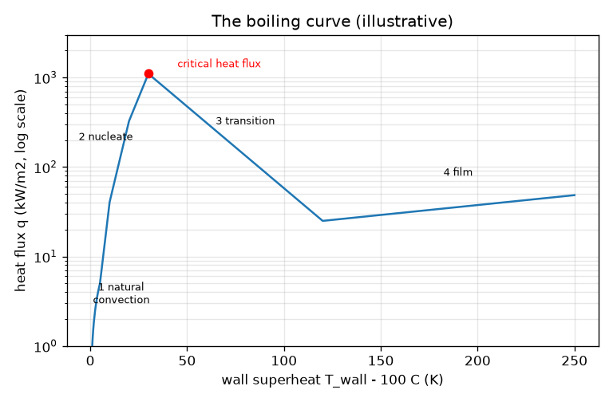
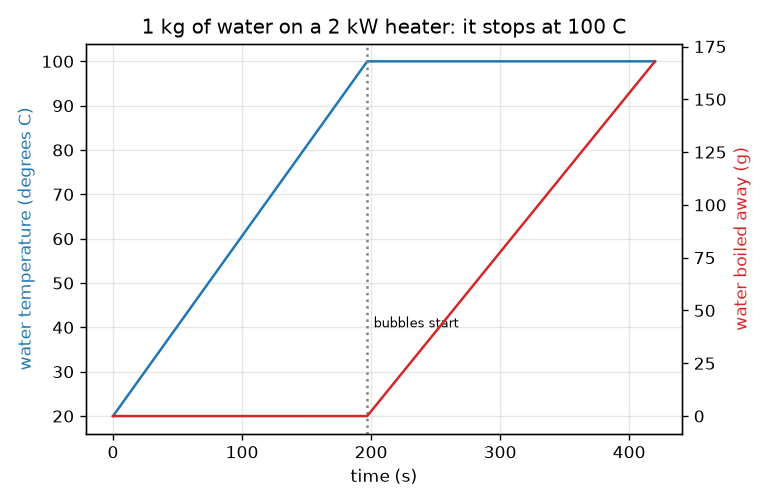

# அமர்வு 1: ஒரு பாத்திரத் தண்ணீர் ஏன் 100 C-இல் சிக்கிக்கொள்கிறது

[Session 1 — हिन्दी](README.hi.md) · [Session 1 — മലയാളം](README.ml.md)

*நிலை 1 (கருத்தியல் ஊடாடும் மாதிரி) · சுமார் 60 நிமிடங்கள் · openboiling*

> இது கல்விக்கான எளிமைப்படுத்தப்பட்ட மாதிரி. இது சரிபார்க்கப்பட்ட வடிவமைப்புக் கருவி அல்ல; உண்மையான கட்டமைப்புகள், மின் நிறுவல்கள், வாகனங்கள், தொழில்துறை செயல்முறைகள் அல்லது மருத்துவ முடிவுகளுக்கு இதைப் பயன்படுத்தக் கூடாது.

**முன்தேவைகள் (Prerequisites)**

- எண்கணிதமும் வரைபடம் படிப்பதும்.
- நீங்கள் PRIMER.md படித்து, `python start.py 1` ஒருமுறை இயக்கியுள்ளீர்கள்.

**கற்றல் நோக்கங்கள் (Learning objectives).** இந்த அமர்வுக்குப் பிறகு நீங்கள்:

- தண்ணீர் கொதிக்கும்போது வெப்பநிலை ஏன் உயர்வதை நிறுத்துகிறது என்று விளக்க முடியும்.
- திறன் மற்றும் நிறையிலிருந்து, கொதிநிலையை அடையும் நேரத்தையும் கொதித்து ஆவியான நிறையையும் கணக்கிட முடியும்.
- கொதிநிலை வளைவின் (boiling curve) நான்கு நிலைகளைப் பெயரிட்டு எதில் குமிழ்கள் உள்ளன என்று சொல்ல முடியும்.
- கொதிநிலைக்கு மேலுள்ள மேற்பரப்பு வெப்பநிலைக்கு எதிரான வெப்பப் பாய்வின் (heat flux) வரைபடத்தைப் படிக்க முடியும்.

## A. நிஜ உலகப் பிரச்சினை
நீங்கள் ஒரு பாத்திரத் தண்ணீரை அடுப்பில் வைக்கிறீர்கள். சில நிமிடங்கள் அது சூடாகிக்கொண்டே இருக்கிறது. பிறகு அடியில் குமிழ்கள் தோன்றுகின்றன, ஹீட்டர் இன்னும் ஆற்றலைக் கொட்டிக்கொண்டிருந்தாலும் வெப்பநிலை உயர்வது நின்றுவிடுகிறது. அந்த ஆற்றல் எங்கே போகிறது? குமிழ்கள் ஏன் தண்ணீரின் நடுவில் அல்லாமல் சூடான மேற்பரப்பில் தொடங்குகின்றன? (பொதுக் கல்விக்கு மட்டும்: இது உண்மையான வெப்பமூட்டும் உபகரணங்களை இயக்குவதற்கான ஆலோசனை அல்ல.)

## B. கருத்தும் கோட்பாடும்
வெப்பம் (heat) என்பது ஆற்றல், ஜூல்களில் (J) அளக்கப்படுகிறது; திறன் (power) என்பது வினாடிக்கான ஆற்றல், வாட்களில் (W). m கிலோகிராம் தண்ணீரை dT வெப்பநிலை வேறுபாட்டால் சூடாக்க m cp dT தேவை; இங்கு cp = 4186 J/(kg K) என்பது 1 kg-க்கு 1 K உயர எவ்வளவு ஆற்றல் தேவை என்பதாகும். கொதிநிலையில் (சாதாரண காற்றழுத்தத்தில் 100 C) தண்ணீரை நீராவியாக மாற்ற ஒவ்வொரு கிலோகிராமுக்கும் L = 2.257 மில்லியன் J கூடுதல் ஆற்றல் தேவை; இது நடக்கும்போது தண்ணீர் 100 C-இலேயே இருக்கிறது. உலோகத்தைத் தொடும் தண்ணீர் தொலைவிலுள்ள தண்ணீரை விடச் சூடாக இருப்பதால் குமிழ்கள் ஹீட்டர் மேற்பரப்பில் உருவாகின்றன. இப்போது உலோகத்தைக் கொதிநிலைக்கு dT கெல்வின் மேலே வைத்திருந்து, அதிலிருந்து வெளியேறும் வெப்பப் பாய்வு q-ஐ, சதுர மீட்டருக்கு வாட்களில், அளப்பதாகக் கற்பனை செய்யுங்கள். கொதிநிலை வளைவு q-ஐ dT-க்கு எதிராக வரைகிறது, அதற்கு நான்கு நிலைகள் உள்ளன: இயற்கை வெப்பச்சலனம் (natural convection) (குமிழ்கள் இல்லை), கருவாக்கக் கொதிப்பு (nucleate boiling) (குமிழ்கள், மிகச் செங்குத்தான உயர்வு), மாறுநிலை வெப்பப் பாய்வு (critical heat flux) அதைத் தொடர்ந்து இடைநிலைக் கொதிப்பு (transition boiling) (பாய்வு குறைகிறது), மற்றும் படலக் கொதிப்பு (film boiling) (ஒரு நீராவிப் போர்வை மேற்பரப்பைக் காப்பிடுகிறது).

| குறியீடு | பொருள் | அலகு |
|---|---|---|
| m | தண்ணீரின் நிறை | kg |
| cp | திரவ நீரின் தன்வெப்பம் (specific heat) (4186) | J/(kg K) |
| L | ஆவியாதல் உள்ளுறை வெப்பம் (latent heat of vaporisation) (2.257e6) | J/kg |
| P | ஹீட்டர் திறன் | W |
| eta | தண்ணீரை அடையும் திறனின் பின்னம் (0.85) | அலகு இல்லை |
| dT | கொதிநிலைக்கு மேலுள்ள மேற்பரப்பு வெப்பநிலை | K |
| q | மேற்பரப்பிலிருந்து வெளியேறும் வெப்பப் பாய்வு | W/m2 |

**அனுமானங்கள் (Assumptions)**

- சாதாரண காற்றழுத்தத்தில் தண்ணீர், கொதிநிலை 100 C.
- சீரான நீர் வெப்பநிலை; செயல்திறன் (efficiency) eta வழியாகத் தவிர அறைக்கு வெப்ப இழப்பு இல்லை.
- கொதிநிலை வளைவின் எண்கள் விளக்கத்துக்கானவை; உண்மையான மதிப்புகள் மேற்பரப்பைப் பொறுத்தவை.

$$ t_{\mathrm{boil}}=\frac{m\,c_p\,(100-T_0)}{\eta\,P} $$

$$ \dot m_{\mathrm{steam}}=\frac{\eta\,P}{L}\qquad(\text{once the water is at }100\,^\circ\mathrm{C}) $$

$$ q=\frac{\text{heat leaving the surface}}{\text{area}}\quad[\mathrm{W/m^2}] $$

## C. காட்சி விளக்கம்
முதல் படம் 2 kW ஹீட்டரில் 1 kg தண்ணீரைக் காட்டுகிறது: வெப்பநிலை ஒரு நேர்கோட்டில் ஏறுகிறது, பிறகு 197 s-க்குப் பின் 100 C-இல் தட்டையாகிறது, அதே நேரத்தில் கொதித்து ஆவியான நிறையின் சிவப்பு வளைவு உயரத் தொடங்குகிறது. இரண்டாவது படம் மடக்கை (logarithmic) பாய்வு அச்சில் கொதிநிலை வளைவு. கருவாக்க நிலையில் அது 30 K-இல் சுமார் 1100 kW/m2 உச்சம் வரை செங்குத்தாக உயர்கிறது, 120 K-இல் சுமார் 25 kW/m2 என்ற குறைந்தபட்சத்துக்கு இறங்குகிறது, படலக் கொதிப்பில் மீண்டும் மெதுவாக உயர்கிறது. கொதிநிலைக்கு 200 K மேலுள்ள மேற்பரப்பு வெறும் 10 K மேலுள்ள ஒன்றின் ஏறக்குறைய அதே வெப்பப் பாய்வைக் கொண்டு செல்கிறது என்பதைக் கவனியுங்கள் (சுமார் 38 மற்றும் 41 kW/m2).

*நான்கு நிலைகளும் மாறுநிலை வெப்பப் பாய்வும் கொண்ட கொதிநிலை வளைவு (விளக்க எண்கள்).*

*2 kW ஹீட்டரில் 1 kg தண்ணீர்: 197 s-க்குப் பின் வெப்பநிலை 100 C-இல் நிற்கிறது, கொதித்து ஆவியான நிறை வளர்கிறது.*

## D. ஊடாடும் உருவகப்படுத்தல்
பாடத்தை இயக்குங்கள் (`python start.py 1`), பிறகு நேரடிச் செயலியைத் திறங்கள்: [அமர்வு 1: பாத்திரத்தைச் சூடாக்கி கொதிநிலை வளைவைக் கண்டறியுங்கள்](https://krunalpanchal1995.github.io/pan-iit-oss/openboiling/session-01/) (அல்லது இந்தக் கோப்புறையிலுள்ள `app.html`). ஹீட்டர் திறனை உயர்த்தி கொதிக்கும் நேரம் குறைவதைப் பாருங்கள்; நேர ஸ்லைடரைக் கொதிநிலையைத் தாண்டி இழுத்து வெப்பநிலை தட்டையாவதையும் நீர்மட்டம் இறங்குவதையும் பாருங்கள். பிறகு கொதிநிலை-வளைவுக் காட்சியைத் திறந்து மேற்பரப்பு ஸ்லைடரை நான்கு நிலைகள் வழியாகவும் நகர்த்துங்கள்.

**சவால்.** சூடாக்கத் தொடங்கி 3 நிமிடங்களுக்குள் தண்ணீரைக் கொதிக்க வைத்து, குறைந்தது 50 g கொதித்து ஆவியாகும் வரை சூடாக்குவதைத் தொடருங்கள்.

## E. தீர்க்கப்பட்ட எடுத்துக்காட்டும் பரிசோதனையும்
**பிரச்சினை.** 20 C-இல் உள்ள 1 kg தண்ணீர், 0.85 செயல்திறனுள்ள 2000 W ஹீட்டரில். எப்போது கொதிக்கும், 5 நிமிடங்களுக்குப் பிறகு எவ்வளவு தண்ணீர் கொதித்து ஆவியாகியிருக்கும்?

1. சூடாக்கத் தேவையான ஆற்றல்: m cp dT = 1 * 4186 * 80 = 334 880 J.
2. பயனுள்ள திறன்: 0.85 * 2000 = 1700 W.
3. கொதிக்கும் நேரம்: 334 880 / 1700 = 197 s (3 நிமிடம் 17 வினாடி).
4. அடுத்த 300 s-இல் ஆற்றல் 1700 * 300 = 510 000 J, அனைத்தும் நீராவியை உருவாக்குகிறது.
5. கொதித்து ஆவியான நிறை: 510 000 / 2.257e6 = 0.226 kg.

**விடை.** 197 s-க்குப் பின் அது கொதிக்கிறது; 5 நிமிடங்கள் கழித்தும் அது 100 C-இலேயே உள்ளது, 226 g (22.6 சதவீதம்) கொதித்து ஆவியாகியுள்ளது.

**பரிசோதனை.** தெரிந்த திறன் கொண்ட (லேபிளில் படியுங்கள்) ஒரு தட்டில் கெட்டில் அல்லது பாத்திரத்தில் 1 லிட்டர் தண்ணீரைச் சூடாக்குங்கள், அடிப்பகுதி முழுவதும் குமிழ்கள் தோன்றும் வரையிலான நேரத்தை அளவிடுங்கள், 5 நிமிடக் கொதிப்புக்கு முன்னும் பின்னும் பாத்திரத்தை எடைபோடுங்கள். மாதிரியின் சுமார் 20 சதவீதத்துக்குள் ஒரு நேரத்தையும் மாதிரிக்கு நெருக்கமான நிறை இழப்பையும் நீங்கள் காண வேண்டும். வேறுபாடுகள்: உண்மையான ஹீட்டர் அறைக்கும் பாத்திரத்துக்கும் ஆற்றலை இழக்கிறது, எனவே உண்மையான செயல்திறன் 0.85-ஐ விடக் குறைவு; கரைந்துள்ள காற்று தண்ணீரிலிருந்து வெளியேறுவதால் 100 C-க்கு வெகு முன்பே சிறிய காற்றுக் குமிழ்கள் தோன்றுகின்றன, இதை மாதிரி புறக்கணிக்கிறது.

## F. மதிப்பீடும் வடிவமைப்புச் சவாலும்
**கேள்வி வகை A: கருத்தியல்.** தண்ணீர் கொதிக்கத் தொடங்கிய பின்னும் ஹீட்டர் 2000 W தந்துகொண்டிருக்கிறது, ஆனாலும் வெப்பநிலை 100 C-இலேயே உள்ளது. ஆற்றல் எங்கே போகிறது?

குறிப்பு

பாத்திரத்திலிருந்து என்ன வெளியேறுகிறது என்று சிந்தியுங்கள்.

படிப்படியான தீர்வு

அது உள்ளுறை வெப்பத்துக்குப் போகிறது: திரவ நீரை நீராவியாக மாற்றும் ஆற்றல். ஒவ்வொரு கிலோகிராமுக்கும் சுமார் 2.257 மில்லியன் ஜூல்கள் தேவை, நீராவி அந்த ஆற்றலைக் கொண்டு செல்கிறது. நிலையான அழுத்தத்தில் கொதிக்கும் தண்ணீரின் வெப்பநிலை உயர முடியாது, எனவே கூடுதல் ஆற்றல் முழுவதும் வினாடிக்கு eta P / L கிலோகிராம் வீதத்தில் ஆவியாகிறது.

**கேள்வி வகை B: எண்ணியல்.** 20 C-இல் உள்ள 1.5 kg தண்ணீர் 1800 W ஹீட்டரில் (செயல்திறன் 0.85). கொதிக்க எவ்வளவு நேரம், அடுத்த 2 நிமிடங்களில் எவ்வளவு கொதித்து ஆவியாகும்?

குறிப்பு

t = m cp dT / (eta P) பயன்படுத்துங்கள், பிறகு நிறை வீதம் eta P / L.

படிப்படியான தீர்வு

நேரம் = 1.5 * 4186 * 80 / (0.85 * 1800) = 502 320 / 1530 = 328 s (சுமார் 5.5 நிமிடங்கள்). பிறகு கொதித்த நிறை = 0.85 * 1800 * 120 / 2.257e6 = 183 600 / 2.257e6 = 0.081 kg = 81 g. சரிபார்ப்பு: 2 நிமிடக் கொதிப்பு தண்ணீரின் சுமார் 5 சதவீதத்தை மட்டுமே நீக்குகிறது, 328 s சூடாக்கல் சுட்டுவதை விட மிகக் குறைவு, ஏனெனில் L என்பது cp-இன் 540 மடங்கு.

**கேள்வி வகை C: வரைபடம் மற்றும் உருவகப்படுத்தல் விளக்கம்.** கொதிநிலை வளைவில், கொதிநிலைக்கு 10 K மேல், 60 K மேல் மற்றும் 200 K மேல் உள்ள மேற்பரப்புகளின் வெப்பப் பாய்வை ஒப்பிடுங்கள். ஒவ்வொன்றின் நிலையையும் பெயரிடுங்கள். எது வியப்பானது?

குறிப்பு

கொதிநிலை-வளைவுக் காட்சியின் அளவீட்டையோ lesson.py அச்சிடும் எண்களையோ பயன்படுத்துங்கள்.

படிப்படியான தீர்வு

10 K: கருவாக்கக் கொதிப்பு, சுமார் 41 kW/m2. 60 K: இடைநிலைக் கொதிப்பு, சுமார் 312 kW/m2 (மூன்றில் மிகப் பெரியது, ஆனால் உச்சத்தைத் தாண்டியது). 200 K: படலக் கொதிப்பு, சுமார் 38 kW/m2. 190 K அதிகச் சூடான 200 K மேற்பரப்பு 10 K மேற்பரப்பின் ஏறக்குறைய அதே வெப்பப் பாய்வைக் கொண்டு செல்வது வியப்பானது: நீராவிப் போர்வை அதைக் காப்பிடுகிறது. வளைவு ஒருதிசை மாறுவதல்ல (not monotonic).

**கேள்வி வகை D: வடிவமைப்பு மற்றும் உகப்பாக்கச் சவால்.** வடிவமைப்பு: 20 C-இலிருந்து 1 லிட்டர் (1 kg) தண்ணீர் 3 நிமிடங்களில் கொதிக்கும்படி ஒரு ஹீட்டர் திறனைத் தேர்ந்தெடுங்கள், பிறகு அந்தத் திறனிலேயே விட்டால் 10 நிமிடங்களில் எவ்வளவு தண்ணீரை இழப்பீர்கள் என்று சொல்லுங்கள். கொதிப்பைத் தொடர வைக்கச் சிறந்த வழியைப் பரிந்துரையுங்கள்.

குறிப்பு

t = m cp dT / (eta P) இலிருந்து P-ஐக் கண்டுபிடியுங்கள், பிறகு நிறை வீதத்துக்கு eta P / L பயன்படுத்துங்கள்.

படிப்படியான தீர்வு

P = 334 880 / (0.85 * 180) = 2189 W, எனவே 2.2 kW ஹீட்டர். அந்தத் திறனில் விட்டால், கொதித்து ஆவியாகும் வீதம் 0.85 * 2189 / 2.257e6 = 0.82 g/s, எனவே 10 நிமிடங்களில் சுமார் 495 g: தண்ணீரில் பாதி. சிறந்தது: கொதிப்பு தொடங்கியதும் திறனைக் குறையுங்கள். மென்மையான கொதிப்பைத் தொடர, வெப்ப இழப்புகளையும் நீங்கள் ஏற்கும் நீராவியையும் ஈடுசெய்யும் அளவு திறன் மட்டுமே போதும்; உதாரணமாக கால் பங்கு திறன் சுமார் கால் பங்கு தண்ணீரை மட்டுமே இழக்கிறது. சமரசம் (trade-off): வேகமான தொடக்கம் ஒருபுறம், நீர் இழப்பும் ஆற்றல் பயன்பாடும் மறுபுறம். அனுமானங்கள்: நிலையான செயல்திறன், மூடி இல்லை.

[RUBRIC.md](../../RUBRIC.md) மூலம் உங்களை மதிப்பிடுங்கள். தாளில் வேலை செய்ய [செயல்பாட்டுத் தாளை](activity_sheet.md) அச்சிடுங்கள்.

## பொதுவான தவறான கருத்துகள்
| பொதுவான தவறான கருத்து | உண்மையில் சரியானது |
|---|---|
| நீண்ட நேரம் சூடாக்கப்பட்டதால் தண்ணீர் கொதிக்கிறது. | கொதிநிலை வெப்பநிலையை அடையும்போது அது கொதிக்கிறது; அதன் பிறகு கூடுதல் சூடாக்கல் அதிக நீராவியை உருவாக்குகிறது, அதிகச் சூடான திரவத்தை அல்ல. |
| 100 C-க்கு வெகு முன்பே தோன்றும் குமிழ்கள் தண்ணீர் ஏற்கனவே கொதிக்கிறது என்று பொருள். | அவை பெரும்பாலும் கரைசலிலிருந்து வெளியேறும் கரைந்த காற்று; உண்மையான கொதிப்புக் குமிழ்கள் நீராவியால் நிரம்பி அடிப்பகுதி முழுவதையும் நிரப்புகின்றன. |
| அதிகச் சூடான மேற்பரப்பு எப்போதும் தண்ணீருக்குள் அதிக வெப்பத்தைக் கொண்டு செல்லும். | மாறுநிலை வெப்பப் பாய்வைத் தாண்டியதும் நீராவிப் போர்வை பாய்வைக் குறைக்கிறது; மிகச் சூடான மேற்பரப்பு மிதமான சூடானதை விடக் குறைவான வெப்பத்தைக் கடத்தலாம். |
| ஆற்றல் அடிப்படையில் 100 C-இல் கொதிக்கும் தண்ணீரும் 100 C-இல் நீராவியும் ஒன்றே. | நீராவி கூடுதல் உள்ளுறை வெப்பத்தை, கிலோகிராமுக்கு 2.257 மில்லியன் ஜூல்களை, வைத்திருக்கிறது; அதே தண்ணீரை 0 C-இலிருந்து 100 C-க்குச் சூடாக்கத் தேவையான ஆற்றலின் ஐந்து மடங்குக்கும் மேல். |

## சொற்களஞ்சியம்
- **தன்வெப்பம் (specific heat)**: ஒரு பொருளின் 1 kg-ஐ 1 K சூடாக்கத் தேவையான ஆற்றல் (தண்ணீருக்கு 4186 J/(kg K))
- **உள்ளுறை வெப்பம் (latent heat)**: நிலையான வெப்பநிலையில் 1 kg திரவத்தை ஆவியாக மாற்றத் தேவையான ஆற்றல்
- **வெப்பப் பாய்வு (heat flux)**: ஒரு மேற்பரப்பிலிருந்து ஓரலகுப் பரப்புக்கு வினாடிக்கு வெளியேறும் வெப்பம், W/m2-இல்
- **மிகைவெப்பம் (superheat)**: மேற்பரப்பு கொதிநிலைக்கு எத்தனை கெல்வின் மேலே உள்ளது
- **கொதிநிலை வளைவு (boiling curve)**: மேற்பரப்பு மிகைவெப்பத்துக்கு எதிரான வெப்பப் பாய்வின் வரைபடம்
- **மாறுநிலை வெப்பப் பாய்வு (critical heat flux)**: கொதிநிலை வளைவின் உச்சம், கருவாக்கக் கொதிப்பு கொண்டு செல்லக்கூடிய மிகப் பெரிய பாய்வு

## முடிவு
1. [exercises.md](exercises.md)-இல் உள்ள மூன்று நிரலாக்கப் பணிகளைச் செய்யுங்கள்.
2. உங்கள் மாற்றங்களுக்குப் பிறகு `python start.py 1` மீண்டும் இயக்குங்கள். அது சோதனைச் சாவடியுடன் முடிகிறது; அது `PASS` என்று அச்சிடும்போது நீங்கள் முடித்துவிட்டீர்கள். (சோதனைச் சாவடி மட்டும்: `python start.py check 1`.)

அடுத்து: [அமர்வு 2](../session-02/README.md)
