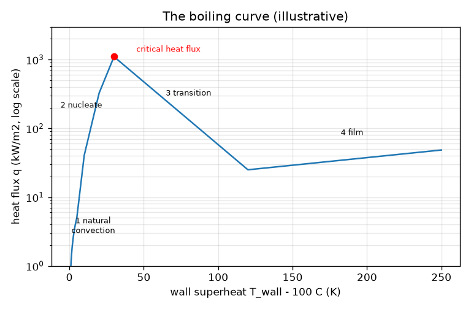
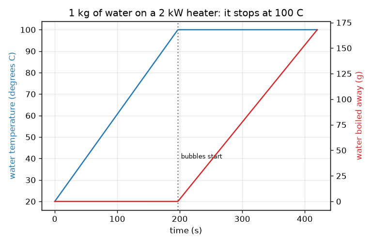

# సెషన్ 1: ఒక గిన్నె నీరు 100 C వద్ద ఎందుకు ఆగిపోతుంది

[Session 1 — हिन्दी](README.hi.md) · [Session 1 — മലയാളം](README.ml.md) · [Session 1 — தமிழ்](README.ta.md)

*స్థాయి 1 (భావనాత్మక ఇంటరాక్టివ్ నమూనా) · సుమారు 60 నిమిషాలు · openboiling*

> ఇది విద్య కోసం సరళీకరించిన నమూనా. ఇది ధ్రువీకరించబడిన డిజైన్ సాధనం కాదు; నిజమైన నిర్మాణాలు, విద్యుత్ ఇన్‌స్టలేషన్లు, వాహనాలు, పారిశ్రామిక ప్రక్రియలు లేదా వైద్య నిర్ణయాల కోసం దీనిని ఉపయోగించకూడదు.

**ముందస్తు అవసరాలు (Prerequisites)**

- అంకగణితం మరియు గ్రాఫ్ చదవడం.
- మీరు PRIMER.md చదివి, `python start.py 1` ఒకసారి రన్ చేశారు.

**అభ్యసన లక్ష్యాలు (Learning objectives).** ఈ సెషన్ తర్వాత మీరు:

- నీరు మరిగేటప్పుడు ఉష్ణోగ్రత పెరగడం ఎందుకు ఆగిపోతుందో వివరించగలరు.
- శక్తి (power) మరియు ద్రవ్యరాశి నుండి, మరుగు స్థానం చేరే సమయాన్ని మరియు మరిగి ఆవిరైన ద్రవ్యరాశిని లెక్కించగలరు.
- మరుగు వక్రం (boiling curve) యొక్క నాలుగు దశలకు పేర్లు చెప్పి, దేనిలో బుడగలు ఉంటాయో చెప్పగలరు.
- మరుగు స్థానం పైన ఉన్న ఉపరితల ఉష్ణోగ్రతకు వ్యతిరేకంగా ఉష్ణ అభివాహం (heat flux) గ్రాఫ్‌ను చదవగలరు.

## A. నిజ జీవిత సమస్య
మీరు ఒక గిన్నె నీటిని పొయ్యి మీద పెడతారు. కొన్ని నిమిషాలు అది వేడెక్కుతూనే ఉంటుంది. తర్వాత అడుగున బుడగలు కనిపిస్తాయి, హీటర్ ఇంకా శక్తిని పోస్తున్నా ఉష్ణోగ్రత పెరగడం ఆగిపోతుంది. ఆ శక్తి ఎక్కడికి వెళ్తుంది? బుడగలు నీటి మధ్యలో కాకుండా వేడి ఉపరితలంపై ఎందుకు మొదలవుతాయి? (సాధారణ విద్య కోసం మాత్రమే: ఇది నిజమైన వేడిచేసే పరికరాలను నడపడానికి సలహా కాదు.)

## B. భావన మరియు సిద్ధాంతం
ఉష్ణం (heat) అంటే శక్తి, జౌల్స్ (J)లో కొలుస్తారు; సామర్థ్యం (power) అంటే సెకనుకు శక్తి, వాట్స్ (W)లో. m కిలోగ్రాముల నీటిని dT ఉష్ణోగ్రత తేడాతో వేడి చేయడానికి m cp dT అవసరం; ఇక్కడ cp = 4186 J/(kg K) అంటే 1 kg కి 1 K పెరగడానికి ఎంత శక్తి కావాలో. మరుగు స్థానం వద్ద (సాధారణ గాలి పీడనం వద్ద 100 C) నీటిని ఆవిరిగా మార్చడానికి ప్రతి కిలోగ్రాముకు L = 2.257 మిలియన్ J అదనపు శక్తి అవసరం; ఇది జరుగుతున్నప్పుడు నీరు 100 C వద్దే ఉంటుంది. లోహాన్ని తాకే నీరు దూరంగా ఉన్న నీటి కంటే వేడిగా ఉండడం వల్ల బుడగలు హీటర్ ఉపరితలంపై ఏర్పడతాయి. ఇప్పుడు లోహాన్ని మరుగు స్థానం కంటే dT కెల్విన్ పైన ఉంచి, దాని నుండి వెళ్లే ఉష్ణ అభివాహం q ని, చదరపు మీటరుకు వాట్స్‌లో, కొలుస్తున్నట్లు ఊహించండి. మరుగు వక్రం q ని dT కి వ్యతిరేకంగా చూపిస్తుంది, దానికి నాలుగు దశలు ఉన్నాయి: సహజ సంవహనం (natural convection) (బుడగలు లేవు), న్యూక్లియేట్ మరుగుడు (nucleate boiling) (బుడగలు, చాలా నిటారైన పెరుగుదల), క్రిటికల్ ఉష్ణ అభివాహం (critical heat flux) తర్వాత పరివర్తన మరుగుడు (transition boiling) (అభివాహం తగ్గుతుంది), మరియు ఫిల్మ్ మరుగుడు (film boiling) (ఒక ఆవిరి దుప్పటి ఉపరితలాన్ని ఇన్సులేట్ చేస్తుంది).

| గుర్తు | అర్థం | యూనిట్ |
|---|---|---|
| m | నీటి ద్రవ్యరాశి | kg |
| cp | ద్రవ నీటి విశిష్ట ఉష్ణం (specific heat) (4186) | J/(kg K) |
| L | బాష్పీభవన గుప్తోష్ణం (latent heat of vaporisation) (2.257e6) | J/kg |
| P | హీటర్ సామర్థ్యం | W |
| eta | నీటిని చేరే సామర్థ్యం భాగం (0.85) | యూనిట్ లేదు |
| dT | మరుగు స్థానం పైన ఉపరితల ఉష్ణోగ్రత | K |
| q | ఉపరితలం నుండి వెళ్లే ఉష్ణ అభివాహం | W/m2 |

**ఊహలు (Assumptions)**

- సాధారణ గాలి పీడనం వద్ద నీరు, మరుగు స్థానం 100 C.
- ఏకరీతి నీటి ఉష్ణోగ్రత; దక్షత (efficiency) eta ద్వారా తప్ప గదికి ఉష్ణ నష్టం లేదు.
- మరుగు వక్రం సంఖ్యలు ఉదాహరణ కోసం; నిజమైన విలువలు ఉపరితలంపై ఆధారపడతాయి.

$$ t_{\mathrm{boil}}=\frac{m\,c_p\,(100-T_0)}{\eta\,P} $$

$$ \dot m_{\mathrm{steam}}=\frac{\eta\,P}{L}\qquad(\text{once the water is at }100\,^\circ\mathrm{C}) $$

$$ q=\frac{\text{heat leaving the surface}}{\text{area}}\quad[\mathrm{W/m^2}] $$

## C. దృశ్య వివరణ
మొదటి చిత్రం 2 kW హీటర్‌పై 1 kg నీటిని చూపిస్తుంది: ఉష్ణోగ్రత సరళ రేఖలో పెరుగుతుంది, తర్వాత 197 s తర్వాత 100 C వద్ద చదునుగా మారుతుంది, అదే సమయంలో మరిగి ఆవిరైన ద్రవ్యరాశి యొక్క ఎరుపు వక్రం పెరగడం మొదలవుతుంది. రెండవ చిత్రం లాగరిథమిక్ అభివాహ అక్షంపై మరుగు వక్రం. న్యూక్లియేట్ దశలో అది 30 K వద్ద సుమారు 1100 kW/m2 శిఖరం వరకు నిటారుగా పెరుగుతుంది, 120 K వద్ద సుమారు 25 kW/m2 కనిష్టానికి పడిపోతుంది, ఫిల్మ్ మరుగుడులో మళ్లీ నెమ్మదిగా పెరుగుతుంది. మరుగు స్థానం కంటే 200 K పైన ఉన్న ఉపరితలం కేవలం 10 K పైన ఉన్నదాని దాదాపు అదే ఉష్ణ అభివాహాన్ని మోస్తుందని గమనించండి (సుమారు 38 మరియు 41 kW/m2).

*నాలుగు దశలు మరియు క్రిటికల్ ఉష్ణ అభివాహంతో మరుగు వక్రం (ఉదాహరణ సంఖ్యలు).*

*2 kW హీటర్‌పై 1 kg నీరు: 197 s తర్వాత ఉష్ణోగ్రత 100 C వద్ద ఆగుతుంది, మరిగి ఆవిరైన ద్రవ్యరాశి పెరుగుతుంది.*

## D. ఇంటరాక్టివ్ సిమ్యులేషన్
పాఠాన్ని రన్ చేయండి (`python start.py 1`), తర్వాత లైవ్ యాప్ తెరవండి: [సెషన్ 1: గిన్నెను వేడి చేసి మరుగు వక్రాన్ని కనుగొనండి](https://krunalpanchal1995.github.io/pan-iit-oss/openboiling/session-01/) (లేదా ఈ ఫోల్డర్‌లోని `app.html`). హీటర్ సామర్థ్యాన్ని పెంచి మరిగే సమయం తగ్గడం చూడండి; సమయ స్లైడర్‌ను మరుగు స్థానం దాటి లాగి ఉష్ణోగ్రత చదునుగా మారడం మరియు నీటి మట్టం తగ్గడం చూడండి. తర్వాత మరుగు-వక్రం వ్యూ తెరిచి ఉపరితల స్లైడర్‌ను నాలుగు దశల గుండా కదిలించండి.

**సవాలు.** వేడి చేయడం మొదలుపెట్టిన 3 నిమిషాలలోపు నీటిని మరిగించి, కనీసం 50 g మరిగి ఆవిరయ్యే వరకు వేడి చేయడం కొనసాగించండి.

## E. సాధించిన ఉదాహరణ మరియు ప్రయోగం
**సమస్య.** 20 C వద్ద ఉన్న 1 kg నీరు, 0.85 దక్షత గల 2000 W హీటర్‌పై. ఎప్పుడు మరుగుతుంది, 5 నిమిషాల తర్వాత ఎంత నీరు మరిగి ఆవిరైపోయింది?

1. వేడి చేయడానికి శక్తి: m cp dT = 1 * 4186 * 80 = 334 880 J.
2. ఉపయోగకర సామర్థ్యం: 0.85 * 2000 = 1700 W.
3. మరగడానికి సమయం: 334 880 / 1700 = 197 s (3 నిమిషాల 17 సెకన్లు).
4. తర్వాతి 300 s లో శక్తి 1700 * 300 = 510 000 J, అదంతా ఆవిరిని తయారు చేస్తుంది.
5. మరిగి ఆవిరైన ద్రవ్యరాశి: 510 000 / 2.257e6 = 0.226 kg.

**సమాధానం.** 197 s తర్వాత అది మరుగుతుంది; 5 నిమిషాల తర్వాత కూడా అది 100 C వద్దే ఉంది, 226 g (22.6 శాతం) మరిగి ఆవిరైపోయింది.

**ప్రయోగం.** తెలిసిన సామర్థ్యం గల (లేబుల్ నుండి చదవండి) ప్లేట్‌పై కెటిల్ లేదా గిన్నెలో 1 లీటరు నీటిని వేడి చేయండి, అడుగు అంతటా బుడగలు కనిపించే వరకు సమయాన్ని కొలవండి, 5 నిమిషాలు మరిగించే ముందు మరియు తర్వాత గిన్నెను తూకం వేయండి. నమూనాకు సుమారు 20 శాతం లోపల ఒక సమయాన్ని మరియు నమూనాకు దగ్గరగా ఉన్న ద్రవ్యరాశి నష్టాన్ని మీరు కనుగొనాలి. తేడాలు: నిజమైన హీటర్ గదికి మరియు గిన్నెకు శక్తిని కోల్పోతుంది, కాబట్టి నిజమైన దక్షత 0.85 కంటే తక్కువ; కరిగి ఉన్న గాలి నీటి నుండి బయటకు రావడం వల్ల 100 C కి చాలా ముందే చిన్న గాలి బుడగలు కనిపిస్తాయి, నమూనా దీనిని విస్మరిస్తుంది.

## F. మూల్యాంకనం మరియు డిజైన్ సవాలు
**ప్రశ్న రకం A: భావనాత్మక.** నీరు మరుగుతున్న తర్వాత కూడా హీటర్ 2000 W ఇస్తూనే ఉంటుంది, అయినా ఉష్ణోగ్రత 100 C వద్దే ఉంటుంది. శక్తి ఎక్కడికి వెళ్తుంది?

సూచన

గిన్నె నుండి ఏమి బయటకు వెళ్తుందో ఆలోచించండి.

దశలవారీ పరిష్కారం

అది గుప్తోష్ణంలోకి వెళ్తుంది: ద్రవ నీటిని ఆవిరిగా మార్చే శక్తి. ప్రతి కిలోగ్రాముకు సుమారు 2.257 మిలియన్ జౌల్స్ అవసరం, ఆవిరి ఆ శక్తిని తీసుకువెళ్తుంది. స్థిర పీడనం వద్ద మరుగుతున్న నీటి ఉష్ణోగ్రత పెరగలేదు, కాబట్టి అదనపు శక్తి అంతా సెకనుకు eta P / L కిలోగ్రాముల రేటుతో ఆవిరిగా మారుతుంది.

**ప్రశ్న రకం B: సంఖ్యాత్మక.** 20 C వద్ద 1.5 kg నీరు 1800 W హీటర్‌పై (దక్షత 0.85). మరగడానికి ఎంత సమయం, తర్వాతి 2 నిమిషాలలో ఎంత మరిగి ఆవిరవుతుంది?

సూచన

t = m cp dT / (eta P) ఉపయోగించండి, తర్వాత ద్రవ్యరాశి రేటు eta P / L.

దశలవారీ పరిష్కారం

సమయం = 1.5 * 4186 * 80 / (0.85 * 1800) = 502 320 / 1530 = 328 s (సుమారు 5.5 నిమిషాలు). తర్వాత మరిగిన ద్రవ్యరాశి = 0.85 * 1800 * 120 / 2.257e6 = 183 600 / 2.257e6 = 0.081 kg = 81 g. సరిచూపు: 2 నిమిషాల మరుగుడు నీటిలో సుమారు 5 శాతం మాత్రమే తొలగిస్తుంది, 328 s వేడి చేయడం సూచించే దానికంటే చాలా తక్కువ, ఎందుకంటే L అనేది cp కి 540 రెట్లు.

**ప్రశ్న రకం C: గ్రాఫ్ మరియు సిమ్యులేషన్ వ్యాఖ్యానం.** మరుగు వక్రంపై, మరుగు స్థానం కంటే 10 K పైన, 60 K పైన మరియు 200 K పైన ఉన్న ఉపరితలాల ఉష్ణ అభివాహాన్ని పోల్చండి. ప్రతి దాని దశకు పేరు పెట్టండి. ఏది ఆశ్చర్యకరం?

సూచన

మరుగు-వక్రం వ్యూ రీడౌట్ లేదా lesson.py ప్రింట్ చేసే సంఖ్యలను ఉపయోగించండి.

దశలవారీ పరిష్కారం

10 K: న్యూక్లియేట్ మరుగుడు, సుమారు 41 kW/m2. 60 K: పరివర్తన మరుగుడు, సుమారు 312 kW/m2 (మూడింటిలో అతిపెద్దది, కానీ శిఖరం దాటింది). 200 K: ఫిల్మ్ మరుగుడు, సుమారు 38 kW/m2. 190 K ఎక్కువ వేడిగా ఉన్న 200 K ఉపరితలం 10 K వద్ద ఉన్నదాని దాదాపు అదే ఉష్ణ అభివాహాన్ని మోయడం ఆశ్చర్యకరం: ఆవిరి దుప్పటి దానిని ఇన్సులేట్ చేస్తుంది. వక్రం ఏకదిశాత్మకం కాదు (not monotonic).

**ప్రశ్న రకం D: డిజైన్ మరియు ఆప్టిమైజేషన్ సవాలు.** డిజైన్: 20 C నుండి 1 లీటరు (1 kg) నీరు 3 నిమిషాలలో మరిగేలా హీటర్ సామర్థ్యాన్ని ఎంచుకోండి, తర్వాత ఆ సామర్థ్యంలోనే వదిలేస్తే 10 నిమిషాలలో ఎంత నీరు కోల్పోతారో చెప్పండి. మరుగుడును కొనసాగించడానికి మెరుగైన మార్గాన్ని సూచించండి.

సూచన

t = m cp dT / (eta P) నుండి P ని సాధించండి, తర్వాత ద్రవ్యరాశి రేటుకు eta P / L ఉపయోగించండి.

దశలవారీ పరిష్కారం

P = 334 880 / (0.85 * 180) = 2189 W, కాబట్టి 2.2 kW హీటర్. ఆ సామర్థ్యంలో వదిలేస్తే, మరిగి ఆవిరయ్యే రేటు 0.85 * 2189 / 2.257e6 = 0.82 g/s, కాబట్టి 10 నిమిషాలలో సుమారు 495 g: నీటిలో సగం. మెరుగైనది: మరుగుడు మొదలైన తర్వాత సామర్థ్యాన్ని తగ్గించండి. మెల్లని మరుగుడు కొనసాగడానికి ఉష్ణ నష్టాలను మరియు మీరు అంగీకరించే ఆవిరిని భర్తీ చేసేంత సామర్థ్యం మాత్రమే చాలు, ఉదాహరణకు నాలుగో వంతు సామర్థ్యం సుమారు నాలుగో వంతు నీటిని మాత్రమే కోల్పోతుంది. రాజీ (trade-off): వేగవంతమైన ప్రారంభం ఒకవైపు, నీటి నష్టం మరియు శక్తి వినియోగం మరోవైపు. ఊహలు: స్థిర దక్షత, మూత లేదు.

[RUBRIC.md](../../RUBRIC.md) తో మిమ్మల్ని మీరు స్కోర్ చేసుకోండి. కాగితంపై పని చేయడానికి [కార్యాచరణ పత్రం](activity_sheet.md) ప్రింట్ చేయండి.

## సాధారణ అపోహలు
| సాధారణ అపోహ | నిజానికి ఏది సరైనది |
|---|---|
| చాలా సేపు వేడి చేసినందువల్ల నీరు మరుగుతుంది. | మరుగు ఉష్ణోగ్రతను చేరినప్పుడు అది మరుగుతుంది; ఆ తర్వాత అదనపు వేడి ఎక్కువ ఆవిరిని తయారు చేస్తుంది, ఎక్కువ వేడి ద్రవాన్ని కాదు. |
| 100 C కి చాలా ముందే కనిపించే బుడగలు అంటే నీరు ఇప్పటికే మరుగుతోందని అర్థం. | అవి ఎక్కువగా ద్రావణం నుండి బయటకు వచ్చే కరిగిన గాలి; నిజమైన మరుగు బుడగలు ఆవిరితో నిండి ఉండి అడుగు మొత్తాన్ని నింపుతాయి. |
| ఎక్కువ వేడి ఉపరితలం ఎల్లప్పుడూ నీటిలోకి ఎక్కువ ఉష్ణాన్ని తీసుకువెళ్తుంది. | క్రిటికల్ ఉష్ణ అభివాహం దాటిన తర్వాత ఆవిరి దుప్పటి అభివాహాన్ని తగ్గిస్తుంది; చాలా వేడి ఉపరితలం మధ్యస్థంగా వేడిగా ఉన్నదాని కంటే తక్కువ ఉష్ణాన్ని బదిలీ చేయవచ్చు. |
| శక్తి పరంగా 100 C వద్ద మరుగుతున్న నీరు మరియు 100 C వద్ద ఆవిరి ఒకటే. | ఆవిరి అదనపు గుప్తోష్ణాన్ని, కిలోగ్రాముకు 2.257 మిలియన్ జౌల్స్, కలిగి ఉంటుంది; అదే నీటిని 0 C నుండి 100 C కి వేడి చేయడానికి కావలసిన శక్తికి ఐదు రెట్ల కంటే ఎక్కువ. |

## పదకోశం
- **విశిష్ట ఉష్ణం (specific heat)**: ఒక పదార్థం యొక్క 1 kg ని 1 K వేడి చేయడానికి కావలసిన శక్తి (నీటికి 4186 J/(kg K))
- **గుప్తోష్ణం (latent heat)**: స్థిర ఉష్ణోగ్రత వద్ద 1 kg ద్రవాన్ని ఆవిరిగా మార్చడానికి కావలసిన శక్తి
- **ఉష్ణ అభివాహం (heat flux)**: ఒక ఉపరితలం నుండి యూనిట్ వైశాల్యానికి సెకనుకు వెళ్లే ఉష్ణం, W/m2 లో
- **సూపర్‌హీట్ (superheat)**: ఉపరితలం మరుగు స్థానం కంటే ఎన్ని కెల్విన్ పైన ఉంది
- **మరుగు వక్రం (boiling curve)**: ఉపరితల సూపర్‌హీట్‌కు వ్యతిరేకంగా ఉష్ణ అభివాహం గ్రాఫ్
- **క్రిటికల్ ఉష్ణ అభివాహం (critical heat flux)**: మరుగు వక్రం యొక్క శిఖరం, న్యూక్లియేట్ మరుగుడు మోయగల అతిపెద్ద అభివాహం

## ముగింపు
1. [exercises.md](exercises.md) లోని మూడు కోడింగ్ పనులు చేయండి.
2. మీ మార్పుల తర్వాత `python start.py 1` మళ్లీ రన్ చేయండి. అది చెక్‌పాయింట్‌తో ముగుస్తుంది; అది `PASS` అని ప్రింట్ చేసినప్పుడు మీరు పూర్తి చేశారు. (చెక్‌పాయింట్ మాత్రమే: `python start.py check 1`.)

తర్వాత: [సెషన్ 2](../session-02/README.md)
