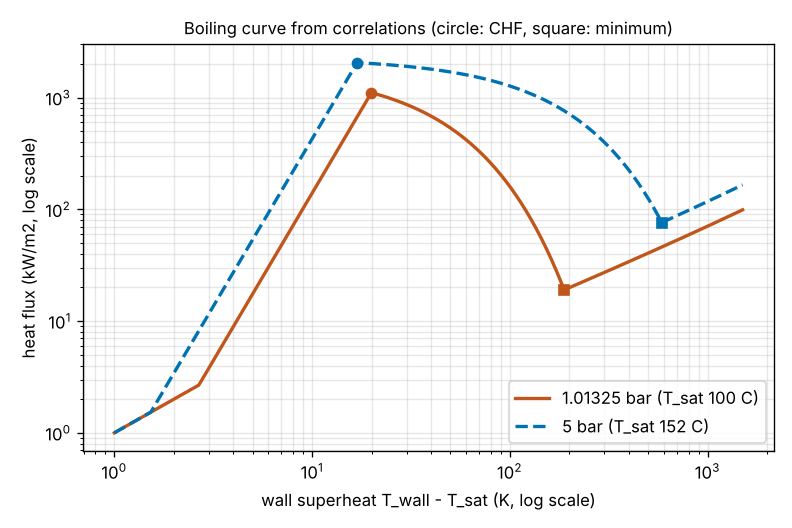
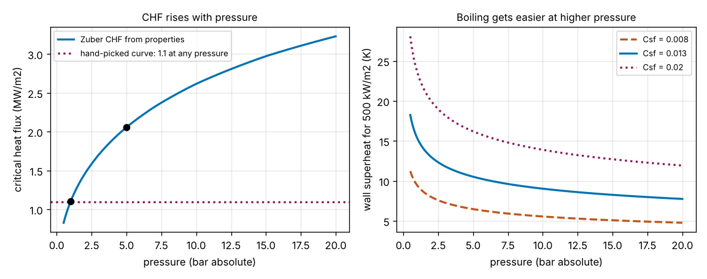

# Session 4: The boiling curve from fluid properties, and what pressure does to it

*Level 3 (simulation and validation) · about 90 minutes · openboiling*

> This is a simplified educational model. It is not a validated design tool and must not be used for real structures, electrical installations, vehicles, industrial processes or medical decisions.

**Prerequisites**

- Session 2: q = C dT^3, the critical heat flux, the heat flux of a heater.
- Session 3: the piecewise boiling curve, power-controlled heating and burnout.

**Learning objectives.** After this session you can:

- Compute the properties of saturated water at any pressure from 0.5 to 20 bar by interpolating a steam table, and check the interpolation against independent values.
- Build a boiling curve from correlations: Rohsenow for nucleate boiling, Zuber for the critical heat flux (CHF), Berenson for the minimum flux and film boiling.
- Explain why the CHF rises with pressure although the latent heat falls, using the three factors of Zuber's formula.
- Say how large the uncertainty of each correlation is, and which parts of the curve are only a shape.
- Use the curve to size the heat flux of a heater at several pressures and to test it for burnout.

## A. Real-world problem
Sessions 2 and 3 used a boiling curve with hand-picked numbers: a CHF of 1.1 MW/m2 at any pressure. But a pressure cooker boils water at 120 C, a boiler at 180 C and a power-station tube at 300 C, and engineers know that the CHF changes with pressure. By how much, and why? And what does it mean for a heater that is safe at one atmosphere when it is put in a vessel at 5 bar? This session builds the boiling curve from the properties of water instead of from chosen numbers. (Simplified teaching model; never use it to design or test real heating or boiler equipment.)

## B. Concept and theory
Everything in the curve comes from the properties of saturated water at the working pressure p: the saturation temperature T_sat, the densities of liquid and vapour, the latent heat h_fg, the surface tension sigma, the viscosities, the specific heats, the Prandtl number of the liquid and the vapour conductivity. We take them from a steam table (IAPWS-IF97, computed with the Python package `iapws`, rounded to 5 figures) at 12 pressures from 0.5 to 20 bar absolute, and between the rows we interpolate the logarithm of each property against ln p (the temperature linearly against ln p). Outside the table the code raises `ValueError` instead of extrapolating.

**Nucleate boiling (Rohsenow).** q = mu_l h_fg sqrt(g (rho_l - rho_v) / sigma) (cp_l dT / (Csf h_fg Pr_l))^3. It is still q = C dT^3, as in Session 2, but now C comes from the properties and changes with pressure. Csf stands for the surface and liquid together; 0.013 is a typical value for clean water on a metal, and the flux goes as 1 / Csf^3, so changing Csf by 50 percent changes the flux by a factor of eight.

**Critical heat flux (Zuber).** q_chf = 0.131 h_fg sqrt(rho_v) (sigma g (rho_l - rho_v))^(1/4). The vapour leaves in columns and jets, and the CHF is where the escaping vapour starts to choke the liquid that must come back to the wall. It depends on the fluid and not on the surface, so it does not depend on Csf. With pressure, three factors change and pull in different directions: sqrt(rho_v) rises a lot (the vapour gets denser, so each cubic metre of leaving vapour carries more energy), while h_fg and the capillary factor (sigma (rho_l - rho_v))^(1/4) fall a little.

**Minimum flux and film boiling (Berenson).** The minimum flux (Leidenfrost point) is q_min = 0.09 rho_v h_fg (g sigma (rho_l - rho_v) / (rho_l + rho_v)^2)^(1/4). Film boiling on a horizontal plate is h = 0.425 (k_v^3 rho_v (rho_l - rho_v) g h'_fg / (mu_v dT lambda))^(1/4) with the Taylor wavelength lambda = 2 pi sqrt(3 sigma / (g (rho_l - rho_v))) and h'_fg = h_fg + 0.4 cp_v dT. These are independent correlations and they do not meet, so we define dt_min as the superheat at which the film-boiling flux falls to q_min. That makes the curve continuous. Radiation is left out.

**The whole curve** has the four pieces of Session 3, with every number from the properties: natural convection H dT (H = 1000 W/(m2 K)) until the nucleate flux is larger, nucleate boiling up to the superheat where it reaches the CHF, transition boiling falling straight on a log scale from the CHF to q_min, and film boiling from dt_min upwards.

| Symbol | Meaning | Unit |
|---|---|---|
| p | pressure, absolute | bar |
| T_sat | saturation temperature | C |
| dT | wall superheat T_wall - T_sat | K |
| rho_l, rho_v | liquid and vapour density | kg/m3 |
| h_fg | latent heat of vaporisation | J/kg |
| sigma | surface tension | N/m |
| Csf | surface-fluid constant of Rohsenow (0.013) | no unit |
| q_chf, q_min | critical heat flux, minimum film-boiling flux | W/m2 |
| dt_min | superheat at which film boiling carries q_min | K |

**Assumptions**

- Saturated water, pool boiling on a large flat horizontal surface; no subcooling, no flow, no radiation.
- Properties along the saturation line from a 12-row table, interpolated; vapour properties in the film are taken at saturation.
- **The correlations are textbook ones with large uncertainties.** The nucleate flux can be off by a factor of two (about 25 percent in superheat), the CHF by 20 to 30 percent, and both depend on the surface. Zuber's 0.131, Berenson's 0.09 and 0.425 and Rohsenow's Csf = 0.013 are typical constants, not fitted to any surface in this repository.
- The transition and film parts were developed mostly from data near atmospheric pressure. At high pressure dt_min becomes very large (586 K at 5 bar, 1229 K at 20 bar) because two independent correlations are joined, so treat those parts as a shape and not as a prediction. The nucleate part and the CHF are the parts to use.
- The burnout test is Session 3's: a lumped 5 mm copper plate (17 250 J/(m2 K)), power ramped over 10 s, explicit Euler steps of 0.005 s, burnout at a superheat of 600 K.

$$ q_{\mathrm{nb}}=\mu_l h_{fg}\sqrt{\frac{g(\rho_l-\rho_v)}{\sigma}}\left(\frac{c_{p,l}\,\Delta T}{C_{sf}\,h_{fg}\,\mathrm{Pr}_l}\right)^{3} $$

$$ q_{\mathrm{chf}}=0.131\,h_{fg}\sqrt{\rho_v}\,\bigl[\sigma g(\rho_l-\rho_v)\bigr]^{1/4} $$

$$ q_{\min}=0.09\,\rho_v h_{fg}\left[\frac{g\sigma(\rho_l-\rho_v)}{(\rho_l+\rho_v)^2}\right]^{1/4} $$

$$ \frac{q_{\mathrm{chf}}(p)}{q_{\mathrm{chf}}(p_0)}=\sqrt{\frac{\rho_v}{\rho_{v0}}}\cdot\frac{h_{fg}}{h_{fg0}}\cdot\left[\frac{\sigma(\rho_l-\rho_v)}{\sigma_0(\rho_{l0}-\rho_{v0})}\right]^{1/4} $$

## C. Visual explanation
The first figure shows the boiling curve at 1 atm (solid orange-brown, T_sat 100 C) and at 5 bar (dashed blue, T_sat 152 C) on log-log axes, with the CHF marked by a circle and the minimum flux by a square. At 1 atm the CHF is 1.108 MW/m2, reached at a superheat of 19.9 K; at 5 bar it is 2.057 MW/m2 at 16.9 K. The whole nucleate branch moves up and to the left: at 5 bar the same wall superheat carries more heat, because the coefficient C is larger (428 against 140 W/(m2 K3)).

The second figure, on the left, plots the CHF against pressure: it rises from 0.83 MW/m2 at 0.5 bar to 3.23 MW/m2 at 20 bar, while the hand-picked curve of Sessions 2 and 3 stays at 1.1. At 1 atm the two agree within 1 percent; at 5 bar the hand-picked value is 47 percent too low. On the right, the wall superheat needed to carry 500 kW/m2 falls with pressure, and the three curves show how much the surface constant matters (Csf 0.008, 0.013 and 0.02).

*Boiling curves from correlations at 1 atm and 5 bar, log-log, with the critical heat flux (circle) and the minimum flux (square) of each.*

*Left: the critical heat flux against pressure from the properties, against the constant 1.1 MW/m2 of the hand-picked curve. Right: the wall superheat for 500 kW/m2 against pressure for three values of the surface constant.*

The pressure study from `pressure_row` (CHF in MW/m2, the other fluxes in kW/m2, superheats in K):

| Pressure | T_sat (C) | CHF | CHF / CHF(1 atm) | dT at CHF | q_min | dt_min | q at 10 K |
|---|---|---|---|---|---|---|---|
| 0.5 bar | 81.3 | 0.828 | 0.75 | 21.6 | 10.1 | 108 | 82 |
| 1 atm | 100.0 | 1.108 | 1.00 | 19.9 | 19.0 | 188 | 140 |
| 2 bar | 120.2 | 1.454 | 1.31 | 18.5 | 34.6 | 313 | 228 |
| 5 bar | 151.8 | 2.057 | 1.86 | 16.9 | 76.2 | 586 | 428 |
| 10 bar | 179.9 | 2.617 | 2.36 | 15.7 | 136.5 | 882 | 678 |
| 20 bar | 212.4 | 3.229 | 2.91 | 14.4 | 239.7 | 1229 | 1072 |

**Why does the CHF go up by a factor of 1.86 at 5 bar?** The three factors of Zuber's formula, compared with 1 atm, are sqrt(rho_v): 2.11, h_fg: 0.93 and the capillary factor: 0.94. Their product is 1.856. The vapour density alone does the work; the other two take back about 12 percent. The CHF does not grow forever: it passes a maximum at tens of bars and falls to zero at the critical point (221 bar), but that is outside this table.

**How the previous sessions fit.** The hand-picked curve of Session 3 put the CHF at 30 K superheat with C = 40.7 W/(m2 K3). The correlations give a CHF of the same size at 1 atm (1.108 against 1.1) but at 19.9 K, with C = 140. A Csf of about 0.0196 would put the peak back at 30 K, which is inside the range of surfaces (0.006 to 0.02 and more). So the Session 3 curve is a plausible but rough surface, and the peak position, unlike the peak height, depends on the surface.

## D. Interactive simulation
Run the lesson (`python start.py 4`), then open the live app: [Session 4: boiling curves from fluid properties](https://krunalpanchal1995.github.io/pan-iit-oss/openboiling/session-04/) (or `app.html` in this folder). Choose a pressure from 0.5 to 20 bar, a heat flux and the surface constant. The first view is the boiling curve with the 1 atm curve dashed for comparison; the second plots the CHF and the 60 percent design limit against pressure; the third plots the wall superheat against pressure. Try the presets: 1300 kW/m2 is above the CHF at 1 atm and has a 37 percent margin at 5 bar. The app uses the same equations as the lesson (a test compares the two to 1e-15), and the transition and film parts of the curve, particularly at high pressure, show only a shape.

**Challenge.** Run the heater at 1500 kW/m2 or more with at least a 40 percent margin below the critical heat flux (flux at most 60 percent of the CHF). What is the lowest pressure that works? (The slider moves in steps of 0.5 bar; the exact answer is between two steps.)

## E. Worked example and experiment
**Problem.** A heater surface carries 1300 kW/m2 in saturated water. (a) Find the CHF at 1 atm and at 5 bar by hand from the steam table. (b) Is the heater safe at each pressure? (c) At 5 bar, what are the wall superheat and the wall temperature? Check each against the code.

1. At 1 atm the table gives rho_l = 958.37 kg/m3, rho_v = 0.59762 kg/m3, h_fg = 2.2565e6 J/kg and sigma = 0.058917 N/m. sqrt(rho_v) = 0.7731; sigma g (rho_l - rho_v) = 0.058917 x 9.81 x 957.77 = 553.6, whose fourth root is 4.850.
2. q_chf(1 atm) = 0.131 x 2.2565e6 x 0.7731 x 4.850 = 1.108e6 W/m2.
3. At 5 bar: rho_l = 915.28, rho_v = 2.6681, h_fg = 2.1079e6, sigma = 0.048349. sqrt(rho_v) = 1.6334; sigma g (rho_l - rho_v) = 432.9, fourth root 4.561. q_chf(5 bar) = 0.131 x 2.1079e6 x 1.6334 x 4.561 = 2.057e6 W/m2, which is 1.856 times the 1 atm value.
4. 1300 kW/m2 is above 1108 kW/m2, so at 1 atm there is no steady nucleate state: the simulation burns the plate out after 18.0 s. At 5 bar it is below 2057 kW/m2, a margin of 1 - 1300 / 2057 = 37 percent, and the same simulation does not burn out.
5. Rohsenow at 5 bar: C = 427.9 W/(m2 K3), so dT = (1.3e6 / 427.9)^(1/3) = 3038^(1/3) = 14.5 K and the wall is at 151.8 + 14.5 = 166.3 C. The code (`steady_superheat(1.3e6, 5)`) gives 14.48 K, and a 60 s simulation settles at the same value.

**Answer.** The CHF is 1.108 MW/m2 at 1 atm and 2.057 MW/m2 at 5 bar (ratio 1.86). 1300 kW/m2 burns the heater out at 1 atm and is safe at 5 bar, with a 37 percent margin, a wall superheat of 14.5 K and a wall temperature of 166.3 C. By hand and by code agree to the digits shown.

**Experiment.** The real analogue is a heated block or a thin wire in a vessel whose pressure can be set; people have measured the CHF of water against pressure for decades, and it rises with pressure to a maximum at tens of bars before it falls. Hobbyists must not try this: a pressure vessel and a burnout are dangerous. Model versus reality: the measured CHF depends on the surface, its orientation and size, on subcooling and on dissolved gas; Zuber's value is a typical one, within 20 to 30 percent for a large clean horizontal surface, and the real curve past the peak is unstable and cannot be held in a power-controlled experiment.

## Real-world application and mini-project: The heater of a pressure cooker
A flat heater of area 0.02 m2 (200 cm2) boils water inside a vessel that can be run at 0.5, 1 atm, 2, 5 or 10 bar. The rule of Session 3 stays: the heat flux is at most 60 percent of the CHF. Find, for each pressure, the allowed flux, the allowed power, the wall superheat and the wall temperature, and show that using the 1 atm flux in the 5 bar vessel wastes capacity while using the 5 bar flux at 1 atm burns the plate out. Use `design_row`, `design_flux` and `burnout_time` from Session 4. The constants are textbook values with large uncertainties, so this is an exercise in method, not a heater specification.

**Deliverable:** A script that prints a table for the five pressures (allowed flux, power on 0.02 m2, T_sat, wall superheat, wall temperature), checks that the CHF at 5 bar is at least 1.3 times the CHF at 1 atm, runs the burnout test with the 5 bar flux at 1 atm and at 5 bar, and saves a picture of the boiling curves at 1 atm and 5 bar with the design points marked.

**Success looks like:** The allowed flux is 497, 665, 873, 1234 and 1570 kW/m2 at 0.5, 1 atm, 2, 5 and 10 bar (wall temperatures 99.5, 116.8, 135.9, 166.1 and 193.1 C, wall superheats 18.2 down to 13.2 K); the allowed power on 0.02 m2 is 13.3 kW at 1 atm and 24.7 kW at 5 bar; the CHF ratio is 1.86; the 5 bar flux of 1234 kW/m2 burns the plate out at 1 atm after 19.0 s and is safe at 5 bar.

## F. Assessment and design challenge
**Question type A: Conceptual.** The latent heat of water falls as the pressure rises, yet the critical heat flux rises. Explain, using the three factors of Zuber's formula.

Hint

Which of the three properties changes most between 1 atm and 5 bar, and in which direction?

Step-by-step solution

q_chf is proportional to h_fg sqrt(rho_v) (sigma (rho_l - rho_v))^(1/4). From 1 atm to 5 bar the vapour density rises from 0.598 to 2.668 kg/m3, so sqrt(rho_v) is 2.11 times larger. The latent heat falls to 0.93 of its value and the capillary factor to 0.94. The product is 2.11 x 0.93 x 0.94 = 1.86. A cubic metre of vapour carries away more energy when it is denser, so the same escaping vapour velocity carries much more heat; the loss in latent heat and surface tension is small by comparison. (Near the critical point, h_fg and sigma go to zero and the CHF falls again.)

**Question type B: Numerical.** Compute the CHF at 2 bar by hand from the table row (rho_l = 942.94, rho_v = 1.129, h_fg = 2.2016e6, sigma = 0.054926) and its ratio to the value at 1 atm.

Hint

q = 0.131 h_fg sqrt(rho_v) (sigma g (rho_l - rho_v))^(1/4), g = 9.81 m/s2.

Step-by-step solution

0.131 x 2.2016e6 x sqrt(1.129) = 0.131 x 2.2016e6 x 1.0625 = 3.064e5. sigma g (rho_l - rho_v) = 0.054926 x 9.81 x 941.81 = 507.5 and its fourth root is 4.746. So q_chf = 3.064e5 x 4.746 = 1.454e6 W/m2. At 1 atm it is 1.108e6, so the ratio is 1.312: a pressure of 2 bar already carries 31 percent more heat than 1 atm. Units: W/m2.

**Question type C: Graph and simulation interpretation.** In the second figure, the wall superheat needed for 500 kW/m2 at 1 atm is about 9.4 K for Csf = 0.008, 15.3 K for 0.013 and 23.5 K for 0.02. What does this say about predicting the wall temperature, compared with predicting the CHF?

Hint

Which of the two depends on the surface constant, and which does not?

Step-by-step solution

The surface constant enters the nucleate flux as 1 / Csf^3, so the superheat is proportional to Csf: a range of Csf from 0.008 to 0.02 spreads the wall superheat from 9.4 to 23.5 K at the same flux (a factor of 2.5), so the wall temperature of a real surface is uncertain by several kelvin unless the surface has been measured. The CHF of Zuber's formula does not contain Csf at all, so it is the same 1.108 MW/m2 for all three: it is the more robust number, within the 20 to 30 percent of the correlation, and it is the one a designer uses for a safety margin. The two together say: trust the margin to the CHF, not the exact wall temperature.

**Question type D: Design and optimisation challenge.** Design: a heater of 0.02 m2 must deliver 24 kW in water with a flux of at most 60 percent of the CHF. Among the pressures 0.5, 1 atm, 2, 5 and 10 bar, which is the lowest that works, and what is the wall temperature? What is the exact lowest pressure?

Hint

24 kW on 0.02 m2 is a flux of 1200 kW/m2. The CHF must be at least 1200 / 0.6 = 2000 kW/m2.

Step-by-step solution

The allowed power at each pressure is 0.6 q_chf x 0.02 m2: 9.9 kW at 0.5 bar, 13.3 kW at 1 atm, 17.5 kW at 2 bar, 24.7 kW at 5 bar and 31.4 kW at 10 bar. So 5 bar is the lowest of the five that delivers 24 kW; at 5 bar the flux is 1200 kW/m2, the superheat is 14.1 K and the wall is at 165.9 C. Solving q_chf(p) = 2000 kW/m2 gives an exact lowest pressure of 4.63 bar, where T_sat is 149.0 C and the wall is at 163.3 C. The answer rests on the CHF of Zuber with its 20 to 30 percent uncertainty, which the 40 percent margin is meant to cover; it is a method, not a heater specification.

Score yourself with [RUBRIC.md](../../RUBRIC.md). Print the [activity sheet](activity_sheet.md) to work on paper.

## Common misconceptions
| Common misconception | What is actually true |
|---|---|
| The critical heat flux is a property of the heater. | Zuber's CHF depends on the fluid and its pressure, not on the surface; the surface changes the superheat at which the peak is reached. |
| Higher pressure means a lower CHF, because the latent heat falls. | The CHF rises with pressure up to tens of bars: the denser vapour carries away more energy and beats the small fall of the latent heat. |
| Rohsenow's Csf is a physical constant of water. | It describes the surface and the liquid together, varies from about 0.006 to 0.02 and more, and the flux goes as 1 / Csf^3. |
| A formula that is continuous and smooth is accurate. | The curve is continuous by construction (we chose dt_min that way), but the transition and film parts are joined from independent correlations and, at high pressure, only show a shape. |

## Glossary
- **saturation temperature**: the temperature at which water boils at a given pressure
- **Rohsenow correlation**: the nucleate pool-boiling flux as a function of the wall superheat and the fluid properties
- **Zuber's CHF**: the hydrodynamic estimate of the critical heat flux, from vapour density, latent heat and surface tension
- **Leidenfrost point (q_min)**: the lowest flux at which film boiling can be sustained
- **Berenson film boiling**: the correlation for a stable vapour film under a horizontal plate
- **surface constant Csf**: the number that stands for the surface and the liquid together in Rohsenow's formula
- **interpolation**: reading a value between two rows of a table

## Finish
1. Do the three coding tasks in [exercises.md](exercises.md).
2. Run `python start.py 4` again after your changes. It ends with the checkpoint; when it prints `PASS`, you are done. (Checkpoint only: `python start.py check 4`.)

Next: the [roadmap](../../promo/roadmap.md). Session 5 is yours to build.
