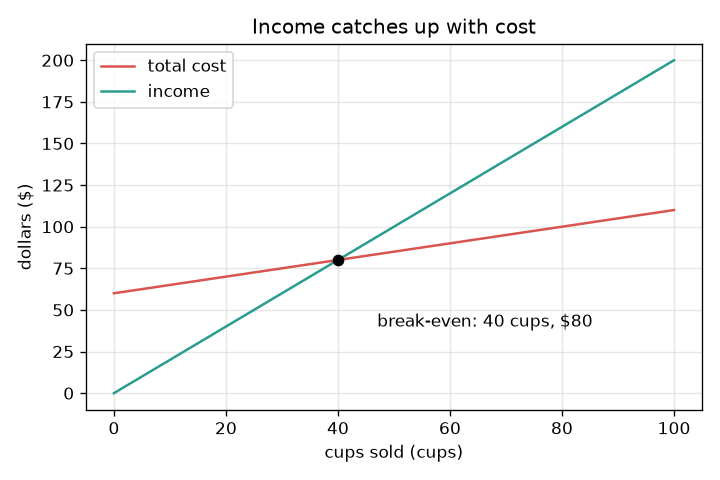
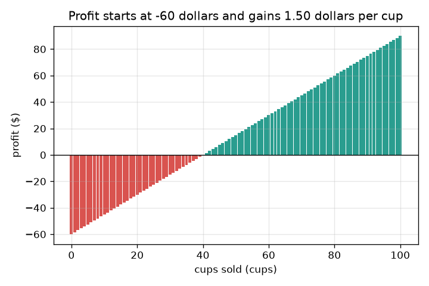

# सत्र 1: आय (income) लागत (cost) के बराबर कब पहुँचती है?

*स्तर 1 (वैचारिक इंटरैक्टिव मॉडल) · लगभग 60 मिनट · openbreakeven*

> यह एक सरलीकृत शैक्षिक मॉडल है। यह कोई प्रमाणित डिज़ाइन उपकरण नहीं है और इसका उपयोग वास्तविक संरचनाओं, विद्युत संस्थापनों, वाहनों, औद्योगिक प्रक्रियाओं या चिकित्सा निर्णयों के लिए नहीं किया जाना चाहिए।

**पूर्वापेक्षाएँ (Prerequisites)**

- स्कूल का अंकगणित: गुणा और भाग।
- आपने PRIMER.md पढ़ लिया है और एक बार `python start.py 1` चला लिया है।

**सीखने के उद्देश्य (Learning objectives)।** इस सत्र के बाद आप:

- स्थिर लागत (fixed cost) (एक बार चुकाई जाने वाली) को हर कप की लागत से अलग कर सकेंगे।
- लागत रेखा और आय रेखा लिख सकेंगे, और यह पता कर सकेंगे कि वे कहाँ मिलती हैं।
- एक भाग से ब्रेक-ईवन (break-even) कपों की संख्या निकाल सकेंगे।
- बिके कपों के सापेक्ष लागत और आय का ग्राफ़ पढ़ सकेंगे, और बता सकेंगे कि कब कोई ब्रेक-ईवन नहीं होता।

## A. वास्तविक दुनिया की समस्या
आप नींबू पानी (lemonade) का स्टॉल चलाना चाहते हैं। एक भी कप बेचने से पहले आपको स्टॉल, एक जग और एक बोर्ड के लिए 60 डॉलर चुकाने होंगे। उसके बाद हर कप बनाने में 50 सेंट लगते हैं और वह 2 डॉलर में बिकता है। शुरुआत में आप 60 डॉलर पीछे हैं। कितने कपों के बाद आपकी कुल आय आपकी कुल लागत के बराबर पहुँच जाएगी? वही संख्या ब्रेक-ईवन बिंदु (break-even point) है। (केवल सामान्य शिक्षा के लिए: यह स्टॉल काल्पनिक है और यह कोई वित्तीय सलाह नहीं है।)

## B. अवधारणा और सिद्धांत
स्थिर लागत F एक बार चुकाई जाती है, चाहे आप कितने भी कप बेचें। परिवर्ती लागत (variable cost) v हर कप के लिए चुकाई जाती है। इसलिए q कपों के बाद कुल लागत F + v q है, एक सीधी रेखा जो F से शुरू होती है। आय, कीमत (price) p गुणा q है, एक सीधी रेखा जो 0 से शुरू होती है। लाभ (profit) आय घटा लागत है। हर कप F चुकाने के लिए p - v डॉलर कमाता है, इसलिए आवश्यक कप F को एक कप की कमाई से भाग देने पर मिलते हैं। यदि p, v से बड़ा नहीं है, तो एक कप कुछ नहीं कमाता और आय कभी बराबरी नहीं कर पाती: कोई ब्रेक-ईवन नहीं होता।

| प्रतीक | अर्थ | इकाई |
|---|---|---|
| F | स्थिर लागत, एक बार चुकाई जाती है | डॉलर |
| v | एक कप की परिवर्ती लागत | डॉलर प्रति कप |
| p | एक कप की कीमत | डॉलर प्रति कप |
| q | बिके कप | कप |
| q* | ब्रेक-ईवन कपों की संख्या | कप |

**मान्यताएँ (Assumptions)**

- बनाया गया हर कप बिक जाता है, और हमेशा एक ही कीमत पर।
- एक कप की लागत वही रहती है, चाहे आप कितने भी बनाएँ।
- आज का पैसा बाद के पैसे के बराबर मूल्य का है (सत्र 3 इस मान्यता को ढीला करता है)।
- स्टॉल और उसकी संख्याएँ काल्पनिक हैं।

$$ \text{cost}(q)=F+v\,q,\qquad \text{income}(q)=p\,q $$

$$ \text{profit}(q)=p\,q-(F+v\,q)=(p-v)\,q-F $$

$$ q^{*}=\frac{F}{p-v}\quad(\text{only if } p>v) $$

## C. दृश्य व्याख्या
पहला चित्र बिके कपों के सापेक्ष दोनों रेखाएँ दिखाता है। लाल लागत रेखा 60 डॉलर से शुरू होती है और धीरे-धीरे, 50 सेंट प्रति कप, बढ़ती है। हरी आय रेखा 0 से शुरू होती है और तेज़ी से, 2 डॉलर प्रति कप, बढ़ती है। वे 40 कप और 80 डॉलर पर काटती हैं: वही ब्रेक-ईवन बिंदु है। दूसरा चित्र हर कप के बाद के लाभ को एक बार (bar) के रूप में दिखाता है। यह माइनस 60 डॉलर से शुरू होता है, हर कप 1.50 डॉलर जोड़ता है, और 40 कपों पर बार हरे हो जाते हैं।

*बिके कपों के सापेक्ष लागत और आय: वे 40 कप और 80 डॉलर पर काटती हैं।*

*हर कप के बाद लाभ: यह माइनस 60 डॉलर से शुरू होता है और हर कप पर 1.50 डॉलर बढ़ता है।*

## D. इंटरैक्टिव सिमुलेशन
पाठ चलाएँ (`python start.py 1`), फिर लाइव ऐप खोलें: [सत्र 1: नींबू पानी का स्टॉल](https://krunalpanchal1995.github.io/pan-iit-oss/openbreakeven/session-01/) (या इस फ़ोल्डर में `app.html`)। कप वाले स्लाइडर को खिसकाएँ और दोनों बार देखें: बाहर जाने वाला पैसा और अंदर आने वाला पैसा। फिर ग्राफ़ दृश्य खोलें और कीमत, एक कप की लागत और स्थिर लागत को एक-एक करके बदलें।

**चुनौती।** स्टॉल को 30 कपों के भीतर ब्रेक-ईवन तक पहुँचाएँ।

## E. हल किया गया उदाहरण और प्रयोग
**समस्या।** एक स्टॉल की स्थिर लागत 60 डॉलर है, वह कप 2.00 डॉलर में बेचता है और प्रति कप 0.50 डॉलर खर्च करता है। ब्रेक-ईवन कपों की संख्या ज्ञात करें और उसकी जाँच करें।

1. हर कप स्थिर लागत की ओर 2.00 - 0.50 = 1.50 डॉलर कमाता है।
2. आवश्यक कप = 60 / 1.50 = 40 कप।
3. लागत की जाँच: 60 + 0.50 * 40 = 80 डॉलर। आय की जाँच: 2.00 * 40 = 80 डॉलर। दोनों बराबर हैं।
4. एक कप पहले, 39 कपों पर, लाभ माइनस 1.50 डॉलर है; एक कप बाद, 41 कपों पर, यह प्लस 1.50 डॉलर है।

**उत्तर।** ब्रेक-ईवन 40 कपों पर है, जहाँ आय और लागत दोनों 80 डॉलर हैं।

**प्रयोग।** स्कूल में एक असली या नकली स्टॉल चलाएँ: पहले जो खर्च किया वह लिख लें, फिर बिके कपों और मिले पैसों का हिसाब रखें। चलते योग (running totals) को प्लॉट करें और देखें कि वे कहाँ काटते हैं। उम्मीद करें कि यह कटान 40 कपों से अलग होगा: कुछ कप गिर जाते हैं, कीमत बदल सकती है, और एक कप की लागत केवल एक औसत है। मॉडल एक स्थिर कीमत और लागत लेता है और मानता है कि बनाया गया हर कप बिक जाता है।

## F. मूल्यांकन और डिज़ाइन चुनौती
**प्रश्न प्रकार A: वैचारिक।** एक दोस्त कहता है: स्टॉल की लागत 60 डॉलर है और हर कप 2 डॉलर में बिकता है, इसलिए ब्रेक-ईवन 60 / 2 = 30 कप है। वे क्या भूल गए?

संकेत

क्या एक कप बनाने में कुछ खर्च होता है?

चरण-दर-चरण हल

वे परिवर्ती लागत भूल गए। हर कप 2.00 डॉलर लाता है लेकिन उसे बनाने में 0.50 डॉलर भी लगते हैं, इसलिए वह स्थिर लागत चुकाने में केवल 1.50 डॉलर की मदद करता है। सही उत्तर 60 / 1.50 = 40 कप है, 30 नहीं।

**प्रश्न प्रकार B: संख्यात्मक।** एक अलग स्टॉल की स्थिर लागत 45 डॉलर, कीमत 1.50 डॉलर और एक कप की लागत 0.60 डॉलर है। ब्रेक-ईवन कप ज्ञात करें और जाँचें कि वहाँ आय लागत के बराबर है।

संकेत

प्रति कप कमाई = कीमत घटा कप की लागत; फिर भाग दें।

चरण-दर-चरण हल

हर कप 1.50 - 0.60 = 0.90 डॉलर कमाता है। कप = 45 / 0.90 = 50। जाँच: आय = 1.50 * 50 = 75 डॉलर; लागत = 45 + 0.60 * 50 = 75 डॉलर। बराबर। इकाइयाँ: डॉलर को डॉलर प्रति कप से भाग देने पर कप मिलते हैं।

**प्रश्न प्रकार C: ग्राफ़ और सिमुलेशन की व्याख्या।** पहले स्टॉल के ग्राफ़ पर, 25 कपों पर लागत, आय और लाभ पढ़ें। स्टॉल आगे है या पीछे?

संकेत

लागत रेखा का मान 60 जोड़ 0.50 गुणा 25 है; आय 2.00 गुणा 25 है।

चरण-दर-चरण हल

25 कपों पर लागत 60 + 12.50 = 72.50 डॉलर है और आय 50 डॉलर है। लाभ 50 - 72.50 = माइनस 22.50 डॉलर है, यानी हानि (loss): लाल रेखा अभी भी हरी रेखा के ऊपर है, इसलिए स्टॉल पीछे है।

**प्रश्न प्रकार D: डिज़ाइन और अनुकूलन (optimisation) चुनौती।** डिज़ाइन: स्टॉल केवल एक छोटे दिन के लिए खुलेगा। कीमत या स्थिर लागत में से किसी एक को बदलें ताकि ब्रेक-ईवन 30 कप या उससे कम पर हो। आप कौन-सा चुनेंगे और उसमें जोखिम क्या है?

संकेत

उसी स्थिर लागत के साथ कीमत 2.50 आज़माएँ, और उसी कीमत के साथ स्थिर लागत 45। फिर दूसरी दिशा देखने के लिए कीमत 1.00 आज़माएँ।

चरण-दर-चरण हल

कीमत 2.50 डॉलर: हर कप 2.00 कमाता है, इसलिए 60 / 2.00 = 30 कप। या कीमत 2.00 पर स्थिर लागत 45 डॉलर: 45 / 1.50 = 30 कप। दोनों काम करते हैं। ऊँची कीमत से ग्राहक कम होने का जोखिम है (यह सरल मॉडल उसे नज़रअंदाज़ करता है); कम स्थिर लागत का मतलब सस्ता स्टॉल है, जो छोटा या कम अच्छी जगह पर हो सकता है। 1.00 डॉलर की कीमत पर 60 / 0.50 = 120 कप चाहिए होंगे, इसलिए कीमत बहुत घटाने से ब्रेक-ईवन बहुत दूर चला जाता है।

[RUBRIC.md](../../RUBRIC.md) से स्वयं को अंक दें। काग़ज़ पर काम करने के लिए [गतिविधि पत्रक](activity_sheet.md) प्रिंट करें।

## सामान्य भ्रांतियाँ (Common misconceptions)
| सामान्य भ्रांति | वास्तव में क्या सही है |
|---|---|
| ब्रेक-ईवन उन कपों की संख्या है जो स्टॉल का खर्च चुका देते हैं। | हर कप बनाने में भी कुछ खर्च होता है; केवल जो बचता है, कीमत घटा कप की लागत, वही स्टॉल का खर्च चुकाता है। |
| ब्रेक-ईवन पर स्टॉल ने लाभ कमा लिया है। | ब्रेक-ईवन पर लाभ ठीक शून्य होता है। लाभ अगले कप से शुरू होता है। |
| ऊँची कीमत हमेशा ब्रेक-ईवन को जल्दी लाती है। | इस मॉडल में हाँ, लेकिन असली ग्राहक ऊँची कीमत पर कम कप खरीदते हैं; सत्र 2 इसे जोड़ता है। |
| अगर मैं पर्याप्त कप बेचूँ तो मैं हमेशा ब्रेक-ईवन पर पहुँचूँगा। | केवल तभी जब कीमत एक कप की लागत से अधिक हो। वरना हर अतिरिक्त कप हानि को और बड़ा करता है। |

## शब्दावली (Glossary)
- **स्थिर लागत (fixed cost)**: एक बार चुकाया जाने वाला पैसा, चाहे कितने भी कप बिकें
- **परिवर्ती लागत (variable cost)**: बनाए गए हर कप पर खर्च होने वाला पैसा
- **आय (income, revenue)**: कीमत गुणा बिके कप
- **लाभ (profit)**: आय घटा कुल लागत; ऋणात्मक का अर्थ है हानि
- **ब्रेक-ईवन (break-even)**: कपों की वह संख्या जहाँ आय लागत के बराबर होती है, इसलिए लाभ शून्य होता है

## समापन
1. [exercises.md](exercises.md) में दिए तीन कोडिंग कार्य करें।
2. अपने बदलावों के बाद `python start.py 1` फिर से चलाएँ। यह चेकपॉइंट (checkpoint) के साथ समाप्त होता है; जब यह `PASS` प्रिंट करे, तो आपका काम पूरा है। (केवल चेकपॉइंट: `python start.py check 1`।)

आगे: [सत्र 2](../session-02/README.md)
