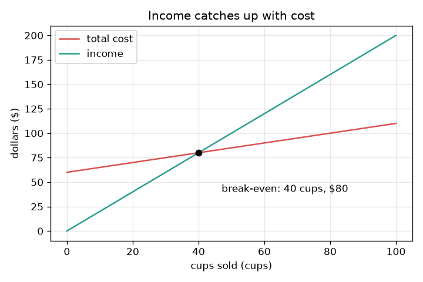
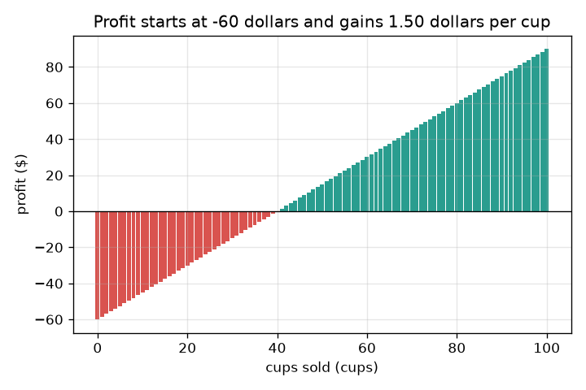

# സെഷൻ 1: വരുമാനം ചെലവിനൊപ്പം എത്തുന്നത് എവിടെ?

[Session 1 — हिन्दी](README.hi.md)

*ലെവൽ 1 (ആശയപരമായ ഇന്ററാക്ടീവ് മോഡൽ) · ഏകദേശം 60 മിനിറ്റ് · openbreakeven*

> ഇത് ലളിതമാക്കിയ ഒരു വിദ്യാഭ്യാസ മോഡൽ മാത്രമാണ്. ഇത് സാധൂകരിച്ച ഒരു ഡിസൈൻ ഉപകരണമല്ല; യഥാർത്ഥ നിർമ്മിതികൾ, വൈദ്യുത സംവിധാനങ്ങൾ, വാഹനങ്ങൾ, വ്യാവസായിക പ്രക്രിയകൾ അല്ലെങ്കിൽ മെഡിക്കൽ തീരുമാനങ്ങൾ എന്നിവയ്ക്ക് ഇത് ഉപയോഗിക്കരുത്.

**മുൻ‌അറിവ് (Prerequisites)**

- സ്കൂൾ ഗണിതം: ഗുണനവും ഹരണവും.
- നിങ്ങൾ PRIMER.md വായിക്കുകയും `python start.py 1` ഒരിക്കൽ പ്രവർത്തിപ്പിക്കുകയും ചെയ്തിട്ടുണ്ട്.

**പഠന ലക്ഷ്യങ്ങൾ (Learning objectives).** ഈ സെഷനു ശേഷം നിങ്ങൾക്ക് കഴിയും:

- സ്ഥിര ചെലവ് (fixed cost, ഒരിക്കൽ മാത്രം നൽകുന്നത്) ഓരോ കപ്പിന്റെയും ചെലവിൽ നിന്ന് വേർതിരിക്കാൻ.
- ചെലവ് രേഖയും വരുമാന രേഖയും എഴുതി, അവ കൂടിച്ചേരുന്ന സ്ഥലം കണ്ടെത്താൻ.
- ഒരൊറ്റ ഹരണത്തിലൂടെ ബ്രേക്ക്-ഈവൻ (break-even) കപ്പുകളുടെ എണ്ണം കണക്കാക്കാൻ.
- വിറ്റ കപ്പുകൾക്കെതിരെ ചെലവിന്റെയും വരുമാനത്തിന്റെയും ഗ്രാഫ് വായിക്കാനും, ബ്രേക്ക്-ഈവൻ ഇല്ലാത്തത് എപ്പോഴെന്ന് പറയാനും.

## A. യഥാർത്ഥ ലോക പ്രശ്നം
നിങ്ങൾ ഒരു നാരങ്ങാവെള്ളക്കട നടത്താൻ ആഗ്രഹിക്കുന്നു. ഒരു കപ്പ് പോലും വിൽക്കുന്നതിനു മുമ്പ് കടയ്ക്കും ഒരു ജഗ്ഗിനും ഒരു ബോർഡിനുമായി 60 ഡോളർ നൽകണം. അതിനുശേഷം ഓരോ കപ്പും ഉണ്ടാക്കാൻ 50 സെന്റ് ചെലവാകും, 2 ഡോളറിന് വിൽക്കും. തുടക്കത്തിൽ നിങ്ങൾ 60 ഡോളർ പിന്നിലാണ്. നിങ്ങളുടെ ആകെ വരുമാനം ആകെ ചെലവിനൊപ്പം എത്താൻ എത്ര കപ്പുകൾ വേണം? ആ സംഖ്യയാണ് ബ്രേക്ക്-ഈവൻ പോയിന്റ് (break-even point). (പൊതുവിദ്യാഭ്യാസത്തിനു മാത്രം: ഈ കട സാങ്കൽപ്പികമാണ്, ഇത് സാമ്പത്തിക ഉപദേശമല്ല.)

## B. ആശയവും സിദ്ധാന്തവും
സ്ഥിര ചെലവ് F നിങ്ങൾ എത്ര കപ്പുകൾ വിറ്റാലും ഒരിക്കൽ മാത്രം നൽകുന്നു. വേരിയബിൾ ചെലവ് (variable cost) v ഓരോ കപ്പിനും നൽകുന്നു. അതിനാൽ q കപ്പുകൾക്കു ശേഷമുള്ള ആകെ ചെലവ് F + v q ആണ്, F-ൽ തുടങ്ങുന്ന ഒരു നേർരേഖ. വരുമാനം (income) വില p ഗുണം q ആണ്, 0-ൽ തുടങ്ങുന്ന ഒരു നേർരേഖ. ലാഭം (profit) വരുമാനം മൈനസ് ചെലവ് ആണ്. ഓരോ കപ്പും F അടച്ചുതീർക്കാനായി p - v ഡോളർ നേടുന്നു, അതിനാൽ ആവശ്യമായ കപ്പുകൾ F-നെ ഒരു കപ്പ് നേടുന്ന തുക കൊണ്ട് ഹരിച്ചതാണ്. p, v-യേക്കാൾ വലുതല്ലെങ്കിൽ ഒരു കപ്പ് ഒന്നും നേടുന്നില്ല, വരുമാനം ഒരിക്കലും ചെലവിനൊപ്പം എത്തുന്നില്ല: ബ്രേക്ക്-ഈവൻ ഇല്ല.

| ചിഹ്നം | അർത്ഥം | യൂണിറ്റ് |
|---|---|---|
| F | സ്ഥിര ചെലവ്, ഒരിക്കൽ നൽകുന്നത് | ഡോളർ |
| v | ഒരു കപ്പിന്റെ വേരിയബിൾ ചെലവ് | ഡോളർ / കപ്പ് |
| p | ഒരു കപ്പിന്റെ വില | ഡോളർ / കപ്പ് |
| q | വിറ്റ കപ്പുകൾ | കപ്പുകൾ |
| q* | ബ്രേക്ക്-ഈവൻ കപ്പുകളുടെ എണ്ണം | കപ്പുകൾ |

**അനുമാനങ്ങൾ (Assumptions)**

- ഉണ്ടാക്കുന്ന എല്ലാ കപ്പും വിൽക്കപ്പെടുന്നു, എപ്പോഴും ഒരേ വിലയ്ക്ക്.
- എത്ര ഉണ്ടാക്കിയാലും ഒരു കപ്പിന്റെ ചെലവ് മാറുന്നില്ല.
- ഇന്നത്തെ പണത്തിന് പിന്നീടുള്ള പണത്തിന്റെ അതേ മൂല്യമുണ്ട് (സെഷൻ 3 ഇത് ഇളവ് ചെയ്യുന്നു).
- കടയും അതിലെ സംഖ്യകളും സാങ്കൽപ്പികമാണ്.

$$ \text{cost}(q)=F+v\,q,\qquad \text{income}(q)=p\,q $$

$$ \text{profit}(q)=p\,q-(F+v\,q)=(p-v)\,q-F $$

$$ q^{*}=\frac{F}{p-v}\quad(\text{only if } p>v) $$

## C. ദൃശ്യ വിശദീകരണം
ആദ്യ ചിത്രം വിറ്റ കപ്പുകൾക്കെതിരെ രണ്ട് രേഖകളും വരയ്ക്കുന്നു. ചുവന്ന ചെലവ് രേഖ 60 ഡോളറിൽ തുടങ്ങി പതുക്കെ, ഓരോ കപ്പിനും 50 സെന്റ് വീതം ഉയരുന്നു. പച്ച വരുമാന രേഖ 0-ൽ തുടങ്ങി വേഗത്തിൽ, ഓരോ കപ്പിനും 2 ഡോളർ വീതം ഉയരുന്നു. അവ 40 കപ്പുകളിലും 80 ഡോളറിലും കൂട്ടിമുട്ടുന്നു: അതാണ് ബ്രേക്ക്-ഈവൻ പോയിന്റ്. രണ്ടാമത്തെ ചിത്രം ഓരോ കപ്പിനു ശേഷവുമുള്ള ലാഭം ഒരു ബാർ ആയി കാണിക്കുന്നു. അത് മൈനസ് 60 ഡോളറിൽ തുടങ്ങുന്നു, ഓരോ കപ്പും 1.50 ഡോളർ കൂട്ടുന്നു, 40 കപ്പുകളിൽ ബാറുകൾ പച്ചയാകുന്നു.

*വിറ്റ കപ്പുകൾക്കെതിരെ ചെലവും വരുമാനവും: അവ 40 കപ്പുകളിലും 80 ഡോളറിലും കൂട്ടിമുട്ടുന്നു.*

*ഓരോ കപ്പിനു ശേഷവുമുള്ള ലാഭം: അത് മൈനസ് 60 ഡോളറിൽ തുടങ്ങി ഓരോ കപ്പിനും 1.50 ഡോളർ നേടുന്നു.*

## D. ഇന്ററാക്ടീവ് സിമുലേഷൻ
പാഠം പ്രവർത്തിപ്പിക്കുക (`python start.py 1`), തുടർന്ന് ലൈവ് ആപ്പ് തുറക്കുക: [സെഷൻ 1: നാരങ്ങാവെള്ളക്കട](https://krunalpanchal1995.github.io/pan-iit-oss/openbreakeven/session-01/) (അല്ലെങ്കിൽ ഈ ഫോൾഡറിലെ `app.html`). കപ്പുകളുടെ സ്ലൈഡർ നീക്കി രണ്ട് ബാറുകൾ ശ്രദ്ധിക്കുക: പുറത്തേക്ക് പോകുന്ന പണവും അകത്തേക്ക് വരുന്ന പണവും. തുടർന്ന് ഗ്രാഫ് വ്യൂ തുറന്ന് വില, ഒരു കപ്പിന്റെ ചെലവ്, സ്ഥിര ചെലവ് എന്നിവ ഓരോന്നായി മാറ്റുക.

**വെല്ലുവിളി.** 30 കപ്പുകൾക്കുള്ളിൽ കട ബ്രേക്ക്-ഈവൻ ആക്കുക.

## E. ചെയ്തുകാണിച്ച ഉദാഹരണവും പരീക്ഷണവും
**പ്രശ്നം.** ഒരു കടയ്ക്ക് 60 ഡോളർ സ്ഥിര ചെലവുണ്ട്, കപ്പുകൾ 2.00 ഡോളറിന് വിൽക്കുന്നു, ഓരോ കപ്പിനും 0.50 ഡോളർ ചെലവാക്കുന്നു. ബ്രേക്ക്-ഈവൻ കപ്പുകളുടെ എണ്ണം കണ്ടെത്തി പരിശോധിക്കുക.

1. ഓരോ കപ്പും സ്ഥിര ചെലവിനായി 2.00 - 0.50 = 1.50 ഡോളർ നേടുന്നു.
2. ആവശ്യമായ കപ്പുകൾ = 60 / 1.50 = 40 കപ്പുകൾ.
3. ചെലവ് പരിശോധിക്കുക: 60 + 0.50 * 40 = 80 ഡോളർ. വരുമാനം പരിശോധിക്കുക: 2.00 * 40 = 80 ഡോളർ. അവ തുല്യമാണ്.
4. ഒരു കപ്പ് മുമ്പ്, 39 കപ്പുകളിൽ, ലാഭം മൈനസ് 1.50 ഡോളർ; ഒരു കപ്പ് ശേഷം, 41 കപ്പുകളിൽ, അത് പ്ലസ് 1.50 ഡോളർ.

**ഉത്തരം.** ബ്രേക്ക്-ഈവൻ 40 കപ്പുകളിലാണ്, അവിടെ വരുമാനവും ചെലവും 80 ഡോളർ വീതം.

**പരീക്ഷണം.** സ്കൂളിൽ ഒരു യഥാർത്ഥ അല്ലെങ്കിൽ സാങ്കൽപ്പിക കട നടത്തുക: ആദ്യം ചെലവാക്കിയത് എഴുതിവയ്ക്കുക, തുടർന്ന് വിറ്റ കപ്പുകളുടെയും ലഭിച്ച പണത്തിന്റെയും കണക്ക് സൂക്ഷിക്കുക. കൂടിവരുന്ന ആകെത്തുകകൾ പ്ലോട്ട് ചെയ്ത് അവ എവിടെ കൂട്ടിമുട്ടുന്നുവെന്ന് നോക്കുക. കൂട്ടിമുട്ടൽ 40 കപ്പുകളിൽ നിന്ന് വ്യത്യസ്തമാകാം: ചില കപ്പുകൾ തൂവിപ്പോകും, വില മാറിയേക്കാം, ഒരു കപ്പിന്റെ ചെലവ് ഒരു ശരാശരി മാത്രമാണ്. മോഡൽ ഒരു സ്ഥിര വിലയും ചെലവും ഉപയോഗിക്കുന്നു, ഉണ്ടാക്കുന്ന എല്ലാ കപ്പും വിൽക്കുമെന്ന് അനുമാനിക്കുന്നു.

## F. വിലയിരുത്തലും ഡിസൈൻ വെല്ലുവിളിയും
**ചോദ്യ തരം A: ആശയപരം.** ഒരു സുഹൃത്ത് പറയുന്നു: കടയ്ക്ക് 60 ഡോളർ ചെലവ്, ഓരോ കപ്പും 2 ഡോളറിന് വിൽക്കുന്നു, അതിനാൽ ബ്രേക്ക്-ഈവൻ 60 / 2 = 30 കപ്പുകൾ. അവർ എന്താണ് മറന്നത്?

സൂചന

ഒരു കപ്പ് ഉണ്ടാക്കാൻ എന്തെങ്കിലും ചെലവുണ്ടോ?

ഘട്ടം ഘട്ടമായുള്ള പരിഹാരം

അവർ വേരിയബിൾ ചെലവ് മറന്നു. ഓരോ കപ്പും 2.00 ഡോളർ കൊണ്ടുവരുന്നു, എന്നാൽ ഉണ്ടാക്കാൻ 0.50 ഡോളർ ചെലവുമുണ്ട്, അതിനാൽ അത് സ്ഥിര ചെലവിന് 1.50 ഡോളർ മാത്രമേ സഹായിക്കൂ. ശരിയായ ഉത്തരം 60 / 1.50 = 40 കപ്പുകൾ ആണ്, 30 അല്ല.

**ചോദ്യ തരം B: സംഖ്യാപരം.** മറ്റൊരു കടയ്ക്ക് സ്ഥിര ചെലവ് 45 ഡോളർ, വില 1.50 ഡോളർ, ഒരു കപ്പിന്റെ ചെലവ് 0.60 ഡോളർ. ബ്രേക്ക്-ഈവൻ കപ്പുകൾ കണ്ടെത്തി അവിടെ വരുമാനം ചെലവിന് തുല്യമാണോ എന്ന് പരിശോധിക്കുക.

സൂചന

ഒരു കപ്പിലെ നേട്ടം = വില മൈനസ് കപ്പിന്റെ ചെലവ്; തുടർന്ന് ഹരിക്കുക.

ഘട്ടം ഘട്ടമായുള്ള പരിഹാരം

ഓരോ കപ്പും 1.50 - 0.60 = 0.90 ഡോളർ നേടുന്നു. കപ്പുകൾ = 45 / 0.90 = 50. പരിശോധന: വരുമാനം = 1.50 * 50 = 75 ഡോളർ; ചെലവ് = 45 + 0.60 * 50 = 75 ഡോളർ. തുല്യം. യൂണിറ്റുകൾ: ഡോളറിനെ ഡോളർ / കപ്പ് കൊണ്ട് ഹരിച്ചാൽ കപ്പുകൾ ലഭിക്കുന്നു.

**ചോദ്യ തരം C: ഗ്രാഫും സിമുലേഷനും വ്യാഖ്യാനിക്കൽ.** ആദ്യ കടയുടെ ഗ്രാഫിൽ, 25 കപ്പുകളിലെ ചെലവ്, വരുമാനം, ലാഭം എന്നിവ വായിക്കുക. കട മുന്നിലാണോ പിന്നിലാണോ?

സൂചന

ചെലവ് രേഖയുടെ മൂല്യം 60 പ്ലസ് 0.50 ഗുണം 25; വരുമാനം 2.00 ഗുണം 25.

ഘട്ടം ഘട്ടമായുള്ള പരിഹാരം

25 കപ്പുകളിൽ ചെലവ് 60 + 12.50 = 72.50 ഡോളറും വരുമാനം 50 ഡോളറുമാണ്. ലാഭം 50 - 72.50 = മൈനസ് 22.50 ഡോളർ, ഒരു നഷ്ടം: ചുവന്ന രേഖ ഇപ്പോഴും പച്ച രേഖയ്ക്ക് മുകളിലാണ്, അതിനാൽ കട പിന്നിലാണ്.

**ചോദ്യ തരം D: ഡിസൈനും ഒപ്റ്റിമൈസേഷൻ (optimisation) വെല്ലുവിളിയും.** ഡിസൈൻ: കട ഒരു ചെറിയ ദിവസം മാത്രമേ തുറന്നിരിക്കൂ. ബ്രേക്ക്-ഈവൻ 30 കപ്പുകളിലോ അതിൽ കുറവിലോ ആകുന്ന രീതിയിൽ വിലയോ സ്ഥിര ചെലവോ മാറ്റുക. നിങ്ങൾ ഏതു തിരഞ്ഞെടുക്കും, അതിലെ അപകടസാധ്യത എന്ത്?

സൂചന

അതേ സ്ഥിര ചെലവിൽ വില 2.50 പരീക്ഷിക്കുക, അതേ വിലയിൽ സ്ഥിര ചെലവ് 45 പരീക്ഷിക്കുക. തുടർന്ന് മറുദിശ കാണാൻ വില 1.00 പരീക്ഷിക്കുക.

ഘട്ടം ഘട്ടമായുള്ള പരിഹാരം

വില 2.50 ഡോളർ: ഓരോ കപ്പും 2.00 നേടുന്നു, അതിനാൽ 60 / 2.00 = 30 കപ്പുകൾ. അല്ലെങ്കിൽ വില 2.00-ൽ സ്ഥിര ചെലവ് 45 ഡോളർ: 45 / 1.50 = 30 കപ്പുകൾ. രണ്ടും പ്രവർത്തിക്കുന്നു. ഉയർന്ന വില ഉപഭോക്താക്കളെ കുറയ്ക്കാനുള്ള അപകടസാധ്യതയുണ്ട് (ഈ ലളിതമായ മോഡൽ അത് അവഗണിക്കുന്നു); കുറഞ്ഞ സ്ഥിര ചെലവ് എന്നാൽ വിലകുറഞ്ഞ കട, അത് ചെറുതോ മോശം സ്ഥലത്തോ ആകാം. 1.00 ഡോളർ വിലയ്ക്ക് 60 / 0.50 = 120 കപ്പുകൾ വേണ്ടിവരും, അതിനാൽ വില വളരെയധികം കുറയ്ക്കുന്നത് ബ്രേക്ക്-ഈവൻ വളരെ ദൂരേക്ക് തള്ളുന്നു.

[RUBRIC.md](../../RUBRIC.md) ഉപയോഗിച്ച് സ്വയം സ്കോർ ചെയ്യുക. പേപ്പറിൽ ചെയ്യാൻ [പ്രവർത്തന ഷീറ്റ്](activity_sheet.md) പ്രിന്റ് ചെയ്യുക.

## സാധാരണ തെറ്റിദ്ധാരണകൾ
| സാധാരണ തെറ്റിദ്ധാരണ | യഥാർത്ഥത്തിൽ ശരിയായത് |
|---|---|
| കടയ്ക്കുള്ള പണം അടച്ചുതീർക്കുന്ന കപ്പുകളുടെ എണ്ണമാണ് ബ്രേക്ക്-ഈവൻ. | ഓരോ കപ്പ് ഉണ്ടാക്കാനും ചെലവുണ്ട്; ബാക്കിയുള്ളത് മാത്രം, വില മൈനസ് കപ്പിന്റെ ചെലവ്, കടയ്ക്കുള്ള പണം അടയ്ക്കുന്നു. |
| ബ്രേക്ക്-ഈവനിൽ കട ലാഭം നേടിയിരിക്കുന്നു. | ബ്രേക്ക്-ഈവനിൽ ലാഭം കൃത്യം പൂജ്യമാണ്. ലാഭം അടുത്ത കപ്പിൽ നിന്ന് തുടങ്ങുന്നു. |
| ഉയർന്ന വില എപ്പോഴും ബ്രേക്ക്-ഈവൻ നേരത്തെ കൊണ്ടുവരും. | ഈ മോഡലിൽ അതെ, എന്നാൽ യഥാർത്ഥ ഉപഭോക്താക്കൾ ഉയർന്ന വിലയിൽ കുറച്ച് കപ്പുകളേ വാങ്ങൂ; സെഷൻ 2 അത് ചേർക്കുന്നു. |
| ആവശ്യത്തിന് കപ്പുകൾ വിറ്റാൽ ഞാൻ എപ്പോഴും ബ്രേക്ക്-ഈവൻ ആകും. | വില ഒരു കപ്പിന്റെ ചെലവിനേക്കാൾ കൂടുതലാണെങ്കിൽ മാത്രം. അല്ലെങ്കിൽ ഓരോ അധിക കപ്പും നഷ്ടം വലുതാക്കുന്നു. |

## പദാവലി (Glossary)
- **സ്ഥിര ചെലവ് (fixed cost)**: വിറ്റ കപ്പുകളുടെ എണ്ണം എന്തായാലും ഒരിക്കൽ നൽകുന്ന പണം
- **വേരിയബിൾ ചെലവ് (variable cost)**: ഉണ്ടാക്കുന്ന ഓരോ കപ്പിനും ചെലവാക്കുന്ന പണം
- **വരുമാനം (income / revenue)**: വില ഗുണം വിറ്റ കപ്പുകൾ
- **ലാഭം (profit)**: വരുമാനം മൈനസ് ആകെ ചെലവ്; നെഗറ്റീവ് എന്നാൽ നഷ്ടം
- **ബ്രേക്ക്-ഈവൻ (break-even)**: വരുമാനം ചെലവിന് തുല്യമാകുന്ന, അതായത് ലാഭം പൂജ്യമാകുന്ന, കപ്പുകളുടെ എണ്ണം

## പൂർത്തിയാക്കൽ
1. [exercises.md](exercises.md)-ലെ മൂന്ന് കോഡിംഗ് ടാസ്കുകൾ ചെയ്യുക.
2. നിങ്ങളുടെ മാറ്റങ്ങൾക്കു ശേഷം `python start.py 1` വീണ്ടും പ്രവർത്തിപ്പിക്കുക. അത് ചെക്ക്‌പോയിന്റിൽ (checkpoint) അവസാനിക്കുന്നു; അത് `PASS` എന്ന് പ്രിന്റ് ചെയ്യുമ്പോൾ നിങ്ങൾ പൂർത്തിയാക്കി. (ചെക്ക്‌പോയിന്റ് മാത്രം: `python start.py check 1`.)

അടുത്തത്: [സെഷൻ 2](../session-02/README.md)
