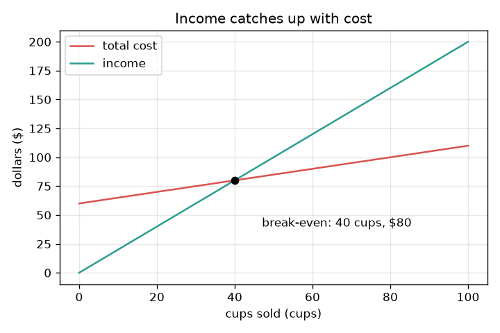
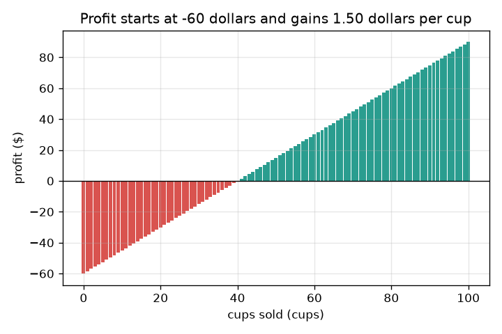

# அமர்வு 1: வருமானம் செலவை எங்கே எட்டிப் பிடிக்கிறது?

[Session 1 — हिन्दी](README.hi.md)

*நிலை 1 (கருத்தியல் ஊடாடும் மாதிரி) · சுமார் 60 நிமிடங்கள் · openbreakeven*

> இது எளிமைப்படுத்தப்பட்ட ஒரு கல்வி மாதிரி மட்டுமே. இது சரிபார்க்கப்பட்ட வடிவமைப்புக் கருவி அல்ல; உண்மையான கட்டமைப்புகள், மின் நிறுவல்கள், வாகனங்கள், தொழில்துறை செயல்முறைகள் அல்லது மருத்துவ முடிவுகளுக்கு இதைப் பயன்படுத்தக் கூடாது.

**முன்தேவைகள் (Prerequisites)**

- பள்ளிக் கணக்கு: பெருக்கல் மற்றும் வகுத்தல்.
- நீங்கள் PRIMER.md படித்து, `python start.py 1` ஒருமுறை இயக்கியிருக்க வேண்டும்.

**கற்றல் நோக்கங்கள் (Learning objectives).** இந்த அமர்வுக்குப் பிறகு உங்களால் முடியும்:

- நிலையான செலவை (fixed cost, ஒருமுறை செலுத்துவது) ஒவ்வொரு கோப்பையின் செலவிலிருந்து பிரிக்க.
- செலவுக் கோட்டையும் வருமானக் கோட்டையும் எழுதி, அவை சந்திக்கும் இடத்தைக் கண்டறிய.
- ஒரே ஒரு வகுத்தலில் சமநிலைப் புள்ளி (break-even) கோப்பைகளின் எண்ணிக்கையைக் கணக்கிட.
- விற்ற கோப்பைகளுக்கு எதிராக செலவு மற்றும் வருமான வரைபடத்தைப் படித்து, சமநிலைப் புள்ளி இல்லாதது எப்போது என்று சொல்ல.

## A. நிஜ உலகப் பிரச்சினை
நீங்கள் ஒரு எலுமிச்சைச் சாறுக் கடை நடத்த விரும்புகிறீர்கள். ஒரு கோப்பை கூட விற்பதற்கு முன் கடை, ஒரு குடுவை, ஒரு பலகை ஆகியவற்றுக்கு 60 டாலர் செலுத்த வேண்டும். அதன் பிறகு ஒவ்வொரு கோப்பையும் தயாரிக்க 50 சென்ட் ஆகும், 2 டாலருக்கு விற்கப்படும். தொடக்கத்தில் நீங்கள் 60 டாலர் பின்தங்கியிருக்கிறீர்கள். உங்கள் மொத்த வருமானம் மொத்த செலவை எட்டிப் பிடிக்க எத்தனை கோப்பைகள் வேண்டும்? அந்த எண்தான் சமநிலைப் புள்ளி (break-even point). (பொதுக் கல்விக்கு மட்டும்: இந்தக் கடை கற்பனையானது, இது நிதி ஆலோசனை அல்ல.)

## B. கருத்தும் கோட்பாடும்
நிலையான செலவு F, நீங்கள் எத்தனை கோப்பைகள் விற்றாலும் ஒருமுறை மட்டுமே செலுத்தப்படுகிறது. மாறும் செலவு (variable cost) v ஒவ்வொரு கோப்பைக்கும் செலுத்தப்படுகிறது. எனவே q கோப்பைகளுக்குப் பிறகு மொத்த செலவு F + v q ஆகும், இது F-இல் தொடங்கும் ஒரு நேர்கோடு. வருமானம் (income) விலை p பெருக்கல் q ஆகும், இது 0-இல் தொடங்கும் ஒரு நேர்கோடு. லாபம் (profit) என்பது வருமானம் கழித்தல் செலவு. ஒவ்வொரு கோப்பையும் F-ஐ அடைக்க p - v டாலர் ஈட்டுகிறது, எனவே தேவையான கோப்பைகள் F-ஐ ஒரு கோப்பை ஈட்டுவதால் வகுத்தது. p, v-ஐ விடப் பெரியதாக இல்லையென்றால் ஒரு கோப்பை எதுவும் ஈட்டாது, வருமானம் ஒருபோதும் செலவை எட்டாது: சமநிலைப் புள்ளி இல்லை.

| குறியீடு | பொருள் | அலகு |
|---|---|---|
| F | நிலையான செலவு, ஒருமுறை செலுத்துவது | டாலர் |
| v | ஒரு கோப்பையின் மாறும் செலவு | டாலர் / கோப்பை |
| p | ஒரு கோப்பையின் விலை | டாலர் / கோப்பை |
| q | விற்ற கோப்பைகள் | கோப்பைகள் |
| q* | சமநிலைப் புள்ளி கோப்பைகளின் எண்ணிக்கை | கோப்பைகள் |

**அனுமானங்கள் (Assumptions)**

- தயாரிக்கப்படும் ஒவ்வொரு கோப்பையும் விற்கப்படுகிறது, எப்போதும் ஒரே விலையில்.
- எத்தனை தயாரித்தாலும் ஒரு கோப்பையின் செலவு மாறாது.
- இன்றைய பணத்துக்கு பின்னர் வரும் பணத்தின் அதே மதிப்பு உண்டு (அமர்வு 3 இதைத் தளர்த்துகிறது).
- கடையும் அதன் எண்களும் கற்பனையானவை.

$$ \text{cost}(q)=F+v\,q,\qquad \text{income}(q)=p\,q $$

$$ \text{profit}(q)=p\,q-(F+v\,q)=(p-v)\,q-F $$

$$ q^{*}=\frac{F}{p-v}\quad(\text{only if } p>v) $$

## C. காட்சி விளக்கம்
முதல் படம் விற்ற கோப்பைகளுக்கு எதிராக இரண்டு கோடுகளையும் வரைகிறது. சிவப்புச் செலவுக் கோடு 60 டாலரில் தொடங்கி மெதுவாக, ஒரு கோப்பைக்கு 50 சென்ட் வீதம் உயர்கிறது. பச்சை வருமானக் கோடு 0-இல் தொடங்கி வேகமாக, ஒரு கோப்பைக்கு 2 டாலர் வீதம் உயர்கிறது. அவை 40 கோப்பைகளிலும் 80 டாலரிலும் வெட்டுகின்றன: அதுதான் சமநிலைப் புள்ளி. இரண்டாவது படம் ஒவ்வொரு கோப்பைக்குப் பிறகும் உள்ள லாபத்தை ஒரு பட்டையாகக் காட்டுகிறது. அது கழித்தல் 60 டாலரில் தொடங்குகிறது, ஒவ்வொரு கோப்பையும் 1.50 டாலர் சேர்க்கிறது, 40 கோப்பைகளில் பட்டைகள் பச்சையாகின்றன.

*விற்ற கோப்பைகளுக்கு எதிராக செலவும் வருமானமும்: அவை 40 கோப்பைகளிலும் 80 டாலரிலும் வெட்டுகின்றன.*

*ஒவ்வொரு கோப்பைக்குப் பிறகும் லாபம்: அது கழித்தல் 60 டாலரில் தொடங்கி ஒரு கோப்பைக்கு 1.50 டாலர் கூடுகிறது.*

## D. ஊடாடும் உருவகப்படுத்தல் (Interactive simulation)
பாடத்தை இயக்குங்கள் (`python start.py 1`), பின்னர் நேரடிச் செயலியைத் திறங்கள்: [அமர்வு 1: எலுமிச்சைச் சாறுக் கடை](https://krunalpanchal1995.github.io/pan-iit-oss/openbreakeven/session-01/) (அல்லது இந்தக் கோப்புறையில் உள்ள `app.html`). கோப்பைகள் ஸ்லைடரை நகர்த்தி இரண்டு பட்டைகளையும் கவனியுங்கள்: வெளியே போகும் பணம், உள்ளே வரும் பணம். பின்னர் வரைபடக் காட்சியைத் திறந்து விலை, ஒரு கோப்பையின் செலவு, நிலையான செலவு ஆகியவற்றை ஒவ்வொன்றாக மாற்றுங்கள்.

**சவால்.** 30 கோப்பைகளுக்குள் கடையைச் சமநிலைக்குக் கொண்டு வாருங்கள்.

## E. செய்து காட்டிய எடுத்துக்காட்டும் சோதனையும்
**பிரச்சினை.** ஒரு கடையின் நிலையான செலவு 60 டாலர், கோப்பைகளை 2.00 டாலருக்கு விற்கிறது, ஒரு கோப்பைக்கு 0.50 டாலர் செலவிடுகிறது. சமநிலைப் புள்ளி கோப்பைகளின் எண்ணிக்கையைக் கண்டறிந்து சரிபாருங்கள்.

1. ஒவ்வொரு கோப்பையும் நிலையான செலவுக்காக 2.00 - 0.50 = 1.50 டாலர் ஈட்டுகிறது.
2. தேவையான கோப்பைகள் = 60 / 1.50 = 40 கோப்பைகள்.
3. செலவைச் சரிபாருங்கள்: 60 + 0.50 * 40 = 80 டாலர். வருமானத்தைச் சரிபாருங்கள்: 2.00 * 40 = 80 டாலர். அவை சமம்.
4. ஒரு கோப்பை முன்பு, 39 கோப்பைகளில், லாபம் கழித்தல் 1.50 டாலர்; ஒரு கோப்பை பின்பு, 41 கோப்பைகளில், அது கூட்டல் 1.50 டாலர்.

**விடை.** சமநிலைப் புள்ளி 40 கோப்பைகளில், அங்கு வருமானமும் செலவும் இரண்டும் 80 டாலர்.

**சோதனை.** பள்ளியில் ஒரு உண்மையான அல்லது பாவனைக் கடையை நடத்துங்கள்: முதலில் செலவிட்டதை எழுதுங்கள், பின்னர் விற்ற கோப்பைகளையும் பெற்ற பணத்தையும் கணக்கு வைத்துக் கொள்ளுங்கள். கூடிக்கொண்டே போகும் மொத்தங்களை வரைந்து அவை எங்கே வெட்டுகின்றன என்று பாருங்கள். வெட்டும் இடம் 40 கோப்பைகளிலிருந்து வேறுபடலாம் என எதிர்பாருங்கள்: சில கோப்பைகள் சிந்திவிடும், விலை மாறலாம், ஒரு கோப்பையின் செலவு ஒரு சராசரி மட்டுமே. மாதிரி ஒரே நிலையான விலையையும் செலவையும் பயன்படுத்துகிறது, தயாரிக்கப்படும் ஒவ்வொரு கோப்பையும் விற்கப்படும் என்று அனுமானிக்கிறது.

## F. மதிப்பீடும் வடிவமைப்புச் சவாலும்
**கேள்வி வகை A: கருத்தியல்.** ஒரு நண்பர் சொல்கிறார்: கடைக்கு 60 டாலர் செலவு, ஒவ்வொரு கோப்பையும் 2 டாலருக்கு விற்கிறது, எனவே சமநிலைப் புள்ளி 60 / 2 = 30 கோப்பைகள். அவர் எதை மறந்தார்?

குறிப்பு

ஒரு கோப்பையைத் தயாரிக்க ஏதாவது செலவாகிறதா?

படிப்படியான தீர்வு

அவர் மாறும் செலவை மறந்துவிட்டார். ஒவ்வொரு கோப்பையும் 2.00 டாலர் கொண்டு வருகிறது, ஆனால் தயாரிக்க 0.50 டாலர் செலவும் ஆகிறது, எனவே அது நிலையான செலவுக்கு 1.50 டாலர் மட்டுமே உதவுகிறது. சரியான விடை 60 / 1.50 = 40 கோப்பைகள், 30 அல்ல.

**கேள்வி வகை B: எண்ணியல்.** வேறொரு கடையின் நிலையான செலவு 45 டாலர், விலை 1.50 டாலர், ஒரு கோப்பையின் செலவு 0.60 டாலர். சமநிலைப் புள்ளி கோப்பைகளைக் கண்டறிந்து, அங்கே வருமானம் செலவுக்குச் சமம் என்று சரிபாருங்கள்.

குறிப்பு

ஒரு கோப்பையின் ஈட்டல் = விலை கழித்தல் கோப்பைச் செலவு; பின்னர் வகுங்கள்.

படிப்படியான தீர்வு

ஒவ்வொரு கோப்பையும் 1.50 - 0.60 = 0.90 டாலர் ஈட்டுகிறது. கோப்பைகள் = 45 / 0.90 = 50. சரிபார்ப்பு: வருமானம் = 1.50 * 50 = 75 டாலர்; செலவு = 45 + 0.60 * 50 = 75 டாலர். சமம். அலகுகள்: டாலரை டாலர் / கோப்பையால் வகுத்தால் கோப்பைகள் கிடைக்கும்.

**கேள்வி வகை C: வரைபடம் மற்றும் உருவகப்படுத்தல் விளக்கம்.** முதல் கடையின் வரைபடத்தில், 25 கோப்பைகளில் செலவு, வருமானம், லாபம் ஆகியவற்றைப் படியுங்கள். கடை முன்னிலையிலா பின்தங்கியா?

குறிப்பு

செலவுக் கோட்டின் மதிப்பு 60 கூட்டல் 0.50 பெருக்கல் 25; வருமானம் 2.00 பெருக்கல் 25.

படிப்படியான தீர்வு

25 கோப்பைகளில் செலவு 60 + 12.50 = 72.50 டாலர், வருமானம் 50 டாலர். லாபம் 50 - 72.50 = கழித்தல் 22.50 டாலர், ஒரு நட்டம்: சிவப்புக் கோடு இன்னும் பச்சைக் கோட்டுக்கு மேலே உள்ளது, எனவே கடை பின்தங்கியுள்ளது.

**கேள்வி வகை D: வடிவமைப்பு மற்றும் உகப்பாக்கம் (optimisation) சவால்.** வடிவமைப்பு: கடை ஒரு குறுகிய நாள் மட்டுமே திறந்திருக்கும். சமநிலைப் புள்ளி 30 கோப்பைகள் அல்லது அதற்குக் குறைவாக வருமாறு விலையையோ நிலையான செலவையோ மாற்றுங்கள். நீங்கள் எதைத் தேர்ந்தெடுப்பீர்கள், அதன் இடர் என்ன?

குறிப்பு

அதே நிலையான செலவுடன் விலை 2.50-ஐ முயலுங்கள், அதே விலையுடன் நிலையான செலவு 45-ஐ முயலுங்கள். பின்னர் மறுதிசையைப் பார்க்க விலை 1.00-ஐ முயலுங்கள்.

படிப்படியான தீர்வு

விலை 2.50 டாலர்: ஒவ்வொரு கோப்பையும் 2.00 ஈட்டுகிறது, எனவே 60 / 2.00 = 30 கோப்பைகள். அல்லது விலை 2.00-இல் நிலையான செலவு 45 டாலர்: 45 / 1.50 = 30 கோப்பைகள். இரண்டும் வேலை செய்கின்றன. அதிக விலை வாடிக்கையாளர்களைக் குறைக்கும் இடர் உண்டு (இந்த எளிய மாதிரி அதைப் புறக்கணிக்கிறது); குறைந்த நிலையான செலவு என்றால் மலிவான கடை, அது சிறியதாகவோ மோசமான இடத்திலோ இருக்கலாம். 1.00 டாலர் விலைக்கு 60 / 0.50 = 120 கோப்பைகள் தேவைப்படும், எனவே விலையை மிகவும் குறைப்பது சமநிலைப் புள்ளியை வெகு தொலைவுக்குத் தள்ளுகிறது.

[RUBRIC.md](../../RUBRIC.md) மூலம் உங்களுக்கு நீங்களே மதிப்பெண் இடுங்கள். தாளில் செய்ய [செயல்பாட்டுத் தாளை](activity_sheet.md) அச்சிடுங்கள்.

## பொதுவான தவறான எண்ணங்கள்
| பொதுவான தவறான எண்ணம் | உண்மையில் சரியானது |
|---|---|
| கடைக்கான பணத்தை அடைக்கும் கோப்பைகளின் எண்ணிக்கையே சமநிலைப் புள்ளி. | ஒவ்வொரு கோப்பையைத் தயாரிக்கவும் செலவாகிறது; மீதமுள்ளது மட்டும், விலை கழித்தல் கோப்பைச் செலவு, கடைக்கான பணத்தை அடைக்கிறது. |
| சமநிலைப் புள்ளியில் கடை லாபம் ஈட்டியிருக்கிறது. | சமநிலைப் புள்ளியில் லாபம் சரியாகப் பூஜ்ஜியம். லாபம் அடுத்த கோப்பையிலிருந்து தொடங்குகிறது. |
| அதிக விலை எப்போதும் சமநிலைப் புள்ளியை விரைவில் கொண்டு வரும். | இந்த மாதிரியில் ஆம், ஆனால் உண்மையான வாடிக்கையாளர்கள் அதிக விலையில் குறைவான கோப்பைகளே வாங்குவார்கள்; அமர்வு 2 அதைச் சேர்க்கிறது. |
| போதுமான கோப்பைகள் விற்றால் நான் எப்போதும் சமநிலையை அடைவேன். | விலை ஒரு கோப்பையின் செலவை விட அதிகமாக இருந்தால் மட்டுமே. இல்லையெனில் ஒவ்வொரு கூடுதல் கோப்பையும் நட்டத்தைப் பெரிதாக்குகிறது. |

## சொற்களஞ்சியம் (Glossary)
- **நிலையான செலவு (fixed cost)**: விற்ற கோப்பைகளின் எண்ணிக்கை எதுவாயினும் ஒருமுறை செலுத்தும் பணம்
- **மாறும் செலவு (variable cost)**: தயாரிக்கும் ஒவ்வொரு கோப்பைக்கும் செலவிடும் பணம்
- **வருமானம் (income / revenue)**: விலை பெருக்கல் விற்ற கோப்பைகள்
- **லாபம் (profit)**: வருமானம் கழித்தல் மொத்த செலவு; எதிர்மறை என்றால் நட்டம்
- **சமநிலைப் புள்ளி (break-even)**: வருமானம் செலவுக்குச் சமமாகி, லாபம் பூஜ்ஜியமாகும் கோப்பைகளின் எண்ணிக்கை

## நிறைவு
1. [exercises.md](exercises.md)-இல் உள்ள மூன்று நிரலாக்கப் பணிகளைச் செய்யுங்கள்.
2. உங்கள் மாற்றங்களுக்குப் பிறகு `python start.py 1` மீண்டும் இயக்குங்கள். அது சோதனைச்சாவடியுடன் (checkpoint) முடிகிறது; அது `PASS` என்று அச்சிடும்போது நீங்கள் முடித்துவிட்டீர்கள். (சோதனைச்சாவடி மட்டும்: `python start.py check 1`.)

அடுத்தது: [அமர்வு 2](../session-02/README.md)
