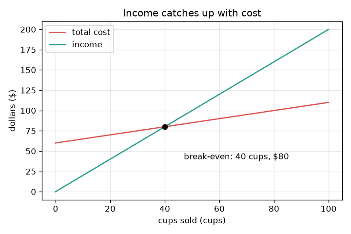
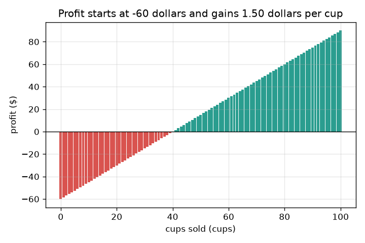

# సెషన్ 1: ఆదాయం ఖర్చును ఎక్కడ అందుకుంటుంది?

[Session 1 — हिन्दी](README.hi.md)

*స్థాయి 1 (భావనాత్మక ఇంటరాక్టివ్ మోడల్) · సుమారు 60 నిమిషాలు · openbreakeven*

> ఇది సరళీకరించిన విద్యా మోడల్ మాత్రమే. ఇది ధృవీకరించిన డిజైన్ సాధనం కాదు; నిజమైన నిర్మాణాలు, విద్యుత్ వ్యవస్థలు, వాహనాలు, పారిశ్రామిక ప్రక్రియలు లేదా వైద్య నిర్ణయాల కోసం దీన్ని ఉపయోగించకూడదు.

**ముందస్తు అవసరాలు (Prerequisites)**

- పాఠశాల అంకగణితం: గుణకారం మరియు భాగహారం.
- మీరు PRIMER.md చదివి, `python start.py 1` ఒకసారి నడిపి ఉండాలి.

**అభ్యాస లక్ష్యాలు (Learning objectives).** ఈ సెషన్ తర్వాత మీరు చేయగలరు:

- స్థిర ఖర్చును (fixed cost, ఒకసారి చెల్లించేది) ప్రతి కప్పు ఖర్చు నుండి వేరు చేయడం.
- ఖర్చు రేఖను, ఆదాయ రేఖను రాసి, అవి కలిసే చోటును కనుగొనడం.
- ఒకే ఒక భాగహారంతో బ్రేక్-ఈవెన్ (break-even) కప్పుల సంఖ్యను లెక్కించడం.
- అమ్మిన కప్పులకు వ్యతిరేకంగా ఖర్చు మరియు ఆదాయ గ్రాఫ్‌ను చదివి, బ్రేక్-ఈవెన్ లేనప్పుడు చెప్పడం.

## A. నిజ జీవిత సమస్య
మీరు ఒక నిమ్మరసం దుకాణం నడపాలనుకుంటున్నారు. ఒక్క కప్పు కూడా అమ్మక ముందే దుకాణం, ఒక జగ్గు, ఒక బోర్డు కోసం 60 డాలర్లు చెల్లించాలి. ఆ తర్వాత ప్రతి కప్పు తయారు చేయడానికి 50 సెంట్లు ఖర్చవుతుంది, 2 డాలర్లకు అమ్ముడవుతుంది. ప్రారంభంలో మీరు 60 డాలర్లు వెనుకబడి ఉన్నారు. మీ మొత్తం ఆదాయం మొత్తం ఖర్చును అందుకోవడానికి ఎన్ని కప్పులు కావాలి? ఆ సంఖ్యే బ్రేక్-ఈవెన్ పాయింట్ (break-even point). (సాధారణ విద్య కోసం మాత్రమే: ఈ దుకాణం కల్పితం, ఇది ఆర్థిక సలహా కాదు.)

## B. భావన మరియు సిద్ధాంతం
స్థిర ఖర్చు F, మీరు ఎన్ని కప్పులు అమ్మినా ఒకసారి మాత్రమే చెల్లిస్తారు. చర ఖర్చు (variable cost) v ప్రతి కప్పుకూ చెల్లిస్తారు. కాబట్టి q కప్పుల తర్వాత మొత్తం ఖర్చు F + v q, ఇది F వద్ద మొదలయ్యే ఒక సరళ రేఖ. ఆదాయం (income) ధర p గుణించు q, ఇది 0 వద్ద మొదలయ్యే ఒక సరళ రేఖ. లాభం (profit) అంటే ఆదాయం తీసివేత ఖర్చు. ప్రతి కప్పు F ను తీర్చడానికి p - v డాలర్లు సంపాదిస్తుంది, కాబట్టి కావలసిన కప్పులు F ను ఒక కప్పు సంపాదించే మొత్తంతో భాగించినది. p, v కంటే పెద్దది కాకపోతే ఒక కప్పు ఏమీ సంపాదించదు, ఆదాయం ఎప్పటికీ ఖర్చును అందుకోదు: బ్రేక్-ఈవెన్ లేదు.

| చిహ్నం | అర్థం | యూనిట్ |
|---|---|---|
| F | స్థిర ఖర్చు, ఒకసారి చెల్లించేది | డాలర్లు |
| v | ఒక కప్పు చర ఖర్చు | డాలర్లు / కప్పు |
| p | ఒక కప్పు ధర | డాలర్లు / కప్పు |
| q | అమ్మిన కప్పులు | కప్పులు |
| q* | బ్రేక్-ఈవెన్ కప్పుల సంఖ్య | కప్పులు |

**ఊహలు (Assumptions)**

- తయారు చేసిన ప్రతి కప్పూ అమ్ముడవుతుంది, ఎల్లప్పుడూ ఒకే ధరకు.
- ఎన్ని తయారు చేసినా ఒక కప్పు ఖర్చు మారదు.
- ఈ రోజు డబ్బుకు తర్వాతి డబ్బుకు ఉన్నంత విలువే ఉంటుంది (సెషన్ 3 దీన్ని సడలిస్తుంది).
- దుకాణం మరియు దాని సంఖ్యలు కల్పితం.

$$ \text{cost}(q)=F+v\,q,\qquad \text{income}(q)=p\,q $$

$$ \text{profit}(q)=p\,q-(F+v\,q)=(p-v)\,q-F $$

$$ q^{*}=\frac{F}{p-v}\quad(\text{only if } p>v) $$

## C. దృశ్య వివరణ
మొదటి చిత్రం అమ్మిన కప్పులకు వ్యతిరేకంగా రెండు రేఖలనూ గీస్తుంది. ఎరుపు ఖర్చు రేఖ 60 డాలర్ల వద్ద మొదలై నెమ్మదిగా, కప్పుకు 50 సెంట్ల చొప్పున పెరుగుతుంది. ఆకుపచ్చ ఆదాయ రేఖ 0 వద్ద మొదలై వేగంగా, కప్పుకు 2 డాలర్ల చొప్పున పెరుగుతుంది. అవి 40 కప్పులు మరియు 80 డాలర్ల వద్ద ఖండించుకుంటాయి: అదే బ్రేక్-ఈవెన్ పాయింట్. రెండవ చిత్రం ప్రతి కప్పు తర్వాతి లాభాన్ని ఒక బార్‌గా చూపిస్తుంది. అది మైనస్ 60 డాలర్ల వద్ద మొదలవుతుంది, ప్రతి కప్పు 1.50 డాలర్లు కలుపుతుంది, 40 కప్పుల వద్ద బార్లు ఆకుపచ్చగా మారతాయి.

*అమ్మిన కప్పులకు వ్యతిరేకంగా ఖర్చు మరియు ఆదాయం: అవి 40 కప్పులు మరియు 80 డాలర్ల వద్ద ఖండించుకుంటాయి.*

*ప్రతి కప్పు తర్వాత లాభం: అది మైనస్ 60 డాలర్ల వద్ద మొదలై కప్పుకు 1.50 డాలర్లు పెరుగుతుంది.*

## D. ఇంటరాక్టివ్ సిమ్యులేషన్
పాఠాన్ని నడపండి (`python start.py 1`), తర్వాత లైవ్ యాప్‌ను తెరవండి: [సెషన్ 1: నిమ్మరసం దుకాణం](https://krunalpanchal1995.github.io/pan-iit-oss/openbreakeven/session-01/) (లేదా ఈ ఫోల్డర్‌లోని `app.html`). కప్పుల స్లైడర్‌ను కదిలించి రెండు బార్లను గమనించండి: బయటకు వెళ్ళే డబ్బు, లోపలికి వచ్చే డబ్బు. తర్వాత గ్రాఫ్ వ్యూ తెరిచి ధర, ఒక కప్పు ఖర్చు, స్థిర ఖర్చులను ఒక్కొక్కటిగా మార్చండి.

**సవాలు.** 30 కప్పుల లోపల దుకాణాన్ని బ్రేక్-ఈవెన్ చేయండి.

## E. సాధించిన ఉదాహరణ మరియు ప్రయోగం
**సమస్య.** ఒక దుకాణానికి స్థిర ఖర్చు 60 డాలర్లు, కప్పులను 2.00 డాలర్లకు అమ్ముతుంది, కప్పుకు 0.50 డాలర్లు ఖర్చు చేస్తుంది. బ్రేక్-ఈవెన్ కప్పుల సంఖ్యను కనుగొని తనిఖీ చేయండి.

1. ప్రతి కప్పు స్థిర ఖర్చు కోసం 2.00 - 0.50 = 1.50 డాలర్లు సంపాదిస్తుంది.
2. కావలసిన కప్పులు = 60 / 1.50 = 40 కప్పులు.
3. ఖర్చు తనిఖీ: 60 + 0.50 * 40 = 80 డాలర్లు. ఆదాయం తనిఖీ: 2.00 * 40 = 80 డాలర్లు. అవి సమానం.
4. ఒక కప్పు ముందు, 39 కప్పుల వద్ద, లాభం మైనస్ 1.50 డాలర్లు; ఒక కప్పు తర్వాత, 41 కప్పుల వద్ద, అది ప్లస్ 1.50 డాలర్లు.

**సమాధానం.** బ్రేక్-ఈవెన్ 40 కప్పుల వద్ద, అక్కడ ఆదాయం మరియు ఖర్చు రెండూ 80 డాలర్లు.

**ప్రయోగం.** పాఠశాలలో ఒక నిజమైన లేదా ఊహాజనిత దుకాణం నడపండి: మొదట ఖర్చు చేసినది రాయండి, తర్వాత అమ్మిన కప్పులు, వచ్చిన డబ్బు లెక్క ఉంచండి. పెరుగుతున్న మొత్తాలను ప్లాట్ చేసి అవి ఎక్కడ ఖండించుకుంటాయో చూడండి. ఖండన 40 కప్పుల నుండి భిన్నంగా ఉంటుందని ఆశించండి: కొన్ని కప్పులు ఒలికిపోతాయి, ధర మారవచ్చు, ఒక కప్పు ఖర్చు ఒక సగటు మాత్రమే. మోడల్ ఒకే స్థిర ధర మరియు ఖర్చును ఉపయోగిస్తుంది, తయారు చేసిన ప్రతి కప్పూ అమ్ముడవుతుందని ఊహిస్తుంది.

## F. మూల్యాంకనం మరియు డిజైన్ సవాలు
**ప్రశ్న రకం A: భావనాత్మక.** ఒక స్నేహితుడు అంటాడు: దుకాణానికి 60 డాలర్లు ఖర్చు, ప్రతి కప్పు 2 డాలర్లకు అమ్ముడవుతుంది, కాబట్టి బ్రేక్-ఈవెన్ 60 / 2 = 30 కప్పులు. వారు ఏమి మర్చిపోయారు?

సూచన

ఒక కప్పు తయారు చేయడానికి ఏమైనా ఖర్చవుతుందా?

దశలవారీ పరిష్కారం

వారు చర ఖర్చును మర్చిపోయారు. ప్రతి కప్పు 2.00 డాలర్లు తెస్తుంది, కానీ తయారు చేయడానికి 0.50 డాలర్లు కూడా ఖర్చవుతుంది, కాబట్టి అది స్థిర ఖర్చుకు 1.50 డాలర్లు మాత్రమే సహాయపడుతుంది. సరైన సమాధానం 60 / 1.50 = 40 కప్పులు, 30 కాదు.

**ప్రశ్న రకం B: సంఖ్యాత్మక.** వేరొక దుకాణానికి స్థిర ఖర్చు 45 డాలర్లు, ధర 1.50 డాలర్లు, కప్పు ఖర్చు 0.60 డాలర్లు. బ్రేక్-ఈవెన్ కప్పులను కనుగొని, అక్కడ ఆదాయం ఖర్చుకు సమానమని తనిఖీ చేయండి.

సూచన

కప్పుకు సంపాదన = ధర తీసివేత కప్పు ఖర్చు; తర్వాత భాగించండి.

దశలవారీ పరిష్కారం

ప్రతి కప్పు 1.50 - 0.60 = 0.90 డాలర్లు సంపాదిస్తుంది. కప్పులు = 45 / 0.90 = 50. తనిఖీ: ఆదాయం = 1.50 * 50 = 75 డాలర్లు; ఖర్చు = 45 + 0.60 * 50 = 75 డాలర్లు. సమానం. యూనిట్లు: డాలర్లను డాలర్లు / కప్పుతో భాగిస్తే కప్పులు వస్తాయి.

**ప్రశ్న రకం C: గ్రాఫ్ మరియు సిమ్యులేషన్ వ్యాఖ్యానం.** మొదటి దుకాణం గ్రాఫ్‌లో, 25 కప్పుల వద్ద ఖర్చు, ఆదాయం, లాభం చదవండి. దుకాణం ముందుందా వెనుకబడిందా?

సూచన

ఖర్చు రేఖ విలువ 60 ప్లస్ 0.50 గుణించు 25; ఆదాయం 2.00 గుణించు 25.

దశలవారీ పరిష్కారం

25 కప్పుల వద్ద ఖర్చు 60 + 12.50 = 72.50 డాలర్లు, ఆదాయం 50 డాలర్లు. లాభం 50 - 72.50 = మైనస్ 22.50 డాలర్లు, ఒక నష్టం: ఎరుపు రేఖ ఇంకా ఆకుపచ్చ రేఖ పైన ఉంది, కాబట్టి దుకాణం వెనుకబడి ఉంది.

**ప్రశ్న రకం D: డిజైన్ మరియు ఆప్టిమైజేషన్ (optimisation) సవాలు.** డిజైన్: దుకాణం ఒక చిన్న రోజు మాత్రమే తెరిచి ఉంటుంది. బ్రేక్-ఈవెన్ 30 కప్పులు లేదా అంతకంటే తక్కువ వద్ద వచ్చేలా ధరను గానీ స్థిర ఖర్చును గానీ మార్చండి. మీరు దేన్ని ఎంచుకుంటారు, దాని ప్రమాదం ఏమిటి?

సూచన

అదే స్థిర ఖర్చుతో ధర 2.50 ప్రయత్నించండి, అదే ధరతో స్థిర ఖర్చు 45 ప్రయత్నించండి. తర్వాత వ్యతిరేక దిశను చూడటానికి ధర 1.00 ప్రయత్నించండి.

దశలవారీ పరిష్కారం

ధర 2.50 డాలర్లు: ప్రతి కప్పు 2.00 సంపాదిస్తుంది, కాబట్టి 60 / 2.00 = 30 కప్పులు. లేదా ధర 2.00 వద్ద స్థిర ఖర్చు 45 డాలర్లు: 45 / 1.50 = 30 కప్పులు. రెండూ పనిచేస్తాయి. ఎక్కువ ధర వల్ల కస్టమర్లు తగ్గే ప్రమాదం ఉంది (ఈ సరళ మోడల్ దాన్ని విస్మరిస్తుంది); తక్కువ స్థిర ఖర్చు అంటే చౌకైన దుకాణం, అది చిన్నదిగా లేదా చెడ్డ చోట ఉండవచ్చు. 1.00 డాలర్ ధరకు 60 / 0.50 = 120 కప్పులు కావాలి, కాబట్టి ధరను బాగా తగ్గించడం బ్రేక్-ఈవెన్‌ను చాలా దూరం నెట్టేస్తుంది.

[RUBRIC.md](../../RUBRIC.md) తో మీకు మీరే స్కోర్ ఇవ్వండి. కాగితంపై పని చేయడానికి [కార్యకలాప పత్రాన్ని](activity_sheet.md) ప్రింట్ చేయండి.

## సాధారణ అపోహలు
| సాధారణ అపోహ | నిజంగా సరైనది |
|---|---|
| దుకాణం ఖర్చును తీర్చే కప్పుల సంఖ్యే బ్రేక్-ఈవెన్. | ప్రతి కప్పు తయారీకీ ఖర్చవుతుంది; మిగిలినది మాత్రమే, ధర తీసివేత కప్పు ఖర్చు, దుకాణం ఖర్చును తీరుస్తుంది. |
| బ్రేక్-ఈవెన్ వద్ద దుకాణం లాభం సంపాదించింది. | బ్రేక్-ఈవెన్ వద్ద లాభం సరిగ్గా సున్నా. లాభం తర్వాతి కప్పు నుండి మొదలవుతుంది. |
| ఎక్కువ ధర ఎల్లప్పుడూ బ్రేక్-ఈవెన్‌ను త్వరగా తెస్తుంది. | ఈ మోడల్‌లో అవును, కానీ నిజమైన కస్టమర్లు ఎక్కువ ధరకు తక్కువ కప్పులు కొంటారు; సెషన్ 2 దాన్ని జోడిస్తుంది. |
| తగినన్ని కప్పులు అమ్మితే నేను ఎల్లప్పుడూ బ్రేక్-ఈవెన్ అవుతాను. | ధర ఒక కప్పు ఖర్చు కంటే ఎక్కువగా ఉంటేనే. లేకపోతే ప్రతి అదనపు కప్పు నష్టాన్ని పెంచుతుంది. |

## పదకోశం (Glossary)
- **స్థిర ఖర్చు (fixed cost)**: అమ్మిన కప్పుల సంఖ్య ఏదైనా ఒకసారి చెల్లించే డబ్బు
- **చర ఖర్చు (variable cost)**: తయారు చేసే ప్రతి కప్పుపై ఖర్చు చేసే డబ్బు
- **ఆదాయం (income / revenue)**: ధర గుణించు అమ్మిన కప్పులు
- **లాభం (profit)**: ఆదాయం తీసివేత మొత్తం ఖర్చు; ప్రతికూలం అంటే నష్టం
- **బ్రేక్-ఈవెన్ (break-even)**: ఆదాయం ఖర్చుకు సమానమై, లాభం సున్నా అయ్యే కప్పుల సంఖ్య

## ముగింపు
1. [exercises.md](exercises.md) లోని మూడు కోడింగ్ పనులు చేయండి.
2. మీ మార్పుల తర్వాత `python start.py 1` మళ్ళీ నడపండి. అది చెక్‌పాయింట్‌ (checkpoint) తో ముగుస్తుంది; అది `PASS` అని ప్రింట్ చేసినప్పుడు మీరు పూర్తి చేశారు. (చెక్‌పాయింట్ మాత్రమే: `python start.py check 1`.)

తర్వాత: [సెషన్ 2](../session-02/README.md)
