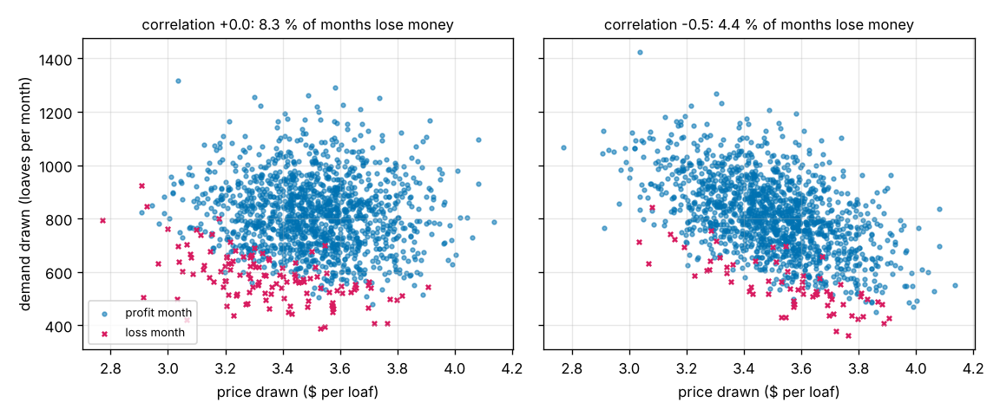
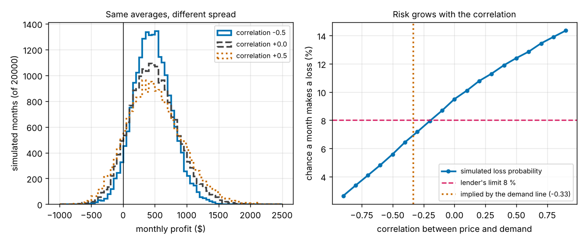

# Session 4: When price and demand move together

*Level 3 (simulation and validation) · about 90 minutes · openbreakeven*

> This is a simplified educational model. It is not a validated design tool and must not be used for real structures, electrical installations, vehicles, industrial processes or medical decisions.

**Prerequisites**

- Session 2: the demand line (each dollar of price loses 250 loaves a month) and the break-even equations.
- Session 3: the Monte Carlo profit model, the loss probability, mean and standard deviation.

**Learning objectives.** After this session you can:

- Draw two random inputs with a chosen correlation and check that the sample has it.
- Show that a correlation between price and demand changes the spread of profit and the loss probability while the mean barely moves.
- Validate the simulation against exact formulas for the mean and the standard deviation of profit.
- Estimate which correlation a demand line implies, and find the largest correlation that meets a lender's limit on the loss probability.

## A. Real-world problem
In Session 3 the made-up bakery's price, variable cost and demand were random but independent: a higher price than planned said nothing about demand. Real customers are not like that. When the price is above plan, fewer people buy; in a festival week a higher price can even come with more buyers. With the same averages and the same spreads, how much does this link change the chance that a month makes a loss? And which link should a lender believe? (Made-up bakery and numbers; general education only, not financial advice.)

## B. Concept and theory
The correlation rho of two random numbers is a number from -1 to +1. At -1 a high price always comes with low demand, at 0 there is no linear link and at +1 they always rise together. To draw demand with correlation rho to the price we mix two independent standard normal draws, z_p for the price and z_o for everything else: z_d = rho z_p + sqrt(1 - rho^2) z_o, and then demand = mean + sd z_d. The price and the variable cost are drawn exactly as in Session 3, so rho = 0 reproduces Session 3 to the last digit.

Write profit = X D - F, where X = price - variable cost and D = demand. X and D are jointly normal, so the mean and the standard deviation of X D have exact formulas (Isserlis' theorem). With Cov(X, D) = rho sigma_p sigma_D (the cost is independent of both), the mean is mu_X mu_D + Cov - F, and the variance is mu_X^2 sigma_D^2 + mu_D^2 sigma_X^2 + 2 mu_X mu_D Cov + sigma_X^2 sigma_D^2 + Cov^2, with sigma_X^2 = sigma_p^2 + sigma_v^2. The correlation moves the mean by only rho sigma_p sigma_D, which is 30 dollars per unit of rho here, but it moves the variance a lot.

Why? A higher price earns more on each loaf but sells fewer loaves. With rho < 0 the two effects partly cancel (a **natural hedge**) and the profit varies less. With rho > 0 they add and the profit varies more. The risk of a loss month therefore depends on the links between the inputs, not only on the spread of each input.

Which correlation is believable? Session 2 gave the demand line: each extra dollar of price loses 250 loaves a month. If the price wobbles by 0.20 dollars and demand follows that line, demand moves by 250 x 0.20 = 50 loaves, while the whole demand spread is 150 loaves, so the correlation is -50 / 150 = -0.33.

| Symbol | Meaning | Unit |
|---|---|---|
| rho | correlation between price and demand | no unit |
| p, v, D | price, variable cost, demand | dollars per loaf, dollars per loaf, loaves per month |
| X | price minus variable cost | dollars per loaf |
| sigma_p, sigma_v, sigma_D | standard deviations (0.20, 0.15, 150) | dollars per loaf, dollars per loaf, loaves per month |
| Cov | covariance of price and demand, rho sigma_p sigma_D | dollars x loaves per month |
| F | fixed cost | dollars per month |

**Assumptions**

- Price, variable cost and demand are normal; demand is clipped at 0 in the simulation (a more than 5 standard deviation event here). The formulas ignore the clipping.
- Only the price-demand correlation is added; the variable cost stays independent of both.
- The linear correlation is a simplification: it does not describe a demand line that bends, or a price that is set after seeing demand.
- The standard deviations are made-up (0.20 dollars, 0.15 dollars, 150 loaves) and so is the bakery.
- The simulation is seeded (seed 42, 20000 months) so every run gives the same numbers; another seed gives results about 0.2 points different for a loss probability near 6 percent.
- Monthly profit only: no loan, no tax. All numbers are made up and this is not financial advice.

$$ z_d=\rho\,z_p+\sqrt{1-\rho^{2}}\,z_o,\qquad D=\mu_D+\sigma_D z_d $$

$$ E[\text{profit}]=\mu_X\mu_D+\rho\,\sigma_p\sigma_D-F $$

$$ \mathrm{Var}[X D]=\mu_X^{2}\sigma_D^{2}+\mu_D^{2}\sigma_X^{2}+2\mu_X\mu_D\,\mathrm{Cov}+\sigma_X^{2}\sigma_D^{2}+\mathrm{Cov}^{2},\qquad \mathrm{Cov}=\rho\,\sigma_p\sigma_D $$

$$ \rho_{\text{implied}}=-\frac{b\,\sigma_p}{\sigma_D}=-\frac{250\times 0.20}{150}=-0.33 $$

## C. Visual explanation
The first figure plots price against demand for 1500 months at correlation 0 (a round cloud) and at -0.5 (a cloud that slopes down to the right), with the loss months marked. With correlation 0, 9.5 percent of the months lose money; with -0.5 it is 5.6 percent. In the second figure, on the left, the three histograms have the same centre, near 470 dollars, but the one for correlation +0.5 is wide (standard deviation 438 dollars) and the one for -0.5 is narrow (300 dollars), so the area to the left of zero is large for +0.5 and small for -0.5. On the right the loss probability rises steadily with the correlation, from 2.6 percent at -0.9 to 14.4 percent at +0.9, and crosses a lender's limit of 8 percent at a correlation of about -0.19.

*Price against demand for 1500 simulated months at correlation 0 and -0.5; the loss months are marked.*

*Left: profit histograms for correlation -0.5, 0 and +0.5. Right: the loss probability against the correlation, with the lender's 8 percent limit and the correlation implied by the demand line.*

The numbers behind the figures (20000 months, seed 42; the mean and standard deviation are from the formulas):

| Correlation | Loss probability | Mean profit | Standard deviation |
|---|---|---|---|
| -0.9 | 2.6 % | $453 | $225 |
| -0.5 | 5.6 % | $465 | $301 |
| -0.33 (demand line) | 6.9 % | $470 | $327 |
| 0 (Session 3) | 9.5 % | $480 | $375 |
| +0.5 | 12.4 % | $495 | $437 |
| +0.9 | 14.4 % | $507 | $482 |

The simulated means are within about 4 dollars of the formula (the simulation of 20000 months has a standard error of about 2 to 3 dollars).

## D. Interactive simulation
Run the lesson (`python start.py 4`), then open the live app: [Session 4: price and demand that move together](https://krunalpanchal1995.github.io/pan-iit-oss/openbreakeven/session-04/) (or `app.html` in this folder). Start on the scatter view and move the correlation slider: the cloud tilts, and the magenta loss crosses gather in the corner where the price is high and the demand low. Then look at the histogram (dashed outline: independent) and the loss-chance curve. The app draws 6000 months, so its loss probabilities can differ from the Python ones by up to about 1 point; the mean and the standard deviation in the readout are shown next to the exact formulas.

**Challenge.** Make the chance of a loss month at most 6 percent by choosing the correlation (leave the other sliders at plan). Which correlations work, and are they believable?

## E. Worked example and experiment
**Problem.** The bakery sells loaves at 3.50 dollars (variable cost 1.40), with F = 1200 dollars a month, a price wobble of 0.20, a cost wobble of 0.15 and demand of 800 loaves with sd 150. Find the mean and the standard deviation of monthly profit for correlation -0.5, estimate the loss probability from them, and compare with the simulation.

1. mu_X = 3.50 - 1.40 = 2.10, so the planned profit is 2.10 x 800 - 1200 = 480 dollars. Cov = -0.5 x 0.20 x 150 = -15.
2. Mean = 480 - 15 = 465 dollars: the correlation moved the mean by only 15 dollars.
3. sigma_X^2 = 0.20^2 + 0.15^2 = 0.0625. Variance = 2.1^2 x 150^2 + 800^2 x 0.0625 + 2 x 2.1 x 800 x (-15) + 0.0625 x 150^2 + 15^2 = 99 225 + 40 000 - 50 400 + 1 406 + 225 = 90 456, so the standard deviation is 300.8 dollars (374.9 for independent inputs).
4. A quick estimate treats the profit as normal: z = -465 / 300.8 = -1.546 and P(loss) = 0.061 (6.1 percent). The simulation of 20000 months gives 5.6 percent, with mean 461 and standard deviation 300.
5. The normal shortcut is a little high because a product of normals is skewed: it has a longer tail on the profit side than on the loss side. For independent inputs the same shortcut gives 10.0 percent against 9.5 percent simulated.

**Answer.** With correlation -0.5 the mean profit is 465 dollars and the standard deviation is 300.8 dollars (against 480 and 375 for independent inputs). The loss chance is about 6.1 percent by the normal shortcut and 5.6 percent by simulation, against 9.5 percent for independent inputs: a 3.9 point drop from a link that changes the mean by only 15 dollars.

**Experiment.** Keep a record of the daily price and the number sold at a school or club stall, changing the price from time to time and noting special days. Compute the correlation of price and sales with `numpy.corrcoef` and use it in `simulate_profit_corr`. Expect a rough value only: prices are chosen by you rather than drawn at random, and weekdays and weather also move demand, so the correlation you measure mixes your pricing with the customers' response, and it may not stay the same next month.

## Real-world application and mini-project: The lender's limit on the loss chance
A lender will fund the bakery if the chance that a month makes a loss is at most 8 percent. The independent model of Session 3 says 9.5 percent, so the plan fails; but price and demand are linked. Use `loss_vs_rho`, `rho_for_limit` and `implied_rho` from Session 4 to find which correlations meet the limit, whether the demand line of Session 2 does, and how robust that conclusion is to the seed and to the spread of the price. State clearly that the answer depends on the correlation you assume, and which assumption you would defend to the lender.

**Deliverable:** A script that prints the loss probability for correlations from -0.9 to +0.9 in steps of 0.1, finds the largest correlation that meets the 8 percent limit, reports the correlation implied by the demand line and its loss probability, repeats the calculation for seeds 1 to 5, and saves a plot of the loss probability against the correlation with the limit and the implied value marked.

**Success looks like:** The largest correlation that meets the limit is about -0.19 (loss probability 7.9 percent); the demand line gives -0.33 and a loss probability of 6.9 percent, so it meets the limit, while independent inputs (9.5 percent) and positive correlations (12.4 percent at +0.5) do not; the threshold stays between about -0.20 and -0.14 across seeds 1 to 5.

## F. Assessment and design challenge
**Question type A: Conceptual.** Why does a negative correlation between price and demand make the bakery's profit less risky, although it hardly changes the average profit?

Hint

Think about what a month with a higher price than planned does to the margin and to the number of loaves sold.

Step-by-step solution

Profit is the margin per loaf times the number of loaves. A month with a high price has a bigger margin but, with a negative correlation, a smaller demand; a month with a low price has a smaller margin but a bigger demand. The two effects pull the profit in opposite directions and partly cancel, so the profit varies less around the same centre: this is a natural hedge. The average moves only by rho sigma_p sigma_D (here 15 dollars at -0.5) while the standard deviation falls from 375 to 301 dollars, so fewer months fall below zero. With a positive correlation the effects add and the risk grows.

**Question type B: Numerical.** Find the mean and the standard deviation of monthly profit for correlation +0.5 by hand (same data as the worked example), and use them to estimate the loss probability with the normal shortcut. How does it compare with the 12.4 percent of the simulation?

Hint

Cov = rho sigma_p sigma_D = 15. Use the variance formula and then z = -mean / standard deviation.

Step-by-step solution

Mean = 480 + 15 = 495 dollars. Variance = 99 225 + 40 000 + 2 x 2.1 x 800 x 15 + 1 406 + 225 = 99 225 + 40 000 + 50 400 + 1 406 + 225 = 191 256, so the standard deviation is 437.3 dollars. z = -495 / 437.3 = -1.132 and P(loss) = 0.129, about 12.9 percent, a little above the simulated 12.4 percent. The shortcut is slightly high at both +0.5 and -0.5 because of the skew. Units: dollars per month, and a pure number for the probability.

**Question type C: Graph and simulation interpretation.** In the loss-probability figure, the independent case (correlation 0) lies at 9.5 percent, above the lender's 8 percent, and the demand-line value (-0.33) lies below it. What can you conclude, and what can you not conclude?

Hint

Where does the curve cross 8 percent, and what does the demand-line value assume about why price moves?

Step-by-step solution

The curve crosses 8 percent at a correlation of about -0.19, so any correlation below that meets the limit. The demand line implies -0.33, which meets it with 6.9 percent. What we cannot conclude is that the plan is safe: the -0.33 holds only if the price wobbles because the bakery moves along its demand line, so that 50 of the 150 loaves of demand spread are explained by price. If the price wobbles for other reasons (a supplier's cost, a competitor's sale) the link may be weaker, and at a correlation of 0 the limit is missed. The result depends on an assumption about the cause of the price changes and should be reported as a range (6.9 to 9.5 percent), not as one number.

**Question type D: Design and optimisation challenge.** Design: a lender asks for a loss probability of at most 5 percent. The owner can cut the fixed cost in steps of 50 dollars from 1200. (a) Assuming independent inputs, what is the highest fixed cost that meets the limit? (b) Assuming the demand-line correlation of -0.33? How much does believing the correlation relax the budget, and how safe is that answer?

Hint

Use `loss_probability(rho, fixed=...)` for F = 1200, 1150, 1100, 1050 and 1000.

Step-by-step solution

Independent inputs: 1200 gives 9.5 percent, 1150 gives 7.0, 1100 gives 5.1 (just over) and 1050 gives 3.6, so the highest fixed cost that meets the limit is 1050 dollars. With the correlation -0.33: 1200 gives 6.9 percent, 1150 gives 4.9 and 1100 gives 3.5, so the highest is 1150 dollars. Believing the correlation relaxes the budget by 100 dollars a month. But 4.9 percent is only 0.1 points below the limit, within the error of the simulation (about 0.2 points for 20000 months), and it rests on the assumed correlation; a careful owner who cannot rule out independent inputs would choose 1050 dollars, which meets the limit under both assumptions (3.6 and 2.4 percent). The constants are made-up, so this shows a method, not a real loan decision.

Score yourself with [RUBRIC.md](../../RUBRIC.md). Print the [activity sheet](activity_sheet.md) to work on paper.

## Common misconceptions
| Common misconception | What is actually true |
|---|---|
| If every input has the right average and spread, the risk is fixed. | The links between the inputs matter: with the same averages and spreads the loss chance went from 5.6 to 12.4 percent between correlation -0.5 and +0.5. |
| A correlation changes the average profit a lot. | It changes the mean only by rho times the product of the two spreads (15 to 30 dollars here); it changes the spread, and so the loss chance, much more. |
| A negative correlation means the business loses money. | It means price and demand move in opposite directions; here that lowers the risk. |
| The correlation can simply be chosen to make the plan pass. | It is an assumption that needs a reason, such as the demand line; the honest answer shows the range of correlations and what each implies. |

## Glossary
- **correlation**: a number from -1 to +1 saying how closely two random quantities move together
- **covariance**: the average product of the two deviations from the means; the correlation times the two standard deviations
- **natural hedge**: two effects that partly cancel because they move in opposite directions
- **common random numbers**: using the same random draws for every setting so that differences come from the setting and not from luck
- **Isserlis' theorem**: the rule that gives the moments of products of jointly normal numbers

## Finish
1. Do the three coding tasks in [exercises.md](exercises.md).
2. Run `python start.py 4` again after your changes. It ends with the checkpoint; when it prints `PASS`, you are done. (Checkpoint only: `python start.py check 4`.)

Next: [Session 5: Seasons and a loan](../session-05/README.md).
