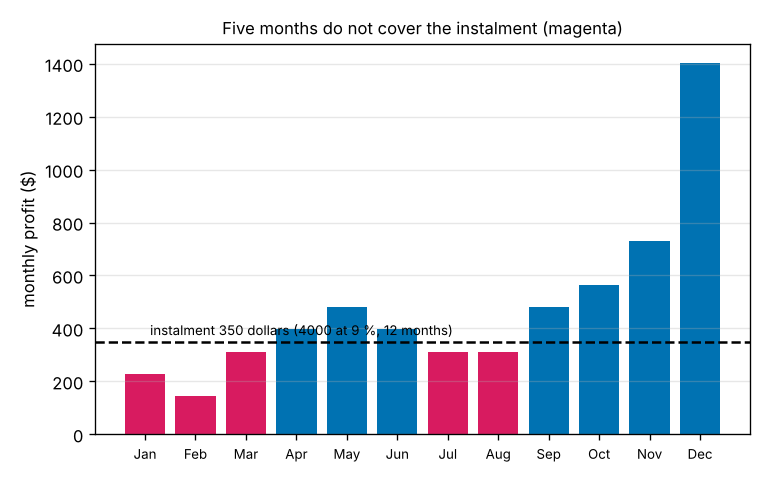
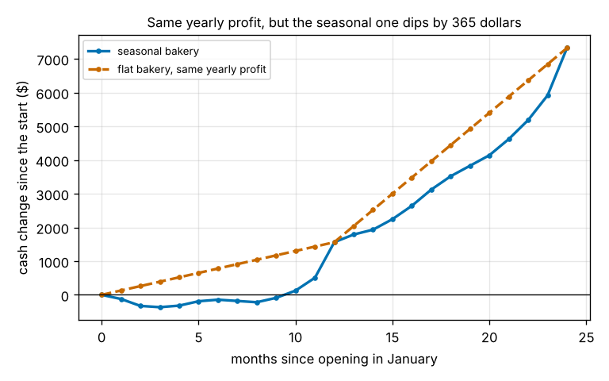

# Session 5: Seasons and a loan

*Level 3 (simulation and validation) · about 90 minutes · openbreakeven*

> This is a simplified educational model. It is not a validated design tool and must not be used for real structures, electrical installations, vehicles, industrial processes or medical decisions.

**Prerequisites**

- Session 3: planned profit, the Monte Carlo model, the start-up cost and payback.
- Session 4: the idea of risk coming from how inputs behave together (helpful, not essential).
- Optional: the openloan repo (monthly instalments).

**Learning objectives.** After this session you can:

- Build a 12-month demand pattern that averages 1.0 and show that the yearly profit equals that of a flat year.
- Compute the equal monthly instalment of a loan, split each instalment into interest and repayment, and check that the schedule clears the debt.
- Follow the running cash total month by month and find the extra cash the owner needs.
- Show that the opening month, the loan size and the loan term change the extra cash needed, and use a Monte Carlo year to put a probability on running short.

## A. Real-world problem
The made-up bakery of the earlier sessions sells the same number of loaves every month and pays for everything itself. A real bakery sells far more in December than in February, and most borrow part of the start-up money and repay it in equal instalments. A seasonal bakery can earn exactly as much in a year as a flat one and still run out of cash in March, because the instalment is due every month but the customers are not. How much extra cash does the owner need, and what can be changed to reduce it? (Made-up bakery, loan and numbers; general education only, not financial advice.)

## B. Concept and theory
A **seasonal factor** says how a month's demand compares with the yearly average; 1.55 means 55 percent more. We require the 12 factors to average exactly 1.0, so the pattern moves sales around the yearly average and neither adds nor removes any. Month by month the profit is (p - v) x (planned demand x factor) - F. This is a straight line in the factor, so the twelve profits add up to exactly twelve times the flat monthly profit (the roadmap's check). With the made-up pattern, in dollars: Jan 228, Feb 144, Mar 312, Apr 396, May 480, Jun 396, Jul 312, Aug 312, Sep 480, Oct 564, Nov 732 and Dec 1404, which add up to 5760 = 12 x 480.

A loan of L dollars at an annual rate a (a nominal rate, so the monthly rate is r = a / 12) repaid by n equal instalments at the end of each month needs the instalment A = L r / (1 - (1 + r)^-n), or L / n if r = 0. Each instalment first pays that month's interest, balance x r, and the rest reduces the balance; the balance after n instalments is exactly zero. A longer term gives a smaller instalment but more total interest, n A - L.

At month 0 the owner pays the part of the start-up cost that is not borrowed, S - L (here S = 6000). Every month the cash changes by that month's profit minus the instalment (while the loan lasts). The **extra cash needed** is how far the running total falls below its starting level: the owner must then add money from somewhere else. It is zero if the cash never falls below where it began. When the pattern repeats every year, the opening month decides whether the weak winter months come first or after a December.

When demand is also random (Session 3), each month's demand is the seasonal mean plus a normal error (sd 150, months independent). Simulating many years (seeded) gives the share of years in which the extra cash needed exceeds a buffer.

| Symbol | Meaning | Unit |
|---|---|---|
| s_m | seasonal factor of month m (average 1.0) | no unit |
| p, v | price and variable cost (3.50, 1.40) | dollars per loaf |
| F | fixed cost per month (1200) | dollars per month |
| S, L | start-up cost (6000) and amount borrowed | dollars |
| a, r, n | annual rate, monthly rate a / 12, number of instalments | per year, per month, months |
| A | monthly instalment | dollars per month |
| B | buffer: extra cash the owner can find | dollars |

**Assumptions**

- Seasonal factors are made-up and the same every year; the 24 months shown repeat the pattern.
- The loan rate is a nominal annual rate (monthly rate = rate / 12), paid at the end of each month; there are no fees, no early repayment and no tax. (Session 3 converts a rate with (1 + i)^(1/12) - 1 for discounting; a loan quote usually uses rate / 12.)
- The owner pays S - L at month 0; the owner's profit is not withdrawn.
- Random demand: normal, sd 150 loaves in every month, months independent, clipped at 0; price and cost are not random here.
- The simulation is seeded (5000 years, seed 42); another seed gives results about 0.5 points different for a probability near 8 percent.
- All numbers are made up and this is not financial advice.

$$ \sum_{m=1}^{12}\bigl[(p-v)\,s_m D-F\bigr]=12\,\bigl[(p-v)\,D-F\bigr]\quad\text{when}\quad \tfrac{1}{12}\textstyle\sum s_m=1 $$

$$ A=\frac{L\,r}{1-(1+r)^{-n}},\qquad r=\frac{a}{12},\qquad \text{interest}_m=r\,B_{m-1},\qquad B_m=B_{m-1}-(A-\text{interest}_m) $$

$$ C_m=-(S-L)+\sum_{j=1}^{m}\bigl[\pi_j-A\,\mathbf{1}(j\le n)\bigr],\qquad \text{extra cash}=\max\Bigl(0,\,-\min_m\,(C_m+S-L)\Bigr) $$

## C. Visual explanation
The first figure shows the twelve monthly profits as bars against the instalment of a 4000 dollar loan at 9 percent over 12 months (349.81 dollars a month). Five months, January, February, March, July and August, earn less than the instalment (magenta). The second figure follows the running cash total of the seasonal bakery and of a flat bakery that earns the same 5760 dollars in the year. The flat bakery gains 130 dollars every month; the seasonal one falls to 365 dollars below its starting level in March, climbs back above zero in October and jumps in December. At the end of the year both are at 1562 dollars: the seasons moved the money in time, not in total. Over the 24 months shown the seasonal line stays below the flat one because the pattern repeats and the instalments stop after month 12.

*The twelve monthly profits against the instalment of a 4000 dollar, 12-month loan; the months that do not cover it are magenta.*

*Running cash change of the seasonal bakery and of a flat bakery with the same yearly profit; the seasonal one dips 365 dollars below its start in March.*

The effect of the loan term, for 4000 dollars at 9 percent opening in January (the chance is the share of 5000 simulated years that need more than 1000 dollars):

| Term | Instalment | Total interest | Extra cash needed | Chance of needing more than 1000 |
|---|---|---|---|---|
| 6 months | $684.28 | $105.7 | $2150 | 95.1 % |
| 12 months | $349.81 | $197.7 | $365 | 33.0 % |
| 18 months | $238.39 | $291.0 | $105 | 8.7 % |
| 24 months | $182.74 | $385.7 | $0 | 4.3 % |

Opening month matters too: with the 12-month loan the extra cash needed is 365 dollars opening in January, 244 in February, 38 in March, none in April or May, 29 in June, 76 in July, 38 in August and none from September to December.

## D. Interactive simulation
Run the lesson (`python start.py 5`), then open the live app: [Session 5: seasons and a loan](https://krunalpanchal1995.github.io/pan-iit-oss/openbreakeven/session-05/) (or `app.html` in this folder). The first view shows the profit bars against the instalment, the second the running cash total with the lowest point marked and the flat year dashed, the third the extra cash needed against the loan term. Use the presets (Flat year, Open in April, Long loan, Big loan) and move the loan, the rate, the term, the strength of the seasons and the opening month. The app uses the planned (non-random) year; the Monte Carlo risk is in the lesson.

**Challenge.** Borrow at least 4000 dollars and never need extra cash (the running total never falls below its starting level), with the seasons at full strength. What did you change?

## E. Worked example and experiment
**Problem.** The bakery borrows 4000 dollars of its 6000 dollar start-up cost at 9 percent a year, repaid over 12 months, and opens in January. Find the instalment, the first month's interest, the running total after January, February and March, and the extra cash the owner needs. Compare with a flat year of the same yearly profit.

1. r = 0.09 / 12 = 0.0075 and A = 4000 x 0.0075 / (1 - 1.0075^-12) = 30 / 0.08577 = 349.81 dollars a month. Total repaid 12 x 349.81 = 4197.67, so the interest is 197.67 dollars.
2. The first instalment holds 4000 x 0.0075 = 30.00 dollars of interest and repays 319.81 dollars, leaving a balance of 3680.19.
3. The profits are 228, 144 and 312 dollars, so the cash change is 228 - 349.81 = -121.81 after January, -121.81 + 144 - 349.81 = -327.61 after February and -327.61 + 312 - 349.81 = -365.42 after March. April's profit of 396 brings it up by 46.19, so March is the lowest point.
4. The extra cash needed is 365.42 dollars: the owner starts with 2000 dollars already put in and must find 365 dollars more by March.
5. A flat year earns 480 dollars every month and 480 - 349.81 = 130.19 is positive every month, so the flat bakery needs 0 extra cash. The twelve profits of the seasonal year add up to 5760, the same as 12 x 480; after 12 months both are 5760 - 4197.67 = 1562.33 dollars up.

**Answer.** The instalment is 349.81 dollars; the running total is -121.81, -327.61 and -365.42 dollars after January to March, so the owner needs 365.42 dollars of extra cash in March; a flat year with the same yearly profit needs none, and both years end 1562.33 dollars ahead. The seasons change when the money arrives, not how much.

**Experiment.** Take a month-by-month record of a real small seller's income (a school fair stall, a market table) for a year if you can. Compute each month's share of the yearly average, check that the factors average 1.0, and enter them in `SEASON`. Expect the pattern to differ from year to year, and real instalments, fees and tax to differ from this model.

## Real-world application and mini-project: How much should the bakery borrow, and over how long?
The owner can borrow 1000, 2000, 3000, 4000, 5000 or 6000 dollars of the 6000 dollar start-up cost at 9 percent a year, repaid over 6, 12, 18 or 24 months, and opens in January. The owner can find a buffer of 1000 dollars of extra cash. A choice passes if the planned year needs at most 1000 dollars of extra cash and the chance, over 5000 simulated years with random demand, of needing more than 1000 dollars is at most 10 percent. Among the passing choices recommend the one that borrows the most (the owner puts in the least own money), and break ties by the lowest total interest. Use `evaluate_loan` and `loan_passes` from Session 5. Then say how the answer changes if the bakery opens in October.

**Deliverable:** A script that prints a table of all 24 choices (instalment, total interest, extra cash needed, risk), marks which pass, names the recommended choice, and saves a plot of the extra cash needed against the loan term with one line per loan size.

**Success looks like:** 12 of the 24 choices pass; the recommended choice is 5000 dollars over 24 months (instalment 228.4 dollars, interest 482.2 dollars, 84.8 dollars of extra cash in the planned year and a 7.6 percent chance of needing more than 1000), so the owner puts in only 1000 dollars of own money; 5000 over 18 months (19.0 percent) and 4000 over 12 months (33.0 percent) fail. Opening in October instead, 19 choices pass and the recommended choice becomes 6000 dollars over 18 months, since the strong months now come first.

## F. Assessment and design challenge
**Question type A: Conceptual.** A seasonal bakery and a flat bakery earn exactly the same profit over a year. Why can only the seasonal one run short of cash when it repays a loan in equal instalments?

Hint

Compare each month's profit with the instalment, and think about when the money arrives.

Step-by-step solution

The instalment is the same in every month, but the seasonal bakery earns its profit unevenly: in the five quiet months (January, February, March, July and August) the profit is below the 349.81 dollar instalment, so the cash falls, and the strong months (above all December) come later. The running total is the sum of the monthly gains and losses, so it can go below its start in March and climb back later, even though the yearly total is the same as for the flat bakery, whose 480 dollar profit covers the instalment every month. The seasons change when the money arrives, not how much, and cash is needed at the time the bill is due.

**Question type B: Numerical.** A loan of 3000 dollars at 12 percent a year is repaid over 12 months. Find the monthly instalment, the interest in the first instalment, the balance after it, and the total interest.

Hint

r = 0.12 / 12 = 0.01 and A = L r / (1 - (1 + r)^-n).

Step-by-step solution

r = 0.01. A = 3000 x 0.01 / (1 - 1.01^-12) = 30 / 0.11255 = 266.55 dollars. The first month's interest is 3000 x 0.01 = 30.00 dollars, so 266.55 - 30.00 = 236.55 dollars is repaid and the balance is 3000 - 236.55 = 2763.45 dollars. Total paid 12 x 266.55 = 3198.56, so the total interest is 198.56 dollars. Units: dollars (and dollars a month for the instalment).

**Question type C: Graph and simulation interpretation.** In the running-cash figure the seasonal and flat curves are 756 dollars apart in March (-365 against +391) but touch again in December. What does the gap in March mean, and why do the curves meet at month 12?

Hint

What do the two bakeries have in common after twelve months, and what differs in March?

Step-by-step solution

After twelve months both bakeries have earned 5760 dollars and paid the same twelve instalments, so both are 1562 dollars up: the curves meet. Both have paid three instalments (1049 dollars), but by March the flat bakery has earned 3 x 480 = 1440 dollars of profit and the seasonal one only 684 dollars. That is 756 dollars less, so the seasonal line sits 756 dollars below the flat one (-365 against +391). The 756 dollars is not lost: the seasonal bakery earns it back in the strong months from October to December. Until then the owner has to bridge the part of it that takes the total below the start, the 365 dollars of extra cash.

**Question type D: Design and optimisation challenge.** Design: the owner borrows 4000 dollars at 9 percent and can find at most 200 dollars of extra cash in the planned year. Choose the shortest loan term among 6, 12, 18 and 24 months that works. What does it cost in interest compared with 12 months, and how risky is it when demand is random?

Hint

Use `extra_cash_needed` for each term, then `total_interest` and `shortfall_probability(1000, loan=4000, term=...)`.

Step-by-step solution

The extra cash needed is 2150 dollars for 6 months, 365 for 12, 105 for 18 and 0 for 24. The shortest term with at most 200 dollars is 18 months (105 dollars). Its interest is 291.0 dollars against 197.7 dollars for 12 months, an extra 93.3 dollars for the smaller instalment (238.39 against 349.81). With random demand the chance of needing more than 1000 dollars is 8.7 percent for 18 months (33.0 percent for 12 months and 4.3 percent for 24). The 18-month loan meets the rule, but only just: with the owner's 200 dollar buffer a bad winter would need more, so a careful owner might accept the extra interest of 24 months (385.7 dollars) or open in April, when even the 12-month loan needs no extra cash. The numbers are made up, so this shows a method, not a lending decision.

Score yourself with [RUBRIC.md](../../RUBRIC.md). Print the [activity sheet](activity_sheet.md) to work on paper.

## Common misconceptions
| Common misconception | What is actually true |
|---|---|
| If the yearly profit covers the loan, cash cannot run short. | The instalment is due every month; with seasons, five months here earn less than it, and the running total dips 365 dollars below its start in March. |
| A longer loan is always better because the instalment is smaller. | It needs less extra cash but costs more interest: 385.7 dollars for 24 months against 197.7 for 12. |
| The yearly average is enough to plan the year. | The average hides the timing; the same yearly profit needs 0 extra cash flat and 365 dollars seasonal. |
| The opening month does not matter. | Opening in April instead of January removes the dip, because the strong December comes before the second winter. |

## Glossary
- **seasonal factor**: how a month's demand compares with the yearly average (1.0 is average)
- **instalment**: the equal payment made each month to repay a loan with interest
- **amortisation**: repaying a loan by instalments that cover the interest and reduce the balance
- **running total**: the cash after each month, starting from the money the owner put in
- **extra cash needed**: how far the running total falls below its starting level, which the owner must cover from elsewhere
- **buffer**: the extra cash the owner can find in a bad month

## Finish
1. Do the three coding tasks in [exercises.md](exercises.md).
2. Run `python start.py 5` again after your changes. It ends with the checkpoint; when it prints `PASS`, you are done. (Checkpoint only: `python start.py check 5`.)

Next: the [roadmap](../../promo/roadmap.md). Session 6 is yours to build.
