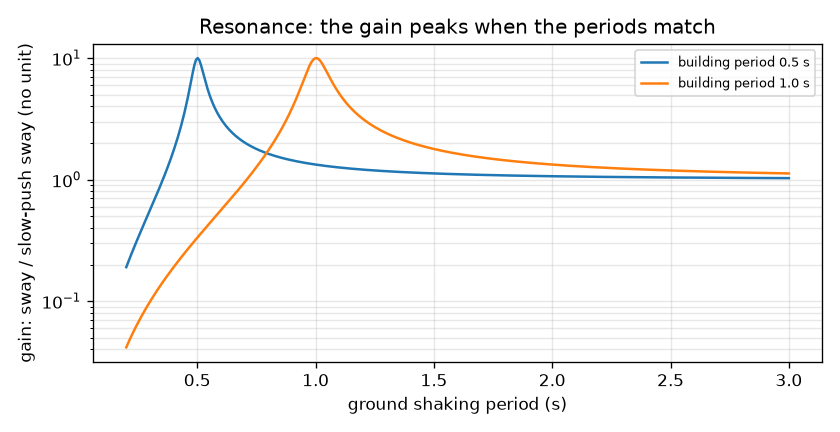
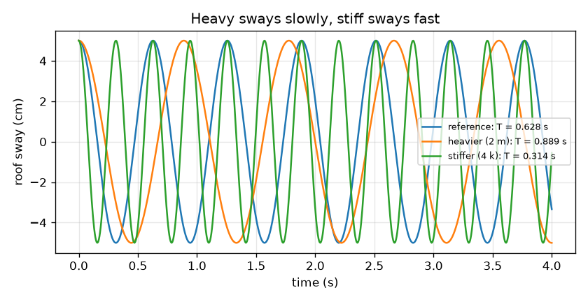

# सत्र 1: एक इमारत स्प्रिंग पर टिका एक द्रव्यमान है

*स्तर 1 (संकल्पनात्मक इंटरैक्टिव मॉडल) · लगभग 60 मिनट · openbuildingsway*

> यह एक सरलीकृत शैक्षिक मॉडल है। यह कोई प्रमाणित डिज़ाइन टूल नहीं है और इसका उपयोग वास्तविक संरचनाओं, विद्युत स्थापनाओं, वाहनों, औद्योगिक प्रक्रियाओं या चिकित्सा निर्णयों के लिए नहीं किया जाना चाहिए।

**पूर्व-आवश्यकताएँ (Prerequisites)**

- स्कूल स्तर का बीजगणित और वर्गमूल।
- आपने PRIMER.md पढ़ लिया है और `python start.py 1` एक बार चला लिया है।

**सीखने के उद्देश्य (Learning objectives)।** इस सत्र के बाद आप:

- समझा सकेंगे कि एक ऊँची इमारत लोलक (pendulum) की तरह आगे-पीछे क्यों डोलती है और एक डोलन का समय किससे तय होता है।
- T = 2 pi sqrt(m / k) का उपयोग करके पता लगा सकेंगे कि द्रव्यमान (mass) और कठोरता (stiffness) आवर्तकाल (period) को कैसे बदलते हैं।
- अनुनाद (resonance) का वर्णन कर सकेंगे: क्या होता है जब ज़मीन का कंपन इमारत की अपनी लय से मेल खाता है।
- ज़मीन के आवर्तकाल के विरुद्ध लब्धि (gain) का ग्राफ़ पढ़ सकेंगे।

## A. वास्तविक दुनिया की समस्या
भूकंप के बाद कुछ इमारतें बुरी तरह हिल जाती हैं जबकि बगल वाली इमारत मुश्किल से हिलती है। उत्तर का एक हिस्सा लय है। हर इमारत का अपना धीमा, नियमित डोलन होता है, और ज़मीन की भी एक पसंदीदा लय होती है। यदि दोनों मेल खाती हैं, तो हर धक्का पिछले धक्के में जुड़ता जाता है, जैसे झूले पर बच्चे को ठीक सही पल पर धक्का देना। किसी इमारत की लय किससे तय होती है, और यह मेल कितना बुरा है? (यह repo सीखने के लिए है। यह एक सरलीकृत मॉडल है और इसका उपयोग कभी भी किसी वास्तविक इमारत को डिज़ाइन करने या आँकने के लिए नहीं किया जाना चाहिए।)

## B. संकल्पना और सिद्धांत
पूरी इमारत को कठोरता k वाले एक स्प्रिंग पर द्रव्यमान m के एक पिंड के रूप में कल्पना कीजिए, जहाँ k प्रति मीटर डोलन के लिए आवश्यक पार्श्व (sideways) बल है। इसे बगल की ओर खींचिए और छोड़ दीजिए: यह आगे-पीछे झूलता है। कोणीय आवृत्ति (angular frequency) w = sqrt(k / m) बताती है कि चक्र रेडियन प्रति सेकंड में कितनी तेज़ी से चलता है, और आवर्तकाल T = 2 pi / w एक पूरे आगे-पीछे डोलन का समय है। भारी का अर्थ है धीमा, कठोर का अर्थ है तेज़। सामान्य फ़्रेम इमारतों के लिए इंजीनियर अक्सर N मंज़िलों के लिए T लगभग 0.1 N सेकंड का मोटा अनुभवजन्य नियम (empirical rule of thumb) उपयोग करते हैं; यह केवल एक मार्गदर्शक है। जब ज़मीन आवर्तकाल Tg के साथ आगे-पीछे हिलाई जाती है, तो लब्धि (gain) बताती है कि बहुत धीमे धक्के की तुलना में डोलन कितना बढ़ जाता है। r = T / Tg और अवमंदन अनुपात (damping ratio) zeta (सामान्यतः 0.05, अर्थात डोलन हर चक्र में कुछ प्रतिशत घटता जाता है) के साथ, लब्धि 1 / sqrt((1 - r^2)^2 + (2 zeta r)^2) है। सत्र 2 इसे व्युत्पन्न करता है।

| प्रतीक | अर्थ | इकाई |
|---|---|---|
| m | इमारत के पिंड का द्रव्यमान | kg |
| k | स्तंभों की पार्श्व कठोरता | N/m |
| w | डोलन की कोणीय आवृत्ति | rad/s |
| T | डोलन का आवर्तकाल | s |
| Tg | ज़मीन के कंपन का आवर्तकाल | s |
| r | अनुपात T / Tg | कोई इकाई नहीं |
| zeta | अवमंदन अनुपात | कोई इकाई नहीं |
| gain | डोलन को बहुत धीमे धक्के वाले डोलन से भाग देने पर | कोई इकाई नहीं |

**मान्यताएँ (Assumptions)**

- इमारत एक स्प्रिंग पर एक पिंड है (एक स्वातंत्र्य कोटि, single degree of freedom)।
- ज़मीन एक स्थिर दोहराई जाने वाली लय में हिलती है, जो एक वास्तविक भूकंप नहीं करता।
- जब तक अन्यथा न कहा जाए, अवमंदन क्रांतिक (critical) का 5 प्रतिशत है (zeta = 0.05)।
- सब कुछ प्रत्यास्थ (elastic) रहता है: कुछ भी नहीं टूटता या झुकता (yield) नहीं।

$$ \omega=\sqrt{\frac{k}{m}},\qquad T=\frac{2\pi}{\omega} $$

$$ x(t)=x_0\cos(\omega t)\quad\text{(free sway released from rest at }x_0\text{)} $$

$$ T\approx 0.1\,N\ \text{s}\quad\text{(rough empirical rule of thumb for typical frame buildings)} $$

$$ \text{gain}=\frac{1}{\sqrt{(1-r^2)^2+(2\zeta r)^2}},\qquad r=\frac{T}{T_g} $$

## C. दृश्य व्याख्या
पहला चित्र एक ही 5 cm डोलन से छोड़ी गई तीन इमारतें दिखाता है: संदर्भ इमारत (T = 0.628 s), दोगुने द्रव्यमान वाली एक भारी इमारत (T = 0.889 s, धीमी) और चार गुनी कठोरता वाली एक कठोर इमारत (T = 0.314 s, दोगुनी तेज़)। दूसरा चित्र 0.5 s और 1 s आवर्तकाल वाली इमारतों के लिए लॉग स्केल पर ज़मीन के आवर्तकाल के विरुद्ध लब्धि आलेखित करता है। हर वक्र 10 के एक तीखे शिखर तक उठता है जहाँ ज़मीन का आवर्तकाल इमारत के आवर्तकाल के बराबर होता है, बहुत धीमे कंपन के लिए 1 के क़रीब होता है और बहुत तेज़ कंपन के लिए 1 से काफ़ी नीचे गिर जाता है।

*0.5 s और 1 s की इमारतों के लिए ज़मीन के आवर्तकाल के विरुद्ध लब्धि: 10 का शिखर वहाँ है जहाँ आवर्तकाल मेल खाते हैं।*

*एक ही 5 cm डोलन से छोड़ी गई तीन इमारतें: भारी धीमी है (T = 0.889 s), कठोर तेज़ है (T = 0.314 s)।*

## D. इंटरैक्टिव सिमुलेशन
पाठ चलाइए (`python start.py 1`), फिर लाइव ऐप खोलिए: [सत्र 1: स्प्रिंग पर एक इमारत](https://krunalpanchal1995.github.io/pan-iit-oss/openbuildingsway/session-01/) (या इसी फ़ोल्डर में `app.html`)। द्रव्यमान और कठोरता स्लाइडर खिसकाइए और रीडआउट में आवर्तकाल को बदलते देखिए; फिर ज़मीन का आवर्तकाल और समय स्लाइडर खिसकाइए और छह मंज़िला इमारत को डोलते देखिए। शिखर कहाँ है यह देखने के लिए लब्धि ग्राफ़ खोलिए।

**चुनौती।** इमारत को 1 s वाली ज़मीन के साथ अनुनाद के लिए समायोजित कीजिए: इसका आवर्तकाल ज़मीन के आवर्तकाल के 2 प्रतिशत के भीतर लाइए।

## E. हल किया गया उदाहरण और प्रयोग
**समस्या।** एक इमारत पिंड के लिए m = 200 000 kg और k = 20 000 000 N/m है। w और T ज्ञात कीजिए। यदि द्रव्यमान दोगुना हो जाए, और यदि कठोरता चार गुनी कर दी जाए, तो T का क्या होता है? 5 प्रतिशत अवमंदन के साथ अनुनाद पर, डोलन कितना बढ़ जाता है?

1. w = sqrt(k / m) = sqrt(20 000 000 / 200 000) = sqrt(100) = 10 rad/s।
2. T = 2 pi / w = 6.283 / 10 = 0.6283 s।
3. द्रव्यमान दोगुना: T, sqrt(2) गुना बढ़ता है, इसलिए T = 0.6283 * 1.4142 = 0.8886 s।
4. चार गुनी कठोरता: T, sqrt(4) = 2 गुना घटता है, इसलिए T = 0.3142 s।
5. अनुनाद पर r = 1, इसलिए लब्धि 1 / sqrt(0 + (2 * 0.05 * 1)^2) = 1 / 0.1 = 10 है।

**उत्तर।** w = 10 rad/s और T = 0.6283 s; द्रव्यमान दोगुना करने पर 0.8886 s, कठोरता चार गुनी करने पर 0.3142 s; अनुनाद पर लब्धि 10 है।

**प्रयोग।** 30 cm के एक प्लास्टिक के स्केल को मेज़ पर इस तरह क्लैंप कीजिए कि उसका अधिकांश भाग बाहर निकला रहे, और खुले सिरे पर मॉडलिंग क्ले का एक ढेला रखिए। सिरे को बगल की ओर खींचिए, छोड़िए, और आवर्तकाल पाने के लिए फ़ोन स्टॉपवॉच से दस झूलों का समय लीजिए। और क्ले जोड़िए (अधिक द्रव्यमान) और फिर खुली लंबाई छोटी कीजिए (अधिक कठोर): आवर्तकाल द्रव्यमान के साथ बढ़ना चाहिए और कठोरता के साथ घटना चाहिए, जैसा ऐप में होता है। आपकी संख्याएँ सूत्र से अलग होंगी क्योंकि स्केल का अपना द्रव्यमान होता है, वह अपनी लंबाई के साथ मुड़ाव फैलाता है और हवा तथा क्लैंप में ऊर्जा खोता है: मॉडल इमारत को भारहीन स्प्रिंग पर एक बिंदु द्रव्यमान मानता है।

## F. मूल्यांकन और डिज़ाइन चुनौती
**प्रश्न प्रकार A: संकल्पनात्मक।** एक भारी इमारत धीरे क्यों डोलती है जबकि एक कठोर इमारत तेज़ डोलती है? ज़मीन की मेल खाती लय तब भी ख़तरनाक क्यों हो सकती है जब धक्का स्वयं छोटा हो?

संकेत

झूले पर बैठे बच्चे के बारे में सोचिए: यदि बच्चा भारी हो तो क्या बदलता है? फिर सोचिए कि कब एक धक्का गति में जुड़ता है और कब उसके विरुद्ध काम करता है।

चरण-दर-चरण हल

उसी स्प्रिंग बल के लिए बड़े द्रव्यमान को त्वरित करना कठिन होता है, इसलिए हर झूला अधिक समय लेता है; एक कठोर स्प्रिंग उसी डोलन के लिए अधिक ज़ोर से वापस खींचता है, इसलिए हर झूला जल्दी होता है। यही T = 2 pi sqrt(m / k) है। जब ज़मीन का आवर्तकाल इमारत के बराबर होता है, तो हर धक्का ठीक उसी समय आता है जब इमारत पहले से उसी दिशा में चल रही होती है, इसलिए प्रभाव चक्र दर चक्र जुड़ते जाते हैं और केवल अवमंदन ही डोलन को सीमित करता है। छोटे धक्के भी बड़े डोलन तक बढ़ सकते हैं: 5 प्रतिशत अवमंदन पर अनुनाद पर लब्धि 10 है।

**प्रश्न प्रकार B: संख्यात्मक।** एक इमारत पिंड के लिए m = 500 000 kg और k = 20 000 000 N/m है। w और T ज्ञात कीजिए और बताइए कि क्या यह 1 s के ज़मीन आवर्तकाल के क़रीब है।

संकेत

w = sqrt(k / m), फिर T = 2 pi / w। इकाइयाँ जाँचिए: k / m, N/m प्रति kg = 1/s^2 में है।

चरण-दर-चरण हल

w = sqrt(20 000 000 / 500 000) = sqrt(40) = 6.325 rad/s। T = 2 pi / 6.325 = 0.9935 s। यह 1 s के ज़मीन आवर्तकाल के 1 प्रतिशत के भीतर है, इसलिए यह इमारत लगभग अनुनाद पर है और बहुत अधिक बढ़ जाएगी (लगभग 10 गुना)। समझदारी जाँच (sanity check): यह हल किए गए उदाहरण (200 000 kg, T = 0.628 s) से भारी है, इसलिए इसका आवर्तकाल लंबा है।

**प्रश्न प्रकार C: ग्राफ़ और सिमुलेशन की व्याख्या।** लब्धि ग्राफ़ पर एक 1 s की इमारत को पहले ऐसी ज़मीन हिलाती है जिसका आवर्तकाल 2 s है, और फिर 0.5 s आवर्तकाल वाली ज़मीन। हर स्थिति में लब्धि पढ़िए और बताइए कि हर एक इंजीनियर को क्या बताती है।

संकेत

अनुपात r = T / Tg = इमारत का आवर्तकाल बटा ज़मीन का आवर्तकाल है। सूत्र का उपयोग कीजिए या वक्र पढ़िए।

चरण-दर-चरण हल

Tg = 2 s के साथ, r = 0.5 और लब्धि 1.33 है: इमारत ज़्यादातर धीमी ज़मीनी गति का अनुसरण करती है, थोड़ी बढ़ी हुई। Tg = 0.5 s के साथ, r = 2 और लब्धि 0.33 है: कंपन इतना तेज़ है कि इमारत उसका अनुसरण नहीं कर पाती, इसलिए वह मुश्किल से हिलती है। दोनों ही Tg = 1 s पर 10 के अनुनाद शिखर से बहुत दूर हैं।

**प्रश्न प्रकार D: डिज़ाइन और इष्टतमीकरण (optimisation) चुनौती।** एक इमारत के लिए m = 200 000 kg है और ज़मीन का आवर्तकाल 1 s है। ऐसी कठोरता k चुनिए जो इसका आवर्तकाल 0.5 s (एक कठोर डिज़ाइन) या 1.5 s (एक लचीला डिज़ाइन) कर दे। हर एक लब्धि के लिए क्या देता है, और हर एक की कमी क्या है?

संकेत

k = m (2 pi / T)^2 पाने के लिए T = 2 pi sqrt(m / k) को उलटिए, फिर लब्धि सूत्र में r = T / Tg का उपयोग कीजिए।

चरण-दर-चरण हल

T = 0.5 s के लिए: k = 200 000 * (2 pi / 0.5)^2 = 3.158e7 N/m, r = 0.5, लब्धि 1.33। T = 1.5 s के लिए: k = 200 000 * (2 pi / 1.5)^2 = 3.509e6 N/m, r = 1.5, लब्धि 0.79। दोनों 10 के अनुनाद शिखर से बचते हैं। कमियाँ: कठोर डिज़ाइन में स्तंभ सामग्री बहुत अधिक लगती है (लचीले डिज़ाइन की 9 गुना कठोरता) और यह बड़े बल आकर्षित करता है; लचीला डिज़ाइन सस्ता है पर कुल मिलाकर काफ़ी दूर तक डोलता है (लंबे आवर्तकाल का अर्थ है बड़े विस्थापन) और असुविधाजनक हो सकता है या बगल की इमारत से टकरा सकता है। मान्यताएँ: ज़मीन का एक स्थिर आवर्तकाल है और मॉडल एक पिंड का है।

[RUBRIC.md](../../RUBRIC.md) से स्वयं को अंक दीजिए। कागज़ पर काम करने के लिए [गतिविधि पत्रक](activity_sheet.md) प्रिंट कीजिए।

## सामान्य भ्रांतियाँ (Common misconceptions)
| सामान्य भ्रांति | वास्तव में क्या सच है |
|---|---|
| एक अधिक मज़बूत इमारत भूकंप में अपने आप अधिक सुरक्षित होती है। | मज़बूती (strength) और कठोरता अलग-अलग हैं। कठोरता डोलन का आवर्तकाल तय करती है; मायने यह रखता है कि वह आवर्तकाल कंपन के सापेक्ष कहाँ है, और इमारत कितना डोलन सह सकती है। |
| ज़मीन का कंपन हर इमारत के लिए एक जैसा होता है। | कंपन एक जैसा होता है, प्रतिक्रिया नहीं: यदि इमारत का आवर्तकाल ज़मीन के आवर्तकाल के क़रीब है तो वह कंपन को बहुत बढ़ाती है और यदि दूर है तो लगभग बिल्कुल नहीं। |
| नियम T = 0.1 N सेकंड प्रकृति का एक नियम है। | यह सामान्य फ़्रेम इमारतों के लिए एक मोटा अनुभवजन्य नियम है। दीवारें, ऊँचे पतले टॉवर और नरम मिट्टी इससे बहुत भिन्न हो सकते हैं, और वास्तविक आवर्तकालों की गणना या मापन किया जाना चाहिए। |
| एक भारी इमारत धीरे इसलिए डोलती है क्योंकि गुरुत्व उसे नीचे खींचता है। | आवर्तकाल द्रव्यमान-से-कठोरता अनुपात पर निर्भर करता है। द्रव्यमान और कठोरता दोनों को दोगुना करने पर आवर्तकाल नहीं बदलता। |

## शब्दावली (Glossary)
- **आवर्तकाल (period)**: एक पूरे आगे-पीछे डोलन का समय, सेकंड में
- **कोणीय आवृत्ति (angular frequency)**: डोलन चक्र कितनी तेज़ी से घूमता है, रेडियन प्रति सेकंड में: w = 2 pi / T
- **कठोरता (stiffness)**: प्रति मीटर पार्श्व डोलन के लिए आवश्यक बल, N/m में
- **अनुनाद (resonance)**: बड़ा डोलन जो तब बनता है जब कंपन की लय इमारत की अपनी लय से मेल खाती है
- **अवमंदन अनुपात (damping ratio)**: क्रांतिक अवमंदन का अंश; साधारण इमारतों के लिए लगभग 0.05
- **लब्धि (gain)**: एक स्थिर कंपन बहुत धीमे धक्के की तुलना में कितना बढ़ जाता है

## समापन
1. [exercises.md](exercises.md) में दिए गए तीन कोडिंग कार्य कीजिए।
2. अपने बदलावों के बाद `python start.py 1` फिर से चलाइए। यह checkpoint के साथ समाप्त होता है; जब यह `PASS` छापे, तो आपका काम पूरा है। (केवल checkpoint: `python start.py check 1`।)

अगला: [सत्र 2](../session-02/README.md)
