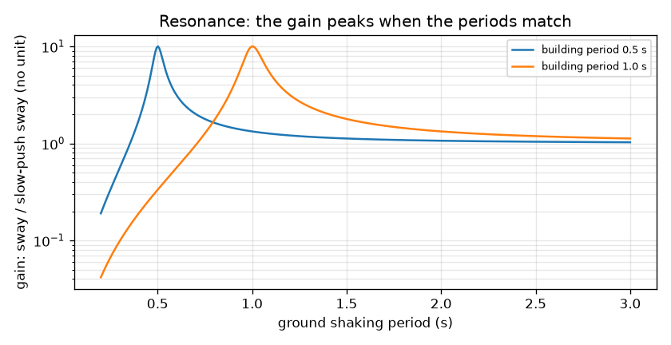
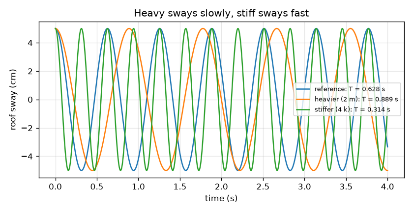

# സെഷൻ 1: ഒരു കെട്ടിടം ഒരു സ്പ്രിംഗിലെ പിണ്ഡമാണ്

[Session 1 — हिन्दी](README.hi.md)

*ലെവൽ 1 (ആശയപരമായ ഇന്ററാക്ടീവ് മോഡൽ) · ഏകദേശം 60 മിനിറ്റ് · openbuildingsway*

> ഇത് ലളിതമാക്കിയ ഒരു വിദ്യാഭ്യാസ മോഡലാണ്. ഇത് സാധൂകരിക്കപ്പെട്ട ഒരു ഡിസൈൻ ഉപകരണമല്ല; യഥാർത്ഥ നിർമ്മിതികൾ, വൈദ്യുത ഇൻസ്റ്റലേഷനുകൾ, വാഹനങ്ങൾ, വ്യാവസായിക പ്രക്രിയകൾ അല്ലെങ്കിൽ വൈദ്യശാസ്ത്രപരമായ തീരുമാനങ്ങൾ എന്നിവയ്ക്ക് ഇത് ഉപയോഗിക്കരുത്.

**മുൻ‌അറിവ് (Prerequisites)**

- സ്കൂൾ ബീജഗണിതവും വർഗ്ഗമൂലങ്ങളും.
- നിങ്ങൾ PRIMER.md വായിക്കുകയും `python start.py 1` ഒരു തവണ റൺ ചെയ്യുകയും ചെയ്തിട്ടുണ്ട്.

**പഠന ലക്ഷ്യങ്ങൾ (Learning objectives).** ഈ സെഷനു ശേഷം നിങ്ങൾക്ക് കഴിയും:

- ഉയരമുള്ള ഒരു കെട്ടിടം ഒരു പെൻഡുലം പോലെ മുന്നോട്ടും പിന്നോട്ടും ആടുന്നത് എന്തുകൊണ്ടെന്നും ഒരു ആട്ടത്തിന്റെ സമയം നിർണ്ണയിക്കുന്നത് എന്താണെന്നും വിശദീകരിക്കാൻ.
- പിണ്ഡവും ദൃഢതയും (stiffness) ആവർത്തനകാലത്തെ (period) എങ്ങനെ മാറ്റുന്നുവെന്ന് കണ്ടെത്താൻ T = 2 pi sqrt(m / k) ഉപയോഗിക്കാൻ.
- അനുനാദം (resonance) വിവരിക്കാൻ: ഭൂമിയുടെ കുലുക്കം കെട്ടിടത്തിന്റെ സ്വന്തം താളവുമായി പൊരുത്തപ്പെടുമ്പോൾ എന്ത് സംഭവിക്കുന്നു.
- ഭൂമിയുടെ ആവർത്തനകാലത്തിനെതിരെ ഗെയിൻ (gain) കാണിക്കുന്ന ഗ്രാഫ് വായിക്കാൻ.

## A. യഥാർത്ഥ ലോക പ്രശ്നം
ഒരു ഭൂകമ്പത്തിനു ശേഷം ചില കെട്ടിടങ്ങൾ ശക്തമായി കുലുങ്ങുമ്പോൾ തൊട്ടടുത്തുള്ളത് ഏറെക്കുറെ അനങ്ങുന്നില്ല. ഉത്തരത്തിന്റെ ഒരു ഭാഗം താളമാണ്. ഓരോ കെട്ടിടത്തിനും അതിന്റേതായ സാവധാനമുള്ള, ക്രമമായ ആട്ടമുണ്ട്, ഭൂമിക്കും ഒരു ഇഷ്ട താളമുണ്ട്. രണ്ടും പൊരുത്തപ്പെട്ടാൽ, ഓരോ തള്ളും മുമ്പത്തേതിനോട് ചേരുന്നു, ഊഞ്ഞാലിലെ കുട്ടിയെ കൃത്യ നിമിഷത്തിൽ തള്ളുന്നതുപോലെ. ഒരു കെട്ടിടത്തിന്റെ താളം നിർണ്ണയിക്കുന്നത് എന്താണ്, പൊരുത്തം എത്ര മോശമാണ്? (ഈ റിപ്പോ പഠനത്തിനുള്ളതാണ്. ഇത് ലളിതമാക്കിയ ഒരു മോഡലാണ്, യഥാർത്ഥ കെട്ടിടം ഡിസൈൻ ചെയ്യാനോ വിലയിരുത്താനോ ഒരിക്കലും ഉപയോഗിക്കരുത്.)

## B. ആശയവും സിദ്ധാന്തവും
മുഴുവൻ കെട്ടിടത്തെയും k ദൃഢതയുള്ള ഒരു സ്പ്രിംഗിലെ m പിണ്ഡമുള്ള ഒരു കട്ടയായി സങ്കൽപ്പിക്കുക; ഇവിടെ k എന്നത് ഓരോ മീറ്റർ ആട്ടത്തിനും ആവശ്യമായ പാർശ്വബലമാണ്. അതിനെ വശത്തേക്ക് വലിച്ച് വിടുക: അത് മുന്നോട്ടും പിന്നോട്ടും ആടുന്നു. കോണീയ ആവൃത്തി (angular frequency) w = sqrt(k / m) ചക്രം എത്ര വേഗത്തിൽ നടക്കുന്നുവെന്ന് റേഡിയൻ പ്രതി സെക്കൻഡിൽ പറയുന്നു, ആവർത്തനകാലം T = 2 pi / w ഒരു പൂർണ്ണ മുന്നോട്ടും-പിന്നോട്ടുമുള്ള ആട്ടത്തിനുള്ള സമയമാണ്. ഭാരം കൂടിയാൽ സാവധാനം, ദൃഢത കൂടിയാൽ വേഗത്തിൽ. സാധാരണ ഫ്രെയിം കെട്ടിടങ്ങൾക്ക് എഞ്ചിനീയർമാർ പലപ്പോഴും N നിലകൾക്ക് T ഏകദേശം 0.1 N സെക്കൻഡ് എന്ന ഏകദേശ അനുഭവ നിയമം (empirical rule of thumb) ഉപയോഗിക്കുന്നു; ഇത് ഒരു വഴികാട്ടി മാത്രമാണ്. ഭൂമി Tg ആവർത്തനകാലത്തിൽ മുന്നോട്ടും പിന്നോട്ടും കുലുങ്ങുമ്പോൾ, വളരെ സാവധാനമുള്ള തള്ളലിനെ അപേക്ഷിച്ച് ആട്ടം എത്ര വർദ്ധിക്കുന്നുവെന്ന് ഗെയിൻ പറയുന്നു. r = T / Tg, ഡാമ്പിംഗ് അനുപാതം (damping ratio) zeta (സാധാരണയായി 0.05, അതായത് ഓരോ ചക്രത്തിലും ആട്ടം ഏതാനും ശതമാനം കുറയുന്നു) എന്നിവ ഉപയോഗിച്ച്, ഗെയിൻ 1 / sqrt((1 - r^2)^2 + (2 zeta r)^2) ആണ്. സെഷൻ 2 ഇത് വ്യുൽപ്പാദിപ്പിക്കുന്നു.

| ചിഹ്നം | അർത്ഥം | യൂണിറ്റ് |
|---|---|---|
| m | കെട്ടിട കട്ടയുടെ പിണ്ഡം | kg |
| k | തൂണുകളുടെ പാർശ്വ ദൃഢത | N/m |
| w | ആട്ടത്തിന്റെ കോണീയ ആവൃത്തി | rad/s |
| T | ആട്ടത്തിന്റെ ആവർത്തനകാലം | s |
| Tg | ഭൂമി കുലുക്കത്തിന്റെ ആവർത്തനകാലം | s |
| r | അനുപാതം T / Tg | യൂണിറ്റ് ഇല്ല |
| zeta | ഡാമ്പിംഗ് അനുപാതം | യൂണിറ്റ് ഇല്ല |
| gain | ആട്ടത്തെ വളരെ സാവധാനമുള്ള തള്ളലിലെ ആട്ടം കൊണ്ട് ഹരിച്ചത് | യൂണിറ്റ് ഇല്ല |

**അനുമാനങ്ങൾ (Assumptions)**

- കെട്ടിടം ഒരു സ്പ്രിംഗിലെ ഒരു കട്ടയാണ് (ഒരൊറ്റ ഡിഗ്രി ഓഫ് ഫ്രീഡം (single degree of freedom)).
- ഭൂമി സ്ഥിരമായ ആവർത്തിക്കുന്ന താളത്തിൽ കുലുങ്ങുന്നു, യഥാർത്ഥ ഭൂകമ്പം അങ്ങനെയല്ല.
- മറിച്ചു പറഞ്ഞിട്ടില്ലെങ്കിൽ ഡാമ്പിംഗ് ക്രിട്ടിക്കലിന്റെ 5 ശതമാനമാണ് (zeta = 0.05).
- എല്ലാം ഇലാസ്റ്റിക് ആയി തുടരുന്നു: ഒന്നും പൊട്ടുകയോ വഴങ്ങുകയോ (yield) ഇല്ല.

$$ \omega=\sqrt{\frac{k}{m}},\qquad T=\frac{2\pi}{\omega} $$

$$ x(t)=x_0\cos(\omega t)\quad\text{(free sway released from rest at }x_0\text{)} $$

$$ T\approx 0.1\,N\ \text{s}\quad\text{(rough empirical rule of thumb for typical frame buildings)} $$

$$ \text{gain}=\frac{1}{\sqrt{(1-r^2)^2+(2\zeta r)^2}},\qquad r=\frac{T}{T_g} $$

## C. ദൃശ്യ വിശദീകരണം
ആദ്യ ചിത്രം ഒരേ 5 cm ആട്ടത്തിൽ നിന്ന് വിട്ട മൂന്ന് കെട്ടിടങ്ങൾ കാണിക്കുന്നു: റഫറൻസ് (T = 0.628 s), ഇരട്ടി പിണ്ഡമുള്ള ഭാരം കൂടിയ ഒന്ന് (T = 0.889 s, സാവധാനം), നാലിരട്ടി ദൃഢതയുള്ള ഒന്ന് (T = 0.314 s, ഇരട്ടി വേഗം). രണ്ടാമത്തെ ചിത്രം 0.5 s, 1 s ആവർത്തനകാലമുള്ള കെട്ടിടങ്ങൾക്ക് ഭൂമിയുടെ ആവർത്തനകാലത്തിനെതിരെ ഗെയിൻ ലോഗ് സ്കെയിലിൽ വരയ്ക്കുന്നു. ഓരോ വക്രവും ഭൂമിയുടെ ആവർത്തനകാലം കെട്ടിടത്തിന്റേതിന് തുല്യമാകുന്നിടത്ത് 10 എന്ന കൂർത്ത ഉച്ചിയിലേക്ക് ഉയരുന്നു, വളരെ സാവധാനമുള്ള കുലുക്കത്തിന് 1-ന് അടുത്താണ്, വളരെ വേഗമുള്ള കുലുക്കത്തിന് 1-ന് വളരെ താഴെ വീഴുന്നു.

*0.5 s, 1 s കെട്ടിടങ്ങൾക്ക് ഭൂമിയുടെ ആവർത്തനകാലത്തിനെതിരെ ഗെയിൻ: ആവർത്തനകാലങ്ങൾ പൊരുത്തപ്പെടുന്നിടത്ത് 10 എന്ന ഉച്ചി.*

*ഒരേ 5 cm ആട്ടത്തിൽ നിന്ന് വിട്ട മൂന്ന് കെട്ടിടങ്ങൾ: ഭാരമുള്ളത് സാവധാനം (T = 0.889 s), ദൃഢമായത് വേഗത്തിൽ (T = 0.314 s).*

## D. ഇന്ററാക്ടീവ് സിമുലേഷൻ
പാഠം റൺ ചെയ്യുക (`python start.py 1`), തുടർന്ന് ലൈവ് ആപ്പ് തുറക്കുക: [സെഷൻ 1: ഒരു സ്പ്രിംഗിലെ കെട്ടിടം](https://krunalpanchal1995.github.io/pan-iit-oss/openbuildingsway/session-01/) (അല്ലെങ്കിൽ ഈ ഫോൾഡറിലെ `app.html`). പിണ്ഡം, ദൃഢത സ്ലൈഡറുകൾ വലിച്ച് റീഡൗട്ടിലെ ആവർത്തനകാലം മാറുന്നത് ശ്രദ്ധിക്കുക; തുടർന്ന് ഭൂമിയുടെ ആവർത്തനകാലവും സമയ സ്ലൈഡറും നീക്കി ആറ് നിലയുള്ള കെട്ടിടം ആടുന്നത് കാണുക. ഉച്ചി എവിടെയാണെന്ന് കാണാൻ ഗെയിൻ ഗ്രാഫ് തുറക്കുക.

**വെല്ലുവിളി.** കെട്ടിടത്തെ 1 s ഭൂമിയുമായി അനുനാദത്തിലാക്കുക: അതിന്റെ ആവർത്തനകാലം ഭൂമിയുടെ ആവർത്തനകാലത്തിന്റെ 2 ശതമാനത്തിനുള്ളിൽ ആക്കുക.

## E. പ്രവർത്തിച്ച ഉദാഹരണവും പരീക്ഷണവും
**പ്രശ്നം.** ഒരു കെട്ടിട കട്ടയ്ക്ക് m = 200 000 kg, k = 20 000 000 N/m. w, T എന്നിവ കണ്ടെത്തുക. പിണ്ഡം ഇരട്ടിയായാലും ദൃഢത നാലിരട്ടിയായാലും T-ക്ക് എന്ത് സംഭവിക്കും? 5 ശതമാനം ഡാമ്പിംഗോടെ അനുനാദത്തിൽ ആട്ടം എത്ര വർദ്ധിക്കും?

1. w = sqrt(k / m) = sqrt(20 000 000 / 200 000) = sqrt(100) = 10 rad/s.
2. T = 2 pi / w = 6.283 / 10 = 0.6283 s.
3. പിണ്ഡം ഇരട്ടിയാക്കുക: T sqrt(2) മടങ്ങ് വളരുന്നു, അതിനാൽ T = 0.6283 * 1.4142 = 0.8886 s.
4. നാലിരട്ടി ദൃഢത: T sqrt(4) = 2 മടങ്ങ് ചുരുങ്ങുന്നു, അതിനാൽ T = 0.3142 s.
5. അനുനാദത്തിൽ r = 1, അതിനാൽ ഗെയിൻ 1 / sqrt(0 + (2 * 0.05 * 1)^2) = 1 / 0.1 = 10.

**ഉത്തരം.** w = 10 rad/s, T = 0.6283 s; പിണ്ഡം ഇരട്ടിയാക്കിയാൽ 0.8886 s, ദൃഢത നാലിരട്ടിയാക്കിയാൽ 0.3142 s; അനുനാദത്തിൽ ഗെയിൻ 10.

**പരീക്ഷണം.** 30 cm പ്ലാസ്റ്റിക് സ്കെയിൽ മിക്കഭാഗവും പുറത്തേക്ക് നിൽക്കും വിധം മേശയിൽ ക്ലാമ്പ് ചെയ്യുക, സ്വതന്ത്ര അറ്റത്ത് ഒരു കട്ട മോഡലിംഗ് ക്ലേ വയ്ക്കുക. അറ്റം വശത്തേക്ക് വലിച്ച് വിടുക, ഫോൺ സ്റ്റോപ്പ്‌വാച്ച് ഉപയോഗിച്ച് പത്ത് ആട്ടങ്ങളുടെ സമയം എടുത്ത് ആവർത്തനകാലം കണ്ടെത്തുക. കൂടുതൽ ക്ലേ ചേർക്കുക (കൂടുതൽ പിണ്ഡം), തുടർന്ന് സ്വതന്ത്ര നീളം കുറയ്ക്കുക (കൂടുതൽ ദൃഢം): ആപ്പിലെ പോലെ ആവർത്തനകാലം പിണ്ഡത്തോടൊപ്പം വളരുകയും ദൃഢതയോടൊപ്പം ചുരുങ്ങുകയും വേണം. സ്കെയിലിന് സ്വന്തം പിണ്ഡമുള്ളതിനാലും അതിന്റെ വളവ് നീളം മുഴുവൻ വ്യാപിക്കുന്നതിനാലും വായുവിലേക്കും ക്ലാമ്പിലേക്കും ഊർജ്ജം നഷ്ടപ്പെടുന്നതിനാലും നിങ്ങളുടെ സംഖ്യകൾ സൂത്രവാക്യത്തിൽ നിന്ന് വ്യത്യസ്തമായിരിക്കും: മോഡൽ കെട്ടിടത്തെ ഭാരമില്ലാത്ത സ്പ്രിംഗിലെ ഒരു ബിന്ദു പിണ്ഡമായി കണക്കാക്കുന്നു.

## F. മൂല്യനിർണ്ണയവും ഡിസൈൻ വെല്ലുവിളിയും
**ചോദ്യ തരം A: ആശയപരം.** ഭാരം കൂടിയ കെട്ടിടം കൂടുതൽ സാവധാനവും ദൃഢമായ കെട്ടിടം വേഗത്തിലും ആടുന്നത് എന്തുകൊണ്ട്? തള്ളൽ തന്നെ ചെറുതാണെങ്കിൽ പോലും പൊരുത്തപ്പെടുന്ന ഭൂതാളം അപകടകരമാകുന്നത് എന്തുകൊണ്ട്?

സൂചന

ഊഞ്ഞാലിലെ ഒരു കുട്ടിയെക്കുറിച്ച് ചിന്തിക്കുക: കുട്ടിക്ക് ഭാരം കൂടിയാൽ എന്ത് മാറും? തുടർന്ന് ഒരു തള്ളൽ ചലനത്തോട് എപ്പോൾ ചേരുന്നു, എപ്പോൾ എതിർക്കുന്നു എന്ന് ചിന്തിക്കുക.

ഘട്ടം ഘട്ടമായുള്ള പരിഹാരം

ഒരേ സ്പ്രിംഗ് ബലത്തിന് വലിയ പിണ്ഡത്തെ ത്വരിതപ്പെടുത്താൻ പ്രയാസമാണ്, അതിനാൽ ഓരോ ആട്ടത്തിനും കൂടുതൽ സമയമെടുക്കുന്നു; ദൃഢമായ സ്പ്രിംഗ് ഒരേ ആട്ടത്തിന് കൂടുതൽ ശക്തമായി തിരിച്ചുവലിക്കുന്നു, അതിനാൽ ഓരോ ആട്ടവും വേഗത്തിലാണ്. അതാണ് T = 2 pi sqrt(m / k). ഭൂമിയുടെ ആവർത്തനകാലം കെട്ടിടത്തിന്റേതിന് തുല്യമാകുമ്പോൾ, ഓരോ തള്ളും കെട്ടിടം ഇതിനകം അതേ ദിശയിൽ നീങ്ങുമ്പോൾ തന്നെ എത്തുന്നു, അതിനാൽ ഫലങ്ങൾ ചക്രത്തിനു ശേഷം ചക്രമായി കൂടുന്നു, ഡാമ്പിംഗ് മാത്രമേ ആട്ടത്തെ പരിമിതപ്പെടുത്തൂ. ചെറിയ തള്ളലുകൾ പോലും വലിയ ആട്ടമായി വളരാം: 5 ശതമാനം ഡാമ്പിംഗിൽ അനുനാദത്തിലെ ഗെയിൻ 10 ആണ്.

**ചോദ്യ തരം B: സംഖ്യാപരം.** ഒരു കെട്ടിട കട്ടയ്ക്ക് m = 500 000 kg, k = 20 000 000 N/m. w, T എന്നിവ കണ്ടെത്തി അത് 1 s ഭൂമി ആവർത്തനകാലത്തിന് അടുത്താണോ എന്ന് പറയുക.

സൂചന

w = sqrt(k / m), തുടർന്ന് T = 2 pi / w. യൂണിറ്റുകൾ പരിശോധിക്കുക: k / m എന്നത് N/m per kg = 1/s^2 ആണ്.

ഘട്ടം ഘട്ടമായുള്ള പരിഹാരം

w = sqrt(20 000 000 / 500 000) = sqrt(40) = 6.325 rad/s. T = 2 pi / 6.325 = 0.9935 s. ഇത് 1 s ഭൂമി ആവർത്തനകാലത്തിന്റെ 1 ശതമാനത്തിനുള്ളിലാണ്, അതിനാൽ ഈ കെട്ടിടം ഏതാണ്ട് അനുനാദത്തിലാണ്, ശക്തമായി വർദ്ധിക്കും (ഏകദേശം 10 മടങ്ങ്). യുക്തിപരിശോധന: ഇത് പ്രവർത്തിച്ച ഉദാഹരണത്തേക്കാൾ (200 000 kg, T = 0.628 s) ഭാരമുള്ളതാണ്, അതിനാൽ ആവർത്തനകാലം കൂടുതലാണ്.

**ചോദ്യ തരം C: ഗ്രാഫും സിമുലേഷനും വ്യാഖ്യാനിക്കൽ.** ഗെയിൻ ഗ്രാഫിൽ ഒരു 1 s കെട്ടിടത്തെ 2 s ആവർത്തനകാലമുള്ള ഭൂമിയും തുടർന്ന് 0.5 s ആവർത്തനകാലമുള്ള ഒന്നും കുലുക്കുന്നു. ഓരോ സാഹചര്യത്തിലും ഗെയിൻ വായിച്ച് ഓരോന്നും ഒരു എഞ്ചിനീയറോട് എന്ത് പറയുന്നുവെന്ന് പറയുക.

സൂചന

അനുപാതം r = T / Tg = കെട്ടിട ആവർത്തനകാലം ഹരണം ഭൂമി ആവർത്തനകാലം. സൂത്രവാക്യം ഉപയോഗിക്കുക അല്ലെങ്കിൽ വക്രം വായിക്കുക.

ഘട്ടം ഘട്ടമായുള്ള പരിഹാരം

Tg = 2 s ആകുമ്പോൾ, r = 0.5, ഗെയിൻ 1.33: കെട്ടിടം മിക്കവാറും സാവധാനമുള്ള ഭൂചലനത്തെ പിന്തുടരുന്നു, അല്പം വർദ്ധിച്ച്. Tg = 0.5 s ആകുമ്പോൾ, r = 2, ഗെയിൻ 0.33: കുലുക്കം കെട്ടിടത്തിന് പിന്തുടരാൻ കഴിയാത്തത്ര വേഗത്തിലാണ്, അതിനാൽ അത് ഏറെക്കുറെ അനങ്ങുന്നില്ല. രണ്ടും Tg = 1 s-ലെ 10 എന്ന അനുനാദ ഉച്ചിയിൽ നിന്ന് വളരെ അകലെയാണ്.

**ചോദ്യ തരം D: ഡിസൈനും ഒപ്റ്റിമൈസേഷൻ വെല്ലുവിളിയും.** ഒരു കെട്ടിടത്തിന് m = 200 000 kg, ഭൂമി ആവർത്തനകാലം 1 s. അതിന്റെ ആവർത്തനകാലം 0.5 s (ദൃഢമായ ഡിസൈൻ) അല്ലെങ്കിൽ 1.5 s (വഴക്കമുള്ള ഡിസൈൻ) ആക്കുന്ന ദൃഢത k തിരഞ്ഞെടുക്കുക. ഓരോന്നും ഗെയിനിന് എന്ത് നൽകുന്നു, ഓരോന്നിന്റെയും ദോഷം എന്താണ്?

സൂചന

T = 2 pi sqrt(m / k) വിപരീതമാക്കി k = m (2 pi / T)^2 നേടുക, തുടർന്ന് ഗെയിൻ സൂത്രവാക്യത്തിൽ r = T / Tg ഉപയോഗിക്കുക.

ഘട്ടം ഘട്ടമായുള്ള പരിഹാരം

T = 0.5 s-ന്: k = 200 000 * (2 pi / 0.5)^2 = 3.158e7 N/m, r = 0.5, ഗെയിൻ 1.33. T = 1.5 s-ന്: k = 200 000 * (2 pi / 1.5)^2 = 3.509e6 N/m, r = 1.5, ഗെയിൻ 0.79. രണ്ടും 10 എന്ന അനുനാദ ഉച്ചി ഒഴിവാക്കുന്നു. ദോഷങ്ങൾ: ദൃഢമായ ഡിസൈനിന് കൂടുതൽ തൂൺ സാമഗ്രി വേണം (വഴക്കമുള്ളതിന്റെ 9 മടങ്ങ് ദൃഢത) കൂടാതെ വലിയ ബലങ്ങളെ ആകർഷിക്കുന്നു; വഴക്കമുള്ള ഡിസൈൻ വിലകുറഞ്ഞതാണ്, പക്ഷേ ആകെ വളരെ ദൂരം ആടുന്നു (ദീർഘ ആവർത്തനകാലം എന്നാൽ വലിയ സ്ഥാനാന്തരങ്ങൾ) കൂടാതെ അസുഖകരമാകാം അല്ലെങ്കിൽ അടുത്ത കെട്ടിടത്തിൽ ഇടിക്കാം. അനുമാനങ്ങൾ: ഭൂമിക്ക് ഒരു സ്ഥിര ആവർത്തനകാലമുണ്ട്, മോഡൽ ഒരു കട്ടയാണ്.

[RUBRIC.md](../../RUBRIC.md) ഉപയോഗിച്ച് സ്വയം സ്കോർ ചെയ്യുക. പേപ്പറിൽ ചെയ്യാൻ [പ്രവർത്തന ഷീറ്റ്](activity_sheet.md) പ്രിന്റ് ചെയ്യുക.

## സാധാരണ തെറ്റിദ്ധാരണകൾ
| സാധാരണ തെറ്റിദ്ധാരണ | യഥാർത്ഥത്തിൽ ശരിയായത് |
|---|---|
| ശക്തമായ കെട്ടിടം ഭൂകമ്പത്തിൽ സ്വയമേവ സുരക്ഷിതമാണ്. | ബലവും (strength) ദൃഢതയും വ്യത്യസ്തമാണ്. ദൃഢത ആട്ട ആവർത്തനകാലം നിശ്ചയിക്കുന്നു; ആ ആവർത്തനകാലം കുലുക്കത്തിനെതിരെ എവിടെ നിൽക്കുന്നു, കെട്ടിടത്തിന് എത്ര ആട്ടം അതിജീവിക്കാൻ കഴിയും എന്നതാണ് പ്രധാനം. |
| ഭൂമിയുടെ കുലുക്കം എല്ലാ കെട്ടിടങ്ങൾക്കും ഒന്നാണ്. | കുലുക്കം ഒന്നാണ്, പ്രതികരണം അങ്ങനെയല്ല: കെട്ടിടത്തിന്റെ ആവർത്തനകാലം ഭൂമിയുടേതിന് അടുത്താണെങ്കിൽ അത് കുലുക്കത്തെ ശക്തമായി വർദ്ധിപ്പിക്കുന്നു, അകലെയാണെങ്കിൽ ഏറെക്കുറെ ഇല്ല. |
| T = 0.1 N സെക്കൻഡ് എന്ന നിയമം ഒരു പ്രകൃതി നിയമമാണ്. | ഇത് സാധാരണ ഫ്രെയിം കെട്ടിടങ്ങൾക്കുള്ള ഏകദേശ അനുഭവ നിയമമാണ്. ഭിത്തികൾ, ഉയരമുള്ള നേർത്ത ടവറുകൾ, മൃദുവായ മണ്ണ് എന്നിവ വളരെ വ്യത്യസ്തമാകാം, യഥാർത്ഥ ആവർത്തനകാലങ്ങൾ കണക്കാക്കുകയോ അളക്കുകയോ വേണം. |
| ഗുരുത്വാകർഷണം താഴേക്ക് വലിക്കുന്നതിനാൽ ഭാരം കൂടിയ കെട്ടിടം കൂടുതൽ സാവധാനം ആടുന്നു. | ആവർത്തനകാലം പിണ്ഡ-ദൃഢത അനുപാതത്തെ ആശ്രയിച്ചിരിക്കുന്നു. പിണ്ഡവും ദൃഢതയും ഇരട്ടിയാക്കിയാൽ ആവർത്തനകാലം മാറുന്നില്ല. |

## പദാവലി (Glossary)
- **ആവർത്തനകാലം (period)**: ഒരു പൂർണ്ണ മുന്നോട്ടും-പിന്നോട്ടുമുള്ള ആട്ടത്തിനുള്ള സമയം, സെക്കൻഡിൽ
- **കോണീയ ആവൃത്തി (angular frequency)**: ആട്ട ചക്രം എത്ര വേഗത്തിൽ തിരിയുന്നു, റേഡിയൻ പ്രതി സെക്കൻഡിൽ: w = 2 pi / T
- **ദൃഢത (stiffness)**: ഓരോ മീറ്റർ പാർശ്വ ആട്ടത്തിനും ആവശ്യമായ ബലം, N/m-ൽ
- **അനുനാദം (resonance)**: കുലുക്ക താളം കെട്ടിടത്തിന്റെ സ്വന്തം താളവുമായി പൊരുത്തപ്പെടുമ്പോൾ വളരുന്ന വലിയ ആട്ടം
- **ഡാമ്പിംഗ് അനുപാതം (damping ratio)**: ക്രിട്ടിക്കൽ ഡാമ്പിംഗിന്റെ അംശം; സാധാരണ കെട്ടിടങ്ങൾക്ക് ഏകദേശം 0.05
- **ഗെയിൻ (gain)**: വളരെ സാവധാനമുള്ള തള്ളലിനെ അപേക്ഷിച്ച് സ്ഥിരമായ കുലുക്കം എത്ര വർദ്ധിക്കുന്നു

## പൂർത്തിയാക്കുക
1. [exercises.md](exercises.md)-ലെ മൂന്ന് കോഡിംഗ് ടാസ്കുകൾ ചെയ്യുക.
2. നിങ്ങളുടെ മാറ്റങ്ങൾക്ക് ശേഷം `python start.py 1` വീണ്ടും റൺ ചെയ്യുക. അത് ചെക്ക്‌പോയിന്റോടെ അവസാനിക്കുന്നു; അത് `PASS` പ്രിന്റ് ചെയ്യുമ്പോൾ, നിങ്ങൾ പൂർത്തിയാക്കി. (ചെക്ക്‌പോയിന്റ് മാത്രം: `python start.py check 1`.)

അടുത്തത്: [സെഷൻ 2](../session-02/README.md)
