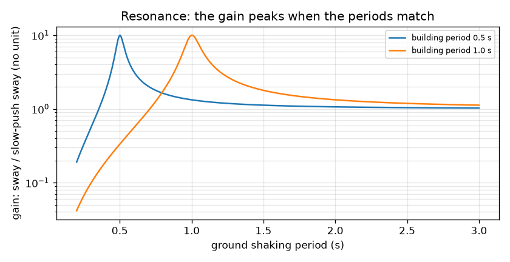
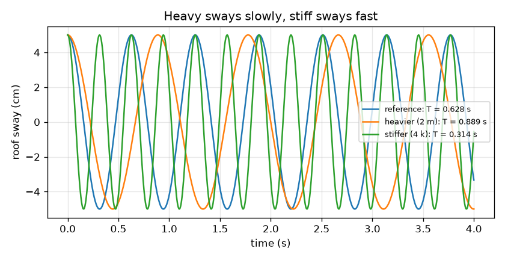

# அமர்வு 1: ஒரு கட்டடம் என்பது ஒரு சுருள்வில்லின் மீதுள்ள நிறை

[Session 1 — हिन्दी](README.hi.md)

*நிலை 1 (கருத்தியல் ஊடாடும் மாதிரி) · சுமார் 60 நிமிடங்கள் · openbuildingsway*

> இது எளிமைப்படுத்தப்பட்ட ஒரு கல்வி மாதிரி. இது சரிபார்க்கப்பட்ட வடிவமைப்புக் கருவி அல்ல; உண்மையான கட்டமைப்புகள், மின் நிறுவல்கள், வாகனங்கள், தொழில்துறை செயல்முறைகள் அல்லது மருத்துவ முடிவுகளுக்கு இதைப் பயன்படுத்தக் கூடாது.

**முன்தேவைகள் (Prerequisites)**

- பள்ளி இயற்கணிதமும் வர்க்கமூலங்களும்.
- நீங்கள் PRIMER.md படித்து, `python start.py 1` ஐ ஒரு முறை இயக்கியிருக்க வேண்டும்.

**கற்றல் நோக்கங்கள் (Learning objectives).** இந்த அமர்வுக்குப் பிறகு நீங்கள்:

- உயரமான கட்டடம் ஒரு ஊசல் போல முன்னும் பின்னும் ஆடுவது ஏன் என்றும், ஒரு ஆட்டத்தின் நேரத்தை எது தீர்மானிக்கிறது என்றும் விளக்க முடியும்.
- நிறையும் விறைப்பும் (stiffness) அலைவுக் காலத்தை (period) எப்படி மாற்றுகின்றன என்பதைக் கண்டறிய T = 2 pi sqrt(m / k) ஐப் பயன்படுத்த முடியும்.
- ஒத்ததிர்வை (resonance) விவரிக்க முடியும்: நில அதிர்வு கட்டடத்தின் சொந்தத் தாளத்துடன் பொருந்தும்போது என்ன நடக்கிறது.
- நில அலைவுக் காலத்திற்கு எதிராக ஆதாயம் (gain) காட்டும் வரைபடத்தைப் படிக்க முடியும்.

## A. நிஜ உலகப் பிரச்சனை
நிலநடுக்கத்திற்குப் பிறகு சில கட்டடங்கள் கடுமையாக அதிர்ந்திருக்கும், ஆனால் பக்கத்துக் கட்டடம் அரிதாகவே அசைந்திருக்கும். பதிலின் ஒரு பகுதி தாளம். ஒவ்வொரு கட்டடத்திற்கும் அதன் சொந்த மெதுவான, சீரான ஆட்டம் உள்ளது; நிலத்திற்கும் ஒரு விருப்பத் தாளம் உள்ளது. இரண்டும் பொருந்தினால், ஒவ்வொரு தள்ளும் முந்தையதுடன் சேர்கிறது, ஊஞ்சலில் உள்ள குழந்தையைச் சரியான கணத்தில் தள்ளுவது போல. ஒரு கட்டடத்தின் தாளத்தை எது தீர்மானிக்கிறது, பொருத்தம் எவ்வளவு மோசமானது? (இந்த ரெப்போ கற்றலுக்கானது. இது எளிமைப்படுத்தப்பட்ட மாதிரி; உண்மையான கட்டடத்தை வடிவமைக்கவோ மதிப்பிடவோ ஒருபோதும் பயன்படுத்தக் கூடாது.)

## B. கருத்தும் கோட்பாடும்
முழுக் கட்டடத்தையும் k விறைப்புள்ள ஒரு சுருள்வில்லின் மீது m நிறையுள்ள ஒரு கட்டியாகக் கற்பனை செய்யுங்கள்; இங்கே k என்பது ஒவ்வொரு மீட்டர் ஆட்டத்திற்கும் தேவையான பக்கவாட்டு விசை. அதைப் பக்கவாட்டில் இழுத்து விடுங்கள்: அது முன்னும் பின்னும் ஆடுகிறது. கோண அதிர்வெண் (angular frequency) w = sqrt(k / m) சுழற்சி எவ்வளவு வேகமாக நடக்கிறது என்பதை ரேடியன் per வினாடியில் சொல்கிறது, அலைவுக் காலம் T = 2 pi / w என்பது ஒரு முழு முன்-பின் ஆட்டத்திற்கான நேரம். கனமானது என்றால் மெதுவாக, விறைப்பானது என்றால் வேகமாக. வழக்கமான சட்டகக் கட்டடங்களுக்குப் பொறியாளர்கள் பெரும்பாலும் N மாடிகளுக்கு T சுமார் 0.1 N வினாடிகள் என்ற தோராயமான அனுபவ விதியை (empirical rule of thumb) பயன்படுத்துகின்றனர்; இது ஒரு வழிகாட்டி மட்டுமே. நிலம் Tg அலைவுக் காலத்துடன் முன்னும் பின்னும் அதிரும்போது, மிக மெதுவான தள்ளலுடன் ஒப்பிடும்போது ஆட்டம் எவ்வளவு பெருக்கப்படுகிறது என்பதை ஆதாயம் சொல்கிறது. r = T / Tg மற்றும் தணிப்பு விகிதம் (damping ratio) zeta (வழக்கமாக 0.05, அதாவது ஒவ்வொரு சுழற்சியிலும் ஆட்டம் சில சதவீதம் குறைகிறது) உடன், ஆதாயம் 1 / sqrt((1 - r^2)^2 + (2 zeta r)^2). அமர்வு 2 இதை வருவிக்கிறது.

| குறியீடு | பொருள் | அலகு |
|---|---|---|
| m | கட்டடக் கட்டியின் நிறை | kg |
| k | தூண்களின் பக்கவாட்டு விறைப்பு | N/m |
| w | ஆட்டத்தின் கோண அதிர்வெண் | rad/s |
| T | ஆட்டத்தின் அலைவுக் காலம் | s |
| Tg | நில அதிர்வின் அலைவுக் காலம் | s |
| r | விகிதம் T / Tg | அலகு இல்லை |
| zeta | தணிப்பு விகிதம் | அலகு இல்லை |
| gain | ஆட்டத்தை மிக மெதுவான தள்ளலின் ஆட்டத்தால் வகுத்தது | அலகு இல்லை |

**அனுமானங்கள் (Assumptions)**

- கட்டடம் ஒரு சுருள்வில்லின் மீது ஒரு கட்டி (ஒற்றைச் சுதந்திரக் கூறு (single degree of freedom)).
- நிலம் நிலையான மீண்டும் வரும் தாளத்தில் அதிர்கிறது; உண்மையான நிலநடுக்கம் அப்படி இல்லை.
- வேறு சொல்லப்படாவிட்டால் தணிப்பு கிரிட்டிக்கலின் 5 சதவீதம் (zeta = 0.05).
- எல்லாம் மீள்தன்மையுடன் (elastic) இருக்கிறது: எதுவும் விரிசல் விடுவதோ வளைந்து கொடுப்பதோ (yield) இல்லை.

$$ \omega=\sqrt{\frac{k}{m}},\qquad T=\frac{2\pi}{\omega} $$

$$ x(t)=x_0\cos(\omega t)\quad\text{(free sway released from rest at }x_0\text{)} $$

$$ T\approx 0.1\,N\ \text{s}\quad\text{(rough empirical rule of thumb for typical frame buildings)} $$

$$ \text{gain}=\frac{1}{\sqrt{(1-r^2)^2+(2\zeta r)^2}},\qquad r=\frac{T}{T_g} $$

## C. காட்சி விளக்கம்
முதல் படம் ஒரே 5 cm ஆட்டத்திலிருந்து விடப்பட்ட மூன்று கட்டடங்களைக் காட்டுகிறது: குறிப்புக் கட்டடம் (T = 0.628 s), இரு மடங்கு நிறையுள்ள கனமான ஒன்று (T = 0.889 s, மெதுவானது) மற்றும் நான்கு மடங்கு விறைப்புள்ள ஒன்று (T = 0.314 s, இரு மடங்கு வேகம்). இரண்டாவது படம் 0.5 s மற்றும் 1 s அலைவுக் காலமுள்ள கட்டடங்களுக்கு நில அலைவுக் காலத்திற்கு எதிராக ஆதாயத்தை மடக்கை அளவில் (log scale) வரைகிறது. ஒவ்வொரு வளைவும் நில அலைவுக் காலம் கட்டட அலைவுக் காலத்திற்குச் சமமாகும் இடத்தில் 10 என்ற கூர்மையான உச்சத்திற்கு உயர்கிறது, மிக மெதுவான அதிர்வுக்கு 1-க்கு அருகில் உள்ளது, மிக வேகமான அதிர்வுக்கு 1-க்குக் கீழே நன்றாக இறங்குகிறது.

*0.5 s மற்றும் 1 s கட்டடங்களுக்கு நில அலைவுக் காலத்திற்கு எதிரான ஆதாயம்: அலைவுக் காலங்கள் பொருந்தும் இடத்தில் 10 என்ற உச்சம்.*

*ஒரே 5 cm ஆட்டத்திலிருந்து விடப்பட்ட மூன்று கட்டடங்கள்: கனமானது மெதுவானது (T = 0.889 s), விறைப்பானது வேகமானது (T = 0.314 s).*

## D. ஊடாடும் உருவகப்படுத்தல்
பாடத்தை இயக்கவும் (`python start.py 1`), பிறகு நேரடிச் செயலியைத் திறக்கவும்: [அமர்வு 1: சுருள்வில்லின் மீதுள்ள கட்டடம்](https://krunalpanchal1995.github.io/pan-iit-oss/openbuildingsway/session-01/) (அல்லது இந்தக் கோப்புறையில் உள்ள `app.html`). நிறை மற்றும் விறைப்பு ஸ்லைடர்களை இழுத்து, அளவீட்டில் அலைவுக் காலம் மாறுவதைக் கவனியுங்கள்; பிறகு நில அலைவுக் காலத்தையும் நேர ஸ்லைடரையும் நகர்த்தி ஆறு மாடிக் கட்டடம் ஆடுவதைப் பாருங்கள். உச்சம் எங்கே உள்ளது என்று பார்க்க ஆதாய வரைபடத்தைத் திறங்கள்.

**சவால்.** கட்டடத்தை 1 s நிலத்துடன் ஒத்ததிர்வில் அமையுங்கள்: அதன் அலைவுக் காலத்தை நில அலைவுக் காலத்தின் 2 சதவீதத்திற்குள் கொண்டு வாருங்கள்.

## E. தீர்க்கப்பட்ட உதாரணமும் சோதனையும்
**பிரச்சனை.** ஒரு கட்டடக் கட்டிக்கு m = 200 000 kg மற்றும் k = 20 000 000 N/m. w மற்றும் T ஐக் கண்டறியுங்கள். நிறை இரு மடங்கானால், விறைப்பு நான்கு மடங்கானால் T-க்கு என்ன நடக்கும்? 5 சதவீதத் தணிப்புடன் ஒத்ததிர்வில் ஆட்டம் எவ்வளவு பெருக்கப்படும்?

1. w = sqrt(k / m) = sqrt(20 000 000 / 200 000) = sqrt(100) = 10 rad/s.
2. T = 2 pi / w = 6.283 / 10 = 0.6283 s.
3. நிறையை இரு மடங்காக்குங்கள்: T, sqrt(2) மடங்கு வளர்கிறது, எனவே T = 0.6283 * 1.4142 = 0.8886 s.
4. நான்கு மடங்கு விறைப்பு: T, sqrt(4) = 2 மடங்கு சுருங்குகிறது, எனவே T = 0.3142 s.
5. ஒத்ததிர்வில் r = 1, எனவே ஆதாயம் 1 / sqrt(0 + (2 * 0.05 * 1)^2) = 1 / 0.1 = 10.

**விடை.** w = 10 rad/s மற்றும் T = 0.6283 s; நிறையை இரு மடங்காக்கினால் 0.8886 s, விறைப்பை நான்கு மடங்காக்கினால் 0.3142 s; ஒத்ததிர்வில் ஆதாயம் 10.

**சோதனை.** 30 cm பிளாஸ்டிக் அளவுகோலின் பெரும்பகுதி வெளியே நீட்டியிருக்கும்படி மேசையில் இறுக்கிப் பிடியுங்கள், சுதந்திர முனையில் ஒரு கட்டி மாடலிங் களிமண்ணை வையுங்கள். முனையைப் பக்கவாட்டில் இழுத்து விட்டு, தொலைபேசி நிறுத்தக் கடிகாரத்தால் பத்து ஆட்டங்களை நேரம் பார்த்து அலைவுக் காலத்தைப் பெறுங்கள். மேலும் களிமண் சேருங்கள் (அதிக நிறை), பிறகு சுதந்திர நீளத்தைக் குறையுங்கள் (அதிக விறைப்பு): செயலியில் உள்ளது போல அலைவுக் காலம் நிறையுடன் வளர்ந்து விறைப்புடன் சுருங்க வேண்டும். அளவுகோலுக்குச் சொந்த நிறை இருப்பதாலும், அதன் வளைவு நீளம் முழுவதும் பரவுவதாலும், காற்றுக்கும் இறுக்கிக்கும் ஆற்றல் இழப்பதாலும் உங்கள் எண்கள் சூத்திரத்திலிருந்து வேறுபடும்: மாதிரி கட்டடத்தை எடையற்ற சுருள்வில்லின் மீது ஒரு புள்ளி நிறையாகக் கருதுகிறது.

## F. மதிப்பீடும் வடிவமைப்புச் சவாலும்
**கேள்வி வகை A: கருத்தியல்.** கனமான கட்டடம் மெதுவாகவும் விறைப்பான கட்டடம் வேகமாகவும் ஆடுவது ஏன்? தள்ளல் சிறியதாக இருந்தாலும் பொருந்தும் நிலத் தாளம் ஆபத்தானதாக இருக்க முடிவது ஏன்?

குறிப்பு

ஊஞ்சலில் உள்ள ஒரு குழந்தையை நினைத்துப் பாருங்கள்: குழந்தை கனமாக இருந்தால் என்ன மாறும்? பிறகு ஒரு தள்ளல் இயக்கத்துடன் எப்போது சேர்கிறது, எப்போது எதிராகச் செயல்படுகிறது என்று சிந்தியுங்கள்.

படிப்படியான தீர்வு

அதே சுருள்வில் விசைக்குப் பெரிய நிறையை முடுக்குவது கடினம், எனவே ஒவ்வொரு ஆட்டமும் அதிக நேரம் எடுக்கிறது; விறைப்பான சுருள்வில் அதே ஆட்டத்திற்கு வலுவாகத் திரும்ப இழுக்கிறது, எனவே ஒவ்வொரு ஆட்டமும் விரைவானது. அதுதான் T = 2 pi sqrt(m / k). நில அலைவுக் காலம் கட்டடத்தினுடையதற்குச் சமமாகும்போது, ஒவ்வொரு தள்ளும் கட்டடம் ஏற்கனவே அதே திசையில் நகரும்போதே வந்து சேர்கிறது, எனவே விளைவுகள் சுழற்சிக்குப் பின் சுழற்சியாகக் கூடுகின்றன, தணிப்பு மட்டுமே ஆட்டத்தைக் கட்டுப்படுத்துகிறது. சிறிய தள்ளல்கள் கூடப் பெரிய ஆட்டமாக வளரலாம்: 5 சதவீதத் தணிப்பில் ஒத்ததிர்வு ஆதாயம் 10.

**கேள்வி வகை B: எண்ணியல்.** ஒரு கட்டடக் கட்டிக்கு m = 500 000 kg மற்றும் k = 20 000 000 N/m. w மற்றும் T ஐக் கண்டறிந்து, அது 1 s நில அலைவுக் காலத்திற்கு அருகில் உள்ளதா என்று சொல்லுங்கள்.

குறிப்பு

w = sqrt(k / m), பிறகு T = 2 pi / w. அலகுகளைச் சரிபாருங்கள்: k / m என்பது N/m per kg = 1/s^2.

படிப்படியான தீர்வு

w = sqrt(20 000 000 / 500 000) = sqrt(40) = 6.325 rad/s. T = 2 pi / 6.325 = 0.9935 s. இது 1 s நில அலைவுக் காலத்தின் 1 சதவீதத்திற்குள் உள்ளது, எனவே இந்தக் கட்டடம் கிட்டத்தட்ட ஒத்ததிர்வில் உள்ளது, வலுவாகப் பெருக்கப்படும் (சுமார் 10 மடங்கு). சரிபார்ப்பு: இது தீர்க்கப்பட்ட உதாரணத்தை (200 000 kg, T = 0.628 s) விடக் கனமானது, எனவே அதன் அலைவுக் காலம் நீளமானது.

**கேள்வி வகை C: வரைபடம் மற்றும் உருவகப்படுத்தல் விளக்கம்.** ஆதாய வரைபடத்தில் ஒரு 1 s கட்டடம் 2 s அலைவுக் காலமுள்ள நிலத்தாலும், பிறகு 0.5 s அலைவுக் காலமுள்ள ஒன்றாலும் அதிர்விக்கப்படுகிறது. ஒவ்வொரு நிலையிலும் ஆதாயத்தைப் படித்து, ஒவ்வொன்றும் ஒரு பொறியாளருக்கு என்ன சொல்கிறது என்று சொல்லுங்கள்.

குறிப்பு

விகிதம் r = T / Tg = கட்டட அலைவுக் காலம் வகுத்தல் நில அலைவுக் காலம். சூத்திரத்தைப் பயன்படுத்துங்கள் அல்லது வளைவைப் படியுங்கள்.

படிப்படியான தீர்வு

Tg = 2 s எனில், r = 0.5, ஆதாயம் 1.33: கட்டடம் பெரும்பாலும் மெதுவான நில இயக்கத்தைப் பின்தொடர்கிறது, சற்றுப் பெருக்கப்பட்டு. Tg = 0.5 s எனில், r = 2, ஆதாயம் 0.33: அதிர்வு கட்டடம் பின்தொடர முடியாத அளவு விரைவானது, எனவே அது அரிதாகவே அசைகிறது. இரண்டும் Tg = 1 s-ல் உள்ள 10 என்ற ஒத்ததிர்வு உச்சத்திலிருந்து வெகு தொலைவில் உள்ளன.

**கேள்வி வகை D: வடிவமைப்பு மற்றும் உகப்பாக்கச் சவால்.** ஒரு கட்டடத்திற்கு m = 200 000 kg, நில அலைவுக் காலம் 1 s. அதன் அலைவுக் காலத்தை 0.5 s (விறைப்பான வடிவமைப்பு) அல்லது 1.5 s (நெகிழ்வான வடிவமைப்பு) ஆக்கும் விறைப்பு k ஐத் தேர்ந்தெடுங்கள். ஒவ்வொன்றும் ஆதாயத்திற்கு என்ன தருகிறது, ஒவ்வொன்றின் குறைபாடு என்ன?

குறிப்பு

T = 2 pi sqrt(m / k) ஐத் தலைகீழாக்கி k = m (2 pi / T)^2 பெறுங்கள், பிறகு ஆதாயச் சூத்திரத்தில் r = T / Tg பயன்படுத்துங்கள்.

படிப்படியான தீர்வு

T = 0.5 s-க்கு: k = 200 000 * (2 pi / 0.5)^2 = 3.158e7 N/m, r = 0.5, ஆதாயம் 1.33. T = 1.5 s-க்கு: k = 200 000 * (2 pi / 1.5)^2 = 3.509e6 N/m, r = 1.5, ஆதாயம் 0.79. இரண்டும் 10 என்ற ஒத்ததிர்வு உச்சத்தைத் தவிர்க்கின்றன. குறைபாடுகள்: விறைப்பான வடிவமைப்புக்கு அதிகத் தூண் பொருள் செலவாகும் (நெகிழ்வானதை விட 9 மடங்கு விறைப்பு), பெரிய விசைகளையும் ஈர்க்கிறது; நெகிழ்வான வடிவமைப்பு மலிவானது, ஆனால் மொத்தத்தில் நீண்ட தூரம் ஆடுகிறது (நீண்ட அலைவுக் காலம் என்றால் பெரிய இடப்பெயர்ச்சிகள்), அசௌகரியமாக இருக்கலாம் அல்லது அடுத்த கட்டடத்தில் மோதலாம். அனுமானங்கள்: நிலத்திற்கு ஒரே நிலையான அலைவுக் காலம், மாதிரி ஒரு கட்டி.

[RUBRIC.md](../../RUBRIC.md) மூலம் உங்களை மதிப்பிட்டுக் கொள்ளுங்கள். காகிதத்தில் செய்ய [செயல்பாட்டுத் தாள்](activity_sheet.md) அச்சிடுங்கள்.

## பொதுவான தவறான கருத்துகள்
| பொதுவான தவறான கருத்து | உண்மையில் சரியானது |
|---|---|
| வலுவான கட்டடம் நிலநடுக்கத்தில் தானாகவே பாதுகாப்பானது. | வலிமையும் (strength) விறைப்பும் வேறுவேறு. விறைப்பு ஆட்ட அலைவுக் காலத்தை அமைக்கிறது; அந்த அலைவுக் காலம் அதிர்வுக்கு எதிராக எங்கே அமைகிறது, கட்டடம் எவ்வளவு ஆட்டத்தைத் தாங்கும் என்பதே முக்கியம். |
| நில அதிர்வு எல்லாக் கட்டடங்களுக்கும் ஒன்றே. | அதிர்வு ஒன்றே, ஆனால் பதில்வினை அல்ல: கட்டடத்தின் அலைவுக் காலம் நில அலைவுக் காலத்திற்கு அருகில் இருந்தால் அது அதிர்வை வலுவாகப் பெருக்குகிறது, தொலைவில் இருந்தால் அரிதாகவே. |
| T = 0.1 N வினாடிகள் என்ற விதி ஒரு இயற்கை விதி. | இது வழக்கமான சட்டகக் கட்டடங்களுக்கான தோராயமான அனுபவ விதி. சுவர்கள், உயரமான மெல்லிய கோபுரங்கள், மென்மையான மண் ஆகியவை மிகவும் வேறுபடலாம்; உண்மையான அலைவுக் காலங்களைக் கணக்கிட வேண்டும் அல்லது அளக்க வேண்டும். |
| ஈர்ப்பு கீழே இழுப்பதால் கனமான கட்டடம் மெதுவாக ஆடுகிறது. | அலைவுக் காலம் நிறை-விறைப்பு விகிதத்தைச் சார்ந்தது. நிறை, விறைப்பு இரண்டையும் இரு மடங்காக்கினால் அலைவுக் காலம் மாறாது. |

## சொற்களஞ்சியம் (Glossary)
- **அலைவுக் காலம் (period)**: ஒரு முழு முன்-பின் ஆட்டத்திற்கான நேரம், வினாடிகளில்
- **கோண அதிர்வெண் (angular frequency)**: ஆட்டச் சுழற்சி எவ்வளவு வேகமாகச் சுழல்கிறது, ரேடியன் per வினாடியில்: w = 2 pi / T
- **விறைப்பு (stiffness)**: ஒவ்வொரு மீட்டர் பக்கவாட்டு ஆட்டத்திற்கும் தேவையான விசை, N/m-ல்
- **ஒத்ததிர்வு (resonance)**: அதிர்வுத் தாளம் கட்டடத்தின் சொந்தத் தாளத்துடன் பொருந்தும்போது வளரும் பெரிய ஆட்டம்
- **தணிப்பு விகிதம் (damping ratio)**: கிரிட்டிக்கல் தணிப்பின் பின்னம்; சாதாரணக் கட்டடங்களுக்குச் சுமார் 0.05
- **ஆதாயம் (gain)**: மிக மெதுவான தள்ளலுடன் ஒப்பிடும்போது நிலையான அதிர்வு எவ்வளவு பெருக்கப்படுகிறது

## நிறைவு
1. [exercises.md](exercises.md) இல் உள்ள மூன்று நிரலாக்கப் பணிகளைச் செய்யுங்கள்.
2. உங்கள் மாற்றங்களுக்குப் பிறகு `python start.py 1` ஐ மீண்டும் இயக்குங்கள். அது சோதனைச் சாவடியுடன் (checkpoint) முடிகிறது; அது `PASS` என அச்சிடும்போது, நீங்கள் முடித்துவிட்டீர்கள். (சோதனைச் சாவடி மட்டும்: `python start.py check 1`.)

அடுத்து: [அமர்வு 2](../session-02/README.md)
