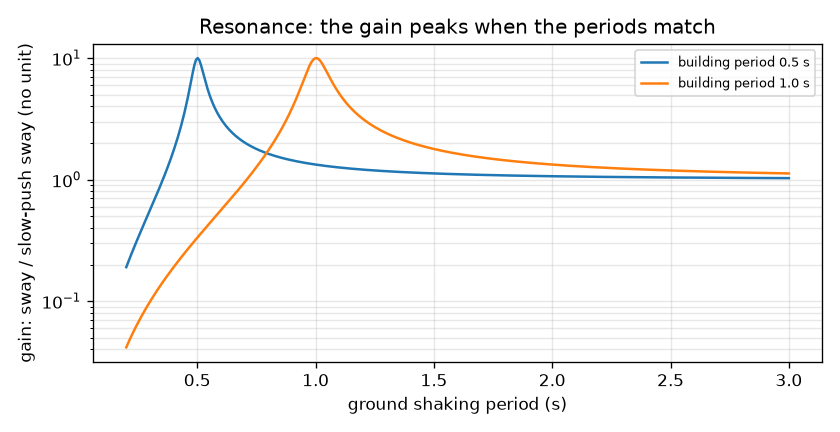
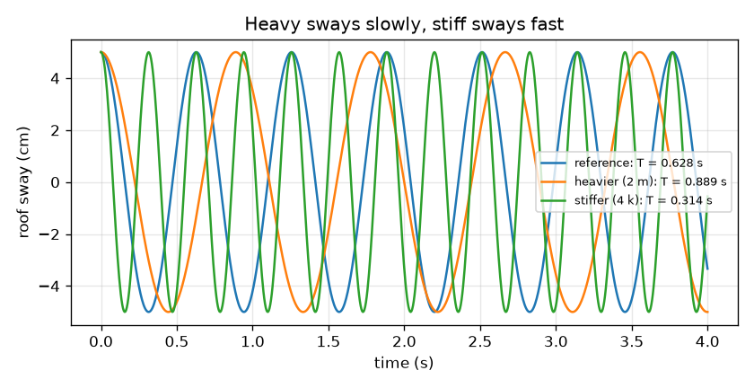

# సెషన్ 1: ఒక భవనం అంటే స్ప్రింగ్‌పై ఉన్న ద్రవ్యరాశి

[Session 1 — हिन्दी](README.hi.md)

*స్థాయి 1 (భావనాత్మక ఇంటరాక్టివ్ మోడల్) · సుమారు 60 నిమిషాలు · openbuildingsway*

> ఇది సరళీకరించిన విద్యా మోడల్. ఇది ధృవీకరించబడిన డిజైన్ సాధనం కాదు; నిజమైన నిర్మాణాలు, విద్యుత్ ఇన్‌స్టాలేషన్‌లు, వాహనాలు, పారిశ్రామిక ప్రక్రియలు లేదా వైద్య నిర్ణయాల కోసం దీనిని ఉపయోగించకూడదు.

**ముందస్తు అవసరాలు (Prerequisites)**

- పాఠశాల బీజగణితం మరియు వర్గమూలాలు.
- మీరు PRIMER.md చదివి, `python start.py 1` ను ఒకసారి రన్ చేసి ఉండాలి.

**అభ్యాస లక్ష్యాలు (Learning objectives).** ఈ సెషన్ తర్వాత మీరు:

- ఎత్తైన భవనం లోలకం (pendulum) లాగా ముందుకు వెనక్కు ఎందుకు ఊగుతుందో మరియు ఒక ఊపు సమయాన్ని ఏది నిర్ణయిస్తుందో వివరించగలరు.
- ద్రవ్యరాశి మరియు దృఢత్వం (stiffness) ఆవర్తన కాలాన్ని (period) ఎలా మారుస్తాయో కనుగొనడానికి T = 2 pi sqrt(m / k) ఉపయోగించగలరు.
- అనునాదాన్ని (resonance) వివరించగలరు: భూకంపన భవనం యొక్క సొంత లయతో సరిపోలినప్పుడు ఏమి జరుగుతుంది.
- భూమి ఆవర్తన కాలానికి వ్యతిరేకంగా గెయిన్ (gain) గ్రాఫ్‌ను చదవగలరు.

## A. నిజ జీవిత సమస్య
భూకంపం తర్వాత కొన్ని భవనాలు తీవ్రంగా కదిలిపోతాయి, కానీ పక్కనే ఉన్నది అరుదుగా కదులుతుంది. సమాధానంలో ఒక భాగం లయ. ప్రతి భవనానికి దాని సొంత నెమ్మదైన, క్రమమైన ఊపు ఉంటుంది, భూమికి కూడా ఒక ఇష్టమైన లయ ఉంటుంది. రెండూ సరిపోలితే, ప్రతి తోపు మునుపటిదానికి జతకలుస్తుంది, ఉయ్యాలలో ఉన్న పిల్లవాడిని సరైన క్షణంలో నెట్టినట్లు. ఒక భవనం యొక్క లయను ఏది నిర్ణయిస్తుంది, మరియు సరిపోలిక ఎంత చెడ్డది? (ఈ రెపో నేర్చుకోవడానికి మాత్రమే. ఇది సరళీకరించిన మోడల్, నిజమైన భవనాన్ని డిజైన్ చేయడానికి లేదా అంచనా వేయడానికి ఎప్పుడూ ఉపయోగించకూడదు.)

## B. భావన మరియు సిద్ధాంతం
మొత్తం భవనాన్ని k దృఢత్వం గల ఒక స్ప్రింగ్‌పై m ద్రవ్యరాశి గల ఒక ముద్దగా ఊహించుకోండి; ఇక్కడ k అంటే ప్రతి మీటర్ ఊపుకు అవసరమైన పక్క బలం. దానిని పక్కకు లాగి వదలండి: అది ముందుకు వెనక్కు ఊగుతుంది. కోణీయ పౌనఃపున్యం (angular frequency) w = sqrt(k / m) చక్రం ఎంత వేగంగా జరుగుతుందో రేడియన్ per సెకనులో చెబుతుంది, మరియు ఆవర్తన కాలం T = 2 pi / w ఒక పూర్తి ముందుకు-వెనక్కు ఊపుకు పట్టే సమయం. బరువైనది అంటే నెమ్మదిగా, దృఢమైనది అంటే వేగంగా. సాధారణ ఫ్రేమ్ భవనాలకు ఇంజనీర్లు తరచుగా N అంతస్తులకు T సుమారు 0.1 N సెకన్లు అనే స్థూల అనుభవ నియమాన్ని (empirical rule of thumb) ఉపయోగిస్తారు; ఇది కేవలం మార్గదర్శి మాత్రమే. భూమి Tg ఆవర్తన కాలంతో ముందుకు వెనక్కు కంపించినప్పుడు, చాలా నెమ్మదైన తోపుతో పోలిస్తే ఊపు ఎంత పెరుగుతుందో గెయిన్ చెబుతుంది. r = T / Tg మరియు అవమందన నిష్పత్తి (damping ratio) zeta (సాధారణంగా 0.05, అంటే ప్రతి చక్రంలో ఊపు కొన్ని శాతం తగ్గుతుంది) తో, గెయిన్ 1 / sqrt((1 - r^2)^2 + (2 zeta r)^2). సెషన్ 2 దీనిని ఉత్పాదిస్తుంది.

| చిహ్నం | అర్థం | యూనిట్ |
|---|---|---|
| m | భవన ముద్ద ద్రవ్యరాశి | kg |
| k | స్తంభాల పక్క దృఢత్వం | N/m |
| w | ఊపు యొక్క కోణీయ పౌనఃపున్యం | rad/s |
| T | ఊపు యొక్క ఆవర్తన కాలం | s |
| Tg | భూకంపన ఆవర్తన కాలం | s |
| r | నిష్పత్తి T / Tg | యూనిట్ లేదు |
| zeta | అవమందన నిష్పత్తి | యూనిట్ లేదు |
| gain | ఊపును చాలా నెమ్మదైన తోపు ఊపుతో భాగించినది | యూనిట్ లేదు |

**ఊహలు (Assumptions)**

- భవనం ఒక స్ప్రింగ్‌పై ఒక ముద్ద (ఏక స్వేచ్ఛా స్థాయి (single degree of freedom)).
- భూమి స్థిరమైన పునరావృత లయలో కంపిస్తుంది, నిజమైన భూకంపం అలా ఉండదు.
- వేరే చెప్పకపోతే అవమందనం క్రిటికల్‌లో 5 శాతం (zeta = 0.05).
- అన్నీ స్థితిస్థాపకంగా (elastic) ఉంటాయి: ఏదీ పగలదు లేదా లొంగదు (yield).

$$ \omega=\sqrt{\frac{k}{m}},\qquad T=\frac{2\pi}{\omega} $$

$$ x(t)=x_0\cos(\omega t)\quad\text{(free sway released from rest at }x_0\text{)} $$

$$ T\approx 0.1\,N\ \text{s}\quad\text{(rough empirical rule of thumb for typical frame buildings)} $$

$$ \text{gain}=\frac{1}{\sqrt{(1-r^2)^2+(2\zeta r)^2}},\qquad r=\frac{T}{T_g} $$

## C. దృశ్య వివరణ
మొదటి చిత్రం ఒకే 5 cm ఊపు నుండి వదిలిన మూడు భవనాలను చూపిస్తుంది: సూచన భవనం (T = 0.628 s), రెట్టింపు ద్రవ్యరాశి గల బరువైనది (T = 0.889 s, నెమ్మది) మరియు నాలుగు రెట్ల దృఢత్వం గలది (T = 0.314 s, రెట్టింపు వేగం). రెండవ చిత్రం 0.5 s మరియు 1 s ఆవర్తన కాలాలు గల భవనాలకు భూమి ఆవర్తన కాలానికి వ్యతిరేకంగా గెయిన్‌ను లాగ్ స్కేల్‌పై గీస్తుంది. ప్రతి వక్రం భూమి ఆవర్తన కాలం భవన ఆవర్తన కాలానికి సమానమైన చోట 10 అనే పదునైన శిఖరానికి పెరుగుతుంది, చాలా నెమ్మదైన కంపనానికి 1 కి దగ్గరగా ఉంటుంది మరియు చాలా వేగమైన కంపనానికి 1 కంటే బాగా తక్కువకు పడిపోతుంది.

*0.5 s మరియు 1 s భవనాలకు భూమి ఆవర్తన కాలానికి వ్యతిరేకంగా గెయిన్: ఆవర్తన కాలాలు సరిపోలిన చోట 10 శిఖరం ఉంటుంది.*

*ఒకే 5 cm ఊపు నుండి వదిలిన మూడు భవనాలు: బరువైనది నెమ్మది (T = 0.889 s), దృఢమైనది వేగం (T = 0.314 s).*

## D. ఇంటరాక్టివ్ సిమ్యులేషన్
పాఠాన్ని రన్ చేయండి (`python start.py 1`), తర్వాత లైవ్ యాప్‌ను తెరవండి: [సెషన్ 1: స్ప్రింగ్‌పై ఒక భవనం](https://krunalpanchal1995.github.io/pan-iit-oss/openbuildingsway/session-01/) (లేదా ఈ ఫోల్డర్‌లోని `app.html`). ద్రవ్యరాశి మరియు దృఢత్వం స్లయిడర్‌లను లాగి రీడౌట్‌లో ఆవర్తన కాలం మారడం గమనించండి; తర్వాత భూమి ఆవర్తన కాలాన్ని మరియు సమయ స్లయిడర్‌ను కదిలించి ఆరు అంతస్తుల భవనం ఊగడం చూడండి. శిఖరం ఎక్కడ ఉందో చూడడానికి గెయిన్ గ్రాఫ్‌ను తెరవండి.

**సవాలు.** భవనాన్ని 1 s భూమితో అనునాదంలోకి ట్యూన్ చేయండి: దాని ఆవర్తన కాలాన్ని భూమి ఆవర్తన కాలంలో 2 శాతం లోపలికి తీసుకురండి.

## E. సాధించిన ఉదాహరణ మరియు ప్రయోగం
**సమస్య.** ఒక భవన ముద్దకు m = 200 000 kg మరియు k = 20 000 000 N/m. w మరియు T కనుగొనండి. ద్రవ్యరాశి రెట్టింపైతే, దృఢత్వం నాలుగు రెట్లైతే T కి ఏమవుతుంది? 5 శాతం అవమందనంతో అనునాదంలో ఊపు ఎంత పెరుగుతుంది?

1. w = sqrt(k / m) = sqrt(20 000 000 / 200 000) = sqrt(100) = 10 rad/s.
2. T = 2 pi / w = 6.283 / 10 = 0.6283 s.
3. ద్రవ్యరాశిని రెట్టింపు చేయండి: T, sqrt(2) రెట్లు పెరుగుతుంది, కాబట్టి T = 0.6283 * 1.4142 = 0.8886 s.
4. నాలుగు రెట్ల దృఢత్వం: T, sqrt(4) = 2 రెట్లు తగ్గుతుంది, కాబట్టి T = 0.3142 s.
5. అనునాదంలో r = 1, కాబట్టి గెయిన్ 1 / sqrt(0 + (2 * 0.05 * 1)^2) = 1 / 0.1 = 10.

**సమాధానం.** w = 10 rad/s మరియు T = 0.6283 s; ద్రవ్యరాశి రెట్టింపు చేస్తే 0.8886 s, దృఢత్వం నాలుగు రెట్లు చేస్తే 0.3142 s; అనునాదంలో గెయిన్ 10.

**ప్రయోగం.** 30 cm ప్లాస్టిక్ స్కేలును ఎక్కువ భాగం బయటకు ఉండేలా బల్లకు బిగించి, స్వేచ్ఛా చివరపై మోడలింగ్ మట్టి ముద్ద ఉంచండి. చివరను పక్కకు లాగి వదిలి, ఫోన్ స్టాప్‌వాచ్‌తో పది ఊపులకు సమయం కొలిచి ఆవర్తన కాలం పొందండి. మరింత మట్టి జోడించండి (ఎక్కువ ద్రవ్యరాశి), తర్వాత స్వేచ్ఛా పొడవును తగ్గించండి (ఎక్కువ దృఢం): యాప్‌లో లాగానే ఆవర్తన కాలం ద్రవ్యరాశితో పెరగాలి మరియు దృఢత్వంతో తగ్గాలి. స్కేలుకు సొంత ద్రవ్యరాశి ఉండటం, దాని వంపు పొడవంతా వ్యాపించడం, మరియు గాలికి, బిగింపుకు శక్తి కోల్పోవడం వల్ల మీ సంఖ్యలు సూత్రం నుండి భిన్నంగా ఉంటాయి: మోడల్ భవనాన్ని బరువులేని స్ప్రింగ్‌పై ఒక బిందు ద్రవ్యరాశిగా పరిగణిస్తుంది.

## F. మూల్యాంకనం మరియు డిజైన్ సవాలు
**ప్రశ్న రకం A: భావనాత్మక.** బరువైన భవనం నెమ్మదిగా, దృఢమైన భవనం వేగంగా ఎందుకు ఊగుతుంది? తోపు చిన్నదైనా సరిపోలే భూమి లయ ఎందుకు ప్రమాదకరం కావచ్చు?

సూచన

ఉయ్యాలలో ఉన్న పిల్లవాడి గురించి ఆలోచించండి: పిల్లవాడు బరువైతే ఏమి మారుతుంది? తర్వాత ఒక తోపు కదలికకు ఎప్పుడు జతకలుస్తుంది, ఎప్పుడు వ్యతిరేకంగా పనిచేస్తుందో ఆలోచించండి.

దశలవారీ పరిష్కారం

అదే స్ప్రింగ్ బలానికి పెద్ద ద్రవ్యరాశిని త్వరణం చేయడం కష్టం, కాబట్టి ప్రతి ఊపుకు ఎక్కువ సమయం పడుతుంది; దృఢమైన స్ప్రింగ్ అదే ఊపుకు బలంగా వెనక్కు లాగుతుంది, కాబట్టి ప్రతి ఊపు వేగంగా ఉంటుంది. అదే T = 2 pi sqrt(m / k). భూమి ఆవర్తన కాలం భవనానిదానికి సమానమైనప్పుడు, ప్రతి తోపు భవనం ఇప్పటికే అదే దిశలో కదులుతున్నప్పుడే వస్తుంది, కాబట్టి ప్రభావాలు చక్రం తర్వాత చక్రం కూడుకుంటాయి మరియు అవమందనం మాత్రమే ఊపును పరిమితం చేస్తుంది. చిన్న తోపులు కూడా పెద్ద ఊపుగా పెరగవచ్చు: 5 శాతం అవమందనంలో అనునాద గెయిన్ 10.

**ప్రశ్న రకం B: సంఖ్యాత్మక.** ఒక భవన ముద్దకు m = 500 000 kg మరియు k = 20 000 000 N/m. w మరియు T కనుగొని, అది 1 s భూమి ఆవర్తన కాలానికి దగ్గరగా ఉందో లేదో చెప్పండి.

సూచన

w = sqrt(k / m), తర్వాత T = 2 pi / w. యూనిట్లు సరిచూడండి: k / m అనేది N/m per kg = 1/s^2.

దశలవారీ పరిష్కారం

w = sqrt(20 000 000 / 500 000) = sqrt(40) = 6.325 rad/s. T = 2 pi / 6.325 = 0.9935 s. ఇది 1 s భూమి ఆవర్తన కాలంలో 1 శాతం లోపల ఉంది, కాబట్టి ఈ భవనం దాదాపు అనునాదంలో ఉంది మరియు బలంగా పెరుగుతుంది (సుమారు 10 రెట్లు). సరిచూపు: ఇది సాధించిన ఉదాహరణ (200 000 kg, T = 0.628 s) కంటే బరువైనది, కాబట్టి దాని ఆవర్తన కాలం ఎక్కువ.

**ప్రశ్న రకం C: గ్రాఫ్ మరియు సిమ్యులేషన్ వ్యాఖ్యానం.** గెయిన్ గ్రాఫ్‌పై ఒక 1 s భవనాన్ని 2 s ఆవర్తన కాలం గల భూమి, తర్వాత 0.5 s ఆవర్తన కాలం గలది కంపింపజేస్తాయి. ప్రతి సందర్భంలో గెయిన్ చదివి, ప్రతిదీ ఇంజనీర్‌కు ఏమి చెబుతుందో చెప్పండి.

సూచన

నిష్పత్తి r = T / Tg = భవన ఆవర్తన కాలం భాగించు భూమి ఆవర్తన కాలం. సూత్రం ఉపయోగించండి లేదా వక్రాన్ని చదవండి.

దశలవారీ పరిష్కారం

Tg = 2 s తో, r = 0.5 మరియు గెయిన్ 1.33: భవనం ఎక్కువగా నెమ్మదైన భూమి కదలికను అనుసరిస్తుంది, కొంచెం పెరిగి. Tg = 0.5 s తో, r = 2 మరియు గెయిన్ 0.33: కంపనం భవనం అనుసరించలేనంత వేగంగా ఉంది, కాబట్టి అది అరుదుగా కదులుతుంది. రెండూ Tg = 1 s వద్ద ఉన్న 10 అనునాద శిఖరానికి చాలా దూరంగా ఉన్నాయి.

**ప్రశ్న రకం D: డిజైన్ మరియు ఆప్టిమైజేషన్ సవాలు.** ఒక భవనానికి m = 200 000 kg, భూమి ఆవర్తన కాలం 1 s. దాని ఆవర్తన కాలాన్ని 0.5 s (దృఢమైన డిజైన్) లేదా 1.5 s (వంగే డిజైన్) చేసే దృఢత్వం k ఎంచుకోండి. ప్రతిదీ గెయిన్‌కు ఏమి ఇస్తుంది, ప్రతిదాని లోపం ఏమిటి?

సూచన

T = 2 pi sqrt(m / k) ను తిప్పి k = m (2 pi / T)^2 పొందండి, తర్వాత గెయిన్ సూత్రంలో r = T / Tg ఉపయోగించండి.

దశలవారీ పరిష్కారం

T = 0.5 s కు: k = 200 000 * (2 pi / 0.5)^2 = 3.158e7 N/m, r = 0.5, గెయిన్ 1.33. T = 1.5 s కు: k = 200 000 * (2 pi / 1.5)^2 = 3.509e6 N/m, r = 1.5, గెయిన్ 0.79. రెండూ 10 అనునాద శిఖరాన్ని తప్పిస్తాయి. లోపాలు: దృఢమైన డిజైన్‌కు చాలా ఎక్కువ స్తంభ పదార్థం ఖర్చవుతుంది (వంగేదానికి 9 రెట్ల దృఢత్వం) మరియు పెద్ద బలాలను ఆకర్షిస్తుంది; వంగే డిజైన్ చౌకైనది కానీ మొత్తంగా చాలా దూరం ఊగుతుంది (దీర్ఘ ఆవర్తన కాలం అంటే పెద్ద స్థానభ్రంశాలు) మరియు అసౌకర్యంగా ఉండవచ్చు లేదా పక్క భవనాన్ని ఢీకొనవచ్చు. ఊహలు: భూమికి ఒకే స్థిర ఆవర్తన కాలం ఉంది మరియు మోడల్ ఒక ముద్ద.

[RUBRIC.md](../../RUBRIC.md) తో మిమ్మల్ని మీరు స్కోర్ చేసుకోండి. కాగితంపై పని చేయడానికి [కార్యాచరణ షీట్](activity_sheet.md) ప్రింట్ చేయండి.

## సాధారణ అపోహలు
| సాధారణ అపోహ | వాస్తవంగా నిజమైనది |
|---|---|
| బలమైన భవనం భూకంపంలో స్వయంచాలకంగా సురక్షితం. | బలం (strength) మరియు దృఢత్వం వేర్వేరు. దృఢత్వం ఊపు ఆవర్తన కాలాన్ని నిర్ణయిస్తుంది; ఆ ఆవర్తన కాలం కంపనానికి వ్యతిరేకంగా ఎక్కడ ఉంది, భవనం ఎంత ఊపును తట్టుకోగలదు అనేదే ముఖ్యం. |
| భూకంపన ప్రతి భవనానికీ ఒకటే. | కంపనం ఒకటే, ప్రతిస్పందన కాదు: భవనం ఆవర్తన కాలం భూమి ఆవర్తన కాలానికి దగ్గరగా ఉంటే అది కంపనాన్ని బలంగా పెంచుతుంది, దూరంగా ఉంటే అరుదుగా. |
| T = 0.1 N సెకన్లు నియమం ప్రకృతి నియమం. | ఇది సాధారణ ఫ్రేమ్ భవనాలకు స్థూల అనుభవ నియమం. గోడలు, ఎత్తైన సన్నని టవర్లు మరియు మెత్తని నేలలు చాలా భిన్నంగా ఉండవచ్చు, నిజమైన ఆవర్తన కాలాలను లెక్కించాలి లేదా కొలవాలి. |
| గురుత్వాకర్షణ కిందకు లాగడం వల్ల బరువైన భవనం నెమ్మదిగా ఊగుతుంది. | ఆవర్తన కాలం ద్రవ్యరాశి-దృఢత్వ నిష్పత్తిపై ఆధారపడి ఉంటుంది. ద్రవ్యరాశి మరియు దృఢత్వం రెండింటినీ రెట్టింపు చేస్తే ఆవర్తన కాలం మారదు. |

## పదకోశం (Glossary)
- **ఆవర్తన కాలం (period)**: ఒక పూర్తి ముందుకు-వెనక్కు ఊపుకు సమయం, సెకన్లలో
- **కోణీయ పౌనఃపున్యం (angular frequency)**: ఊపు చక్రం ఎంత వేగంగా తిరుగుతుంది, రేడియన్ per సెకనులో: w = 2 pi / T
- **దృఢత్వం (stiffness)**: ప్రతి మీటర్ పక్క ఊపుకు అవసరమైన బలం, N/m లో
- **అనునాదం (resonance)**: కంపన లయ భవనం సొంత లయతో సరిపోలినప్పుడు పెరిగే పెద్ద ఊపు
- **అవమందన నిష్పత్తి (damping ratio)**: క్రిటికల్ అవమందనంలో భాగం; సాధారణ భవనాలకు సుమారు 0.05
- **గెయిన్ (gain)**: చాలా నెమ్మదైన తోపుతో పోలిస్తే స్థిరమైన కంపనం ఎంత పెరుగుతుంది

## ముగింపు
1. [exercises.md](exercises.md) లోని మూడు కోడింగ్ పనులు చేయండి.
2. మీ మార్పుల తర్వాత `python start.py 1` ను మళ్ళీ రన్ చేయండి. అది చెక్‌పాయింట్‌తో ముగుస్తుంది; అది `PASS` అని ప్రింట్ చేసినప్పుడు, మీరు పూర్తి చేసినట్లు. (చెక్‌పాయింట్ మాత్రమే: `python start.py check 1`.)

తదుపరి: [సెషన్ 2](../session-02/README.md)
