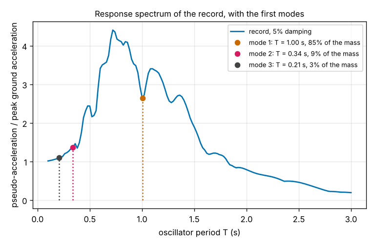
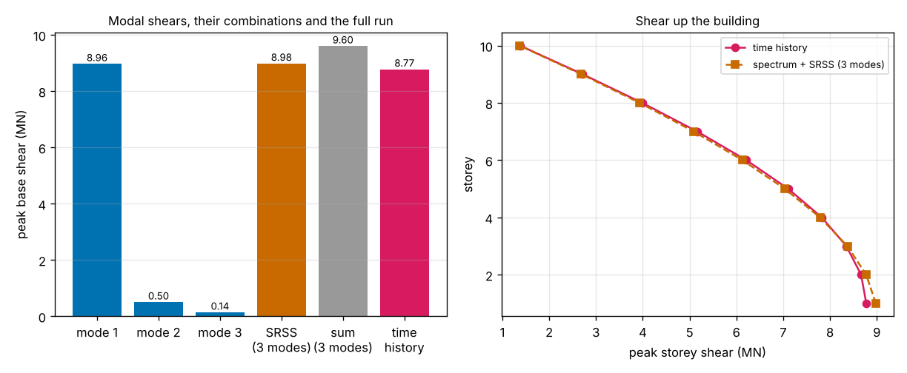
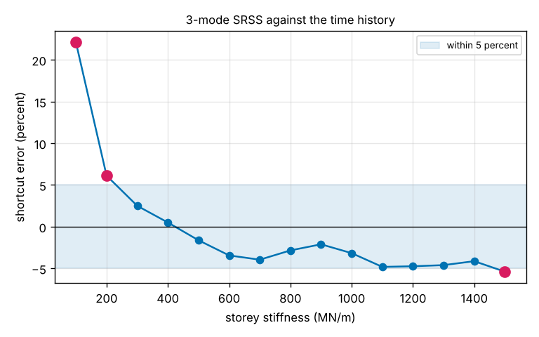

# Session 4: The response-spectrum shortcut: base shear without a time history

*Level 3 (simulation and validation) · about 90 minutes · openbuildingsway*

> This is a simplified educational model. It is not a validated design tool and must not be used for real structures, electrical installations, vehicles, industrial processes or medical decisions.

**Prerequisites**

- Session 3: mode shapes, participation factor, effective modal mass, Newmark time history and base shear.
- Session 2: the one-degree-of-freedom oscillator and its damping ratio.

**Learning objectives.** After this session you can:

- Compute the response spectrum of a ground record, S_d(T) and the pseudo-acceleration S_a(T), from one-degree-of-freedom oscillators.
- Turn a mode's effective mass and spectrum value into its peak base shear, V_i = M*_i S_a(T_i), and check it against k_1 times the lowest-floor displacement.
- Combine the modes with SRSS (and know what the plain sum and CQC do), and compare the result with the full time-history peak.
- Read the shear in every storey from the same modal forces.
- Measure when the shortcut can be trusted and when it cannot.

## A. Real-world problem
A design office has to check hundreds of buildings and cannot run a 2400-step time history for each one. The usual shortcut skips the time history: shake a family of simple one-degree-of-freedom oscillators with the ground record once, call the largest displacement of each one the *response spectrum*, then read off one number per mode and combine the modes. For the 10-storey frame of Session 3 (floors of 200 tonnes, storeys of 350 MN/m) the full run gives a peak base shear of 8.77 MN. How close does the shortcut get with three modes, and for which buildings does it go wrong? (Synthetic record and a made-up frame; a screening exercise, not a design method.)

## B. Concept and theory
**The response spectrum.** Take an oscillator of period T and damping ratio 5 percent, shake it with the record a_g(t), and write down the largest displacement it ever reaches: S_d(T). Repeat for many periods. The pseudo-acceleration is S_a(T) = (2 pi / T)^2 S_d(T): a mass m on that oscillator feels at most the force m S_a at the peak. Dividing by the peak ground acceleration (2 m/s^2) says how many times the record is amplified at that period. A very stiff oscillator (T near 0) follows the ground, so S_a / PGA tends to 1; for this record the amplification peaks at 4.4 around T = 0.72 s and falls to 0.19 at 3 s.

**One mode.** Mode i alone would move the floors in the shape phi_i with peak amplitude Gamma_i S_d(T_i) (Gamma_i is the participation factor of Session 3). The forces that hold that shape are F_j = m_j Gamma_i phi_j,i w_i^2 S_d(T_i), and they add up to the base shear

V_i = M*_i S_a(T_i), with M*_i = Gamma_i^2 the effective modal mass.

The same force follows from the lowest storey, k_1 Gamma_i phi_1,i S_d(T_i), and the code checks that the two agree for all ten modes. A storey shear is the sum of the floor forces above the storey.

**Combining modes.** The modes do not peak at the same moment, so adding the V_i overestimates (the sum is an upper bound). The standard rule is the square root of the sum of squares (SRSS), V = sqrt(sum V_i^2), which assumes independent peaks and works when the periods are well separated. When two periods are close the modes peak together, and the complete quadratic combination (CQC) uses a correlation rho_ij between the modes: 1 for equal frequencies and close to 0 when they are far apart. With equal damping zeta and r = w_j / w_i, rho_ij = 8 zeta^2 (1 + r) r^1.5 / ((1 - r^2)^2 + 4 zeta^2 r (1 + r)^2). In a shear building the first two periods differ by a factor of 3, so CQC and SRSS agree here (8.983 against 8.979 MN).

| Symbol | Meaning | Unit |
|---|---|---|
| T, w | period and angular frequency of a mode | s, rad/s |
| S_d(T) | peak displacement of an oscillator of period T (5 percent damping) | m |
| S_a(T) | pseudo-acceleration (2 pi / T)^2 S_d(T) | m/s^2 |
| PGA | peak ground acceleration of the record (2.0) | m/s^2 |
| Gamma_i, M*_i | participation factor and effective modal mass of mode i | kg^(1/2), kg |
| V_i | peak base shear of mode i, M*_i S_a(T_i) | N |
| V | combined base shear (SRSS, sum or CQC) | N |
| rho_ij | correlation of modes i and j in CQC | no unit |

**Assumptions**

- Everything from Session 3 still holds: a linear, planar shear building with a fixed base, 5 percent damping in every mode, floors of 200 tonnes and storeys of 350 MN/m unless said otherwise.
- The ground record is the synthetic one of Session 3 (seed 7, 24 s, peak 2 m/s^2), not a real earthquake. The spectrum of one record is jagged; design codes use smooth spectra built from many records.
- The shortcut uses the spectrum of the same record as the time history, so the error you see comes only from combining the modes, not from using a different record.
- The time history is the reference answer. It is the Newmark run of Session 3, validated against modal superposition (8.775 and 8.784 MN).
- The "within 5 percent" screening limit is a classroom choice, not a code requirement.

$$ \ddot q+2\zeta\omega\dot q+\omega^2q=-a_g(t),\qquad S_d(T)=\max_t|q|,\qquad S_a=\omega^2S_d $$

$$ V_i=\omega_i^2\,\Gamma_i\,(\boldsymbol\phi_i^{\mathsf T}M\mathbf r)\,S_d(T_i)=M^*_iS_a(T_i)=k_1\Gamma_i\phi_{1,i}S_d(T_i) $$

$$ V_{\mathrm{SRSS}}=\sqrt{\sum_iV_i^2},\qquad V_{\mathrm{sum}}=\sum_i|V_i|,\qquad V_{\mathrm{CQC}}=\sqrt{\sum_i\sum_j\rho_{ij}V_iV_j} $$

$$ \rho_{ij}=\frac{8\zeta^2(1+r)r^{3/2}}{(1-r^2)^2+4\zeta^2r(1+r)^2},\quad r=\frac{\omega_j}{\omega_i} $$

## C. Visual explanation
The first figure is the spectrum of the record, S_a divided by the peak ground acceleration, with the first three modes of the frame marked. The first mode (T = 1.00 s, 85 percent of the mass) sits in a dip of the spectrum, at 2.64 times the ground acceleration, while the peak of 4.4 lies at 0.72 s. The second figure, left, shows the modal base shears: 8.96, 0.50 and 0.14 MN for the first three modes, combined by SRSS to 8.98 MN (the time history gives 8.77 MN) and by the plain sum to 9.60 MN. Right, the storey shears up the building from the shortcut and from the time history lie almost on top of each other; the largest gap is 2.3 percent in the lowest storey. The third figure runs the whole comparison for storey stiffnesses from 100 to 1500 MN/m: the 3-mode SRSS estimate is within 5 percent for 12 of 15 stiffnesses.

*The spectrum of the record with the first three modes marked; the first mode sits in a dip.*

*Left: modal base shears, SRSS, the plain sum and the time history. Right: peak storey shear up the building.*

*Error of the 3-mode SRSS shortcut against the storey stiffness; magenta points are outside 5 percent.*

How the answer builds up with the number of modes (frame of the lesson, time history 8.775 MN):

| Modes used | SRSS (MN) | Error | Plain sum (MN) | Error |
|---|---|---|---|---|
| 1 | 8.964 | +2.2 % | 8.964 | +2.2 % |
| 2 | 8.978 | +2.3 % | 9.463 | +7.8 % |
| 3 | 8.979 | +2.3 % | 9.598 | +9.4 % |
| 5 | 8.979 | +2.3 % | 9.688 | +10.4 % |
| 10 | 8.979 | +2.3 % | 9.721 | +10.8 % |

Two modes already carry 94 percent of the mass (the usual rule asks for 90 percent), and a third brings it to 97 percent. For six other records of the same kind (seeds 1 to 6) the 3-mode SRSS error of this frame lies between -2.8 and +4.1 percent.

## D. Interactive simulation
Run the lesson (`python start.py 4`), then open the live app: [Session 4: the response-spectrum shortcut](https://krunalpanchal1995.github.io/pan-iit-oss/openbuildingsway/session-04/) (or `app.html` in this folder). The page holds the record and runs both the shortcut and the full Newmark time history in your browser for the building you choose: change the number of storeys, floor mass, storey stiffness, the number of modes used and the strength of the record, and switch between the spectrum, the base-shear bars and the error against the number of modes. Presets: the frame of the lesson, one mode only, a soft frame, a stiffer frame and four storeys. The app matches the Python lesson to better than one part in 10 million.

**Challenge.** With 10 storeys, 200 t floors and 3 modes, find a storey stiffness for which the shortcut is more than 8 percent above the full time-history run.

## E. Worked example and experiment
**Problem.** Take the two-storey building of Session 3 (m = 200 000 kg, k = 3.5e8 N/m, T1 = 0.2430 s, T2 = 0.0928 s, effective mass shares 94.72 and 5.28 percent of the total mass 400 000 kg). A made-up spectrum gives S_a = 2.0 m/s^2 at T1 and 1.0 m/s^2 at T2. Find the modal base shears, the SRSS and the plain sum, and say how the numbers change for the 10-storey frame of Section A.

1. Effective masses: M*_1 = 0.9472 x 400 000 = 378 885 kg and M*_2 = 0.0528 x 400 000 = 21 115 kg.
2. Modal base shears V = M* S_a: V_1 = 378 885 x 2.0 = 757 771 N = 757.8 kN and V_2 = 21 115 x 1.0 = 21 115 N = 21.1 kN.
3. SRSS: sqrt(757.8^2 + 21.1^2) = sqrt(574 261 + 445) = 758.1 kN.
4. Plain sum: 757.8 + 21.1 = 778.9 kN, which is 2.7 percent above the SRSS because the second mode is small.
5. For the 10-storey frame the code reads S_a from the spectrum of the record: 5.29, 2.73 and 2.19 m/s^2 at T = 1.005, 0.337 and 0.206 s; with the effective masses 1 696 000, 183 000 and 61 800 kg this gives V = 8.964, 0.498 and 0.135 MN, an SRSS of 8.979 MN and a plain sum of 9.598 MN. The full time history gives 8.775 MN.

**Answer.** Two storeys: V = 757.8 and 21.1 kN, SRSS 758.1 kN, sum 778.9 kN. Ten storeys: SRSS 8.979 MN, which is 2.3 percent above the time-history peak of 8.775 MN, so the roadmap target of 5 percent is met; the plain sum is 9.4 percent above.

**Experiment.** Stand a ruler or a stack of books on a flexible card, tape coins on the top, and shake the base with a phone's vibration or by hand at different rates. Film it and estimate the largest sway at each rate: that is a response spectrum measured by hand for one oscillator. Compare two stack heights: the taller (longer period) stack sways most at the slower rates. Expect rough numbers: friction, a non-uniform shaking rate and the card's own flexibility are not in the model.

## Real-world application and mini-project: When can the shortcut be trusted?
A screening office wants to use the 3-mode SRSS shortcut instead of a time history for the 10-storey frame, and the owner is considering stiffer columns. For storey stiffnesses from 100 to 1500 MN/m in steps of 100 (floors of 200 tonnes, the record of Session 3), compute the first period, the time-history base shear and the 3-mode SRSS estimate. The shortcut passes for a stiffness if its error is within 5 percent. Use `error_vs_stiffness` and `passing` from Session 4, and say which failures are on the safe side (estimate above the time history) and which are not.

**Deliverable:** A script that prints a table for the 15 stiffnesses (first period, time history, estimate, error, pass or fail), reports how many pass and the range of stiffnesses that pass, and saves a plot of the error against the stiffness with the 5 percent band. Add two sentences on what the screening office should do about the failures.

**Success looks like:** 12 of the 15 stiffnesses pass, namely 300 to 1400 MN/m; 100 MN/m (T1 = 1.88 s, +22.1 percent) and 200 MN/m (+6.1 percent) fail on the safe side, and 1500 MN/m (-5.4 percent) fails on the unsafe side. Your write-up notes that the time-history base shear is not smaller for stiffer frames (15.3 MN at 700 MN/m against 8.8 MN at 350 MN/m), and that the pass range depends on this one jagged record, so it should not be read as a rule.

## F. Assessment and design challenge
**Question type A: Conceptual.** Why does the shortcut combine the modes with the square root of the sum of squares rather than adding the modal peaks, and when could SRSS be too small?

Hint

Do the modes reach their peaks at the same moment? What changes if two modes have almost the same period?

Step-by-step solution

Each mode oscillates at its own frequency, so their peaks occur at different times and partly cancel; adding the peaks assumes they all coincide and so gives an upper bound (+9.4 percent here for three modes, against +2.3 for SRSS). SRSS treats the peaks as independent, which is a good model when the periods are well apart, as in this frame (T1 / T2 = 3). If two periods are almost equal, the two modes oscillate in step and peak together, so SRSS underestimates; CQC corrects this with a correlation rho_ij that tends to 1 for equal frequencies (the CQC of two equal-frequency modes is their plain sum).

**Question type B: Numerical.** A building of total mass 1.5e6 kg has a first mode that carries 80 percent of the mass and a second that carries 15 percent. The spectrum gives S_a = 3.0 m/s^2 at the first period and 4.0 m/s^2 at the second. Find the modal base shears, the SRSS and the plain sum.

Hint

V = M* S_a with M* = share x total mass.

Step-by-step solution

M*_1 = 0.80 x 1.5e6 = 1.2e6 kg and M*_2 = 0.15 x 1.5e6 = 2.25e5 kg. V_1 = 1.2e6 x 3.0 = 3.6e6 N = 3.6 MN and V_2 = 2.25e5 x 4.0 = 0.9e6 N = 0.9 MN. SRSS = sqrt(3.6^2 + 0.9^2) = sqrt(13.77) = 3.71 MN. Sum = 4.5 MN, which is 21 percent above the SRSS. Units: kg times m/s^2 is newtons.

**Question type C: Graph and simulation interpretation.** In the spectrum figure the first mode (T = 1.00 s) sits at S_a / PGA = 2.64, in a dip, while the peak of 4.4 is at 0.72 s. A retrofit that stiffens every storey to 700 MN/m moves the first period to 0.71 s. What does the spectrum predict for the first-mode base shear, and what does the full time history give?

Hint

Compare S_a at the two periods, and remember that V = M* S_a with the same effective mass. Then compare 8.8 MN with the time-history base shear for 700 MN/m that the lesson prints in its stiffness table.

Step-by-step solution

At T = 0.71 s the spectrum is at 4.33 times the ground acceleration instead of 2.64, so S_a rises by a factor of 4.33 / 2.64 = 1.64. The effective mass share (84.8 percent) is the same for a uniform frame, but the first-mode base shear is 14.68 MN instead of 8.96 MN, and the SRSS is 14.69 MN. The full time history at 700 MN/m gives 15.29 MN, 1.74 times the 8.78 MN of the original frame (the error of the shortcut is -4.0 percent). Stiffening moved the frame into the strongest part of the spectrum of this record, so the force it must resist rose: stiffer does not mean less force.

**Question type D: Design and optimisation challenge.** The owner can choose a storey stiffness of 100, 200, ..., 1500 MN/m. The screening office accepts the shortcut only if it is within 5 percent. For which options can it use the shortcut, and what should it do for the others? Which failures are the dangerous ones?

Hint

Use `error_vs_stiffness` and look at the sign of the error as well as its size: a negative error means the shortcut gives less than the time history.

Step-by-step solution

The shortcut is within 5 percent for 300, 400, ..., 1400 MN/m (12 of 15 options; errors from +2.5 to -4.8 percent). It fails for 100 MN/m (+22.1 percent), 200 MN/m (+6.1 percent) and 1500 MN/m (-5.4 percent). The first two overestimate, so a force limit set from the shortcut would be on the safe side, but they are too far off to be useful; the 1500 MN/m option underestimates, which is the unsafe direction, so it needs a time history. Even the passing options at 1100 to 1400 MN/m are close to the limit (-4.1 to -4.8 percent), so a careful office would run a time history for any option whose shortcut error is near the limit. One synthetic record decides these numbers; with a real design spectrum the pass range would be different.

Score yourself with [RUBRIC.md](../../RUBRIC.md). Print the [activity sheet](activity_sheet.md) to work on paper.

## Common misconceptions
| Common misconception | What is actually true |
|---|---|
| Adding the peaks of all modes gives the right base shear. | It is an upper bound: 9.60 MN for three modes against the 8.77 MN of the time history. SRSS gives 8.98 MN. |
| A stiffer building always feels less force. | At 700 MN/m the base shear is 15.3 MN, 1.74 times that of the 350 MN/m frame, because the period moved into the peak of the spectrum. |
| The shortcut is exact when the spectrum comes from the same record. | It is exact for one mode (one storey) but combines peaks that do not coincide; for the soft 100 MN/m frame it is 22 percent high. |
| A small base shear means the building is safe. | The base shear is only one check; the shortcut says nothing about sway, drift or damage. |
| The response spectrum describes the building. | It describes the record and the damping; the building only chooses the periods where it is read. |

## Glossary
- **response spectrum**: the peak response of one-degree-of-freedom oscillators of different periods to one ground record
- **pseudo-acceleration**: S_a = (2 pi / T)^2 S_d, the peak force per unit mass of the oscillator
- **effective modal mass**: M*_i = Gamma_i^2, the share of the mass that takes part in mode i
- **base shear**: the horizontal force in the lowest storey, which the foundation must resist
- **SRSS**: square root of the sum of squares, the rule for combining modal peaks
- **CQC**: complete quadratic combination, SRSS with a correlation between close modes
- **screening**: a quick, rough check used to decide which cases need a full analysis

## Finish
1. Do the three coding tasks in [exercises.md](exercises.md).
2. Run `python start.py 4` again after your changes. It ends with the checkpoint; when it prints `PASS`, you are done. (Checkpoint only: `python start.py check 4`.)

Next: the [roadmap](../../promo/roadmap.md). Session 5 is yours to build.
