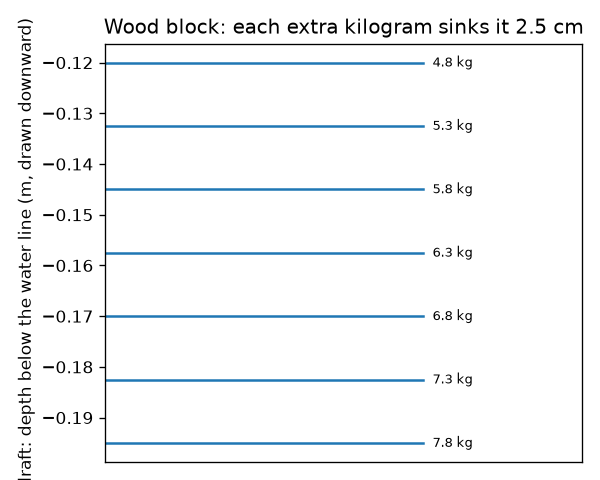
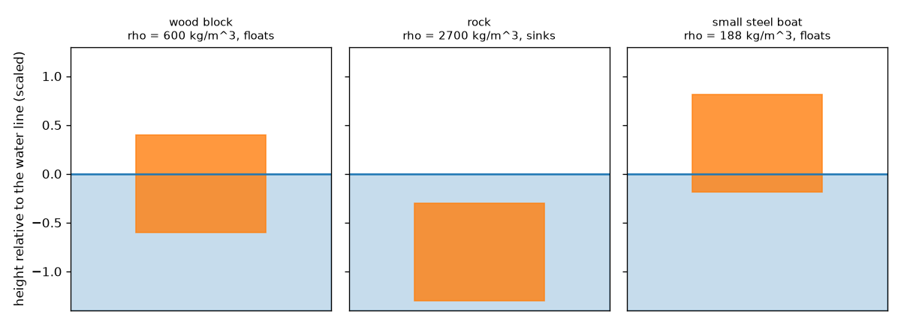
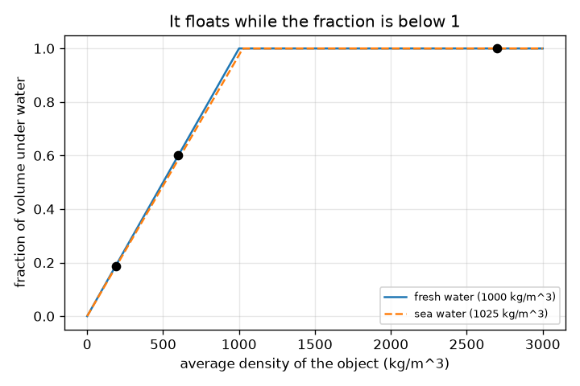

# सत्र 1: चीज़ें तब तैरती हैं जब उनके द्वारा हटाए गए पानी का भार उनके अपने भार के बराबर हो

*स्तर 1 (वैचारिक इंटरैक्टिव मॉडल) · लगभग 60 मिनट · openbuoyancy*

> यह एक सरलीकृत शैक्षिक मॉडल (simplified educational model) है। यह कोई सत्यापित डिज़ाइन टूल नहीं है और इसका उपयोग वास्तविक संरचनाओं, बिजली की स्थापनाओं, वाहनों, औद्योगिक प्रक्रियाओं या चिकित्सा निर्णयों के लिए नहीं किया जाना चाहिए।

**पूर्व-आवश्यकताएँ (Prerequisites)**

- घनत्व (density) = द्रव्यमान भाग आयतन।
- आपने PRIMER.md पढ़ लिया है और `python start.py 1` एक बार चला लिया है।

**सीखने के उद्देश्य (Learning objectives).** इस सत्र के बाद आप:

- समझा सकेंगे कि पानी में एक नाव, एक पत्थर और लकड़ी का एक गुटका अलग-अलग व्यवहार क्यों करते हैं।
- औसत घनत्व (average density) से तय कर सकेंगे कि कोई वस्तु तैरती है या नहीं और उसका कितना भाग पानी के नीचे है।
- सपाट तले वाले डिब्बे का डूबाव (draft) निकाल सकेंगे और डूबाव का निशान पढ़ सकेंगे।
- औसत घनत्व के सापेक्ष डूबे हुए अंश (submerged fraction) का ग्राफ़ पढ़ सकेंगे।

## A. वास्तविक दुनिया की समस्या
एक स्टील का जहाज़ हज़ारों टन भारी होता है और तैरता है। एक कंकड़ कुछ ग्राम का होता है और डूब जाता है। लकड़ी का एक गुटका तालाब में नीचे होकर तैरता है और समुद्र में थोड़ा ऊपर। क्यों? क्या आप आज़माने से पहले अनुमान लगा सकते हैं कि कोई चीज़ तैरेगी या नहीं और कितनी गहराई पर टिकेगी? (यह सामान्य विज्ञान शिक्षा है, नाव सुरक्षा की मार्गदर्शिका नहीं।)

## B. अवधारणा और सिद्धांत
जब किसी वस्तु को पानी में उतारा जाता है, तो वह कुछ पानी को अपने रास्ते से हटा देती है। पानी उतने ही बल से वापस धकेलता है जितना हटाए गए पानी का भार है (आर्किमिडीज़ का सिद्धांत / Archimedes' principle)। कोई वस्तु तब तैरती है जब वह पूरी तरह डूबने से पहले अपने भार के बराबर पानी हटा सके। चूँकि हटाया गया पानी = द्रव का घनत्व गुणा डूबा हुआ आयतन, इसलिए कोई वस्तु तब तैरती है जब उसका औसत घनत्व (कुल द्रव्यमान भाग कुल बाहरी आयतन, अंदर की किसी भी हवा सहित) द्रव के घनत्व से कम हो, और तब उसके आयतन का rho_object / rho_fluid अंश सतह के नीचे होता है। तले के क्षेत्रफल A वाले सपाट तले के डिब्बे के लिए, पानी के नीचे की गहराई (डूबाव) mass / (rho_fluid * A) है। खोखली स्टील की नाव इसलिए तैरती है क्योंकि उसके औसत घनत्व में अंदर की हवा शामिल है।

| प्रतीक | अर्थ | इकाई |
|---|---|---|
| rho_obj | वस्तु का औसत घनत्व (द्रव्यमान / बाहरी आयतन) | kg/m^3 |
| rho_fluid | द्रव का घनत्व (मीठा पानी 1000, समुद्री पानी लगभग 1025) | kg/m^3 |
| f | वस्तु के आयतन का पानी के नीचे वाला अंश | कोई इकाई नहीं |
| m | वस्तु का द्रव्यमान | kg |
| A | सपाट तले का क्षेत्रफल | m^2 |
| draft | जल रेखा के नीचे तले की गहराई | m |

**मान्यताएँ (Assumptions)**

- वस्तु इतने बड़े टैंक के स्थिर पानी में है कि उसका स्तर नहीं बदलता।
- वस्तु सीधी खड़ी रहती है (स्थिरता सत्र 3 में है)।
- पानी का घनत्व गहराई के साथ स्थिर है।

$$ \rho_{obj}=\frac{m}{V} $$

$$ f=\min\!\left(1,\ \frac{\rho_{obj}}{\rho_{fluid}}\right) $$

$$ \text{draft}=\frac{m}{\rho_{fluid}\,A} $$

## C. दृश्य व्याख्या
पहला चित्र पानी में तीन चीज़ें दिखाता है: लकड़ी का गुटका (औसत घनत्व 600 kg/m^3) 60 प्रतिशत पानी के नीचे रहकर तैरता है, पत्थर (2700 kg/m^3) डूब जाता है, और स्टील की नाव (औसत घनत्व 187.5 kg/m^3) केवल लगभग 19 प्रतिशत पानी के नीचे रहकर तैरती है। दूसरा चित्र औसत घनत्व के सापेक्ष डूबा हुआ अंश दिखाता है: यह एक सीधी रेखा में बढ़ता है और जहाँ घनत्व पानी के बराबर होता है वहाँ 1 पर रुक जाता है। तीसरा डूबाव के निशान दिखाता है: हर अतिरिक्त किलोग्राम गुटके को 2.5 cm और डुबाता है।

*लकड़ी के गुटके के डूबाव निशान: हर अतिरिक्त किलोग्राम 2.5 cm डूबाव जोड़ता है।*

*लकड़ी का गुटका तैरता है, पत्थर डूबता है, और स्टील की नाव ऊँची तैरती है।*

*मीठे और समुद्री पानी के लिए औसत घनत्व के सापेक्ष पानी के नीचे का अंश।*

## D. इंटरैक्टिव सिमुलेशन
पाठ चलाइए (`python start.py 1`), फिर लाइव ऐप खोलिए: [सत्र 1: तैरना या डूबना](https://krunalpanchal1995.github.io/pan-iit-oss/openbuoyancy/session-01/) (या इस फ़ोल्डर में `app.html`)। वस्तु का घनत्व और द्रव का घनत्व खिसकाइए, गुटके को ऊपर उठते और डूबते तथा दोनों तीरों को बदलते देखिए, फिर ग्राफ़ दृश्य खोलिए और रेखा पर बिंदु का अनुसरण कीजिए।

**चुनौती (Challenge).** गुटके को ठीक 75 प्रतिशत पानी के नीचे रखकर तैराइए।

## E. हल किया गया उदाहरण और प्रयोग
**समस्या.** 0.2 m भुजा वाले लकड़ी के घन का द्रव्यमान 4.8 kg है। क्या यह मीठे पानी में तैरता है? यह कितनी गहराई पर टिकता है? समुद्री पानी (1025 kg/m^3) में क्या होता है?

1. आयतन = 0.2 * 0.2 * 0.2 = 0.008 m^3, इसलिए औसत घनत्व = 4.8 / 0.008 = 600 kg/m^3।
2. 600, 1000 से कम है, इसलिए यह तैरता है। पानी के नीचे का अंश = 600 / 1000 = 0.60।
3. तले का क्षेत्रफल = 0.2 * 0.2 = 0.04 m^2, इसलिए डूबाव = 4.8 / (1000 * 0.04) = 0.120 m (0.2 m का 60 प्रतिशत, जैसा होना चाहिए)।
4. समुद्री पानी में: डूबाव = 4.8 / (1025 * 0.04) = 0.117 m। यह लगभग 3 mm ऊपर टिकता है।

**उत्तर.** यह 60 प्रतिशत पानी के नीचे रहकर तैरता है, मीठे पानी में डूबाव 0.120 m और समुद्री पानी में 0.117 m है।

**प्रयोग (Experiment).** एक बाल्टी में लकड़ी या प्लास्टिक का गुटका तैराइए, पेंसिल से जल रेखा का निशान लगाइए, रूलर से डूबाव मापिए और mass / (1000 * area) से तुलना कीजिए। फिर पानी में नमक डालिए और रेखा को थोड़ा ऊपर खिसकते देखिए। अंतर लकड़ी द्वारा पानी सोखने, गुटके के पूर्ण घन न होने और जल रेखा को पढ़ने में आपकी त्रुटि से आते हैं; मॉडल एक पूर्ण सूखा गुटका और सपाट सतह मानता है।

## F. मूल्यांकन और डिज़ाइन चुनौती
**प्रश्न प्रकार A: वैचारिक (Conceptual).** स्टील का घनत्व लगभग 7850 kg/m^3 है, फिर भी स्टील का जहाज़ तैरता है। समझाइए, और बताइए कि वही स्टील पीटकर एक ठोस गोले में बदल दिया जाए तो क्या होगा।

संकेत

अंदर की हवा सहित पूरे जहाज़ के औसत घनत्व के बारे में सोचिए।

चरण-दर-चरण हल

जहाज़ एक खोखला खोल है, इसलिए उसका कुल द्रव्यमान भाग उसका कुल बाहरी आयतन (स्टील और अंदर की हवा) 1000 kg/m^3 से बहुत कम है। Python में, 0.8 m^3 बाहरी आयतन वाली 150 kg की स्टील नाव का औसत घनत्व 187.5 kg/m^3 है और वह तैरती है, जबकि गोले के रूप में वही 150 kg स्टील का आयतन 0.019 m^3 और घनत्व 7850 kg/m^3 है और वह डूब जाता है।

**प्रश्न प्रकार B: संख्यात्मक (Numerical).** 2.0 kg द्रव्यमान वाले एक गुटके का आयतन 0.0030 m^3 है। उसका औसत घनत्व, क्या वह मीठे पानी में तैरता है, पानी के नीचे का अंश और उसके द्वारा हटाए गए पानी का द्रव्यमान निकालिए।

संकेत

औसत घनत्व = द्रव्यमान / आयतन; 1000 से तुलना कीजिए।

चरण-दर-चरण हल

घनत्व = 2.0 / 0.0030 = 666.7 kg/m^3, 1000 से कम, इसलिए यह तैरता है। पानी के नीचे का अंश = 666.7 / 1000 = 0.667। यह 2.0 kg पानी हटाता है, जो इसके अपने द्रव्यमान के बराबर है (जाँच: 1000 * 0.0030 * 0.667 = 2.0 kg)।

**प्रश्न प्रकार C: ग्राफ़ और सिमुलेशन की व्याख्या.** घनत्व के सापेक्ष डूबे हुए अंश के ग्राफ़ में, रेखा घनत्व 1000 (मीठा पानी) पर बढ़ना बंद कर देती है। 1010 kg/m^3 घनत्व वाली वस्तु मीठे पानी और समुद्री पानी में क्या करती है?

संकेत

हर पानी के लिए क्षैतिज अक्ष पर 1010 ढूँढिए और देखिए कि अंश 1 तक पहुँचता है या नहीं।

चरण-दर-चरण हल

मीठे पानी में अंश 1010 / 1000 = 1.01 होगा, जो 1 से अधिक है, इसलिए यह डूब जाती है। समुद्री पानी (1025) में अंश 1010 / 1025 = 0.985 है, इसलिए यह 98.5 प्रतिशत पानी के नीचे रहकर, बस मुश्किल से, तैरती है। समुद्री पानी की रेखा और दाईं ओर जाकर 1 तक पहुँचती है।

**प्रश्न प्रकार D: डिज़ाइन और अनुकूलन (optimisation) चुनौती.** डिज़ाइन: एक सपाट तले वाली नाव का खाली द्रव्यमान 150 kg है और तला 2.0 m गुणा 0.8 m है। शांत मीठे पानी में इसका डूबाव 0.25 m से अधिक नहीं होना चाहिए। सबसे बड़ा माल (cargo) कितना हो सकता है? अपनी मान्यताएँ बताइए।

संकेत

सबसे बड़ा कुल द्रव्यमान = rho * A * draft_max।

चरण-दर-चरण हल

तले का क्षेत्रफल = 1.6 m^2। सबसे बड़ा कुल द्रव्यमान = 1000 * 1.6 * 0.25 = 400 kg, इसलिए माल अधिकतम 400 - 150 = 250 kg है। मान्यताएँ: शांत पानी, नाव सीधी रहती है, माल समान रूप से फैला है और किनारे पर्याप्त ऊँचे हैं। एक वास्तविक नाव को बड़ा सुरक्षा मार्जिन चाहिए (लहरें, असमान लदान), और सत्र 3 दिखाता है कि नाव के तैरते रहने पर भी स्थिरता विफल हो सकती है।

[RUBRIC.md](../../RUBRIC.md) से स्वयं को अंक दीजिए। कागज़ पर काम करने के लिए [गतिविधि पत्रक](activity_sheet.md) प्रिंट कीजिए।

## सामान्य भ्रांतियाँ
| सामान्य भ्रांति (misconception) | वास्तव में क्या सच है |
|---|---|
| भारी चीज़ें डूबती हैं और हल्की चीज़ें तैरती हैं। | भार नहीं, घनत्व तय करता है: एक विशाल जहाज़ तैरता है, एक छोटा कंकड़ डूबता है। |
| कोई वस्तु इसलिए तैरती है क्योंकि पानी उसे ऐसे बल से ऊपर धकेलता है जो उसके भार पर निर्भर करता है। | ऊपर की ओर बल हटाए गए पानी के भार के बराबर है, जो डूबे हुए आयतन पर निर्भर करता है; तैरती वस्तु तब तक डूबती है जब तक यह उसके अपने भार के बराबर न हो जाए। |
| तैरती वस्तु को उसके भार से कम बल ऊपर धकेलता है। | तैरते समय उत्प्लावन बल (buoyant force) ठीक भार के बराबर होता है; इसीलिए वह स्थिर टिकी रहती है। |
| समुद्री पानी और मीठा पानी समान डूबाव देते हैं। | समुद्री पानी लगभग 2.5 प्रतिशत अधिक घना है, इसलिए वही वस्तु थोड़ी ऊपर टिकती है। |

## शब्दावली
- **घनत्व (density)**: द्रव्यमान भाग आयतन, kg/m^3 में
- **उत्प्लावन बल (buoyant force)**: किसी द्रव का उसमें रखी वस्तु पर ऊपर की ओर धक्का
- **हटाया गया पानी (displaced water)**: वस्तु के सतह के नीचे वाले भाग द्वारा रास्ते से हटाया गया पानी
- **डूबाव (draft)**: तैरती वस्तु के सबसे निचले बिंदु की जल रेखा के नीचे गहराई
- **औसत घनत्व (average density)**: कुल द्रव्यमान भाग कुल बाहरी आयतन, अंदर की किसी भी हवा को गिनते हुए

## समापन
1. [exercises.md](exercises.md) में दिए तीन कोडिंग कार्य कीजिए।
2. अपने बदलावों के बाद `python start.py 1` फिर से चलाइए। यह चेकपॉइंट (checkpoint) के साथ समाप्त होता है; जब यह `PASS` छापे, तो आपका काम पूरा है। (केवल चेकपॉइंट: `python start.py check 1`।)

आगे: [सत्र 2](../session-02/README.md)
