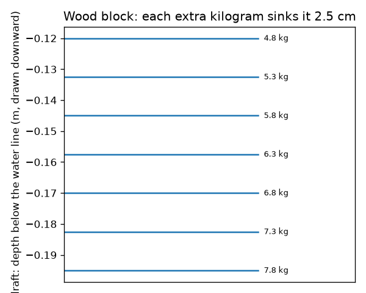
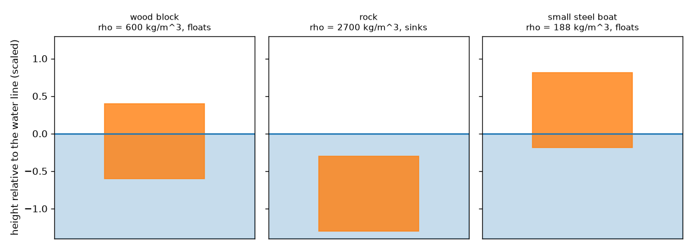
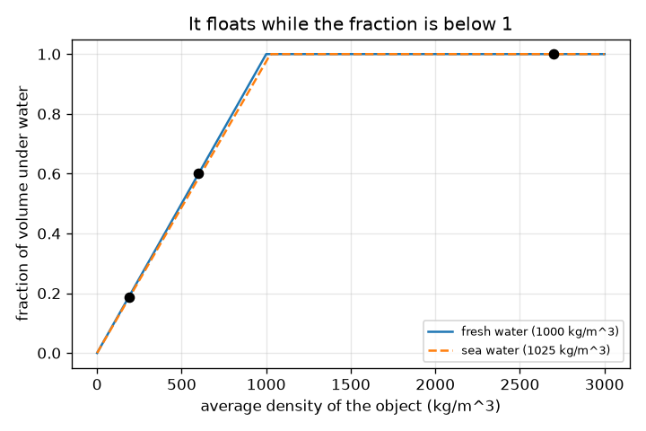

# സെഷൻ 1: വസ്തുക്കൾ തള്ളിമാറ്റുന്ന വെള്ളത്തിന് അവയോളം തന്നെ ഭാരമുണ്ടെങ്കിൽ അവ പൊങ്ങിക്കിടക്കുന്നു

[Session 1 — हिन्दी](README.hi.md) · [Session 1 — മലയാളം](README.ml.md)

*ലെവൽ 1 (ആശയപരമായ ഇന്ററാക്ടീവ് മോഡൽ) · ഏകദേശം 60 മിനിറ്റ് · openbuoyancy*

> ഇത് ലളിതമാക്കിയ ഒരു വിദ്യാഭ്യാസ മോഡലാണ്. ഇത് സാധൂകരിക്കപ്പെട്ട (validated) ഒരു ഡിസൈൻ ഉപകരണമല്ല; യഥാർത്ഥ നിർമ്മിതികൾ, ഇലക്ട്രിക്കൽ ഇൻസ്റ്റലേഷനുകൾ, വാഹനങ്ങൾ, വ്യാവസായിക പ്രക്രിയകൾ അല്ലെങ്കിൽ മെഡിക്കൽ തീരുമാനങ്ങൾ എന്നിവയ്ക്ക് ഇത് ഉപയോഗിക്കരുത്.

**മുൻ‌വ്യവസ്ഥകൾ (Prerequisites)**

- സാന്ദ്രത (density) = പിണ്ഡം ÷ വ്യാപ്തം.
- നിങ്ങൾ PRIMER.md വായിക്കുകയും `python start.py 1` ഒരിക്കൽ റൺ ചെയ്യുകയും ചെയ്തിട്ടുണ്ട്.

**പഠന ലക്ഷ്യങ്ങൾ (Learning objectives).** ഈ സെഷനു ശേഷം നിങ്ങൾക്ക് കഴിയും:

- ഒരു ബോട്ട്, ഒരു പാറ, ഒരു മരക്കട്ട എന്നിവ വെള്ളത്തിൽ വ്യത്യസ്തമായി പെരുമാറുന്നത് എന്തുകൊണ്ടെന്ന് വിശദീകരിക്കാൻ.
- ഒരു വസ്തു പൊങ്ങിക്കിടക്കുമോ എന്നും അതിന്റെ എത്ര ഭാഗം വെള്ളത്തിനടിയിലാണെന്നും തീരുമാനിക്കാൻ ശരാശരി സാന്ദ്രത (average density) ഉപയോഗിക്കാൻ.
- പരന്ന അടിഭാഗമുള്ള ഒരു പെട്ടിയുടെ ഡ്രാഫ്റ്റ് (draft) കണക്കാക്കാനും ഡ്രാഫ്റ്റ് അടയാളം വായിക്കാനും.
- ശരാശരി സാന്ദ്രതയ്ക്കെതിരെ മുങ്ങിയ ഭാഗത്തിന്റെ അംശത്തിന്റെ ഗ്രാഫ് വായിക്കാൻ.

## A. യഥാർത്ഥ ലോക പ്രശ്നം
ഒരു സ്റ്റീൽ കപ്പലിന് ആയിരക്കണക്കിന് ടൺ ഭാരമുണ്ട്, എന്നിട്ടും അത് പൊങ്ങിക്കിടക്കുന്നു. ഒരു ചെറുകല്ലിന് ഏതാനും ഗ്രാം ഭാരമേയുള്ളൂ, അത് മുങ്ങുന്നു. ഒരു മരക്കട്ട കുളത്തിൽ താഴ്ന്നും കടലിൽ അല്പം ഉയർന്നും പൊങ്ങിക്കിടക്കുന്നു. എന്തുകൊണ്ട്? പരീക്ഷിക്കുന്നതിനു മുമ്പ്, ഒരു വസ്തു പൊങ്ങിക്കിടക്കുമോ എന്നും അത് എത്ര ആഴത്തിൽ ഇരിക്കുമെന്നും നിങ്ങൾക്ക് പ്രവചിക്കാൻ കഴിയുമോ? (ഇത് പൊതു ശാസ്ത്ര വിദ്യാഭ്യാസമാണ്, ബോട്ട് സുരക്ഷയ്ക്കുള്ള വഴികാട്ടിയല്ല.)

## B. ആശയവും സിദ്ധാന്തവും
ഒരു വസ്തു വെള്ളത്തിലേക്ക് താഴ്ത്തുമ്പോൾ അത് കുറച്ച് വെള്ളത്തെ വഴിയിൽ നിന്ന് തള്ളിമാറ്റുന്നു. തള്ളിമാറ്റിയ വെള്ളത്തിന്റെ ഭാരത്തിന് തുല്യമായ ബലത്തോടെ വെള്ളം തിരികെ തള്ളുന്നു (ആർക്കിമിഡീസ് തത്വം - Archimedes' principle). പൂർണ്ണമായി മുങ്ങുന്നതിനു മുമ്പ് സ്വന്തം ഭാരത്തിനു തുല്യമായ വെള്ളം തള്ളിമാറ്റാൻ കഴിയുമ്പോൾ ഒരു വസ്തു പൊങ്ങിക്കിടക്കുന്നു. തള്ളിമാറ്റിയ വെള്ളം = ദ്രാവക സാന്ദ്രത ഗുണം മുങ്ങിയ വ്യാപ്തം ആയതിനാൽ, ഒരു വസ്തുവിന്റെ ശരാശരി സാന്ദ്രത (ആകെ പിണ്ഡം ÷ ആകെ പുറം വ്യാപ്തം, ഉള്ളിലെ വായു ഉൾപ്പെടെ) ദ്രാവകത്തിന്റെ സാന്ദ്രതയേക്കാൾ കുറവാണെങ്കിൽ അത് പൊങ്ങിക്കിടക്കുന്നു, അപ്പോൾ അതിന്റെ വ്യാപ്തത്തിന്റെ rho_object / rho_fluid എന്ന അംശം ഉപരിതലത്തിനു താഴെയായിരിക്കും. അടിഭാഗ വിസ്തീർണ്ണം A ഉള്ള ഒരു പരന്ന അടിഭാഗമുള്ള പെട്ടിക്ക്, വെള്ളത്തിനടിയിലെ ആഴം (ഡ്രാഫ്റ്റ്) mass / (rho_fluid * A) ആണ്. ഒരു പൊള്ളയായ സ്റ്റീൽ ബോട്ട് പൊങ്ങിക്കിടക്കുന്നത് അതിന്റെ ശരാശരി സാന്ദ്രതയിൽ ഉള്ളിലെ വായുവും ഉൾപ്പെടുന്നതുകൊണ്ടാണ്.

| ചിഹ്നം | അർത്ഥം | യൂണിറ്റ് |
|---|---|---|
| rho_obj | വസ്തുവിന്റെ ശരാശരി സാന്ദ്രത (പിണ്ഡം / പുറം വ്യാപ്തം) | kg/m^3 |
| rho_fluid | ദ്രാവകത്തിന്റെ സാന്ദ്രത (ശുദ്ധജലം 1000, കടൽവെള്ളം ഏകദേശം 1025) | kg/m^3 |
| f | വസ്തുവിന്റെ വ്യാപ്തത്തിൽ വെള്ളത്തിനടിയിലുള്ള അംശം | യൂണിറ്റ് ഇല്ല |
| m | വസ്തുവിന്റെ പിണ്ഡം | kg |
| A | പരന്ന അടിഭാഗത്തിന്റെ വിസ്തീർണ്ണം | m^2 |
| draft | ജലരേഖയ്ക്ക് താഴെയുള്ള അടിഭാഗത്തിന്റെ ആഴം | m |

**അനുമാനങ്ങൾ (Assumptions)**

- നിരപ്പ് മാറാത്തത്ര വലിയ ടാങ്കിലെ നിശ്ചല ജലത്തിലാണ് വസ്തു.
- വസ്തു നേരെ നിൽക്കുന്നു (സ്ഥിരത സെഷൻ 3-ലാണ്).
- ആഴത്തിനനുസരിച്ച് ജല സാന്ദ്രത സ്ഥിരമാണ്.

$$ \rho_{obj}=\frac{m}{V} $$

$$ f=\min\!\left(1,\ \frac{\rho_{obj}}{\rho_{fluid}}\right) $$

$$ \text{draft}=\frac{m}{\rho_{fluid}\,A} $$

## C. ദൃശ്യ വിശദീകരണം
ആദ്യ ചിത്രം വെള്ളത്തിലെ മൂന്ന് വസ്തുക്കളെ കാണിക്കുന്നു: മരക്കട്ട (ശരാശരി സാന്ദ്രത 600 kg/m^3) 60 ശതമാനം വെള്ളത്തിനടിയിലായി പൊങ്ങിക്കിടക്കുന്നു, പാറ (2700 kg/m^3) മുങ്ങുന്നു, സ്റ്റീൽ ബോട്ട് (ശരാശരി സാന്ദ്രത 187.5 kg/m^3) ഏകദേശം 19 ശതമാനം മാത്രം വെള്ളത്തിനടിയിലായി പൊങ്ങിക്കിടക്കുന്നു. രണ്ടാമത്തേത് ശരാശരി സാന്ദ്രതയ്ക്കെതിരെ മുങ്ങിയ അംശം പ്ലോട്ട് ചെയ്യുന്നു: അത് ഒരു നേർരേഖയിൽ ഉയരുകയും സാന്ദ്രത വെള്ളത്തിന്റേതിന് തുല്യമാകുന്നിടത്ത് 1-ൽ നിൽക്കുകയും ചെയ്യുന്നു. മൂന്നാമത്തേത് ഡ്രാഫ്റ്റ് അടയാളങ്ങൾ കാണിക്കുന്നു: ഓരോ അധിക കിലോഗ്രാമും കട്ടയെ 2.5 cm മുക്കുന്നു.

*ഒരു മരക്കട്ടയുടെ ഡ്രാഫ്റ്റ് അടയാളങ്ങൾ: ഓരോ അധിക കിലോഗ്രാമും 2.5 cm ഡ്രാഫ്റ്റ് കൂട്ടുന്നു.*

*ഒരു മരക്കട്ട പൊങ്ങിക്കിടക്കുന്നു, ഒരു പാറ മുങ്ങുന്നു, ഒരു സ്റ്റീൽ ബോട്ട് ഉയർന്ന് പൊങ്ങിക്കിടക്കുന്നു.*

*ശുദ്ധജലത്തിനും കടൽവെള്ളത്തിനും ശരാശരി സാന്ദ്രതയ്ക്കെതിരെ വെള്ളത്തിനടിയിലുള്ള അംശം.*

## D. ഇന്ററാക്ടീവ് സിമുലേഷൻ
പാഠം റൺ ചെയ്യുക (`python start.py 1`), തുടർന്ന് ലൈവ് ആപ്പ് തുറക്കുക: [സെഷൻ 1: പൊങ്ങുമോ മുങ്ങുമോ](https://krunalpanchal1995.github.io/pan-iit-oss/openbuoyancy/session-01/) (അല്ലെങ്കിൽ ഈ ഫോൾഡറിലെ `app.html`). വസ്തുവിന്റെ സാന്ദ്രതയും ദ്രാവകത്തിന്റെ സാന്ദ്രതയും സ്ലൈഡ് ചെയ്യുക, കട്ട ഉയരുന്നതും താഴുന്നതും രണ്ട് അമ്പുകൾ മാറുന്നതും നിരീക്ഷിക്കുക, തുടർന്ന് ഗ്രാഫ് വ്യൂ തുറന്ന് രേഖയിലൂടെ ബിന്ദുവിനെ പിന്തുടരുക.

**വെല്ലുവിളി (Challenge).** കട്ടയുടെ കൃത്യം 75 ശതമാനം വെള്ളത്തിനടിയിലാകുന്ന വിധം അതിനെ പൊങ്ങിക്കിടക്കാൻ ചെയ്യുക.

## E. പരിഹരിച്ച ഉദാഹരണവും പരീക്ഷണവും
**പ്രശ്നം.** 0.2 m വശമുള്ള ഒരു മരക്കട്ടയ്ക്ക് (ക്യൂബ്) 4.8 kg പിണ്ഡമുണ്ട്. അത് ശുദ്ധജലത്തിൽ പൊങ്ങിക്കിടക്കുമോ? അത് എത്ര ആഴത്തിൽ ഇരിക്കും? കടൽവെള്ളത്തിൽ (1025 kg/m^3) എന്ത് സംഭവിക്കും?

1. വ്യാപ്തം = 0.2 * 0.2 * 0.2 = 0.008 m^3, അതിനാൽ ശരാശരി സാന്ദ്രത = 4.8 / 0.008 = 600 kg/m^3.
2. 600 എന്നത് 1000-നേക്കാൾ കുറവാണ്, അതിനാൽ അത് പൊങ്ങിക്കിടക്കുന്നു. വെള്ളത്തിനടിയിലുള്ള അംശം = 600 / 1000 = 0.60.
3. അടിഭാഗ വിസ്തീർണ്ണം = 0.2 * 0.2 = 0.04 m^2, അതിനാൽ ഡ്രാഫ്റ്റ് = 4.8 / (1000 * 0.04) = 0.120 m (0.2 m-ന്റെ 60 ശതമാനം, അങ്ങനെ ആയിരിക്കണം).
4. കടൽവെള്ളത്തിൽ: ഡ്രാഫ്റ്റ് = 4.8 / (1025 * 0.04) = 0.117 m. അത് ഏകദേശം 3 mm ഉയർന്ന് ഇരിക്കുന്നു.

**ഉത്തരം.** അത് 60 ശതമാനം വെള്ളത്തിനടിയിലായി പൊങ്ങിക്കിടക്കുന്നു, ശുദ്ധജലത്തിൽ ഡ്രാഫ്റ്റ് 0.120 m, കടൽവെള്ളത്തിൽ 0.117 m.

**പരീക്ഷണം.** ഒരു ബക്കറ്റിൽ ഒരു മരക്കട്ടയോ പ്ലാസ്റ്റിക് കട്ടയോ പൊങ്ങിക്കിടക്കാൻ വയ്ക്കുക, പെൻസിൽ കൊണ്ട് ജലരേഖ അടയാളപ്പെടുത്തുക, ഒരു സ്കെയിൽ കൊണ്ട് ഡ്രാഫ്റ്റ് അളന്ന് mass / (1000 * area)-മായി താരതമ്യം ചെയ്യുക. പിന്നെ വെള്ളത്തിൽ ഉപ്പ് ചേർത്ത് രേഖ അല്പം മുകളിലേക്ക് നീങ്ങുന്നത് കാണുക. വ്യത്യാസങ്ങൾ വരുന്നത് മരം വെള്ളം വലിച്ചെടുക്കുന്നതിൽ നിന്നും, കട്ട തികഞ്ഞ ക്യൂബ് അല്ലാത്തതിൽ നിന്നും, നിങ്ങൾ ജലരേഖ വായിക്കുന്നതിൽ നിന്നുമാണ്; മോഡൽ തികഞ്ഞ ഉണങ്ങിയ കട്ടയും പരന്ന ഉപരിതലവും അനുമാനിക്കുന്നു.

## F. വിലയിരുത്തലും ഡിസൈൻ വെല്ലുവിളിയും
**ചോദ്യ തരം A: ആശയപരം.** സ്റ്റീലിന് ഏകദേശം 7850 kg/m^3 സാന്ദ്രതയുണ്ട്, എന്നിട്ടും ഒരു സ്റ്റീൽ കപ്പൽ പൊങ്ങിക്കിടക്കുന്നു. വിശദീകരിക്കുക, അതേ സ്റ്റീൽ അടിച്ച് ഒരു ഖര കട്ടയാക്കിയാൽ എന്ത് സംഭവിക്കുമെന്ന് പറയുക.

സൂചന

ഉള്ളിലെ വായു ഉൾപ്പെടെ മുഴുവൻ കപ്പലിന്റെയും ശരാശരി സാന്ദ്രതയെക്കുറിച്ച് ചിന്തിക്കുക.

ഘട്ടം ഘട്ടമായുള്ള പരിഹാരം

കപ്പൽ ഒരു പൊള്ളയായ പുറന്തോടാണ്, അതിനാൽ അതിന്റെ ആകെ പിണ്ഡത്തെ ആകെ പുറം വ്യാപ്തം (സ്റ്റീലും ഉള്ളിലെ വായുവും) കൊണ്ട് ഹരിച്ചാൽ 1000 kg/m^3-നേക്കാൾ വളരെ കുറവാണ്. Python-ൽ, 0.8 m^3 പുറം വ്യാപ്തമുള്ള 150 kg സ്റ്റീൽ ബോട്ടിന് 187.5 kg/m^3 ശരാശരി സാന്ദ്രതയുണ്ട്, അത് പൊങ്ങിക്കിടക്കുന്നു, എന്നാൽ അതേ 150 kg സ്റ്റീൽ ഒരു കട്ടയായാൽ 0.019 m^3 വ്യാപ്തവും 7850 kg/m^3 സാന്ദ്രതയും ഉണ്ടാകും, അത് മുങ്ങുന്നു.

**ചോദ്യ തരം B: സംഖ്യാപരം.** 2.0 kg പിണ്ഡമുള്ള ഒരു കട്ടയ്ക്ക് 0.0030 m^3 വ്യാപ്തമുണ്ട്. അതിന്റെ ശരാശരി സാന്ദ്രത, ശുദ്ധജലത്തിൽ പൊങ്ങിക്കിടക്കുമോ, വെള്ളത്തിനടിയിലുള്ള അംശം, അത് തള്ളിമാറ്റുന്ന വെള്ളത്തിന്റെ പിണ്ഡം എന്നിവ കണ്ടെത്തുക.

സൂചന

ശരാശരി സാന്ദ്രത = പിണ്ഡം / വ്യാപ്തം; 1000-മായി താരതമ്യം ചെയ്യുക.

ഘട്ടം ഘട്ടമായുള്ള പരിഹാരം

സാന്ദ്രത = 2.0 / 0.0030 = 666.7 kg/m^3, 1000-ന് താഴെ, അതിനാൽ അത് പൊങ്ങിക്കിടക്കുന്നു. വെള്ളത്തിനടിയിലുള്ള അംശം = 666.7 / 1000 = 0.667. അത് 2.0 kg വെള്ളം തള്ളിമാറ്റുന്നു, സ്വന്തം പിണ്ഡത്തിന് തുല്യം (പരിശോധന: 1000 * 0.0030 * 0.667 = 2.0 kg).

**ചോദ്യ തരം C: ഗ്രാഫ്, സിമുലേഷൻ വ്യാഖ്യാനം.** സാന്ദ്രതയ്ക്കെതിരെ മുങ്ങിയ അംശത്തിന്റെ ഗ്രാഫിൽ, സാന്ദ്രത 1000-ൽ (ശുദ്ധജലം) രേഖ ഉയരുന്നത് നിർത്തുന്നു. 1010 kg/m^3 സാന്ദ്രതയുള്ള ഒരു വസ്തു ശുദ്ധജലത്തിലും കടൽവെള്ളത്തിലും എന്ത് ചെയ്യും?

സൂചന

ഓരോ വെള്ളത്തിനും തിരശ്ചീന അക്ഷത്തിൽ 1010 കണ്ടെത്തി അംശം 1-ൽ എത്തുന്നുണ്ടോ എന്ന് നോക്കുക.

ഘട്ടം ഘട്ടമായുള്ള പരിഹാരം

ശുദ്ധജലത്തിൽ അംശം 1010 / 1000 = 1.01 ആയിരിക്കും, ഇത് 1-നേക്കാൾ കൂടുതലാണ്, അതിനാൽ അത് മുങ്ങുന്നു. കടൽവെള്ളത്തിൽ (1025) അംശം 1010 / 1025 = 0.985 ആണ്, അതിനാൽ അത് 98.5 ശതമാനം വെള്ളത്തിനടിയിലായി, കഷ്ടിച്ച്, പൊങ്ങിക്കിടക്കുന്നു. കടൽവെള്ളം കൂടുതൽ വലത്തോട്ട് 1-ൽ എത്തുന്ന ഒരു രേഖ നൽകുന്നു.

**ചോദ്യ തരം D: ഡിസൈൻ, ഒപ്റ്റിമൈസേഷൻ വെല്ലുവിളി.** ഡിസൈൻ: പരന്ന അടിഭാഗമുള്ള ഒരു ബോട്ടിന് 150 kg ശൂന്യ പിണ്ഡവും 2.0 m x 0.8 m അടിഭാഗവുമുണ്ട്. ശാന്തമായ ശുദ്ധജലത്തിൽ അതിന്റെ ഡ്രാഫ്റ്റ് 0.25 m-ൽ കൂടരുത്. ഏറ്റവും വലിയ ചരക്ക് എത്ര? നിങ്ങളുടെ അനുമാനങ്ങൾ പറയുക.

സൂചന

ഏറ്റവും വലിയ ആകെ പിണ്ഡം = rho * A * draft_max.

ഘട്ടം ഘട്ടമായുള്ള പരിഹാരം

അടിഭാഗ വിസ്തീർണ്ണം = 1.6 m^2. ഏറ്റവും വലിയ ആകെ പിണ്ഡം = 1000 * 1.6 * 0.25 = 400 kg, അതിനാൽ ചരക്ക് പരമാവധി 400 - 150 = 250 kg. അനുമാനങ്ങൾ: ശാന്തമായ വെള്ളം, ബോട്ട് നേരെ നിൽക്കുന്നു, ചരക്ക് തുല്യമായി വിതരണം ചെയ്തിരിക്കുന്നു, വശങ്ങൾക്ക് മതിയായ ഉയരമുണ്ട്. ഒരു യഥാർത്ഥ ബോട്ടിന് വലിയ സുരക്ഷാ മാർജിൻ വേണം (തിരമാലകൾ, അസമമായ ലോഡിംഗ്), ബോട്ട് പൊങ്ങിക്കിടക്കുമ്പോൾ പോലും സ്ഥിരത നഷ്ടപ്പെടാമെന്ന് സെഷൻ 3 കാണിക്കുന്നു.

[RUBRIC.md](../../RUBRIC.md) ഉപയോഗിച്ച് സ്വയം സ്കോർ ചെയ്യുക. കടലാസിൽ പ്രവർത്തിക്കാൻ [ആക്ടിവിറ്റി ഷീറ്റ്](activity_sheet.md) പ്രിന്റ് ചെയ്യുക.

## സാധാരണ തെറ്റിദ്ധാരണകൾ
| സാധാരണ തെറ്റിദ്ധാരണ | യഥാർത്ഥത്തിൽ സത്യം എന്താണ് |
|---|---|
| ഭാരമുള്ളവ മുങ്ങുന്നു, ഭാരം കുറഞ്ഞവ പൊങ്ങിക്കിടക്കുന്നു. | ഭാരമല്ല, സാന്ദ്രതയാണ് തീരുമാനിക്കുന്നത്: ഒരു വലിയ കപ്പൽ പൊങ്ങിക്കിടക്കുന്നു, ഒരു ചെറിയ കല്ല് മുങ്ങുന്നു. |
| വസ്തുവിന്റെ ഭാരത്തെ ആശ്രയിക്കുന്ന ഒരു ബലം കൊണ്ട് വെള്ളം മുകളിലേക്ക് തള്ളുന്നതുകൊണ്ടാണ് അത് പൊങ്ങിക്കിടക്കുന്നത്. | മുകളിലേക്കുള്ള ബലം തള്ളിമാറ്റിയ വെള്ളത്തിന്റെ ഭാരത്തിന് തുല്യമാണ്, അത് മുങ്ങിയ വ്യാപ്തത്തെ ആശ്രയിക്കുന്നു; പൊങ്ങിക്കിടക്കുന്ന വസ്തു ആ ബലം സ്വന്തം ഭാരത്തിന് തുല്യമാകുന്നതുവരെ താഴുന്നു. |
| പൊങ്ങിക്കിടക്കുന്ന വസ്തുവിനെ അതിന്റെ ഭാരത്തേക്കാൾ കുറഞ്ഞ ബലമാണ് മുകളിലേക്ക് തള്ളുന്നത്. | പൊങ്ങിക്കിടക്കുമ്പോൾ, പ്ലവന ബലം (buoyant force) കൃത്യമായി ഭാരത്തിന് തുല്യമാണ്; അതുകൊണ്ടാണ് അത് നിശ്ചലമായി ഇരിക്കുന്നത്. |
| കടൽവെള്ളവും ശുദ്ധജലവും ഒരേ ഡ്രാഫ്റ്റ് നൽകുന്നു. | കടൽവെള്ളത്തിന് ഏകദേശം 2.5 ശതമാനം കൂടുതൽ സാന്ദ്രതയുണ്ട്, അതിനാൽ അതേ വസ്തു അല്പം ഉയർന്ന് ഇരിക്കുന്നു. |

## പദാവലി (Glossary)
- **സാന്ദ്രത (density)**: പിണ്ഡം ÷ വ്യാപ്തം, kg/m^3-ൽ
- **പ്ലവന ബലം (buoyant force)**: ഒരു ദ്രാവകം അതിലുള്ള വസ്തുവിൽ ചെലുത്തുന്ന മുകളിലേക്കുള്ള തള്ളൽ
- **തള്ളിമാറ്റിയ വെള്ളം (displaced water)**: ഉപരിതലത്തിനടിയിലുള്ള വസ്തുവിന്റെ ഭാഗം വഴിയിൽ നിന്ന് തള്ളിമാറ്റിയ വെള്ളം
- **ഡ്രാഫ്റ്റ് (draft)**: പൊങ്ങിക്കിടക്കുന്ന വസ്തുവിന്റെ ഏറ്റവും താഴ്ന്ന ബിന്ദുവിന് ജലരേഖയ്ക്ക് താഴെയുള്ള ആഴം
- **ശരാശരി സാന്ദ്രത (average density)**: ആകെ പിണ്ഡം ÷ ആകെ പുറം വ്യാപ്തം, ഉള്ളിലെ വായു ഉൾപ്പെടെ

## പൂർത്തിയാക്കുക
1. [exercises.md](exercises.md)-ലെ മൂന്ന് കോഡിംഗ് ടാസ്കുകൾ ചെയ്യുക.
2. നിങ്ങളുടെ മാറ്റങ്ങൾക്കു ശേഷം `python start.py 1` വീണ്ടും റൺ ചെയ്യുക. അത് ചെക്ക്‌പോയിന്റോടെ അവസാനിക്കുന്നു; അത് `PASS` പ്രിന്റ് ചെയ്യുമ്പോൾ, നിങ്ങൾ പൂർത്തിയാക്കി. (ചെക്ക്‌പോയിന്റ് മാത്രം: `python start.py check 1`.)

അടുത്തത്: [സെഷൻ 2](../session-02/README.md)
