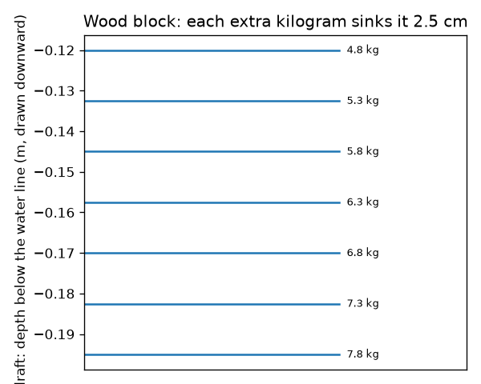
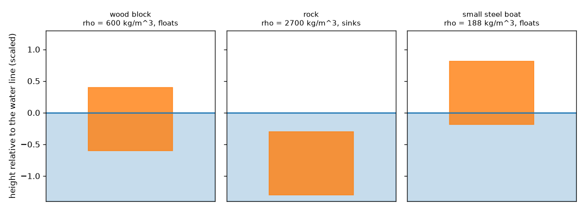
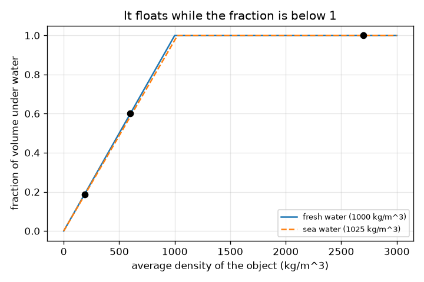

# அமர்வு 1: பொருட்கள் தள்ளிவிடும் நீரின் எடை அவற்றின் எடைக்குச் சமமாக இருக்கும்போது அவை மிதக்கின்றன

[Session 1 — हिन्दी](README.hi.md) · [Session 1 — മലയാളം](README.ml.md) · [Session 1 — தமிழ்](README.ta.md)

*நிலை 1 (கருத்தியல் ஊடாடும் மாதிரி) · சுமார் 60 நிமிடங்கள் · openbuoyancy*

> இது ஒரு எளிமைப்படுத்தப்பட்ட கல்வி மாதிரி. இது சரிபார்க்கப்பட்ட (validated) வடிவமைப்புக் கருவி அல்ல; உண்மையான கட்டமைப்புகள், மின் நிறுவல்கள், வாகனங்கள், தொழில்துறை செயல்முறைகள் அல்லது மருத்துவ முடிவுகளுக்கு இதைப் பயன்படுத்தக் கூடாது.

**முன்தேவைகள் (Prerequisites)**

- அடர்த்தி (density) = நிறை ÷ கனஅளவு.
- நீங்கள் PRIMER.md படித்து, `python start.py 1` ஐ ஒருமுறை இயக்கியிருக்கிறீர்கள்.

**கற்றல் நோக்கங்கள் (Learning objectives).** இந்த அமர்வுக்குப் பிறகு உங்களால் முடியும்:

- ஒரு படகு, ஒரு பாறை, ஒரு மரக்கட்டை ஆகியவை நீரில் ஏன் வெவ்வேறு விதமாக நடந்துகொள்கின்றன என்பதை விளக்க.
- ஒரு பொருள் மிதக்குமா, அதன் எவ்வளவு பகுதி நீருக்கடியில் இருக்கும் என்பதைத் தீர்மானிக்கச் சராசரி அடர்த்தியை (average density) பயன்படுத்த.
- தட்டையான அடிப்பகுதி கொண்ட ஒரு பெட்டியின் மூழ்கு ஆழத்தை (draft) கணக்கிட்டு, மூழ்கு ஆழக் குறியீட்டைப் படிக்க.
- சராசரி அடர்த்திக்கு எதிரான மூழ்கிய பின்னத்தின் வரைபடத்தைப் படிக்க.

## A. நிஜ உலகப் பிரச்சினை
ஒரு எஃகுக் கப்பல் ஆயிரக்கணக்கான டன் எடை கொண்டது, ஆனாலும் மிதக்கிறது. ஒரு கூழாங்கல் சில கிராம் எடைதான், ஆனால் மூழ்குகிறது. ஒரு மரக்கட்டை குளத்தில் தாழ்வாகவும் கடலில் சற்று உயரமாகவும் மிதக்கிறது. ஏன்? முயன்று பார்ப்பதற்கு முன்பே, ஒரு பொருள் மிதக்குமா, எவ்வளவு ஆழத்தில் அமரும் என்று உங்களால் கணிக்க முடியுமா? (இது பொது அறிவியல் கல்வி, படகுப் பாதுகாப்புக்கான வழிகாட்டி அல்ல.)

## B. கருத்தும் கோட்பாடும்
ஒரு பொருளை நீரில் இறக்கும்போது அது சிறிது நீரை வழியிலிருந்து தள்ளுகிறது. தள்ளப்பட்ட நீரின் எடைக்குச் சமமான விசையுடன் நீர் திருப்பித் தள்ளுகிறது (ஆர்க்கிமிடீஸ் கொள்கை - Archimedes' principle). முழுமையாக மூழ்குவதற்கு முன்பே தன் சொந்த எடைக்குச் சமமான நீரைத் தள்ள முடிந்தால் ஒரு பொருள் மிதக்கிறது. இடம்பெயர்ந்த நீர் = திரவ அடர்த்தி பெருக்கல் மூழ்கிய கனஅளவு என்பதால், ஒரு பொருளின் சராசரி அடர்த்தி (மொத்த நிறை ÷ மொத்த வெளிக் கனஅளவு, உள்ளே உள்ள காற்று உட்பட) திரவத்தின் அடர்த்தியை விடக் குறைவாக இருந்தால் அது மிதக்கிறது, அப்போது அதன் கனஅளவில் rho_object / rho_fluid என்ற பின்னம் மேற்பரப்புக்குக் கீழே இருக்கும். அடிப்பரப்பு A கொண்ட தட்டையான அடிப்பகுதிப் பெட்டிக்கு, நீருக்கடியிலான ஆழம் (மூழ்கு ஆழம்) mass / (rho_fluid * A) ஆகும். ஒரு உள்ளீடற்ற எஃகுப் படகு மிதப்பதற்குக் காரணம், அதன் சராசரி அடர்த்தியில் உள்ளே உள்ள காற்றும் அடங்கியுள்ளது.

| குறியீடு | பொருள் | அலகு |
|---|---|---|
| rho_obj | பொருளின் சராசரி அடர்த்தி (நிறை / வெளிக் கனஅளவு) | kg/m^3 |
| rho_fluid | திரவத்தின் அடர்த்தி (நன்னீர் 1000, கடல்நீர் சுமார் 1025) | kg/m^3 |
| f | பொருளின் கனஅளவில் நீருக்கடியில் உள்ள பின்னம் | அலகு இல்லை |
| m | பொருளின் நிறை | kg |
| A | தட்டையான அடிப்பகுதியின் பரப்பு | m^2 |
| draft | நீர்க்கோட்டுக்குக் கீழே அடிப்பகுதியின் ஆழம் | m |

**அனுமானங்கள் (Assumptions)**

- நீர்மட்டம் மாறாத அளவுக்குப் பெரிய தொட்டியில் உள்ள அசைவற்ற நீரில் பொருள் உள்ளது.
- பொருள் நிமிர்ந்து அமர்ந்துள்ளது (நிலைப்புத்தன்மை அமர்வு 3 இல்).
- ஆழத்தைப் பொறுத்து நீரின் அடர்த்தி மாறாது.

$$ \rho_{obj}=\frac{m}{V} $$

$$ f=\min\!\left(1,\ \frac{\rho_{obj}}{\rho_{fluid}}\right) $$

$$ \text{draft}=\frac{m}{\rho_{fluid}\,A} $$

## C. காட்சி விளக்கம்
முதல் படம் நீரில் மூன்று பொருட்களைக் காட்டுகிறது: மரக்கட்டை (சராசரி அடர்த்தி 600 kg/m^3) 60 சதவீதம் நீருக்கடியில் இருக்க மிதக்கிறது, பாறை (2700 kg/m^3) மூழ்குகிறது, எஃகுப் படகு (சராசரி அடர்த்தி 187.5 kg/m^3) சுமார் 19 சதவீதம் மட்டுமே நீருக்கடியில் இருக்க மிதக்கிறது. இரண்டாவது, சராசரி அடர்த்திக்கு எதிராக மூழ்கிய பின்னத்தை வரைகிறது: அது ஒரு நேர்கோட்டில் உயர்ந்து, அடர்த்தி நீரின் அடர்த்திக்குச் சமமாகும் இடத்தில் 1 இல் நிற்கிறது. மூன்றாவது மூழ்கு ஆழக் குறிகளைக் காட்டுகிறது: ஒவ்வொரு கூடுதல் கிலோகிராமும் கட்டையை 2.5 cm மூழ்கச் செய்கிறது.

*ஒரு மரக்கட்டையின் மூழ்கு ஆழக் குறிகள்: ஒவ்வொரு கூடுதல் கிலோகிராமும் 2.5 cm மூழ்கு ஆழத்தைச் சேர்க்கிறது.*

*ஒரு மரக்கட்டை மிதக்கிறது, ஒரு பாறை மூழ்குகிறது, ஒரு எஃகுப் படகு உயரமாக மிதக்கிறது.*

*நன்னீர் மற்றும் கடல்நீருக்குச் சராசரி அடர்த்திக்கு எதிரான நீருக்கடியிலான பின்னம்.*

## D. ஊடாடும் உருவகப்படுத்தல் (Interactive simulation)
பாடத்தை இயக்குங்கள் (`python start.py 1`), பின்னர் நேரடிச் செயலியைத் திறங்கள்: [அமர்வு 1: மிதக்குமா மூழ்குமா](https://krunalpanchal1995.github.io/pan-iit-oss/openbuoyancy/session-01/) (அல்லது இந்தக் கோப்புறையில் உள்ள `app.html`). பொருளின் அடர்த்தியையும் திரவத்தின் அடர்த்தியையும் நகர்த்தி, கட்டை எழுவதையும் மூழ்குவதையும் இரண்டு அம்புகள் மாறுவதையும் கவனியுங்கள், பின்னர் வரைபடக் காட்சியைத் திறந்து கோட்டின் வழியே புள்ளியைப் பின்தொடருங்கள்.

**சவால் (Challenge).** கட்டையின் சரியாக 75 சதவீதம் நீருக்கடியில் இருக்கும்படி அதை மிதக்கச் செய்யுங்கள்.

## E. தீர்க்கப்பட்ட எடுத்துக்காட்டும் சோதனையும்
**பிரச்சினை.** 0.2 m பக்கம் கொண்ட ஒரு மரக் கனசதுரத்தின் நிறை 4.8 kg. அது நன்னீரில் மிதக்குமா? அது எவ்வளவு ஆழத்தில் அமரும்? கடல்நீரில் (1025 kg/m^3) என்ன நடக்கும்?

1. கனஅளவு = 0.2 * 0.2 * 0.2 = 0.008 m^3, எனவே சராசரி அடர்த்தி = 4.8 / 0.008 = 600 kg/m^3.
2. 600 என்பது 1000 ஐ விடக் குறைவு, எனவே அது மிதக்கிறது. நீருக்கடியிலான பின்னம் = 600 / 1000 = 0.60.
3. அடிப்பரப்பு = 0.2 * 0.2 = 0.04 m^2, எனவே மூழ்கு ஆழம் = 4.8 / (1000 * 0.04) = 0.120 m (0.2 m இன் 60 சதவீதம், அப்படித்தான் இருக்க வேண்டும்).
4. கடல்நீரில்: மூழ்கு ஆழம் = 4.8 / (1025 * 0.04) = 0.117 m. அது சுமார் 3 mm உயரமாக அமர்கிறது.

**விடை.** அது 60 சதவீதம் நீருக்கடியில் இருக்க மிதக்கிறது, நன்னீரில் மூழ்கு ஆழம் 0.120 m, கடல்நீரில் 0.117 m.

**சோதனை.** ஒரு வாளியில் ஒரு மர அல்லது பிளாஸ்டிக் கட்டையை மிதக்கவிட்டு, பென்சிலால் நீர்க்கோட்டைக் குறியிட்டு, அளவுகோலால் மூழ்கு ஆழத்தை அளந்து mass / (1000 * area) உடன் ஒப்பிடுங்கள். பின்னர் நீரில் உப்பு சேர்த்து, கோடு சற்று மேலே நகர்வதைப் பாருங்கள். வேறுபாடுகள் மரம் நீரை உறிஞ்சுவதாலும், கட்டை சரியான கனசதுரமாக இல்லாததாலும், நீங்கள் நீர்க்கோட்டைப் படிப்பதாலும் வருகின்றன; மாதிரி ஒரு சரியான உலர்ந்த கட்டையையும் தட்டையான மேற்பரப்பையும் அனுமானிக்கிறது.

## F. மதிப்பீடும் வடிவமைப்புச் சவாலும்
**கேள்வி வகை A: கருத்தியல்.** எஃகின் அடர்த்தி சுமார் 7850 kg/m^3, ஆனாலும் ஒரு எஃகுக் கப்பல் மிதக்கிறது. விளக்குங்கள், அதே எஃகை அடித்து ஒரு திடக் கட்டியாக்கினால் என்ன நடக்கும் என்று சொல்லுங்கள்.

குறிப்பு

உள்ளே உள்ள காற்று உட்பட முழுக் கப்பலின் சராசரி அடர்த்தியைப் பற்றிச் சிந்தியுங்கள்.

படிப்படியான தீர்வு

கப்பல் ஒரு உள்ளீடற்ற ஓடு, எனவே அதன் மொத்த நிறையை மொத்த வெளிக் கனஅளவால் (எஃகும் உள்ளே உள்ள காற்றும்) வகுத்தால் 1000 kg/m^3 ஐ விட மிகக் குறைவு. Python இல், 0.8 m^3 வெளிக் கனஅளவு கொண்ட 150 kg எஃகுப் படகின் சராசரி அடர்த்தி 187.5 kg/m^3, அது மிதக்கிறது; அதே 150 kg எஃகு ஒரு கட்டியாக இருந்தால் கனஅளவு 0.019 m^3, அடர்த்தி 7850 kg/m^3, அது மூழ்குகிறது.

**கேள்வி வகை B: எண்ணியல்.** 2.0 kg நிறை கொண்ட ஒரு கட்டையின் கனஅளவு 0.0030 m^3. அதன் சராசரி அடர்த்தி, நன்னீரில் மிதக்குமா, நீருக்கடியிலான பின்னம், அது தள்ளும் நீரின் நிறை ஆகியவற்றைக் கண்டறியுங்கள்.

குறிப்பு

சராசரி அடர்த்தி = நிறை / கனஅளவு; 1000 உடன் ஒப்பிடுங்கள்.

படிப்படியான தீர்வு

அடர்த்தி = 2.0 / 0.0030 = 666.7 kg/m^3, 1000 க்குக் கீழே, எனவே அது மிதக்கிறது. நீருக்கடியிலான பின்னம் = 666.7 / 1000 = 0.667. அது 2.0 kg நீரைத் தள்ளுகிறது, தன் சொந்த நிறைக்குச் சமம் (சரிபார்ப்பு: 1000 * 0.0030 * 0.667 = 2.0 kg).

**கேள்வி வகை C: வரைபடம் மற்றும் உருவகப்படுத்தல் விளக்கம்.** அடர்த்திக்கு எதிரான மூழ்கிய பின்ன வரைபடத்தில், அடர்த்தி 1000 இல் (நன்னீர்) கோடு உயர்வதை நிறுத்துகிறது. 1010 kg/m^3 அடர்த்தி கொண்ட ஒரு பொருள் நன்னீரிலும் கடல்நீரிலும் என்ன செய்யும்?

குறிப்பு

ஒவ்வொரு நீருக்கும் கிடை அச்சில் 1010 ஐக் கண்டறிந்து, பின்னம் 1 ஐ அடைகிறதா என்று பாருங்கள்.

படிப்படியான தீர்வு

நன்னீரில் பின்னம் 1010 / 1000 = 1.01 ஆக இருக்கும், இது 1 ஐ விட அதிகம், எனவே அது மூழ்குகிறது. கடல்நீரில் (1025) பின்னம் 1010 / 1025 = 0.985, எனவே அது 98.5 சதவீதம் நீருக்கடியில் இருக்க, மிக நூலிழையில், மிதக்கிறது. கடல்நீர் இன்னும் வலப்புறத்தில் 1 ஐ அடையும் கோட்டைத் தருகிறது.

**கேள்வி வகை D: வடிவமைப்பு மற்றும் உகப்பாக்கச் சவால்.** வடிவமைப்பு: தட்டையான அடிப்பகுதி கொண்ட ஒரு படகின் வெற்று நிறை 150 kg, அடிப்பகுதி 2.0 m x 0.8 m. அமைதியான நன்னீரில் அதன் மூழ்கு ஆழம் 0.25 m ஐத் தாண்டக் கூடாது. அதிகபட்சச் சரக்கு எவ்வளவு? உங்கள் அனுமானங்களைக் கூறுங்கள்.

குறிப்பு

அதிகபட்ச மொத்த நிறை = rho * A * draft_max.

படிப்படியான தீர்வு

அடிப்பரப்பு = 1.6 m^2. அதிகபட்ச மொத்த நிறை = 1000 * 1.6 * 0.25 = 400 kg, எனவே சரக்கு அதிகபட்சம் 400 - 150 = 250 kg. அனுமானங்கள்: அமைதியான நீர், படகு நிமிர்ந்து இருக்கிறது, சரக்கு சமமாகப் பரவியுள்ளது, பக்கங்கள் போதுமான உயரம் கொண்டவை. ஒரு உண்மையான படகுக்கு அதிகப் பாதுகாப்பு இடைவெளி தேவை (அலைகள், சீரற்ற ஏற்றம்), படகு மிதக்கும்போதும் நிலைப்புத்தன்மை தோற்கலாம் என்று அமர்வு 3 காட்டுகிறது.

[RUBRIC.md](../../RUBRIC.md) கொண்டு உங்களுக்கு நீங்களே மதிப்பெண் இடுங்கள். தாளில் வேலை செய்ய [செயல்பாட்டுத் தாளை](activity_sheet.md) அச்சிடுங்கள்.

## பொதுவான தவறான கருத்துகள்
| பொதுவான தவறான கருத்து | உண்மையில் சரியானது என்ன |
|---|---|
| கனமான பொருட்கள் மூழ்கும், இலேசானவை மிதக்கும். | எடை அல்ல, அடர்த்திதான் தீர்மானிக்கிறது: ஒரு பெரிய கப்பல் மிதக்கிறது, ஒரு சிறிய கூழாங்கல் மூழ்குகிறது. |
| பொருளின் எடையைப் பொறுத்த ஒரு விசையால் நீர் மேலே தள்ளுவதால்தான் அது மிதக்கிறது. | மேல்நோக்கிய விசை இடம்பெயர்ந்த நீரின் எடைக்குச் சமம், அது மூழ்கிய கனஅளவைப் பொறுத்தது; மிதக்கும் பொருள் அந்த விசை தன் எடைக்குச் சமமாகும் வரை மூழ்குகிறது. |
| மிதக்கும் பொருளை அதன் எடையை விடக் குறைவான விசைதான் மேலே தள்ளுகிறது. | மிதக்கும்போது, மிதப்பு விசை (buoyant force) சரியாக எடைக்குச் சமம்; அதனால்தான் அது அசையாமல் இருக்கிறது. |
| கடல்நீரும் நன்னீரும் ஒரே மூழ்கு ஆழத்தைத் தருகின்றன. | கடல்நீர் சுமார் 2.5 சதவீதம் அடர்த்தி அதிகம், எனவே அதே பொருள் சற்று உயரமாக அமர்கிறது. |

## சொற்களஞ்சியம் (Glossary)
- **அடர்த்தி (density)**: நிறை ÷ கனஅளவு, kg/m^3 இல்
- **மிதப்பு விசை (buoyant force)**: ஒரு திரவம் அதில் உள்ள பொருளின் மீது செலுத்தும் மேல்நோக்கிய தள்ளல்
- **இடம்பெயர்ந்த நீர் (displaced water)**: மேற்பரப்புக்குக் கீழே உள்ள பொருளின் பகுதியால் வழியிலிருந்து தள்ளப்பட்ட நீர்
- **மூழ்கு ஆழம் (draft)**: மிதக்கும் பொருளின் மிகத் தாழ்ந்த புள்ளி நீர்க்கோட்டுக்குக் கீழே உள்ள ஆழம்
- **சராசரி அடர்த்தி (average density)**: மொத்த நிறை ÷ மொத்த வெளிக் கனஅளவு, உள்ளே உள்ள காற்று உட்பட

## முடிக்க
1. [exercises.md](exercises.md) இல் உள்ள மூன்று நிரலாக்கப் பணிகளைச் செய்யுங்கள்.
2. உங்கள் மாற்றங்களுக்குப் பிறகு `python start.py 1` ஐ மீண்டும் இயக்குங்கள். அது சோதனைச் சாவடியுடன் (checkpoint) முடிகிறது; அது `PASS` என அச்சிடும்போது, நீங்கள் முடித்துவிட்டீர்கள். (சோதனைச் சாவடி மட்டும்: `python start.py check 1`.)

அடுத்து: [அமர்வு 2](../session-02/README.md)
