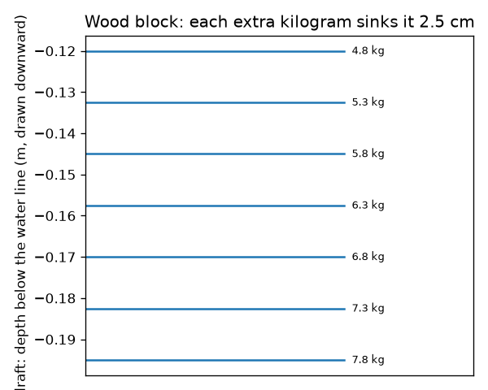
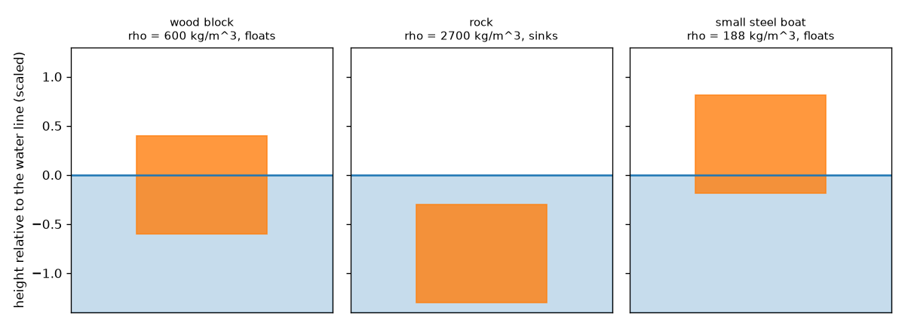
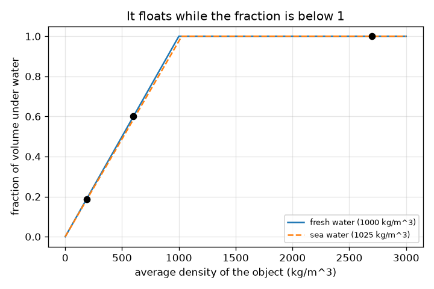

# సెషన్ 1: వస్తువులు పక్కకు నెట్టే నీటి బరువు వాటి బరువుకు సమానమైనప్పుడు అవి తేలుతాయి

[Session 1 — हिन्दी](README.hi.md) · [Session 1 — മലയാളം](README.ml.md) · [Session 1 — தமிழ்](README.ta.md) · [Session 1 — తెలుగు](README.te.md)

*స్థాయి 1 (భావనాత్మక ఇంటరాక్టివ్ మోడల్) · సుమారు 60 నిమిషాలు · openbuoyancy*

> ఇది సరళీకరించిన ఒక విద్యా మోడల్. ఇది ధృవీకరించబడిన (validated) డిజైన్ సాధనం కాదు; నిజమైన నిర్మాణాలు, విద్యుత్ ఇన్‌స్టలేషన్‌లు, వాహనాలు, పారిశ్రామిక ప్రక్రియలు లేదా వైద్య నిర్ణయాల కోసం దీనిని ఉపయోగించకూడదు.

**ముందస్తు అవసరాలు (Prerequisites)**

- సాంద్రత (density) = ద్రవ్యరాశి ÷ ఘనపరిమాణం.
- మీరు PRIMER.md చదివి, `python start.py 1` ను ఒకసారి రన్ చేశారు.

**అభ్యాస లక్ష్యాలు (Learning objectives).** ఈ సెషన్ తర్వాత మీరు చేయగలరు:

- ఒక పడవ, ఒక రాయి, ఒక చెక్క దిమ్మె నీటిలో ఎందుకు వేర్వేరుగా ప్రవర్తిస్తాయో వివరించడం.
- ఒక వస్తువు తేలుతుందా, దానిలో ఎంత భాగం నీటి కింద ఉంటుందో నిర్ణయించడానికి సగటు సాంద్రత (average density) ఉపయోగించడం.
- చదునైన అడుగు ఉన్న పెట్టె యొక్క మునుగు లోతు (draft) లెక్కించి, మునుగు లోతు గుర్తును చదవడం.
- సగటు సాంద్రతకు వ్యతిరేకంగా మునిగిన భాగం యొక్క గ్రాఫ్‌ను చదవడం.

## A. నిజ జీవిత సమస్య
ఒక ఉక్కు ఓడ వేల టన్నుల బరువు ఉంటుంది, అయినా తేలుతుంది. ఒక గులకరాయి కొన్ని గ్రాముల బరువే ఉంటుంది, కానీ మునిగిపోతుంది. ఒక చెక్క దిమ్మె చెరువులో తక్కువగా, సముద్రంలో కొంచెం ఎత్తుగా తేలుతుంది. ఎందుకు? ప్రయత్నించే ముందే, ఒక వస్తువు తేలుతుందా, ఎంత లోతులో కూర్చుంటుందో మీరు అంచనా వేయగలరా? (ఇది సాధారణ విజ్ఞాన విద్య, పడవ భద్రతకు మార్గదర్శి కాదు.)

## B. భావన మరియు సిద్ధాంతం
ఒక వస్తువును నీటిలోకి దించినప్పుడు అది కొంత నీటిని దారి నుండి పక్కకు నెడుతుంది. పక్కకు నెట్టబడిన నీటి బరువుకు సమానమైన బలంతో నీరు తిరిగి నెడుతుంది (ఆర్కిమెడిస్ సూత్రం - Archimedes' principle). పూర్తిగా మునగకముందే తన సొంత బరువుకు సమానమైన నీటిని పక్కకు నెట్టగలిగితే ఒక వస్తువు తేలుతుంది. స్థానభ్రంశం చెందిన నీరు = ద్రవ సాంద్రత గుణకారం మునిగిన ఘనపరిమాణం కాబట్టి, ఒక వస్తువు యొక్క సగటు సాంద్రత (మొత్తం ద్రవ్యరాశి ÷ మొత్తం బయటి ఘనపరిమాణం, లోపలి గాలితో సహా) ద్రవ సాంద్రత కంటే తక్కువగా ఉంటే అది తేలుతుంది, అప్పుడు దాని ఘనపరిమాణంలో rho_object / rho_fluid భాగం ఉపరితలం కింద ఉంటుంది. అడుగు వైశాల్యం A ఉన్న చదునైన అడుగు పెట్టెకు, నీటి కింద లోతు (మునుగు లోతు) mass / (rho_fluid * A). ఖాళీ లోపలి ఉక్కు పడవ తేలడానికి కారణం దాని సగటు సాంద్రతలో లోపలి గాలి కూడా ఉండటమే.

| గుర్తు | అర్థం | యూనిట్ |
|---|---|---|
| rho_obj | వస్తువు సగటు సాంద్రత (ద్రవ్యరాశి / బయటి ఘనపరిమాణం) | kg/m^3 |
| rho_fluid | ద్రవ సాంద్రత (మంచినీరు 1000, సముద్రపు నీరు సుమారు 1025) | kg/m^3 |
| f | వస్తువు ఘనపరిమాణంలో నీటి కింద ఉన్న భాగం | యూనిట్ లేదు |
| m | వస్తువు ద్రవ్యరాశి | kg |
| A | చదునైన అడుగు వైశాల్యం | m^2 |
| draft | నీటి రేఖ కింద అడుగు లోతు | m |

**ఊహలు (Assumptions)**

- నీటి మట్టం మారనంత పెద్ద ట్యాంకులోని నిశ్చల నీటిలో వస్తువు ఉంది.
- వస్తువు నిటారుగా కూర్చుంటుంది (స్థిరత్వం సెషన్ 3 లో).
- లోతుతో నీటి సాంద్రత స్థిరంగా ఉంటుంది.

$$ \rho_{obj}=\frac{m}{V} $$

$$ f=\min\!\left(1,\ \frac{\rho_{obj}}{\rho_{fluid}}\right) $$

$$ \text{draft}=\frac{m}{\rho_{fluid}\,A} $$

## C. దృశ్య వివరణ
మొదటి చిత్రం నీటిలో మూడు వస్తువులను చూపిస్తుంది: చెక్క దిమ్మె (సగటు సాంద్రత 600 kg/m^3) 60 శాతం నీటి కింద ఉండి తేలుతుంది, రాయి (2700 kg/m^3) మునిగిపోతుంది, ఉక్కు పడవ (సగటు సాంద్రత 187.5 kg/m^3) సుమారు 19 శాతం మాత్రమే నీటి కింద ఉండి తేలుతుంది. రెండవది సగటు సాంద్రతకు వ్యతిరేకంగా మునిగిన భాగాన్ని ప్లాట్ చేస్తుంది: అది సరళ రేఖ వెంట పెరిగి, సాంద్రత నీటి సాంద్రతకు సమానమైన చోట 1 వద్ద ఆగుతుంది. మూడవది మునుగు లోతు గుర్తులను చూపిస్తుంది: ప్రతి అదనపు కిలోగ్రాము దిమ్మెను 2.5 cm ముంచుతుంది.

*చెక్క దిమ్మె యొక్క మునుగు లోతు గుర్తులు: ప్రతి అదనపు కిలోగ్రాము 2.5 cm మునుగు లోతును జోడిస్తుంది.*

*చెక్క దిమ్మె తేలుతుంది, రాయి మునుగుతుంది, ఉక్కు పడవ ఎత్తుగా తేలుతుంది.*

*మంచినీరు మరియు సముద్రపు నీటికి సగటు సాంద్రతకు వ్యతిరేకంగా నీటి కింద భాగం.*

## D. ఇంటరాక్టివ్ సిమ్యులేషన్
పాఠాన్ని రన్ చేయండి (`python start.py 1`), ఆపై లైవ్ యాప్ తెరవండి: [సెషన్ 1: తేలుతుందా మునుగుతుందా](https://krunalpanchal1995.github.io/pan-iit-oss/openbuoyancy/session-01/) (లేదా ఈ ఫోల్డర్‌లోని `app.html`). వస్తువు సాంద్రత మరియు ద్రవ సాంద్రతను స్లైడ్ చేసి, దిమ్మె పైకి లేవడం, మునగడం మరియు రెండు బాణాలు మారడం గమనించండి, ఆపై గ్రాఫ్ వ్యూ తెరిచి రేఖ వెంట బిందువును అనుసరించండి.

**సవాలు (Challenge).** దిమ్మెలో సరిగ్గా 75 శాతం నీటి కింద ఉండేలా దానిని తేలించండి.

## E. సాధించిన ఉదాహరణ మరియు ప్రయోగం
**సమస్య.** 0.2 m భుజం ఉన్న చెక్క ఘనానికి 4.8 kg ద్రవ్యరాశి ఉంది. అది మంచినీటిలో తేలుతుందా? ఎంత లోతులో కూర్చుంటుంది? సముద్రపు నీటిలో (1025 kg/m^3) ఏమి జరుగుతుంది?

1. ఘనపరిమాణం = 0.2 * 0.2 * 0.2 = 0.008 m^3, కాబట్టి సగటు సాంద్రత = 4.8 / 0.008 = 600 kg/m^3.
2. 600 అనేది 1000 కంటే తక్కువ, కాబట్టి అది తేలుతుంది. నీటి కింద భాగం = 600 / 1000 = 0.60.
3. అడుగు వైశాల్యం = 0.2 * 0.2 = 0.04 m^2, కాబట్టి మునుగు లోతు = 4.8 / (1000 * 0.04) = 0.120 m (0.2 m లో 60 శాతం, అలాగే ఉండాలి).
4. సముద్రపు నీటిలో: మునుగు లోతు = 4.8 / (1025 * 0.04) = 0.117 m. అది సుమారు 3 mm ఎత్తుగా కూర్చుంటుంది.

**సమాధానం.** అది 60 శాతం నీటి కింద ఉండి తేలుతుంది, మంచినీటిలో మునుగు లోతు 0.120 m, సముద్రపు నీటిలో 0.117 m.

**ప్రయోగం.** ఒక బకెట్‌లో చెక్క లేదా ప్లాస్టిక్ దిమ్మెను తేలించి, పెన్సిల్‌తో నీటి రేఖను గుర్తించి, స్కేలుతో మునుగు లోతును కొలిచి mass / (1000 * area) తో పోల్చండి. ఆపై నీటిలో ఉప్పు కలిపి రేఖ కొంచెం పైకి కదలడం చూడండి. తేడాలు చెక్క నీటిని పీల్చుకోవడం, దిమ్మె సరైన ఘనం కాకపోవడం మరియు మీరు నీటి రేఖను చదవడం నుండి వస్తాయి; మోడల్ పరిపూర్ణమైన పొడి దిమ్మెను మరియు చదునైన ఉపరితలాన్ని ఊహిస్తుంది.

## F. మూల్యాంకనం మరియు డిజైన్ సవాలు
**ప్రశ్న రకం A: భావనాత్మకం.** ఉక్కు సాంద్రత సుమారు 7850 kg/m^3, అయినా ఉక్కు ఓడ తేలుతుంది. వివరించండి, అదే ఉక్కును కొట్టి ఘన ముద్దగా చేస్తే ఏమి జరుగుతుందో చెప్పండి.

సూచన

లోపలి గాలితో సహా మొత్తం ఓడ యొక్క సగటు సాంద్రత గురించి ఆలోచించండి.

దశలవారీ పరిష్కారం

ఓడ ఒక ఖాళీ లోపలి కవచం, కాబట్టి దాని మొత్తం ద్రవ్యరాశిని మొత్తం బయటి ఘనపరిమాణంతో (ఉక్కు మరియు లోపలి గాలి) భాగిస్తే 1000 kg/m^3 కంటే చాలా తక్కువ. Python లో, 0.8 m^3 బయటి ఘనపరిమాణం ఉన్న 150 kg ఉక్కు పడవ సగటు సాంద్రత 187.5 kg/m^3, అది తేలుతుంది; అదే 150 kg ఉక్కు ముద్దగా ఉంటే ఘనపరిమాణం 0.019 m^3, సాంద్రత 7850 kg/m^3, అది మునుగుతుంది.

**ప్రశ్న రకం B: సంఖ్యాత్మకం.** 2.0 kg ద్రవ్యరాశి ఉన్న దిమ్మె ఘనపరిమాణం 0.0030 m^3. దాని సగటు సాంద్రత, మంచినీటిలో తేలుతుందా, నీటి కింద భాగం మరియు అది పక్కకు నెట్టే నీటి ద్రవ్యరాశి కనుగొనండి.

సూచన

సగటు సాంద్రత = ద్రవ్యరాశి / ఘనపరిమాణం; 1000 తో పోల్చండి.

దశలవారీ పరిష్కారం

సాంద్రత = 2.0 / 0.0030 = 666.7 kg/m^3, 1000 కంటే తక్కువ, కాబట్టి అది తేలుతుంది. నీటి కింద భాగం = 666.7 / 1000 = 0.667. అది 2.0 kg నీటిని పక్కకు నెడుతుంది, తన సొంత ద్రవ్యరాశికి సమానం (తనిఖీ: 1000 * 0.0030 * 0.667 = 2.0 kg).

**ప్రశ్న రకం C: గ్రాఫ్ మరియు సిమ్యులేషన్ వ్యాఖ్యానం.** సాంద్రతకు వ్యతిరేకంగా మునిగిన భాగం గ్రాఫ్‌లో, సాంద్రత 1000 (మంచినీరు) వద్ద రేఖ పెరగడం ఆగుతుంది. 1010 kg/m^3 సాంద్రత ఉన్న వస్తువు మంచినీటిలో మరియు సముద్రపు నీటిలో ఏమి చేస్తుంది?

సూచన

ప్రతి నీటికి క్షితిజ అక్షంపై 1010 కనుగొని, భాగం 1 కి చేరుతుందో లేదో చూడండి.

దశలవారీ పరిష్కారం

మంచినీటిలో భాగం 1010 / 1000 = 1.01 అవుతుంది, ఇది 1 కంటే ఎక్కువ, కాబట్టి అది మునుగుతుంది. సముద్రపు నీటిలో (1025) భాగం 1010 / 1025 = 0.985, కాబట్టి అది 98.5 శాతం నీటి కింద ఉండి, అతి కష్టం మీద, తేలుతుంది. సముద్రపు నీరు మరింత కుడివైపున 1 కి చేరే రేఖను ఇస్తుంది.

**ప్రశ్న రకం D: డిజైన్ మరియు ఆప్టిమైజేషన్ సవాలు.** డిజైన్: చదునైన అడుగు ఉన్న పడవకు 150 kg ఖాళీ ద్రవ్యరాశి మరియు 2.0 m x 0.8 m అడుగు ఉంది. ప్రశాంతమైన మంచినీటిలో దాని మునుగు లోతు 0.25 m మించకూడదు. గరిష్ట సరుకు ఎంత? మీ ఊహలను చెప్పండి.

సూచన

గరిష్ట మొత్తం ద్రవ్యరాశి = rho * A * draft_max.

దశలవారీ పరిష్కారం

అడుగు వైశాల్యం = 1.6 m^2. గరిష్ట మొత్తం ద్రవ్యరాశి = 1000 * 1.6 * 0.25 = 400 kg, కాబట్టి సరుకు గరిష్టంగా 400 - 150 = 250 kg. ఊహలు: ప్రశాంతమైన నీరు, పడవ నిటారుగా ఉంటుంది, సరుకు సమానంగా పరచబడింది, పక్కలు తగినంత ఎత్తుగా ఉన్నాయి. నిజమైన పడవకు పెద్ద భద్రతా మార్జిన్ అవసరం (అలలు, అసమాన లోడింగ్), పడవ తేలుతున్నప్పుడు కూడా స్థిరత్వం విఫలం కావచ్చని సెషన్ 3 చూపిస్తుంది.

[RUBRIC.md](../../RUBRIC.md) తో మీకు మీరే స్కోర్ ఇచ్చుకోండి. కాగితంపై పని చేయడానికి [కార్యాచరణ పత్రాన్ని](activity_sheet.md) ప్రింట్ చేయండి.

## సాధారణ అపోహలు
| సాధారణ అపోహ | వాస్తవంగా నిజం ఏమిటి |
|---|---|
| బరువైనవి మునుగుతాయి, తేలికైనవి తేలుతాయి. | బరువు కాదు, సాంద్రత నిర్ణయిస్తుంది: పెద్ద ఓడ తేలుతుంది, చిన్న గులకరాయి మునుగుతుంది. |
| వస్తువు బరువుపై ఆధారపడే బలంతో నీరు పైకి నెట్టడం వల్ల అది తేలుతుంది. | పైకి బలం స్థానభ్రంశం చెందిన నీటి బరువుకు సమానం, అది మునిగిన ఘనపరిమాణంపై ఆధారపడుతుంది; తేలే వస్తువు ఆ బలం తన బరువుకు సమానమయ్యే వరకు మునుగుతుంది. |
| తేలే వస్తువును దాని బరువు కంటే తక్కువ బలం పైకి నెడుతుంది. | తేలుతున్నప్పుడు, ప్లవన బలం (buoyant force) సరిగ్గా బరువుకు సమానం; అందుకే అది నిశ్చలంగా ఉంటుంది. |
| సముద్రపు నీరు మరియు మంచినీరు ఒకే మునుగు లోతును ఇస్తాయి. | సముద్రపు నీరు సుమారు 2.5 శాతం ఎక్కువ సాంద్రత కలిగి ఉంటుంది, కాబట్టి అదే వస్తువు కొంచెం ఎత్తుగా కూర్చుంటుంది. |

## పదకోశం (Glossary)
- **సాంద్రత (density)**: ద్రవ్యరాశి ÷ ఘనపరిమాణం, kg/m^3 లో
- **ప్లవన బలం (buoyant force)**: ద్రవం దానిలోని వస్తువుపై చూపే పైకి నెట్టు
- **స్థానభ్రంశం చెందిన నీరు (displaced water)**: ఉపరితలం కింద ఉన్న వస్తువు భాగం దారి నుండి పక్కకు నెట్టిన నీరు
- **మునుగు లోతు (draft)**: తేలే వస్తువు యొక్క అత్యల్ప బిందువు నీటి రేఖ కింద ఉన్న లోతు
- **సగటు సాంద్రత (average density)**: మొత్తం ద్రవ్యరాశి ÷ మొత్తం బయటి ఘనపరిమాణం, లోపలి గాలితో సహా

## ముగించండి
1. [exercises.md](exercises.md) లోని మూడు కోడింగ్ పనులు చేయండి.
2. మీ మార్పుల తర్వాత `python start.py 1` ను మళ్ళీ రన్ చేయండి. అది చెక్‌పాయింట్‌తో ముగుస్తుంది; అది `PASS` అని ప్రింట్ చేసినప్పుడు, మీరు పూర్తి చేశారు. (చెక్‌పాయింట్ మాత్రమే: `python start.py check 1`.)

తదుపరి: [సెషన్ 2](../session-02/README.md)
