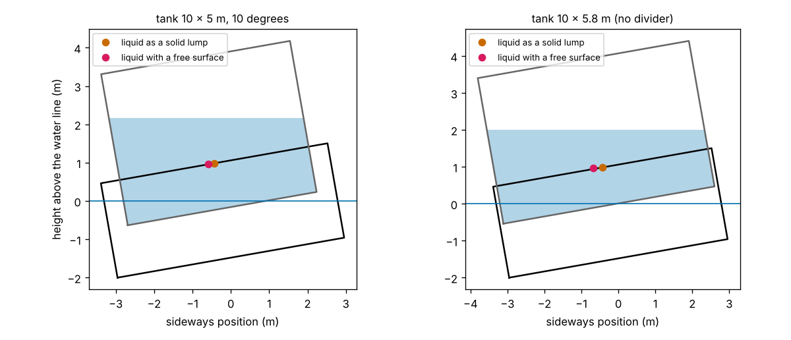
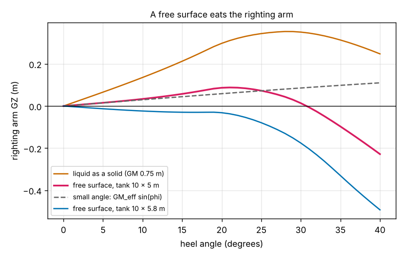
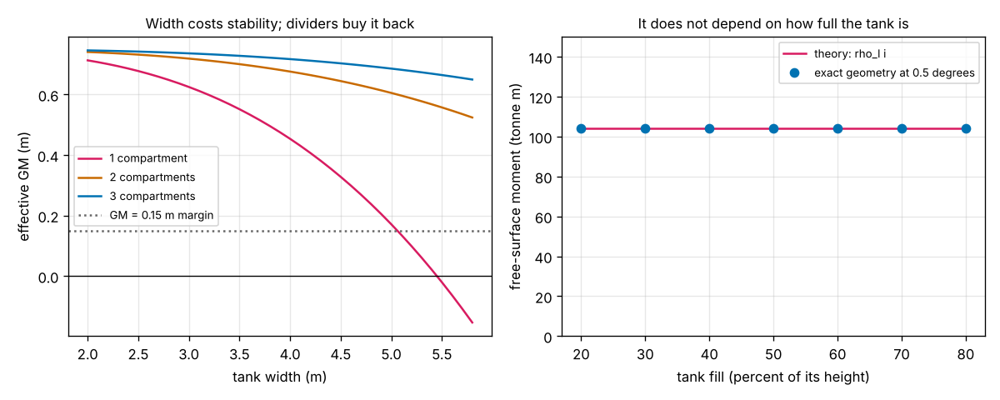

# Session 4: The free-surface effect: why a liquid in a tank lowers GM

*Level 3 (simulation and validation) · about 90 minutes · openbuoyancy*

> This is a simplified educational model. It is not a validated design tool and must not be used for real structures, electrical installations, vehicles, industrial processes or medical decisions.

**Prerequisites**

- Session 3: the metacentric height GM, the righting arm GZ and the exact heeled geometry.
- Session 2: draft and displacement.

**Learning objectives.** After this session you can:

- Compute the second moment i of a liquid's free surface and the loss of metacentric height FSC = rho_l i / m.
- Check the formula against the exact geometry of the heeled tank, and show that the loss does not depend on how full the tank is.
- Explain why the loss grows with the cube of the width, why a longitudinal divider helps (by n squared) and why a transverse bulkhead does not.
- Read the effect on the whole GZ curve and on the range of stability, and design a tank width for a required GM.

## A. Real-world problem
In Session 3 the 180 t barge (60 t empty, 120 t of cargo with its centre 2.5 m above the keel) has a healthy GM of 0.75 m. Now the 120 t is fresh water in a tank 10 m long and 5 m wide. When the barge heels, a solid cargo stays put, but a liquid with a free surface runs to the low side and pulls the barge further over. How much of the 0.75 m is lost, why does a slightly wider tank turn a stable barge into an unstable one, and what does a divider do? (Educational 2D model only: not for loading a real vessel.)

## B. Concept and theory
**The tank.** A rectangular tank of length l (along the barge) and width w (across), on the centre line, holds liquid of density rho_l and mass m_l, so the liquid is h = m_l / (rho_l l w) deep.

**The loss.** When the barge heels by a small angle phi the liquid surface stays level, so a wedge of liquid moves to the low side: the liquid's centre of gravity shifts sideways by i phi / v, where i = l w^3 / 12 is the second moment of the free surface and v the volume of the liquid. This shifts the barge's total weight sideways exactly as if its centre of gravity G had been raised by

FSC = rho_l i / m,

where m is the total mass of the barge (the same as rho times the displaced volume). The effective metacentric height is GM_eff = GM_solid - FSC = KM - (KG + FSC). Two things to notice. FSC does not depend on how full the tank is (as long as the surface does not touch the roof or the floor): the liquid's weight and the size of the wedge cancel. And it grows with the cube of the width.

**Dividers.** A longitudinal divider (along the barge) splits the width into n compartments of width w / n; each has i = l (w/n)^3 / 12, so together they have i / n^2. Two compartments cut the loss to a quarter and three to a ninth. A transverse bulkhead (across the barge) shortens the compartments but leaves each as wide as the tank, so the total l_j w^3 / 12 adds up to the same i: it does not help. A completely full tank has no free surface and FSC = 0.

**Large heel.** The formula is the small-angle limit. The exact GZ curve (liquid centroid from the heeled tank geometry) falls below the small-angle line GM_eff sin(phi) as the heel grows.

| Symbol | Meaning | Unit |
|---|---|---|
| l, w, h | tank length, width and liquid depth | m |
| rho_l | density of the liquid (1000 for fresh water) | kg/m^3 |
| i | second moment of the free surface, l w^3 / 12 | m^4 |
| m | total mass of the barge and cargo | kg |
| FSC | free-surface correction, rho_l i / m | m |
| GM_solid, GM_eff | metacentric height with the liquid as a solid, and with the free surface | m |
| n | number of equal longitudinal compartments | no unit |
| GZ | righting arm | m |

**Assumptions**

- The barge of Session 3: 20 m long, 6 m wide, hull depth 2.5 m, empty mass 60 t with its centre 1 m above the keel; fresh water.
- One rectangular tank on the centre line, 4 m high inside, holding the whole cargo (120 t) as liquid with its centre at 2.5 m above the keel, so the solid-cargo GM is the 0.75 m of Session 3. The widest tank that fits is taken as 5.8 m, leaving 0.1 m on each side for walls.
- Still water and a slow heel: the liquid surface is level at every moment (no sloshing, no waves). Compartments share the liquid equally.
- The tank is watertight and not leaking, and the barge is not damaged. A GM of at least 0.15 m is used as a simple margin, not as a real rule.

$$ i=\frac{l\,w^3}{12},\qquad \mathrm{FSC}=\frac{\rho_l\,i}{m},\qquad GM_{\mathrm{eff}}=GM_{\mathrm{solid}}-\mathrm{FSC} $$

$$ i_n=n\cdot\frac{l\,(w/n)^3}{12}=\frac{i}{n^2}\ \ (n\text{ longitudinal compartments}),\qquad \sum_j\frac{l_j\,w^3}{12}=i\ \ (\text{transverse bulkheads}) $$

$$ GZ=y_G-y_B,\qquad y_G=\frac{m_0\,y_0+m_l\,y_{\mathrm{liquid}}}{m_0+m_l}\ \ (y_{\mathrm{liquid}}\text{ from the heeled tank}) $$

## C. Visual explanation
The first figure shows the barge heeled 10 degrees with its tank. The liquid surface is level, so the liquid's centre of gravity (magenta) sits further to the low side than the orange dot, which is where the same liquid would sit if it were solid. The right panel is the widest tank, 5.8 m: the two dots are further apart. The second figure compares the righting arm. With a solid cargo the GZ at 10 degrees is 0.1356 m and the curve reaches zero at 53.6 degrees; with the 10 x 5 m tank it is 0.0336 m (the small-angle line GM_eff sin(phi) gives 0.0297 m) and the curve already reaches zero at 30.7 degrees. At 5.8 m the curve never rises above zero. The third figure, left, shows the effective GM against tank width for one, two and three compartments, and, right, that the free-surface moment from the exact geometry is the same, 104.2 tonne m, for tanks that are 20 to 80 percent full.

*The heeled barge with its tank: the liquid with a free surface (magenta) against the same liquid frozen as a solid lump (orange).*

*Righting arm against heel angle: solid cargo, free surface in the 10 x 5 m tank, the small-angle line, and the 5.8 m wide tank.*

*Left: effective GM against tank width for 1, 2 and 3 compartments. Right: the free-surface moment from the exact geometry against the fill of the tank.*

Effective GM in metres for the 120 t, 10 m long tank (solid-cargo GM 0.75 m); negative means the upright barge is unstable:

| Tank width | 1 compartment | 2 compartments | 3 compartments |
|---|---|---|---|
| 4.0 m | 0.454 | 0.676 | 0.717 |
| 4.5 m | 0.328 | 0.645 | 0.703 |
| 5.0 m | 0.171 | 0.605 | 0.686 |
| 5.5 m | -0.020 | 0.557 | 0.664 |
| 5.8 m | -0.153 | 0.524 | 0.650 |

## D. Interactive simulation
Run the lesson (`python start.py 4`), then open the live app: [Session 4: sloshing liquid and the lost GM](https://krunalpanchal1995.github.io/pan-iit-oss/openbuoyancy/session-04/) (or `app.html` in this folder). Change the liquid mass and height, the tank length and width, the number of compartments across and along, and the heel angle. Look at the heeled section (orange: liquid as a solid, magenta: where it really acts), the righting-arm curve and the effective GM against tank width. Presets: the barge of the lesson, the widest tank, one divider, bulkheads only and a narrow tank. The app uses the same exact geometry as the lesson, and the numbers agree to 13 digits.

**Challenge.** Use the widest tank (5.8 m wide, 10 m long, 120 t at 2.5 m) and add as few dividers as you can so that the effective GM is at least 0.5 m.

## E. Worked example and experiment
**Problem.** Find the effective GM of the 180 t barge when its 120 t cargo is fresh water in a tank 10 m long and 5 m wide (centre of the liquid 2.5 m above the keel), and then with one longitudinal divider. Check the first value with the exact heeled geometry.

1. The solid-cargo GM is 0.750 m (Session 3, worked example: KB 0.750, BM 2.000, KG 2.000).
2. The free-surface second moment is i = l w^3 / 12 = 10 x 125 / 12 = 104.17 m^4.
3. The correction is FSC = rho_l i / m = 1000 x 104.17 / 180 000 = 0.5787 m.
4. The effective GM is 0.750 - 0.5787 = 0.1713 m: still positive, but nearly neutral.
5. With one divider each compartment is 2.5 m wide, so i = 2 x 10 x 2.5^3 / 12 = 26.04 m^4 (a quarter), FSC = 0.1447 m and GM_eff = 0.6053 m.
6. The exact heeled geometry at 0.5 degrees gives GM_eff = 0.1714 m and 0.6054 m, which agree with the formula to 0.0001 m.

**Answer.** GM_eff = 0.1713 m for the undivided 10 x 5 m tank (the barge loses 77 percent of its GM; the roadmap asked for 0.17 m or less, which is this value to two decimals) and 0.6053 m with one divider.

**Experiment.** Float a plastic food box in a sink or bath with a few coins taped inside, low on the bottom. Fix a small open container on top and fill it with water; freeze an identical one and use it for comparison. Add a coin on one edge and measure how far the box heels in each case, with a protractor on a photo. Expect the box with liquid to heel more. Expect differences from the model: the container is small, the water also sloshes dynamically and surface tension matters at this size.

## Real-world application and mini-project: How wide may the tank be, and does it need a divider?
The barge carries 120 t of fresh water (centre 2.5 m above the keel) in a tank 10 m long. The tank width can be 4.0, 4.5, 5.0, 5.5 or 5.8 m, with 1, 2 or 3 longitudinal compartments of equal width. A choice passes if the effective GM is at least 0.15 m. Use `make_tank`, `gm_effective` and `max_tank_width` from Session 4. For the undivided tank 5.8 m wide, also use `righting_arm_tank` to say what the barge does after a nudge.

**Deliverable:** A script that prints the 15 effective GM values with pass or fail, reports the widest undivided tank that passes, reports the fewest compartments that let the full 5.8 m width pass, and saves a plot of effective GM against width for 1, 2 and 3 compartments with the margin marked. Add two sentences on why a barge that is stable with a solid cargo can capsize with a liquid.

**Success looks like:** The undivided tank passes for 4.0, 4.5 and 5.0 m (GM 0.454, 0.328 and 0.171 m) and fails for 5.5 m (-0.020 m) and 5.8 m (-0.153 m); the widest undivided width is 5.06 m. With 2 or 3 compartments all five widths pass (0.524 to 0.717 m), so one divider is enough for the full 5.8 m. For the undivided 5.8 m tank the righting arm is negative at every heel angle from 1 to 60 degrees (-0.024 m at 10 degrees), so the model has no angle of loll and the barge keeps heeling.

## F. Assessment and design challenge
**Question type A: Conceptual.** Why does the free-surface loss grow with the cube of the tank width, and why does a transverse bulkhead not help while a longitudinal divider does?

Hint

Think about the second moment of the free surface, i = l w^3 / 12, and how each kind of wall changes l and w.

Step-by-step solution

The loss is rho_l i / m and i = l w^3 / 12: the liquid wedge that moves when the barge heels is as wide as the surface and moves a distance proportional to the width, so its moment grows with w^3 (a tank twice as wide has 8 times the loss). A longitudinal divider replaces one surface of width w by n surfaces of width w / n, each with i = l (w/n)^3 / 12, so the total is i / n^2: 1/4 for two compartments. A transverse bulkhead splits the length l into pieces l_j, but each piece is still w wide and the sum of l_j w^3 / 12 is the same i: the loss is unchanged.

**Question type B: Numerical.** A tank 8 m long and 4 m wide holds fresh water on a barge of total mass 150 t whose solid-cargo GM is 0.60 m. Find i, the free-surface correction and the effective GM, and then the effective GM with one longitudinal divider.

Hint

i = l w^3 / 12, FSC = 1000 i / m with m in kg, and one divider gives i / 4.

Step-by-step solution

i = 8 x 4^3 / 12 = 42.67 m^4. FSC = 1000 x 42.67 / 150 000 = 0.2844 m, so GM_eff = 0.60 - 0.2844 = 0.3156 m. With one divider i = 10.67 m^4, FSC = 0.0711 m and GM_eff = 0.5289 m. Units: m^4 for i, metres for the correction.

**Question type C: Graph and simulation interpretation.** In the righting-arm figure the small-angle line GM_eff sin(phi) gives 0.0856 m at 30 degrees for the 10 x 5 m tank, but the exact curve gives 0.0134 m, while the solid-cargo curve gives 0.3510 m. What do you conclude about the formula, and about the range of stability?

Hint

The formula is a small-angle result. Compare the three numbers and look at where each curve reaches zero.

Step-by-step solution

The formula FSC = rho_l i / m is the limit of zero heel: at 5 degrees the line gives 0.0149 m and the exact curve 0.0154 m, but at 30 degrees the line overestimates the righting arm by 0.072 m, because the liquid wedge keeps growing and moves the weight further to the low side. The exact curve, not the line, must be used at large angles. The solid-cargo curve is positive up to 53.6 degrees, while the free-surface curve reaches zero at 30.7 degrees: the free surface also shortens the range of stability by 23 degrees, which the single number GM_eff does not show.

**Question type D: Design and optimisation challenge.** The owner wants an effective GM of at least 0.15 m with the 120 t of liquid in a tank 10 m long. What is the widest undivided tank, and what is the cheapest change that lets the full 5.8 m width be used?

Hint

Use i_max = (GM_solid - 0.15) m / rho_l and w = (12 i_max / l)^(1/3); then try n = 2 compartments.

Step-by-step solution

i_max = (0.75 - 0.15) x 180 000 / 1000 = 108 m^4, so w^3 = 12 x 108 / 10 = 129.6 and w = 5.06 m: a 5.0 m tank passes (GM 0.171 m) but 5.5 m does not (-0.020 m). With n compartments the widest width is n (12 i_max / (n l))^(1/3): 8.03 m for two and 10.53 m for three, both more than the hull can take, so one longitudinal divider is enough for the full 5.8 m width (GM_eff 0.524 m). A divider costs far less than narrowing the tank, and it also lengthens the range of stability (GZ vanishes at 42.2 degrees against 30.7 for the 10 x 5 m tank).

Score yourself with [RUBRIC.md](../../RUBRIC.md). Print the [activity sheet](activity_sheet.md) to work on paper.

## Common misconceptions
| Common misconception | What is actually true |
|---|---|
| The loss depends on how much liquid there is. | It depends on the free surface, not the volume: the free-surface moment is 104.2 tonne m for a tank 20 or 80 percent full. |
| A full tank is the worst case. | A completely full tank has no free surface and no loss; the worst tank is a part-full wide one. |
| A bulkhead across the barge reduces sloshing losses. | It leaves the width unchanged, so the loss is unchanged; only longitudinal dividers help. |
| A positive GM_eff means the barge is fine. | At 0.17 m the barge is nearly neutral and its range of stability is only 30.7 degrees against 53.6 degrees for a solid cargo. |
| The formula works at every heel angle. | It is the small-angle limit; at 30 degrees it overestimates the righting arm by 0.07 m for the 10 x 5 m tank. |

## Glossary
- **free surface**: the top of a liquid that is not completely filling its tank and so can move
- **second moment of area (i)**: l w^3 / 12 for a rectangle, how strongly the surface resists tilting
- **free-surface correction (FSC)**: the loss of metacentric height caused by the free surface, rho_l i / m
- **effective GM**: GM_solid minus FSC, the value that decides stability
- **longitudinal divider**: a wall along the barge that splits the tank across its width
- **transverse bulkhead**: a wall across the barge that splits the tank along its length
- **range of stability**: the heel angle at which GZ falls back to zero

## Finish
1. Do the three coding tasks in [exercises.md](exercises.md).
2. Run `python start.py 4` again after your changes. It ends with the checkpoint; when it prints `PASS`, you are done. (Checkpoint only: `python start.py check 4`.)

Next: the [roadmap](../../promo/roadmap.md). Session 5 is yours to build.
