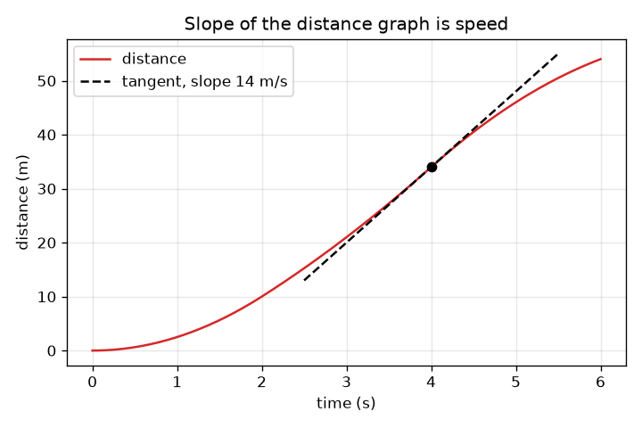
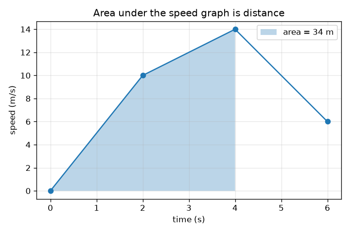

# सत्र 1: ढलान गति है, क्षेत्रफल दूरी है

*स्तर 1 (वैचारिक इंटरैक्टिव मॉडल) · लगभग 60 मिनट · opencalculus*

> यह एक सरलीकृत शैक्षिक मॉडल है। यह कोई प्रमाणित डिज़ाइन उपकरण नहीं है और इसका उपयोग वास्तविक संरचनाओं, विद्युत संस्थापनों, वाहनों, औद्योगिक प्रक्रियाओं या चिकित्सा निर्णयों के लिए नहीं किया जाना चाहिए।

**पूर्व-आवश्यकताएँ (Prerequisites)**

- गति = दूरी / समय और ग्राफ़ पढ़ना (स्कूल स्तर)।
- आपने PRIMER.md पढ़ लिया है और एक बार `python start.py 1` चला लिया है।

**सीखने के उद्देश्य (Learning objectives)।** इस सत्र के बाद आप:

- समझा सकेंगे कि दूरी-समय ग्राफ़ की ढलान (slope) ही गति (speed) क्यों है।
- समझा सकेंगे कि गति-समय ग्राफ़ के नीचे का क्षेत्रफल (area) ही तय की गई दूरी क्यों है।
- खंडशः सीधे (piecewise straight) गति ग्राफ़ के लिए समलंबों (trapezoids) को जोड़कर दूरी निकाल सकेंगे।
- एक ही यात्रा के दोनों ग्राफ़ों के बीच दोनों दिशाओं में आ-जा सकेंगे।

## A. वास्तविक जीवन की समस्या
कार का स्पीडोमीटर बताता है कि आप कितनी तेज़ जा रहे हैं, पर यह नहीं कि आप कितनी दूर आ गए; उसका ओडोमीटर बताता है कि कितनी दूर, पर यह नहीं कि कितनी तेज़। यदि आपके पास इनमें से केवल एक का रिकॉर्ड हो, तो क्या आप दूसरे को फिर से बना सकते हैं? यह प्रश्न छिपे रूप में पूरा कलन (calculus) ही है: दूरी से गति तक जाना अवकलन (differentiation) है, गति से दूरी तक जाना समाकलन (integration) है। इस सत्र में आप केवल ढलानों और क्षेत्रफलों की मदद से दोनों करेंगे।

## B. अवधारणा और सिद्धांत
गति, दूरी को समय से भाग देने पर मिलती है। दूरी-समय ग्राफ़ पर 'दूरी भाग समय' का अर्थ है ऊँचाई-बढ़त भाग क्षैतिज बढ़त (rise over run), यानी ढलान। जब गति बदलती है, तो ढलान पल-पल बदलती है: किसी पल की गति, उस बिंदु पर वक्र को छूने वाली स्पर्श रेखा (tangent line) की ढलान है। उल्टी दिशा में, दूरी बराबर गति गुणा समय। गति-समय ग्राफ़ पर यह चौड़ाई गुणा ऊँचाई है, यानी एक आयत का क्षेत्रफल; यदि गति बदलती है तो हम समय को टुकड़ों में काटते हैं और क्षेत्रफलों को जोड़ते हैं (सीधी-रेखा वाले बदलाव के लिए एक समलंब)। क्षेत्रफल की इकाई s * m/s = m है। हमारी कार विराम से शुरू होती है और उसकी गति 0, 2, 4 और 6 s पर ज्ञात है, बीच में सीधी रेखाएँ हैं।

| प्रतीक | अर्थ | इकाई |
|---|---|---|
| t | शुरुआत से समय | s |
| v(t) | समय t पर कार की गति | m/s |
| x(t) | शुरुआत से समय t तक तय की गई दूरी | m |
| ढलान | दूरी ग्राफ़ की rise over run | m/s |
| क्षेत्रफल | गति ग्राफ़ के नीचे का क्षेत्रफल | m |

**मान्यताएँ (Assumptions)**

- कार एक सीधी सड़क पर चलती है और कभी पीछे नहीं जाती, इसलिए गति और दूरी केवल यात्रा की दिशा में बढ़ती हैं।
- चार ज्ञात पलों के बीच गति एक सीधी रेखा में बदलती है।
- कार x = 0 और t = 0 पर विराम से शुरू होती है।

$$ v=\frac{\Delta x}{\Delta t}\quad\text{(slope of the distance graph)} $$

$$ \Delta x=\frac{v_1+v_2}{2}\,\Delta t\quad\text{(area of one trapezoid under the speed graph)} $$

$$ x(t)=\text{area under }v\text{ from }0\text{ to }t,\qquad v(t)=\text{slope of }x\text{ at }t $$

## C. दृश्य व्याख्या
बायाँ चित्र एक कार के लिए समय के विरुद्ध गति दिखाता है जिसकी गति 2, 4 और 6 s पर 10, 14 और 6 m/s है; 4 s तक का छायांकित क्षेत्रफल 34 m है। दायाँ चित्र उसी कार के लिए समय के विरुद्ध दूरी दिखाता है: जहाँ गति अधिक है वहाँ वक्र तेज़ी से ऊपर उठता है, और 4 s पर बिंदुदार स्पर्श रेखा की ढलान 14 m/s है, वही गति जो दूसरे ग्राफ़ से पढ़ी गई। गति ग्राफ़ का एक सपाट हिस्सा दूरी ग्राफ़ का एक सीधा, स्थिर हिस्सा है; गति ग्राफ़ का एक चढ़ता हिस्सा, दूरी का ऐसा वक्र है जो ऊपर की ओर मुड़ता है।

*समय के विरुद्ध दूरी: 4 s पर स्पर्श रेखा की ढलान 14 m/s है, यानी गति।*

*समय के विरुद्ध गति: 4 s तक का छायांकित क्षेत्रफल दूरी है, 34 m।*

## D. इंटरैक्टिव सिमुलेशन
पाठ चलाएँ (`python start.py 1`), फिर लाइव ऐप खोलें: [सत्र 1: ढलान गति है, क्षेत्रफल दूरी है](https://krunalpanchal1995.github.io/pan-iit-oss/opencalculus/session-01/) (या इसी फ़ोल्डर में `app.html`)। गति वक्र का आकार बदलने के लिए तीनों गति स्लाइडर खींचें और सड़क पर कार को देखें, फिर दूरी दृश्य खोलें और समय स्लाइडर हिलाएँ: लाल स्पर्श रेखा की ढलान हमेशा गति के बराबर होती है। गति दृश्य के छायांकित क्षेत्रफल की तुलना रीडआउट में दिखी दूरी से करें।

**चुनौती।** कार को 6 s में कम से कम 90 m तय कराएँ, बिना कभी 20 m/s से तेज़ चलाए।

## E. हल किया गया उदाहरण और प्रयोग
**समस्या।** एक कार विराम से शुरू होती है और t = 2, 4 और 6 s पर उसकी गति 10, 14 और 6 m/s है, बीच में सीधी रेखाएँ हैं। इनमें से हर समय पर दूरी ज्ञात करें, फिर t = 3 s पर गति और वहाँ दूरी ग्राफ़ की ढलान।

1. टुकड़ा 1 (0 से 2 s): 0 और 10 m/s भुजाओं तथा 2 s चौड़ाई वाला समलंब: (0 + 10)/2 * 2 = 10 m।
2. टुकड़ा 2 (2 से 4 s): (10 + 14)/2 * 2 = 24 m, इसलिए 4 s पर दूरी 10 + 24 = 34 m है।
3. टुकड़ा 3 (4 से 6 s): (14 + 6)/2 * 2 = 20 m, इसलिए 6 s पर दूरी 54 m है।
4. t = 3 s पर गति: 10 और 14 m/s के ठीक बीच में 12 m/s है।
5. 3 s पर दूरी ग्राफ़ की ढलान: वहाँ हर सेकंड में दूरी लगभग 12 m बदलती है, इसलिए ढलान 12 m/s है, वही संख्या। इकाई जाँच: m / s = m/s।

**उत्तर।** 2, 4 और 6 s पर दूरियाँ 10 m, 34 m और 54 m; 3 s पर गति 12 m/s, जो वहाँ दूरी ग्राफ़ की ढलान के बराबर है।

**प्रयोग।** एक खिलौना कार लुढ़काएँ या स्टॉपवॉच और फ़ीते के साथ गलियारे में चलें, हर सेकंड अपनी स्थिति नोट करें। समय के विरुद्ध दूरी आलेखित करें, पड़ोसी बिंदुओं के बीच ढलानों का अनुमान लगाएँ और उनकी तुलना उस गति से करें जो आपने महसूस की। संख्याएँ थोड़ी मोटी होंगी: स्टॉपवॉच की प्रतिक्रिया का समय लगभग 0.2 s है और मॉडल मानता है कि ज्ञात पलों के बीच गति बिल्कुल सीधी रेखा में बदलती है, जिसका पालन असली कार ठीक-ठीक नहीं करती।

## F. मूल्यांकन और डिज़ाइन चुनौती
**प्रश्न प्रकार A: वैचारिक।** एक मित्र कहता है 'गति ग्राफ़ सपाट है, इसलिए कार चल नहीं रही'। क्या यह सही है? सपाट दूरी ग्राफ़ का क्या अर्थ है?

संकेत

गति ग्राफ़ की ऊँचाई पढ़ें, उसकी खड़ापन (steepness) नहीं, और याद रखें ढलान = गति।

चरण-दर-चरण हल

नहीं। 10 m/s पर सपाट गति ग्राफ़ का अर्थ है 10 m/s की स्थिर गति: कार लगातार चल रही है, उसका दूरी ग्राफ़ एक सीधी ढलान वाली रेखा है (ढलान 10 m/s)। सपाट दूरी ग्राफ़ का अर्थ है कि दूरी नहीं बदल रही, इसलिए गति शून्य है और कार रुकी हुई है। दोनों ग्राफ़ों पर 'सपाट' का अर्थ अलग है: गति ग्राफ़ स्वयं गति दिखाता है, दूरी ग्राफ़ उसे केवल अपनी ढलान से दिखाता है।

**प्रश्न प्रकार B: संख्यात्मक।** एक कार की गति t = 0, 2, 4 और 6 s पर 0, 12, 12 और 6 m/s है, बीच में सीधी रेखाएँ हैं। 6 s में कुल दूरी और औसत गति ज्ञात करें। इकाइयाँ जाँचें।

संकेत

तीन समलंब जोड़ें; औसत गति कुल दूरी भाग कुल समय है।

चरण-दर-चरण हल

टुकड़ा 1: (0 + 12)/2 * 2 = 12 m। टुकड़ा 2: (12 + 12)/2 * 2 = 24 m। टुकड़ा 3: (12 + 6)/2 * 2 = 18 m। कुल = 54 m। औसत गति = 54 m / 6 s = 9 m/s। जाँच: गति हमेशा 0 और 12 m/s के बीच है, इसलिए 9 m/s एक विश्वसनीय औसत है। इकाइयाँ: m/s * s = m।

**प्रश्न प्रकार C: ग्राफ़ और सिमुलेशन की व्याख्या।** हल किए गए उदाहरण वाली कार (गति 10, 14, 6 m/s) के दूरी ग्राफ़ में वक्र सबसे खड़ा कहाँ है और वहाँ उसकी ढलान क्या है? अंत में, t = 6 s पर, ढलान क्या है?

संकेत

किसी समय पर दूरी ग्राफ़ की ढलान उस समय की गति के बराबर होती है।

चरण-दर-चरण हल

वक्र t = 4 s पर सबसे खड़ा है जहाँ गति 14 m/s के शिखर पर है, इसलिए ढलान 14 m/s है। t = 6 s पर गति 6 m/s है, इसलिए ढलान घटकर 6 m/s रह गई है: वक्र अब भी ऊपर उठ रहा है पर बहुत धीरे। दूरी कभी कम नहीं होती क्योंकि गति कभी ऋणात्मक नहीं होती।

**प्रश्न प्रकार D: डिज़ाइन और अनुकूलन (optimisation) चुनौती।** डिज़ाइन: 2, 4 और 6 s पर गतियाँ चुनें (हर एक अधिकतम 20 m/s, इस अभ्यास की सीमा) ताकि कार 6 s में कम से कम 90 m तय करे। एक ऐसा चुनाव खोजें जो काम करे और एक जो विफल हो, और बताएँ कि आप किस बात का समझौता (trade-off) करेंगे।

संकेत

कुल दूरी 2 v1 + 2 v2 + v3 है (तीन समलंब)। पहले सबसे बड़ी गतियाँ आज़माएँ।

चरण-दर-चरण हल

कुल = 2 v1 + 2 v2 + v3। 20, 20, 20 के साथ: 40 + 40 + 20 = 100 m, जो काम करता है। 20, 20, 10 के साथ: 90 m, ठीक पर्याप्त। 15, 15, 15 के साथ: 30 + 30 + 15 = 75 m, जो विफल है। पहली दो गतियाँ दोगुनी गिनी जाती हैं क्योंकि हर एक दो टुकड़ों से जुड़ी है, इसलिए शुरुआत में तेज़ होना सबसे अधिक मायने रखता है; समझौता यह है कि 20 m/s पर समाप्त करने से रुकने के लिए कम गुंजाइश बचती है। मान्यता: सीधी-रेखा वाले गति बदलाव, कोई पीछे जाना नहीं।

[RUBRIC.md](../../RUBRIC.md) से स्वयं को अंक दें। काग़ज़ पर काम करने के लिए [गतिविधि पत्रक (activity sheet)](activity_sheet.md) प्रिंट करें।

## सामान्य भ्रांतियाँ (Common misconceptions)
| सामान्य भ्रांति | वास्तव में क्या सच है |
|---|---|
| सपाट गति ग्राफ़ का अर्थ है कार रुकी हुई है। | 10 m/s ऊँचाई पर सपाट गति ग्राफ़ का अर्थ है स्थिर 10 m/s। कार केवल तब रुकी है जब गति ग्राफ़ शून्य पर हो, या दूरी ग्राफ़ सपाट हो। |
| दूरी ग्राफ़ पर ऊँचा होने का अर्थ है तेज़। | दूरी ग्राफ़ पर अधिक खड़ा होने का अर्थ है तेज़। दूरी ग्राफ़ की ऊँचाई बताती है आप कितनी दूर हैं, ढलान बताती है आप कितनी तेज़ जा रहे हैं। |
| गति-समय ग्राफ़ के नीचे का क्षेत्रफल एक गति है। | क्षेत्रफल = चौड़ाई * ऊँचाई = s * m/s = m: यह एक दूरी है। इकाइयाँ बताती हैं कि कोई राशि क्या है। |
| ढलान का अर्थ केवल सीधी रेखाओं के लिए है। | एक वक्र की हर बिंदु पर ढलान होती है: उस स्पर्श रेखा की ढलान जो उसे वहाँ बस छूती है। |

## शब्दावली (Glossary)
- **ढलान (slope)**: rise over run: क्षैतिज दिशा में हर इकाई पर ऊर्ध्वाधर मान कितना बदलता है
- **स्पर्श रेखा (tangent line)**: वह सीधी रेखा जो किसी वक्र को एक बिंदु पर छूती है और वहाँ वक्र जितनी ही ढलान रखती है
- **समलंब (trapezoid)**: चार भुजाओं वाली आकृति जिसकी दो भुजाएँ समांतर हैं; इसका क्षेत्रफल समांतर भुजाओं का औसत गुणा चौड़ाई है
- **गति (speed)**: दूरी कितनी तेज़ी से बदलती है, m/s में
- **तय की गई दूरी (distance travelled)**: सड़क के साथ तय की गई कुल लंबाई, m में

## समापन
1. [exercises.md](exercises.md) में दिए गए तीन कोडिंग कार्य करें।
2. अपने बदलावों के बाद `python start.py 1` फिर से चलाएँ। यह चेकपॉइंट के साथ समाप्त होता है; जब यह `PASS` छापे, तो आपका काम पूरा हो गया। (केवल चेकपॉइंट: `python start.py check 1`।)

आगे: [सत्र 2](../session-02/README.md)
