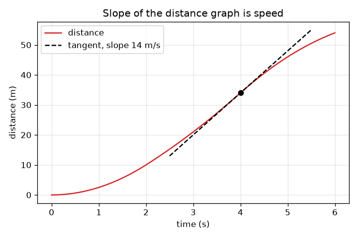
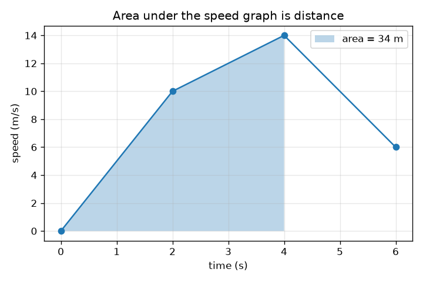

# സെഷൻ 1: ചരിവ് വേഗമാണ്, വിസ്തീർണ്ണം ദൂരമാണ്

[Session 1 — हिन्दी](README.hi.md) · [Session 1 — മലയാളം](README.ml.md)

*ലെവൽ 1 (ആശയപരമായ ഇന്ററാക്ടീവ് മോഡൽ) · ഏകദേശം 60 മിനിറ്റ് · opencalculus*

> ഇത് ലളിതമാക്കിയ ഒരു വിദ്യാഭ്യാസ മോഡലാണ്. ഇത് സാധൂകരിക്കപ്പെട്ട (validated) ഡിസൈൻ ഉപകരണമല്ല; യഥാർത്ഥ ഘടനകൾ, വൈദ്യുത സംവിധാനങ്ങൾ, വാഹനങ്ങൾ, വ്യാവസായിക പ്രക്രിയകൾ അല്ലെങ്കിൽ വൈദ്യശാസ്ത്ര തീരുമാനങ്ങൾ എന്നിവയ്ക്ക് ഇത് ഉപയോഗിക്കരുത്.

**മുൻ‌അറിവ് (Prerequisites)**

- വേഗം = ദൂരം / സമയം, ഗ്രാഫ് വായിക്കൽ (സ്കൂൾ നിലവാരം).
- നിങ്ങൾ PRIMER.md വായിക്കുകയും `python start.py 1` ഒരിക്കൽ പ്രവർത്തിപ്പിക്കുകയും ചെയ്തിട്ടുണ്ട്.

**പഠന ലക്ഷ്യങ്ങൾ (Learning objectives).** ഈ സെഷനു ശേഷം നിങ്ങൾക്ക് കഴിയും:

- ദൂര-സമയ ഗ്രാഫിന്റെ ചരിവ് (slope) എന്തുകൊണ്ട് വേഗമാണെന്ന് വിശദീകരിക്കാൻ.
- വേഗ-സമയ ഗ്രാഫിനു കീഴിലുള്ള വിസ്തീർണ്ണം (area) എന്തുകൊണ്ട് സഞ്ചരിച്ച ദൂരമാണെന്ന് വിശദീകരിക്കാൻ.
- ട്രപ്പീസിയങ്ങൾ (trapezoids) കൂട്ടി, ഖണ്ഡങ്ങളായി നേരായ ഒരു വേഗ ഗ്രാഫിന്റെ ദൂരം കണക്കാക്കാൻ.
- ഒരേ യാത്രയുടെ രണ്ട് ഗ്രാഫുകൾക്കിടയിൽ രണ്ട് ദിശയിലും നീങ്ങാൻ.

## A. യഥാർത്ഥ ലോക പ്രശ്നം
ഒരു കാറിന്റെ സ്പീഡോമീറ്റർ നിങ്ങൾ എത്ര വേഗത്തിൽ പോകുന്നു എന്ന് പറയുന്നു, പക്ഷേ എത്ര ദൂരം വന്നു എന്നല്ല; ഓഡോമീറ്റർ എത്ര ദൂരം എന്ന് പറയുന്നു, പക്ഷേ എത്ര വേഗത്തിൽ എന്നല്ല. അവയിൽ ഒന്നിന്റെ രേഖ മാത്രം കൈവശമുണ്ടെങ്കിൽ, മറ്റേത് പുനർനിർമ്മിക്കാൻ കഴിയുമോ? ആ ചോദ്യം വേഷം മാറിയ മുഴുവൻ കലനശാസ്ത്രവുമാണ് (calculus): ദൂരത്തിൽ നിന്ന് വേഗത്തിലേക്ക് പോകുന്നത് അവകലനം (differentiation), വേഗത്തിൽ നിന്ന് ദൂരത്തിലേക്ക് പോകുന്നത് സമാകലനം (integration). ഈ സെഷനിൽ ചരിവുകളും വിസ്തീർണ്ണങ്ങളും മാത്രം ഉപയോഗിച്ച് നിങ്ങൾ രണ്ടും ചെയ്യുന്നു.

## B. ആശയവും സിദ്ധാന്തവും
വേഗം എന്നാൽ ദൂരത്തെ സമയം കൊണ്ട് ഹരിച്ചത്. ദൂര-സമയ ഗ്രാഫിൽ 'ദൂരം ഹരണം സമയം' എന്നത് ഉയർച്ച ഹരണം നീളം, അതായത് ചരിവ്. വേഗം മാറുമ്പോൾ ചരിവ് ഓരോ നിമിഷവും മാറുന്നു: ഒരു നിമിഷത്തിലെ വേഗം എന്നത് അവിടെ വക്രത്തെ സ്പർശിക്കുന്ന സ്പർശരേഖയുടെ (tangent line) ചരിവാണ്. തിരിച്ചു പോകുമ്പോൾ, ദൂരം = വേഗം ഗുണം സമയം. വേഗ-സമയ ഗ്രാഫിൽ അത് വീതി ഗുണം ഉയരം, ഒരു ചതുരത്തിന്റെ വിസ്തീർണ്ണം; വേഗം മാറുന്നുണ്ടെങ്കിൽ നാം സമയത്തെ കഷണങ്ങളാക്കി വിസ്തീർണ്ണങ്ങൾ കൂട്ടുന്നു (നേർരേഖാ മാറ്റത്തിന് ഒരു ട്രപ്പീസിയം). വിസ്തീർണ്ണത്തിന്റെ യൂണിറ്റ് s * m/s = m ആണ്. നമ്മുടെ കാർ നിശ്ചലാവസ്ഥയിൽ നിന്ന് തുടങ്ങുന്നു, അതിന്റെ വേഗം 0, 2, 4, 6 s-ൽ അറിയാം, ഇടയിൽ നേർരേഖകൾ.

| ചിഹ്നം | അർത്ഥം | യൂണിറ്റ് |
|---|---|---|
| t | തുടക്കം മുതലുള്ള സമയം | s |
| v(t) | t സമയത്ത് കാറിന്റെ വേഗം | m/s |
| x(t) | തുടക്കം മുതൽ t സമയം വരെ സഞ്ചരിച്ച ദൂരം | m |
| slope | ദൂര ഗ്രാഫിന്റെ ഉയർച്ച ഹരണം നീളം (ചരിവ്) | m/s |
| area | വേഗ ഗ്രാഫിനു കീഴിലുള്ള വിസ്തീർണ്ണം | m |

**അനുമാനങ്ങൾ (Assumptions)**

- കാർ ഒരു നേരായ റോഡിലൂടെ നീങ്ങുന്നു, ഒരിക്കലും പിന്നോട്ട് പോകുന്നില്ല, അതിനാൽ വേഗവും ദൂരവും യാത്രാ ദിശയിൽ മാത്രം വളരുന്നു.
- അറിയാവുന്ന നാല് നിമിഷങ്ങൾക്കിടയിൽ വേഗം നേർരേഖയിൽ മാറുന്നു.
- കാർ x = 0, t = 0-ൽ നിശ്ചലാവസ്ഥയിൽ നിന്ന് തുടങ്ങുന്നു.

$$ v=\frac{\Delta x}{\Delta t}\quad\text{(slope of the distance graph)} $$

$$ \Delta x=\frac{v_1+v_2}{2}\,\Delta t\quad\text{(area of one trapezoid under the speed graph)} $$

$$ x(t)=\text{area under }v\text{ from }0\text{ to }t,\qquad v(t)=\text{slope of }x\text{ at }t $$

## C. ദൃശ്യ വിശദീകരണം
ഇടത്തെ ചിത്രം 2, 4, 6 s-ൽ 10, 14, 6 m/s വേഗമുള്ള ഒരു കാറിന്റെ സമയത്തിനെതിരെയുള്ള വേഗം കാണിക്കുന്നു; 4 s വരെയുള്ള ഷേഡ് ചെയ്ത വിസ്തീർണ്ണം 34 m ആണ്. വലത്തെ ചിത്രം അതേ കാറിന്റെ സമയത്തിനെതിരെയുള്ള ദൂരം കാണിക്കുന്നു: വേഗം കൂടുതലുള്ളിടത്ത് വക്രം കുത്തനെ ഉയരുന്നു, 4 s-ലെ ഡാഷ് ചെയ്ത സ്പർശരേഖയുടെ ചരിവ് 14 m/s ആണ്, മറ്റേ ഗ്രാഫിൽ നിന്ന് വായിച്ച വേഗം. വേഗ ഗ്രാഫിലെ പരന്ന ഭാഗം ദൂര ഗ്രാഫിലെ നേരായ, സ്ഥിരമായ ഭാഗമാണ്; വേഗ ഗ്രാഫിലെ ഉയരുന്ന ഭാഗം മുകളിലേക്ക് വളയുന്ന ദൂര വക്രമാണ്.

*സമയത്തിനെതിരെ ദൂരം: 4 s-ലെ സ്പർശരേഖയുടെ ചരിവ് 14 m/s, അതാണ് വേഗം.*

*സമയത്തിനെതിരെ വേഗം: 4 s വരെയുള്ള ഷേഡ് ചെയ്ത വിസ്തീർണ്ണം ദൂരമാണ്, 34 m.*

## D. ഇന്ററാക്ടീവ് സിമുലേഷൻ
പാഠം പ്രവർത്തിപ്പിക്കുക (`python start.py 1`), തുടർന്ന് ലൈവ് ആപ്പ് തുറക്കുക: [സെഷൻ 1: ചരിവ് വേഗമാണ്, വിസ്തീർണ്ണം ദൂരമാണ്](https://krunalpanchal1995.github.io/pan-iit-oss/opencalculus/session-01/) (അല്ലെങ്കിൽ ഈ ഫോൾഡറിലെ `app.html`). വേഗ വക്രത്തിന്റെ ആകൃതി മാറ്റാൻ മൂന്ന് വേഗ സ്ലൈഡറുകൾ വലിച്ച് റോഡിലെ കാർ നിരീക്ഷിക്കുക, തുടർന്ന് ദൂര കാഴ്ച തുറന്ന് സമയ സ്ലൈഡർ നീക്കുക: ചുവന്ന സ്പർശരേഖയുടെ ചരിവ് എപ്പോഴും വേഗത്തിന് തുല്യമാണ്. വേഗ കാഴ്ചയിലെ ഷേഡ് ചെയ്ത വിസ്തീർണ്ണം റീഡൗട്ടിലെ ദൂരവുമായി താരതമ്യം ചെയ്യുക.

**വെല്ലുവിളി.** ഒരിക്കലും 20 m/s-ൽ കൂടുതൽ വേഗത്തിൽ പോകാതെ 6 s-ൽ കാർ കുറഞ്ഞത് 90 m സഞ്ചരിക്കുന്നതാക്കുക.

## E. ഉദാഹരണ പ്രശ്നവും പരീക്ഷണവും
**പ്രശ്നം.** ഒരു കാർ നിശ്ചലാവസ്ഥയിൽ നിന്ന് തുടങ്ങുന്നു, t = 2, 4, 6 s-ൽ 10, 14, 6 m/s വേഗമുണ്ട്, ഇടയിൽ നേർരേഖകൾ. ആ ഓരോ സമയത്തെയും ദൂരം കണ്ടെത്തുക, തുടർന്ന് t = 3 s-ലെ വേഗവും അവിടെ ദൂര ഗ്രാഫിന്റെ ചരിവും.

1. കഷണം 1 (0 മുതൽ 2 s വരെ): 0, 10 m/s വശങ്ങളും 2 s വീതിയുമുള്ള ട്രപ്പീസിയം: (0 + 10)/2 * 2 = 10 m.
2. കഷണം 2 (2 മുതൽ 4 s വരെ): (10 + 14)/2 * 2 = 24 m, അതിനാൽ 4 s-ലെ ദൂരം 10 + 24 = 34 m.
3. കഷണം 3 (4 മുതൽ 6 s വരെ): (14 + 6)/2 * 2 = 20 m, അതിനാൽ 6 s-ലെ ദൂരം 54 m.
4. t = 3 s-ലെ വേഗം: 10-നും 14 m/s-നും ഇടയിലെ പകുതി 12 m/s.
5. 3 s-ൽ ദൂര ഗ്രാഫിന്റെ ചരിവ്: അവിടെ ഓരോ സെക്കൻഡിലും ദൂരം ഏകദേശം 12 m മാറുന്നു, അതിനാൽ ചരിവ് 12 m/s, അതേ സംഖ്യ. യൂണിറ്റ് പരിശോധന: m / s = m/s.

**ഉത്തരം.** 2, 4, 6 s-ൽ ദൂരങ്ങൾ 10 m, 34 m, 54 m; 3 s-ൽ വേഗം 12 m/s, അവിടെ ദൂര ഗ്രാഫിന്റെ ചരിവിന് തുല്യം.

**പരീക്ഷണം.** ഒരു കളിപ്പാട്ട കാർ ഉരുട്ടുകയോ ഒരു ഇടനാഴിയിലൂടെ നടക്കുകയോ ചെയ്യുക, ഒരു സ്റ്റോപ്പ് വാച്ചും അളക്കുന്ന ടേപ്പും ഉപയോഗിച്ച് ഓരോ സെക്കൻഡിലും സ്ഥാനം രേഖപ്പെടുത്തുക. സമയത്തിനെതിരെ ദൂരം പ്ലോട്ട് ചെയ്യുക, അടുത്തടുത്ത ബിന്ദുക്കൾക്കിടയിലെ ചരിവുകൾ കണക്കാക്കി നിങ്ങൾക്ക് അനുഭവപ്പെട്ട വേഗവുമായി താരതമ്യം ചെയ്യുക. സംഖ്യകൾ അല്പം പരുക്കനായിരിക്കും: സ്റ്റോപ്പ് വാച്ച് പ്രതികരണ സമയം ഏകദേശം 0.2 s ആണ്, അറിയാവുന്ന നിമിഷങ്ങൾക്കിടയിൽ വേഗം കൃത്യമായി നേർരേഖയിൽ മാറുന്നു എന്ന് മോഡൽ അനുമാനിക്കുന്നു, ഒരു യഥാർത്ഥ കാർ അത് കൃത്യമായി അനുസരിക്കുന്നില്ല.

## F. മൂല്യനിർണ്ണയവും ഡിസൈൻ വെല്ലുവിളിയും
**ചോദ്യ തരം A: ആശയപരം.** ഒരു സുഹൃത്ത് പറയുന്നു 'വേഗ ഗ്രാഫ് പരന്നതാണ്, അതിനാൽ കാർ നീങ്ങുന്നില്ല'. അത് ശരിയാണോ? പരന്ന ദൂര ഗ്രാഫ് എന്താണ് അർത്ഥമാക്കുന്നത്?

സൂചന

വേഗ ഗ്രാഫിന്റെ കുത്തനെയല്ല, ഉയരം വായിക്കുക, ചരിവ് = വേഗം എന്ന് ഓർക്കുക.

ഘട്ടം ഘട്ടമായുള്ള പരിഹാരം

അല്ല. 10 m/s-ൽ പരന്ന വേഗ ഗ്രാഫ് എന്നാൽ 10 m/s സ്ഥിര വേഗം: കാർ സ്ഥിരമായി നീങ്ങുന്നു, അതിന്റെ ദൂര ഗ്രാഫ് ചരിഞ്ഞ ഒരു നേർരേഖയാണ് (ചരിവ് 10 m/s). പരന്ന ദൂര ഗ്രാഫ് എന്നാൽ ദൂരം മാറുന്നില്ല, അതിനാൽ വേഗം പൂജ്യമാണ്, കാർ നിർത്തിയിരിക്കുന്നു. 'പരന്നത്' രണ്ട് ഗ്രാഫുകളിലും വ്യത്യസ്ത കാര്യങ്ങളാണ് അർത്ഥമാക്കുന്നത്: വേഗ ഗ്രാഫ് വേഗം നേരിട്ട് കാണിക്കുന്നു, ദൂര ഗ്രാഫ് അതിന്റെ ചരിവിലൂടെ മാത്രം.

**ചോദ്യ തരം B: സംഖ്യാപരം.** ഒരു കാറിന് t = 0, 2, 4, 6 s-ൽ 0, 12, 12, 6 m/s വേഗമുണ്ട്, ഇടയിൽ നേർരേഖകൾ. 6 s-ലെ ആകെ ദൂരവും ശരാശരി വേഗവും കണ്ടെത്തുക. യൂണിറ്റുകൾ പരിശോധിക്കുക.

സൂചന

മൂന്ന് ട്രപ്പീസിയങ്ങൾ കൂട്ടുക; ശരാശരി വേഗം എന്നാൽ ആകെ ദൂരം ഹരണം ആകെ സമയം.

ഘട്ടം ഘട്ടമായുള്ള പരിഹാരം

കഷണം 1: (0 + 12)/2 * 2 = 12 m. കഷണം 2: (12 + 12)/2 * 2 = 24 m. കഷണം 3: (12 + 6)/2 * 2 = 18 m. ആകെ = 54 m. ശരാശരി വേഗം = 54 m / 6 s = 9 m/s. യുക്തിപരിശോധന (sanity check): വേഗം എപ്പോഴും 0-നും 12 m/s-നും ഇടയിലാണ്, അതിനാൽ 9 m/s വിശ്വസനീയമായ ശരാശരിയാണ്. യൂണിറ്റുകൾ: m/s * s = m.

**ചോദ്യ തരം C: ഗ്രാഫ്, സിമുലേഷൻ വ്യാഖ്യാനം.** ഉദാഹരണ പ്രശ്നത്തിലെ കാറിന്റെ (വേഗങ്ങൾ 10, 14, 6 m/s) ദൂര ഗ്രാഫിൽ, വക്രം ഏറ്റവും കുത്തനെയുള്ളത് എവിടെയാണ്, അവിടെ ചരിവ് എന്താണ്? അവസാനം, t = 6 s-ൽ ചരിവ് എന്താണ്?

സൂചന

ഒരു സമയത്തെ ദൂര ഗ്രാഫിന്റെ ചരിവ് ആ സമയത്തെ വേഗത്തിന് തുല്യമാണ്.

ഘട്ടം ഘട്ടമായുള്ള പരിഹാരം

വേഗം 14 m/s-ൽ ഏറ്റവും ഉയർന്നിരിക്കുന്ന t = 4 s-ലാണ് വക്രം ഏറ്റവും കുത്തനെയുള്ളത്, അതിനാൽ ചരിവ് 14 m/s. t = 6 s-ൽ വേഗം 6 m/s ആണ്, അതിനാൽ ചരിവ് 6 m/s ആയി കുറഞ്ഞു: വക്രം ഇപ്പോഴും ഉയരുന്നു, പക്ഷേ വളരെ മൃദുവായി. വേഗം ഒരിക്കലും നെഗറ്റീവ് അല്ലാത്തതിനാൽ ദൂരം ഒരിക്കലും കുറയുന്നില്ല.

**ചോദ്യ തരം D: ഡിസൈൻ, ഒപ്റ്റിമൈസേഷൻ വെല്ലുവിളി.** ഡിസൈൻ: 6 s-ൽ കാർ കുറഞ്ഞത് 90 m സഞ്ചരിക്കുന്ന വിധത്തിൽ 2, 4, 6 s-ലെ വേഗങ്ങൾ തിരഞ്ഞെടുക്കുക (ഓരോന്നും പരമാവധി 20 m/s, ഈ അഭ്യാസത്തിന്റെ പരിധി). പ്രവർത്തിക്കുന്ന ഒരു തിരഞ്ഞെടുപ്പും പരാജയപ്പെടുന്ന ഒന്നും കണ്ടെത്തുക, നിങ്ങൾ എന്ത് വിട്ടുവീഴ്ച ചെയ്യുമെന്ന് പറയുക.

സൂചന

ആകെ ദൂരം 2 v1 + 2 v2 + v3 ആണ് (മൂന്ന് ട്രപ്പീസിയങ്ങൾ). ആദ്യം ഏറ്റവും വലിയ വേഗങ്ങൾ പരീക്ഷിക്കുക.

ഘട്ടം ഘട്ടമായുള്ള പരിഹാരം

ആകെ = 2 v1 + 2 v2 + v3. 20, 20, 20 ഉപയോഗിച്ച്: 40 + 40 + 20 = 100 m, ഇത് പ്രവർത്തിക്കുന്നു. 20, 20, 10 ഉപയോഗിച്ച്: 90 m, കഷ്ടിച്ച് മതി. 15, 15, 15 ഉപയോഗിച്ച്: 30 + 30 + 15 = 75 m, ഇത് പരാജയപ്പെടുന്നു. ആദ്യ രണ്ട് വേഗങ്ങൾ ഓരോന്നും രണ്ട് കഷണങ്ങളിൽ പെടുന്നതിനാൽ ഇരട്ടിയായി കണക്കാക്കുന്നു, അതിനാൽ നേരത്തെ വേഗത്തിലാകുന്നതാണ് ഏറ്റവും പ്രധാനം; വിട്ടുവീഴ്ച (trade-off): 20 m/s-ൽ അവസാനിപ്പിക്കുന്നത് നിർത്താൻ കുറഞ്ഞ മാർജിൻ മാത്രം നൽകുന്നു. അനുമാനം: നേർരേഖാ വേഗ മാറ്റങ്ങൾ, പിന്നോട്ടില്ല.

[RUBRIC.md](../../RUBRIC.md) ഉപയോഗിച്ച് സ്വയം സ്കോർ ചെയ്യുക. പേപ്പറിൽ ചെയ്യാൻ [പ്രവർത്തന ഷീറ്റ്](activity_sheet.md) പ്രിന്റ് ചെയ്യുക.

## സാധാരണ തെറ്റിദ്ധാരണകൾ
| സാധാരണ തെറ്റിദ്ധാരണ | യഥാർത്ഥത്തിൽ ശരിയായത് |
|---|---|
| പരന്ന വേഗ ഗ്രാഫ് എന്നാൽ കാർ നിർത്തിയിരിക്കുന്നു. | 10 m/s ഉയരത്തിലുള്ള പരന്ന വേഗ ഗ്രാഫ് എന്നാൽ സ്ഥിരമായ 10 m/s. വേഗ ഗ്രാഫ് പൂജ്യത്തിലാകുമ്പോഴോ ദൂര ഗ്രാഫ് പരന്നതാകുമ്പോഴോ മാത്രമാണ് കാർ നിർത്തിയിരിക്കുന്നത്. |
| ദൂര ഗ്രാഫിൽ ഉയരത്തിൽ എന്നാൽ വേഗത്തിൽ. | ദൂര ഗ്രാഫിൽ കൂടുതൽ കുത്തനെ എന്നാൽ വേഗത്തിൽ. ദൂര ഗ്രാഫിന്റെ ഉയരം നിങ്ങൾ എത്ര ദൂരെയാണ് എന്നതാണ്, ചരിവ് എത്ര വേഗത്തിൽ പോകുന്നു എന്നതാണ്. |
| വേഗ-സമയ ഗ്രാഫിനു കീഴിലുള്ള വിസ്തീർണ്ണം ഒരു വേഗമാണ്. | വിസ്തീർണ്ണം = വീതി * ഉയരം = s * m/s = m: അത് ഒരു ദൂരമാണ്. ഒരു അളവ് എന്താണെന്ന് യൂണിറ്റുകൾ പറയുന്നു. |
| ചരിവിന് നേർരേഖകൾക്ക് മാത്രമേ അർത്ഥമുള്ളൂ. | ഒരു വക്രത്തിന് ഓരോ ബിന്ദുവിലും ചരിവുണ്ട്: അവിടെ അതിനെ കഷ്ടിച്ച് സ്പർശിക്കുന്ന സ്പർശരേഖയുടെ ചരിവ്. |

## പദാവലി (Glossary)
- **ചരിവ് (slope)**: ഉയർച്ച ഹരണം നീളം: കുറുകെയുള്ള ഓരോ യൂണിറ്റിനും ലംബ മൂല്യം എത്ര മാറുന്നു
- **സ്പർശരേഖ (tangent line)**: ഒരു വക്രത്തെ ഒരു ബിന്ദുവിൽ സ്പർശിക്കുകയും അവിടെ വക്രത്തിന്റെ അതേ ചരിവുള്ളതുമായ നേർരേഖ
- **ട്രപ്പീസിയം (trapezoid)**: രണ്ട് സമാന്തര വശങ്ങളുള്ള നാലുവശ രൂപം; അതിന്റെ വിസ്തീർണ്ണം സമാന്തര വശങ്ങളുടെ ശരാശരി ഗുണം വീതി
- **വേഗം (speed)**: ദൂരം എത്ര വേഗത്തിൽ മാറുന്നു, m/s-ൽ
- **സഞ്ചരിച്ച ദൂരം (distance travelled)**: റോഡിലൂടെ പിന്നിട്ട ആകെ നീളം, m-ൽ

## പൂർത്തിയാക്കുക
1. [exercises.md](exercises.md)-ലെ മൂന്ന് കോഡിംഗ് ടാസ്കുകൾ ചെയ്യുക.
2. നിങ്ങളുടെ മാറ്റങ്ങൾക്ക് ശേഷം `python start.py 1` വീണ്ടും പ്രവർത്തിപ്പിക്കുക. അത് ചെക്ക്പോയിന്റോടെ അവസാനിക്കുന്നു; അത് `PASS` പ്രിന്റ് ചെയ്യുമ്പോൾ നിങ്ങൾ പൂർത്തിയാക്കി. (ചെക്ക്പോയിന്റ് മാത്രം: `python start.py check 1`.)

അടുത്തത്: [സെഷൻ 2](../session-02/README.md)
