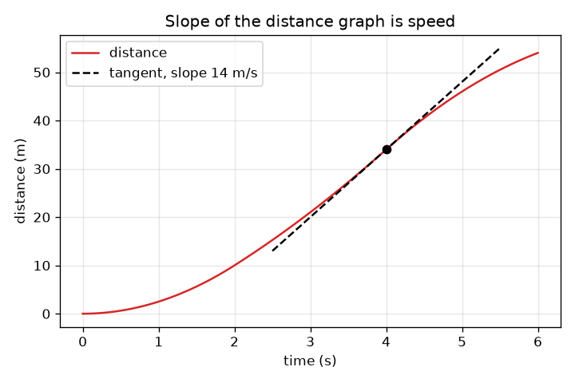
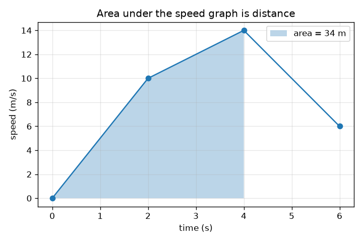

# அமர்வு 1: சாய்வு என்பது வேகம், பரப்பு என்பது தூரம்

[Session 1 — हिन्दी](README.hi.md) · [Session 1 — മലയാളം](README.ml.md) · [Session 1 — தமிழ்](README.ta.md)

*நிலை 1 (கருத்தியல் ஊடாடும் மாதிரி) · சுமார் 60 நிமிடங்கள் · opencalculus*

> இது எளிமைப்படுத்தப்பட்ட ஒரு கல்வி மாதிரி. இது சரிபார்க்கப்பட்ட (validated) வடிவமைப்புக் கருவி அல்ல; உண்மையான கட்டமைப்புகள், மின் நிறுவல்கள், வாகனங்கள், தொழில்துறை செயல்முறைகள் அல்லது மருத்துவ முடிவுகளுக்கு இதைப் பயன்படுத்தக் கூடாது.

**முன்தேவைகள் (Prerequisites)**

- வேகம் = தூரம் / நேரம், வரைபடம் படித்தல் (பள்ளி நிலை).
- நீங்கள் PRIMER.md-ஐப் படித்து `python start.py 1`-ஐ ஒருமுறை இயக்கியிருக்கிறீர்கள்.

**கற்றல் நோக்கங்கள் (Learning objectives).** இந்த அமர்வுக்குப் பிறகு நீங்கள்:

- தூர-நேர வரைபடத்தின் சாய்வு (slope) ஏன் வேகம் என்பதை விளக்க முடியும்.
- வேக-நேர வரைபடத்தின் கீழுள்ள பரப்பு (area) ஏன் பயணித்த தூரம் என்பதை விளக்க முடியும்.
- சரிவகங்களை (trapezoids) கூட்டி, துண்டுவாரியாக நேரான வேக வரைபடத்திற்குத் தூரத்தைக் கணக்கிட முடியும்.
- ஒரே பயணத்தின் இரண்டு வரைபடங்களுக்கு இடையே இரு திசைகளிலும் செல்ல முடியும்.

## A. நிஜ உலகச் சிக்கல்
ஒரு காரின் வேகமானி நீங்கள் எவ்வளவு வேகமாகச் செல்கிறீர்கள் என்று சொல்கிறது, ஆனால் எவ்வளவு தூரம் வந்தீர்கள் என்று அல்ல; ஓடோமீட்டர் எவ்வளவு தூரம் என்று சொல்கிறது, ஆனால் எவ்வளவு வேகம் என்று அல்ல. அவற்றில் ஒன்றின் பதிவு மட்டும் உங்களிடம் இருந்தால், மற்றொன்றை மீண்டும் உருவாக்க முடியுமா? அந்தக் கேள்வி மாறுவேடத்தில் உள்ள முழு நுண்கணிதமே (calculus): தூரத்திலிருந்து வேகத்திற்குச் செல்வது வகைக்கெழு காணல் (differentiation), வேகத்திலிருந்து தூரத்திற்குச் செல்வது தொகையிடல் (integration). இந்த அமர்வில் சாய்வுகளையும் பரப்புகளையும் மட்டுமே கொண்டு இரண்டையும் செய்கிறீர்கள்.

## B. கருத்தும் கோட்பாடும்
வேகம் என்பது தூரத்தை நேரத்தால் வகுத்தது. தூர-நேர வரைபடத்தில் 'தூரம் வகுத்தல் நேரம்' என்பது ஏற்றம் வகுத்தல் ஓட்டம், அதாவது சாய்வு. வேகம் மாறும்போது சாய்வு கணத்துக்குக் கணம் மாறுகிறது: ஒரு கணத்தில் வேகம் என்பது அங்கு வளைவைத் தொடும் தொடுகோட்டின் (tangent line) சாய்வு. மறு திசையில், தூரம் = வேகம் பெருக்கல் நேரம். வேக-நேர வரைபடத்தில் அது அகலம் பெருக்கல் உயரம், ஒரு செவ்வகத்தின் பரப்பு; வேகம் மாறினால் நேரத்தைத் துண்டுகளாக வெட்டிப் பரப்புகளைக் கூட்டுகிறோம் (நேர்கோட்டு மாற்றத்திற்கு ஒரு சரிவகம்). பரப்பின் அலகு s * m/s = m. நம் கார் ஓய்வு நிலையிலிருந்து தொடங்குகிறது, அதன் வேகம் 0, 2, 4, 6 s-இல் தெரியும், இடையில் நேர்கோடுகள்.

| குறியீடு | பொருள் | அலகு |
|---|---|---|
| t | தொடக்கத்திலிருந்து நேரம் | s |
| v(t) | t நேரத்தில் காரின் வேகம் | m/s |
| x(t) | தொடக்கத்திலிருந்து t நேரம் வரை பயணித்த தூரம் | m |
| slope | தூர வரைபடத்தின் ஏற்றம் வகுத்தல் ஓட்டம் (சாய்வு) | m/s |
| area | வேக வரைபடத்தின் கீழுள்ள பரப்பு | m |

**அனுமானங்கள் (Assumptions)**

- கார் ஒரு நேரான சாலையில் செல்கிறது, ஒருபோதும் பின்னோக்கிச் செல்வதில்லை, எனவே வேகமும் தூரமும் பயணத் திசையில் மட்டுமே வளர்கின்றன.
- தெரிந்த நான்கு கணங்களுக்கு இடையில் வேகம் நேர்கோட்டில் மாறுகிறது.
- கார் x = 0, t = 0-இல் ஓய்வு நிலையிலிருந்து தொடங்குகிறது.

$$ v=\frac{\Delta x}{\Delta t}\quad\text{(slope of the distance graph)} $$

$$ \Delta x=\frac{v_1+v_2}{2}\,\Delta t\quad\text{(area of one trapezoid under the speed graph)} $$

$$ x(t)=\text{area under }v\text{ from }0\text{ to }t,\qquad v(t)=\text{slope of }x\text{ at }t $$

## C. காட்சி விளக்கம்
இடது படம் 2, 4, 6 s-இல் 10, 14, 6 m/s வேகம் உள்ள ஒரு காருக்கு நேரத்திற்கு எதிராக வேகத்தைக் காட்டுகிறது; 4 s வரை நிழலிடப்பட்ட பரப்பு 34 m. வலது படம் அதே காருக்கு நேரத்திற்கு எதிராகத் தூரத்தைக் காட்டுகிறது: வேகம் அதிகமாக உள்ள இடத்தில் வளைவு செங்குத்தாக உயர்கிறது, 4 s-இல் உள்ள கோடிட்ட தொடுகோட்டின் சாய்வு 14 m/s, மற்ற வரைபடத்திலிருந்து படித்த வேகம். வேக வரைபடத்தின் தட்டையான பகுதி தூர வரைபடத்தின் நேரான, சீரான பகுதி; வேக வரைபடத்தின் உயரும் பகுதி மேல்நோக்கி வளையும் தூர வளைவு.

*நேரத்திற்கு எதிராகத் தூரம்: 4 s-இல் தொடுகோட்டின் சாய்வு 14 m/s, அதுவே வேகம்.*

*நேரத்திற்கு எதிராக வேகம்: 4 s வரை நிழலிடப்பட்ட பரப்பு தூரம், 34 m.*

## D. ஊடாடும் உருவகப்படுத்தல்
பாடத்தை இயக்கவும் (`python start.py 1`), பிறகு நேரடி செயலியைத் திறக்கவும்: [அமர்வு 1: சாய்வு என்பது வேகம், பரப்பு என்பது தூரம்](https://krunalpanchal1995.github.io/pan-iit-oss/opencalculus/session-01/) (அல்லது இந்தக் கோப்புறையில் உள்ள `app.html`). வேக வளைவின் வடிவத்தை மாற்ற மூன்று வேக நழுவிகளை (sliders) இழுத்துச் சாலையில் காரைக் கவனிக்கவும், பிறகு தூரக் காட்சியைத் திறந்து நேர நழுவியை நகர்த்தவும்: சிவப்புத் தொடுகோட்டின் சாய்வு எப்போதும் வேகத்திற்குச் சமம். வேகக் காட்சியில் நிழலிடப்பட்ட பரப்பை அளவீட்டுக் காட்சியில் உள்ள தூரத்துடன் ஒப்பிடவும்.

**சவால்.** ஒருபோதும் 20 m/s-க்கு மேல் செல்லாமல் 6 s-இல் கார் குறைந்தது 90 m கடக்கச் செய்யவும்.

## E. தீர்க்கப்பட்ட உதாரணமும் சோதனையும்
**சிக்கல்.** ஒரு கார் ஓய்வு நிலையிலிருந்து தொடங்குகிறது, t = 2, 4, 6 s-இல் 10, 14, 6 m/s வேகம் உள்ளது, இடையில் நேர்கோடுகள். அந்த ஒவ்வொரு நேரத்திலும் தூரத்தைக் கண்டறியவும், பிறகு t = 3 s-இல் வேகத்தையும் அங்கு தூர வரைபடத்தின் சாய்வையும்.

1. துண்டு 1 (0 முதல் 2 s): 0, 10 m/s பக்கங்களும் 2 s அகலமும் உள்ள சரிவகம்: (0 + 10)/2 * 2 = 10 m.
2. துண்டு 2 (2 முதல் 4 s): (10 + 14)/2 * 2 = 24 m, எனவே 4 s-இல் தூரம் 10 + 24 = 34 m.
3. துண்டு 3 (4 முதல் 6 s): (14 + 6)/2 * 2 = 20 m, எனவே 6 s-இல் தூரம் 54 m.
4. t = 3 s-இல் வேகம்: 10-க்கும் 14 m/s-க்கும் நடுவில் 12 m/s.
5. 3 s-இல் தூர வரைபடத்தின் சாய்வு: அங்கு ஒவ்வொரு வினாடிக்கும் தூரம் சுமார் 12 m மாறுகிறது, எனவே சாய்வு 12 m/s, அதே எண். அலகுச் சோதனை: m / s = m/s.

**விடை.** 2, 4, 6 s-இல் தூரங்கள் 10 m, 34 m, 54 m; 3 s-இல் வேகம் 12 m/s, அங்கு தூர வரைபடத்தின் சாய்வுக்குச் சமம்.

**சோதனை.** ஒரு பொம்மைக் காரை உருட்டவும் அல்லது ஒரு தாழ்வாரத்தில் நடக்கவும், நிறுத்துக் கடிகாரம் மற்றும் அளவு நாடாவுடன் ஒவ்வொரு வினாடியும் நிலையைக் குறித்துக்கொள்ளவும். நேரத்திற்கு எதிராகத் தூரத்தை வரைந்து, அடுத்தடுத்த புள்ளிகளுக்கு இடையிலான சாய்வுகளை மதிப்பிட்டு, நீங்கள் உணர்ந்த வேகத்துடன் ஒப்பிடவும். எண்கள் சற்றுக் கரடுமுரடாக இருக்கும்: நிறுத்துக் கடிகார எதிர்வினை நேரம் சுமார் 0.2 s, மேலும் தெரிந்த கணங்களுக்கு இடையில் வேகம் சரியாக நேர்கோட்டில் மாறுவதாக மாதிரி அனுமானிக்கிறது, உண்மையான கார் அதைச் சரியாகப் பின்பற்றுவதில்லை.

## F. மதிப்பீடும் வடிவமைப்புச் சவாலும்
**கேள்வி வகை A: கருத்தியல்.** ஒரு நண்பர் 'வேக வரைபடம் தட்டையாக உள்ளது, எனவே கார் நகரவில்லை' என்கிறார். அது சரியா? தட்டையான தூர வரைபடம் எதைக் குறிக்கிறது?

குறிப்பு

வேக வரைபடத்தின் செங்குத்தை அல்ல, உயரத்தைப் படியுங்கள், சாய்வு = வேகம் என்பதை நினைவில் கொள்ளுங்கள்.

படிப்படியான தீர்வு

இல்லை. 10 m/s-இல் தட்டையான வேக வரைபடம் என்றால் 10 m/s மாறாத வேகம்: கார் சீராக நகர்கிறது, அதன் தூர வரைபடம் சாய்ந்த நேர்கோடு (சாய்வு 10 m/s). தட்டையான தூர வரைபடம் என்றால் தூரம் மாறவில்லை, எனவே வேகம் பூஜ்யம், கார் நின்றுவிட்டது. 'தட்டை' என்பது இரண்டு வரைபடங்களிலும் வெவ்வேறு பொருள் தருகிறது: வேக வரைபடம் வேகத்தையே காட்டுகிறது, தூர வரைபடம் அதன் சாய்வின் மூலம் மட்டுமே காட்டுகிறது.

**கேள்வி வகை B: எண்ணியல்.** ஒரு காருக்கு t = 0, 2, 4, 6 s-இல் 0, 12, 12, 6 m/s வேகம், இடையில் நேர்கோடுகள். 6 s-இல் மொத்தத் தூரத்தையும் சராசரி வேகத்தையும் கண்டறியவும். அலகுகளைச் சரிபார்க்கவும்.

குறிப்பு

மூன்று சரிவகங்களைக் கூட்டவும்; சராசரி வேகம் என்பது மொத்தத் தூரம் வகுத்தல் மொத்த நேரம்.

படிப்படியான தீர்வு

துண்டு 1: (0 + 12)/2 * 2 = 12 m. துண்டு 2: (12 + 12)/2 * 2 = 24 m. துண்டு 3: (12 + 6)/2 * 2 = 18 m. மொத்தம் = 54 m. சராசரி வேகம் = 54 m / 6 s = 9 m/s. நியாயச் சோதனை (sanity check): வேகம் எப்போதும் 0-க்கும் 12 m/s-க்கும் இடையில் உள்ளது, எனவே 9 m/s நம்பத்தகுந்த சராசரி. அலகுகள்: m/s * s = m.

**கேள்வி வகை C: வரைபடம் மற்றும் உருவகப்படுத்தல் விளக்கம்.** தீர்க்கப்பட்ட உதாரணத்தின் காரின் (வேகங்கள் 10, 14, 6 m/s) தூர வரைபடத்தில், வளைவு எங்கே மிகச் செங்குத்தாக உள்ளது, அங்கு சாய்வு என்ன? இறுதியில், t = 6 s-இல் சாய்வு என்ன?

குறிப்பு

ஒரு நேரத்தில் தூர வரைபடத்தின் சாய்வு அந்த நேரத்தின் வேகத்திற்குச் சமம்.

படிப்படியான தீர்வு

வேகம் 14 m/s-இல் உச்சத்தில் உள்ள t = 4 s-இல் வளைவு மிகச் செங்குத்தாக உள்ளது, எனவே சாய்வு 14 m/s. t = 6 s-இல் வேகம் 6 m/s, எனவே சாய்வு 6 m/s-ஆகக் குறைந்துவிட்டது: வளைவு இன்னும் உயர்கிறது, ஆனால் மிக மெதுவாக. வேகம் ஒருபோதும் எதிர்மறையாக இல்லாததால் தூரம் ஒருபோதும் குறைவதில்லை.

**கேள்வி வகை D: வடிவமைப்பு மற்றும் உகப்பாக்கச் சவால்.** வடிவமைப்பு: 6 s-இல் கார் குறைந்தது 90 m கடக்கும்படி 2, 4, 6 s-இல் வேகங்களைத் தேர்ந்தெடுக்கவும் (ஒவ்வொன்றும் அதிகபட்சம் 20 m/s, இந்தப் பயிற்சியின் வரம்பு). வேலை செய்யும் ஒரு தேர்வையும் தோல்வியடையும் ஒன்றையும் கண்டறிந்து, நீங்கள் எதைச் சமரசம் செய்வீர்கள் என்று சொல்லவும்.

குறிப்பு

மொத்தத் தூரம் 2 v1 + 2 v2 + v3 (மூன்று சரிவகங்கள்). முதலில் மிகப் பெரிய வேகங்களை முயற்சிக்கவும்.

படிப்படியான தீர்வு

மொத்தம் = 2 v1 + 2 v2 + v3. 20, 20, 20 உடன்: 40 + 40 + 20 = 100 m, இது வேலை செய்கிறது. 20, 20, 10 உடன்: 90 m, சரியாகப் போதும். 15, 15, 15 உடன்: 30 + 30 + 15 = 75 m, இது தோல்வியடைகிறது. முதல் இரண்டு வேகங்கள் ஒவ்வொன்றும் இரண்டு துண்டுகளுக்குச் சொந்தமானதால் இரு மடங்காகக் கணக்கிடப்படுகின்றன, எனவே ஆரம்பத்திலேயே வேகமாக இருப்பது மிக முக்கியம்; சமரசம் (trade-off): 20 m/s-இல் முடிப்பது நிறுத்துவதற்குக் குறைந்த இடைவெளியையே விடுகிறது. அனுமானம்: நேர்கோட்டு வேக மாற்றங்கள், பின்னோக்கிச் செல்லுதல் இல்லை.

[RUBRIC.md](../../RUBRIC.md) கொண்டு உங்களை நீங்களே மதிப்பிடுங்கள். தாளில் செய்ய [செயல்பாட்டுத் தாளை](activity_sheet.md) அச்சிடுங்கள்.

## பொதுவான தவறான கருத்துகள்
| பொதுவான தவறான கருத்து | உண்மையில் சரியானது |
|---|---|
| தட்டையான வேக வரைபடம் என்றால் கார் நின்றுவிட்டது. | 10 m/s உயரத்தில் தட்டையான வேக வரைபடம் என்றால் சீரான 10 m/s. வேக வரைபடம் பூஜ்யத்தில் இருக்கும்போது அல்லது தூர வரைபடம் தட்டையாக இருக்கும்போது மட்டுமே கார் நின்றுள்ளது. |
| தூர வரைபடத்தில் உயரமாக இருப்பது என்றால் வேகமாக. | தூர வரைபடத்தில் அதிகச் செங்குத்து என்றால் வேகமாக. தூர வரைபடத்தின் உயரம் நீங்கள் எவ்வளவு தொலைவில் உள்ளீர்கள் என்பது, சாய்வு எவ்வளவு வேகமாகச் செல்கிறீர்கள் என்பது. |
| வேக-நேர வரைபடத்தின் கீழுள்ள பரப்பு ஒரு வேகம். | பரப்பு = அகலம் * உயரம் = s * m/s = m: அது ஒரு தூரம். ஒரு அளவு என்ன என்பதை அலகுகள் சொல்கின்றன. |
| சாய்வு நேர்கோடுகளுக்கு மட்டுமே பொருள் தரும். | ஒரு வளைவுக்கு ஒவ்வொரு புள்ளியிலும் சாய்வு உண்டு: அங்கு அதைத் தொட்டுச் செல்லும் தொடுகோட்டின் சாய்வு. |

## சொற்களஞ்சியம் (Glossary)
- **சாய்வு (slope)**: ஏற்றம் வகுத்தல் ஓட்டம்: குறுக்கே ஒவ்வொரு அலகுக்கும் செங்குத்து மதிப்பு எவ்வளவு மாறுகிறது
- **தொடுகோடு (tangent line)**: ஒரு வளைவை ஒரு புள்ளியில் தொட்டு, அங்கு வளைவின் அதே சாய்வைக் கொண்ட நேர்கோடு
- **சரிவகம் (trapezoid)**: இரண்டு இணைப் பக்கங்கள் கொண்ட நான்கு பக்க வடிவம்; அதன் பரப்பு இணைப் பக்கங்களின் சராசரி பெருக்கல் அகலம்
- **வேகம் (speed)**: தூரம் எவ்வளவு வேகமாக மாறுகிறது, m/s-இல்
- **பயணித்த தூரம் (distance travelled)**: சாலையில் கடந்த மொத்த நீளம், m-இல்

## நிறைவு
1. [exercises.md](exercises.md)-இல் உள்ள மூன்று நிரலாக்கப் பணிகளைச் செய்யவும்.
2. உங்கள் மாற்றங்களுக்குப் பிறகு `python start.py 1`-ஐ மீண்டும் இயக்கவும். அது சோதனைச்சாவடியுடன் (checkpoint) முடிகிறது; அது `PASS` என அச்சிடும்போது நீங்கள் முடித்துவிட்டீர்கள். (சோதனைச்சாவடி மட்டும்: `python start.py check 1`.)

அடுத்து: [அமர்வு 2](../session-02/README.md)
