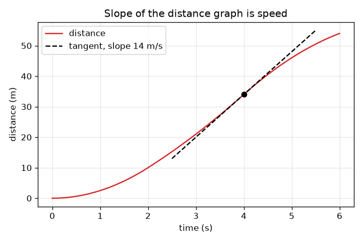
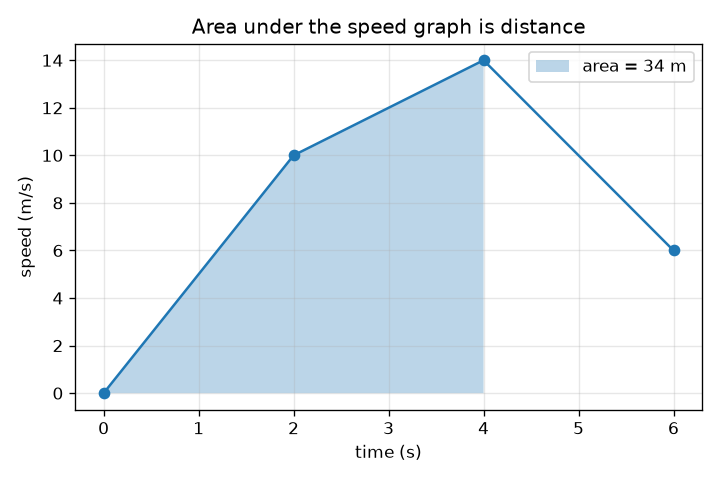

# సెషన్ 1: వాలు అంటే వేగం, వైశాల్యం అంటే దూరం

[Session 1 — हिन्दी](README.hi.md) · [Session 1 — മലയാളം](README.ml.md) · [Session 1 — தமிழ்](README.ta.md) · [Session 1 — తెలుగు](README.te.md)

*స్థాయి 1 (భావనాత్మక ఇంటరాక్టివ్ నమూనా) · సుమారు 60 నిమిషాలు · opencalculus*

> ఇది సరళీకరించిన విద్యా నమూనా. ఇది ధృవీకరించబడిన (validated) డిజైన్ సాధనం కాదు; నిజమైన నిర్మాణాలు, విద్యుత్ సంస్థాపనలు, వాహనాలు, పారిశ్రామిక ప్రక్రియలు లేదా వైద్య నిర్ణయాల కోసం దీన్ని ఉపయోగించకూడదు.

**ముందస్తు జ్ఞానం (Prerequisites)**

- వేగం = దూరం / సమయం, గ్రాఫ్ చదవడం (పాఠశాల స్థాయి).
- మీరు PRIMER.md చదివి `python start.py 1` ఒకసారి నడిపారు.

**అభ్యసన లక్ష్యాలు (Learning objectives).** ఈ సెషన్ తర్వాత మీరు:

- దూర-సమయ గ్రాఫ్ వాలు (slope) ఎందుకు వేగమో వివరించగలరు.
- వేగ-సమయ గ్రాఫ్ కింది వైశాల్యం (area) ఎందుకు ప్రయాణించిన దూరమో వివరించగలరు.
- సమలంబ చతుర్భుజాలను (trapezoids) కలిపి, ముక్కలుగా సరళంగా ఉన్న వేగ గ్రాఫ్‌కు దూరాన్ని లెక్కించగలరు.
- ఒకే ప్రయాణానికి చెందిన రెండు గ్రాఫ్‌ల మధ్య రెండు దిశల్లోనూ వెళ్ళగలరు.

## A. వాస్తవ ప్రపంచ సమస్య
ఒక కారు స్పీడోమీటర్ మీరు ఎంత వేగంగా వెళ్తున్నారో చెబుతుంది కానీ ఎంత దూరం వచ్చారో కాదు; ఓడోమీటర్ ఎంత దూరమో చెబుతుంది కానీ ఎంత వేగమో కాదు. వాటిలో ఒకదాని రికార్డు మాత్రమే మీ దగ్గర ఉంటే, రెండోదాన్ని మళ్ళీ నిర్మించగలరా? ఆ ప్రశ్న మారువేషంలో ఉన్న మొత్తం కలన గణితమే (calculus): దూరం నుండి వేగానికి వెళ్ళడం అవకలనం (differentiation), వేగం నుండి దూరానికి వెళ్ళడం సమాకలనం (integration). ఈ సెషన్‌లో వాలులు, వైశాల్యాలు మాత్రమే వాడి మీరు రెండూ చేస్తారు.

## B. భావన మరియు సిద్ధాంతం
వేగం అంటే దూరాన్ని సమయంతో భాగించడం. దూర-సమయ గ్రాఫ్‌పై 'దూరం భాగహారం సమయం' అంటే ఎత్తు భాగహారం పొడవు, అదే వాలు. వేగం మారినప్పుడు వాలు క్షణక్షణం మారుతుంది: ఒక క్షణంలో వేగం అంటే అక్కడ వక్రాన్ని తాకే స్పర్శరేఖ (tangent line) వాలు. వ్యతిరేక దిశలో, దూరం = వేగం గుణకారం సమయం. వేగ-సమయ గ్రాఫ్‌పై అది వెడల్పు గుణకారం ఎత్తు, ఒక దీర్ఘచతురస్రం వైశాల్యం; వేగం మారితే మనం సమయాన్ని ముక్కలుగా కోసి వైశాల్యాలను కలుపుతాం (సరళ రేఖ మార్పుకు ఒక సమలంబ చతుర్భుజం). వైశాల్యం యూనిట్ s * m/s = m. మన కారు విశ్రాంతి స్థితి నుండి మొదలవుతుంది, దాని వేగం 0, 2, 4, 6 s వద్ద తెలుసు, మధ్యలో సరళ రేఖలు.

| గుర్తు | అర్థం | యూనిట్ |
|---|---|---|
| t | ప్రారంభం నుండి సమయం | s |
| v(t) | t సమయంలో కారు వేగం | m/s |
| x(t) | ప్రారంభం నుండి t సమయం వరకు ప్రయాణించిన దూరం | m |
| slope | దూర గ్రాఫ్ ఎత్తు భాగహారం పొడవు (వాలు) | m/s |
| area | వేగ గ్రాఫ్ కింది వైశాల్యం | m |

**ఊహలు (Assumptions)**

- కారు ఒక సరళమైన రోడ్డు వెంబడి కదులుతుంది, ఎప్పుడూ వెనక్కి వెళ్ళదు, కాబట్టి వేగం, దూరం ప్రయాణ దిశలో మాత్రమే పెరుగుతాయి.
- తెలిసిన నాలుగు క్షణాల మధ్య వేగం సరళ రేఖలో మారుతుంది.
- కారు x = 0, t = 0 వద్ద విశ్రాంతి స్థితి నుండి మొదలవుతుంది.

$$ v=\frac{\Delta x}{\Delta t}\quad\text{(slope of the distance graph)} $$

$$ \Delta x=\frac{v_1+v_2}{2}\,\Delta t\quad\text{(area of one trapezoid under the speed graph)} $$

$$ x(t)=\text{area under }v\text{ from }0\text{ to }t,\qquad v(t)=\text{slope of }x\text{ at }t $$

## C. దృశ్య వివరణ
ఎడమ చిత్రం 2, 4, 6 s వద్ద 10, 14, 6 m/s వేగాలున్న కారుకు సమయానికి వ్యతిరేకంగా వేగాన్ని చూపిస్తుంది; 4 s వరకు నీడ వేసిన వైశాల్యం 34 m. కుడి చిత్రం అదే కారుకు సమయానికి వ్యతిరేకంగా దూరాన్ని చూపిస్తుంది: వేగం ఎక్కువ ఉన్నచోట వక్రం నిటారుగా పెరుగుతుంది, 4 s వద్ద గీతల స్పర్శరేఖ వాలు 14 m/s, రెండో గ్రాఫ్ నుండి చదివిన వేగం. వేగ గ్రాఫ్‌లోని చదునైన భాగం దూర గ్రాఫ్‌లో సరళమైన, స్థిరమైన భాగం; వేగ గ్రాఫ్‌లో పెరుగుతున్న భాగం పైకి వంగే దూర వక్రం.

*సమయానికి వ్యతిరేకంగా దూరం: 4 s వద్ద స్పర్శరేఖ వాలు 14 m/s, అదే వేగం.*

*సమయానికి వ్యతిరేకంగా వేగం: 4 s వరకు నీడ వేసిన వైశాల్యం దూరం, 34 m.*

## D. ఇంటరాక్టివ్ సిమ్యులేషన్
పాఠాన్ని నడపండి (`python start.py 1`), తర్వాత లైవ్ యాప్‌ను తెరవండి: [సెషన్ 1: వాలు అంటే వేగం, వైశాల్యం అంటే దూరం](https://krunalpanchal1995.github.io/pan-iit-oss/opencalculus/session-01/) (లేదా ఈ ఫోల్డర్‌లోని `app.html`). వేగ వక్రం ఆకారాన్ని మార్చడానికి మూడు వేగ స్లైడర్‌లను లాగి రోడ్డుపై కారును గమనించండి, తర్వాత దూర వీక్షణను తెరిచి సమయ స్లైడర్‌ను కదపండి: ఎరుపు స్పర్శరేఖ వాలు ఎల్లప్పుడూ వేగానికి సమానం. వేగ వీక్షణలో నీడ వేసిన వైశాల్యాన్ని రీడౌట్‌లోని దూరంతో పోల్చండి.

**సవాలు.** ఎప్పుడూ 20 m/s కంటే వేగంగా వెళ్ళకుండా 6 s లో కారు కనీసం 90 m ప్రయాణించేలా చేయండి.

## E. సాధించిన ఉదాహరణ మరియు ప్రయోగం
**సమస్య.** ఒక కారు విశ్రాంతి స్థితి నుండి మొదలవుతుంది, t = 2, 4, 6 s వద్ద 10, 14, 6 m/s వేగాలు ఉన్నాయి, మధ్యలో సరళ రేఖలు. ఆ ప్రతి సమయంలో దూరాన్ని కనుగొనండి, తర్వాత t = 3 s వద్ద వేగాన్ని, అక్కడ దూర గ్రాఫ్ వాలును కనుగొనండి.

1. ముక్క 1 (0 నుండి 2 s): 0, 10 m/s భుజాలు, 2 s వెడల్పు ఉన్న సమలంబ చతుర్భుజం: (0 + 10)/2 * 2 = 10 m.
2. ముక్క 2 (2 నుండి 4 s): (10 + 14)/2 * 2 = 24 m, కాబట్టి 4 s వద్ద దూరం 10 + 24 = 34 m.
3. ముక్క 3 (4 నుండి 6 s): (14 + 6)/2 * 2 = 20 m, కాబట్టి 6 s వద్ద దూరం 54 m.
4. t = 3 s వద్ద వేగం: 10 మరియు 14 m/s మధ్య సగం 12 m/s.
5. 3 s వద్ద దూర గ్రాఫ్ వాలు: అక్కడ ప్రతి సెకనుకు దూరం సుమారు 12 m మారుతుంది, కాబట్టి వాలు 12 m/s, అదే సంఖ్య. యూనిట్ తనిఖీ: m / s = m/s.

**సమాధానం.** 2, 4, 6 s వద్ద దూరాలు 10 m, 34 m, 54 m; 3 s వద్ద వేగం 12 m/s, అక్కడ దూర గ్రాఫ్ వాలుకు సమానం.

**ప్రయోగం.** ఒక బొమ్మ కారును దొర్లించండి లేదా ఒక వరండాలో నడవండి, స్టాప్‌వాచ్, కొలత టేప్‌తో ప్రతి సెకను స్థానాన్ని నమోదు చేయండి. సమయానికి వ్యతిరేకంగా దూరాన్ని ప్లాట్ చేసి, పక్కపక్క బిందువుల మధ్య వాలులను అంచనా వేసి, మీకు అనిపించిన వేగంతో పోల్చండి. సంఖ్యలు కొంచెం స్థూలంగా ఉంటాయి: స్టాప్‌వాచ్ ప్రతిచర్య సమయం సుమారు 0.2 s, మరియు తెలిసిన క్షణాల మధ్య వేగం ఖచ్చితంగా సరళ రేఖలో మారుతుందని నమూనా ఊహిస్తుంది, నిజమైన కారు దాన్ని ఖచ్చితంగా పాటించదు.

## F. మూల్యాంకనం మరియు డిజైన్ సవాలు
**ప్రశ్న రకం A: భావనాత్మక.** ఒక స్నేహితుడు 'వేగ గ్రాఫ్ చదునుగా ఉంది, కాబట్టి కారు కదలడం లేదు' అంటాడు. అది సరైనదేనా? చదునైన దూర గ్రాఫ్ దేనిని సూచిస్తుంది?

సూచన

వేగ గ్రాఫ్ నిటారుతనాన్ని కాదు, ఎత్తును చదవండి, వాలు = వేగం అని గుర్తుంచుకోండి.

దశలవారీ పరిష్కారం

కాదు. 10 m/s వద్ద చదునైన వేగ గ్రాఫ్ అంటే 10 m/s స్థిర వేగం: కారు స్థిరంగా కదులుతోంది, దాని దూర గ్రాఫ్ వాలుగా ఉన్న సరళ రేఖ (వాలు 10 m/s). చదునైన దూర గ్రాఫ్ అంటే దూరం మారడం లేదు, కాబట్టి వేగం సున్నా, కారు ఆగి ఉంది. 'చదును' అనేది రెండు గ్రాఫ్‌లపై వేర్వేరు అర్థాలు ఇస్తుంది: వేగ గ్రాఫ్ వేగాన్నే చూపిస్తుంది, దూర గ్రాఫ్ దాన్ని తన వాలు ద్వారా మాత్రమే చూపిస్తుంది.

**ప్రశ్న రకం B: సంఖ్యాత్మక.** ఒక కారుకు t = 0, 2, 4, 6 s వద్ద 0, 12, 12, 6 m/s వేగాలు, మధ్యలో సరళ రేఖలు. 6 s లో మొత్తం దూరాన్ని, సగటు వేగాన్ని కనుగొనండి. యూనిట్లను తనిఖీ చేయండి.

సూచన

మూడు సమలంబ చతుర్భుజాలను కలపండి; సగటు వేగం అంటే మొత్తం దూరం భాగహారం మొత్తం సమయం.

దశలవారీ పరిష్కారం

ముక్క 1: (0 + 12)/2 * 2 = 12 m. ముక్క 2: (12 + 12)/2 * 2 = 24 m. ముక్క 3: (12 + 6)/2 * 2 = 18 m. మొత్తం = 54 m. సగటు వేగం = 54 m / 6 s = 9 m/s. సహేతుకత తనిఖీ (sanity check): వేగం ఎల్లప్పుడూ 0 మరియు 12 m/s మధ్య ఉంది, కాబట్టి 9 m/s నమ్మదగిన సగటు. యూనిట్లు: m/s * s = m.

**ప్రశ్న రకం C: గ్రాఫ్ మరియు సిమ్యులేషన్ వ్యాఖ్యానం.** సాధించిన ఉదాహరణలోని కారు (వేగాలు 10, 14, 6 m/s) దూర గ్రాఫ్‌లో, వక్రం ఎక్కడ అత్యంత నిటారుగా ఉంది, అక్కడ వాలు ఎంత? చివరలో, t = 6 s వద్ద వాలు ఎంత?

సూచన

ఒక సమయంలో దూర గ్రాఫ్ వాలు ఆ సమయంలోని వేగానికి సమానం.

దశలవారీ పరిష్కారం

వేగం 14 m/s వద్ద గరిష్ఠంగా ఉన్న t = 4 s వద్ద వక్రం అత్యంత నిటారుగా ఉంది, కాబట్టి వాలు 14 m/s. t = 6 s వద్ద వేగం 6 m/s, కాబట్టి వాలు 6 m/s కి తగ్గింది: వక్రం ఇంకా పెరుగుతోంది కానీ చాలా మెల్లగా. వేగం ఎప్పుడూ రుణాత్మకం కానందున దూరం ఎప్పుడూ తగ్గదు.

**ప్రశ్న రకం D: డిజైన్ మరియు ఆప్టిమైజేషన్ సవాలు.** డిజైన్: 6 s లో కారు కనీసం 90 m ప్రయాణించేలా 2, 4, 6 s వద్ద వేగాలను ఎంచుకోండి (ఒక్కొక్కటి గరిష్ఠంగా 20 m/s, ఈ అభ్యాసం పరిమితి). పనిచేసే ఒక ఎంపికను, విఫలమయ్యే ఒకదాన్ని కనుగొని, మీరు దేనిలో రాజీ పడతారో చెప్పండి.

సూచన

మొత్తం దూరం 2 v1 + 2 v2 + v3 (మూడు సమలంబ చతుర్భుజాలు). ముందుగా అతి పెద్ద వేగాలను ప్రయత్నించండి.

దశలవారీ పరిష్కారం

మొత్తం = 2 v1 + 2 v2 + v3. 20, 20, 20 తో: 40 + 40 + 20 = 100 m, ఇది పనిచేస్తుంది. 20, 20, 10 తో: 90 m, సరిగ్గా సరిపోతుంది. 15, 15, 15 తో: 30 + 30 + 15 = 75 m, ఇది విఫలమవుతుంది. మొదటి రెండు వేగాలు ఒక్కొక్కటి రెండు ముక్కలకు చెందినందున రెట్టింపుగా లెక్కించబడతాయి, కాబట్టి ప్రారంభంలోనే వేగంగా ఉండటం అత్యంత ముఖ్యం; రాజీ (trade-off): 20 m/s వద్ద ముగించడం ఆపడానికి తక్కువ మార్జిన్ మాత్రమే ఇస్తుంది. ఊహ: సరళ రేఖ వేగ మార్పులు, వెనక్కి వెళ్ళడం లేదు.

[RUBRIC.md](../../RUBRIC.md) తో మిమ్మల్ని మీరు అంచనా వేసుకోండి. కాగితంపై పని చేయడానికి [కార్యాచరణ పత్రాన్ని](activity_sheet.md) ప్రింట్ చేయండి.

## సాధారణ అపోహలు
| సాధారణ అపోహ | నిజానికి సరైనది |
|---|---|
| చదునైన వేగ గ్రాఫ్ అంటే కారు ఆగి ఉంది. | 10 m/s ఎత్తులో చదునైన వేగ గ్రాఫ్ అంటే స్థిరమైన 10 m/s. వేగ గ్రాఫ్ సున్నా వద్ద ఉన్నప్పుడు లేదా దూర గ్రాఫ్ చదునుగా ఉన్నప్పుడు మాత్రమే కారు ఆగి ఉంటుంది. |
| దూర గ్రాఫ్‌పై ఎత్తుగా ఉండటం అంటే వేగంగా. | దూర గ్రాఫ్‌పై మరింత నిటారు అంటే వేగంగా. దూర గ్రాఫ్ ఎత్తు మీరు ఎంత దూరంలో ఉన్నారో, వాలు మీరు ఎంత వేగంగా వెళ్తున్నారో. |
| వేగ-సమయ గ్రాఫ్ కింది వైశాల్యం ఒక వేగం. | వైశాల్యం = వెడల్పు * ఎత్తు = s * m/s = m: అది ఒక దూరం. ఒక రాశి ఏమిటో యూనిట్లు చెబుతాయి. |
| వాలుకు సరళ రేఖలకు మాత్రమే అర్థం ఉంది. | ఒక వక్రానికి ప్రతి బిందువు వద్ద వాలు ఉంటుంది: అక్కడ దాన్ని కేవలం తాకే స్పర్శరేఖ వాలు. |

## పదకోశం (Glossary)
- **వాలు (slope)**: ఎత్తు భాగహారం పొడవు: అడ్డంగా ప్రతి యూనిట్‌కు నిలువు విలువ ఎంత మారుతుంది
- **స్పర్శరేఖ (tangent line)**: ఒక వక్రాన్ని ఒక బిందువు వద్ద తాకి, అక్కడ వక్రానికి ఉన్న అదే వాలు కలిగిన సరళ రేఖ
- **సమలంబ చతుర్భుజం (trapezoid)**: రెండు సమాంతర భుజాలు ఉన్న నాలుగు భుజాల ఆకారం; దాని వైశాల్యం సమాంతర భుజాల సగటు గుణకారం వెడల్పు
- **వేగం (speed)**: దూరం ఎంత వేగంగా మారుతుంది, m/s లో
- **ప్రయాణించిన దూరం (distance travelled)**: రోడ్డు వెంబడి కవర్ చేసిన మొత్తం పొడవు, m లో

## ముగింపు
1. [exercises.md](exercises.md) లోని మూడు కోడింగ్ పనులు చేయండి.
2. మీ మార్పుల తర్వాత `python start.py 1` ను మళ్ళీ నడపండి. అది చెక్‌పాయింట్‌తో ముగుస్తుంది; అది `PASS` అని ప్రింట్ చేసినప్పుడు మీరు పూర్తి చేశారు. (చెక్‌పాయింట్ మాత్రమే: `python start.py check 1`.)

తదుపరి: [సెషన్ 2](../session-02/README.md)
