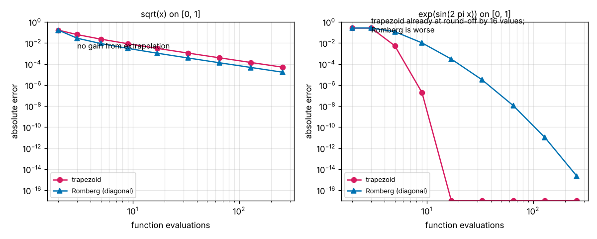

# Session 4: Romberg integration: far more accuracy from the same function values

*Level 3 (simulation and validation) · about 90 minutes · opencalculus*

> This is a simplified educational model. It is not a validated design tool and must not be used for real structures, electrical installations, vehicles, industrial processes or medical decisions.

**Prerequisites**

- Session 3: the trapezoid rule, Simpson's rule and the order of a method.
- Reading log-log graphs: a straight line of slope p means error proportional to h^p.

**Learning objectives.** After this session you can:

- Build a Romberg table from trapezoid sums that reuse every function value.
- Explain why (4 T(h/2) - T(h)) / 3 removes the h^2 error, and why that is Simpson's rule.
- Measure the order of each column of the table (2, 4, 6, ...).
- Count how many function values a rule needs for a target error.
- Recognise the failure cases: a function that is not smooth at an endpoint, a periodic function, and a stopping rule that is fooled.

## A. Real-world problem
Some numbers are expensive. If each function value is a one-minute simulation, or one reading from a slow instrument, you want the most accuracy from the fewest values. In Session 3, Simpson's rule with 17 values gave an error of about 1.5e-7 for the area under e^x on [0, 1]. Can the same 17 values give an error below 1e-12? And how much does that save when the function is a bell curve whose area needs to be known to ten digits? (Educational model with exact answers: not for design work.)

## B. Concept and theory
The trapezoid rule with 2^i slices is T_i. Going from T_(i-1) to T_i needs only the new midpoints, so a table of `levels` rows costs 2^(levels-1) + 1 function values in total, the cost of one trapezoid rule on the finest grid.

For a smooth function the trapezoid error is a series in even powers of the step: T(h) = I + c1 h^2 + c2 h^4 + c3 h^6 + ..., where the constants c1, c2, ... do not depend on h. Halving h divides the h^2 term by 4, so the combination (4 T(h/2) - T(h)) / 3 cancels it and leaves an error of order h^4. This combination is exactly Simpson's rule. The same trick on two Simpson values (16 and 15 in place of 4 and 3) cancels the h^4 term, and so on. This is **Richardson extrapolation**; applying it to trapezoid sums is **Romberg integration**. Column j of the table has error about h^(2j+2) and is exact for polynomials up to degree 2j + 1.

The method depends on that series. If the function is not smooth (a square root at the end of the interval) the powers are not even integers and extrapolation gains little. If the function is smooth and periodic over the interval, the trapezoid rule is already extremely accurate, there is nothing left to cancel, and extrapolation only mixes in round-off. Finally, the usual stopping rule (stop when two successive corners agree) can be fooled when the first few values happen to agree by accident. Everything here has an exact answer to compare with; it is a teaching model, not a validated library.

| Symbol | Meaning | Unit |
|---|---|---|
| h | step size, (b - a) / 2^i | same unit as x |
| T_i | trapezoid sum with 2^i slices | same unit as the integral |
| R(i, j) | Romberg table entry in row i and column j (R(i, 0) = T_i) | same unit as the integral |
| c1, c2, ... | error constants that do not depend on h | various |
| levels | number of rows of the table | no unit |
| values | number of function evaluations, 2^(levels-1) + 1 | no unit |

**Assumptions**

- The function can be evaluated at any point of the interval, and every value costs the same.
- The function is smooth on the whole interval, except in the failure cases we study on purpose.
- Numbers are double precision (about 16 digits, so errors cannot go below about 1e-16).
- Exact areas are known: e - 1; sqrt(pi)/2 erf(2) = 0.882081 for exp(-x^2) on [0, 2]; 2/3 for sqrt(x); I0(1) = 1.266066 for exp(sin 2 pi x) over one period.

$$ T(h)=I+c_1h^2+c_2h^4+c_3h^6+\dots $$

$$ R(i,j)=\frac{4^{j}\,R(i,j-1)-R(i-1,j-1)}{4^{j}-1},\qquad R(i,0)=T_i $$

$$ R(i,1)=\frac{4\,T_i-T_{i-1}}{3}=\text{Simpson's rule with }2^i\text{ slices},\qquad \text{values}=2^{\,\mathrm{levels}-1}+1 $$

## C. Visual explanation
The first figure shows the whole table of errors for e^x on [0, 1], one cell per entry: darker cells have smaller errors. Moving right along a row (more cancellation) or down a column (a finer grid) both help, and the corner reaches the round-off floor near 1e-16 after 6 rows. The second figure plots error against the number of function values for the trapezoid rule, Simpson and Romberg, on e^x (left) and on the bell curve exp(-x^2) on [0, 2] (right). On e^x the Romberg line falls so steeply that at 17 values it is 3.3e-14, against 1.5e-7 for Simpson and 5.6e-4 for the trapezoid. The third figure shows where Romberg fails.

![The error of every entry of the Romberg table for e^x on [0, 1] (darker is smaller).](../../docs/figures/s04_romberg_table.png)

*The error of every entry of the Romberg table for e^x on [0, 1] (darker is smaller).*

![Error against the number of function values: trapezoid, Simpson (column 1) and Romberg (corner), for e^x and for exp(-x^2) on [0, 2].](../../docs/figures/s04_error_vs_evaluations.png)

*Error against the number of function values: trapezoid, Simpson (column 1) and Romberg (corner), for e^x and for exp(-x^2) on [0, 2].*

*Failure cases. Left: sqrt(x) gains almost nothing from extrapolation. Right: for a periodic function the trapezoid rule is already at round-off and Romberg is worse.*

Function values needed for a target error on exp(-x^2) over [0, 2] (grids of 2^k + 1 values):

| Target error | Trapezoid | Simpson | Romberg |
|---|---|---|---|
| 1e-6 | 257 | 17 | 17 |
| 1e-8 | 2049 | 65 | 33 |
| 1e-10 | 16385 | 257 | 33 |
| 1e-12 | more than 131 073 | 513 | 65 |

## D. Interactive simulation
Run the lesson (`python start.py 4`), then open the live app: [Session 4: Romberg integration](https://krunalpanchal1995.github.io/pan-iit-oss/opencalculus/session-04/) (or `app.html` in this folder). Choose the function and the number of levels. The table view shows the error of every entry, the second view the errors against cost, and the third the sample points on the curve. Use the presets to see the four behaviours: a smooth function, a bell curve, the square root and the periodic function.

**Challenge.** Reach an error below 1e-12 for the area of e^x on [0, 1] using as few function evaluations as you can (at most 17).

## E. Worked example and experiment
**Problem.** Build a three-row Romberg table for the area of e^x on [0, 1] and compare its corner with Simpson's rule for the same function values.

1. Exact: e - 1 = 1.718282. The trapezoid rule with 1, 2 and 4 slices gives T0 = 0.5 (1 + 2.718282) = 1.859141, T1 = 1.753931 and T2 = 1.727222. The three sums use only 5 function values (2, then 1 new, then 2 new).
2. First column of corrections: R(1,1) = (4 x 1.753931 - 1.859141) / 3 = 1.718861 (error +5.8e-4) and R(2,1) = (4 x 1.727222 - 1.753931) / 3 = 1.718319 (error +3.7e-5).
3. R(2,1) is Simpson's rule with 4 slices: the same number you found in Session 3.
4. Second column: R(2,2) = (16 x 1.718319 - 1.718861) / 15 = 1.718283.
5. The error of R(2,2) is +8.6e-7. With the same 5 values the trapezoid rule has an error of 8.9e-3 (10 000 times larger) and Simpson 3.7e-5 (43 times larger).

**Answer.** R(2,2) = 1.718283 with error 8.6e-7 from 5 function values, against Simpson's 1.718319 (error 3.7e-5) and the trapezoid rule's 1.727222 (error 8.9e-3).

**Experiment.** Fill a measuring jug or a drinking glass whose shape changes smoothly with height, and measure its radius every 1 cm with a ruler. The volume is the integral of pi r^2 over the height. Compute it with the trapezoid rule using every reading, every second reading and every fourth reading, then apply the Romberg combination to the three results and compare with the volume measured by pouring in water from a measuring cup. The model predicts the extrapolated value is closer than any single sum, but the ruler readings are only good to about 1 mm and extrapolation also amplifies that noise: the cancellation works on the smooth error, not on measurement errors.

## Real-world application and mini-project: How many function values does each rule need?
A heat-flow simulation returns the flux q(x) = exp(-x^2) (made-up units) at a point x on a plate 2 units wide, and every call costs one minute. The total heat is the integral of q from 0 to 2, whose exact value sqrt(pi)/2 erf(2) = 0.882081 is known here so that you can check. Use `evaluations_needed` and `romberg_table` from Session 4 to find, for the targets 1e-6, 1e-8, 1e-10 and 1e-12, how many function values (minutes) the trapezoid rule, Simpson's rule and Romberg integration need on the grids with 2^k + 1 values.

**Deliverable:** A script that prints a table of values needed for each rule and target, the number of minutes saved by Romberg against Simpson at 1e-10, and a log-log plot of error against the number of values for the three rules; then two sentences on what happens to Romberg for sqrt(x) on [0, 1] with 129 values (use `FUNCTIONS[3]`) and why.

**Success looks like:** For 1e-6, 1e-8, 1e-10 and 1e-12 Simpson needs 17, 65, 257 and 513 values and Romberg 17, 33, 33 and 65; the trapezoid rule needs 257, 2049 and 16385 and more than 131 073 for the last. At 1e-10 Romberg saves 224 minutes against Simpson. For sqrt(x) with 129 values the Romberg error is 4.7e-5, only 3 times better than the trapezoid rule's 1.4e-4, because the error series has no even powers of h to cancel.

## F. Assessment and design challenge
**Question type A: Conceptual.** Why does (4 T(h/2) - T(h)) / 3 remove the h^2 error of the trapezoid rule, and why do we divide by 3?

Hint

Write T(h) = I + c1 h^2 + ... and T(h/2) = I + c1 h^2 / 4 + ... and look at the c1 terms.

Step-by-step solution

T(h) = I + c1 h^2 + c2 h^4 + ... and, with half the step, T(h/2) = I + c1 h^2 / 4 + c2 h^4 / 16 + .... The h^2 term of 4 T(h/2) is c1 h^2, the same as in T(h), so it cancels in 4 T(h/2) - T(h). What remains is 3 I plus terms in h^4, so we divide by 3 to get I back. The leftover error is order h^4: this is Simpson's rule. For the next column the h^4 terms are c2 h^4 and c2 h^4 / 16, so the factor is 16 and the divisor 15.

**Question type B: Numerical.** The trapezoid rule for pi = the area of 4 / (1 + x^2) on [0, 1] gives T0 = 3.000000, T1 = 3.100000 and T2 = 3.131176. Complete the Romberg table (R(1,1), R(2,1), R(2,2)) and say which entry is closest to pi = 3.141593.

Hint

R(i,1) = (4 T_i - T_(i-1)) / 3 and R(2,2) = (16 R(2,1) - R(1,1)) / 15.

Step-by-step solution

R(1,1) = (4 x 3.1 - 3.0) / 3 = 3.133333. R(2,1) = (4 x 3.131176 - 3.1) / 3 = 3.141569. R(2,2) = (16 x 3.141569 - 3.133333) / 15 = 3.142118. The errors are -8.3e-3, -2.4e-5 and +5.3e-4: the closest entry is R(2,1), not the corner. With only 5 values the h^6 term is not yet small compared with the h^4 term, so the last extrapolation overshoots. With 6 rows (33 values) the corner has caught up and is at 4.8e-11, but it is no better than the best entry of its row (3.7e-11).

**Question type C: Graph and simulation interpretation.** In the error-against-values figure for e^x, at 17 values the errors are 5.6e-4 (trapezoid), 1.5e-7 (Simpson) and 3.3e-14 (Romberg). By what factor is Romberg better than each, and what happens to its line beyond 33 values?

Hint

Divide the errors. Look for the floor in the figure near 1e-16.

Step-by-step solution

Romberg is 5.6e-4 / 3.3e-14 = 1.7e10 times better than the trapezoid rule and 1.5e-7 / 3.3e-14 = 4.4e6 times better than Simpson. Beyond 33 values (error about 2e-16 in the lesson) the line stops falling and wobbles around 1e-16: the answer is at the round-off limit of double precision, so more values cannot help and cost more.

**Question type D: Design and optimisation challenge.** Your budget is 40 function values (40 minutes) for the area of exp(-x^2) on [0, 2]. On the grids of 2^k + 1 values, which rule should you use and what error will it reach? What must you budget if you need 1e-12?

Hint

The grids have 3, 5, 9, 17, 33, 65 values. Use the largest that fits, and the table in section C.

Step-by-step solution

The largest grid within 40 values has 33 values. There the errors are 2.4e-5 for the trapezoid rule, 6.2e-8 for Simpson and 5.3e-11 for Romberg (corner), so Romberg is the best choice, over 1000 times better than Simpson. For 1e-12 Romberg needs 65 values (error 1.2e-13) against 513 for Simpson, so budget 65 minutes. Note that for this function the corner is not always the best entry of its row: at 33 values the entry in column 2 has error 2.2e-11, slightly better than the corner, but you cannot know which entry is best without the exact answer, so the corner is the usual choice.

Score yourself with [RUBRIC.md](../../RUBRIC.md). Print the [activity sheet](activity_sheet.md) to work on paper.

## Common misconceptions
| Common misconception | What is actually true |
|---|---|
| Romberg is a new rule that needs new function values. | It only recombines trapezoid sums; column 1 is exactly Simpson's rule, and no value is computed twice. |
| More levels always give more digits. | The error stops at about 1e-16 (round-off), and for a function that is not smooth it stops much earlier: sqrt(x) is stuck near 1e-4 with 129 values. |
| Extrapolation always improves a periodic function. | Over a full period the trapezoid rule is already at round-off with 17 values; Romberg with 65 values is worse (1e-8). |
| The corner of the table is always the best entry. | For pi = 4 / (1 + x^2) the best entry of the 3-row table is R(2,1), not the corner R(2,2). |
| When two successive corners agree, the answer is right. | Not always: for exp(sin 2 pi x) the first two corners agree exactly and the stopping rule stops with 3 values and an error of 0.27. |

## Glossary
- **Richardson extrapolation**: combining results at two step sizes to cancel the leading error term
- **Romberg integration**: Richardson extrapolation applied again and again to trapezoid sums
- **Romberg table**: the triangle of values R(i, j); the bottom right corner is the best estimate
- **function value (evaluation)**: one call of the function; the cost we count
- **periodic function**: a function that repeats; over a whole period the trapezoid rule is extremely accurate
- **round-off floor**: the smallest error double precision numbers allow, about 1e-16

## Finish
1. Do the three coding tasks in [exercises.md](exercises.md).
2. Run `python start.py 4` again after your changes. It ends with the checkpoint; when it prints `PASS`, you are done. (Checkpoint only: `python start.py check 4`.)

Next: [Session 5: Gaussian quadrature: choosing where to sample](../session-05/README.md).
