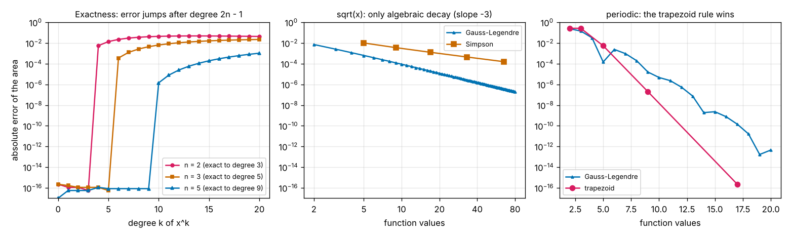

# Session 5: Gaussian quadrature: choosing where to sample

*Level 3 (simulation and validation) · about 90 minutes · opencalculus*

> This is a simplified educational model. It is not a validated design tool and must not be used for real structures, electrical installations, vehicles, industrial processes or medical decisions.

**Prerequisites**

- Session 3: the trapezoid rule, Simpson's rule and the order of a method.
- Session 4: Romberg integration and counting function values.

**Learning objectives.** After this session you can:

- Compute the nodes and weights of the Gauss-Legendre rule (roots of a Legendre polynomial, found with Newton's method).
- Apply the rule on any interval and say what it costs (n points are n function values).
- Explain why n points are exact up to degree 2n - 1 and test it.
- Compare Gauss, Simpson and Romberg for the same number of function values.
- Recognise the failure cases: a function that is not smooth, a periodic function, a narrow peak, and the cost of rules that are not nested.

## A. Real-world problem
In Session 4 Romberg integration needed 65 function values to reach 1e-12 for a bell curve, and Simpson's rule needed 513. If every value is a one-minute simulation, that is a long wait. All those rules used equally spaced points and chose only the weights. What if we also choose where to sample? With 5 well-placed values the area of e^x on [0, 1] can be found with an error of 6.5e-13, while Simpson's rule with 5 values has an error of 3.7e-5. (Educational model with exact answers: not for design work.)

## B. Concept and theory
A quadrature rule approximates an integral by a weighted sum of function values: the area is about w_1 f(x_1) + ... + w_n f(x_n). With equally spaced points only the n weights are free, and the best you can do is be exact for polynomials of degree about n - 1. If the n points are free too there are 2n numbers to choose, and a polynomial of degree 2n - 1 has 2n coefficients. Gauss showed that the choice that makes the rule exact for all of them puts the points at the roots of the Legendre polynomial P_n. These polynomials follow the recurrence (k + 1) P_(k+1)(x) = (2k + 1) x P_k(x) - k P_(k-1)(x), starting from P_0 = 1 and P_1 = x. The roots lie inside the interval, crowd towards its ends and are symmetric; the weights are all positive and add up to the interval length (2 on [-1, 1]).

On [a, b] the points are mapped as x = m + r t, with the midpoint m = (a + b) / 2 and half-length r = (b - a) / 2, and the integral is r times the weighted sum. The 2-point rule has t = plus or minus 1/sqrt(3) with weights 1 and 1; the 3-point rule has t = 0 and plus or minus sqrt(3/5) with weights 8/9 and 5/9. For a function that is smooth enough (analytic) the error falls faster than any power of 1/n: every extra point adds several digits, which is why 5 points can beat 513.

There is a price. The rules are not nested: the (n + 1)-point rule shares almost no points with the n-point rule, so if you do not know in advance which n is enough and try n = 2, 3, 4, ... until two rules agree, every rule you try costs n new values. And, like all high-order rules, the method relies on smoothness: for sqrt(x) the error only falls like n^-3, for a periodic function the plain trapezoid rule is much better, and a narrow peak is simply missed. Everything here has an exact answer to compare with; it is a teaching model, not a validated library.

| Symbol | Meaning | Unit |
|---|---|---|
| n | number of points (and function values) | no unit |
| t_i, w_i | node and weight on [-1, 1] (roots of P_n) | no unit |
| m, r | midpoint and half-length of [a, b] | same unit as x |
| P_n | Legendre polynomial of degree n | no unit |
| degree | highest power of x the rule integrates exactly, 2n - 1 | no unit |
| values | number of function evaluations | no unit |

**Assumptions**

- The function can be evaluated at any point of the interval, and every value costs the same.
- The function is smooth on the whole interval, except in the failure cases we study on purpose.
- Numbers are double precision (about 16 digits, so errors cannot go below about 1e-16).
- Exact areas are known: e - 1; sqrt(pi)/2 erf(2) = 0.882081 for exp(-x^2) on [0, 2]; 2/3 for sqrt(x); I0(1) = 1.266066 for exp(sin 2 pi x) over one period; 0.2669 for |x - 0.37| on [0, 1].

$$ \int_a^b f\,dx\approx r\sum_{i=1}^{n}w_i\,f(m+r\,t_i),\qquad m=\tfrac{a+b}2,\ r=\tfrac{b-a}2 $$

$$ (k+1)P_{k+1}(x)=(2k+1)\,x\,P_k(x)-k\,P_{k-1}(x),\qquad P_n(t_i)=0,\qquad w_i=\frac{2}{(1-t_i^2)\,P_n'(t_i)^2} $$

$$ \int_{-1}^{1}x^k\,dx=\sum_i w_i t_i^k\ \ \text{for all }k\le 2n-1 $$

## C. Visual explanation
The first figure compares 5 equally spaced values with the 5 Gauss-Legendre values for e^x on [0, 1]. The Gauss points are not evenly spread: they crowd towards the ends and the weights (the widths of the shaded rectangles) are largest in the middle. The error is 6.5e-13 against 3.7e-5. The second figure plots error against the number of function values for Simpson, Romberg and Gauss, on e^x (left) and on the bell curve exp(-x^2) on [0, 2] (right): the Gauss line falls much faster. The third figure has three panels. Left: the n-point rule is exact for x^k until k = 2n - 1 and then the error jumps. Middle: sqrt(x), where the error falls only as a straight line of slope -3 on a log-log plot. Right: a periodic function, where the plain trapezoid rule reaches round-off with 17 values and Gauss does not.

![Five equally spaced values (Simpson) against the five Gauss-Legendre values for e^x on [0, 1]; the rectangles show the weights.](../../docs/figures/s05_nodes_weights.png)

*Five equally spaced values (Simpson) against the five Gauss-Legendre values for e^x on [0, 1]; the rectangles show the weights.*

![Error against the number of function values for Simpson, Romberg and Gauss, on e^x and on exp(-x^2) over [0, 2].](../../docs/figures/s05_error_vs_values.png)

*Error against the number of function values for Simpson, Romberg and Gauss, on e^x and on exp(-x^2) over [0, 2].*

*Left: error for x^k jumps after degree 2n - 1. Middle: sqrt(x) converges only like n^-3. Right: for a periodic function the trapezoid rule beats Gauss.*

Function values needed for a target error on exp(-x^2) over [0, 2]:

| Target error | Simpson | Romberg | Gauss (n known in advance) | Gauss (n found by trying, all values counted) |
|---|---|---|---|---|
| 1e-6 | 17 | 17 | 6 | 27 |
| 1e-8 | 65 | 33 | 7 | 35 |
| 1e-10 | 257 | 33 | 9 | 54 |
| 1e-12 | 513 | 65 | 10 | 65 |

## D. Interactive simulation
Run the lesson (`python start.py 5`), then open the live app: [Session 5: Gaussian quadrature](https://krunalpanchal1995.github.io/pan-iit-oss/opencalculus/session-05/) (or `app.html` in this folder). Choose the function and the number of points n. The first view draws the points and weights, the second the error against cost for Gauss, Simpson and Romberg, and the third the error for x^k, which jumps right after degree 2n - 1. Use the presets to see the smooth case, the bell curve, the slow sqrt(x) and the periodic function.

**Challenge.** Reach an error below 1e-11 for the area of e^x on [0, 1] with as few points as you can (at most 5).

## E. Worked example and experiment
**Problem.** Find the area of e^x on [0, 1] with the 2-point and the 3-point Gauss-Legendre rules and compare with Simpson's rule for the same number of function values.

1. Exact: e - 1 = 1.718282. On [0, 1] the midpoint is m = 0.5 and the half-length r = 0.5.
2. Two points: t = plus or minus 0.577350, so x = 0.5 plus or minus 0.288675 = 0.211325 and 0.788675, with weights 1 and 1. The values are e^0.211325 = 1.235314 and e^0.788675 = 2.200479.
3. Two-point area: 0.5 x (1 x 1.235314 + 1 x 2.200479) = 1.717896, error -3.9e-4.
4. Three points: t = -0.774597, 0 and 0.774597, so x = 0.112702, 0.5 and 0.887298, with weights 5/9, 8/9 and 5/9. The values are 1.119298, 1.648721 and 2.428560.
5. Three-point area: 0.5 x (5/9 x 1.119298 + 8/9 x 1.648721 + 5/9 x 2.428560) = 1.718281, error -8.2e-7.
6. Simpson's rule with the same 3 values (x = 0, 0.5, 1) gives 1.718861 with error +5.8e-4, so the 3-point Gauss rule is about 700 times closer.

**Answer.** 2 points: 1.717896 (error -3.9e-4); 3 points: 1.718281 (error -8.2e-7), against Simpson's 1.718861 (error 5.8e-4) for the same 3 values.

**Experiment.** Take a smooth curve that you can measure, for example the height profile of a bottle's side measured every 1 cm with a ruler, and compute its volume (the integral of pi r^2 dx) two ways: with the equally spaced readings and Simpson's rule, and with readings taken at the Gauss points (for 3 points on a 10 cm bottle: at 1.13, 5.00 and 8.87 cm) and the 3-point weights. Compare with the volume measured by pouring in water. The model predicts that the 3 Gauss readings are as good as many equally spaced ones, but the ruler is only good to about 1 mm and measurement noise is not reduced by the clever placement: the rule only removes the method error.

## Real-world application and mini-project: Which rule for an expensive simulation?
The plate of Session 4 again: a simulation returns the flux q(x) = exp(-x^2) (made-up units) at a point on a plate 2 units wide, one minute per call, and the total is the integral from 0 to 2 (exact 0.882081). Use `gauss_values_needed`, `gauss_tol` and `gauss_legendre` from Session 5 and the Session 4 counts of Simpson and Romberg (17, 65, 257, 513 and 17, 33, 33, 65 values for 1e-6, 1e-8, 1e-10 and 1e-12). Find, for those targets, the number of values Gauss needs when n is known and the total number it spends when n must be found by trying, then check what happens for the two functions that Gauss does not like.

**Deliverable:** A script that prints the table of values for the three rules at the four targets (and the total spent by the stopping rule), a log-scale plot of error against values, and a recommendation in three sentences: which rule you would use for this plate, and for a square root `FUNCTIONS[3]` and for a periodic function `FUNCTIONS[4]` over one period.

**Success looks like:** Gauss needs 6, 7, 9 and 10 values when n is known, but the stopping rule spends 27, 35, 54 and 65 (for 1e-12 the same 65 as Romberg, because the rules are not nested). For sqrt(x) 80 Gauss values give an error of 2.0e-7 (Romberg with 129 values: 4.7e-5), but 160 values still give only 2.5e-8, an order of 3 on a log-log plot. For the periodic function the plain trapezoid rule with 17 values is at round-off (2e-16) while Gauss with 17 values has an error of 1.4e-10.

## F. Assessment and design challenge
**Question type A: Conceptual.** Why is the n-point Gauss-Legendre rule exact up to degree 2n - 1, when the n-point rule with equally spaced points is exact only up to about degree n - 1?

Hint

Count the free numbers in a rule (points and weights) and the coefficients of a polynomial.

Step-by-step solution

A rule with n fixed equally spaced points can only choose its n weights, so it can be made exact for the n monomials 1, x, ..., x^(n-1): degree n - 1 (one more for symmetric rules such as Simpson's). If the n points are free as well there are 2n numbers to choose, and a polynomial of degree 2n - 1 has exactly 2n coefficients, so all of them can be integrated exactly. The Legendre roots are the choice that achieves this. Check: the 3-point rule is exact for x^5 but not for x^6, where its error on [0, 1] is 3.6e-4.

**Question type B: Numerical.** Use the 2-point Gauss-Legendre rule to find the area of x^3 + 1 on [1, 3], and then the area of x^4 on [1, 3]. The exact answers are 22 and 48.4.

Hint

The midpoint is m = 2 and the half-length r = 1, so x = 2 plus or minus 0.57735 and the weights are 1 and 1.

Step-by-step solution

The points are x = 2 - 0.577350 = 1.422650 and 2 + 0.577350 = 2.577350. For x^3 + 1 the values are 3.879348 and 18.120648; the area is 1 x (3.879348 + 18.120648) = 22.000 (exact: a cubic is within degree 2n - 1 = 3). For x^4 the values are 4.0963 and 44.1259, the area is 48.2222, an error of -0.178: degree 4 is beyond 2n - 1, so the rule is no longer exact.

**Question type C: Graph and simulation interpretation.** In the error-against-values figure for the bell curve, at 9 values the errors are 1.6e-5 (Simpson), 5.0e-5 (Romberg) and 1.2e-11 (Gauss). What do you conclude about Gauss, and about the claim that Romberg is always better than Simpson?

Hint

Divide the errors, and compare Romberg with Simpson at the same number of values.

Step-by-step solution

Gauss is 1.6e-5 / 1.2e-11 = 1.4e6 times better than Simpson with the same 9 values. At 9 values Romberg (corner) is about 3 times worse than Simpson: the bell curve bends so much that the higher columns of the table, which assume the h^2, h^4, h^6 error series has already settled, make things worse until the grid is fine enough. At 17 values Romberg wins (1.8e-7 against 9.9e-7). So Romberg is not always better than Simpson, and the corner of a table is a good choice only once the grid is fine.

**Question type D: Design and optimisation challenge.** You can afford 10 function values (10 minutes) for the area of exp(-x^2) on [0, 2]. Which rule do you choose and what error do you expect? Then suppose you needed 1e-12 and did not know how many points to use: what would the Gauss approach cost, and how does it compare with Romberg?

Hint

Use the table in section C: for the second part count all the values spent by trying n = 2, 3, 4, ...

Step-by-step solution

With 10 values: Gauss with n = 10 has an error of 3.1e-13, Simpson with 9 values has 1.6e-5 and Romberg with 9 values 5.0e-5: choose Gauss. If you do not know n in advance you raise n until two rules agree to within 1e-12; that happens at n = 11 after 2 + 3 + ... + 11 = 65 values in total, exactly what Romberg needs (65), because the Gauss rules are not nested and nothing is reused. Gauss wins clearly when you can fix n in advance (for example from a trial run on a similar problem), and its advantage largely disappears when you must discover n during the run.

Score yourself with [RUBRIC.md](../../RUBRIC.md). Print the [activity sheet](activity_sheet.md) to work on paper.

## Common misconceptions
| Common misconception | What is actually true |
|---|---|
| Equally spaced points are the natural choice. | Points at the Legendre roots give twice the exactness (2n - 1 against about n - 1) for the same cost. |
| Gauss is always better than Simpson or Romberg. | For a periodic function the plain trapezoid rule is better (2e-16 with 17 values against 1.4e-10); for sqrt(x) Gauss is better but still slow (error ~ n^-3). |
| The Gauss points are just a better grid that I can refine. | The (n + 1)-point rule shares almost no points with the n-point rule, so trying several n costs the sum of all of them. |
| More points always mean a smaller error. | For smooth functions the error reaches about 1e-16 and stops; for a narrow peak 20 points miss it completely (100 percent error). |
| One rule over the whole interval is fine if the function has a corner. | \|x - 0.37\| with one 10-point rule has error 1.4e-3; split at the corner and two single points give the exact area. |

## Glossary
- **quadrature**: approximating an integral by a weighted sum of function values
- **node (point)**: a place where the function is evaluated
- **weight**: the number that multiplies a function value in the sum
- **Legendre polynomial**: P_n, the polynomial whose roots are the Gauss-Legendre nodes
- **degree of exactness**: the highest degree of polynomial a rule integrates without error
- **nested rules**: rules whose points include those of the previous rule, so values are reused (trapezoid and Romberg are nested; Gauss-Legendre is not)
- **analytic function**: a function with a convergent power series; Gauss converges very fast for these

## Finish
1. Do the three coding tasks in [exercises.md](exercises.md).
2. Run `python start.py 5` again after your changes. It ends with the checkpoint; when it prints `PASS`, you are done. (Checkpoint only: `python start.py check 5`.)

Next: the [roadmap](../../promo/roadmap.md). Session 6 is yours to build.
