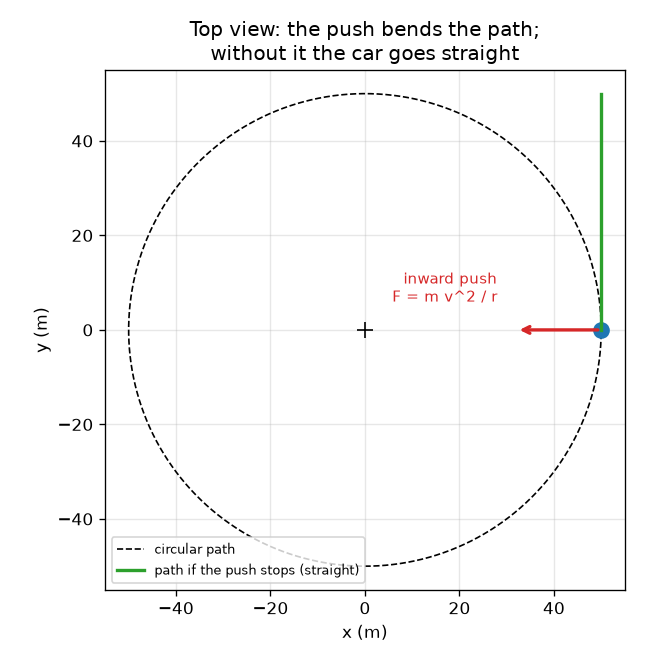
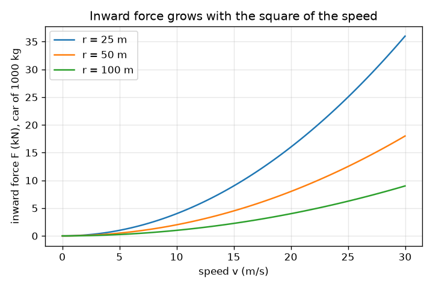

# सत्र 1: मोड़ पर घूमने के लिए अंदर की ओर धक्का चाहिए

*स्तर 1 (वैचारिक इंटरैक्टिव मॉडल) · लगभग 60 मिनट · opencentripetal*

> यह एक सरलीकृत शैक्षिक मॉडल है। यह कोई प्रमाणित डिज़ाइन उपकरण नहीं है और इसका उपयोग वास्तविक संरचनाओं, बिजली की स्थापनाओं, वाहनों, औद्योगिक प्रक्रियाओं या चिकित्सा निर्णयों के लिए नहीं किया जाना चाहिए।

**पूर्वापेक्षाएँ (Prerequisites)**

- गुणा, भाग और वर्ग।
- आपने PRIMER.md पढ़ लिया है और `python start.py 1` एक बार चला लिया है।

**सीखने के उद्देश्य।** इस सत्र के बाद आप:

- समझा सकेंगे कि मोड़ पर चल रही कार पर मोड़ के केंद्र की ओर इशारा करता एक बल (force) क्यों होना चाहिए।
- सही इकाइयों के साथ a = v^2 / r और F = m v^2 / r का उपयोग कर सकेंगे।
- बाहर की ओर फेंके जाने की अनुभूति को जड़त्व (inertia) से समझा सकेंगे, बिना किसी बाहरी बल के।
- चाल के सापेक्ष अंदर की ओर लगने वाले बल का ग्राफ़ पढ़ सकेंगे और बता सकेंगे कि त्रिज्या (radius) के साथ यह कैसे बदलता है।

## A. वास्तविक दुनिया की समस्या
मोड़ पर घूमती कार में आप दरवाज़े से दबे हुए महसूस करते हैं, मानो कोई चीज़ आपको बाहर फेंक रही हो। पर जब दरवाज़ा खुला हो, तो आप त्रिज्या के साथ बाहर नहीं उड़ते: आप सीधे आगे चलते जाते हैं जबकि कार मुड़कर दूर चली जाती है। तो वास्तव में होता क्या है? किसी चीज़ को कार को लगातार अंदर की ओर धकेलना होगा, और इस सत्र का प्रश्न यह है कि दी गई चाल और त्रिज्या के लिए उसे कितनी ज़ोर से धकेलना पड़ता है।

## B. अवधारणा और सिद्धांत
चाल (speed) यह है कि आप कितनी तेज़ी से चलते हैं; वेग (velocity) में दिशा भी शामिल होती है। वृत्त पर चाल स्थिर रह सकती है जबकि दिशा लगातार बदलती रहती है, इसलिए वेग बदलता है और एक त्वरण (acceleration) होता है। यह वृत्त के केंद्र की ओर इशारा करता है और इसे अभिकेंद्र त्वरण (centripetal acceleration) कहते हैं (centripetal का अर्थ है केंद्र की ओर जाने वाला)। न्यूटन का दूसरा नियम कहता है कि इसे उत्पन्न करने के लिए बल F = m a चाहिए। इसलिए आवश्यक आंतरिक बल F = m v^2 / r है। चाल दोगुनी करने पर चार गुना बल चाहिए; त्रिज्या आधी करने पर दोगुना बल चाहिए। कुछ भी बाहर की ओर नहीं धकेलता: जब अंदर का धक्का रुक जाता है (कटी हुई डोरी, बर्फ़ीली सड़क), तो वस्तु सीधी स्पर्शरेखा (tangent) के साथ चलती है, जो केंद्र से देखने पर बाहर जाती हुई लगती है।

| प्रतीक | अर्थ | इकाई |
|---|---|---|
| v | पथ के साथ चाल | m/s |
| r | वृत्त की त्रिज्या | m |
| m | द्रव्यमान | kg |
| a | अभिकेंद्र (अंदर की ओर) त्वरण | m/s^2 |
| F | आवश्यक आंतरिक बल | N |

**मान्यताएँ (Assumptions)**

- पूर्णतः वृत्ताकार पथ पर स्थिर चाल।
- कार को द्रव्यमान m वाला एक बिंदु माना गया है।
- हम अभी यह नहीं बताते कि बल कौन देता है (वह सत्र 2 में है)।

$$ a=\frac{v^{2}}{r} $$

$$ F=ma=\frac{m\,v^{2}}{r} $$

$$ F\propto v^{2},\qquad F\propto \frac{1}{r}\quad\text{(at fixed mass)} $$

## C. दृश्य व्याख्या
पहला चित्र एक वृत्ताकार सड़क का ऊपर से दृश्य है। लाल अंदर वाला तीर वास्तविक बल है, हरा तीर स्पर्शरेखा के साथ वेग है, और हरी सीधी रेखा दिखाती है कि धक्का रुकने पर कार कहाँ जाएगी: वह वृत्त छोड़ देती है और बिना किसी बाहरी बल के केंद्र से दूर चली जाती है। दूसरा चित्र 1000 kg की कार के लिए तीन त्रिज्याओं पर चाल के सापेक्ष आंतरिक बल दिखाता है। वक्र परवलय (parabola) हैं क्योंकि F, v के वर्ग के साथ बढ़ता है, और त्रिज्या जितनी छोटी, वक्र उतना ही खड़ा।

*ऊपर से दृश्य: अंदर का धक्का पथ को मोड़ता है; इसके बिना कार स्पर्शरेखा के साथ सीधी जाती है।*

*1000 kg की कार के लिए चाल के सापेक्ष आंतरिक बल: एक परवलय, छोटी त्रिज्या के लिए अधिक खड़ा।*

## D. इंटरैक्टिव सिमुलेशन
पाठ चलाइए (`python start.py 1`), फिर लाइव ऐप खोलिए: [सत्र 1: मोड़ पर अंदर का धक्का](https://krunalpanchal1995.github.io/pan-iit-oss/opencentripetal/session-01/) (या इसी फ़ोल्डर में `app.html`)। चाल और त्रिज्या के स्लाइडर हिलाइए और लाल आंतरिक तीर तथा रीडआउट को देखिए। फिर ग्राफ़ खोलिए और देखिए कि आपकी त्रिज्या का वक्र दोगुनी त्रिज्या वाले वक्र से कैसे तुलना करता है।

**चुनौती।** 1000 kg की कार के लिए आंतरिक बल को 2100 N या उससे कम रखते हुए 20 m/s या उससे अधिक पर चलाइए।

## E. हल किया गया उदाहरण और प्रयोग
**समस्या।** 1000 kg की एक कार 10 m/s (36 km/h) से 50 m त्रिज्या वाले मोड़ पर चलती है। त्वरण और आंतरिक बल ज्ञात कीजिए, और चाल दोगुनी करने का प्रभाव जाँचिए।

1. a = v^2 / r = 10^2 / 50 = 100 / 50 = 2 m/s^2, केंद्र की ओर।
2. F = m a = 1000 * 2 = 2000 N।
3. समझदारी जाँच: भार m g = 1000 * 9.81 = 9810 N है, इसलिए धक्का भार का लगभग 0.2 है, एक हल्का मोड़।
4. चाल दोगुनी करके 20 m/s: F = 1000 * 400 / 50 = 8000 N, चार गुना। 10 m/s पर त्रिज्या आधी करके 25 m: F = 4000 N, दोगुना।

**उत्तर।** a = 2 m/s^2 और F = 2000 N; चाल दोगुनी करने पर 8000 N और त्रिज्या आधी करने पर 4000 N।

**प्रयोग।** एक छोटी गेंद को डोरी से बाँधकर क्षैतिज वृत्त में घुमाइए (बाहर खुले में, हल्की गेंद, साफ़ जगह) और 10 चक्करों का समय मापकर चाल v = 2 pi r / T ज्ञात कीजिए; फिर दो चालों पर डोरी में महसूस होने वाले खिंचाव की तुलना कीजिए। दोगुनी चाल पर आपको लगभग चार गुना खिंचाव महसूस होगा। मॉडल स्थिर चाल पर पूर्ण वृत्त के लिए सटीक है; असली गेंद गुरुत्व के कारण क्षैतिज से थोड़ा नीचे झुकती है और तेज़-धीमी होती रहती है, इसीलिए हाथ से किया गया प्रयोग केवल लगभग मेल खाता है।

## F. मूल्यांकन और डिज़ाइन चुनौती
**प्रश्न प्रकार A: वैचारिक।** एक यात्री कहता है: 'मोड़ पर कार मुझे बाहर की ओर धकेलती है'। समझाइए कि वास्तव में क्या हो रहा है, और बताइए कि दरवाज़ा क्या करता है।

संकेत

सोचिए कि यदि कुछ भी धक्का न दे तो यात्री का शरीर क्या करेगा, और कौन-सी वस्तु यात्री को अंदर की ओर धकेलती है।

चरण-दर-चरण हल

यात्री को कुछ भी बाहर की ओर नहीं धकेलता। जड़त्व के कारण शरीर स्थिर वेग से सीधी रेखा में चलते रहने की प्रवृत्ति रखता है। कार अंदर की ओर मुड़ती है, इसलिए दरवाज़ा (और सीट) यात्री की ओर आता है और शरीर पर अंदर की ओर दबाव डालता है, जिससे उसे आंतरिक त्वरण v^2 / r मिलता है। यात्री दरवाज़े के उस संपर्क बल को महसूस करता है और उसे बाहर फेंके जाने के रूप में समझता है। यदि दरवाज़ा खुला होता, तो यात्री स्पर्शरेखा के साथ सीधा चलता, जो केंद्र से दूर है पर त्रिज्या के साथ नहीं।

**प्रश्न प्रकार B: संख्यात्मक।** 800 kg की एक कार 15 m/s से 30 m त्रिज्या वाले मोड़ पर चलती है। त्वरण और आंतरिक बल ज्ञात कीजिए, और बल की तुलना कार के भार से कीजिए।

संकेत

पहले a = v^2 / r, फिर F = m a; भार = m g, जहाँ g = 9.81 m/s^2।

चरण-दर-चरण हल

a = 15^2 / 30 = 225 / 30 = 7.5 m/s^2। F = 800 * 7.5 = 6000 N। भार = 800 * 9.81 = 7848 N, इसलिए F भार का लगभग 0.76 है। समझदारी जाँच: इकाइयाँ m^2/s^2 को m से भाग देने पर m/s^2 होती हैं, और kg * m/s^2 = N है। भार के 0.76 का धक्का एक बहुत तीखा मोड़ है: सूखी सड़क पर साधारण टायर भार का केवल लगभग 0.7 से 0.9 तक दे सकते हैं, इसलिए यह सीमा के क़रीब है।

**प्रश्न प्रकार C: ग्राफ़ और सिमुलेशन की व्याख्या।** r = 50 m पर 1000 kg की कार के लिए चाल के सापेक्ष आंतरिक बल के ग्राफ़ में 10 m/s और 20 m/s पर बल कितना है? वक्र का आकार क्या है और क्यों?

संकेत

हर चाल के लिए F = m v^2 / r का उपयोग कीजिए और दोनों मानों की तुलना कीजिए।

चरण-दर-चरण हल

10 m/s पर बल 2000 N (2 kN) है; 20 m/s पर यह 8000 N (8 kN) है। वक्र एक परवलय है, क्योंकि F, v के वर्ग के समानुपाती है: v को दोगुना करने पर F 4 गुना हो जाता है। दोगुनी त्रिज्या वाला वक्र हर चाल पर इसके नीचे, आधी ऊँचाई पर रहता है।

**प्रश्न प्रकार D: डिज़ाइन और अनुकूलन (optimisation) चुनौती।** डिज़ाइन: 0.5 kg की एक गेंद को 0.8 m त्रिज्या वाली डोरी पर घुमाया जाता है। डोरी 60 N पर टूटती है। आप अधिकतम कितनी चाल की अनुमति दे सकते हैं, और यदि डोरी पर कभी भी उसके टूटने वाले बल के आधे से अधिक भार न आना हो तो आप कौन-सी चाल चुनेंगे?

संकेत

अनुमत बल के साथ F = m v^2 / r को v = sqrt(F r / m) के लिए हल कीजिए।

चरण-दर-चरण हल

टूटने वाले बल पर: v = sqrt(60 * 0.8 / 0.5) = sqrt(96) = 9.80 m/s। टूटने वाले बल के आधे, 30 N, के सुरक्षा अंतर (safety margin) के साथ: v = sqrt(30 * 0.8 / 0.5) = sqrt(48) = 6.93 m/s। इस अंतर की क़ीमत चाल का लगभग 29 प्रतिशत है, क्योंकि v केवल F के वर्गमूल के साथ बढ़ता है। जब डोरी टूटती है, तो गेंद स्पर्शरेखा के साथ सीधी रेखा में चली जाती है।

[RUBRIC.md](../../RUBRIC.md) से स्वयं को अंक दीजिए। काग़ज़ पर काम करने के लिए [गतिविधि पत्रक](activity_sheet.md) प्रिंट कीजिए।

## सामान्य भ्रांतियाँ
| सामान्य भ्रांति | वास्तव में क्या सच है |
|---|---|
| एक बाहरी 'अपकेंद्री' (centrifugal) बल कार को सड़क से बाहर धकेलता है। | कुछ भी बाहर की ओर नहीं धकेलता। कार सीधी चलती रहती है (जड़त्व) जब तक कोई आंतरिक बल उसका पथ न मोड़े; सड़क से फिसलना आंतरिक बल का खो जाना है। |
| स्थिर चाल पर कोई त्वरण नहीं होता। | त्वरण वेग का परिवर्तन है, और वेग में दिशा शामिल है। वृत्त पर दिशा लगातार बदलती है, इसलिए केंद्र की ओर v^2 / r का त्वरण होता है। |
| चाल दोगुनी करने से आवश्यक बल दोगुना होता है। | बल v के वर्ग के साथ चलता है, इसलिए चाल दोगुनी करने पर चार गुना बल चाहिए। |
| वृत्त से छोड़ी गई गेंद त्रिज्या के साथ बाहर उड़ती है। | वह स्पर्शरेखा के साथ, अपनी उसी चाल से, सीधी रेखा में चलती है। |

## शब्दावली
- **अभिकेंद्र (centripetal)**: वृत्त के केंद्र की ओर निर्देशित
- **जड़त्व (inertia)**: किसी वस्तु की अपना वेग बनाए रखने की प्रवृत्ति, जब तक कोई बल न लगे
- **स्पर्शरेखा (tangent)**: वृत्त को एक बिंदु पर छूने वाली सीधी रेखा, उस बिंदु पर गति की दिशा
- **न्यूटन (newton, N)**: बल की इकाई; 1 N, 1 kg को 1 m/s^2 का त्वरण देता है

## समापन
1. [exercises.md](exercises.md) में दिए तीन कोडिंग कार्य कीजिए।
2. अपने बदलावों के बाद `python start.py 1` फिर से चलाइए। यह चेकपॉइंट (checkpoint) पर समाप्त होता है; जब यह `PASS` छापे, तो आपका काम पूरा है। (केवल चेकपॉइंट: `python start.py check 1`।)

अगला: [सत्र 2](../session-02/README.md)
