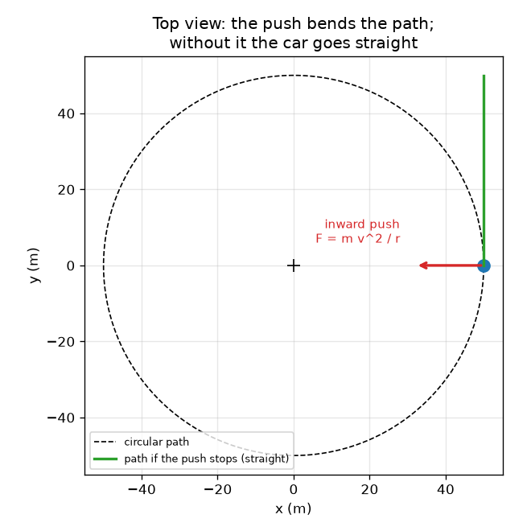
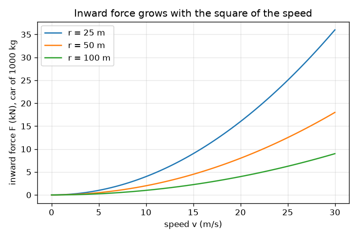

# സെഷൻ 1: ഒരു വളവ് ചുറ്റി പോകാൻ ഉള്ളിലേക്കുള്ള ഒരു തള്ളൽ വേണം

[Session 1 — हिन्दी](README.hi.md)

*ലെവൽ 1 (ആശയപരമായ ഇന്ററാക്ടീവ് മോഡൽ) · ഏകദേശം 60 മിനിറ്റ് · opencentripetal*

> ഇത് ലളിതമാക്കിയ ഒരു വിദ്യാഭ്യാസ മോഡൽ ആണ്. ഇത് സാധൂകരിച്ച (validated) ഡിസൈൻ ഉപകരണമല്ല; യഥാർത്ഥ നിർമിതികൾ, വൈദ്യുത ഇൻസ്റ്റലേഷനുകൾ, വാഹനങ്ങൾ, വ്യാവസായിക പ്രക്രിയകൾ അല്ലെങ്കിൽ വൈദ്യശാസ്ത്ര തീരുമാനങ്ങൾ എന്നിവയ്ക്ക് ഇത് ഉപയോഗിക്കരുത്.

**മുൻകൂട്ടി അറിയേണ്ടവ (Prerequisites)**

- ഗുണനം, ഹരണം, വർഗ്ഗങ്ങൾ (squares).
- നിങ്ങൾ PRIMER.md വായിച്ചിട്ടുണ്ട്, `python start.py 1` ഒരിക്കൽ റൺ ചെയ്തിട്ടുണ്ട്.

**പഠന ലക്ഷ്യങ്ങൾ (Learning objectives).** ഈ സെഷനു ശേഷം നിങ്ങൾക്ക്:

- വളവിലുള്ള ഒരു കാറിന് വളവിന്റെ കേന്ദ്രത്തിലേക്ക് ചൂണ്ടുന്ന ഒരു ബലം (force) എന്തുകൊണ്ട് ഉണ്ടായിരിക്കണം എന്ന് വിശദീകരിക്കാം.
- ശരിയായ യൂണിറ്റുകളോടെ a = v^2 / r, F = m v^2 / r എന്നിവ ഉപയോഗിക്കാം.
- പുറത്തേക്കുള്ള ഒരു ബലം ഇല്ലാതെ, ജഡത്വം (inertia) ഉപയോഗിച്ച് പുറത്തേക്ക് എറിയപ്പെടുന്ന തോന്നൽ വിശദീകരിക്കാം.
- വേഗതയ്‌ക്കെതിരെ ഉള്ളിലേക്കുള്ള ബലത്തിന്റെ ഗ്രാഫ് വായിച്ച് ആരം (radius) മാറുമ്പോൾ അത് എങ്ങനെ മാറുന്നു എന്ന് പറയാം.

## A. യഥാർത്ഥ ലോക പ്രശ്നം
ഒരു വളവ് ചുറ്റി പോകുന്ന കാറിൽ, എന്തോ നിങ്ങളെ പുറത്തേക്ക് എറിയുന്നതുപോലെ വാതിലിനോട് അമർത്തപ്പെടുന്നതായി നിങ്ങൾക്ക് തോന്നുന്നു. എന്നാൽ വാതിൽ തുറന്നിരിക്കുമ്പോൾ നിങ്ങൾ ആരത്തിലൂടെ പുറത്തേക്ക് പറക്കുന്നില്ല: കാർ തിരിഞ്ഞുപോകുമ്പോൾ നിങ്ങൾ നേരെ മുന്നോട്ട് പോകുന്നു. അപ്പോൾ ശരിക്കും എന്താണ് സംഭവിക്കുന്നത്? എന്തെങ്കിലും എല്ലായ്‌പ്പോഴും കാറിനെ ഉള്ളിലേക്ക് തള്ളണം, ഒരു നിശ്ചിത വേഗതയ്ക്കും ആരത്തിനും അത് എത്ര ശക്തമായി തള്ളണം എന്നതാണ് ഈ സെഷന്റെ ചോദ്യം.

## B. ആശയവും സിദ്ധാന്തവും
വേഗത (speed) എന്നത് നിങ്ങൾ എത്ര വേഗത്തിൽ നീങ്ങുന്നു എന്നതാണ്; പ്രവേഗത്തിന് (velocity) ഒരു ദിശയും ഉണ്ട്. ഒരു വൃത്തത്തിൽ വേഗത സ്ഥിരമായിരിക്കാം, എന്നാൽ ദിശ മാറിക്കൊണ്ടേയിരിക്കുന്നു, അതിനാൽ പ്രവേഗം മാറുന്നു, ഒരു ത്വരണം (acceleration) ഉണ്ടാകുന്നു. അത് വൃത്തത്തിന്റെ കേന്ദ്രത്തിലേക്ക് ചൂണ്ടുന്നു, അതിനെ അഭികേന്ദ്ര ത്വരണം (centripetal acceleration) എന്ന് വിളിക്കുന്നു (centripetal എന്നാൽ കേന്ദ്രം തേടുന്ന). അത് ഉണ്ടാക്കാൻ F = m a എന്ന ബലം വേണമെന്ന് ന്യൂട്ടന്റെ രണ്ടാം നിയമം പറയുന്നു. അതിനാൽ ആവശ്യമായ ഉള്ളിലേക്കുള്ള ബലം F = m v^2 / r. വേഗത ഇരട്ടിയാക്കിയാൽ നാലിരട്ടി ബലം വേണം; ആരം പകുതിയാക്കിയാൽ ഇരട്ടി ബലം വേണം. ഒന്നും പുറത്തേക്ക് തള്ളുന്നില്ല: ഉള്ളിലേക്കുള്ള തള്ളൽ നിലയ്ക്കുമ്പോൾ (ചരട് മുറിയുന്നു, മഞ്ഞുമൂടിയ റോഡ്), വസ്തു നേർരേഖയിലുള്ള സ്പർശരേഖയിലൂടെ (tangent) നീങ്ങുന്നു, അത് കേന്ദ്രത്തിൽ നിന്ന് നോക്കുമ്പോൾ പുറത്തേക്ക് നീങ്ങുന്നതുപോലെ തോന്നുന്നു.

| ചിഹ്നം | അർത്ഥം | യൂണിറ്റ് |
|---|---|---|
| v | പാതയിലൂടെയുള്ള വേഗത | m/s |
| r | വൃത്തത്തിന്റെ ആരം | m |
| m | പിണ്ഡം (mass) | kg |
| a | അഭികേന്ദ്ര (ഉള്ളിലേക്കുള്ള) ത്വരണം | m/s^2 |
| F | ആവശ്യമായ ഉള്ളിലേക്കുള്ള ബലം | N |

**അനുമാനങ്ങൾ (Assumptions)**

- തികച്ചും വൃത്താകൃതിയിലുള്ള പാതയിൽ സ്ഥിര വേഗത.
- കാറിനെ m പിണ്ഡമുള്ള ഒരൊറ്റ ബിന്ദുവായി കണക്കാക്കുന്നു.
- ബലം എന്താണ് നൽകുന്നത് എന്ന് ഇപ്പോൾ പറയുന്നില്ല (അത് സെഷൻ 2-ൽ).

$$ a=\frac{v^{2}}{r} $$

$$ F=ma=\frac{m\,v^{2}}{r} $$

$$ F\propto v^{2},\qquad F\propto \frac{1}{r}\quad\text{(at fixed mass)} $$

## C. ദൃശ്യ വിശദീകരണം
ആദ്യ ചിത്രം ഒരു വൃത്താകൃതിയിലുള്ള റോഡിന്റെ മുകളിൽ നിന്നുള്ള കാഴ്ചയാണ്. ചുവന്ന ഉള്ളിലേക്കുള്ള അമ്പ് യഥാർത്ഥ ബലമാണ്, പച്ച അമ്പ് സ്പർശരേഖയിലൂടെയുള്ള പ്രവേഗമാണ്, തള്ളൽ നിലച്ചാൽ കാർ എവിടേക്ക് പോകും എന്ന് പച്ച നേർരേഖ കാണിക്കുന്നു: പുറത്തേക്കുള്ള ഒരു ബലവും ഇല്ലാതെ അത് വൃത്തം വിട്ട് കേന്ദ്രത്തിൽ നിന്ന് അകന്നു നീങ്ങുന്നു. രണ്ടാമത്തെ ചിത്രം മൂന്ന് ആരങ്ങൾക്ക് 1000 kg കാറിന്റെ ഉള്ളിലേക്കുള്ള ബലം വേഗതയ്‌ക്കെതിരെ വരയ്ക്കുന്നു. F, v-യുടെ വർഗ്ഗത്തിനനുസരിച്ച് വളരുന്നതിനാൽ വക്രങ്ങൾ പരവലയങ്ങളാണ് (parabolas), ആരം ചെറുതാകുന്തോറും വക്രം കുത്തനെയാകുന്നു.

*മുകളിൽ നിന്നുള്ള കാഴ്ച: ഉള്ളിലേക്കുള്ള തള്ളൽ പാതയെ വളയ്ക്കുന്നു; അതില്ലെങ്കിൽ കാർ സ്പർശരേഖയിലൂടെ നേരെ പോകുന്നു.*

*1000 kg കാറിന് വേഗതയ്‌ക്കെതിരെ ഉള്ളിലേക്കുള്ള ബലം: ഒരു പരവലയം, ചെറിയ ആരത്തിന് കൂടുതൽ കുത്തനെ.*

## D. ഇന്ററാക്ടീവ് സിമുലേഷൻ
പാഠം റൺ ചെയ്യുക (`python start.py 1`), തുടർന്ന് ലൈവ് ആപ്പ് തുറക്കുക: [സെഷൻ 1: വളവിലെ ഉള്ളിലേക്കുള്ള തള്ളൽ](https://krunalpanchal1995.github.io/pan-iit-oss/opencentripetal/session-01/) (അല്ലെങ്കിൽ ഈ ഫോൾഡറിലെ `app.html`). വേഗതയുടെയും ആരത്തിന്റെയും സ്ലൈഡറുകൾ നീക്കി ചുവന്ന ഉള്ളിലേക്കുള്ള അമ്പും റീഡൗട്ടും നിരീക്ഷിക്കുക. തുടർന്ന് ഗ്രാഫ് തുറന്ന് നിങ്ങളുടെ ആരത്തിനുള്ള വക്രം ഇരട്ടി ആരത്തിനുള്ള വക്രവുമായി എങ്ങനെ താരതമ്യം ചെയ്യുന്നു എന്ന് കാണുക.

**വെല്ലുവിളി.** 1000 kg കാറിന് ഉള്ളിലേക്കുള്ള ബലം 2100 N-ലോ അതിൽ താഴെയോ നിലനിർത്തിക്കൊണ്ട് 20 m/s-ലോ അതിൽ കൂടുതലോ വേഗതയിൽ ഓടിക്കുക.

## E. ഉദാഹരണവും പരീക്ഷണവും
**പ്രശ്നം.** ഒരു 1000 kg കാർ 50 m ആരമുള്ള ഒരു വളവിലൂടെ 10 m/s (36 km/h) വേഗതയിൽ ഓടുന്നു. ത്വരണവും ഉള്ളിലേക്കുള്ള ബലവും കണ്ടെത്തുക, വേഗത ഇരട്ടിയാക്കുന്നതിന്റെ ഫലം പരിശോധിക്കുക.

1. a = v^2 / r = 10^2 / 50 = 100 / 50 = 2 m/s^2, കേന്ദ്രത്തിലേക്ക് ചൂണ്ടുന്നു.
2. F = m a = 1000 * 2 = 2000 N.
3. യുക്തി പരിശോധന: ഭാരം m g = 1000 * 9.81 = 9810 N, അതിനാൽ തള്ളൽ ഭാരത്തിന്റെ ഏകദേശം 0.2 ആണ്, ഒരു മൃദുവായ വളവ്.
4. വേഗത 20 m/s ആയി ഇരട്ടിയാക്കുക: F = 1000 * 400 / 50 = 8000 N, നാലിരട്ടി. 10 m/s-ൽ ആരം 25 m ആയി പകുതിയാക്കുക: F = 4000 N, ഇരട്ടി.

**ഉത്തരം.** a = 2 m/s^2, F = 2000 N; വേഗത ഇരട്ടിയാക്കിയാൽ 8000 N, ആരം പകുതിയാക്കിയാൽ 4000 N.

**പരീക്ഷണം.** ഒരു ചെറിയ പന്ത് ഒരു ചരടിൽ തിരശ്ചീന വൃത്തത്തിൽ കറക്കുക (പുറത്ത്, ഭാരം കുറഞ്ഞ പന്ത്, ഒഴിഞ്ഞ സ്ഥലം), v = 2 pi r / T എന്ന വേഗത കണ്ടെത്താൻ 10 കറക്കങ്ങളുടെ സമയം അളക്കുക; തുടർന്ന് രണ്ട് വേഗതകളിൽ ചരടിൽ നിങ്ങൾക്ക് അനുഭവപ്പെടുന്ന വലി താരതമ്യം ചെയ്യുക. ഇരട്ടി വേഗതയിൽ ഏകദേശം നാലിരട്ടി വലി നിങ്ങൾക്ക് അനുഭവപ്പെടും. സ്ഥിര വേഗതയിലുള്ള ഒരു തികഞ്ഞ വൃത്തത്തിന് മോഡൽ കൃത്യമാണ്; യഥാർത്ഥ പന്ത് ഗുരുത്വാകർഷണം കാരണം തിരശ്ചീനത്തിന് അൽപ്പം താഴേക്ക് താഴുകയും വേഗത കൂടുകയും കുറയുകയും ചെയ്യുന്നു, അതുകൊണ്ടാണ് കൈകൊണ്ടുള്ള പരീക്ഷണം ഏകദേശം മാത്രം യോജിക്കുന്നത്.

## F. വിലയിരുത്തലും ഡിസൈൻ വെല്ലുവിളിയും
**ചോദ്യ തരം A: ആശയപരം.** ഒരു യാത്രക്കാരൻ പറയുന്നു: 'വളവിൽ കാർ എന്നെ പുറത്തേക്ക് തള്ളുന്നു'. ശരിക്കും എന്താണ് സംഭവിക്കുന്നത് എന്ന് വിശദീകരിക്കുക, വാതിൽ എന്താണ് ചെയ്യുന്നത് എന്ന് പറയുക.

സൂചന

ഒന്നും തള്ളുന്നില്ലെങ്കിൽ യാത്രക്കാരന്റെ ശരീരം എന്ത് ചെയ്യും എന്നും, ഏത് വസ്തുവാണ് യാത്രക്കാരനെ ഉള്ളിലേക്ക് തള്ളുന്നത് എന്നും ചിന്തിക്കുക.

ഘട്ടം ഘട്ടമായുള്ള പരിഹാരം

ഒന്നും യാത്രക്കാരനെ പുറത്തേക്ക് തള്ളുന്നില്ല. ജഡത്വം കാരണം ശരീരം സ്ഥിര പ്രവേഗത്തിൽ നേർരേഖയിൽ നീങ്ങിക്കൊണ്ടിരിക്കാൻ പ്രവണത കാണിക്കുന്നു. കാർ ഉള്ളിലേക്ക് തിരിയുന്നു, അതിനാൽ വാതിൽ (സീറ്റും) യാത്രക്കാരനിലേക്ക് നീങ്ങി ശരീരത്തിൽ ഉള്ളിലേക്ക് അമർത്തുന്നു, അതിന് v^2 / r എന്ന ഉള്ളിലേക്കുള്ള ത്വരണം നൽകുന്നു. വാതിലിൽ നിന്നുള്ള ആ സമ്പർക്ക ബലം (contact force) യാത്രക്കാരന് അനുഭവപ്പെടുകയും അത് പുറത്തേക്ക് എറിയപ്പെടുന്നതായി വ്യാഖ്യാനിക്കുകയും ചെയ്യുന്നു. വാതിൽ തുറന്നിരുന്നെങ്കിൽ യാത്രക്കാരൻ സ്പർശരേഖയിലൂടെ നേരെ നീങ്ങുമായിരുന്നു, അത് കേന്ദ്രത്തിൽ നിന്ന് അകലെയാണ്, എന്നാൽ ആരത്തിലൂടെയല്ല.

**ചോദ്യ തരം B: സംഖ്യാപരം.** 800 kg ഉള്ള ഒരു കാർ 30 m ആരമുള്ള ഒരു വളവിലൂടെ 15 m/s വേഗതയിൽ ഓടുന്നു. ത്വരണവും ഉള്ളിലേക്കുള്ള ബലവും കണ്ടെത്തുക, ബലത്തെ കാറിന്റെ ഭാരവുമായി താരതമ്യം ചെയ്യുക.

സൂചന

ആദ്യം a = v^2 / r, തുടർന്ന് F = m a; ഭാരം = m g, g = 9.81 m/s^2.

ഘട്ടം ഘട്ടമായുള്ള പരിഹാരം

a = 15^2 / 30 = 225 / 30 = 7.5 m/s^2. F = 800 * 7.5 = 6000 N. ഭാരം = 800 * 9.81 = 7848 N, അതിനാൽ F ഭാരത്തിന്റെ ഏകദേശം 0.76 ആണ്. യുക്തി പരിശോധന: യൂണിറ്റുകൾ m^2/s^2-നെ m കൊണ്ട് ഹരിച്ചത്, അത് m/s^2 ആണ്, kg * m/s^2 എന്നത് N ആണ്. ഭാരത്തിന്റെ 0.76 തള്ളൽ വളരെ മൂർച്ചയുള്ള വളവാണ്: ഉണങ്ങിയ റോഡിലെ സാധാരണ ടയറുകൾക്ക് ഭാരത്തിന്റെ ഏകദേശം 0.7 മുതൽ 0.9 വരെ മാത്രമേ നൽകാനാകൂ, അതിനാൽ ഇത് പരിധിക്ക് അടുത്താണ്.

**ചോദ്യ തരം C: ഗ്രാഫും സിമുലേഷനും വ്യാഖ്യാനിക്കൽ.** r = 50 m-ലുള്ള 1000 kg കാറിന്റെ വേഗതയ്‌ക്കെതിരെ ഉള്ളിലേക്കുള്ള ബലത്തിന്റെ ഗ്രാഫിൽ, 10 m/s-ലും 20 m/s-ലും ബലം എത്രയാണ്? വക്രത്തിന്റെ ആകൃതി എന്താണ്, എന്തുകൊണ്ട്?

സൂചന

ഓരോ വേഗതയ്ക്കും F = m v^2 / r ഉപയോഗിച്ച് രണ്ട് മൂല്യങ്ങളും താരതമ്യം ചെയ്യുക.

ഘട്ടം ഘട്ടമായുള്ള പരിഹാരം

10 m/s-ൽ ബലം 2000 N (2 kN); 20 m/s-ൽ അത് 8000 N (8 kN). വക്രം ഒരു പരവലയമാണ്, കാരണം F, v-യുടെ വർഗ്ഗത്തിന് ആനുപാതികമാണ്: v ഇരട്ടിയാക്കുന്നത് F-നെ 4 കൊണ്ട് ഗുണിക്കുന്നു. ഇരട്ടി ആരത്തിനുള്ള വക്രം എല്ലാ വേഗതയിലും പകുതി ഉയരത്തിൽ അതിന് താഴെയാണ്.

**ചോദ്യ തരം D: ഡിസൈനും ഒപ്റ്റിമൈസേഷനും വെല്ലുവിളി.** ഡിസൈൻ: ഒരു 0.5 kg പന്ത് 0.8 m ആരമുള്ള ഒരു ചരടിൽ കറക്കുന്നു. ചരട് 60 N-ൽ പൊട്ടുന്നു. നിങ്ങൾക്ക് അനുവദിക്കാവുന്ന ഏറ്റവും വലിയ വേഗത എന്താണ്, ചരട് ഒരിക്കലും അതിന്റെ പൊട്ടൽ ബലത്തിന്റെ പകുതിയിൽ കൂടുതൽ വഹിക്കരുത് എങ്കിൽ നിങ്ങൾ ഏത് വേഗത തിരഞ്ഞെടുക്കും?

സൂചന

അനുവദനീയമായ ബലം ഉപയോഗിച്ച് F = m v^2 / r-നെ v = sqrt(F r / m) ആയി പരിഹരിക്കുക.

ഘട്ടം ഘട്ടമായുള്ള പരിഹാരം

പൊട്ടൽ ബലത്തിൽ: v = sqrt(60 * 0.8 / 0.5) = sqrt(96) = 9.80 m/s. പൊട്ടൽ ബലത്തിന്റെ പകുതിയായ 30 N സുരക്ഷാ മാർജിനോടെ: v = sqrt(30 * 0.8 / 0.5) = sqrt(48) = 6.93 m/s. മാർജിൻ വേഗതയുടെ ഏകദേശം 29 ശതമാനം കുറയ്ക്കുന്നു, കാരണം v, F-ന്റെ വർഗ്ഗമൂലത്തിനനുസരിച്ച് മാത്രമേ വളരുന്നുള്ളൂ. ചരട് പൊട്ടുമ്പോൾ പന്ത് സ്പർശരേഖയിലൂടെ നേർരേഖയിൽ നീങ്ങുന്നു.

[RUBRIC.md](../../RUBRIC.md) ഉപയോഗിച്ച് സ്വയം സ്കോർ ചെയ്യുക. പേപ്പറിൽ ചെയ്യാൻ [ആക്ടിവിറ്റി ഷീറ്റ്](activity_sheet.md) പ്രിന്റ് ചെയ്യുക.

## സാധാരണ തെറ്റിദ്ധാരണകൾ
| സാധാരണ തെറ്റിദ്ധാരണ | യഥാർത്ഥത്തിൽ ശരിയായത് |
|---|---|
| കാറിനെ റോഡിൽ നിന്ന് പുറത്തേക്ക് തള്ളുന്ന ഒരു 'അപകേന്ദ്ര' (centrifugal) ബലം ഉണ്ട്. | ഒന്നും പുറത്തേക്ക് തള്ളുന്നില്ല. ഒരു ഉള്ളിലേക്കുള്ള ബലം പാതയെ വളയ്ക്കുന്നില്ലെങ്കിൽ കാർ നേരെ പോകുന്നു (ജഡത്വം); റോഡിൽ നിന്ന് തെന്നിമാറുന്നത് ഉള്ളിലേക്കുള്ള ബലം നഷ്ടപ്പെടുന്നതാണ്. |
| സ്ഥിര വേഗതയിൽ ത്വരണം ഇല്ല. | ത്വരണം എന്നത് പ്രവേഗത്തിന്റെ മാറ്റമാണ്, പ്രവേഗത്തിൽ ദിശയും ഉൾപ്പെടുന്നു. വൃത്തത്തിൽ ദിശ എല്ലായ്‌പ്പോഴും മാറുന്നു, അതിനാൽ കേന്ദ്രത്തിലേക്ക് v^2 / r ത്വരണം ഉണ്ട്. |
| വേഗത ഇരട്ടിയാക്കിയാൽ ആവശ്യമായ ബലം ഇരട്ടിയാകുന്നു. | ബലം v-യുടെ വർഗ്ഗത്തിനനുസരിച്ച് മാറുന്നു, അതിനാൽ വേഗത ഇരട്ടിയാക്കാൻ നാലിരട്ടി ബലം വേണം. |
| വൃത്തത്തിൽ നിന്ന് വിട്ടയച്ച പന്ത് ആരത്തിലൂടെ പുറത്തേക്ക് പറക്കുന്നു. | അത് സ്പർശരേഖയിലൂടെ, അതിനുണ്ടായിരുന്ന വേഗതയിൽ നേർരേഖയിൽ നീങ്ങുന്നു. |

## പദാവലി (Glossary)
- **അഭികേന്ദ്രം (centripetal)**: വൃത്തത്തിന്റെ കേന്ദ്രത്തിലേക്ക് നയിക്കപ്പെട്ട
- **ജഡത്വം (inertia)**: ഒരു ബലം പ്രവർത്തിക്കാത്തിടത്തോളം ഒരു വസ്തു അതിന്റെ പ്രവേഗം നിലനിർത്താനുള്ള പ്രവണത
- **സ്പർശരേഖ (tangent)**: ഒരു വൃത്തത്തെ ഒരു ബിന്ദുവിൽ സ്പർശിക്കുന്ന നേർരേഖ, അവിടെയുള്ള ചലനത്തിന്റെ ദിശ
- **ന്യൂട്ടൺ (N)**: ബലത്തിന്റെ യൂണിറ്റ്; 1 N, 1 kg-ക്ക് 1 m/s^2 ത്വരണം നൽകുന്നു

## പൂർത്തിയാക്കുക
1. [exercises.md](exercises.md)-ലെ മൂന്ന് കോഡിംഗ് ടാസ്കുകൾ ചെയ്യുക.
2. നിങ്ങളുടെ മാറ്റങ്ങൾക്ക് ശേഷം `python start.py 1` വീണ്ടും റൺ ചെയ്യുക. അത് ചെക്ക്‌പോയിന്റോടെ അവസാനിക്കുന്നു; അത് `PASS` പ്രിന്റ് ചെയ്യുമ്പോൾ നിങ്ങൾ പൂർത്തിയാക്കി. (ചെക്ക്‌പോയിന്റ് മാത്രം: `python start.py check 1`.)

അടുത്തത്: [സെഷൻ 2](../session-02/README.md)
