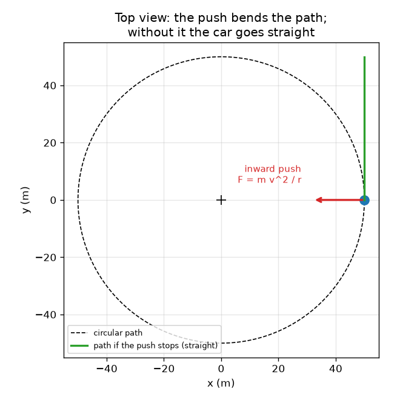
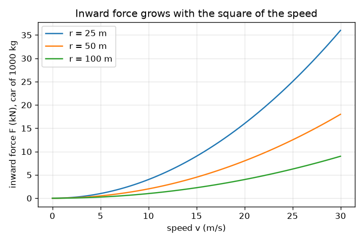

# அமர்வு 1: ஒரு வளைவைச் சுற்றிச் செல்ல உள்நோக்கிய தள்ளல் தேவை

[Session 1 — हिन्दी](README.hi.md)

*நிலை 1 (கருத்தியல் ஊடாடும் மாதிரி) · சுமார் 60 நிமிடங்கள் · opencentripetal*

> இது எளிமைப்படுத்தப்பட்ட ஒரு கல்வி மாதிரி. இது சரிபார்க்கப்பட்ட (validated) வடிவமைப்புக் கருவி அல்ல; உண்மையான கட்டமைப்புகள், மின் நிறுவல்கள், வாகனங்கள், தொழிற்சாலை செயல்முறைகள் அல்லது மருத்துவ முடிவுகளுக்கு இதைப் பயன்படுத்தக் கூடாது.

**முன்தேவைகள் (Prerequisites)**

- பெருக்கல், வகுத்தல் மற்றும் வர்க்கங்கள் (squares).
- நீங்கள் PRIMER.md படித்து, `python start.py 1` ஒருமுறை இயக்கியுள்ளீர்கள்.

**கற்றல் நோக்கங்கள் (Learning objectives).** இந்த அமர்வுக்குப் பிறகு நீங்கள்:

- வளைவில் செல்லும் ஒரு காருக்கு வளைவின் மையத்தை நோக்கிய ஒரு விசை (force) ஏன் இருக்க வேண்டும் என்பதை விளக்கலாம்.
- சரியான அலகுகளுடன் a = v^2 / r மற்றும் F = m v^2 / r ஐப் பயன்படுத்தலாம்.
- வெளிநோக்கிய விசை எதுவும் இல்லாமல், நிலைமம் (inertia) மூலம் வெளியே தூக்கி எறியப்படும் உணர்வை விளக்கலாம்.
- வேகத்திற்கு எதிரான உள்நோக்கிய விசையின் வரைபடத்தைப் படித்து, ஆரம் (radius) மாறும்போது அது எவ்வாறு மாறுகிறது என்று கூறலாம்.

## A. நிஜ உலகப் பிரச்சினை
ஒரு வளைவைச் சுற்றிச் செல்லும் காரில், ஏதோ உங்களை வெளியே எறிவது போல் கதவோடு அழுத்தப்படுவதை உணர்கிறீர்கள். ஆனால் கதவு திறந்திருக்கும்போது நீங்கள் ஆரத்தின் வழியே வெளியே பறப்பதில்லை: கார் திரும்பிச் செல்லும்போது நீங்கள் நேராக முன்னே செல்கிறீர்கள். அப்படியானால் உண்மையில் என்ன நடக்கிறது? ஏதோ ஒன்று காரை எப்போதும் உள்நோக்கித் தள்ள வேண்டும்; கொடுக்கப்பட்ட வேகம் மற்றும் ஆரத்திற்கு அது எவ்வளவு வலுவாகத் தள்ள வேண்டும் என்பதே இந்த அமர்வின் கேள்வி.

## B. கருத்தும் கோட்பாடும்
வேகம் (speed) என்பது நீங்கள் எவ்வளவு விரைவாக நகர்கிறீர்கள் என்பது; திசைவேகத்திற்கு (velocity) ஒரு திசையும் உண்டு. ஒரு வட்டத்தில் வேகம் மாறாமல் இருக்கலாம், ஆனால் திசை தொடர்ந்து மாறுகிறது, எனவே திசைவேகம் மாறுகிறது, ஒரு முடுக்கம் (acceleration) உள்ளது. அது வட்டத்தின் மையத்தை நோக்கிச் சுட்டுகிறது, மைய நோக்கு முடுக்கம் (centripetal acceleration) என அழைக்கப்படுகிறது (centripetal என்றால் மையத்தைத் தேடும்). அதை உருவாக்க F = m a என்ற விசை தேவை என்று நியூட்டனின் இரண்டாம் விதி கூறுகிறது. எனவே தேவையான உள்நோக்கிய விசை F = m v^2 / r. வேகத்தை இரட்டிப்பாக்கினால் நான்கு மடங்கு விசை தேவை; ஆரத்தைப் பாதியாக்கினால் இரண்டு மடங்கு விசை தேவை. எதுவும் வெளிநோக்கித் தள்ளுவதில்லை: உள்நோக்கிய தள்ளல் நின்றால் (அறுந்த கயிறு, பனிக்கட்டிச் சாலை), பொருள் நேரான தொடுகோட்டின் (tangent) வழியே நகர்கிறது, இது மையத்திலிருந்து பார்க்கும்போது வெளிநோக்கி நகர்வது போல் தோன்றுகிறது.

| குறியீடு | பொருள் | அலகு |
|---|---|---|
| v | பாதையின் வழியே வேகம் | m/s |
| r | வட்டத்தின் ஆரம் | m |
| m | நிறை (mass) | kg |
| a | மைய நோக்கு (உள்நோக்கிய) முடுக்கம் | m/s^2 |
| F | தேவையான உள்நோக்கிய விசை | N |

**அனுமானங்கள் (Assumptions)**

- முழுமையான வட்டப் பாதையில் மாறா வேகம்.
- கார் m நிறை கொண்ட ஒற்றைப் புள்ளியாகக் கருதப்படுகிறது.
- விசையை எது வழங்குகிறது என்பதை இப்போது கூறவில்லை (அது அமர்வு 2).

$$ a=\frac{v^{2}}{r} $$

$$ F=ma=\frac{m\,v^{2}}{r} $$

$$ F\propto v^{2},\qquad F\propto \frac{1}{r}\quad\text{(at fixed mass)} $$

## C. காட்சி விளக்கம்
முதல் படம் ஒரு வட்டச் சாலையின் மேல் தோற்றம். சிவப்பு உள்நோக்கிய அம்பு உண்மையான விசை, பச்சை அம்பு தொடுகோட்டின் வழியே திசைவேகம், தள்ளல் நின்றால் கார் எங்கே செல்லும் என்பதைப் பச்சை நேர்கோடு காட்டுகிறது: வெளிநோக்கிய விசை எதுவும் இல்லாமல் அது வட்டத்தை விட்டு மையத்திலிருந்து விலகி நகர்கிறது. இரண்டாவது படம் மூன்று ஆரங்களுக்கு 1000 kg காரின் உள்நோக்கிய விசையை வேகத்திற்கு எதிராக வரைகிறது. F, v-இன் வர்க்கத்துடன் வளர்வதால் வளைவுகள் பரவளையங்கள் (parabolas); ஆரம் சிறியதாக இருந்தால் வளைவு செங்குத்தாகிறது.

*மேல் தோற்றம்: உள்நோக்கிய தள்ளல் பாதையை வளைக்கிறது; அது இல்லாமல் கார் தொடுகோட்டின் வழியே நேராகச் செல்கிறது.*

*1000 kg காருக்கு வேகத்திற்கு எதிரான உள்நோக்கிய விசை: ஒரு பரவளையம், சிறிய ஆரத்திற்கு அதிகச் செங்குத்து.*

## D. ஊடாடும் உருவகப்படுத்தல் (Interactive simulation)
பாடத்தை இயக்கவும் (`python start.py 1`), பின்னர் நேரடிச் செயலியைத் திறக்கவும்: [அமர்வு 1: வளைவில் உள்நோக்கிய தள்ளல்](https://krunalpanchal1995.github.io/pan-iit-oss/opencentripetal/session-01/) (அல்லது இந்தக் கோப்புறையிலுள்ள `app.html`). வேகம் மற்றும் ஆர ஸ்லைடர்களை நகர்த்தி, சிவப்பு உள்நோக்கிய அம்பையும் அளவீட்டையும் கவனிக்கவும். பின்னர் வரைபடத்தைத் திறந்து, உங்கள் ஆரத்திற்கான வளைவு இரு மடங்கு ஆரத்திற்கான வளைவுடன் எவ்வாறு ஒப்பிடுகிறது என்று பாருங்கள்.

**சவால்.** 1000 kg காருக்கு உள்நோக்கிய விசையை 2100 N அல்லது அதற்குக் கீழே வைத்துக்கொண்டு 20 m/s அல்லது அதற்கு மேல் ஓட்டவும்.

## E. தீர்க்கப்பட்ட எடுத்துக்காட்டும் சோதனையும்
**பிரச்சினை.** ஒரு 1000 kg கார் 50 m ஆரம் கொண்ட வளைவைச் சுற்றி 10 m/s (36 km/h) வேகத்தில் செல்கிறது. முடுக்கத்தையும் உள்நோக்கிய விசையையும் கண்டறிந்து, வேகத்தை இரட்டிப்பாக்குவதன் விளைவைச் சரிபார்க்கவும்.

1. a = v^2 / r = 10^2 / 50 = 100 / 50 = 2 m/s^2, மையத்தை நோக்கி.
2. F = m a = 1000 * 2 = 2000 N.
3. நியாயச் சரிபார்ப்பு: எடை m g = 1000 * 9.81 = 9810 N, எனவே தள்ளல் எடையின் சுமார் 0.2, ஒரு மென்மையான வளைவு.
4. வேகத்தை 20 m/s ஆக இரட்டிப்பாக்கவும்: F = 1000 * 400 / 50 = 8000 N, நான்கு மடங்கு. 10 m/s-இல் ஆரத்தை 25 m ஆகப் பாதியாக்கவும்: F = 4000 N, இரண்டு மடங்கு.

**விடை.** a = 2 m/s^2 மற்றும் F = 2000 N; வேகத்தை இரட்டிப்பாக்கினால் 8000 N, ஆரத்தைப் பாதியாக்கினால் 4000 N.

**சோதனை.** ஒரு சிறிய பந்தை ஒரு கயிற்றில் கிடைமட்ட வட்டத்தில் சுழற்றவும் (வெளியில், லேசான பந்து, தெளிவான இடம்); v = 2 pi r / T என்ற வேகத்தைக் கண்டறிய 10 சுற்றுகளின் நேரத்தை அளவிடவும்; பின்னர் இரண்டு வேகங்களில் கயிற்றில் நீங்கள் உணரும் இழுவையை ஒப்பிடவும். இரு மடங்கு வேகத்தில் சுமார் நான்கு மடங்கு இழுவையை உணர்வீர்கள். மாறா வேகத்தில் ஒரு முழுமையான வட்டத்திற்கு மாதிரி துல்லியமானது; உண்மையான பந்து ஈர்ப்பு காரணமாகக் கிடைமட்டத்திற்குச் சற்றுக் கீழே தொங்குகிறது, வேகம் கூடியும் குறைந்தும் மாறுகிறது; அதனால்தான் கையால் செய்யும் சோதனை தோராயமாக மட்டுமே ஒத்துப்போகிறது.

## F. மதிப்பீடும் வடிவமைப்புச் சவாலும்
**கேள்வி வகை A: கருத்தியல்.** ஒரு பயணி கூறுகிறார்: 'வளைவில் கார் என்னை வெளியே தள்ளுகிறது'. உண்மையில் என்ன நடக்கிறது என்பதை விளக்கி, கதவு என்ன செய்கிறது என்று கூறவும்.

குறிப்பு

எதுவும் தள்ளாவிட்டால் பயணியின் உடல் என்ன செய்யும் என்றும், எந்தப் பொருள் பயணியை உள்நோக்கித் தள்ளுகிறது என்றும் சிந்தியுங்கள்.

படிப்படியான தீர்வு

எதுவும் பயணியை வெளிநோக்கித் தள்ளுவதில்லை. நிலைமம் காரணமாக உடல் மாறா திசைவேகத்தில் நேர்கோட்டில் தொடர்ந்து நகர முனைகிறது. கார் உள்நோக்கித் திரும்புகிறது, எனவே கதவு (மற்றும் இருக்கை) பயணியை நோக்கி நகர்ந்து உடலின் மீது உள்நோக்கி அழுத்துகிறது, அதற்கு v^2 / r என்ற உள்நோக்கிய முடுக்கத்தைத் தருகிறது. கதவிலிருந்து வரும் அந்தத் தொடு விசையை (contact force) பயணி உணர்ந்து, அதை வெளியே எறியப்படுவதாகப் புரிந்துகொள்கிறார். கதவு திறந்திருந்தால், பயணி தொடுகோட்டின் வழியே நேராக நகர்வார்; இது மையத்திலிருந்து விலகியது, ஆனால் ஆரத்தின் வழியே அல்ல.

**கேள்வி வகை B: எண்ணியல்.** 800 kg கொண்ட ஒரு கார் 30 m ஆரம் கொண்ட வளைவைச் சுற்றி 15 m/s வேகத்தில் செல்கிறது. முடுக்கத்தையும் உள்நோக்கிய விசையையும் கண்டறிந்து, விசையைக் காரின் எடையுடன் ஒப்பிடவும்.

குறிப்பு

முதலில் a = v^2 / r, பின்னர் F = m a; எடை = m g, g = 9.81 m/s^2.

படிப்படியான தீர்வு

a = 15^2 / 30 = 225 / 30 = 7.5 m/s^2. F = 800 * 7.5 = 6000 N. எடை = 800 * 9.81 = 7848 N, எனவே F எடையின் சுமார் 0.76. நியாயச் சரிபார்ப்பு: அலகுகள் m^2/s^2-ஐ m-ஆல் வகுத்தது, அது m/s^2; kg * m/s^2 என்பது N. எடையின் 0.76 தள்ளல் மிகக் கூர்மையான வளைவு: உலர்ந்த சாலையில் சாதாரண டயர்கள் எடையின் சுமார் 0.7 முதல் 0.9 வரை மட்டுமே வழங்க முடியும், எனவே இது வரம்பிற்கு அருகில் உள்ளது.

**கேள்வி வகை C: வரைபடம் மற்றும் உருவகப்படுத்தல் விளக்கம்.** r = 50 m-இல் 1000 kg காருக்கு வேகத்திற்கு எதிரான உள்நோக்கிய விசையின் வரைபடத்தில், 10 m/s மற்றும் 20 m/s-இல் விசை என்ன? வளைவின் வடிவம் என்ன, ஏன்?

குறிப்பு

ஒவ்வொரு வேகத்திற்கும் F = m v^2 / r ஐப் பயன்படுத்தி இரண்டு மதிப்புகளையும் ஒப்பிடவும்.

படிப்படியான தீர்வு

10 m/s-இல் விசை 2000 N (2 kN); 20 m/s-இல் அது 8000 N (8 kN). வளைவு ஒரு பரவளையம், ஏனெனில் F, v-இன் வர்க்கத்திற்கு விகிதசமம்: v-ஐ இரட்டிப்பாக்குவது F-ஐ 4 ஆல் பெருக்குகிறது. இரு மடங்கு ஆரத்திற்கான வளைவு ஒவ்வொரு வேகத்திலும் பாதி உயரத்தில் அதற்குக் கீழே உள்ளது.

**கேள்வி வகை D: வடிவமைப்பு மற்றும் உகப்பாக்கச் (optimisation) சவால்.** வடிவமைப்பு: ஒரு 0.5 kg பந்து 0.8 m ஆரம் கொண்ட கயிற்றில் சுழற்றப்படுகிறது. கயிறு 60 N-இல் அறுகிறது. நீங்கள் அனுமதிக்கக்கூடிய அதிகபட்ச வேகம் என்ன, கயிறு அதன் உடைவு விசையின் பாதிக்கு மேல் ஒருபோதும் சுமக்கக் கூடாது என்றால் நீங்கள் எந்த வேகத்தைத் தேர்வு செய்வீர்கள்?

குறிப்பு

அனுமதிக்கப்பட்ட விசையுடன் F = m v^2 / r ஐ v = sqrt(F r / m) எனத் தீர்க்கவும்.

படிப்படியான தீர்வு

உடைவு விசையில்: v = sqrt(60 * 0.8 / 0.5) = sqrt(96) = 9.80 m/s. உடைவு விசையின் பாதியான 30 N பாதுகாப்பு வரம்புடன்: v = sqrt(30 * 0.8 / 0.5) = sqrt(48) = 6.93 m/s. இந்த வரம்பு வேகத்தில் சுமார் 29 சதவீதத்தைக் குறைக்கிறது, ஏனெனில் v, F-இன் வர்க்கமூலத்துடன் மட்டுமே வளர்கிறது. கயிறு அறும்போது, பந்து தொடுகோட்டின் வழியே நேர்கோட்டில் நகர்கிறது.

[RUBRIC.md](../../RUBRIC.md) மூலம் உங்களை நீங்களே மதிப்பிடுங்கள். தாளில் செய்ய [செயல்பாட்டுத் தாளை](activity_sheet.md) அச்சிடவும்.

## பொதுவான தவறான கருத்துகள்
| பொதுவான தவறான கருத்து | உண்மையில் சரியானது |
|---|---|
| காரைச் சாலையிலிருந்து வெளியே தள்ளும் ஒரு வெளிநோக்கிய 'மைய விலக்கு' (centrifugal) விசை உள்ளது. | எதுவும் வெளிநோக்கித் தள்ளுவதில்லை. ஓர் உள்நோக்கிய விசை அதன் பாதையை வளைக்காவிட்டால் கார் நேராகச் செல்கிறது (நிலைமம்); சாலையிலிருந்து சறுக்குவது உள்நோக்கிய விசையை இழப்பதாகும். |
| மாறா வேகத்தில் முடுக்கம் இல்லை. | முடுக்கம் என்பது திசைவேகத்தின் மாற்றம், திசைவேகத்தில் திசையும் அடங்கும். வட்டத்தில் திசை எப்போதும் மாறுகிறது, எனவே மையத்தை நோக்கி v^2 / r முடுக்கம் உள்ளது. |
| வேகத்தை இரட்டிப்பாக்கினால் தேவையான விசை இரட்டிப்பாகும். | விசை v-இன் வர்க்கத்துடன் மாறுகிறது, எனவே வேகத்தை இரட்டிப்பாக்க நான்கு மடங்கு விசை தேவை. |
| வட்டத்திலிருந்து விடுவிக்கப்பட்ட பந்து ஆரத்தின் வழியே வெளியே பறக்கிறது. | அது தொடுகோட்டின் வழியே, அதற்கு இருந்த வேகத்தில் நேர்கோட்டில் நகர்கிறது. |

## சொற்களஞ்சியம் (Glossary)
- **மைய நோக்கு (centripetal)**: வட்டத்தின் மையத்தை நோக்கிச் செலுத்தப்பட்ட
- **நிலைமம் (inertia)**: ஒரு விசை செயல்படாதவரை ஒரு பொருள் தன் திசைவேகத்தைத் தக்கவைக்கும் போக்கு
- **தொடுகோடு (tangent)**: ஒரு வட்டத்தை ஒரு புள்ளியில் தொடும் நேர்கோடு, அங்குள்ள இயக்கத்தின் திசை
- **நியூட்டன் (N)**: விசையின் அலகு; 1 N, 1 kg-க்கு 1 m/s^2 முடுக்கம் தருகிறது

## நிறைவு
1. [exercises.md](exercises.md)-இல் உள்ள மூன்று நிரலாக்கப் பணிகளைச் செய்யவும்.
2. உங்கள் மாற்றங்களுக்குப் பிறகு `python start.py 1` மீண்டும் இயக்கவும். அது சோதனைச் சாவடியுடன் (checkpoint) முடிகிறது; அது `PASS` அச்சிடும்போது நீங்கள் முடித்துவிட்டீர்கள். (சோதனைச் சாவடி மட்டும்: `python start.py check 1`.)

அடுத்து: [அமர்வு 2](../session-02/README.md)
