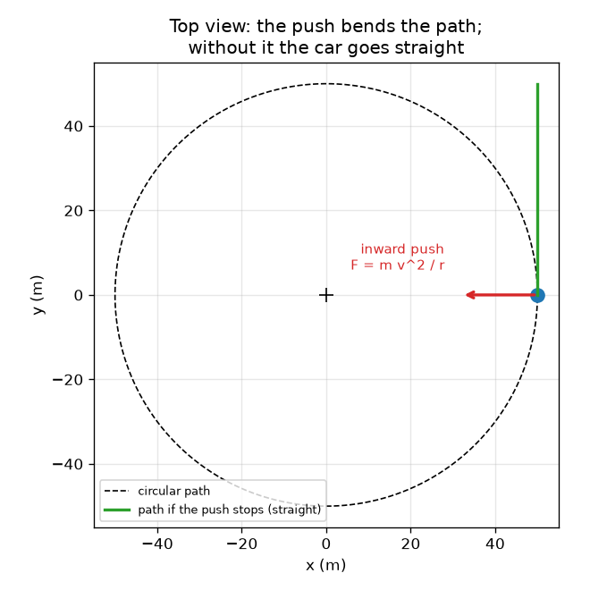
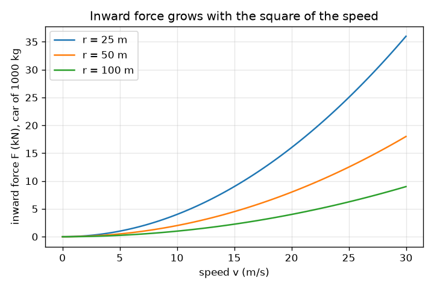

# సెషన్ 1: మలుపు చుట్టూ తిరగడానికి లోపలికి నెట్టడం అవసరం

[Session 1 — हिन्दी](README.hi.md)

*స్థాయి 1 (భావనాత్మక ఇంటరాక్టివ్ నమూనా) · సుమారు 60 నిమిషాలు · opencentripetal*

> ఇది సరళీకరించిన విద్యా నమూనా. ఇది ధృవీకరించబడిన (validated) డిజైన్ సాధనం కాదు; నిజమైన నిర్మాణాలు, విద్యుత్ ఇన్‌స్టలేషన్లు, వాహనాలు, పారిశ్రామిక ప్రక్రియలు లేదా వైద్య నిర్ణయాల కోసం దీనిని ఉపయోగించకూడదు.

**ముందస్తు అవసరాలు (Prerequisites)**

- గుణకారం, భాగహారం మరియు వర్గాలు (squares).
- మీరు PRIMER.md చదివి, `python start.py 1` ఒకసారి రన్ చేశారు.

**అభ్యసన లక్ష్యాలు (Learning objectives).** ఈ సెషన్ తర్వాత మీరు:

- మలుపులో ఉన్న కారుకు మలుపు కేంద్రం వైపు చూపే ఒక బలం (force) ఎందుకు ఉండాలో వివరించగలరు.
- సరైన ప్రమాణాలతో a = v^2 / r మరియు F = m v^2 / r ను ఉపయోగించగలరు.
- బయటికి ఏ బలం లేకుండా, జడత్వం (inertia) ఉపయోగించి బయటికి విసిరివేయబడుతున్న భావనను వివరించగలరు.
- వేగానికి వ్యతిరేకంగా లోపలి బలం గ్రాఫ్‌ను చదివి, వ్యాసార్థం (radius) తో అది ఎలా మారుతుందో చెప్పగలరు.

## A. వాస్తవ ప్రపంచ సమస్య
మలుపు చుట్టూ వెళ్తున్న కారులో, ఏదో మిమ్మల్ని బయటికి విసిరేస్తున్నట్లు తలుపుకు నొక్కబడినట్లు మీకు అనిపిస్తుంది. కానీ తలుపు తెరిచి ఉన్నప్పుడు మీరు వ్యాసార్థం వెంట బయటికి ఎగిరిపోరు: కారు దూరంగా తిరుగుతుండగా మీరు నేరుగా ముందుకు వెళ్తారు. మరి నిజంగా ఏమి జరుగుతుంది? ఏదో ఒకటి కారును ఎల్లప్పుడూ లోపలికి నెట్టాలి; ఇచ్చిన వేగం మరియు వ్యాసార్థానికి అది ఎంత బలంగా నెట్టాలి అనేదే ఈ సెషన్ ప్రశ్న.

## B. భావన మరియు సిద్ధాంతం
వడి (speed) అంటే మీరు ఎంత వేగంగా కదులుతున్నారు అనేది; వేగానికి (velocity) ఒక దిశ కూడా ఉంటుంది. వృత్తంపై వడి స్థిరంగా ఉండవచ్చు కానీ దిశ మారుతూనే ఉంటుంది, కాబట్టి వేగం మారుతుంది మరియు త్వరణం (acceleration) ఉంటుంది. అది వృత్త కేంద్రం వైపు చూపుతుంది మరియు దానిని అభికేంద్ర త్వరణం (centripetal acceleration) అంటారు (centripetal అంటే కేంద్రాన్ని కోరే). దానిని ఉత్పత్తి చేయడానికి F = m a బలం అవసరమని న్యూటన్ రెండవ నియమం చెబుతుంది. కాబట్టి అవసరమైన లోపలి బలం F = m v^2 / r. వడిని రెట్టింపు చేస్తే నాలుగు రెట్లు బలం అవసరం; వ్యాసార్థాన్ని సగం చేస్తే రెట్టింపు బలం అవసరం. ఏదీ బయటికి నెట్టదు: లోపలికి నెట్టడం ఆగిపోయినప్పుడు (తెగిన తాడు, మంచు రోడ్డు), వస్తువు సరళ స్పర్శరేఖ (tangent) వెంట కదులుతుంది, ఇది కేంద్రం నుండి చూస్తే బయటికి కదులుతున్నట్లు కనిపిస్తుంది.

| గుర్తు | అర్థం | ప్రమాణం |
|---|---|---|
| v | మార్గం వెంట వడి | m/s |
| r | వృత్త వ్యాసార్థం | m |
| m | ద్రవ్యరాశి (mass) | kg |
| a | అభికేంద్ర (లోపలి) త్వరణం | m/s^2 |
| F | అవసరమైన లోపలి బలం | N |

**ఊహలు (Assumptions)**

- పూర్తిగా వృత్తాకార మార్గంపై స్థిర వడి.
- కారును m ద్రవ్యరాశి గల ఒకే బిందువుగా పరిగణిస్తాము.
- బలాన్ని ఏది అందిస్తుందో ఇంకా చెప్పడం లేదు (అది సెషన్ 2).

$$ a=\frac{v^{2}}{r} $$

$$ F=ma=\frac{m\,v^{2}}{r} $$

$$ F\propto v^{2},\qquad F\propto \frac{1}{r}\quad\text{(at fixed mass)} $$

## C. దృశ్య వివరణ
మొదటి చిత్రం వృత్తాకార రోడ్డు పై నుండి దృశ్యం. ఎరుపు లోపలి బాణం నిజమైన బలం, ఆకుపచ్చ బాణం స్పర్శరేఖ వెంట వేగం, మరియు నెట్టడం ఆగిపోతే కారు ఎక్కడికి వెళ్తుందో ఆకుపచ్చ సరళరేఖ చూపిస్తుంది: బయటి బలం ఏదీ లేకుండానే అది వృత్తాన్ని వదిలి కేంద్రం నుండి దూరంగా కదులుతుంది. రెండవ చిత్రం మూడు వ్యాసార్థాలకు 1000 kg కారు లోపలి బలాన్ని వడికి వ్యతిరేకంగా చూపిస్తుంది. F, v వర్గంతో పెరుగుతుంది కాబట్టి వక్రాలు పరావలయాలు (parabolas), మరియు వ్యాసార్థం ఎంత చిన్నదైతే వక్రం అంత నిటారుగా ఉంటుంది.

*పై నుండి దృశ్యం: లోపలికి నెట్టడం మార్గాన్ని వంచుతుంది; అది లేకుంటే కారు స్పర్శరేఖ వెంట నేరుగా వెళ్తుంది.*

*1000 kg కారుకు వడికి వ్యతిరేకంగా లోపలి బలం: ఒక పరావలయం, చిన్న వ్యాసార్థానికి మరింత నిటారు.*

## D. ఇంటరాక్టివ్ సిమ్యులేషన్
పాఠాన్ని రన్ చేయండి (`python start.py 1`), తర్వాత లైవ్ యాప్‌ను తెరవండి: [సెషన్ 1: మలుపులో లోపలికి నెట్టడం](https://krunalpanchal1995.github.io/pan-iit-oss/opencentripetal/session-01/) (లేదా ఈ ఫోల్డర్‌లోని `app.html`). వడి మరియు వ్యాసార్థం స్లైడర్లను కదిలించి ఎరుపు లోపలి బాణాన్ని మరియు రీడౌట్‌ను గమనించండి. తర్వాత గ్రాఫ్‌ను తెరిచి మీ వ్యాసార్థం వక్రం రెట్టింపు వ్యాసార్థం వక్రంతో ఎలా పోలుస్తుందో చూడండి.

**సవాలు.** 1000 kg కారుకు లోపలి బలాన్ని 2100 N లేదా అంతకంటే తక్కువగా ఉంచుతూ 20 m/s లేదా అంతకంటే ఎక్కువ వడితో నడపండి.

## E. సాధించిన ఉదాహరణ మరియు ప్రయోగం
**సమస్య.** ఒక 1000 kg కారు 50 m వ్యాసార్థం గల మలుపు చుట్టూ 10 m/s (36 km/h) వడితో వెళ్తుంది. త్వరణాన్ని మరియు లోపలి బలాన్ని కనుగొని, వడిని రెట్టింపు చేయడం ప్రభావాన్ని తనిఖీ చేయండి.

1. a = v^2 / r = 10^2 / 50 = 100 / 50 = 2 m/s^2, కేంద్రం వైపు.
2. F = m a = 1000 * 2 = 2000 N.
3. సహేతుకత తనిఖీ: బరువు m g = 1000 * 9.81 = 9810 N, కాబట్టి నెట్టడం బరువులో సుమారు 0.2, ఒక మృదువైన మలుపు.
4. వడిని 20 m/s కి రెట్టింపు చేయండి: F = 1000 * 400 / 50 = 8000 N, నాలుగు రెట్లు. 10 m/s వద్ద వ్యాసార్థాన్ని 25 m కి సగం చేయండి: F = 4000 N, రెట్టింపు.

**సమాధానం.** a = 2 m/s^2 మరియు F = 2000 N; వడిని రెట్టింపు చేస్తే 8000 N, వ్యాసార్థాన్ని సగం చేస్తే 4000 N.

**ప్రయోగం.** ఒక చిన్న బంతిని తాడుకు కట్టి క్షితిజ సమాంతర వృత్తంలో తిప్పండి (బయట, తేలికైన బంతి, ఖాళీ స్థలం); v = 2 pi r / T వడిని కనుగొనడానికి 10 భ్రమణాల సమయాన్ని కొలవండి; తర్వాత రెండు వడుల వద్ద తాడుపై మీకు అనిపించే లాగుడును పోల్చండి. రెట్టింపు వడి వద్ద సుమారు నాలుగు రెట్లు లాగుడు అనిపిస్తుంది. స్థిర వడితో పరిపూర్ణ వృత్తానికి నమూనా ఖచ్చితమైనది; నిజమైన బంతి గురుత్వాకర్షణ వల్ల క్షితిజ సమాంతరం కంటే కొంచెం కిందికి వేలాడుతుంది మరియు వడి పెరుగుతూ తగ్గుతూ ఉంటుంది, అందుకే చేతితో చేసే ప్రయోగం సుమారుగా మాత్రమే సరిపోతుంది.

## F. మూల్యాంకనం మరియు డిజైన్ సవాలు
**ప్రశ్న రకం A: భావనాత్మక.** ఒక ప్రయాణికుడు అంటాడు: 'మలుపులో కారు నన్ను బయటికి నెడుతుంది'. నిజంగా ఏమి జరుగుతుందో వివరించి, తలుపు ఏమి చేస్తుందో చెప్పండి.

సూచన

ఏదీ నెట్టకపోతే ప్రయాణికుడి శరీరం ఏమి చేస్తుంది, మరియు ఏ వస్తువు ప్రయాణికుడిని లోపలికి నెడుతుందో ఆలోచించండి.

దశలవారీ పరిష్కారం

ఏదీ ప్రయాణికుడిని బయటికి నెట్టదు. జడత్వం వల్ల శరీరం స్థిర వేగంతో సరళరేఖలో కదులుతూ ఉండటానికి మొగ్గు చూపుతుంది. కారు లోపలికి తిరుగుతుంది, కాబట్టి తలుపు (మరియు సీటు) ప్రయాణికుడి వైపు కదిలి శరీరంపై లోపలికి నొక్కుతుంది, దానికి v^2 / r లోపలి త్వరణాన్ని ఇస్తుంది. తలుపు నుండి వచ్చే ఆ స్పర్శ బలాన్ని (contact force) ప్రయాణికుడు అనుభవించి, దానిని బయటికి విసిరివేయబడటంగా అర్థం చేసుకుంటాడు. తలుపు తెరిచి ఉంటే, ప్రయాణికుడు స్పర్శరేఖ వెంట నేరుగా కదులుతాడు, ఇది కేంద్రం నుండి దూరంగా ఉంటుంది కానీ వ్యాసార్థం వెంట కాదు.

**ప్రశ్న రకం B: సంఖ్యాత్మక.** 800 kg కారు 30 m వ్యాసార్థం గల మలుపు చుట్టూ 15 m/s వడితో వెళ్తుంది. త్వరణాన్ని మరియు లోపలి బలాన్ని కనుగొని, బలాన్ని కారు బరువుతో పోల్చండి.

సూచన

మొదట a = v^2 / r, తర్వాత F = m a; బరువు = m g, g = 9.81 m/s^2.

దశలవారీ పరిష్కారం

a = 15^2 / 30 = 225 / 30 = 7.5 m/s^2. F = 800 * 7.5 = 6000 N. బరువు = 800 * 9.81 = 7848 N, కాబట్టి F బరువులో సుమారు 0.76. సహేతుకత తనిఖీ: ప్రమాణాలు m^2/s^2 ను m తో భాగిస్తే m/s^2, మరియు kg * m/s^2 అంటే N. బరువులో 0.76 నెట్టడం చాలా పదునైన మలుపు: పొడి రోడ్డుపై సాధారణ టైర్లు బరువులో సుమారు 0.7 నుండి 0.9 వరకు మాత్రమే అందించగలవు, కాబట్టి ఇది పరిమితికి దగ్గరగా ఉంది.

**ప్రశ్న రకం C: గ్రాఫ్ మరియు సిమ్యులేషన్ వ్యాఖ్యానం.** r = 50 m పై 1000 kg కారుకు వడికి వ్యతిరేకంగా లోపలి బలం గ్రాఫ్‌లో, 10 m/s మరియు 20 m/s వద్ద బలం ఎంత? వక్రం ఆకారం ఏమిటి, ఎందుకు?

సూచన

ప్రతి వడికి F = m v^2 / r ఉపయోగించి రెండు విలువలను పోల్చండి.

దశలవారీ పరిష్కారం

10 m/s వద్ద బలం 2000 N (2 kN); 20 m/s వద్ద అది 8000 N (8 kN). వక్రం ఒక పరావలయం, ఎందుకంటే F, v వర్గానికి అనులోమానుపాతంలో ఉంటుంది: v ని రెట్టింపు చేస్తే F 4 తో గుణించబడుతుంది. రెట్టింపు వ్యాసార్థం వక్రం ప్రతి వడి వద్ద సగం ఎత్తులో దాని కింద ఉంటుంది.

**ప్రశ్న రకం D: డిజైన్ మరియు ఆప్టిమైజేషన్ (optimisation) సవాలు.** డిజైన్: 0.5 kg బంతిని 0.8 m వ్యాసార్థం గల తాడుపై తిప్పుతారు. తాడు 60 N వద్ద తెగుతుంది. మీరు అనుమతించగల గరిష్ట వడి ఎంత, మరియు తాడు ఎప్పుడూ దాని తెగే బలంలో సగం కంటే ఎక్కువ మోయకూడదంటే మీరు ఏ వడిని ఎంచుకుంటారు?

సూచన

అనుమతించిన బలంతో F = m v^2 / r ను v = sqrt(F r / m) గా సాధించండి.

దశలవారీ పరిష్కారం

తెగే బలం వద్ద: v = sqrt(60 * 0.8 / 0.5) = sqrt(96) = 9.80 m/s. తెగే బలంలో సగమైన 30 N భద్రతా మార్జిన్‌తో: v = sqrt(30 * 0.8 / 0.5) = sqrt(48) = 6.93 m/s. మార్జిన్ వడిలో సుమారు 29 శాతం తగ్గిస్తుంది, ఎందుకంటే v, F వర్గమూలంతో మాత్రమే పెరుగుతుంది. తాడు తెగినప్పుడు, బంతి స్పర్శరేఖ వెంట సరళరేఖలో కదులుతుంది.

[RUBRIC.md](../../RUBRIC.md) తో మిమ్మల్ని మీరు స్కోర్ చేసుకోండి. కాగితంపై చేయడానికి [కార్యాచరణ పత్రాన్ని](activity_sheet.md) ప్రింట్ చేయండి.

## సాధారణ అపోహలు
| సాధారణ అపోహ | వాస్తవంగా నిజమైనది |
|---|---|
| కారును రోడ్డు నుండి బయటికి నెట్టే బయటి 'అపకేంద్ర' (centrifugal) బలం ఉంది. | ఏదీ బయటికి నెట్టదు. లోపలి బలం దాని మార్గాన్ని వంచకపోతే కారు నేరుగా వెళ్తుంది (జడత్వం); రోడ్డు నుండి జారిపోవడం అంటే లోపలి బలాన్ని కోల్పోవడం. |
| స్థిర వడి వద్ద త్వరణం ఉండదు. | త్వరణం అంటే వేగంలో మార్పు, మరియు వేగంలో దిశ కూడా ఉంటుంది. వృత్తంపై దిశ ఎల్లప్పుడూ మారుతుంది, కాబట్టి కేంద్రం వైపు v^2 / r త్వరణం ఉంటుంది. |
| వడిని రెట్టింపు చేస్తే అవసరమైన బలం రెట్టింపు అవుతుంది. | బలం v వర్గంతో మారుతుంది, కాబట్టి వడిని రెట్టింపు చేయడానికి నాలుగు రెట్లు బలం అవసరం. |
| వృత్తం నుండి విడుదలైన బంతి వ్యాసార్థం వెంట బయటికి ఎగురుతుంది. | అది స్పర్శరేఖ వెంట, దానికి ఉన్న వడితో సరళరేఖలో కదులుతుంది. |

## పదకోశం (Glossary)
- **అభికేంద్ర (centripetal)**: వృత్త కేంద్రం వైపు నిర్దేశించబడిన
- **జడత్వం (inertia)**: బలం పనిచేయనంత వరకు ఒక వస్తువు తన వేగాన్ని నిలుపుకునే ధోరణి
- **స్పర్శరేఖ (tangent)**: వృత్తాన్ని ఒక బిందువు వద్ద తాకే సరళరేఖ, అక్కడ చలన దిశ
- **న్యూటన్ (N)**: బలానికి ప్రమాణం; 1 N, 1 kg కి 1 m/s^2 త్వరణాన్ని ఇస్తుంది

## ముగింపు
1. [exercises.md](exercises.md) లోని మూడు కోడింగ్ పనులను చేయండి.
2. మీ మార్పుల తర్వాత `python start.py 1` మళ్ళీ రన్ చేయండి. అది చెక్‌పాయింట్‌తో ముగుస్తుంది; అది `PASS` ప్రింట్ చేసినప్పుడు మీరు పూర్తి చేశారు. (చెక్‌పాయింట్ మాత్రమే: `python start.py check 1`.)

తర్వాత: [సెషన్ 2](../session-02/README.md)
