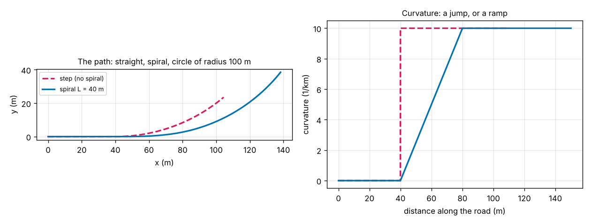
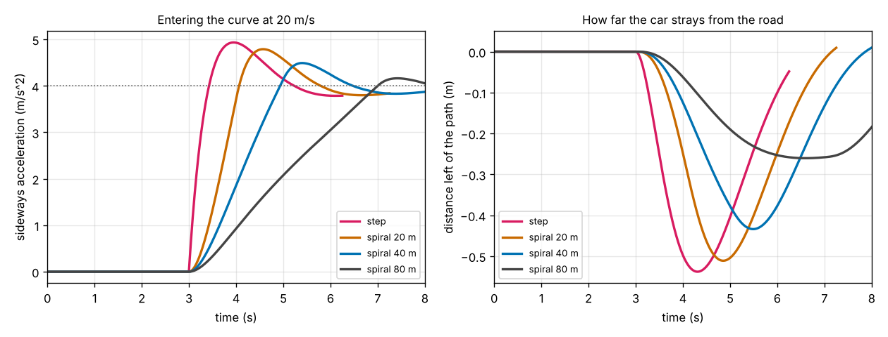
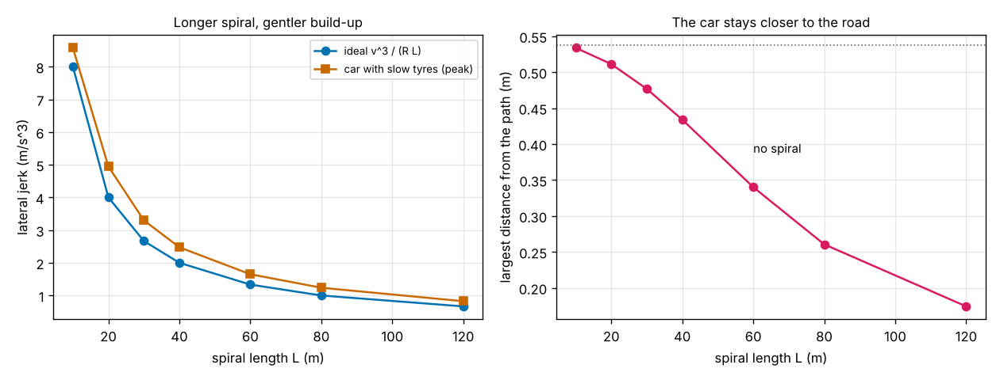

# Session 4: A transition spiral into the curve

*Level 3 (simulation and validation) · about 90 minutes · opencentripetal*

> This is a simplified educational model. It is not a validated design tool and must not be used for real structures, electrical installations, vehicles, industrial processes or medical decisions.

**Prerequisites**

- Session 1: a = v^2 / r, the sideways acceleration on a circle.
- Session 3: the simulated car with a friction limit, and its limit speeds.

**Learning objectives.** After this session you can:

- Describe a path made of a straight, a clothoid (spiral) and a circular arc, with its curvature and heading.
- Show that the sideways acceleration on a spiral rises at a constant rate v^3 / (R L), and use that to find the shortest spiral for a jerk limit.
- Compute the shift of the circle caused by the spiral and check it against L^2 / (24 R).
- Test a car with slow tyres on the path and compare the step of Session 3 with a spiral.
- Explain why a spiral does not raise the speed that the tyres can hold.

## A. Real-world problem
In Session 3 the car met the curve with a step. On a curve of radius 100 m at 20 m/s the sideways acceleration is v^2 / R = 4 m/s^2, and on the straight just before it is zero: the model demands the whole 4 m/s^2 in an instant. Roads and railways do not do that. They insert a transition spiral, a clothoid, whose curvature grows in proportion to the distance, so the passengers' sideways force builds up smoothly. How long must the spiral be for a given comfort limit? How far does it move the curve? And how much better does a car with slightly slow tyres and steering follow it? (Educational model: not for road design.)

## B. Concept and theory
Curvature kappa is one over the radius of the bend: 0 on a straight, 1 / R on the circle. On a spiral of length L we let it rise linearly, kappa(s) = s / (R L), so that it reaches 1 / R exactly at the end. The heading of the road is the integral of the curvature, theta(s) = s^2 / (2 R L), and the position follows from x = the integral of cos(theta) ds and y = the integral of sin(theta) ds (the Fresnel integrals), which the lesson sums as a series.

At speed v the sideways acceleration is a = v^2 kappa. On the spiral s = v t, so a = v^3 t / (R L): it grows in proportion to time. The rate of change of the sideways acceleration is called the lateral jerk, and here it is constant, j = v^3 / (R L). For a limit j_max the shortest spiral is L = v^3 / (R j_max), driven in L / v seconds. Doubling the speed multiplies the jerk by 8 for the same spiral. A spiral also moves the circle inwards by a shift p, which for a short spiral is about L^2 / (24 R).

The new car model: the point-mass car of Session 3 follows the path at constant speed, with a driver who asks for a_cmd = v^2 kappa minus feedback on the distance d to the left of the road and its rate (gains 1.0 and 1.4 as in Session 3). The change: tyres and steering need time to build force, so the actual acceleration follows the request with a lag, da/dt = (a_cmd - a) / tau, with tau = 0.25 s (a made-up value), and can never exceed mu g. It is stepped in time with the 4th-order Runge-Kutta method.

| Symbol | Meaning | Unit |
|---|---|---|
| R | radius of the circular curve | m |
| L | length of the spiral (0 means the step of Session 3) | m |
| kappa | curvature, 1 / radius of the bend | 1/m |
| theta | heading angle of the road | rad |
| v | constant speed | m/s |
| a | sideways acceleration, v^2 kappa | m/s^2 |
| j | lateral jerk, the rate of change of a | m/s^3 |
| p | shift of the circle caused by the spiral | m |
| tau | lag of the tyre force | s |
| mu | friction coefficient (0.8 for dry) | no unit |

**Assumptions**

- Constant speed on a flat road, a left turn, the point-mass car of Session 3 (no weight transfer, no body roll).
- The spiral turns the road by less than 1 radian (L is at most 2 R).
- Tyre lag tau = 0.25 s and the driver gains are made-up round numbers, not measured values.
- The jerk limit is an assumed design value. A 1994 AASHTO excerpt hosted by the University of Idaho says a rate of 1 m/s^3 is generally accepted for railways and values from 1 to 3 have been used for highways; check the current standard for real work.
- Educational model only; not a road design tool.

$$ \kappa(s)=\frac{s}{R\,L},\qquad \theta(s)=\frac{s^2}{2\,R\,L},\qquad x=\int_0^s\cos\theta\,ds,\quad y=\int_0^s\sin\theta\,ds $$

$$ a=v^2\kappa=\frac{v^3\,t}{R\,L},\qquad j=\frac{da}{dt}=\frac{v^3}{R\,L},\qquad L_{\min}=\frac{v^3}{R\,j_{\max}},\qquad p\approx\frac{L^2}{24\,R} $$

$$ \dot a=\frac{a_{\mathrm{cmd}}-a}{\tau},\qquad a_{\mathrm{cmd}}=v^2\kappa-K_P\,d-K_D\,\dot d,\qquad |a_{\mathrm{cmd}}|\le \mu g $$

## C. Visual explanation
The first figure shows the path (left): the magenta dashed path jumps from the straight into the circle, while the blue path eases in through a 40 m spiral, which moves the circle slightly inwards; the curvature (right) is a jump for the step and a ramp for the spiral. The second figure shows the car entering the curve at 20 m/s: the sideways acceleration (left) and the distance from the road (right) for a step and for spirals of 20, 40 and 80 m. With a step the acceleration shoots up and overshoots to 4.93 m/s^2 before settling at 4.0; the longer the spiral the gentler the rise and the smaller the overshoot (4.49 for 40 m, 4.16 for 80 m). The third figure plots the peak jerk (left) and the largest distance from the road (right) against the spiral length.

*The path with and without a spiral (left) and the curvature along it (right).*

*Sideways acceleration (left) and distance from the road (right) for a car entering the curve at 20 m/s, with a step and with spirals of 20, 40 and 80 m.*

*Peak lateral jerk (left) and largest distance from the road (right) against the spiral length.*

Car entering a curve of radius 100 m at 20 m/s (steady sideways acceleration 4.0 m/s^2), with a tyre lag of 0.25 s:

| Spiral | Ideal jerk v^3 / (R L) | Peak jerk of the car | Peak sideways acceleration | Largest distance from the road | Shift |
|---|---|---|---|---|---|
| none (step) | infinite | 15.7 m/s^3 | 4.93 m/s^2 | 0.54 m | 0 |
| 20 m | 4.0 m/s^3 | 4.95 m/s^3 | 4.79 m/s^2 | 0.51 m | 0.17 m |
| 40 m | 2.0 m/s^3 | 2.47 m/s^3 | 4.49 m/s^2 | 0.43 m | 0.67 m |
| 80 m | 1.0 m/s^3 | 1.24 m/s^3 | 4.16 m/s^2 | 0.26 m | 2.65 m |

## D. Interactive simulation
Run the lesson (`python start.py 4`), then open the live app: [Session 4: the transition spiral](https://krunalpanchal1995.github.io/pan-iit-oss/opencentripetal/session-04/) (or `app.html` in this folder). Change the speed, the radius, the spiral length and the tyre lag. The first view shows the road and the car, the second the sideways acceleration (ideal and actual), the third the distance from the road. The presets show the step, the 40 m spiral, a speed beyond the grip, and near-instant tyres.

**Challenge.** At 20 m/s on a curve of radius 100 m, find the shortest spiral (steps of 5 m) that keeps the ideal lateral jerk at or below 1.0 m/s^3.

## E. Worked example and experiment
**Problem.** A car drives at 20 m/s into a curve of radius 100 m. Find the steady sideways acceleration, the shortest spiral that keeps the lateral jerk at 2.0 m/s^3, the time it takes, the heading change and the shift of the circle.

1. The steady sideways acceleration is a = v^2 / R = 400 / 100 = 4.0 m/s^2, the number the step of Session 3 demands at once.
2. The shortest spiral for j = 2.0 m/s^3 is L = v^3 / (R j) = 8000 / (100 x 2.0) = 40 m.
3. Driving it takes L / v = 40 / 20 = 2.0 s, during which the acceleration rises from 0 to 4.0 m/s^2 at 4.0 / 2.0 = 2.0 m/s^3, as designed.
4. The heading changes by theta = L / (2 R) = 40 / 200 = 0.200 rad = 11.46 degrees along the spiral.
5. The shift is about L^2 / (24 R) = 1600 / 2400 = 0.667 m (the exact path gives 0.6657 m).
6. With slow tyres (tau = 0.25 s) the simulated car has a peak jerk of 2.47 m/s^3 on this spiral, against 15.7 m/s^3 on the step.

**Answer.** Spiral of 40 m, driven in 2.0 s, heading change 0.200 rad, shift 0.67 m; the jerk is exactly 2.0 m/s^3 in the ideal model.

**Experiment.** Hang a small weight on a thread from a stick fixed upright on a toy cart or a wheeled tray, and pull the cart by a string round a bend marked on a table with tape: once as a straight joined suddenly to a circle, once with the tape bent gradually into the circle over the same distance. Film the thread from above and compare how fast the weight swings out. The model predicts a smoother swing with the gradual join, and the same final angle (the same final acceleration) in both. Expect differences: your pulling speed will not be constant and the thread swings and oscillates; the lag in the model is only a rough stand-in.

## Real-world application and mini-project: Design the spiral for a road curve
A road curve has radius R = 150 m. Design the transition spiral for design speeds of 50, 70 and 90 km/h with a lateral jerk limit of 2.0 m/s^3 (an assumed value inside the range quoted for highways; see the assumptions). Use `design_spiral`, `entry_metrics` and `follow_path` from Session 4: for each speed find the shortest spiral rounded up to a multiple of 5 m, the jerk it gives, its shift and the time it takes, then compare the car on this spiral with the car on a step.

**Deliverable:** A script that prints, for each design speed, the exact and rounded spiral length, the jerk, the shift, the driving time, and the peak jerk and the largest distance from the road of the car on the spiral and on the step; a figure of the sideways acceleration against time for the three speeds; and two sentences on whether a spiral matters at 50 km/h.

**Success looks like:** The spirals are 10, 25 and 55 m (minimum 8.9, 24.5 and 52.1 m), giving jerks of 1.79, 1.96 and 1.89 m/s^3, shifts of 0.03, 0.17 and 0.84 m, and times of 0.7, 1.3 and 2.2 s. The simulated car has peak jerks of 2.2, 2.4 and 2.3 m/s^3 on the spirals, against 5.0, 9.7 and 16.3 m/s^3 on the step; the largest distance from the road is 0.17, 0.31 and 0.44 m with the spiral against 0.17, 0.34 and 0.56 m with the step. At 50 km/h the spiral changes the sideways error by almost nothing but still cuts the jerk by a factor of 2.3.

## F. Assessment and design challenge
**Question type A: Conceptual.** Why does a spiral whose curvature grows linearly with the distance give a constant lateral jerk, and what happens to the jerk if the speed doubles?

Hint

Write the sideways acceleration a = v^2 kappa, put in kappa = s / (R L) and s = v t.

Step-by-step solution

a = v^2 kappa = v^2 s / (R L) and with s = v t this is a = v^3 t / (R L): proportional to time, so its rate of change j = v^3 / (R L) is constant. The jerk grows with the cube of the speed: at double speed the same spiral gives 2^3 = 8 times the jerk, so to keep the same jerk the spiral must be 8 times longer.

**Question type B: Numerical.** A curve of radius 300 m is to be driven at 90 km/h (25 m/s) with a lateral jerk of at most 1.0 m/s^3. Find the steady sideways acceleration, the shortest spiral (rounded up to a multiple of 5 m), the jerk it gives, the time to drive it and the shift.

Hint

L = v^3 / (R j), then j = v^3 / (R L) with the rounded L, and p = L^2 / (24 R).

Step-by-step solution

a = v^2 / R = 625 / 300 = 2.08 m/s^2. L_min = 25^3 / (300 x 1.0) = 15625 / 300 = 52.1 m, rounded up to 55 m. The jerk is 15625 / (300 x 55) = 0.947 m/s^3 (below the limit, because we rounded up). The time is 55 / 25 = 2.2 s and the shift is 55^2 / (24 x 300) = 3025 / 7200 = 0.42 m.

**Question type C: Graph and simulation interpretation.** In the second figure the car on the 40 m spiral reaches a sideways acceleration of 4.49 m/s^2 before settling at 4.0, and its peak jerk is 2.47 m/s^3, although the ideal jerk of this spiral is 2.0. Why? What changes if the tyres were almost instant?

Hint

Think about the lag tau and about what the driver's feedback does when the car falls behind the road.

Step-by-step solution

The tyre force trails the request by about tau = 0.25 s, so the car falls a little behind the road, the feedback asks for extra sideways acceleration to catch up, and the car then overshoots (4.49 against 4.0) and its jerk during the catching up is above the ideal 2.0 (2.47). The simulation confirms this reading: with tau = 0.01 s the car follows the road to 0.015 m, the peak jerk is 2.03 m/s^3, essentially the ideal v^3 / (R L) = 2.0. A longer spiral (80 m) reduces both the overshoot (4.16) and the peak jerk (1.24).

**Question type D: Design and optimisation challenge.** A road curve of radius 150 m must carry 90 km/h with a spiral for a jerk limit of 2.0 m/s^3 (spiral of 55 m). Is the road safe on a wet surface with mu = 0.4? Does a longer spiral help?

Hint

Compare the steady sideways acceleration v^2 / R with mu g. The spiral only changes how the acceleration builds up.

Step-by-step solution

The steady sideways acceleration at 25 m/s on R = 150 m is 625 / 150 = 4.17 m/s^2, but a wet flat road gives only mu g = 0.4 x 9.81 = 3.92 m/s^2: the demand is above the grip, so a car at 90 km/h cannot hold the curve on a wet road, whatever the spiral. The wet limit is sqrt(mu g R) = sqrt(3.924 x 150) = 24.3 m/s = 87.3 km/h on a flat road, and a posted limit needs a margin below that. A longer spiral does not help: the spiral only smooths the build-up, while the grip limit depends on v^2 / R. (In the simulation a car at 29 m/s on R = 100 m, which demands 8.41 against a grip of 7.85 m/s^2, still runs 2.6 m off the road with an 80 m spiral.) The spiral is fixed by comfort, the speed limit by grip: both must be checked.

Score yourself with [RUBRIC.md](../../RUBRIC.md). Print the [activity sheet](activity_sheet.md) to work on paper.

## Common misconceptions
| Common misconception | What is actually true |
|---|---|
| A spiral makes the curve less sharp. | The circle still has the same radius R and the same steady acceleration v^2 / R; the spiral only builds the curvature up gradually, and it moves the circle inwards by about L^2 / (24 R). |
| A longer spiral is always better. | It lowers the jerk (v^3 / (R L)) but needs more land and moves the circle further inwards (2.65 m for 80 m on R = 100 m); the jerk limit sets the shortest useful length. |
| The jerk depends on the curve only. | It depends on the cube of the speed: at the same spiral, 90 km/h gives (90 / 50)^3 = 5.8 times the jerk of 50 km/h. |
| A spiral raises the speed the tyres can hold. | The grip limit depends on the steady v^2 / R; at 29 m/s on R = 100 m the car runs 2.6 m off the road even with an 80 m spiral. |
| The road has a kink where the curve starts. | The step is in the curvature, not in the position or the direction: the path is smooth in both, but the sideways acceleration jumps. |

## Glossary
- **curvature**: one over the radius of the bend; 0 on a straight
- **clothoid (Euler spiral)**: a curve whose curvature grows in proportion to the distance along it
- **transition spiral**: a clothoid between a straight and a circle (or between two circles)
- **lateral jerk**: the rate of change of the sideways acceleration, in m/s^3
- **shift**: how far the spiral moves the circle inwards from the line of the straight, about L^2 / (24 R)
- **lag (time constant)**: the time a force takes to build up in the tyres and steering

## Finish
1. Do the three coding tasks in [exercises.md](exercises.md).
2. Run `python start.py 4` again after your changes. It ends with the checkpoint; when it prints `PASS`, you are done. (Checkpoint only: `python start.py check 4`.)

Next: the [roadmap](../../promo/roadmap.md). Session 5 is yours to build.
