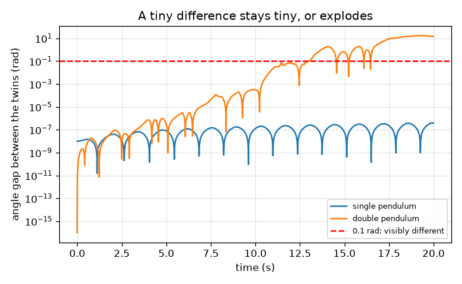
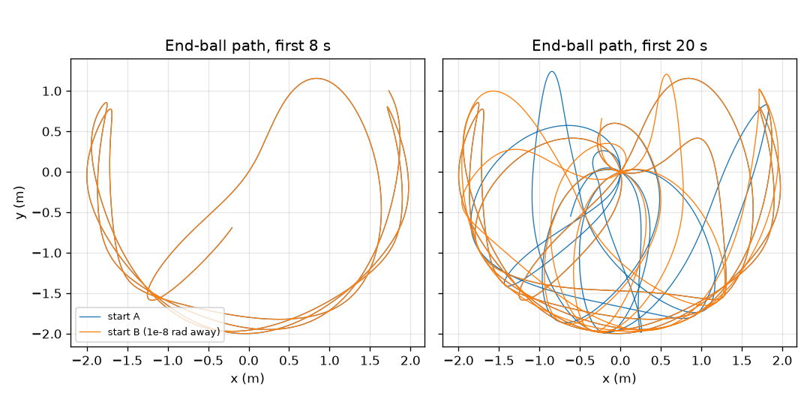

# सत्र 1: लगभग एक जैसी दो शुरुआतें अलग-अलग हो जाती हैं

*स्तर 1 (अवधारणात्मक इंटरैक्टिव मॉडल) · लगभग 60 मिनट · openchaos*

> यह एक सरलीकृत शैक्षिक मॉडल है। यह कोई प्रमाणित डिज़ाइन उपकरण नहीं है और इसका उपयोग वास्तविक संरचनाओं, विद्युत संस्थापनों, वाहनों, औद्योगिक प्रक्रियाओं या चिकित्सा निर्णयों के लिए नहीं किया जाना चाहिए।

**पूर्वापेक्षाएँ (Prerequisites)**

- स्कूल स्तर की त्रिकोणमिति: साइन (sine) और कोण।
- आपने PRIMER.md पढ़ लिया है और `python start.py 1` एक बार चला लिया है।

**सीखने के उद्देश्य (Learning objectives)।** इस सत्र के बाद आप:

- समझा सकेंगे कि एक सरल लोलक (pendulum) पूर्वानुमेय क्यों है और लगभग एक जैसी दो शुरुआतों के लिए इसका क्या अर्थ है।
- रुंगे-कुट्टा 4 (Runge-Kutta 4) नियम से एकल और दोहरे लोलक (double pendulum) का सिमुलेशन कर सकेंगे।
- माप सकेंगे कि 1e-8 rad का प्रारंभिक अंतर हर निकाय में कैसे बढ़ता है।
- लघुगणकीय पैमाने (log scale) वाला ग्राफ़ पढ़ सकेंगे और बता सकेंगे कि कोई अंतर कितनी तेज़ी से बढ़ता है।

## A. वास्तविक दुनिया की समस्या
एक पुरानी लंगर घड़ी (grandfather clock) हर बार एक ही तरह झूलती है: अगर आप जानते हैं कि वह कैसे शुरू होती है, तो आप जानते हैं कि एक घंटे बाद वह कहाँ होगी। पहले लोलक के सिरे से एक दूसरा लोलक लटका दें और गति यादृच्छिक (random) लगने लगती है। क्या यह सच में यादृच्छिक है, या यह ऐसे नियमों का पालन करती है जिन्हें हम पर्याप्त दूर तक अनुसरण ही नहीं कर पाते? दो दोहरे लोलकों को ऐसे प्रारंभिक कोणों से छोड़ें जो एक रेडियन के सौ-करोड़वें भाग से अलग हों, और स्वयं देखें।

## B. अवधारणा और सिद्धांत
लोलक एक छड़ पर लगी गेंद है जो गुरुत्व के कारण झूलती है। इसका कोण theta, जो सीधे नीचे की दिशा से मापा जाता है, theta'' = -(g / L) sin(theta) का पालन करता है: गुरुत्व का तल की ओर वापस खिंचाव sin(theta) के समानुपाती है। छोटे झूलों के लिए sin(theta) लगभग theta होता है और झूलने का समय T = 2 pi sqrt(L / g) है। दोहरे लोलक में पहली गेंद से एक दूसरी छड़ लटकी होती है, इसलिए दो कोण (ऊपरी छड़ के लिए theta1, निचली छड़ के लिए theta2) और दो कोणीय चाल उसका वर्णन करते हैं; निचली गेंद को गुरुत्व और ऊपरी गेंद की गति दोनों खींचते हैं। नियम सटीक है और उसमें कोई यादृच्छिकता नहीं है: एक ही शुरुआत हमेशा एक ही गति देती है। जो बदलता है वह है संवेदनशीलता: हम दो प्रतियाँ चलाते हैं जिनकी शुरुआत में बहुत छोटा अंतर है और उनके बीच के अंतर (gap) पर नज़र रखते हैं। एकल लोलक में अंतर बहुत छोटा ही रहता है। दोहरे लोलक में यह हर बराबर समय-अंतराल में लगभग एक ही गुणक से बढ़ता है, इसलिए कुछ सेकंड बाद यह विस्फोटक रूप से बढ़ जाता है। इसे प्रारंभिक स्थितियों पर संवेदनशील निर्भरता (sensitive dependence on initial conditions) कहते हैं।

| प्रतीक | अर्थ | इकाई |
|---|---|---|
| theta | सीधे नीचे की दिशा से कोण | rad |
| omega | कोणीय चाल, theta के बदलने की दर | rad/s |
| L | छड़ की लंबाई (यहाँ 1 m) | m |
| g | गुरुत्व | m/s^2 |
| T | छोटे झूले का झूलने का समय | s |
| delta | दोनों प्रारंभिक कोणों का अंतर | rad |
| gap | समय t पर दोनों कोणों का निरपेक्ष अंतर | rad |

**मान्यताएँ (Assumptions)**

- कोई घर्षण या वायु प्रतिरोध नहीं: छड़ें दृढ़ और हल्की हैं, गेंदें 1 kg की बिंदु-द्रव्यमान हैं, दोनों छड़ें 1 m लंबी हैं।
- कोण सीधे नीचे की दिशा से मापे जाते हैं; हर शुरुआत विराम से होती है (शून्य कोणीय चाल)।
- दोनों जुड़वाँ एक ही संख्यात्मक नियम (0.005 s चरण वाला RK4) से चलाए जाते हैं, इसलिए अंतर यह मापता है कि गति कितनी संवेदनशील है; सत्र 3 दिखाता है कि सॉल्वर (solver) की अपनी त्रुटि यह कैसे सीमित करती है कि एक रन वास्तविक गति का कितनी देर तक अनुसरण करता है।
- रेडियन (radian) कंप्यूटर द्वारा उपयोग की जाने वाली कोण इकाई है: 1 डिग्री 0.01745 rad है।

$$ \ddot\theta=-\frac{g}{L}\sin\theta,\qquad T\approx 2\pi\sqrt{\frac{L}{g}}\ \text{(small swings)} $$

$$ \text{gap}(t)=\left|\theta_2^{B}(t)-\theta_2^{A}(t)\right|,\qquad \text{gap}(t)\approx \delta\,e^{\lambda t}\ \text{while the gap is small (chaotic case)} $$

## C. दृश्य व्याख्या
चित्र 1 दो दोहरे लोलकों के अंतिम गेंद के पथ दिखाता है जो विराम से छोड़े गए हैं, दोनों छड़ें 120 डिग्री पर, और उनमें से एक 1e-8 rad दूर: पहले 8 सेकंड तक दोनों पथ एक-दूसरे के ऊपर पड़े रहते हैं, और 20 सेकंड बाद उनमें कुछ भी समान नहीं रहता। चित्र 2 लघुगणकीय अक्ष पर अंतर दिखाता है: एकल लोलक का अंतर पूरे 20 s तक 4e-7 rad से नीचे रहता है, जबकि दोहरे लोलक का अंतर 5 s पर 2.8e-7 rad, 10 s पर 3.2e-4 rad, 15 s पर 0.62 rad है और 13.0 s पर 0.1 rad पार कर जाता है। लघुगणकीय अक्ष पर सीधी ऊपर उठती रेखा का अर्थ है हर बराबर समय-चरण में एक ही गुणक से वृद्धि।

*लघुगणकीय अक्ष पर कोण का अंतर: एकल लोलक के लिए सपाट, दोहरे लोलक के लिए विस्फोट।*

*1e-8 rad दूर के दो दोहरे लोलकों के अंतिम गेंद के पथ: शुरू में एक जैसे, 20 s बाद असंबंधित।*

## D. इंटरैक्टिव सिमुलेशन
पाठ चलाएँ (`python start.py 1`), फिर लाइव ऐप खोलें: [सत्र 1: लगभग एक जैसी दो शुरुआतें](https://krunalpanchal1995.github.io/pan-iit-oss/openchaos/session-01/) (या इस फ़ोल्डर में `app.html`)। छोड़ने का कोण और प्रारंभिक अंतर का आकार चुनें, समय स्लाइडर खिसकाएँ और चित्र दृश्य पर दोनों लोलकों को देखें; फिर अंतर का ग्राफ़ खोलें और दोहरे व एकल लोलक की तुलना करें।

**चुनौती।** ऐसा छोड़ने का कोण खोजें जिसके लिए दोहरे लोलक के जुड़वाँ पूरे 20 s तक 0.1 rad के भीतर रहें।

## E. हल किया गया उदाहरण और प्रयोग
**समस्या।** एक 1 m का लोलक छोटे कोण से झूलता है। सूत्र से उसका झूलने का समय ज्ञात कीजिए और सिमुलेशन से तुलना कीजिए।

1. सूत्र T = 2 pi sqrt(L / g) है, जहाँ L = 1 m और g = 9.81 m/s^2।
2. L / g = 1 / 9.81 = 0.10194 s^2, और इसका वर्गमूल 0.31928 s है।
3. T = 2 pi x 0.31928 = 2.0061 s।
4. 2 डिग्री से छोड़े गए सिमुलेशन में, लोलक के अपने छोड़ने के बिंदु पर लौटने के समय से मापने पर, 2.006 s मिलता है।
5. तर्कसंगतता जाँच: लगभग एक मीटर लंबा लोलक लगभग हर दो सेकंड में एक बार टिक करता है, जैसे लंगर घड़ी में ('सेकंड लोलक' (seconds pendulum) सेकंड गिनता है, इसलिए वहाँ एक पूरा झूला 2 s लेता है)।

**उत्तर।** सूत्र से T = 2.006 s और सिमुलेशन से 2.006 s।

**प्रयोग।** एक 1 m धागे से एक छोटा भार बाँधें, उसे लगभग 10 डिग्री से छोड़ें और फ़ोन की स्टॉपवॉच से 10 पूरे झूलों का समय नापें: लगभग 20 s (प्रति झूला 2.0 s) की अपेक्षा करें। अंतर प्रतिक्रिया-समय (20 s पर लगभग 0.2 s, यानी 1 प्रतिशत), सीमित आयाम (10 डिग्री का झूला 0.2 प्रतिशत लंबा होता है), धागे के खिंचने और भार के आकार से आते हैं; मॉडल में बिंदु गेंद और कठोर द्रव्यमानहीन छड़ है। फिर पहले भार से एक दूसरा भार लटकाएँ और उसे हाथ से दो बार छोड़ें: दोनों गतियाँ कभी दोहराई नहीं जातीं, क्योंकि आपका हाथ किसी शुरुआत को 1e-8 rad तक दोहरा नहीं सकता (एक डिग्री ही 0.017 rad है), और वास्तविक घर्षण धीरे-धीरे वह ऊर्जा हटा देता है जो अव्यवस्था (chaos) को ईंधन देती है।

## F. मूल्यांकन और डिज़ाइन चुनौती
**प्रश्न प्रकार A: अवधारणात्मक।** एक मित्र कहता है: दोहरा लोलक यादृच्छिक रूप से चलता है, इसलिए कोई समीकरण उसका वर्णन नहीं कर सकता। बताइए कि इस वाक्य में क्या सही है और क्या ग़लत।

संकेत

पूछिए कि क्या एक ही शुरुआत हमेशा एक ही गति देती है, और अंतर का ग्राफ़ शुरुआत के बारे में क्या दिखाता है।

चरण-दर-चरण हल

गति यादृच्छिक दिखती है पर है नहीं: समीकरण सटीक हैं और एक ही शुरुआत हमेशा एक ही गति देती है (यह नियतात्मक (deterministic) है)। जो सच है वह यह कि गति शुरुआत के प्रति अत्यंत संवेदनशील है: 1e-8 rad का अंतर लगभग 13 s में 0.1 rad से अधिक हो जाता है, इसलिए जब तक हम शुरुआत को लगभग पूरी तरह न जानें, हम इसका दूर तक पूर्वानुमान नहीं लगा सकते। अव्यवस्था का अर्थ है व्यवहार में अपूर्वानुमेय, नियमहीन नहीं।

**प्रश्न प्रकार B: संख्यात्मक।** सूत्र T = 2 pi sqrt(L / g) से 0.25 m लंबे लोलक का झूलने का समय ज्ञात कीजिए। क्या यह 1 m के लोलक से अधिक है या कम, और किस गुणक से?

संकेत

सूत्र में L = 0.25 m और g = 9.81 m/s^2 रखें; फिर 2.006 s से तुलना करें।

चरण-दर-चरण हल

L / g = 0.25 / 9.81 = 0.02548 s^2, वर्गमूल = 0.1596 s, T = 2 pi x 0.1596 = 1.003 s। यह 2.006 s का आधा है: चार गुना छोटा होने से झूलने का समय आधा हो जाता है (T, L के वर्गमूल के अनुसार बदलता है)। इकाई: सेकंड।

**प्रश्न प्रकार C: ग्राफ़ और सिमुलेशन की व्याख्या।** अंतर के ग्राफ़ पर, दोहरे लोलक का अंतर 10 s पर 3.2e-4 rad से 15 s पर 0.62 rad तक बढ़ता है। उन 5 s में यह किस गुणक से बढ़ता है, और प्रति सेकंड वृद्धि दर क्या है?

संकेत

दोनों अंतरों को भाग दें, फिर प्राकृतिक लघुगणक लें और 5 s से भाग दें।

चरण-दर-चरण हल

गुणक 0.62 / 3.2e-4 = लगभग 1950 है। 1950 का प्राकृतिक लघुगणक 7.58 है, इसलिए दर 7.58 / 5 s = 1.5 प्रति सेकंड है (अंतर हर सेकंड लगभग 4.5 से गुणा होता है)। यह दर, जिसे ल्यापुनोव घातांक (Lyapunov exponent) कहते हैं, सत्र 3 में ठीक से मापी जाती है।

**प्रश्न प्रकार D: डिज़ाइन और इष्टतमीकरण (optimisation) चुनौती।** डिज़ाइन: आप 1e-3 rad परिशुद्धता वाले चाँदे (protractor) से प्रारंभिक कोण माप सकते हैं। 1.5 प्रति सेकंड की वृद्धि दर का उपयोग करते हुए, आप 0.1 rad के भीतर कितनी देर तक पूर्वानुमान लगा सकते हैं? 10 s के लिए कितनी परिशुद्धता चाहिए होगी? अपनी मान्यता बताइए।

संकेत

अंतर लगभग delta x exp(1.5 t) है; जब यह 0.1 तक पहुँचे तब t के लिए हल करें, फिर t = 10 s पर delta के लिए हल करें।

चरण-दर-चरण हल

delta e^(1.5 t) = 0.1 से हमें t = ln(0.1 / 1e-3) / 1.5 = ln(100) / 1.5 = 4.605 / 1.5 = 3.1 s मिलता है। 10 s के लिए हमें delta = 0.1 e^(-15) = 3e-8 rad चाहिए, जो चाँदे से तीस हज़ार गुना बेहतर है। मान्यता: वृद्धि शुरू से ही एक साफ़ घातांकीय वृद्धि है; वास्तविक अंतर शुरू में धीमे बढ़ता है (ग्राफ़ देखें), इसलिए ये संख्याएँ मोटे अनुमान हैं। समझौता (trade-off): पूर्वानुमान के हर अतिरिक्त सेकंड के लिए शुरुआत को e^1.5 = 4.5 गुना बेहतर जानना होगा।

[RUBRIC.md](../../RUBRIC.md) से स्वयं को अंक दें। काग़ज़ पर काम करने के लिए [गतिविधि पत्रक](activity_sheet.md) प्रिंट करें।

## आम भ्रांतियाँ (Common misconceptions)
| आम भ्रांति | वास्तव में क्या सही है |
|---|---|
| अव्यवस्थित का अर्थ है यादृच्छिक। | अव्यवस्था नियतात्मक है: एक ही शुरुआत एक ही गति देती है। शुरुआत के प्रति संवेदनशीलता ही लंबे पूर्वानुमानों को असंभव बनाती है। |
| एक छोटी त्रुटि छोटी ही रहती है। | दोहरे लोलक में त्रुटि हर सेकंड लगभग एक ही गुणक से गुणा होती है, इसलिए वह बेहिसाब बढ़ जाती है; एकल लोलक में ऐसा नहीं होता। |
| दोहरा लोलक हमेशा अव्यवस्थित होता है। | छोटे झूले नियमित होते हैं (दो सरल पैटर्नों का योग, सत्र 2)। अव्यवस्था तब प्रकट होती है जब लोलक के पास पर्याप्त ऊर्जा हो। |
| अव्यवस्था का कंप्यूटर सिमुलेशन बेकार है। | यह कम समय के लिए और सांख्यिकी के लिए ठीक है; केवल सटीक दीर्घकालिक पथ पहुँच से बाहर है। |

## शब्दावली (Glossary)
- **लोलक (pendulum)**: छड़ पर लगा एक भार जो गुरुत्व के कारण झूलता है
- **रेडियन (radian)**: कोण की इकाई; एक पूरा चक्कर 2 pi rad है, एक डिग्री 0.01745 rad है
- **नियतात्मक (deterministic)**: एक ही शुरुआत हमेशा एक ही परिणाम देती है
- **अव्यवस्था (chaos)**: नियतात्मक गति जिसमें शुरुआत के छोटे अंतर इतनी तेज़ी से बढ़ते हैं कि लंबे पूर्वानुमान विफल हो जाते हैं
- **अंतर (gap)**: दो रनों के कोणों का निरपेक्ष अंतर
- **RK4**: रुंगे-कुट्टा 4, एक चरण-दर-चरण नियम जो बहुत सटीक परिणाम के लिए हर चरण में चार ढाल लेता है
- **लघुगणकीय पैमाना (log scale)**: ग्राफ़ का ऐसा अक्ष जहाँ बराबर चरणों का अर्थ है बराबर गुणक, बराबर मात्राएँ नहीं

## समापन
1. [exercises.md](exercises.md) में दिए तीन कोडिंग कार्य करें।
2. अपने बदलावों के बाद `python start.py 1` फिर से चलाएँ। यह चेकपॉइंट के साथ समाप्त होता है; जब यह `PASS` छापे, तो आपका काम पूरा है। (केवल चेकपॉइंट: `python start.py check 1`।)

आगे: [सत्र 2](../session-02/README.md)
