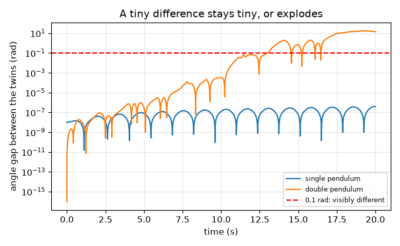
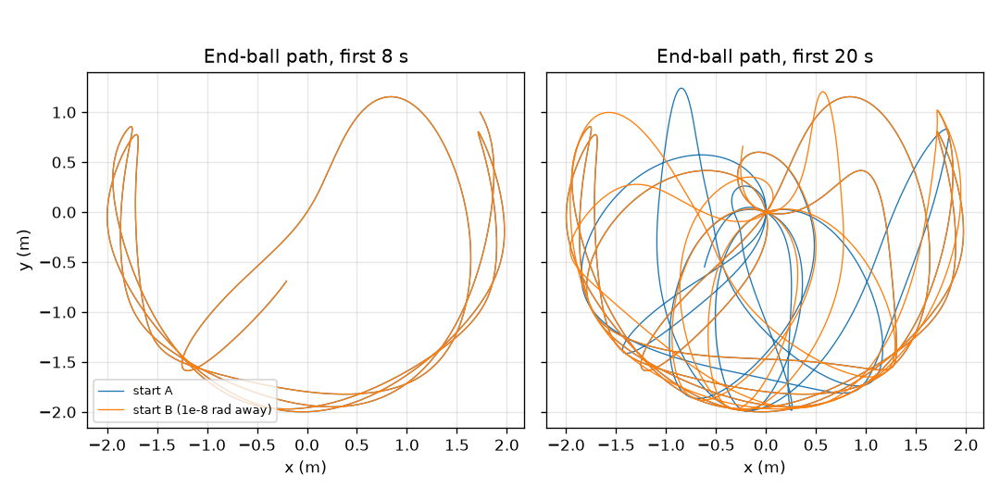

# സെഷൻ 1: ഏതാണ്ട് ഒരുപോലെയുള്ള രണ്ട് തുടക്കങ്ങൾ അകന്നുപോകുന്നു

[Session 1 — हिन्दी](README.hi.md)

*ലെവൽ 1 (ആശയപരമായ ഇന്ററാക്ടീവ് മോഡൽ) · ഏകദേശം 60 മിനിറ്റ് · openchaos*

> ഇത് ഒരു ലളിതമാക്കിയ വിദ്യാഭ്യാസ മോഡൽ ആണ്. ഇത് സാധൂകരിക്കപ്പെട്ട ഒരു ഡിസൈൻ ഉപകരണമല്ല; യഥാർത്ഥ നിർമ്മിതികൾ, വൈദ്യുത ഇൻസ്റ്റലേഷനുകൾ, വാഹനങ്ങൾ, വ്യാവസായിക പ്രക്രിയകൾ അല്ലെങ്കിൽ വൈദ്യപരമായ തീരുമാനങ്ങൾ എന്നിവയ്ക്ക് ഇത് ഉപയോഗിക്കരുത്.

**മുൻ അറിവ് (Prerequisites)**

- സ്കൂൾ ത്രികോണമിതി (trigonometry): സൈനും (sine) കോണുകളും.
- നിങ്ങൾ PRIMER.md വായിക്കുകയും `python start.py 1` ഒരു തവണ റൺ ചെയ്യുകയും ചെയ്തിട്ടുണ്ട്.

**പഠന ലക്ഷ്യങ്ങൾ (Learning objectives).** ഈ സെഷനു ശേഷം നിങ്ങൾക്ക് കഴിയും:

- ഒരു ലഘു പെൻഡുലം (single pendulum) പ്രവചിക്കാവുന്നതാകുന്നത് എന്തുകൊണ്ടെന്നും ഏതാണ്ട് ഒരുപോലെയുള്ള രണ്ട് തുടക്കങ്ങൾക്ക് അതിന്റെ അർത്ഥമെന്താണെന്നും വിശദീകരിക്കാൻ.
- റൂംഗെ-കുട്ട 4 (Runge-Kutta 4) നിയമം ഉപയോഗിച്ച് ഒരു ലഘു പെൻഡുലവും ഒരു ഇരട്ട പെൻഡുലവും (double pendulum) സിമുലേറ്റ് ചെയ്യാൻ.
- 1e-8 rad എന്ന തുടക്ക വ്യത്യാസം ഓരോ സിസ്റ്റത്തിലും എങ്ങനെ വളരുന്നു എന്ന് അളക്കാൻ.
- ഒരു ലോഗ്-സ്കെയിൽ (log-scale) ഗ്രാഫ് വായിച്ച് ഒരു വിടവ് എത്ര വേഗത്തിൽ വളരുന്നു എന്ന് പറയാൻ.

## A. യഥാർത്ഥ ലോക പ്രശ്നം
ഒരു പെൻഡുലം ക്ലോക്ക് എല്ലാ തവണയും ഒരേ രീതിയിൽ ആടുന്നു: അത് എങ്ങനെ തുടങ്ങുന്നു എന്ന് അറിയാമെങ്കിൽ, ഒരു മണിക്കൂറിനു ശേഷം അത് എവിടെയായിരിക്കും എന്ന് നിങ്ങൾക്കറിയാം. ആദ്യത്തേതിന്റെ അറ്റത്ത് രണ്ടാമതൊരു പെൻഡുലം തൂക്കിയാൽ ചലനം ക്രമരഹിതമായി (random) തോന്നുന്നു. അത് ശരിക്കും ക്രമരഹിതമാണോ, അതോ നമുക്ക് വേണ്ടത്ര ദൂരം പിന്തുടരാൻ കഴിയാത്ത നിയമങ്ങൾ അത് പാലിക്കുന്നുണ്ടോ? തുടക്ക കോണുകൾ ഒരു റേഡിയന്റെ നൂറു ദശലക്ഷത്തിലൊന്ന് മാത്രം വ്യത്യാസമുള്ള രണ്ട് ഇരട്ട പെൻഡുലങ്ങൾ വിട്ട് സ്വയം കണ്ടുനോക്കുക.

## B. ആശയവും സിദ്ധാന്തവും
ഗുരുത്വാകർഷണത്തിൽ ആടുന്ന ഒരു ദണ്ഡിലെ ഒരു ഗോളമാണ് പെൻഡുലം. നേരെ താഴേക്കുള്ള ദിശയിൽ നിന്ന് അളക്കുന്ന അതിന്റെ കോൺ theta, theta'' = -(g / L) sin(theta) പാലിക്കുന്നു: അടിഭാഗത്തേക്ക് തിരികെയുള്ള ഗുരുത്വാകർഷണ വലിവ് sin(theta) ക്ക് ആനുപാതികമാണ്. ചെറിയ ആട്ടങ്ങൾക്ക് sin(theta) ഏകദേശം theta ആണ്, ആട്ട സമയം T = 2 pi sqrt(L / g). ഇരട്ട പെൻഡുലത്തിൽ ആദ്യ ഗോളത്തിൽ നിന്ന് രണ്ടാമതൊരു ദണ്ഡ് തൂങ്ങുന്നു, അതിനാൽ രണ്ട് കോണുകളും (മുകളിലെ ദണ്ഡിന് theta1, താഴത്തെ ദണ്ഡിന് theta2) രണ്ട് കോണീയ വേഗതകളും (angular speeds) അതിനെ വിവരിക്കുന്നു; താഴത്തെ ഗോളത്തെ ഗുരുത്വാകർഷണവും മുകളിലത്തേതിന്റെ ചലനവും വലിക്കുന്നു. നിയമം കൃത്യമാണ്, അതിൽ ക്രമരാഹിത്യമില്ല: ഒരേ തുടക്കം എപ്പോഴും ഒരേ ചലനം നൽകുന്നു. മാറുന്നത് സംവേദനക്ഷമതയാണ് (sensitivity): തുടക്കം വളരെ ചെറിയ അളവിൽ വ്യത്യാസമുള്ള രണ്ട് പകർപ്പുകൾ റൺ ചെയ്ത് അവയ്ക്കിടയിലുള്ള വിടവ് (gap) നിരീക്ഷിക്കുന്നു. ലഘു പെൻഡുലത്തിൽ വിടവ് വളരെ ചെറുതായി തുടരുന്നു. ഇരട്ട പെൻഡുലത്തിൽ അത് ഓരോ തുല്യ സമയ ഇടവേളയിലും ഏകദേശം ഒരേ ഘടകം കൊണ്ട് വളരുന്നു, അതിനാൽ കുറച്ച് സെക്കൻഡുകൾക്കു ശേഷം അത് പൊട്ടിത്തെറിക്കുന്നു. ഇതിനെ പ്രാരംഭ അവസ്ഥകളോടുള്ള സംവേദനക്ഷമമായ ആശ്രിതത്വം (sensitive dependence on initial conditions) എന്ന് വിളിക്കുന്നു.

| ചിഹ്നം | അർത്ഥം | യൂണിറ്റ് |
|---|---|---|
| theta | നേരെ താഴേക്കുള്ള ദിശയിൽ നിന്നുള്ള കോൺ | rad |
| omega | കോണീയ വേഗത, theta യുടെ മാറ്റത്തിന്റെ നിരക്ക് | rad/s |
| L | ദണ്ഡിന്റെ നീളം (ഇവിടെ 1 m) | m |
| g | ഗുരുത്വാകർഷണം | m/s^2 |
| T | ഒരു ചെറിയ ആട്ടത്തിന്റെ ആട്ട സമയം | s |
| delta | രണ്ട് തുടക്ക കോണുകൾ തമ്മിലുള്ള വ്യത്യാസം | rad |
| gap | t സമയത്ത് രണ്ട് കോണുകൾ തമ്മിലുള്ള കേവല വ്യത്യാസം | rad |

**അനുമാനങ്ങൾ (Assumptions)**

- ഘർഷണമോ വായു പ്രതിരോധമോ ഇല്ല: ദണ്ഡുകൾ ദൃഢവും ഭാരം കുറഞ്ഞതുമാണ്, ഗോളങ്ങൾ 1 kg വീതമുള്ള ബിന്ദുക്കളാണ്, രണ്ട് ദണ്ഡുകൾക്കും 1 m നീളമുണ്ട്.
- കോണുകൾ നേരെ താഴേക്കുള്ള ദിശയിൽ നിന്ന് അളക്കുന്നു; എല്ലാ തുടക്കവും നിശ്ചലാവസ്ഥയിൽ നിന്നാണ് (പൂജ്യം കോണീയ വേഗതകൾ).
- രണ്ട് ഇരട്ടകളും ഒരേ സംഖ്യാ നിയമം (0.005 s സ്റ്റെപ്പുള്ള RK4) ഉപയോഗിച്ചാണ് റൺ ചെയ്യുന്നത്, അതിനാൽ വിടവ് ചലനം എത്ര സംവേദനക്ഷമമാണ് എന്ന് അളക്കുന്നു; സോൾവറിന്റെ സ്വന്തം പിശക് ഒരു റൺ യഥാർത്ഥ ചലനത്തെ എത്ര നേരം പിന്തുടരുന്നു എന്നതിനെ എങ്ങനെ പരിമിതപ്പെടുത്തുന്നു എന്ന് സെഷൻ 3 കാണിക്കുന്നു.
- കമ്പ്യൂട്ടർ ഉപയോഗിക്കുന്ന കോൺ യൂണിറ്റാണ് റേഡിയൻ (radian): 1 ഡിഗ്രി 0.01745 rad ആണ്.

$$ \ddot\theta=-\frac{g}{L}\sin\theta,\qquad T\approx 2\pi\sqrt{\frac{L}{g}}\ \text{(small swings)} $$

$$ \text{gap}(t)=\left|\theta_2^{B}(t)-\theta_2^{A}(t)\right|,\qquad \text{gap}(t)\approx \delta\,e^{\lambda t}\ \text{while the gap is small (chaotic case)} $$

## C. ദൃശ്യ വിശദീകരണം
രണ്ട് ദണ്ഡുകളും 120 ഡിഗ്രിയിൽ നിശ്ചലാവസ്ഥയിൽ നിന്ന് വിട്ട, അവയിലൊന്ന് 1e-8 rad അകലെയുള്ള, രണ്ട് ഇരട്ട പെൻഡുലങ്ങളുടെ അറ്റത്തെ ഗോളത്തിന്റെ പാത ചിത്രം 1 വരയ്ക്കുന്നു: ആദ്യ 8 സെക്കൻഡ് രണ്ട് പാതകളും ഒന്നിനു മുകളിൽ ഒന്നായി കിടക്കുന്നു, 20 സെക്കൻഡിനു ശേഷം അവയ്ക്ക് പൊതുവായി ഒന്നുമില്ല. ചിത്രം 2 വിടവിനെ ഒരു ലോഗരിതമിക് അക്ഷത്തിൽ പ്ലോട്ട് ചെയ്യുന്നു: ലഘു പെൻഡുലത്തിന്റെ വിടവ് മുഴുവൻ 20 s ഉം 4e-7 rad ന് താഴെ നിൽക്കുന്നു, അതേസമയം ഇരട്ട പെൻഡുലത്തിന്റെ വിടവ് 5 s ൽ 2.8e-7 rad, 10 s ൽ 3.2e-4 rad, 15 s ൽ 0.62 rad ആണ്, 13.0 s ൽ 0.1 rad കടക്കുന്നു. ലോഗ് അക്ഷത്തിലെ ഉയരുന്ന ഒരു നേർരേഖ എന്നാൽ ഓരോ തുല്യ സമയ സ്റ്റെപ്പിലും ഒരേ ഘടകം കൊണ്ടുള്ള വളർച്ച എന്നാണ്.

*ലോഗ് അക്ഷത്തിൽ കോൺ വിടവ്: ലഘു പെൻഡുലത്തിന് പരന്നത്, ഇരട്ട പെൻഡുലത്തിന് ഒരു പൊട്ടിത്തെറി.*

*1e-8 rad അകലെയുള്ള രണ്ട് ഇരട്ട പെൻഡുലങ്ങളുടെ അറ്റത്തെ ഗോളപാതകൾ: ആദ്യം ഒരുപോലെ, 20 s നു ശേഷം ബന്ധമില്ലാത്തവ.*

## D. ഇന്ററാക്ടീവ് സിമുലേഷൻ
പാഠം റൺ ചെയ്യുക (`python start.py 1`), തുടർന്ന് ലൈവ് ആപ്പ് തുറക്കുക: [സെഷൻ 1: ഏതാണ്ട് ഒരുപോലെയുള്ള രണ്ട് തുടക്കങ്ങൾ](https://krunalpanchal1995.github.io/pan-iit-oss/openchaos/session-01/) (അല്ലെങ്കിൽ ഈ ഫോൾഡറിലെ `app.html`). വിടുന്ന കോണും തുടക്ക വ്യത്യാസത്തിന്റെ വലിപ്പവും തിരഞ്ഞെടുക്കുക, സമയ സ്ലൈഡർ വലിച്ച് ചിത്ര കാഴ്ചയിൽ രണ്ട് പെൻഡുലങ്ങളെയും നോക്കുക; തുടർന്ന് വിടവ് ഗ്രാഫ് തുറന്ന് ഇരട്ട പെൻഡുലത്തെയും ലഘു പെൻഡുലത്തെയും താരതമ്യം ചെയ്യുക.

**വെല്ലുവിളി (Challenge).** ഇരട്ട പെൻഡുലത്തിന്റെ ഇരട്ടകൾ മുഴുവൻ 20 s ഉം 0.1 rad നുള്ളിൽ നിൽക്കുന്ന ഒരു വിടുന്ന കോൺ കണ്ടെത്തുക.

## E. ഉദാഹരണ പ്രശ്നവും പരീക്ഷണവും
**പ്രശ്നം.** 1 m പെൻഡുലം ഒരു ചെറിയ കോണിലൂടെ ആടുന്നു. സൂത്രവാക്യത്തിൽ നിന്ന് അതിന്റെ ആട്ട സമയം കണ്ടെത്തി സിമുലേഷനുമായി താരതമ്യം ചെയ്യുക.

1. സൂത്രവാക്യം T = 2 pi sqrt(L / g), ഇവിടെ L = 1 m, g = 9.81 m/s^2.
2. L / g = 1 / 9.81 = 0.10194 s^2, അതിന്റെ വർഗ്ഗമൂലം 0.31928 s.
3. T = 2 pi x 0.31928 = 2.0061 s.
4. 2 ഡിഗ്രി വിടലോടെയുള്ള സിമുലേഷൻ, പെൻഡുലം വിട്ട ബിന്ദുവിലേക്ക് തിരികെയെത്തുന്ന സമയം മുതൽ അളക്കുമ്പോൾ, 2.006 s നൽകുന്നു.
5. യുക്തി പരിശോധന: ഏകദേശം ഒരു മീറ്റർ നീളമുള്ള പെൻഡുലം ഒരു പെൻഡുലം ക്ലോക്കിലെന്നപോലെ ഏകദേശം രണ്ട് സെക്കൻഡിൽ ഒരിക്കൽ ടിക് ചെയ്യുന്നു (ഒരു 'seconds pendulum' സെക്കൻഡുകൾ അടിക്കുന്നു, അതിനാൽ അവിടെ ഒരു പൂർണ്ണ ആട്ടത്തിന് 2 s എടുക്കുന്നു).

**ഉത്തരം.** സൂത്രവാക്യത്തിൽ നിന്ന് T = 2.006 s, സിമുലേഷനിൽ നിന്ന് 2.006 s.

**പരീക്ഷണം.** ഒരു ചെറിയ ഭാരം 1 m ചരടിൽ കെട്ടി, ഏകദേശം 10 ഡിഗ്രിയിൽ നിന്ന് വിട്ട്, ഫോൺ സ്റ്റോപ്പ്‌വാച്ച് ഉപയോഗിച്ച് 10 പൂർണ്ണ ആട്ടങ്ങളുടെ സമയം അളക്കുക: ഏകദേശം 20 s (ഒരു ആട്ടത്തിന് 2.0 s) പ്രതീക്ഷിക്കുക. വ്യത്യാസങ്ങൾ പ്രതികരണ സമയത്തിൽ നിന്നും (20 s ൽ ഏകദേശം 0.2 s, അതായത് 1 ശതമാനം), പരിമിതമായ ആയതിയിൽ (amplitude) നിന്നും (10 ഡിഗ്രി ആട്ടം 0.2 ശതമാനം കൂടുതൽ നീളമുള്ളതാണ്), ചരട് വലിയുന്നതിൽ നിന്നും ഭാരത്തിന്റെ വലിപ്പത്തിൽ നിന്നും വരുന്നു; മോഡലിൽ ഒരു ബിന്ദു ഗോളവും ദൃഢമായ ഭാരമില്ലാത്ത ദണ്ഡുമാണ്. തുടർന്ന് ആദ്യ ഭാരത്തിൽ നിന്ന് രണ്ടാമതൊരു ഭാരം തൂക്കി കൈകൊണ്ട് രണ്ട് തവണ വിടുക: രണ്ട് ചലനങ്ങളും ഒരിക്കലും ആവർത്തിക്കുന്നില്ല, കാരണം നിങ്ങളുടെ കൈയ്ക്ക് ഒരു തുടക്കം 1e-8 rad വരെ ആവർത്തിക്കാൻ കഴിയില്ല (ഒരു ഡിഗ്രി തന്നെ 0.017 rad ആണ്), യഥാർത്ഥ ഘർഷണം കയോസിന് ഇന്ധനമാകുന്ന ഊർജ്ജം പതുക്കെ നീക്കം ചെയ്യുന്നു.

## F. വിലയിരുത്തലും ഡിസൈൻ വെല്ലുവിളിയും
**ചോദ്യ തരം A: ആശയപരം.** ഒരു സുഹൃത്ത് പറയുന്നു: ഇരട്ട പെൻഡുലം ക്രമരഹിതമായി ചലിക്കുന്നു, അതിനാൽ ഒരു സമവാക്യത്തിനും അതിനെ വിവരിക്കാൻ കഴിയില്ല. ആ വാക്യത്തിൽ എന്താണ് ശരി, എന്താണ് തെറ്റ് എന്ന് വിശദീകരിക്കുക.

സൂചന

ഒരേ തുടക്കം എപ്പോഴും ഒരേ ചലനം നൽകുന്നുണ്ടോ എന്നും, വിടവ് ഗ്രാഫ് തുടക്കത്തെക്കുറിച്ച് എന്ത് കാണിക്കുന്നു എന്നും ചോദിക്കുക.

ഘട്ടം ഘട്ടമായുള്ള പരിഹാരം

ചലനം ക്രമരഹിതമായി തോന്നുന്നു, പക്ഷേ അങ്ങനെയല്ല: സമവാക്യങ്ങൾ കൃത്യമാണ്, ഒരേ തുടക്കം എപ്പോഴും ഒരേ ചലനം നൽകുന്നു (അത് നിർണ്ണായകമാണ് (deterministic)). ശരിയായത് എന്തെന്നാൽ ചലനം തുടക്കത്തോട് അങ്ങേയറ്റം സംവേദനക്ഷമമാണ്: 1e-8 rad വ്യത്യാസം ഏകദേശം 13 s ൽ 0.1 rad ൽ കൂടുതലായി വളരുന്നു, അതിനാൽ തുടക്കം ഏതാണ്ട് തികച്ചും അറിയാതെ നമുക്ക് അത് ദൂരേക്ക് പ്രവചിക്കാൻ കഴിയില്ല. കയോസ് എന്നാൽ പ്രായോഗികമായി പ്രവചിക്കാനാവാത്തത് എന്നാണ്, നിയമരഹിതം എന്നല്ല.

**ചോദ്യ തരം B: സംഖ്യാപരം.** T = 2 pi sqrt(L / g) എന്ന സൂത്രവാക്യം ഉപയോഗിച്ച് 0.25 m നീളമുള്ള ഒരു പെൻഡുലത്തിന്റെ ആട്ട സമയം കണ്ടെത്തുക. അത് 1 m പെൻഡുലത്തേക്കാൾ കൂടുതലാണോ കുറവാണോ, ഏത് ഘടകം കൊണ്ട്?

സൂചന

L = 0.25 m, g = 9.81 m/s^2 എന്നിവ സൂത്രവാക്യത്തിൽ ഇടുക; തുടർന്ന് 2.006 s മായി താരതമ്യം ചെയ്യുക.

ഘട്ടം ഘട്ടമായുള്ള പരിഹാരം

L / g = 0.25 / 9.81 = 0.02548 s^2, sqrt = 0.1596 s, T = 2 pi x 0.1596 = 1.003 s. ഇത് 2.006 s ന്റെ പകുതിയാണ്: നാലിരട്ടി ചെറുതായാൽ ആട്ട സമയം പകുതിയാകുന്നു (T, L ന്റെ വർഗ്ഗമൂലത്തിനനുസരിച്ച് മാറുന്നു). യൂണിറ്റുകൾ: സെക്കൻഡ്.

**ചോദ്യ തരം C: ഗ്രാഫ്, സിമുലേഷൻ വ്യാഖ്യാനം.** വിടവ് ഗ്രാഫിൽ, ഇരട്ട പെൻഡുലത്തിന്റെ വിടവ് 10 s ലെ 3.2e-4 rad ൽ നിന്ന് 15 s ലെ 0.62 rad ലേക്ക് വളരുന്നു. ആ 5 s ൽ അത് ഏത് ഘടകം കൊണ്ട് വളരുന്നു, ഒരു സെക്കൻഡിലെ വളർച്ചാ നിരക്ക് എത്രയാണ്?

സൂചന

രണ്ട് വിടവുകളും ഹരിക്കുക, തുടർന്ന് സ്വാഭാവിക ലോഗരിതം (natural logarithm) എടുത്ത് 5 s കൊണ്ട് ഹരിക്കുക.

ഘട്ടം ഘട്ടമായുള്ള പരിഹാരം

ഘടകം 0.62 / 3.2e-4 = ഏകദേശം 1950. 1950 ന്റെ സ്വാഭാവിക ലോഗരിതം 7.58 ആണ്, അതിനാൽ നിരക്ക് 7.58 / 5 s = സെക്കൻഡിൽ 1.5 (വിടവ് ഓരോ സെക്കൻഡിലും ഏകദേശം 4.5 കൊണ്ട് ഗുണിക്കപ്പെടുന്നു). ല്യാപുനോവ് എക്സ്പോണന്റ് (Lyapunov exponent) എന്ന് വിളിക്കുന്ന ഈ നിരക്ക് സെഷൻ 3 ൽ ശരിയായി അളക്കുന്നു.

**ചോദ്യ തരം D: ഡിസൈൻ, ഒപ്റ്റിമൈസേഷൻ വെല്ലുവിളി.** ഡിസൈൻ: 1e-3 rad കൃത്യതയുള്ള ഒരു പ്രൊട്രാക്ടർ ഉപയോഗിച്ച് നിങ്ങൾക്ക് തുടക്ക കോൺ അളക്കാം. സെക്കൻഡിൽ 1.5 എന്ന വളർച്ചാ നിരക്ക് ഉപയോഗിച്ച്, 0.1 rad നുള്ളിൽ എത്ര നേരം പ്രവചിക്കാൻ കഴിയും? 10 s ന് എന്ത് കൃത്യത വേണം? നിങ്ങളുടെ അനുമാനം വ്യക്തമാക്കുക.

സൂചന

വിടവ് ഏകദേശം delta x exp(1.5 t) ആണ്; അത് 0.1 ൽ എത്തുമ്പോഴുള്ള t കണ്ടെത്തുക, തുടർന്ന് t = 10 s ൽ delta കണ്ടെത്തുക.

ഘട്ടം ഘട്ടമായുള്ള പരിഹാരം

delta e^(1.5 t) = 0.1 ൽ നിന്ന് നമുക്ക് t = ln(0.1 / 1e-3) / 1.5 = ln(100) / 1.5 = 4.605 / 1.5 = 3.1 s ലഭിക്കുന്നു. 10 s ന് delta = 0.1 e^(-15) = 3e-8 rad വേണം, പ്രൊട്രാക്ടറിനേക്കാൾ മുപ്പതിനായിരം മടങ്ങ് മെച്ചം. അനുമാനം: തുടക്കം മുതൽ വളർച്ച ഒരു ശുദ്ധമായ എക്സ്പോണൻഷ്യൽ ആണ്; യഥാർത്ഥ വിടവ് ആദ്യം കൂടുതൽ പതുക്കെ വളരുന്നു (ഗ്രാഫ് കാണുക), അതിനാൽ ഈ സംഖ്യകൾ ഏകദേശമാണ്. ട്രേഡ്-ഓഫ് (Trade-off): പ്രവചനത്തിന്റെ ഓരോ അധിക സെക്കൻഡിനും തുടക്കം e^1.5 = 4.5 മടങ്ങ് മെച്ചമായി അറിയണം.

[RUBRIC.md](../../RUBRIC.md) ഉപയോഗിച്ച് സ്വയം സ്കോർ ചെയ്യുക. പേപ്പറിൽ ചെയ്യാൻ [ആക്ടിവിറ്റി ഷീറ്റ്](activity_sheet.md) പ്രിന്റ് ചെയ്യുക.

## സാധാരണ തെറ്റിദ്ധാരണകൾ
| സാധാരണ തെറ്റിദ്ധാരണ | യഥാർത്ഥത്തിൽ ശരിയായത് |
|---|---|
| കയോട്ടിക് എന്നാൽ ക്രമരഹിതം. | കയോസ് നിർണ്ണായകമാണ്: ഒരേ തുടക്കം ഒരേ ചലനം നൽകുന്നു. തുടക്കത്തോടുള്ള സംവേദനക്ഷമതയാണ് ദീർഘ പ്രവചനങ്ങൾ അസാധ്യമാക്കുന്നത്. |
| ഒരു ചെറിയ പിശക് ചെറുതായി തന്നെ നിൽക്കുന്നു. | ഇരട്ട പെൻഡുലത്തിൽ ഒരു പിശക് ഓരോ സെക്കൻഡിലും ഏകദേശം ഒരേ ഘടകം കൊണ്ട് ഗുണിക്കപ്പെടുന്നു, അതിനാൽ അത് അനുപാതമില്ലാതെ വർദ്ധിക്കുന്നു; ലഘു പെൻഡുലത്തിൽ അങ്ങനെയല്ല. |
| ഇരട്ട പെൻഡുലം എപ്പോഴും കയോട്ടിക് ആണ്. | ചെറിയ ആട്ടങ്ങൾ ക്രമമുള്ളവയാണ് (രണ്ട് ലളിത പാറ്റേണുകളുടെ തുക, സെഷൻ 2). പെൻഡുലത്തിന് ആവശ്യത്തിന് ഊർജ്ജമുള്ളപ്പോൾ കയോസ് പ്രത്യക്ഷപ്പെടുന്നു. |
| കയോസിന്റെ ഒരു കമ്പ്യൂട്ടർ സിമുലേഷൻ ഉപയോഗശൂന്യമാണ്. | കുറഞ്ഞ സമയത്തേക്കും സ്ഥിതിവിവരക്കണക്കുകൾക്കും (statistics) അത് നല്ലതാണ്; കൃത്യമായ ദീർഘകാല പാത മാത്രമാണ് എത്താത്തത്. |

## പദാവലി (Glossary)
- **പെൻഡുലം (pendulum)**: ഗുരുത്വാകർഷണത്തിൽ ആടുന്ന ഒരു ദണ്ഡിലെ ഭാരം
- **റേഡിയൻ (radian)**: കോൺ യൂണിറ്റ്; ഒരു പൂർണ്ണ ഭ്രമണം 2 pi rad, ഒരു ഡിഗ്രി 0.01745 rad
- **നിർണ്ണായകം (deterministic)**: ഒരേ തുടക്കം എപ്പോഴും ഒരേ ഫലം നൽകുന്നു
- **കയോസ് (chaos)**: ചെറിയ തുടക്ക വ്യത്യാസങ്ങൾ ദീർഘ പ്രവചനങ്ങൾ പരാജയപ്പെടുന്നത്ര വേഗത്തിൽ വളരുന്ന നിർണ്ണായക ചലനം
- **വിടവ് (gap)**: രണ്ട് റണ്ണുകളുടെ കോണുകൾ തമ്മിലുള്ള കേവല വ്യത്യാസം
- **RK4**: റൂംഗെ-കുട്ട 4, വളരെ കൃത്യമായ ഫലത്തിനായി ഓരോ സ്റ്റെപ്പിലും നാല് ചരിവുകൾ എടുക്കുന്ന ഒരു ഘട്ടം ഘട്ടമായ നിയമം
- **ലോഗ് സ്കെയിൽ (log scale)**: തുല്യ സ്റ്റെപ്പുകൾ തുല്യ അളവുകളല്ല, തുല്യ ഘടകങ്ങളെ അർത്ഥമാക്കുന്ന ഒരു ഗ്രാഫ് അക്ഷം

## പൂർത്തിയാക്കുക
1. [exercises.md](exercises.md) ലെ മൂന്ന് കോഡിംഗ് ടാസ്കുകൾ ചെയ്യുക.
2. നിങ്ങളുടെ മാറ്റങ്ങൾക്കു ശേഷം `python start.py 1` വീണ്ടും റൺ ചെയ്യുക. ഇത് ചെക്ക്‌പോയിന്റോടെ അവസാനിക്കുന്നു; അത് `PASS` എന്ന് പ്രിന്റ് ചെയ്യുമ്പോൾ നിങ്ങൾ പൂർത്തിയാക്കി. (ചെക്ക്‌പോയിന്റ് മാത്രം: `python start.py check 1`.)

അടുത്തത്: [സെഷൻ 2](../session-02/README.md)
