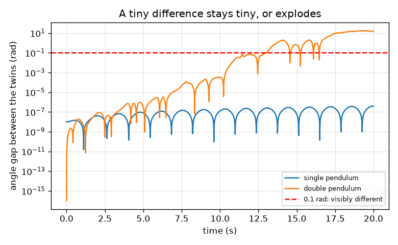
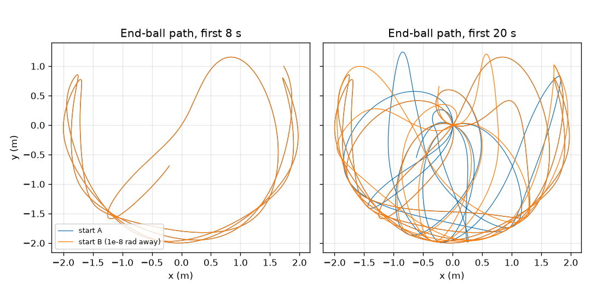

# அமர்வு 1: கிட்டத்தட்ட ஒரே மாதிரியான இரண்டு தொடக்கங்கள் விலகிச் செல்கின்றன

[Session 1 — हिन्दी](README.hi.md) · [Session 1 — മലയാളം](README.ml.md)

*நிலை 1 (கருத்தியல் ஊடாடும் மாதிரி) · சுமார் 60 நிமிடங்கள் · openchaos*

> இது ஒரு எளிமைப்படுத்தப்பட்ட கல்வி மாதிரி. இது சரிபார்க்கப்பட்ட வடிவமைப்புக் கருவி அல்ல; உண்மையான கட்டமைப்புகள், மின் நிறுவல்கள், வாகனங்கள், தொழில்துறை செயல்முறைகள் அல்லது மருத்துவ முடிவுகளுக்கு இதைப் பயன்படுத்தக் கூடாது.

**முன்தேவைகள் (Prerequisites)**

- பள்ளி முக்கோணவியல் (trigonometry): சைன் (sine) மற்றும் கோணங்கள்.
- நீங்கள் PRIMER.md ஐப் படித்து, `python start.py 1` ஐ ஒரு முறை இயக்கியிருக்கிறீர்கள்.

**கற்றல் நோக்கங்கள் (Learning objectives).** இந்த அமர்வுக்குப் பிறகு உங்களால் முடியும்:

- ஒற்றை ஊசல் (single pendulum) ஏன் கணிக்கக்கூடியது என்றும், கிட்டத்தட்ட ஒரே மாதிரியான இரண்டு தொடக்கங்களுக்கு அதன் பொருள் என்ன என்றும் விளக்க.
- ரூங்கே-குட்டா 4 (Runge-Kutta 4) விதியைக் கொண்டு ஒற்றை ஊசலையும் இரட்டை ஊசலையும் (double pendulum) உருவகப்படுத்த.
- 1e-8 rad தொடக்க வேறுபாடு ஒவ்வொரு அமைப்பிலும் எவ்வாறு வளர்கிறது என்று அளவிட.
- மடக்கை அளவுகோல் (log-scale) வரைபடத்தைப் படித்து ஒரு இடைவெளி எவ்வளவு வேகமாக வளர்கிறது என்று கூற.

## A. நிஜ உலகப் பிரச்சினை
ஒரு ஊசல் கடிகாரம் ஒவ்வொரு முறையும் ஒரே மாதிரி ஆடுகிறது: அது எப்படித் தொடங்குகிறது என்று தெரிந்தால், ஒரு மணி நேரத்தில் அது எங்கே இருக்கும் என்று உங்களுக்குத் தெரியும். முதல் ஊசலின் முனையில் இரண்டாவது ஊசலைத் தொங்கவிட்டால் இயக்கம் சீரற்றதாக (random) தோன்றுகிறது. அது உண்மையில் சீரற்றதா, அல்லது நம்மால் போதுமான தூரம் பின்தொடர முடியாத விதிகளை அது பின்பற்றுகிறதா? தொடக்கக் கோணங்கள் ஒரு ரேடியனின் நூறு மில்லியனில் ஒரு பங்கு மட்டுமே வேறுபடும் இரண்டு இரட்டை ஊசல்களை விடுவித்து நீங்களே பாருங்கள்.

## B. கருத்தும் கோட்பாடும்
ஊசல் என்பது ஈர்ப்பு விசையின் கீழ் ஆடும் ஒரு கம்பியில் உள்ள பந்து. நேர் கீழ்நோக்கிய திசையிலிருந்து அளக்கப்படும் அதன் கோணம் theta, theta'' = -(g / L) sin(theta) ஐப் பின்பற்றுகிறது: அடிப்பகுதியை நோக்கித் திரும்பும் ஈர்ப்பு இழுவை sin(theta) க்கு விகிதசமம். சிறிய ஆட்டங்களுக்கு sin(theta) சுமார் theta, ஆட்ட நேரம் T = 2 pi sqrt(L / g). இரட்டை ஊசலில் முதல் பந்திலிருந்து இரண்டாவது கம்பி தொங்குகிறது, எனவே இரண்டு கோணங்களும் (மேல் கம்பிக்கு theta1, கீழ் கம்பிக்கு theta2) இரண்டு கோண வேகங்களும் (angular speeds) அதை விவரிக்கின்றன; கீழ்ப் பந்து ஈர்ப்பாலும் மேல் பந்தின் இயக்கத்தாலும் இழுக்கப்படுகிறது. விதி துல்லியமானது, அதில் சீரற்ற தன்மை இல்லை: ஒரே தொடக்கம் எப்போதும் ஒரே இயக்கத்தைத் தருகிறது. மாறுவது உணர்திறன் (sensitivity): தொடக்கம் மிகச் சிறிய அளவில் வேறுபடும் இரண்டு நகல்களை இயக்கி அவற்றுக்கிடையிலான இடைவெளியை (gap) கண்காணிக்கிறோம். ஒற்றை ஊசலில் இடைவெளி மிகச் சிறியதாகவே இருக்கிறது. இரட்டை ஊசலில் அது ஒவ்வொரு சம கால இடைவெளியிலும் தோராயமாக ஒரே காரணியால் வளர்கிறது, எனவே சில வினாடிகளுக்குப் பிறகு அது வெடிக்கிறது. இது தொடக்க நிலைகளைச் சார்ந்த உணர்திறன் (sensitive dependence on initial conditions) எனப்படுகிறது.

| குறியீடு | பொருள் | அலகு |
|---|---|---|
| theta | நேர் கீழ்நோக்கிய திசையிலிருந்து கோணம் | rad |
| omega | கோண வேகம், theta மாறும் வீதம் | rad/s |
| L | கம்பியின் நீளம் (இங்கு 1 m) | m |
| g | ஈர்ப்பு | m/s^2 |
| T | ஒரு சிறிய ஆட்டத்தின் ஆட்ட நேரம் | s |
| delta | இரண்டு தொடக்கக் கோணங்களுக்கு இடையிலான வேறுபாடு | rad |
| gap | t நேரத்தில் இரண்டு கோணங்களுக்கு இடையிலான தனி வேறுபாடு | rad |

**அனுமானங்கள் (Assumptions)**

- உராய்வோ காற்றுத் தடையோ இல்லை: கம்பிகள் உறுதியானவை, இலேசானவை; பந்துகள் தலா 1 kg கொண்ட புள்ளிகள்; இரண்டு கம்பிகளும் 1 m நீளம்.
- கோணங்கள் நேர் கீழ்நோக்கிய திசையிலிருந்து அளக்கப்படுகின்றன; ஒவ்வொரு தொடக்கமும் ஓய்வு நிலையிலிருந்து (பூஜ்ஜியக் கோண வேகங்கள்).
- இரண்டு இரட்டையர்களும் ஒரே எண்ணியல் விதியால் (0.005 s படியுடன் RK4) இயக்கப்படுகின்றன, எனவே இடைவெளி இயக்கம் எவ்வளவு உணர்திறன் கொண்டது என்பதை அளக்கிறது; தீர்ப்பானின் (solver) சொந்தப் பிழை ஒரு ஓட்டம் உண்மையான இயக்கத்தை எவ்வளவு நேரம் பின்தொடர்கிறது என்பதை எவ்வாறு கட்டுப்படுத்துகிறது என்று அமர்வு 3 காட்டுகிறது.
- ரேடியன் (radian) கணினி பயன்படுத்தும் கோண அலகு: 1 பாகை 0.01745 rad.

$$ \ddot\theta=-\frac{g}{L}\sin\theta,\qquad T\approx 2\pi\sqrt{\frac{L}{g}}\ \text{(small swings)} $$

$$ \text{gap}(t)=\left|\theta_2^{B}(t)-\theta_2^{A}(t)\right|,\qquad \text{gap}(t)\approx \delta\,e^{\lambda t}\ \text{while the gap is small (chaotic case)} $$

## C. காட்சி விளக்கம்
படம் 1, இரண்டு கம்பிகளும் 120 பாகையில் ஓய்விலிருந்து விடுவிக்கப்பட்ட, அவற்றில் ஒன்று 1e-8 rad தள்ளியிருக்கும், இரண்டு இரட்டை ஊசல்களின் முனைப் பந்தின் பாதையை வரைகிறது: முதல் 8 வினாடிகளுக்கு இரண்டு பாதைகளும் ஒன்றின் மேல் ஒன்றாக உள்ளன, 20 வினாடிகளுக்குப் பிறகு அவற்றுக்குப் பொதுவானது எதுவும் இல்லை. படம் 2 இடைவெளியை மடக்கை அச்சில் வரைகிறது: ஒற்றை ஊசலின் இடைவெளி முழு 20 s க்கும் 4e-7 rad க்குக் கீழே இருக்கிறது, அதேசமயம் இரட்டை ஊசலின் இடைவெளி 5 s இல் 2.8e-7 rad, 10 s இல் 3.2e-4 rad, 15 s இல் 0.62 rad, மேலும் 13.0 s இல் 0.1 rad ஐக் கடக்கிறது. மடக்கை அச்சில் உயரும் நேர்கோடு என்றால் ஒவ்வொரு சம காலப் படியிலும் ஒரே காரணியால் வளர்ச்சி என்று பொருள்.

*மடக்கை அச்சில் கோண இடைவெளி: ஒற்றை ஊசலுக்குத் தட்டையானது, இரட்டை ஊசலுக்கு ஒரு வெடிப்பு.*

*1e-8 rad தள்ளியுள்ள இரண்டு இரட்டை ஊசல்களின் முனைப் பந்துப் பாதைகள்: முதலில் ஒரே மாதிரி, 20 s க்குப் பிறகு தொடர்பற்றவை.*

## D. ஊடாடும் உருவகப்படுத்துதல்
பாடத்தை இயக்கவும் (`python start.py 1`), பின்னர் நேரடிச் செயலியைத் திறக்கவும்: [அமர்வு 1: கிட்டத்தட்ட ஒரே மாதிரியான இரண்டு தொடக்கங்கள்](https://krunalpanchal1995.github.io/pan-iit-oss/openchaos/session-01/) (அல்லது இந்தக் கோப்புறையில் உள்ள `app.html`). விடுவிக்கும் கோணத்தையும் தொடக்க வேறுபாட்டின் அளவையும் தேர்ந்தெடுத்து, நேர நழுவியை இழுத்து, படக் காட்சியில் இரண்டு ஊசல்களையும் பாருங்கள்; பின்னர் இடைவெளி வரைபடத்தைத் திறந்து இரட்டை மற்றும் ஒற்றை ஊசலை ஒப்பிடுங்கள்.

**சவால் (Challenge).** இரட்டை ஊசல் இரட்டையர்கள் முழு 20 s க்கும் 0.1 rad க்குள் இருக்கும் ஒரு விடுவிக்கும் கோணத்தைக் கண்டறியுங்கள்.

## E. தீர்க்கப்பட்ட எடுத்துக்காட்டும் சோதனையும்
**பிரச்சினை.** 1 m ஊசல் ஒரு சிறிய கோணத்தில் ஆடுகிறது. சூத்திரத்திலிருந்து அதன் ஆட்ட நேரத்தைக் கண்டறிந்து உருவகப்படுத்துதலுடன் ஒப்பிடுங்கள்.

1. சூத்திரம் T = 2 pi sqrt(L / g), இங்கு L = 1 m மற்றும் g = 9.81 m/s^2.
2. L / g = 1 / 9.81 = 0.10194 s^2, அதன் வர்க்கமூலம் 0.31928 s.
3. T = 2 pi x 0.31928 = 2.0061 s.
4. 2 பாகை விடுவிப்புடன் உருவகப்படுத்துதல், ஊசல் தன் விடுவிப்புப் புள்ளிக்குத் திரும்பும் நேரத்திலிருந்து அளக்கும்போது, 2.006 s தருகிறது.
5. பொருத்தச் சரிபார்ப்பு: சுமார் ஒரு மீட்டர் நீளமுள்ள ஊசல், ஊசல் கடிகாரத்தில் உள்ளது போல, தோராயமாக இரண்டு வினாடிகளுக்கு ஒருமுறை டிக் செய்கிறது (ஒரு 'seconds pendulum' வினாடிகளை அடிக்கிறது, எனவே அங்கு ஒரு முழு ஆட்டம் 2 s எடுக்கிறது).

**விடை.** சூத்திரத்திலிருந்து T = 2.006 s, உருவகப்படுத்துதலிலிருந்து 2.006 s.

**சோதனை.** ஒரு சிறிய எடையை 1 m நூலில் கட்டி, சுமார் 10 பாகையிலிருந்து விடுவித்து, கைபேசி நிறுத்தக் கடிகாரம் மூலம் 10 முழு ஆட்டங்களின் நேரத்தை அளவிடுங்கள்: சுமார் 20 s (ஒரு ஆட்டத்துக்கு 2.0 s) எதிர்பாருங்கள். வேறுபாடுகள் எதிர்வினை நேரத்திலிருந்தும் (20 s இல் சுமார் 0.2 s, அதாவது 1 சதவீதம்), வரம்புள்ள வீச்சிலிருந்தும் (amplitude) (10 பாகை ஆட்டம் 0.2 சதவீதம் நீளமானது), நூல் நீள்வதிலிருந்தும், எடையின் அளவிலிருந்தும் வருகின்றன; மாதிரியில் ஒரு புள்ளிப் பந்தும் உறுதியான நிறையற்ற கம்பியும் உள்ளன. பின்னர் முதல் எடையிலிருந்து இரண்டாவது எடையைத் தொங்கவிட்டு கையால் இரண்டு முறை விடுவியுங்கள்: இரண்டு இயக்கங்களும் ஒருபோதும் மீண்டும் நிகழ்வதில்லை, ஏனெனில் உங்கள் கையால் ஒரு தொடக்கத்தை 1e-8 rad வரை மீண்டும் செய்ய முடியாது (ஒரு பாகையே 0.017 rad), மேலும் உண்மையான உராய்வு குழப்பத்துக்கு (chaos) எரிபொருளாகும் ஆற்றலை மெதுவாக நீக்குகிறது.

## F. மதிப்பீடும் வடிவமைப்புச் சவாலும்
**கேள்வி வகை A: கருத்தியல்.** ஒரு நண்பர் சொல்கிறார்: இரட்டை ஊசல் சீரற்ற முறையில் நகர்கிறது, எனவே எந்தச் சமன்பாட்டாலும் அதை விவரிக்க முடியாது. அந்த வாக்கியத்தில் எது சரி, எது தவறு என்று விளக்குங்கள்.

குறிப்பு

ஒரே தொடக்கம் எப்போதும் ஒரே இயக்கத்தைத் தருகிறதா என்றும், இடைவெளி வரைபடம் தொடக்கத்தைப் பற்றி என்ன காட்டுகிறது என்றும் கேளுங்கள்.

படிப்படியான தீர்வு

இயக்கம் சீரற்றதாகத் தோன்றுகிறது ஆனால் அப்படி இல்லை: சமன்பாடுகள் துல்லியமானவை, ஒரே தொடக்கம் எப்போதும் ஒரே இயக்கத்தைத் தருகிறது (அது தீர்மானிக்கப்பட்டது (deterministic)). உண்மை என்னவென்றால் இயக்கம் தொடக்கத்துக்கு மிக அதிக உணர்திறன் கொண்டது: 1e-8 rad வேறுபாடு சுமார் 13 s இல் 0.1 rad க்கு மேல் வளர்கிறது, எனவே தொடக்கத்தைக் கிட்டத்தட்ட முழுமையாக அறியாவிட்டால் அதை நீண்ட காலம் முன்கணிக்க முடியாது. குழப்பம் (chaos) என்றால் நடைமுறையில் கணிக்க முடியாதது, விதியற்றது அல்ல.

**கேள்வி வகை B: எண்ணியல்.** T = 2 pi sqrt(L / g) சூத்திரத்தைக் கொண்டு 0.25 m நீளமுள்ள ஊசலின் ஆட்ட நேரத்தைக் கண்டறியுங்கள். அது 1 m ஊசலை விட அதிகமா குறைவா, எந்தக் காரணியால்?

குறிப்பு

L = 0.25 m மற்றும் g = 9.81 m/s^2 ஐச் சூத்திரத்தில் வையுங்கள்; பின்னர் 2.006 s உடன் ஒப்பிடுங்கள்.

படிப்படியான தீர்வு

L / g = 0.25 / 9.81 = 0.02548 s^2, sqrt = 0.1596 s, T = 2 pi x 0.1596 = 1.003 s. இது 2.006 s இல் பாதி: நான்கு மடங்கு குறுகியது பாதி ஆட்ட நேரத்தைத் தருகிறது (T, L இன் வர்க்கமூலத்துக்கு ஏற்ப மாறுகிறது). அலகுகள்: வினாடிகள்.

**கேள்வி வகை C: வரைபடம் மற்றும் உருவகப்படுத்துதல் விளக்கம்.** இடைவெளி வரைபடத்தில், இரட்டை ஊசலின் இடைவெளி 10 s இல் 3.2e-4 rad இலிருந்து 15 s இல் 0.62 rad க்கு வளர்கிறது. அந்த 5 s இல் அது எந்தக் காரணியால் வளர்கிறது, வினாடிக்கு வளர்ச்சி வீதம் என்ன?

குறிப்பு

இரண்டு இடைவெளிகளையும் வகுத்து, பின்னர் இயல் மடக்கையை (natural logarithm) எடுத்து 5 s ஆல் வகுங்கள்.

படிப்படியான தீர்வு

காரணி 0.62 / 3.2e-4 = சுமார் 1950. 1950 இன் இயல் மடக்கை 7.58, எனவே வீதம் 7.58 / 5 s = வினாடிக்கு 1.5 (இடைவெளி ஒவ்வொரு வினாடியும் சுமார் 4.5 ஆல் பெருகுகிறது). லியாபுனோவ் அடுக்கு (Lyapunov exponent) எனப்படும் இந்த வீதம் அமர்வு 3 இல் முறையாக அளக்கப்படுகிறது.

**கேள்வி வகை D: வடிவமைப்பு மற்றும் உகப்பாக்கச் சவால்.** வடிவமைப்பு: 1e-3 rad துல்லியம் கொண்ட கோணமானியால் (protractor) தொடக்கக் கோணத்தை அளக்கலாம். வினாடிக்கு 1.5 வளர்ச்சி வீதத்தைப் பயன்படுத்தி, 0.1 rad க்குள் எவ்வளவு நேரம் முன்கணிக்க முடியும்? 10 s க்கு என்ன துல்லியம் தேவை? உங்கள் அனுமானத்தைக் குறிப்பிடுங்கள்.

குறிப்பு

இடைவெளி சுமார் delta x exp(1.5 t); அது 0.1 ஐ அடையும்போது t ஐக் கண்டறிந்து, பின்னர் t = 10 s இல் delta ஐக் கண்டறியுங்கள்.

படிப்படியான தீர்வு

delta e^(1.5 t) = 0.1 இலிருந்து t = ln(0.1 / 1e-3) / 1.5 = ln(100) / 1.5 = 4.605 / 1.5 = 3.1 s கிடைக்கிறது. 10 s க்கு delta = 0.1 e^(-15) = 3e-8 rad தேவை, கோணமானியை விட முப்பதாயிரம் மடங்கு சிறந்தது. அனுமானம்: தொடக்கத்திலிருந்தே வளர்ச்சி ஒரு தூய அடுக்குக்குறி (exponential); உண்மையான இடைவெளி முதலில் மெதுவாக வளர்கிறது (வரைபடத்தைப் பாருங்கள்), எனவே இந்த எண்கள் தோராயமானவை. பரிமாற்றம் (Trade-off): முன்கணிப்பின் ஒவ்வொரு கூடுதல் வினாடிக்கும் தொடக்கம் e^1.5 = 4.5 மடங்கு சிறப்பாகத் தெரிய வேண்டும்.

[RUBRIC.md](../../RUBRIC.md) மூலம் உங்களை நீங்களே மதிப்பிடுங்கள். காகிதத்தில் செய்ய [செயல்பாட்டுத் தாளை](activity_sheet.md) அச்சிடுங்கள்.

## பொதுவான தவறான கருத்துகள்
| பொதுவான தவறான கருத்து | உண்மையில் சரியானது |
|---|---|
| குழப்பமானது என்றால் சீரற்றது. | குழப்பம் தீர்மானிக்கப்பட்டது: ஒரே தொடக்கம் ஒரே இயக்கத்தைத் தருகிறது. தொடக்கத்துக்கான உணர்திறன்தான் நீண்ட முன்கணிப்புகளை சாத்தியமற்றதாக்குகிறது. |
| ஒரு சிறிய பிழை சிறியதாகவே இருக்கும். | இரட்டை ஊசலில் ஒரு பிழை ஒவ்வொரு வினாடியும் சுமார் ஒரே காரணியால் பெருகுகிறது, எனவே அது விகிதத்துக்கு மீறிப் பெரிதாகிறது; ஒற்றை ஊசலில் அப்படி இல்லை. |
| இரட்டை ஊசல் எப்போதும் குழப்பமானது. | சிறிய ஆட்டங்கள் ஒழுங்கானவை (இரண்டு எளிய வடிவங்களின் கூட்டு, அமர்வு 2). ஊசலுக்குப் போதுமான ஆற்றல் இருக்கும்போது குழப்பம் தோன்றுகிறது. |
| குழப்பத்தின் கணினி உருவகப்படுத்துதல் பயனற்றது. | குறுகிய நேரத்துக்கும் புள்ளியியலுக்கும் (statistics) அது நன்றாக உள்ளது; துல்லியமான நீண்டகாலப் பாதை மட்டுமே எட்டாதது. |

## சொற்களஞ்சியம் (Glossary)
- **ஊசல் (pendulum)**: ஈர்ப்பின் கீழ் ஆடும் ஒரு கம்பியில் உள்ள எடை
- **ரேடியன் (radian)**: கோண அலகு; ஒரு முழுச் சுற்று 2 pi rad, ஒரு பாகை 0.01745 rad
- **தீர்மானிக்கப்பட்டது (deterministic)**: ஒரே தொடக்கம் எப்போதும் ஒரே முடிவைத் தருகிறது
- **குழப்பம் (chaos)**: சிறிய தொடக்க வேறுபாடுகள் நீண்ட முன்கணிப்புகள் தோல்வியடையும் அளவுக்கு வேகமாக வளரும் தீர்மானிக்கப்பட்ட இயக்கம்
- **இடைவெளி (gap)**: இரண்டு ஓட்டங்களின் கோணங்களுக்கு இடையிலான தனி வேறுபாடு
- **RK4**: ரூங்கே-குட்டா 4, மிகத் துல்லியமான முடிவுக்காக ஒவ்வொரு படியிலும் நான்கு சரிவுகளை எடுக்கும் படிப்படியான விதி
- **மடக்கை அளவுகோல் (log scale)**: சம படிகள் சம அளவுகளை அல்ல, சம காரணிகளைக் குறிக்கும் வரைபட அச்சு

## முடிக்கவும்
1. [exercises.md](exercises.md) இல் உள்ள மூன்று நிரலாக்கப் பணிகளைச் செய்யுங்கள்.
2. உங்கள் மாற்றங்களுக்குப் பிறகு `python start.py 1` ஐ மீண்டும் இயக்குங்கள். இது சோதனைச்சாவடியுடன் (checkpoint) முடிகிறது; அது `PASS` என்று அச்சிடும்போது நீங்கள் முடித்துவிட்டீர்கள். (சோதனைச்சாவடி மட்டும்: `python start.py check 1`.)

அடுத்து: [அமர்வு 2](../session-02/README.md)
