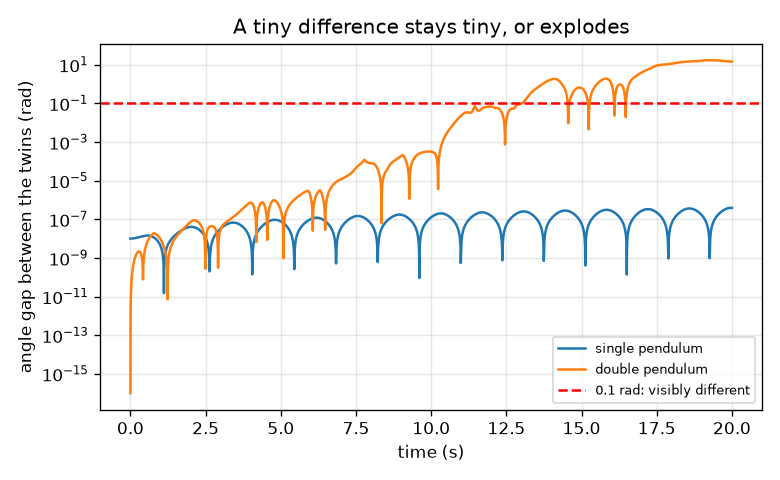
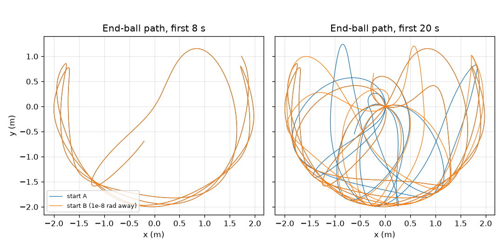

# సెషన్ 1: దాదాపు ఒకేలాంటి రెండు ప్రారంభాలు దూరమవుతాయి

[Session 1 — हिन्दी](README.hi.md) · [Session 1 — മലയാളം](README.ml.md) · [Session 1 — தமிழ்](README.ta.md)

*స్థాయి 1 (భావనాత్మక ఇంటరాక్టివ్ నమూనా) · సుమారు 60 నిమిషాలు · openchaos*

> ఇది ఒక సరళీకృత విద్యా నమూనా. ఇది ధృవీకరించబడిన డిజైన్ సాధనం కాదు; నిజమైన నిర్మాణాలు, విద్యుత్ ఇన్‌స్టలేషన్లు, వాహనాలు, పారిశ్రామిక ప్రక్రియలు లేదా వైద్య నిర్ణయాల కోసం దీనిని ఉపయోగించకూడదు.

**ముందస్తు అవసరాలు (Prerequisites)**

- పాఠశాల త్రికోణమితి (trigonometry): సైన్ (sine) మరియు కోణాలు.
- మీరు PRIMER.md చదివి, `python start.py 1` ను ఒకసారి రన్ చేశారు.

**అభ్యసన లక్ష్యాలు (Learning objectives).** ఈ సెషన్ తర్వాత మీరు చేయగలరు:

- ఒక సాధారణ లోలకం (single pendulum) ఎందుకు ఊహించదగినదో, దాదాపు ఒకేలాంటి రెండు ప్రారంభాలకు దాని అర్థం ఏమిటో వివరించడం.
- రుంగే-కుట్టా 4 (Runge-Kutta 4) నియమంతో ఒక సాధారణ లోలకాన్ని మరియు ఒక ద్వి లోలకాన్ని (double pendulum) సిమ్యులేట్ చేయడం.
- 1e-8 rad ప్రారంభ తేడా ప్రతి వ్యవస్థలో ఎలా పెరుగుతుందో కొలవడం.
- లాగ్-స్కేల్ (log-scale) గ్రాఫ్‌ను చదివి ఒక అంతరం ఎంత వేగంగా పెరుగుతుందో చెప్పడం.

## A. వాస్తవ ప్రపంచ సమస్య
ఒక లోలక గడియారం ప్రతిసారీ ఒకే విధంగా ఊగుతుంది: అది ఎలా ప్రారంభమవుతుందో మీకు తెలిస్తే, ఒక గంటలో అది ఎక్కడ ఉంటుందో మీకు తెలుస్తుంది. మొదటి దాని చివర రెండవ లోలకాన్ని వేలాడదీస్తే చలనం యాదృచ్ఛికంగా (random) కనిపిస్తుంది. అది నిజంగా యాదృచ్ఛికమా, లేక మనం తగినంత దూరం అనుసరించలేని నియమాలను అది పాటిస్తుందా? ప్రారంభ కోణాలు ఒక రేడియన్‌లో వంద మిలియన్ల వంతు మాత్రమే తేడా ఉన్న రెండు ద్వి లోలకాలను విడిచిపెట్టి మీరే చూడండి.

## B. భావన మరియు సిద్ధాంతం
లోలకం అనేది గురుత్వాకర్షణ కింద ఊగే ఒక కడ్డీపై ఉన్న బంతి. నేరుగా కిందికి ఉన్న దిశ నుండి కొలిచే దాని కోణం theta, theta'' = -(g / L) sin(theta) ను పాటిస్తుంది: అడుగు వైపు తిరిగి లాగే గురుత్వాకర్షణ లాగుడు sin(theta) కు అనులోమానుపాతంలో ఉంటుంది. చిన్న ఊపులకు sin(theta) సుమారు theta, ఊపు సమయం T = 2 pi sqrt(L / g). ద్వి లోలకంలో మొదటి బంతి నుండి రెండవ కడ్డీ వేలాడుతుంది, కాబట్టి రెండు కోణాలు (పై కడ్డీకి theta1, కింది కడ్డీకి theta2) మరియు రెండు కోణీయ వేగాలు (angular speeds) దానిని వివరిస్తాయి; కింది బంతిని గురుత్వాకర్షణ మరియు పై బంతి చలనం లాగుతాయి. నియమం ఖచ్చితమైనది, అందులో యాదృచ్ఛికత లేదు: ఒకే ప్రారంభం ఎల్లప్పుడూ ఒకే చలనాన్ని ఇస్తుంది. మారేది సున్నితత్వం (sensitivity): ప్రారంభం చాలా చిన్న మొత్తంలో తేడా ఉన్న రెండు ప్రతులను రన్ చేసి వాటి మధ్య అంతరాన్ని (gap) గమనిస్తాము. సాధారణ లోలకంలో అంతరం చాలా చిన్నదిగానే ఉంటుంది. ద్వి లోలకంలో అది ప్రతి సమాన కాల వ్యవధిలో దాదాపు ఒకే కారకంతో పెరుగుతుంది, కాబట్టి కొన్ని సెకన్ల తర్వాత అది విస్ఫోటనం చెందుతుంది. దీనిని ప్రారంభ పరిస్థితులపై సున్నితమైన ఆధారపడటం (sensitive dependence on initial conditions) అంటారు.

| గుర్తు | అర్థం | యూనిట్ |
|---|---|---|
| theta | నేరుగా కిందికి ఉన్న దిశ నుండి కోణం | rad |
| omega | కోణీయ వేగం, theta మార్పు రేటు | rad/s |
| L | కడ్డీ పొడవు (ఇక్కడ 1 m) | m |
| g | గురుత్వాకర్షణ | m/s^2 |
| T | చిన్న ఊపు యొక్క ఊపు సమయం | s |
| delta | రెండు ప్రారంభ కోణాల మధ్య తేడా | rad |
| gap | t సమయంలో రెండు కోణాల మధ్య పరమ తేడా | rad |

**ఊహలు (Assumptions)**

- ఘర్షణ లేదా గాలి నిరోధం లేదు: కడ్డీలు దృఢమైనవి మరియు తేలికైనవి, బంతులు ఒక్కొక్కటి 1 kg బిందువులు, రెండు కడ్డీలు 1 m పొడవు.
- కోణాలు నేరుగా కిందికి ఉన్న దిశ నుండి కొలుస్తారు; ప్రతి ప్రారంభం విరామ స్థితి నుండి (సున్నా కోణీయ వేగాలు).
- రెండు కవలలు ఒకే సంఖ్యా నియమంతో (0.005 s స్టెప్‌తో RK4) రన్ చేయబడతాయి, కాబట్టి అంతరం చలనం ఎంత సున్నితమైనదో కొలుస్తుంది; సాల్వర్ సొంత దోషం ఒక రన్ నిజమైన చలనాన్ని ఎంతసేపు అనుసరిస్తుందో ఎలా పరిమితం చేస్తుందో సెషన్ 3 చూపిస్తుంది.
- రేడియన్ (radian) కంప్యూటర్ ఉపయోగించే కోణ యూనిట్: 1 డిగ్రీ 0.01745 rad.

$$ \ddot\theta=-\frac{g}{L}\sin\theta,\qquad T\approx 2\pi\sqrt{\frac{L}{g}}\ \text{(small swings)} $$

$$ \text{gap}(t)=\left|\theta_2^{B}(t)-\theta_2^{A}(t)\right|,\qquad \text{gap}(t)\approx \delta\,e^{\lambda t}\ \text{while the gap is small (chaotic case)} $$

## C. దృశ్య వివరణ
చిత్రం 1, రెండు కడ్డీలూ 120 డిగ్రీల వద్ద విరామం నుండి విడిచిపెట్టిన, వాటిలో ఒకటి 1e-8 rad దూరంలో ఉన్న, రెండు ద్వి లోలకాల చివరి బంతి మార్గాన్ని గీస్తుంది: మొదటి 8 సెకన్ల పాటు రెండు మార్గాలు ఒకదానిపై ఒకటి ఉంటాయి, 20 సెకన్ల తర్వాత వాటికి ఉమ్మడిగా ఏమీ ఉండదు. చిత్రం 2 అంతరాన్ని లాగరిథమిక్ అక్షంపై ప్లాట్ చేస్తుంది: సాధారణ లోలకం అంతరం మొత్తం 20 s పాటు 4e-7 rad కంటే తక్కువగా ఉంటుంది, అయితే ద్వి లోలకం అంతరం 5 s వద్ద 2.8e-7 rad, 10 s వద్ద 3.2e-4 rad, 15 s వద్ద 0.62 rad, మరియు 13.0 s వద్ద 0.1 rad ను దాటుతుంది. లాగ్ అక్షంపై పెరిగే సరళ రేఖ అంటే ప్రతి సమాన కాల స్టెప్‌లో ఒకే కారకంతో పెరుగుదల.

*లాగ్ అక్షంపై కోణ అంతరం: సాధారణ లోలకానికి చదునుగా, ద్వి లోలకానికి ఒక విస్ఫోటనం.*

*1e-8 rad దూరంలో ఉన్న రెండు ద్వి లోలకాల చివరి బంతి మార్గాలు: మొదట ఒకేలా, 20 s తర్వాత సంబంధం లేనివి.*

## D. ఇంటరాక్టివ్ సిమ్యులేషన్
పాఠాన్ని రన్ చేయండి (`python start.py 1`), తర్వాత లైవ్ యాప్‌ను తెరవండి: [సెషన్ 1: దాదాపు ఒకేలాంటి రెండు ప్రారంభాలు](https://krunalpanchal1995.github.io/pan-iit-oss/openchaos/session-01/) (లేదా ఈ ఫోల్డర్‌లోని `app.html`). విడిచే కోణాన్ని మరియు ప్రారంభ తేడా పరిమాణాన్ని ఎంచుకోండి, సమయ స్లైడర్‌ను లాగి చిత్ర వీక్షణలో రెండు లోలకాలను చూడండి; తర్వాత అంతరం గ్రాఫ్‌ను తెరిచి ద్వి మరియు సాధారణ లోలకాన్ని పోల్చండి.

**సవాలు (Challenge).** ద్వి లోలక కవలలు మొత్తం 20 s పాటు 0.1 rad లోపు ఉండే ఒక విడిచే కోణాన్ని కనుగొనండి.

## E. సాధించిన ఉదాహరణ మరియు ప్రయోగం
**సమస్య.** 1 m లోలకం ఒక చిన్న కోణంలో ఊగుతుంది. సూత్రం నుండి దాని ఊపు సమయాన్ని కనుగొని సిమ్యులేషన్‌తో పోల్చండి.

1. సూత్రం T = 2 pi sqrt(L / g), ఇక్కడ L = 1 m మరియు g = 9.81 m/s^2.
2. L / g = 1 / 9.81 = 0.10194 s^2, దాని వర్గమూలం 0.31928 s.
3. T = 2 pi x 0.31928 = 2.0061 s.
4. 2 డిగ్రీల విడుదలతో సిమ్యులేషన్, లోలకం తన విడుదల బిందువుకు తిరిగి వచ్చే సమయం నుండి కొలిచినప్పుడు, 2.006 s ఇస్తుంది.
5. సహేతుకత సరిచూపు: సుమారు ఒక మీటర్ పొడవున్న లోలకం, లోలక గడియారంలో లాగా, దాదాపు ప్రతి రెండు సెకన్లకు ఒకసారి టిక్ చేస్తుంది (ఒక 'seconds pendulum' సెకన్లను కొడుతుంది, కాబట్టి అక్కడ ఒక పూర్తి ఊపుకు 2 s పడుతుంది).

**సమాధానం.** సూత్రం నుండి T = 2.006 s, సిమ్యులేషన్ నుండి 2.006 s.

**ప్రయోగం.** ఒక చిన్న బరువును 1 m దారానికి కట్టి, సుమారు 10 డిగ్రీల నుండి విడిచిపెట్టి, ఫోన్ స్టాప్‌వాచ్‌తో 10 పూర్తి ఊపుల సమయాన్ని కొలవండి: సుమారు 20 s (ఒక ఊపుకు 2.0 s) ఆశించండి. తేడాలు ప్రతిచర్య సమయం నుండి (20 s పై సుమారు 0.2 s, అంటే 1 శాతం), పరిమిత కంపన పరిమితి (amplitude) నుండి (10 డిగ్రీల ఊపు 0.2 శాతం పొడవైనది), దారం సాగడం నుండి మరియు బరువు పరిమాణం నుండి వస్తాయి; నమూనాలో ఒక బిందు బంతి మరియు దృఢమైన ద్రవ్యరాశి లేని కడ్డీ ఉంటాయి. తర్వాత మొదటి బరువు నుండి రెండవ బరువును వేలాడదీసి చేతితో రెండుసార్లు విడిచిపెట్టండి: రెండు చలనాలు ఎప్పుడూ పునరావృతం కావు, ఎందుకంటే మీ చేయి ఒక ప్రారంభాన్ని 1e-8 rad వరకు పునరావృతం చేయలేదు (ఒక డిగ్రీయే 0.017 rad), మరియు నిజమైన ఘర్షణ అస్తవ్యస్తతకు (chaos) ఇంధనమైన శక్తిని నెమ్మదిగా తొలగిస్తుంది.

## F. మూల్యాంకనం మరియు డిజైన్ సవాలు
**ప్రశ్న రకం A: భావనాత్మక.** ఒక స్నేహితుడు అంటాడు: ద్వి లోలకం యాదృచ్ఛికంగా కదులుతుంది, కాబట్టి ఏ సమీకరణం దానిని వివరించలేదు. ఆ వాక్యంలో ఏది సరైనదో, ఏది తప్పో వివరించండి.

సూచన

ఒకే ప్రారంభం ఎల్లప్పుడూ ఒకే చలనాన్ని ఇస్తుందా అని, మరియు అంతరం గ్రాఫ్ ప్రారంభం గురించి ఏమి చూపిస్తుందని అడగండి.

దశలవారీ పరిష్కారం

చలనం యాదృచ్ఛికంగా కనిపిస్తుంది కానీ అలా కాదు: సమీకరణాలు ఖచ్చితమైనవి మరియు ఒకే ప్రారంభం ఎల్లప్పుడూ ఒకే చలనాన్ని ఇస్తుంది (అది నిర్ధారిత (deterministic)). నిజమేమిటంటే చలనం ప్రారంభానికి అత్యంత సున్నితమైనది: 1e-8 rad తేడా సుమారు 13 s లో 0.1 rad కంటే ఎక్కువకు పెరుగుతుంది, కాబట్టి ప్రారంభాన్ని దాదాపు పరిపూర్ణంగా తెలుసుకోకపోతే మనం దానిని చాలా ముందుకు ఊహించలేము. అస్తవ్యస్తత అంటే ఆచరణలో ఊహించలేనిది, నియమరహితం కాదు.

**ప్రశ్న రకం B: సంఖ్యాత్మక.** T = 2 pi sqrt(L / g) సూత్రంతో 0.25 m పొడవైన లోలకం యొక్క ఊపు సమయాన్ని కనుగొనండి. అది 1 m లోలకం కంటే ఎక్కువా తక్కువా, ఏ కారకంతో?

సూచన

L = 0.25 m మరియు g = 9.81 m/s^2 ను సూత్రంలో పెట్టండి; తర్వాత 2.006 s తో పోల్చండి.

దశలవారీ పరిష్కారం

L / g = 0.25 / 9.81 = 0.02548 s^2, sqrt = 0.1596 s, T = 2 pi x 0.1596 = 1.003 s. ఇది 2.006 s లో సగం: నాలుగు రెట్లు చిన్నది సగం ఊపు సమయాన్ని ఇస్తుంది (T, L వర్గమూలం ప్రకారం మారుతుంది). యూనిట్లు: సెకన్లు.

**ప్రశ్న రకం C: గ్రాఫ్ మరియు సిమ్యులేషన్ వ్యాఖ్యానం.** అంతరం గ్రాఫ్‌పై, ద్వి లోలకం అంతరం 10 s వద్ద 3.2e-4 rad నుండి 15 s వద్ద 0.62 rad కు పెరుగుతుంది. ఆ 5 s లో అది ఏ కారకంతో పెరుగుతుంది, సెకనుకు పెరుగుదల రేటు ఎంత?

సూచన

రెండు అంతరాలను భాగించి, తర్వాత సహజ లాగరిథమ్ (natural logarithm) తీసుకుని 5 s తో భాగించండి.

దశలవారీ పరిష్కారం

కారకం 0.62 / 3.2e-4 = సుమారు 1950. 1950 సహజ లాగరిథమ్ 7.58, కాబట్టి రేటు 7.58 / 5 s = సెకనుకు 1.5 (అంతరం ప్రతి సెకనుకు సుమారు 4.5 తో గుణించబడుతుంది). లయాపునోవ్ ఘాతాంకం (Lyapunov exponent) అని పిలిచే ఈ రేటు సెషన్ 3 లో సరిగ్గా కొలవబడుతుంది.

**ప్రశ్న రకం D: డిజైన్ మరియు ఆప్టిమైజేషన్ సవాలు.** డిజైన్: 1e-3 rad ఖచ్చితత్వం ఉన్న కోణమానినితో (protractor) ప్రారంభ కోణాన్ని కొలవవచ్చు. సెకనుకు 1.5 పెరుగుదల రేటును ఉపయోగించి, 0.1 rad లోపు ఎంతసేపు అంచనా వేయగలరు? 10 s కు ఏ ఖచ్చితత్వం అవసరం? మీ ఊహను పేర్కొనండి.

సూచన

అంతరం సుమారు delta x exp(1.5 t); అది 0.1 కు చేరినప్పుడు t ను సాధించండి, తర్వాత t = 10 s వద్ద delta ను సాధించండి.

దశలవారీ పరిష్కారం

delta e^(1.5 t) = 0.1 నుండి t = ln(0.1 / 1e-3) / 1.5 = ln(100) / 1.5 = 4.605 / 1.5 = 3.1 s వస్తుంది. 10 s కు delta = 0.1 e^(-15) = 3e-8 rad అవసరం, కోణమానిని కంటే ముప్పై వేల రెట్లు మెరుగు. ఊహ: ప్రారంభం నుండే పెరుగుదల ఒక స్వచ్ఛమైన ఘాతీయం (exponential); నిజమైన అంతరం మొదట నెమ్మదిగా పెరుగుతుంది (గ్రాఫ్ చూడండి), కాబట్టి ఈ సంఖ్యలు స్థూలమైనవి. ట్రేడ్-ఆఫ్ (Trade-off): అంచనా యొక్క ప్రతి అదనపు సెకనుకు ప్రారంభం e^1.5 = 4.5 రెట్లు మెరుగ్గా తెలియాలి.

[RUBRIC.md](../../RUBRIC.md) తో మిమ్మల్ని మీరు స్కోర్ చేసుకోండి. కాగితంపై పని చేయడానికి [కార్యాచరణ పత్రాన్ని](activity_sheet.md) ప్రింట్ చేయండి.

## సాధారణ అపోహలు
| సాధారణ అపోహ | నిజానికి సరైనది |
|---|---|
| అస్తవ్యస్తం అంటే యాదృచ్ఛికం. | అస్తవ్యస్తత నిర్ధారితం: ఒకే ప్రారంభం ఒకే చలనాన్ని ఇస్తుంది. ప్రారంభానికి ఉన్న సున్నితత్వమే దీర్ఘ అంచనాలను అసాధ్యం చేస్తుంది. |
| ఒక చిన్న దోషం చిన్నదిగానే ఉంటుంది. | ద్వి లోలకంలో దోషం ప్రతి సెకనుకు దాదాపు ఒకే కారకంతో గుణించబడుతుంది, కాబట్టి అది అనుపాతానికి మించి పెరుగుతుంది; సాధారణ లోలకంలో అలా జరగదు. |
| ద్వి లోలకం ఎల్లప్పుడూ అస్తవ్యస్తంగా ఉంటుంది. | చిన్న ఊపులు క్రమబద్ధమైనవి (రెండు సరళ నమూనాల మొత్తం, సెషన్ 2). లోలకానికి తగినంత శక్తి ఉన్నప్పుడు అస్తవ్యస్తత కనిపిస్తుంది. |
| అస్తవ్యస్తత యొక్క కంప్యూటర్ సిమ్యులేషన్ నిరుపయోగం. | తక్కువ సమయానికి మరియు గణాంకాలకు (statistics) అది బాగుంటుంది; ఖచ్చితమైన దీర్ఘకాల మార్గం మాత్రమే అందుబాటులో ఉండదు. |

## పదకోశం (Glossary)
- **లోలకం (pendulum)**: గురుత్వాకర్షణ కింద ఊగే కడ్డీపై ఉన్న బరువు
- **రేడియన్ (radian)**: కోణ యూనిట్; ఒక పూర్తి భ్రమణం 2 pi rad, ఒక డిగ్రీ 0.01745 rad
- **నిర్ధారిత (deterministic)**: ఒకే ప్రారంభం ఎల్లప్పుడూ ఒకే ఫలితాన్ని ఇస్తుంది
- **అస్తవ్యస్తత (chaos)**: చిన్న ప్రారంభ తేడాలు దీర్ఘ అంచనాలు విఫలమయ్యేంత వేగంగా పెరిగే నిర్ధారిత చలనం
- **అంతరం (gap)**: రెండు రన్‌ల కోణాల మధ్య పరమ తేడా
- **RK4**: రుంగే-కుట్టా 4, చాలా ఖచ్చితమైన ఫలితం కోసం ప్రతి స్టెప్‌కు నాలుగు వాలులను తీసుకునే దశలవారీ నియమం
- **లాగ్ స్కేల్ (log scale)**: సమాన స్టెప్పులు సమాన మొత్తాలను కాకుండా సమాన కారకాలను సూచించే గ్రాఫ్ అక్షం

## ముగించండి
1. [exercises.md](exercises.md) లోని మూడు కోడింగ్ పనులను చేయండి.
2. మీ మార్పుల తర్వాత `python start.py 1` ను మళ్ళీ రన్ చేయండి. ఇది చెక్‌పాయింట్‌తో ముగుస్తుంది; అది `PASS` అని ప్రింట్ చేసినప్పుడు మీరు పూర్తి చేశారు. (చెక్‌పాయింట్ మాత్రమే: `python start.py check 1`.)

తదుపరి: [సెషన్ 2](../session-02/README.md)
