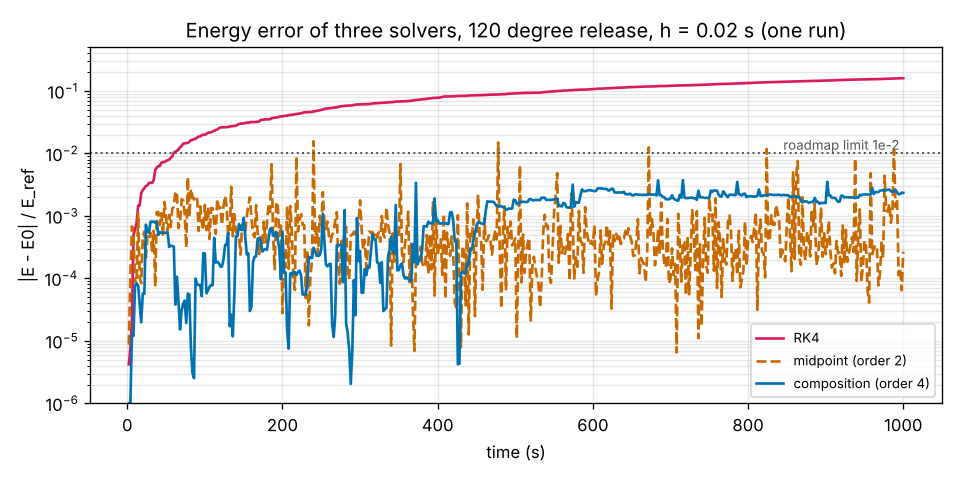
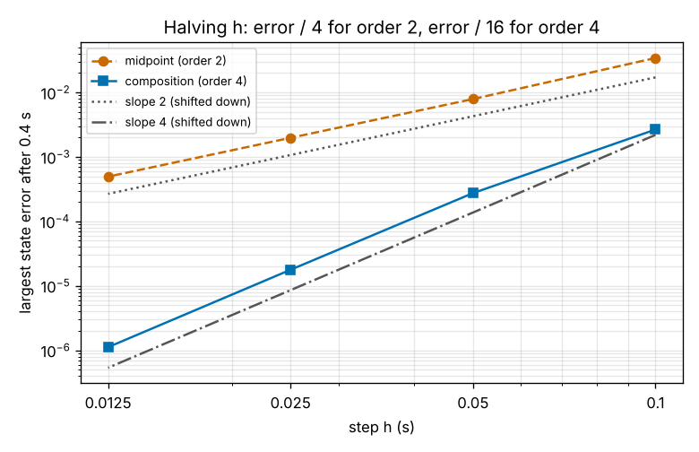
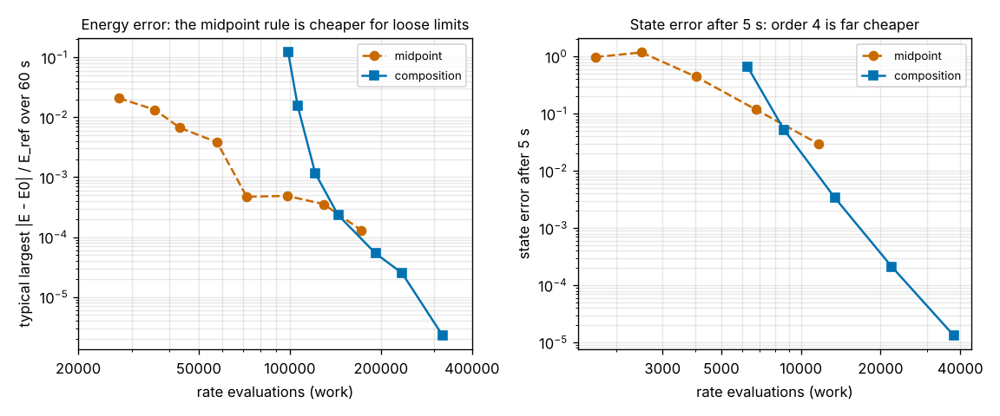
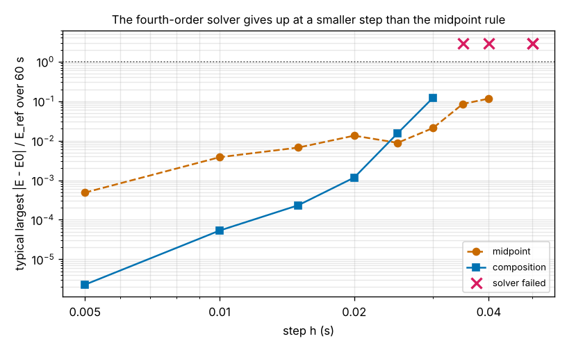

# Session 4: A fourth-order symplectic solver

*Level 3 (simulation and validation) · about 90 minutes · openchaos*

> This is a simplified educational model. It is not a validated design tool and must not be used for real structures, electrical installations, vehicles, industrial processes or medical decisions.

**Prerequisites**

- Session 2: the equations of motion, energy and the RK4 solver.
- Session 3: the implicit midpoint rule and why a symplectic solver keeps the energy error bounded.
- Powers and logarithms: an error that shrinks like h^p loses a factor 2^p when h is halved.

**Learning objectives.** After this session you can:

- Build a fourth-order symplectic solver from three steps of the midpoint rule and explain where the sizes 1.3512 and -1.7024 come from.
- Measure the order of a solver from the ratio of its errors when the step is halved.
- Compare solvers by the work they need (rate evaluations) instead of by their step size.
- Find the step size at which an implicit solver stops converging and say why the fourth-order solver gives up first.

## A. Real-world problem
Satellite orbits, molecules and planets are simulated for billions of steps, so the solver must not leak energy and must also be accurate. In Session 3 the implicit midpoint rule kept the energy error of the double pendulum bounded, but with h = 0.02 s that error still reaches a few percent of the energy scale. Can we do better without making the step tiny? Today we build a fourth-order symplectic solver from the midpoint rule, check that it really is fourth order, count what it costs, and find out where it stops working.

## B. Concept and theory
The implicit midpoint rule is symplectic and symmetric (a step forward by h followed by a step back by h returns to the start), and its error per step starts with an h^3 term, which makes it second order. A **composition** applies it several times with different step sizes: three steps of sizes gamma1 h, gamma0 h and gamma1 h in a row. The result is still symplectic (a chain of symplectic steps is symplectic) and still symmetric. Two conditions fix the sizes: they must add up to one step, 2 gamma1 + gamma0 = 1, and the h^3 error terms must cancel, 2 gamma1^3 + gamma0^3 = 0. The solution is gamma1 = 1 / (2 - 2^(1/3)) = 1.3512 and gamma0 = -2^(1/3) / (2 - 2^(1/3)) = -1.7024, so one step goes forward 1.35 h, **backward** 1.70 h, then forward 1.35 h. The sub-steps are a mathematical device, not moments of physical time. With the h^3 term gone the method is fourth order: halving h should divide the error by 16 instead of 4. The price is work: one step is three midpoint solves, and each solve repeats a substitution until it settles. That substitution only settles when h times the fastest rate of change is small, and the middle solve uses the largest step (1.70 h), so the composition stops working at a smaller h than the midpoint rule. We count work as the number of evaluations of the rate function, and because this pendulum is chaotic we report the typical largest energy error: the median, over five starts nudged by about 1e-9, of the largest |E - E0| / E_ref.

| Symbol | Meaning | Unit |
|---|---|---|
| h | time step | s |
| gamma1, gamma0 | relative sizes of the three sub-steps | none |
| p | order of the method (error shrinks like h^p) | none |
| E, E0 | energy now and at the start | J |
| E_ref | energy scale 3 g, equal to 29.43 J | J |
| work | number of evaluations of the rate function | none |

**Assumptions**

- Equal masses (1 kg) and rods (1 m), no friction; released from rest with both rods at the same angle.
- The substitution that solves each midpoint step stops after 60 tries or when it changes by less than 1e-14; a solve that ends with a change above 1e-9 counts as not converged.
- The order test uses a gentle start (0.5, -0.3, 0.2, 0.1) for 0.4 s, before chaos amplifies anything, and a very fine RK4 reference (h = 0.0005 s).
- Energy errors are sampled once per second; the 120 degree release is chaotic, so a single run's largest error is partly luck (see C).

$$ 2\gamma_1+\gamma_0=1,\qquad 2\gamma_1^3+\gamma_0^3=0\ \Longrightarrow\ \gamma_1=\frac{1}{2-2^{1/3}},\ \ \gamma_0=-\frac{2^{1/3}}{2-2^{1/3}} $$

$$ \Phi_h=\Phi^{(2)}_{\gamma_1 h}\circ\Phi^{(2)}_{\gamma_0 h}\circ\Phi^{(2)}_{\gamma_1 h}\quad\text{(order 4 and symplectic)} $$

$$ \text{error}\approx C h^p\ \Longrightarrow\ p\approx\log_2\frac{\text{error}(h)}{\text{error}(h/2)} $$

## C. Visual explanation
Figure 1 shows the energy error over 1000 s at h = 0.02 s for the 120 degree release. In this run the largest error is 0.16 of E_ref for RK4 (and growing), 0.0157 for the midpoint rule and 0.0038 for the composition, which is below the roadmap limit of 0.01. Chaos makes this number partly luck: over five nearby starts the median of the largest error is 0.0071 for the composition (individual runs 0.004 to 0.009; other nudges gave up to 0.012), 0.024 for the midpoint rule and 0.17 for RK4. Figure 2 is the order test: the midpoint error falls by factors 4.0 when h is halved (order 2.00) and the composition error by 15.9 (order 3.99), from 1.78e-5 at h = 0.025 s to 1.12e-6 at h = 0.0125 s. Figure 3 compares the solvers by work. For the typical largest energy error over 60 s, the midpoint rule reaches 1e-2 with 43,328 rate evaluations (h = 0.015 s) against 121,330 for the composition (h = 0.02 s), and still wins at 1e-3 (72,037 against 144,413), but only the composition reaches 1e-4 (192,125 evaluations at h = 0.01 s; the midpoint rule's best on the ladder is 1.3e-4). For the state after 5 s the composition is far cheaper: 3.4e-3 with 13,441 evaluations against 3.0e-2 for the midpoint rule with 11,628. Figure 4 shows what happens at coarse steps: the composition's typical error rises from 1.2e-3 at h = 0.02 s to 1.5e-2 at 0.025 s, then 15 solves fail to converge at 0.03 s and the run is garbage from 0.035 s, while the midpoint rule still runs at 0.04 s and fails only at 0.05 s.

*Energy error of RK4, the midpoint rule and the composition over 1000 s at h = 0.02 s (one run).*

*Order test: error against step on log axes; slope 2 for the midpoint rule, slope 4 for the composition.*

*Accuracy against work: the midpoint rule is cheaper for loose energy limits, the composition for tight ones and for short-time accuracy.*

*Typical energy error against step: the composition gives up at a smaller step than the midpoint rule (red crosses mark failed runs).*

## D. Interactive simulation
Run the lesson (`python start.py 4`), then open the live app: [Session 4: a fourth-order symplectic solver](https://krunalpanchal1995.github.io/pan-iit-oss/openchaos/session-04/) (or `app.html` in this folder). Choose the start angle, the step and the run length, watch the energy error of the three solvers, switch to the order test, and push the step up until the composition fails.

**Challenge.** In the order test, find the largest step (in steps of 5 ms) at which the composition has a state error below 1e-6 after 0.4 s. The midpoint rule cannot get there at any step the slider allows.

## E. Worked example and experiment
**Problem.** Find the three step sizes of the triple jump for h = 0.02 s and check the two order conditions.

1. 2^(1/3) = 1.259921, so 2 - 2^(1/3) = 0.740079.
2. gamma1 = 1 / 0.740079 = 1.351207.
3. gamma0 = -2^(1/3) gamma1 = -1.259921 x 1.351207 = -1.702414.
4. Sum: 2 x 1.351207 - 1.702414 = 1.000000. Cubes: gamma1^3 = 2.467, so 2 gamma1^3 = 4.934, and gamma0^3 = -4.934; the sum is 0.
5. For h = 0.02 s the sub-steps are 0.027024 s, -0.034048 s and 0.027024 s, which add up to 0.02 s.
6. Check with the simulation: halving h from 0.025 s to 0.0125 s divides the error by 15.9, so the observed order is 3.99.

**Answer.** The sizes are 1.3512 h, -1.7024 h and 1.3512 h, here 0.027024 s, -0.034048 s and 0.027024 s; the middle sub-step goes back 1.26 times as far as each outer sub-step goes forward.

**Experiment.** Run the lesson and look at Figure 1, then change `h` in `drift_curve` from 0.02 to 0.01 and to 0.03 and compare the three solvers. You should see the composition improve much faster than the midpoint rule when h shrinks and become unreliable above 0.025 s. Then nudge the start by 1e-13 (add it to `s0`) and watch the largest error of one run change by a factor of two or more: for a chaotic orbit that is normal, and it is why the checkpoint uses medians over several starts. A real simulation of a satellite or a molecule has the same trade-off: the higher-order method pays off only when you need high accuracy and the step is small enough for its implicit solves to converge.

## Real-world application and mini-project: Pick the cheapest solver for a long pendulum run
You must simulate the 120 degree release for 60 s and keep the typical largest energy error (median over 5 nearby starts, sampled once per second) below 1e-2, 1e-3 or 1e-4 of E_ref. Use `ladder_results` and `cheapest_for_tolerance` with the steps [0.015, 0.0075, 0.0025] for the midpoint rule and [0.02, 0.015, 0.01] for the composition, and count work with `CALLS`.

**Deliverable:** A script that prints, for each of the three tolerances, the cheapest step and number of rate evaluations for each solver (or "not reached"), names the cheaper solver, and finally compares the state error after 5 s for the midpoint rule at h = 0.003125 s with the composition at h = 0.0125 s.

**Success looks like:** For 1e-2 the midpoint rule is cheaper (43,328 against 121,330 evaluations) and also for 1e-3 (72,037 against 144,413); for 1e-4 only the composition reaches it (h = 0.01 s, 192,125 evaluations; the midpoint rule's best is 1.3e-4); and for the state after 5 s the composition's error (3.4e-3 with 13,441 evaluations) is about nine times smaller than the midpoint rule's (3.0e-2 with 11,628).

## F. Assessment and design challenge
**Question type A: Conceptual.** A classmate says: "The fourth-order solver is simply better than the midpoint rule: it is just as symplectic and much more accurate." Give two reasons why this is too simple.

Hint

Think about what one step costs, and about the backward sub-step of 1.70 h.

Step-by-step solution

First, cost: one composed step is three midpoint solves (3.4 times the rate evaluations at h = 0.02 s), so for a loose energy limit the cheap rule wins: 43,328 evaluations against 121,330 for 1e-2. The composition pays off only for tight limits (1e-4) or short-time accuracy. Second, robustness: the middle solve uses a step of 1.70 h, so the substitution that solves it stops converging at a smaller h: the composition fails from h = 0.03 s to 0.035 s while the midpoint rule still runs at 0.04 s. A high order is only an advantage when h is small enough for the method to be in its asymptotic regime.

**Question type B: Numerical.** At h = 0.05 s the composition's state error after 0.4 s is 2.75e-4. Predict the error at h = 0.0125 s, and compare the number of midpoint solves per second of simulated time at the two steps. Give a sanity check.

Hint

Order 4: the error scales with h^4. The step shrinks by a factor 4.

Step-by-step solution

The step shrinks by 4, so the error shrinks by 4^4 = 256: 2.75e-4 / 256 = 1.07e-6 (the lesson measures 1.12e-6). Midpoint solves per second: 3 / 0.05 = 60 at h = 0.05 s and 3 / 0.0125 = 240 at h = 0.0125 s, so four times the work buys 256 times less error. Sanity check: the midpoint rule with the same four-fold work would improve only by 4^2 = 16.

**Question type C: Graph and simulation interpretation.** Figure 3 (left) gives, for the typical largest energy error over 60 s, 43,328 evaluations for the midpoint rule and 121,330 for the composition at 1e-2, and for 1e-4 only the composition (192,125). Which solver would you choose for each limit? Why does the composition's curve fall so much faster as the work grows?

Hint

Compare the error at h = 0.02 s and at h = 0.01 s for each solver (composition 1.2e-3 and 5.3e-5; midpoint 1.3e-2 and 3.8e-3).

Step-by-step solution

For 1e-2 choose the midpoint rule: it needs 2.8 times fewer evaluations. For 1e-4 the composition is the only one that gets there on this ladder. The composition falls faster because its error depends on a higher power of h: halving h from 0.02 s to 0.01 s divides its typical error by 23 (order about 4), the midpoint rule's by 3.4 (order about 2). A steeper curve starts more expensive but crosses the flatter one at tight limits (here between 1e-4 and 2e-4). Assumption: one release angle and 60 s; the crossing moves with the start and the run length.

**Question type D: Design and optimisation challenge.** Design: you need the typical largest energy error of the 120 degree release over 60 s to stay below 1e-4 of E_ref, with a budget of 200,000 rate evaluations. Choose a solver and a step, check your margin against the step at which the solver fails, and say what you would re-test if the pendulum were released from 150 degrees.

Hint

Use the ladder results: the midpoint rule's best is 1.3e-4 at 172,221 evaluations; look at the composition at h = 0.01 s.

Step-by-step solution

The composition at h = 0.01 s gives a typical error of 5.3e-5 with 192,125 evaluations: below 1e-4 and inside the 200,000 budget. The midpoint rule does not reach 1e-4 (1.3e-4 with 172,221 evaluations at h = 0.0025 s). The composition starts to fail at h = 0.03 s, three times larger than the chosen step, a reasonable safety margin. A release from 150 degrees has more energy and faster motion, so the safe step is smaller: run the step survey again (error and number of unsettled solves) and, if needed, reduce h and recompute the budget. Assumption: a single release angle and 60 s; a longer run costs proportionally more evaluations.

Score yourself with [RUBRIC.md](../../RUBRIC.md). Print the [activity sheet](activity_sheet.md) to work on paper.

## Common misconceptions
| Common misconception | What is actually true |
|---|---|
| A higher-order solver is always more accurate. | Only once the step is small enough: at h = 0.025 s the composition's typical energy error (1.5e-2) is no better than the midpoint rule's (8.8e-3), and above 0.03 s it fails while the midpoint rule still runs. |
| Same step size means a fair comparison. | One composed step costs 3.4 times a midpoint step, so solvers must be compared at the same work: for loose energy limits the midpoint rule is cheaper. |
| Symplectic means the energy error is zero. | The error stays bounded but is not zero: 0.0071 of E_ref (median) for the composition at h = 0.02 s, and it depends on the start because the orbit is chaotic. |
| A negative sub-step means the solver runs time backwards. | The sub-steps are a mathematical device; only their sum, h, is a physical time step, and the three sizes are chosen so the h^3 errors cancel. |

## Glossary
- **composition method**: a higher-order method built by applying a lower-order one several times with chosen step sizes
- **triple jump**: the composition with sizes gamma1 h, gamma0 h, gamma1 h (1.3512, -1.7024, 1.3512) that raises a symmetric second-order method to fourth order
- **order of a method**: the power p in error proportional to h^p; halving h divides the error by 2^p
- **symmetric (reversible) method**: a step forward followed by a step back returns to the start
- **rate evaluation**: one call of the function that gives the time derivatives; our measure of work
- **non-converged solve**: an implicit step whose substitution did not settle, so the step is wrong
- **typical largest energy error**: the median, over several nearby starts, of the largest energy error of a run

## Finish
1. Do the three coding tasks in [exercises.md](exercises.md).
2. Run `python start.py 4` again after your changes. It ends with the checkpoint; when it prints `PASS`, you are done. (Checkpoint only: `python start.py check 4`.)

Next: [Session 5: Ensemble forecasts: probabilities instead of paths](../session-05/README.md).
