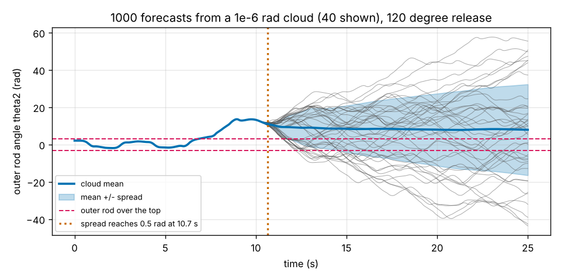
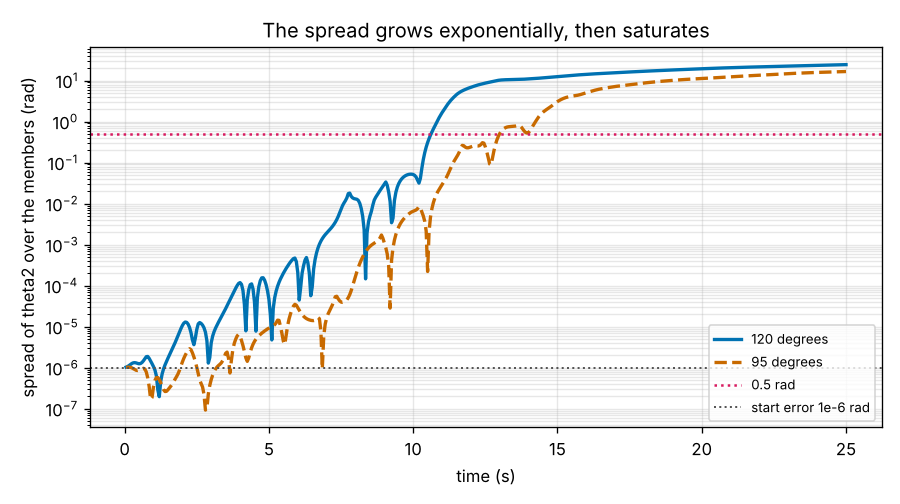
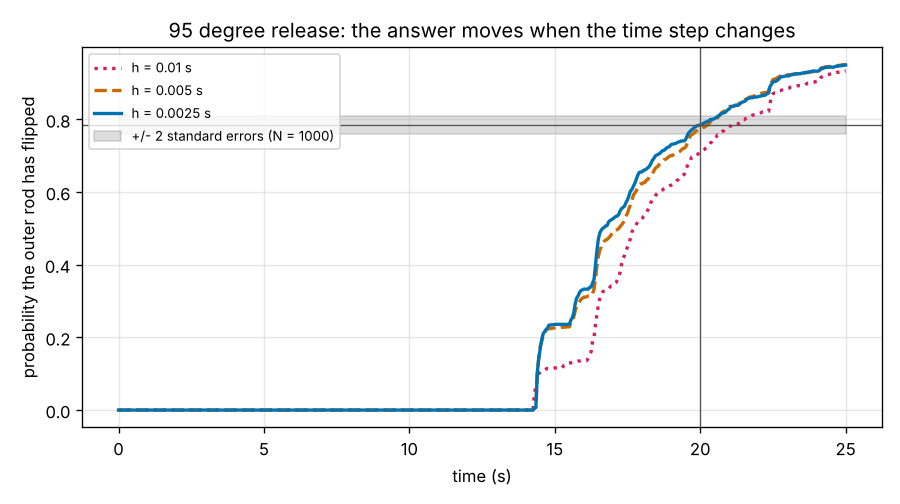
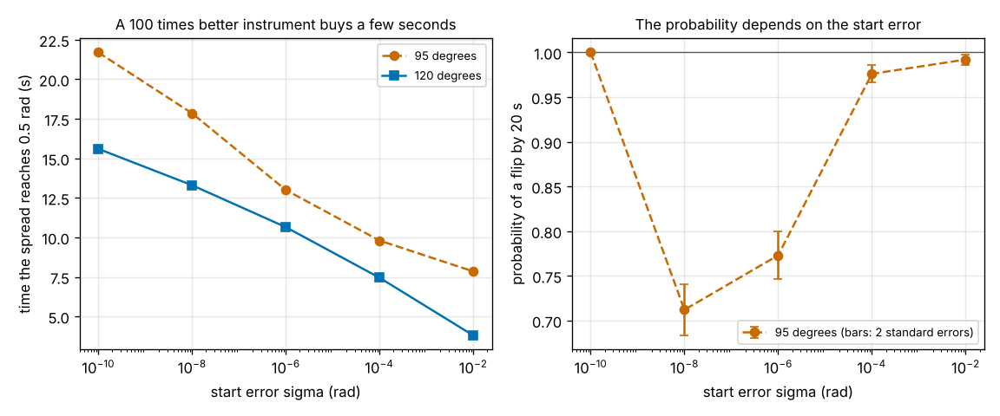

# Session 5: Ensemble forecasts

*Level 3 (simulation and validation) · about 90 minutes · openchaos*

> This is a simplified educational model. It is not a validated design tool and must not be used for real structures, electrical installations, vehicles, industrial processes or medical decisions.

**Prerequisites**

- Session 3: the Lyapunov exponent and the predictability horizon.
- Session 4: why the time step matters (the order of a solver).
- Basic statistics: the mean and the standard deviation of a set of numbers.

**Learning objectives.** After this session you can:

- Run an ensemble of 1000 forecasts from a Gaussian cloud of start errors and measure how fast the cloud spreads.
- Turn the cloud into a probability that the outer rod has flipped, and state its sampling error.
- Check that the answer is converged: different seeds, then a halved time step.
- Say how much a better instrument buys, and why a probability is not a promise about one pendulum.

## A. Real-world problem
Weather services do not give one forecast. They start dozens of forecasts from slightly different versions of today's measurements and report what fraction brings rain. In Session 3 we forecast the double pendulum from one start with one assumed error and found that the forecast fails after a horizon. Today we do what the weather services do: 1000 runs from a Gaussian cloud of start errors of 1e-6 rad. We measure the time when the cloud has spread so far that the path is lost, and we turn the cloud into a probability that the outer rod has flipped by 20 s. And we ask how far that probability can be trusted.

## B. Concept and theory
An **ensemble** is a set of N runs (members) that start from the release angles plus a random error with a Gaussian distribution of standard deviation sigma, drawn independently for the two angles. All members use the same equations and the same RK4 step. The **spread** at time t is the standard deviation of theta2 over the members. At first it equals sigma. While it is small it grows like sigma exp(lambda t), the exponential growth of Session 3, so the slope of ln(spread) estimates lambda. When the spread reaches the size of the motion it saturates. The **spread time** is the first time the spread exceeds 0.5 rad: after it, members disagree about the position of the outer rod by more than half a radian and no single path can be trusted. The **flip time** of a member is the first time its outer rod goes over the top (|theta2| above pi). The flip probability P(t) is the fraction of members whose flip time is at most t. With N members it has a **sampling error** (standard error) sqrt(P (1 - P) / N). It also has a **numerical error**: RK4's error at step h acts like an extra start error, and chaos amplifies it exactly like the error we put in on purpose, so P can move when h changes even if N is huge. A converged answer is one that stays within the sampling error when the seed changes and when h is halved. Finally, an ensemble answers a question about the cloud: the probability that the cloud has flipped is not the probability that one particular pendulum has.

| Symbol | Meaning | Unit |
|---|---|---|
| N | number of members | none |
| sigma | standard deviation of the start errors | rad |
| spread | standard deviation of theta2 over the members | rad |
| lambda | growth rate of the spread | 1/s |
| t_s | spread time, first time the spread exceeds 0.5 rad | s |
| P(t) | fraction of members that have flipped by time t | none |
| SE | standard error of P | none |
| h | time step | s |

**Assumptions**

- Equal masses (1 kg) and rods (1 m), no friction; released from rest with both rods at the same angle.
- Only the two start angles carry an error (sigma = 1e-6 rad unless stated), drawn from a seeded Gaussian generator.
- RK4 with h = 0.005 s, theta2 stored every 0.05 s, flip detected at every step. The spread uses the unwrapped angle of the simulation.
- P is only the sampling error plus what the step does; model errors (friction, measurement bias) are not in the cloud.

$$ \text{spread}(t)\approx\sigma\,e^{\lambda t}\ \Longleftrightarrow\ \ln\text{spread}=\ln\sigma+\lambda t $$

$$ \hat P(t)=\frac{\#\{\text{members with flip time}\le t\}}{N},\qquad \mathrm{SE}=\sqrt{\frac{\hat P(1-\hat P)}{N}} $$

$$ N\ge\frac{P(1-P)}{\mathrm{SE}^2} $$

## C. Visual explanation
Figure 1 shows 40 of the 1000 members for the 120 degree release: they move as one for about 10 s, then the cloud opens up, and the spread first exceeds 0.5 rad at 10.65 s (both seeds). Every member has flipped by 20 s (probability 1.000), at 6.90 s for the median member, the same as the single exact start (6.89 s): when the spread is still tiny the forecast of that event is certain. Figure 2 shows the spread on a log axis: a rising line from 1e-6 rad (lambda about 1 per second for 120 degrees and 1.3 for 95 degrees) that flattens near 10 rad. For the 95 degree release the spread time is 13.0 s and the flip probability in Figure 3 is a real forecast: 0 at 10 s, 0.23 at 15 s, 0.773 at 20 s with a standard error of 0.013, 0.95 at 25 s; four seeds give 0.773, 0.766, 0.780 and 0.781. The same figure shows the numerical error: the probability at 20 s is 0.708 for h = 0.01 s, 0.773 for 0.005 s and 0.785 for 0.0025 s, so the coarse step is off by about 0.07, five times the sampling error. Figure 4 shows what a better instrument buys: for the 95 degree release the spread time is 9.8 s for sigma = 1e-4, 13.0 s for 1e-6 and 17.9 s for 1e-8, about 3 to 5 s per factor 100, and the probability by 20 s is 0.98, 0.77 and 0.71. The exact 95 degree start, with no cloud, flips at 19.2 s.

*Forty of the 1000 forecasts for the 120 degree release, with the cloud mean and its spread.*

*Spread of theta2 over the members: exponential growth from 1e-6 rad, then saturation.*

*Flip probability for the 95 degree release at three time steps; the grey band is two standard errors.*

*Spread time and flip probability against the size of the start error.*

## D. Interactive simulation
Run the lesson (`python start.py 5`), then open the live app: [Session 5: ensemble forecasts](https://krunalpanchal1995.github.io/pan-iit-oss/openchaos/session-05/) (or `app.html` in this folder). Choose the release angle, the start error, the number of members and the step; look at the cloud, the spread and the flip probability, and halve the step to see whether the probability moves.

**Challenge.** For the 95 degree release, find a start error (exponent e) small enough that the spread of the cloud stays below 0.5 rad for at least 17 s.

## E. Worked example and experiment
**Problem.** A forecast of the 95 degree release from 1000 members says that 77 percent have flipped by 20 s. What is the sampling standard error and a 95 percent interval? How many members give a standard error of 0.01?

1. SE = sqrt(P (1 - P) / N) = sqrt(0.77 x 0.23 / 1000) = sqrt(1.771e-4) = 0.0133.
2. A 95 percent interval is about plus or minus 1.96 SE = 0.026, so 0.74 to 0.80.
3. For SE = 0.01: N = P (1 - P) / SE^2 = 0.1771 / 0.0001 = 1771, so about 1800 members.
4. Four times as many members (4000) halve the error: sqrt(0.1771 / 4000) = 0.0067.
5. Check with the simulation: four different seeds give 0.773, 0.766, 0.780 and 0.781, all within 0.015 of each other, as expected from a standard error of 0.013.

**Answer.** SE = 0.013, interval 0.74 to 0.80, and about 1800 members for SE = 0.01 (the sampling error only).

**Experiment.** Run the lesson, then change `h` in `run_ensemble` from 0.005 to 0.01 and to 0.0025 for the 95 degree release and compare the probability at 20 s (0.708, 0.773, 0.785). The step changes the answer far more than another seed does, and no number of members repairs that. A real forecast has the same two errors: too few members, and a model that is not accurate enough. Also try `sigma=1e-10`: the whole cloud then flips like the exact start at 19.2 s and the probability is 1.0. The probability describes the cloud, so it depends on how well you know the start.

## Real-world application and mini-project: How precise must the instrument be?
A lab can measure the two release angles of the 95 degree pendulum to 1e-4, 1e-6 or 1e-8 rad. Use `precision_ladder` (1000 members, h = 0.005 s, seed 1, 30 s) to find, for each, the spread time and the probability of a flip by 20 s with its standard error, and compare the gain from each factor of 100 with ln(100) / lambda.

**Deliverable:** A script that prints, for the three precisions, the spread time, the flip probability by 20 s and its standard error; prints the gain in spread time for each factor of 100 next to ln(100) / lambda with lambda taken from the spread of the 1e-6 run; and says in one sentence whether the 1e-8 instrument makes the 20 s forecast certain.

**Success looks like:** Spread times of 9.8, 13.0 and 17.9 s; flip probabilities 0.98 (error 0.005), 0.77 (0.013) and 0.71 (0.014); gains of 3.2 s and 4.9 s next to ln(100) / lambda = 3.4 s; and the conclusion that even the 1e-8 instrument leaves the cloud spreading before 20 s (spread time 17.9 s), so the forecast is still a probability, not a certainty.

## F. Assessment and design challenge
**Question type A: Conceptual.** After the spread time, why does a forecaster report a probability instead of a path, and what can still go wrong with that probability?

Hint

Think about what the members do after the spread time, and about the two kinds of error of the probability.

Step-by-step solution

After the spread time the members disagree by more than 0.5 rad, so no single member is more believable than another; the path is lost. The fraction of members that flip, however, is a statistic of the whole cloud and changes smoothly with time, so it can still be estimated. It can go wrong in two ways: the sampling error (too few members, the standard error falls only like 1 / sqrt(N)) and the numerical error (a too coarse step, which moved the 95 degree probability by 0.07). It also assumes the cloud is the right description of what we do not know about the start; if the real error is larger or not Gaussian the probability is wrong whatever N is.

**Question type B: Numerical.** For the 95 degree release the probability of a flip by 20 s is about 0.77 with 1000 members. A report must give it with a standard error of 0.005. How many members are needed, and how long will the run take if 1000 members take 2.3 s? Give a sanity check.

Hint

N = P (1 - P) / SE^2; the run time is proportional to N.

Step-by-step solution

N = 0.77 x 0.23 / 0.005^2 = 0.1771 / 2.5e-5 = 7084, so about 7100 members, and the run takes about 7.1 x 2.3 s = 16 s. Sanity check: the error must fall from 0.0133 to 0.005, a factor 2.66, and the error falls like 1 / sqrt(N), so N must grow by 2.66^2 = 7.1.

**Question type C: Graph and simulation interpretation.** In Figure 3 the probability of a flip by 20 s is 0.708 for h = 0.01 s, 0.773 for 0.005 s and 0.785 for 0.0025 s, with a sampling standard error of 0.013. Can sampling explain the change from 0.01 s to 0.005 s? Which step would you report?

Hint

Compare the change with the standard error of a difference, about sqrt(2) times the standard error of one value.

Step-by-step solution

The change is 0.065. The standard error of a difference is about sqrt(2) x 0.013 = 0.019, so the change is about 3.5 standard errors: sampling does not explain it; the coarse step changes the result. From 0.005 s to 0.0025 s the change is 0.012, smaller than one standard error of the difference, so the result has converged within the sampling error. Report the finer value, about 0.78 plus or minus 0.03 (two standard errors), and state the step used.

**Question type D: Design and optimisation challenge.** Design: you must publish the probability that the outer rod of the 95 degree release has flipped by 20 s, accurate to plus or minus 0.02 with 95 percent confidence. Choose the number of members and the step, say how you will check convergence, and name one thing the number does not cover.

Hint

95 percent confidence is about 2 standard errors, so SE = 0.01.

Step-by-step solution

SE = 0.01 needs N = 0.77 x 0.23 / 0.01^2 = 1771, so use at least 1800 members. Use h = 0.005 s, then repeat with h = 0.0025 s and a second seed: the two probabilities must agree within about 0.02, otherwise halve the step again. Report P with both numbers and the step used. The number does not cover anything outside the cloud: measurement bias, a start error larger than 1e-6 rad or not Gaussian, friction, or the fact that the one real pendulum either flips or does not.

Score yourself with [RUBRIC.md](../../RUBRIC.md). Print the [activity sheet](activity_sheet.md) to work on paper.

## Common misconceptions
| Common misconception | What is actually true |
|---|---|
| More members always make the forecast more accurate. | They only reduce the sampling error. A too coarse step stays wrong however many members you use: h = 0.01 s gives 0.708 where the converged value is about 0.78. |
| The ensemble mean is the best forecast of the path. | After the spread time the mean is a smooth curve that no single member follows (Figure 1: the mean goes flat while every member keeps moving). |
| A probability of 0.77 means this pendulum flips with 77 percent certainty. | It is the fraction of the cloud. The exact 95 degree start flips at 19.2 s; the one real pendulum either flips or does not. |
| A 100 times better instrument gives a 100 times longer forecast. | It adds about ln(100) / lambda = 3.4 s to the spread time (3.2 s and 4.9 s measured). |

## Glossary
- **ensemble**: a set of forecasts that start from slightly different starts
- **member**: one run of the ensemble
- **spread**: the standard deviation of a quantity (here theta2) over the members
- **spread time**: the first time the spread exceeds 0.5 rad
- **flip probability**: the fraction of members whose outer rod has flipped by a given time
- **sampling error (standard error)**: the uncertainty of a probability that comes from using only N members, sqrt(P (1 - P) / N)
- **numerical convergence**: the answer stays within the sampling error when the time step is halved

## Finish
1. Do the three coding tasks in [exercises.md](exercises.md).
2. Run `python start.py 5` again after your changes. It ends with the checkpoint; when it prints `PASS`, you are done. (Checkpoint only: `python start.py check 5`.)

Next: the [roadmap](../../promo/roadmap.md). Session 6 is yours to build.
