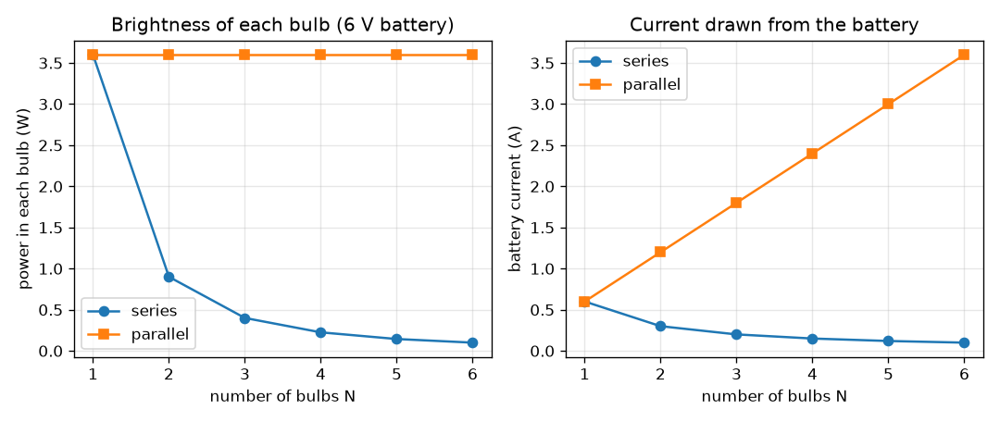
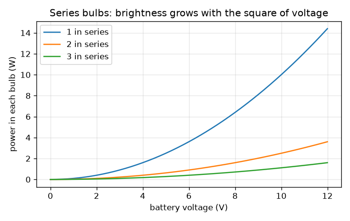

# सत्र 1: एक बैटरी, एक स्विच और बल्ब: श्रेणी और समांतर

*स्तर 1 (वैचारिक इंटरैक्टिव मॉडल) · लगभग 60 मिनट · opencircuitlab*

> यह एक सरलीकृत शैक्षिक मॉडल है। यह कोई प्रमाणित डिज़ाइन टूल नहीं है और इसका उपयोग वास्तविक संरचनाओं, बिजली की वायरिंग (electrical installations), वाहनों, औद्योगिक प्रक्रियाओं या चिकित्सा निर्णयों के लिए नहीं किया जाना चाहिए।

**पूर्व-आवश्यकताएँ (Prerequisites)**

- स्कूल भौतिकी से ओम का नियम (Ohm's law), V = I R।
- आपने PRIMER.md पढ़ लिया है और एक बार `python start.py 1` चलाया है।

**सीखने के उद्देश्य (Learning objectives).** इस सत्र के बाद आप:

- समझा सकेंगे कि श्रेणी (series) शृंखला में धारा हर जगह समान क्यों रहती है जबकि वोल्टता बँट जाती है।
- समझा सकेंगे कि समांतर (parallel) में हर बल्ब को बैटरी की पूरी वोल्टता क्यों मिलती है जबकि धाराएँ जुड़ जाती हैं।
- दोनों वायरिंग में N एक-जैसे बल्बों के लिए धारा, वोल्टता और शक्ति की गणना हाथ से और Python में कर सकेंगे।
- किसी बल्ब की चमक को उसमें व्यय होने वाली शक्ति से जोड़ सकेंगे।

## A. वास्तविक दुनिया की समस्या
पुरानी त्योहारी झालरें एक लंबी शृंखला में जुड़ी होती थीं: जब एक बल्ब फ़्यूज़ हो जाता, तो पूरी लड़ी बुझ जाती, और जब आप और बल्ब जोड़ते, तो सभी मंद हो जाते। एक ही बैटरी पर दो बल्बों वाली टॉर्च अलग तरह से व्यवहार करती है। एक ही बैटरी एक वायरिंग में बल्बों को मंद और दूसरी में तेज़ क्यों चमकाती है, और इस चमक के लिए बैटरी क्या क़ीमत चुकाती है? (केवल कम-वोल्टता वाले शैक्षिक परिपथ: मेन्स बिजली (mains electricity) के साथ कभी प्रयोग न करें।)

## B. अवधारणा और सिद्धांत
बैटरी आवेश (charge) को एक बंद लूप में धकेलती है। श्रेणी शृंखला में केवल एक ही मार्ग होता है, इसलिए वही धारा एक के बाद एक हर बल्ब से गुज़रती है; प्रतिरोध जुड़ जाते हैं और बैटरी की वोल्टता बल्बों में बँट जाती है। समांतर समूह में हर बल्ब सीधे बैटरी के आर-पार जुड़ा होता है, इसलिए हर एक को पूरी वोल्टता मिलती है और वह अपनी अलग धारा ले जाता है; बैटरी को ये सभी धाराएँ एक साथ देनी पड़ती हैं। किसी बल्ब में शक्ति (power) P = V I = I^2 R = V^2 / R है, और हम चमक को इसके समानुपाती मानते हैं। स्विच बस एक खाली जगह (gap) है: खुला होने का अर्थ है कोई लूप नहीं और कोई धारा नहीं।

| प्रतीक | अर्थ | इकाई |
|---|---|---|
| V | बैटरी की वोल्टता | V |
| R | एक बल्ब का प्रतिरोध (मॉडल मान 10) | ohm |
| N | एक-जैसे बल्बों की संख्या | कोई इकाई नहीं |
| I | बैटरी से ली गई धारा | A |
| P | एक बल्ब में शक्ति (ऊष्मा और प्रकाश) | W |

**मान्यताएँ (Assumptions)**

- बैटरी आदर्श है: धारा बहने पर उसकी वोल्टता नहीं गिरती।
- बल्ब एक स्थिर 10 ohm प्रतिरोधक (resistor) है। वास्तविक तंतु (filament) बहुत गरम हो जाता है और उसका प्रतिरोध कई गुना बढ़ जाता है, इसलिए वास्तविक चमक इस मॉडल से भिन्न होती है।
- तारों का कोई प्रतिरोध नहीं है।

$$ I=\frac{V}{R}\qquad P=VI=I^2R=\frac{V^2}{R} $$

$$ \text{series: } R_{\mathrm{tot}}=NR,\quad I=\frac{V}{NR},\quad V_{\mathrm{bulb}}=\frac{V}{N},\quad P_{\mathrm{bulb}}=\frac{V^2}{N^2R} $$

$$ \text{parallel: } R_{\mathrm{tot}}=\frac{R}{N},\quad I=\frac{NV}{R},\quad V_{\mathrm{bulb}}=V,\quad P_{\mathrm{bulb}}=\frac{V^2}{R} $$

## C. दृश्य व्याख्या
पहला चित्र 6 V बैटरी पर 1 से 6 बल्बों के लिए दोनों वायरिंग की तुलना करता है। बाईं ओर, हर बल्ब में शक्ति समांतर में 3.6 W पर बनी रहती है पर श्रेणी में 1/N^2 की तरह गिरती है (दो बल्बों के लिए 0.9 W, तीन के लिए 0.4 W)। दाईं ओर, बैटरी की धारा श्रेणी में गिरती है (एक बल्ब के लिए 0.6 A, चार के लिए 0.15 A) और समांतर में बढ़ती है (चार के लिए 2.4 A): समांतर में चमक की क़ीमत बैटरी चुकाती है। दूसरा चित्र दिखाता है कि श्रेणी शृंखला में चमक बैटरी वोल्टता के वर्ग के साथ बढ़ती है।

*6 V पर 1 से 6 बल्बों के लिए, श्रेणी और समांतर में, हर बल्ब की शक्ति और बैटरी की धारा।*

*श्रेणी में बल्ब: हर बल्ब में शक्ति बैटरी वोल्टता के वर्ग के साथ बढ़ती है।*

## D. इंटरैक्टिव सिमुलेशन
पाठ चलाइए (`python start.py 1`), फिर लाइव ऐप खोलिए: [सत्र 1: श्रेणी और समांतर में बल्ब](https://krunalpanchal1995.github.io/pan-iit-oss/opencircuitlab/session-01/) (या इसी फ़ोल्डर में `app.html`)। बल्बों की संख्या और वायरिंग चुनिए, फिर बैटरी वोल्टता को खिसकाइए। हर बल्ब के नीचे वोल्टता का लेबल, चमक और बैटरी की धारा देखिए। ग्राफ़ व्यू खोलिए और N के सापेक्ष चमक के दो वक्र देखिए।

**चुनौती।** तीन बल्बों को श्रेणी में ऐसे जोड़िए कि हर एक को कम से कम 1 W मिले।

## E. हल किया गया उदाहरण और प्रयोग
**समस्या।** एक 6 V बैटरी 10 ohm वाले तीन बल्बों को चलाती है। (a) श्रेणी वायरिंग और (b) समांतर वायरिंग के लिए धारा, हर बल्ब के आर-पार वोल्टता और उसकी शक्ति ज्ञात कीजिए।

1. श्रेणी: R_total = 3 * 10 = 30 ohm, इसलिए I = 6 / 30 = 0.2 A, हर बल्ब में समान।
2. हर बल्ब के आर-पार वोल्टता = I R = 0.2 * 10 = 2 V (तीनों का योग 6 V होता है, जैसा होना चाहिए)।
3. हर बल्ब में शक्ति = V I = 2 * 0.2 = 0.4 W; कुल 1.2 W, जो बैटरी वोल्टता गुणा धारा, 6 * 0.2, के बराबर है।
4. समांतर: हर बल्ब 6 V देखता है, इसलिए उसकी धारा 6 / 10 = 0.6 A है और उसकी शक्ति 6 * 0.6 = 3.6 W है।
5. बैटरी कुल 3 * 0.6 = 1.8 A और 10.8 W देती है। समांतर हर बल्ब को श्रेणी की तुलना में 9 गुना शक्ति देता है, क्योंकि वोल्टता 3 गुना बड़ी है और शक्ति वर्ग के साथ चलती है।

**उत्तर।** श्रेणी: प्रति बल्ब 0.2 A, 2 V और 0.4 W। समांतर: बैटरी से 1.8 A, प्रति बल्ब 6 V और 3.6 W।

**प्रयोग।** 4.5 V के बैटरी पैक और दो एक-जैसे छोटे टॉर्च बल्बों के साथ, उन्हें पहले श्रेणी में और फिर समांतर में जोड़िए और आँख से उनकी चमक की तुलना कीजिए; हर व्यवस्था में एक बल्ब खोलकर देखिए कि दूसरा क्या करता है। यदि आपके पास मल्टीमीटर (multimeter) है तो बैटरी की धारा मापिए। मॉडल के गुणात्मक परिणाम की अपेक्षा कीजिए (श्रेणी में मंद और बँटा हुआ, समांतर में तेज़, और एक बल्ब का ख़राब होना केवल श्रेणी शृंखला को बुझाता है)। संख्याएँ भिन्न होंगी: ठंडे तंतु का प्रतिरोध गरम तंतु से बहुत कम होता है, इसलिए स्विच चालू करते ही वास्तविक धारा मॉडल की धारा से अधिक होती है।

## F. मूल्यांकन और डिज़ाइन चुनौती
**प्रश्न प्रकार A: वैचारिक।** त्योहारी बल्बों की एक श्रेणी लड़ी में, एक बल्ब का तंतु टूटने से वह ख़राब हो जाता है। बाक़ी सभी बल्ब क्यों बुझ जाते हैं, और समांतर लड़ी में वे जलते क्यों रहते?

संकेत

धारा को एक बंद लूप चाहिए। हर वायरिंग में कितने लूप हैं?

चरण-दर-चरण हल

श्रेणी लड़ी में धारा के लिए केवल एक ही मार्ग है। टूटा हुआ तंतु उस मार्ग में एक खाली जगह है, इसलिए धारा हर जगह शून्य हो जाती है और हर बल्ब बुझ जाता है। समांतर लड़ी में हर बल्ब का बैटरी के आर-पार अपना अलग मार्ग है। एक मार्ग में खाली जगह दूसरों को प्रभावित नहीं करती, इसलिए उन्हें पूरी वोल्टता मिलती रहती है और वे जलते रहते हैं (बैटरी बस थोड़ी कम धारा देती है)।

**प्रश्न प्रकार B: संख्यात्मक।** एक 9 V बैटरी तीन 10 ohm बल्बों को चलाती है। श्रेणी वायरिंग और समांतर वायरिंग के लिए धारा और हर बल्ब में शक्ति ज्ञात कीजिए।

संकेत

श्रेणी: R_total = N R। समांतर: हर बल्ब को पूरे 9 V मिलते हैं। फिर P = V I।

चरण-दर-चरण हल

श्रेणी: R_total = 30 ohm, I = 9 / 30 = 0.3 A, हर बल्ब को 3 V मिलते हैं और P = 3 * 0.3 = 0.9 W। समांतर: हर बल्ब को 9 V मिलते हैं, प्रति बल्ब I = 0.9 A, P = 9 * 0.9 = 8.1 W, बैटरी धारा 2.7 A। समझदारी जाँच (sanity check): 3 बल्बों के लिए समांतर श्रेणी से 9 गुना अधिक चमकीला है (N^2 = 9), और 0.9 * 9 = 8.1।

**प्रश्न प्रकार C: ग्राफ़ और सिमुलेशन की व्याख्या।** 6 V पर चमक के ग्राफ़ में, 4 बल्ब श्रेणी में होने पर हर बल्ब, 4 बल्ब समांतर में होने की तुलना में कितने गुना मंद है? दोनों मान वक्रों से पढ़िए।

संकेत

N = 4 पर नीला और हरा वक्र ढूँढिए।

चरण-दर-चरण हल

N = 4 पर हरा (समांतर) वक्र 3.6 W पर है और नीला (श्रेणी) वक्र 0.225 W पर। अनुपात 3.6 / 0.225 = 16 = N^2 है। नीला वक्र 1 / N^2 की तरह गिरता है, हरा सपाट है।

**प्रश्न प्रकार D: डिज़ाइन और अनुकूलन (optimisation) चुनौती।** डिज़ाइन: एक छोटी 6 V बैटरी अधिकतम 1 A दे सकती है। आपको तीन 10 ohm बल्ब जलाने हैं और चाहते हैं कि हर एक को कम से कम 0.3 W मिले। तीन वायरिंग की तुलना कीजिए: सब श्रेणी में, सब समांतर में, और एक बल्ब एक समांतर जोड़ी के साथ श्रेणी में। कौन-सी अनुमत हैं, और आप कौन-सी चुनेंगे?

संकेत

हर वायरिंग के लिए बैटरी की धारा और हर बल्ब में शक्ति की गणना कीजिए।

चरण-दर-चरण हल

सब श्रेणी में: I = 0.2 A, प्रति बल्ब 0.4 W: अनुमत। सब समांतर में: I = 1.8 A, जो 1 A की सीमा से ऊपर है: अनुमत नहीं। एक बल्ब समांतर जोड़ी के साथ श्रेणी में: R = 10 + 5 = 15 ohm, I = 0.4 A; अकेले बल्ब को 4 V और 1.6 W मिलते हैं, जोड़ी के हर बल्ब को 2 V और 0.4 W: अनुमत, और कुल मिलाकर अधिक चमकीला, पर असमान रूप से। सब श्रेणी में सबसे सरल है और समान चमक देता है; मिश्रित वायरिंग अधिक प्रकाश देती है पर इसकी क़ीमत है असमान बल्ब, और अकेले बल्ब के ख़राब होने पर पूरा परिपथ बुझ जाना। मान्यता: आदर्श बैटरी और स्थिर बल्ब प्रतिरोध।

[RUBRIC.md](../../RUBRIC.md) से स्वयं को अंक दीजिए। काग़ज़ पर काम करने के लिए [गतिविधि पत्रक (activity sheet)](activity_sheet.md) प्रिंट कीजिए।

## आम भ्रांतियाँ (Common misconceptions)
| आम भ्रांति | वास्तव में क्या सही है |
|---|---|
| श्रेणी शृंखला का पहला बल्ब धारा ख़र्च कर देता है, इसलिए आख़िरी बल्ब मंद होता है। | श्रेणी शृंखला में धारा हर जगह समान होती है। बल्ब वोल्टता बाँटते हैं, धारा नहीं। |
| बैटरी की बड़ी वोल्टता का अर्थ केवल समांतर में बड़ी धारा है। | दोनों वायरिंग में धारा वोल्टता के साथ बढ़ती है (I = V / R_total); अंतर R_total में है। |
| समांतर में बल्ब मुफ़्त की चमक हैं। | हर बल्ब अपनी पूरी धारा लेता है, इसलिए हर बल्ब के साथ बैटरी की धारा बढ़ती है, और बैटरी जल्दी ख़त्म हो जाती है। |
| श्रेणी में अधिक बल्ब का अर्थ हमेशा अधिक प्रकाश है। | कुल प्रकाश शक्ति V^2 / (N R) वास्तव में N के साथ घटती है; हर बल्ब को वोल्टता का केवल 1/N और शक्ति का 1/N^2 मिलता है। |

## शब्दावली (Glossary)
- **श्रेणी (series)**: एक ही मार्ग में एक के बाद एक जुड़े घटक
- **समांतर (parallel)**: अगल-बगल जुड़े घटक, हर एक सीधे उन्हीं दो बिंदुओं के आर-पार
- **धारा (current) (I)**: आवेश का प्रवाह, ऐम्पियर (A) में मापा जाता है
- **वोल्टता (voltage) (V)**: वह धक्का जो धारा को चलाता है, वोल्ट (V) में मापा जाता है
- **प्रतिरोध (resistance) (R)**: कोई भाग धारा का कितना ज़ोर से विरोध करता है, ohm में
- **शक्ति (power) (P)**: प्रति सेकंड ऊष्मा और प्रकाश में बदलने वाली ऊर्जा, वाट (W) में

## समापन
1. [exercises.md](exercises.md) में दिए गए तीन कोडिंग कार्य कीजिए।
2. अपने बदलावों के बाद `python start.py 1` फिर से चलाइए। यह चेकपॉइंट (checkpoint) के साथ समाप्त होता है; जब यह `PASS` प्रिंट करे, तो आपका काम पूरा हुआ। (केवल चेकपॉइंट: `python start.py check 1`।)

आगे: [सत्र 2](../session-02/README.md)
