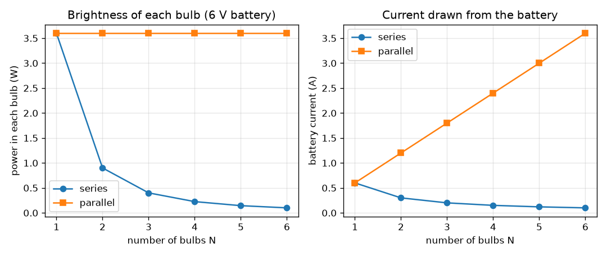
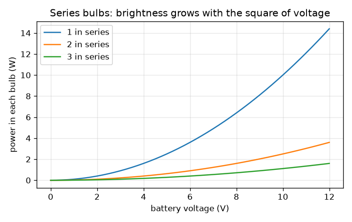

# സെഷൻ 1: ഒരു ബാറ്ററി, ഒരു സ്വിച്ച്, ബൾബുകൾ: സീരീസും പാരലലും

[Session 1 — हिन्दी](README.hi.md)

*ലെവൽ 1 (ആശയപരമായ ഇന്ററാക്ടീവ് മോഡൽ) · ഏകദേശം 60 മിനിറ്റ് · opencircuitlab*

> ഇത് ലളിതമാക്കിയ ഒരു വിദ്യാഭ്യാസ മോഡൽ (educational model) ആണ്. ഇത് സാധൂകരിക്കപ്പെട്ട ഒരു ഡിസൈൻ ഉപകരണമല്ല; യഥാർത്ഥ നിർമ്മിതികൾ, വൈദ്യുത ഇൻസ്റ്റലേഷനുകൾ, വാഹനങ്ങൾ, വ്യാവസായിക പ്രക്രിയകൾ അല്ലെങ്കിൽ വൈദ്യശാസ്ത്ര തീരുമാനങ്ങൾ എന്നിവയ്ക്ക് ഇത് ഉപയോഗിക്കരുത്.

**മുൻ‌അറിവ് (Prerequisites)**

- സ്കൂൾ ഭൗതികശാസ്ത്രത്തിലെ ഓമിന്റെ നിയമം (Ohm's law), V = I R.
- നിങ്ങൾ PRIMER.md വായിക്കുകയും `python start.py 1` ഒരിക്കൽ റൺ ചെയ്യുകയും ചെയ്തിട്ടുണ്ട്.

**പഠന ലക്ഷ്യങ്ങൾ (Learning objectives).** ഈ സെഷനു ശേഷം നിങ്ങൾക്ക് കഴിയും:

- ഒരു സീരീസ് (series) ശൃംഖലയിൽ വോൾട്ടേജ് പങ്കിടപ്പെടുമ്പോഴും കറന്റ് എല്ലായിടത്തും ഒന്നുതന്നെ ആകുന്നത് എന്തുകൊണ്ടെന്ന് വിശദീകരിക്കാൻ.
- പാരലലിലുള്ള (parallel) ബൾബുകൾക്ക് ഓരോന്നിനും മുഴുവൻ ബാറ്ററി വോൾട്ടേജ് കിട്ടുകയും കറന്റുകൾ കൂടിച്ചേരുകയും ചെയ്യുന്നത് എന്തുകൊണ്ടെന്ന് വിശദീകരിക്കാൻ.
- രണ്ട് വയറിംഗിലും N ഒരേപോലുള്ള ബൾബുകൾക്ക് കറന്റ്, വോൾട്ടേജ്, പവർ എന്നിവ കൈകൊണ്ടും Python-ലും കണക്കാക്കാൻ.
- ഒരു ബൾബിന്റെ പ്രകാശതീവ്രതയെ അതിലെ പവറുമായി ബന്ധിപ്പിക്കാൻ.

## A. യഥാർത്ഥ ജീവിതത്തിലെ പ്രശ്നം
പഴയ ഉത്സവ വിളക്കുകൾ ഒരു നീണ്ട ശൃംഖലയായാണ് വയർ ചെയ്തിരുന്നത്: ഒരു ബൾബ് ഫ്യൂസായാൽ മുഴുവൻ നിരയും ഇരുട്ടാകും, കൂടുതൽ ബൾബുകൾ ചേർത്താൽ എല്ലാം മങ്ങും. ഒരേ ബാറ്ററിയിൽ രണ്ട് ബൾബുകളുള്ള ഒരു ടോർച്ച് വ്യത്യസ്തമായി പെരുമാറുന്നു. ഒരേ ബാറ്ററി ഒരു വയറിംഗിൽ ബൾബുകളെ മങ്ങിയും മറ്റൊന്നിൽ തിളക്കത്തോടെയും കത്തിക്കുന്നത് എന്തുകൊണ്ട്, ആ തിളക്കത്തിന് ബാറ്ററി എന്ത് വില നൽകുന്നു? (കുറഞ്ഞ വോൾട്ടേജ് വിദ്യാഭ്യാസ സർക്യൂട്ടുകൾ മാത്രം: മെയിൻസ് വൈദ്യുതി ഉപയോഗിച്ച് ഒരിക്കലും പരീക്ഷണം നടത്തരുത്.)

## B. ആശയവും സിദ്ധാന്തവും
ഒരു ബാറ്ററി ഒരു അടഞ്ഞ ലൂപ്പിലൂടെ ചാർജിനെ തള്ളുന്നു. ഒരു സീരീസ് ശൃംഖലയിൽ ഒരു പാത മാത്രമേയുള്ളൂ, അതിനാൽ ഒരേ കറന്റ് ഓരോ ബൾബിലൂടെയും ഒന്നിനു പിറകെ ഒന്നായി കടന്നുപോകുന്നു; പ്രതിരോധങ്ങൾ (resistances) കൂടിച്ചേരുന്നു, ബാറ്ററി വോൾട്ടേജ് ബൾബുകൾക്കിടയിൽ പങ്കിടപ്പെടുന്നു. ഒരു പാരലൽ നിരയിൽ ഓരോ ബൾബും നേരിട്ട് ബാറ്ററിക്കു കുറുകെ ബന്ധിപ്പിച്ചിരിക്കുന്നു, അതിനാൽ ഓരോന്നിനും മുഴുവൻ വോൾട്ടേജ് കിട്ടുന്നു, ഓരോന്നും സ്വന്തം കറന്റ് വഹിക്കുന്നു; ബാറ്ററി ആ കറന്റുകളെല്ലാം ഒരുമിച്ച് നൽകണം. ഒരു ബൾബിലെ പവർ P = V I = I^2 R = V^2 / R ആണ്, പ്രകാശതീവ്രത അതിന് ആനുപാതികമാണെന്ന് നാം എടുക്കുന്നു. ഒരു സ്വിച്ച് വെറുമൊരു വിടവാണ്: തുറന്നത് എന്നാൽ ലൂപ്പ് ഇല്ല, കറന്റ് ഇല്ല.

| ചിഹ്നം | അർത്ഥം | യൂണിറ്റ് |
|---|---|---|
| V | ബാറ്ററി വോൾട്ടേജ് | V |
| R | ഒരു ബൾബിന്റെ പ്രതിരോധം (മോഡൽ വില 10) | ohm |
| N | ഒരേപോലുള്ള ബൾബുകളുടെ എണ്ണം | യൂണിറ്റ് ഇല്ല |
| I | ബാറ്ററിയിൽ നിന്ന് എടുക്കുന്ന കറന്റ് | A |
| P | ഒരു ബൾബിലെ പവർ (ചൂടും വെളിച്ചവും) | W |

**അനുമാനങ്ങൾ (Assumptions)**

- ബാറ്ററി ആദർശപരമാണ് (ideal): കറന്റ് ഒഴുകുമ്പോൾ അതിന്റെ വോൾട്ടേജ് കുറയുന്നില്ല.
- ഒരു ബൾബ് 10 ohm ഉള്ള ഒരു സ്ഥിര റെസിസ്റ്റർ ആണ്. ഒരു യഥാർത്ഥ ഫിലമെന്റ് വളരെ ചൂടാകുകയും അതിന്റെ പ്രതിരോധം പല മടങ്ങ് കൂടുകയും ചെയ്യുന്നു, അതിനാൽ യഥാർത്ഥ പ്രകാശതീവ്രത ഈ മോഡലിൽ നിന്ന് വ്യത്യസ്തമാണ്.
- വയറുകൾക്ക് പ്രതിരോധമില്ല.

$$ I=\frac{V}{R}\qquad P=VI=I^2R=\frac{V^2}{R} $$

$$ \text{series: } R_{\mathrm{tot}}=NR,\quad I=\frac{V}{NR},\quad V_{\mathrm{bulb}}=\frac{V}{N},\quad P_{\mathrm{bulb}}=\frac{V^2}{N^2R} $$

$$ \text{parallel: } R_{\mathrm{tot}}=\frac{R}{N},\quad I=\frac{NV}{R},\quad V_{\mathrm{bulb}}=V,\quad P_{\mathrm{bulb}}=\frac{V^2}{R} $$

## C. ദൃശ്യ വിശദീകരണം
ആദ്യ ചിത്രം 6 V ബാറ്ററിയിൽ 1 മുതൽ 6 വരെ ബൾബുകൾക്ക് രണ്ട് വയറിംഗുകളും താരതമ്യം ചെയ്യുന്നു. ഇടതുവശത്ത്, ഓരോ ബൾബിലെയും പവർ പാരലലിൽ 3.6 W-ൽ തുടരുന്നു, എന്നാൽ സീരീസിൽ 1/N^2 ആയി കുറയുന്നു (രണ്ട് ബൾബുകൾക്ക് 0.9 W, മൂന്നിന് 0.4 W). വലതുവശത്ത്, ബാറ്ററി കറന്റ് സീരീസിൽ കുറയുന്നു (ഒരു ബൾബിന് 0.6 A, നാലിന് 0.15 A), പാരലലിൽ കൂടുന്നു (നാലിന് 2.4 A): പാരലലിലെ തിളക്കത്തിന്റെ വില ബാറ്ററി നൽകുന്നു. രണ്ടാമത്തെ ചിത്രം കാണിക്കുന്നത്, ഒരു സീരീസ് ശൃംഖലയിൽ പ്രകാശതീവ്രത ബാറ്ററി വോൾട്ടേജിന്റെ വർഗ്ഗത്തിനനുസരിച്ച് കൂടുന്നു എന്നാണ്.

*6 V-ൽ 1 മുതൽ 6 വരെ ബൾബുകൾക്ക്, സീരീസിലും പാരലലിലും, ഓരോ ബൾബിന്റെയും പവറും ബാറ്ററി കറന്റും.*

*സീരീസ് ബൾബുകൾ: ഓരോ ബൾബിലെയും പവർ ബാറ്ററി വോൾട്ടേജിന്റെ വർഗ്ഗത്തിനനുസരിച്ച് കൂടുന്നു.*

## D. ഇന്ററാക്ടീവ് സിമുലേഷൻ
പാഠം റൺ ചെയ്യുക (`python start.py 1`), എന്നിട്ട് ലൈവ് ആപ്പ് തുറക്കുക: [സെഷൻ 1: സീരീസിലും പാരലലിലും ബൾബുകൾ](https://krunalpanchal1995.github.io/pan-iit-oss/opencircuitlab/session-01/) (അല്ലെങ്കിൽ ഈ ഫോൾഡറിലെ `app.html`). ബൾബുകളുടെ എണ്ണവും വയറിംഗും തിരഞ്ഞെടുക്കുക, എന്നിട്ട് ബാറ്ററി വോൾട്ടേജ് വലിച്ചുനീക്കുക. ഓരോ ബൾബിനു താഴെയുമുള്ള വോൾട്ടേജ് ലേബലും തിളക്കവും ബാറ്ററി കറന്റും നിരീക്ഷിക്കുക. ഗ്രാഫ് വ്യൂ തുറന്ന് N-ന് എതിരെയുള്ള പ്രകാശതീവ്രതയുടെ രണ്ട് വക്രങ്ങൾ കാണുക.

**വെല്ലുവിളി.** മൂന്ന് ബൾബുകൾ സീരീസിൽ വയർ ചെയ്ത് ഓരോന്നിനും കുറഞ്ഞത് 1 W കിട്ടുന്ന രീതിയിലാക്കുക.

## E. ഉദാഹരണവും പരീക്ഷണവും
**പ്രശ്നം.** ഒരു 6 V ബാറ്ററി 10 ohm വീതമുള്ള മൂന്ന് ബൾബുകൾക്ക് ഊർജം നൽകുന്നു. (a) സീരീസ് വയറിംഗിനും (b) പാരലൽ വയറിംഗിനും കറന്റ്, ഓരോ ബൾബിനും കുറുകെയുള്ള വോൾട്ടേജ്, അതിന്റെ പവർ എന്നിവ കണ്ടെത്തുക.

1. സീരീസ്: R_total = 3 * 10 = 30 ohm, അതിനാൽ I = 6 / 30 = 0.2 A, ഓരോ ബൾബിലും ഒന്നുതന്നെ.
2. ഓരോ ബൾബിനും കുറുകെയുള്ള വോൾട്ടേജ് = I R = 0.2 * 10 = 2 V (മൂന്നും ചേർന്ന് 6 V ആകുന്നു, അങ്ങനെ ആകണം).
3. ഓരോ ബൾബിലെയും പവർ = V I = 2 * 0.2 = 0.4 W; ആകെ 1.2 W, ഇത് ബാറ്ററി വോൾട്ടേജ് ഗുണം കറന്റിന് തുല്യമാണ്, 6 * 0.2.
4. പാരലൽ: ഓരോ ബൾബിനും 6 V കിട്ടുന്നു, അതിനാൽ അതിന്റെ കറന്റ് 6 / 10 = 0.6 A, പവർ 6 * 0.6 = 3.6 W.
5. ബാറ്ററി ആകെ 3 * 0.6 = 1.8 A-ഉം 10.8 W-ഉം നൽകുന്നു. പാരലൽ ഓരോ ബൾബിനും സീരീസിന്റെ 9 മടങ്ങ് പവർ നൽകുന്നു, കാരണം വോൾട്ടേജ് 3 മടങ്ങ് കൂടുതലാണ്, പവർ വർഗ്ഗത്തിനനുസരിച്ച് പോകുന്നു.

**ഉത്തരം.** സീരീസ്: ഓരോ ബൾബിനും 0.2 A, 2 V, 0.4 W. പാരലൽ: ബാറ്ററിയിൽ നിന്ന് 1.8 A, ഓരോ ബൾബിനും 6 V, 3.6 W.

**പരീക്ഷണം.** ഒരു 4.5 V ബാറ്ററി പാക്കും ഒരേപോലുള്ള രണ്ട് ചെറിയ ടോർച്ച് ബൾബുകളും ഉപയോഗിച്ച്, ആദ്യം സീരീസിലും പിന്നെ പാരലലിലും വയർ ചെയ്ത് അവയുടെ തിളക്കം കണ്ണുകൊണ്ട് താരതമ്യം ചെയ്യുക; ഓരോ ക്രമീകരണത്തിലും ഒരു ബൾബ് അഴിച്ചുമാറ്റി മറ്റേത് എന്തു ചെയ്യുന്നു എന്ന് നോക്കുക. മൾട്ടിമീറ്റർ (multimeter) ഉണ്ടെങ്കിൽ ബാറ്ററി കറന്റ് അളക്കുക. മോഡലിന്റെ ഗുണാത്മക ഫലം പ്രതീക്ഷിക്കുക (സീരീസിൽ മങ്ങിയതും പങ്കിട്ടതും, പാരലലിൽ തിളക്കമുള്ളതും, ഒരു ബൾബ് തകരാറിലായാൽ സീരീസ് ശൃംഖല മാത്രം നിലയ്ക്കും). സംഖ്യകൾ വ്യത്യാസപ്പെടും: തണുത്ത ഫിലമെന്റിന് ചൂടുള്ളതിനേക്കാൾ വളരെ കുറഞ്ഞ പ്രതിരോധമാണ്, അതിനാൽ സ്വിച്ച് ഓൺ ചെയ്യുന്ന നിമിഷം യഥാർത്ഥ കറന്റ് മോഡലിന്റേതിനേക്കാൾ കൂടുതലാണ്.

## F. വിലയിരുത്തലും ഡിസൈൻ വെല്ലുവിളിയും
**ചോദ്യ തരം A: ആശയപരം.** ഉത്സവ ബൾബുകളുടെ ഒരു സീരീസ് നിരയിൽ, ഒരു ബൾബിന്റെ ഫിലമെന്റ് പൊട്ടി അത് തകരാറിലാകുന്നു. മറ്റെല്ലാ ബൾബുകളും അണയുന്നത് എന്തുകൊണ്ട്, ഒരു പാരലൽ നിരയിൽ അവ കത്തിക്കൊണ്ടിരിക്കുന്നത് എന്തുകൊണ്ട്?

സൂചന

ഒരു കറന്റിന് അടഞ്ഞ ലൂപ്പ് വേണം. ഓരോ വയറിംഗിലും എത്ര ലൂപ്പുകളുണ്ട്?

ഘട്ടം ഘട്ടമായുള്ള പരിഹാരം

ഒരു സീരീസ് നിരയിൽ കറന്റിന് ഒരു പാത മാത്രമേയുള്ളൂ. പൊട്ടിയ ഫിലമെന്റ് ആ പാതയിലെ ഒരു വിടവാണ്, അതിനാൽ കറന്റ് എല്ലായിടത്തും പൂജ്യമാകുന്നു, ഓരോ ബൾബും ഇരുട്ടാകുന്നു. ഒരു പാരലൽ നിരയിൽ ഓരോ ബൾബിനും ബാറ്ററിക്കു കുറുകെ നേരിട്ട് സ്വന്തം പാതയുണ്ട്. ഒരു പാതയിലെ വിടവ് മറ്റുള്ളവയെ ബാധിക്കുന്നില്ല, അതിനാൽ അവയ്ക്ക് മുഴുവൻ വോൾട്ടേജും കിട്ടുന്നു, കത്തിക്കൊണ്ടിരിക്കുന്നു (ബാറ്ററി അല്പം കുറഞ്ഞ കറന്റ് നൽകുന്നു എന്നു മാത്രം).

**ചോദ്യ തരം B: സംഖ്യാപരം.** ഒരു 9 V ബാറ്ററി മൂന്ന് 10 ohm ബൾബുകൾക്ക് ഊർജം നൽകുന്നു. സീരീസ് വയറിംഗിനും പാരലൽ വയറിംഗിനും ഓരോ ബൾബിലെയും കറന്റും പവറും കണ്ടെത്തുക.

സൂചന

സീരീസ്: R_total = N R. പാരലൽ: ഓരോ ബൾബിനും മുഴുവൻ 9 V. പിന്നെ P = V I.

ഘട്ടം ഘട്ടമായുള്ള പരിഹാരം

സീരീസ്: R_total = 30 ohm, I = 9 / 30 = 0.3 A, ഓരോ ബൾബിനും 3 V കിട്ടുന്നു, P = 3 * 0.3 = 0.9 W. പാരലൽ: ഓരോ ബൾബിനും 9 V, ഓരോ ബൾബിലും I = 0.9 A, P = 9 * 0.9 = 8.1 W, ബാറ്ററി കറന്റ് 2.7 A. പരിശോധന: 3 ബൾബുകൾക്ക് പാരലൽ സീരീസിനേക്കാൾ 9 മടങ്ങ് തിളക്കമുള്ളതാണ് (N^2 = 9), 0.9 * 9 = 8.1.

**ചോദ്യ തരം C: ഗ്രാഫും സിമുലേഷനും വ്യാഖ്യാനിക്കൽ.** 6 V-ലെ പ്രകാശതീവ്രത ഗ്രാഫിൽ, 4 ബൾബുകൾ പാരലലിലുള്ളതിനേക്കാൾ 4 ബൾബുകൾ സീരീസിലുള്ളപ്പോൾ ഓരോ ബൾബും എത്ര മടങ്ങ് മങ്ങിയതാണ്? വക്രങ്ങളിൽ നിന്ന് രണ്ട് വിലകളും വായിക്കുക.

സൂചന

N = 4-ൽ നീലയും പച്ചയും വക്രങ്ങൾ കണ്ടെത്തുക.

ഘട്ടം ഘട്ടമായുള്ള പരിഹാരം

N = 4-ൽ പച്ച (പാരലൽ) വക്രം 3.6 W-ലും നീല (സീരീസ്) വക്രം 0.225 W-ലും ആണ്. അനുപാതം 3.6 / 0.225 = 16 = N^2. നീല വക്രം 1 / N^2 പോലെ കുറയുന്നു, പച്ചയത് പരന്നതാണ്.

**ചോദ്യ തരം D: ഡിസൈനും ഒപ്റ്റിമൈസേഷൻ (optimisation) വെല്ലുവിളിയും.** ഡിസൈൻ: ഒരു ചെറിയ 6 V ബാറ്ററിക്ക് പരമാവധി 1 A നൽകാൻ കഴിയും. നിങ്ങൾ മൂന്ന് 10 ohm ബൾബുകൾ കത്തിക്കണം, ഓരോന്നിനും കുറഞ്ഞത് 0.3 W കിട്ടണം. മൂന്ന് വയറിംഗുകൾ താരതമ്യം ചെയ്യുക: എല്ലാം സീരീസ്, എല്ലാം പാരലൽ, ഒരു പാരലൽ ജോഡിയുമായി സീരീസിൽ ഒരു ബൾബ്. ഏതൊക്കെ അനുവദനീയമാണ്, നിങ്ങൾ ഏത് തിരഞ്ഞെടുക്കും?

സൂചന

ഓരോ വയറിംഗിനും ബാറ്ററി കറന്റും ഓരോ ബൾബിലെ പവറും കണക്കാക്കുക.

ഘട്ടം ഘട്ടമായുള്ള പരിഹാരം

എല്ലാം സീരീസ്: I = 0.2 A, ഓരോ ബൾബിനും 0.4 W: അനുവദനീയം. എല്ലാം പാരലൽ: I = 1.8 A, ഇത് 1 A പരിധിക്ക് മുകളിലാണ്: അനുവദനീയമല്ല. പാരലൽ ജോഡിയുമായി സീരീസിൽ ഒരു ബൾബ്: R = 10 + 5 = 15 ohm, I = 0.4 A; ഒറ്റ ബൾബിന് 4 V-ഉം 1.6 W-ഉം, ജോഡിയിലെ ഓരോ ബൾബിനും 2 V-ഉം 0.4 W-ഉം: അനുവദനീയം, മൊത്തത്തിൽ കൂടുതൽ തിളക്കമുള്ളത്, പക്ഷേ അസമമായി. എല്ലാം സീരീസ് ഏറ്റവും ലളിതവും തുല്യ തിളക്കം നൽകുന്നതുമാണ്; മിശ്ര വയറിംഗ് കൂടുതൽ വെളിച്ചം നൽകുന്നു, പക്ഷേ ബൾബുകൾ അസമമാകുന്നു, ഒറ്റ ബൾബ് തകരാറിലായാൽ മുഴുവൻ സർക്യൂട്ടും അണയുന്നു. അനുമാനം: ആദർശ ബാറ്ററിയും സ്ഥിരമായ ബൾബ് പ്രതിരോധവും.

[RUBRIC.md](../../RUBRIC.md) ഉപയോഗിച്ച് സ്വയം സ്കോർ ചെയ്യുക. പേപ്പറിൽ ചെയ്യാൻ [ആക്ടിവിറ്റി ഷീറ്റ്](activity_sheet.md) പ്രിന്റ് ചെയ്യുക.

## സാധാരണ തെറ്റിദ്ധാരണകൾ
| സാധാരണ തെറ്റിദ്ധാരണ | യഥാർത്ഥത്തിൽ ശരിയായത് |
|---|---|
| ഒരു സീരീസ് ശൃംഖലയിലെ ആദ്യ ബൾബ് കറന്റ് ഉപയോഗിച്ചുതീർക്കുന്നു, അതിനാൽ അവസാന ബൾബ് മങ്ങിയതാണ്. | ഒരു സീരീസ് ശൃംഖലയിൽ കറന്റ് എല്ലായിടത്തും ഒന്നുതന്നെയാണ്. ബൾബുകൾ പങ്കിടുന്നത് വോൾട്ടേജാണ്, കറന്റല്ല. |
| വലിയ ബാറ്ററി വോൾട്ടേജ് എന്നാൽ പാരലലിൽ മാത്രം വലിയ കറന്റ്. | രണ്ട് വയറിംഗിലും വോൾട്ടേജിനൊപ്പം കറന്റ് കൂടുന്നു (I = V / R_total); വ്യത്യാസം R_total-ലാണ്. |
| പാരലലിലുള്ള ബൾബുകൾ സൗജന്യ തിളക്കമാണ്. | ഓരോ ബൾബും അതിന്റെ മുഴുവൻ കറന്റും എടുക്കുന്നു, അതിനാൽ ഓരോ ബൾബിനൊപ്പവും ബാറ്ററി കറന്റ് കൂടുന്നു, ബാറ്ററി വേഗത്തിൽ തീരുന്നു. |
| സീരീസിൽ കൂടുതൽ ബൾബുകൾ എന്നാൽ എപ്പോഴും കൂടുതൽ വെളിച്ചം. | ആകെ വെളിച്ച പവർ V^2 / (N R) യഥാർത്ഥത്തിൽ N-നൊപ്പം കുറയുന്നു; ഓരോ ബൾബിനും വോൾട്ടേജിന്റെ 1/N-ഉം പവറിന്റെ 1/N^2-ഉം മാത്രമേ കിട്ടൂ. |

## പദാവലി (Glossary)
- **സീരീസ് (series)**: ഒരൊറ്റ പാതയിൽ ഒന്നിനു പിറകെ ഒന്നായി ബന്ധിപ്പിച്ച ഘടകങ്ങൾ
- **പാരലൽ (parallel)**: അടുത്തടുത്തായി, ഓരോന്നും ഒരേ രണ്ട് ബിന്ദുക്കൾക്കു കുറുകെ നേരിട്ട് ബന്ധിപ്പിച്ച ഘടകങ്ങൾ
- **കറന്റ് (current) (I)**: ചാർജിന്റെ ഒഴുക്ക്, ആമ്പിയറിൽ (A) അളക്കുന്നു
- **വോൾട്ടേജ് (voltage) (V)**: കറന്റിനെ ഒഴുക്കുന്ന തള്ളൽ, വോൾട്ടിൽ (V) അളക്കുന്നു
- **പ്രതിരോധം (resistance) (R)**: ഒരു ഭാഗം കറന്റിനെ എത്ര ശക്തമായി എതിർക്കുന്നു, ohm-ൽ
- **പവർ (power) (P)**: സെക്കൻഡിൽ ചൂടും വെളിച്ചവുമായി മാറുന്ന ഊർജം, വാട്ടിൽ (W)

## പൂർത്തിയാക്കുക
1. [exercises.md](exercises.md)-ലെ മൂന്ന് കോഡിംഗ് ടാസ്കുകൾ ചെയ്യുക.
2. മാറ്റങ്ങൾക്കു ശേഷം `python start.py 1` വീണ്ടും റൺ ചെയ്യുക. അത് ചെക്ക്‌പോയിന്റോടെ (checkpoint) അവസാനിക്കുന്നു; അത് `PASS` എന്ന് പ്രിന്റ് ചെയ്യുമ്പോൾ നിങ്ങൾ പൂർത്തിയാക്കി. (ചെക്ക്‌പോയിന്റ് മാത്രം: `python start.py check 1`.)

അടുത്തത്: [സെഷൻ 2](../session-02/README.md)
