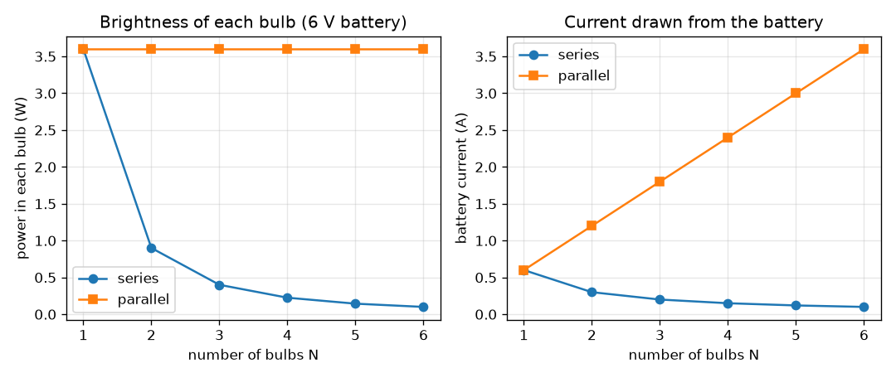
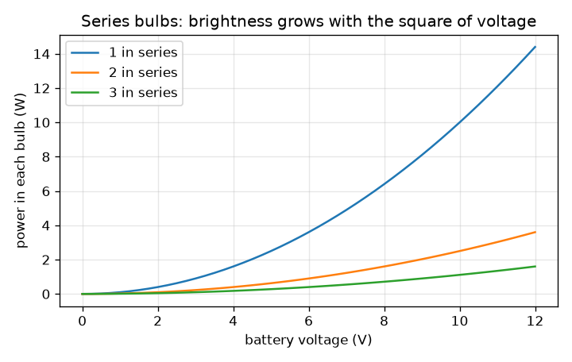

# அமர்வு 1: ஒரு மின்கலம், ஒரு சுவிட்ச் மற்றும் பல்புகள்: தொடர் மற்றும் இணை இணைப்பு

[Session 1 — हिन्दी](README.hi.md)

*நிலை 1 (கருத்தியல் ஊடாடும் மாதிரி) · சுமார் 60 நிமிடங்கள் · opencircuitlab*

> இது எளிமைப்படுத்தப்பட்ட ஒரு கல்வி மாதிரி (educational model). இது சரிபார்க்கப்பட்ட வடிவமைப்புக் கருவி அல்ல; உண்மையான கட்டமைப்புகள், மின் நிறுவல்கள், வாகனங்கள், தொழில்துறை செயல்முறைகள் அல்லது மருத்துவ முடிவுகளுக்கு இதைப் பயன்படுத்தக் கூடாது.

**முன்தேவைகள் (Prerequisites)**

- பள்ளி இயற்பியலில் இருந்து ஓமின் விதி (Ohm's law), V = I R.
- நீங்கள் PRIMER.md படித்து `python start.py 1` ஒருமுறை இயக்கியிருக்கிறீர்கள்.

**கற்றல் நோக்கங்கள் (Learning objectives).** இந்த அமர்வுக்குப் பிறகு உங்களால் முடியும்:

- ஒரு தொடர் (series) சங்கிலியில் மின்னழுத்தம் பகிரப்படும்போது மின்னோட்டம் எல்லா இடத்திலும் ஒன்றாக இருப்பது ஏன் என்று விளக்க.
- இணையாக (parallel) உள்ள பல்புகள் ஒவ்வொன்றும் முழு மின்கல மின்னழுத்தத்தைப் பெறுவதும் மின்னோட்டங்கள் கூடுவதும் ஏன் என்று விளக்க.
- இரண்டு இணைப்புகளிலும் N ஒத்த பல்புகளுக்கு மின்னோட்டம், மின்னழுத்தம், திறன் ஆகியவற்றைக் கையால் மற்றும் Python-இல் கணக்கிட.
- ஒரு பல்பின் ஒளிர்வை அதிலுள்ள திறனுடன் தொடர்புபடுத்த.

## A. நிஜ உலகப் பிரச்சினை
பழைய திருவிழா விளக்குகள் ஒரு நீண்ட சங்கிலியாக இணைக்கப்பட்டிருந்தன: ஒரு பல்பு எரிந்து போனால் முழு வரிசையும் இருண்டது, மேலும் பல்புகளைச் சேர்த்தால் எல்லாம் மங்கின. ஒரே மின்கலத்தில் இரண்டு பல்புகள் கொண்ட ஒரு டார்ச் வேறு விதமாக நடந்து கொள்கிறது. ஒரே மின்கலம் ஒரு இணைப்பில் பல்புகளை மங்கலாகவும் மற்றொன்றில் பிரகாசமாகவும் ஒளிரச் செய்வது ஏன், அந்தப் பிரகாசத்துக்கு மின்கலம் என்ன விலை கொடுக்கிறது? (குறைந்த மின்னழுத்தக் கல்விச் சுற்றுகள் மட்டும்: மெயின்ஸ் மின்சாரத்துடன் ஒருபோதும் சோதனை செய்யாதீர்கள்.)

## B. கருத்தும் கோட்பாடும்
ஒரு மின்கலம் ஒரு மூடிய சுற்றில் மின்னூட்டத்தைத் தள்ளுகிறது. ஒரு தொடர் சங்கிலியில் ஒரே ஒரு பாதைதான், எனவே அதே மின்னோட்டம் ஒவ்வொரு பல்பின் வழியாகவும் ஒன்றன்பின் ஒன்றாகச் செல்கிறது; மின்தடைகள் (resistances) கூடுகின்றன, மின்கல மின்னழுத்தம் பல்புகளுக்கிடையே பகிரப்படுகிறது. ஒரு இணைத் தொகுப்பில் ஒவ்வொரு பல்பும் நேரடியாக மின்கலத்தின் குறுக்கே இணைக்கப்பட்டுள்ளது, எனவே ஒவ்வொன்றும் முழு மின்னழுத்தத்தைப் பெற்று அதன் சொந்த மின்னோட்டத்தைக் கொண்டு செல்கிறது; மின்கலம் அந்த மின்னோட்டங்கள் அனைத்தையும் ஒன்றாக வழங்க வேண்டும். ஒரு பல்பில் உள்ள திறன் P = V I = I^2 R = V^2 / R, ஒளிர்வு அதற்கு விகிதசமம் என்று எடுத்துக்கொள்கிறோம். ஒரு சுவிட்ச் என்பது வெறும் இடைவெளி: திறந்தது என்றால் சுற்று இல்லை, மின்னோட்டம் இல்லை.

| குறியீடு | பொருள் | அலகு |
|---|---|---|
| V | மின்கல மின்னழுத்தம் | V |
| R | ஒரு பல்பின் மின்தடை (மாதிரி மதிப்பு 10) | ohm |
| N | ஒத்த பல்புகளின் எண்ணிக்கை | அலகு இல்லை |
| I | மின்கலத்திலிருந்து எடுக்கப்படும் மின்னோட்டம் | A |
| P | ஒரு பல்பில் உள்ள திறன் (வெப்பமும் ஒளியும்) | W |

**அனுமானங்கள் (Assumptions)**

- மின்கலம் இலட்சியமானது (ideal): மின்னோட்டம் பாயும்போது அதன் மின்னழுத்தம் குறைவதில்லை.
- ஒரு பல்பு என்பது 10 ohm நிலையான மின்தடையம். உண்மையான இழை (filament) மிகவும் சூடாகி அதன் மின்தடை பல மடங்கு உயர்கிறது, எனவே உண்மையான ஒளிர்வு இந்த மாதிரியிலிருந்து வேறுபடுகிறது.
- கம்பிகளுக்கு மின்தடை இல்லை.

$$ I=\frac{V}{R}\qquad P=VI=I^2R=\frac{V^2}{R} $$

$$ \text{series: } R_{\mathrm{tot}}=NR,\quad I=\frac{V}{NR},\quad V_{\mathrm{bulb}}=\frac{V}{N},\quad P_{\mathrm{bulb}}=\frac{V^2}{N^2R} $$

$$ \text{parallel: } R_{\mathrm{tot}}=\frac{R}{N},\quad I=\frac{NV}{R},\quad V_{\mathrm{bulb}}=V,\quad P_{\mathrm{bulb}}=\frac{V^2}{R} $$

## C. காட்சி விளக்கம்
முதல் படம் 6 V மின்கலத்தில் 1 முதல் 6 பல்புகளுக்கு இரண்டு இணைப்புகளையும் ஒப்பிடுகிறது. இடதுபுறம், ஒவ்வொரு பல்பின் திறன் இணையில் 3.6 W-இல் நிலைக்கிறது, ஆனால் தொடரில் 1/N^2 ஆகக் குறைகிறது (இரண்டு பல்புகளுக்கு 0.9 W, மூன்றுக்கு 0.4 W). வலதுபுறம், மின்கல மின்னோட்டம் தொடரில் குறைகிறது (ஒரு பல்புக்கு 0.6 A, நான்குக்கு 0.15 A), இணையில் கூடுகிறது (நான்குக்கு 2.4 A): இணையில் உள்ள பிரகாசத்துக்கு மின்கலம் விலை கொடுக்கிறது. இரண்டாவது படம், தொடர் சங்கிலியில் ஒளிர்வு மின்கல மின்னழுத்தத்தின் வர்க்கத்துடன் வளர்கிறது என்று காட்டுகிறது.

*6 V-இல் 1 முதல் 6 பல்புகளுக்கு, தொடரிலும் இணையிலும், ஒவ்வொரு பல்பின் திறனும் மின்கல மின்னோட்டமும்.*

*தொடர் பல்புகள்: ஒவ்வொரு பல்பின் திறன் மின்கல மின்னழுத்தத்தின் வர்க்கத்துடன் வளர்கிறது.*

## D. ஊடாடும் உருவகப்படுத்தல் (Interactive simulation)
பாடத்தை இயக்குங்கள் (`python start.py 1`), பிறகு நேரடிச் செயலியைத் திறக்கவும்: [அமர்வு 1: தொடரிலும் இணையிலும் பல்புகள்](https://krunalpanchal1995.github.io/pan-iit-oss/opencircuitlab/session-01/) (அல்லது இந்தக் கோப்புறையில் உள்ள `app.html`). பல்புகளின் எண்ணிக்கையையும் இணைப்பையும் தேர்ந்தெடுத்து, மின்கல மின்னழுத்தத்தை இழுக்கவும். ஒவ்வொரு பல்பின் கீழும் உள்ள மின்னழுத்த லேபிள், ஒளிர்வு, மின்கல மின்னோட்டம் ஆகியவற்றைக் கவனியுங்கள். வரைபடக் காட்சியைத் திறந்து N-க்கு எதிரான ஒளிர்வின் இரண்டு வளைவுகளைப் பாருங்கள்.

**சவால்.** மூன்று பல்புகளைத் தொடரில் இணைத்து ஒவ்வொன்றும் குறைந்தது 1 W பெறும்படி செய்யுங்கள்.

## E. தீர்க்கப்பட்ட எடுத்துக்காட்டும் சோதனையும்
**கணக்கு.** ஒரு 6 V மின்கலம் தலா 10 ohm உள்ள மூன்று பல்புகளுக்கு மின்சாரம் அளிக்கிறது. (a) தொடர் இணைப்பு மற்றும் (b) இணை இணைப்புக்கு மின்னோட்டம், ஒவ்வொரு பல்பின் குறுக்கே மின்னழுத்தம், அதன் திறன் ஆகியவற்றைக் கண்டறியுங்கள்.

1. தொடர்: R_total = 3 * 10 = 30 ohm, எனவே I = 6 / 30 = 0.2 A, ஒவ்வொரு பல்பிலும் அதே.
2. ஒவ்வொரு பல்பின் குறுக்கே மின்னழுத்தம் = I R = 0.2 * 10 = 2 V (மூன்றும் சேர்ந்து 6 V, அப்படித்தான் இருக்க வேண்டும்).
3. ஒவ்வொரு பல்பின் திறன் = V I = 2 * 0.2 = 0.4 W; மொத்தம் 1.2 W, இது மின்கல மின்னழுத்தம் பெருக்கல் மின்னோட்டத்துக்குச் சமம், 6 * 0.2.
4. இணை: ஒவ்வொரு பல்பும் 6 V பெறுகிறது, எனவே அதன் மின்னோட்டம் 6 / 10 = 0.6 A, திறன் 6 * 0.6 = 3.6 W.
5. மின்கலம் மொத்தம் 3 * 0.6 = 1.8 A மற்றும் 10.8 W வழங்குகிறது. இணை ஒவ்வொரு பல்புக்கும் தொடரின் 9 மடங்கு திறனைத் தருகிறது, ஏனெனில் மின்னழுத்தம் 3 மடங்கு பெரியது, திறன் வர்க்கத்துடன் செல்கிறது.

**விடை.** தொடர்: ஒரு பல்புக்கு 0.2 A, 2 V, 0.4 W. இணை: மின்கலத்திலிருந்து 1.8 A, ஒரு பல்புக்கு 6 V, 3.6 W.

**சோதனை.** ஒரு 4.5 V மின்கலத் தொகுப்பும் இரண்டு ஒத்த சிறிய டார்ச் பல்புகளும் கொண்டு, முதலில் தொடரிலும் பிறகு இணையிலும் இணைத்து அவற்றின் ஒளிர்வைக் கண்ணால் ஒப்பிடுங்கள்; ஒவ்வொரு அமைப்பிலும் ஒரு பல்பைக் கழற்றி மற்றொன்று என்ன செய்கிறது என்று பாருங்கள். பல்அளவி (multimeter) இருந்தால் மின்கல மின்னோட்டத்தை அளவிடுங்கள். மாதிரியின் தரநிலை முடிவை எதிர்பாருங்கள் (தொடரில் மங்கலாகவும் பகிரப்பட்டும், இணையில் பிரகாசமாகவும், ஒரு பல்பு பழுதானால் தொடர் சங்கிலி மட்டுமே அணையும்). எண்கள் வேறுபடும்: குளிர்ந்த இழைக்குச் சூடான இழையைவிட மிகக் குறைந்த மின்தடை, எனவே சுவிட்ச் போடும் கணத்தில் உண்மையான மின்னோட்டம் மாதிரியினுடையதைவிடப் பெரியது.

## F. மதிப்பீடும் வடிவமைப்புச் சவாலும்
**கேள்வி வகை A: கருத்தியல்.** திருவிழா பல்புகளின் ஒரு தொடர் வரிசையில், ஒரு பல்பின் இழை உடைந்து அது பழுதாகிறது. மற்ற எல்லா பல்புகளும் அணைவது ஏன், ஒரு இணை வரிசையில் அவை ஏன் எரிந்துகொண்டே இருக்கும்?

குறிப்பு

மின்னோட்டத்துக்கு ஒரு மூடிய சுற்று தேவை. ஒவ்வொரு இணைப்பிலும் எத்தனை சுற்றுகள் உள்ளன?

படிப்படியான தீர்வு

ஒரு தொடர் வரிசையில் மின்னோட்டத்துக்கு ஒரே ஒரு பாதைதான். உடைந்த இழை அந்தப் பாதையில் ஒரு இடைவெளி, எனவே மின்னோட்டம் எல்லா இடத்திலும் பூஜ்ஜியம், ஒவ்வொரு பல்பும் இருளுகிறது. ஒரு இணை வரிசையில் ஒவ்வொரு பல்புக்கும் மின்கலத்தின் குறுக்கே நேரடியாகச் சொந்தப் பாதை உள்ளது. ஒரு பாதையில் உள்ள இடைவெளி மற்றவற்றைப் பாதிக்காது, எனவே அவை முழு மின்னழுத்தத்தைப் பெற்று எரிந்துகொண்டே இருக்கும் (மின்கலம் சற்றுக் குறைவான மின்னோட்டத்தை வழங்குகிறது, அவ்வளவுதான்).

**கேள்வி வகை B: எண்ணியல்.** ஒரு 9 V மின்கலம் மூன்று 10 ohm பல்புகளுக்கு மின்சாரம் அளிக்கிறது. தொடர் இணைப்புக்கும் இணை இணைப்புக்கும் ஒவ்வொரு பல்பின் மின்னோட்டத்தையும் திறனையும் கண்டறியுங்கள்.

குறிப்பு

தொடர்: R_total = N R. இணை: ஒவ்வொரு பல்புக்கும் முழு 9 V. பிறகு P = V I.

படிப்படியான தீர்வு

தொடர்: R_total = 30 ohm, I = 9 / 30 = 0.3 A, ஒவ்வொரு பல்பும் 3 V பெறுகிறது, P = 3 * 0.3 = 0.9 W. இணை: ஒவ்வொரு பல்பும் 9 V பெறுகிறது, ஒரு பல்புக்கு I = 0.9 A, P = 9 * 0.9 = 8.1 W, மின்கல மின்னோட்டம் 2.7 A. சரிபார்ப்பு: 3 பல்புகளுக்கு இணை தொடரைவிட 9 மடங்கு பிரகாசமானது (N^2 = 9), 0.9 * 9 = 8.1.

**கேள்வி வகை C: வரைபடம் மற்றும் உருவகப்படுத்தல் விளக்கம்.** 6 V-இல் உள்ள ஒளிர்வு வரைபடத்தில், 4 பல்புகள் இணையில் உள்ளதைவிட 4 பல்புகள் தொடரில் இருக்கும்போது ஒவ்வொரு பல்பும் எத்தனை மடங்கு மங்கலானது? வளைவுகளிலிருந்து இரண்டு மதிப்புகளையும் படியுங்கள்.

குறிப்பு

N = 4-இல் நீல மற்றும் பச்சை வளைவுகளைக் கண்டறியுங்கள்.

படிப்படியான தீர்வு

N = 4-இல் பச்சை (இணை) வளைவு 3.6 W-இலும் நீல (தொடர்) வளைவு 0.225 W-இலும் உள்ளன. விகிதம் 3.6 / 0.225 = 16 = N^2. நீல வளைவு 1 / N^2 போலக் குறைகிறது, பச்சை வளைவு தட்டையானது.

**கேள்வி வகை D: வடிவமைப்பு மற்றும் உகப்பாக்கம் (optimisation) சவால்.** வடிவமைப்பு: ஒரு சிறிய 6 V மின்கலம் அதிகபட்சம் 1 A வழங்க முடியும். நீங்கள் மூன்று 10 ohm பல்புகளை ஒளிரச் செய்ய வேண்டும், ஒவ்வொன்றும் குறைந்தது 0.3 W பெற வேண்டும். மூன்று இணைப்புகளை ஒப்பிடுங்கள்: அனைத்தும் தொடர், அனைத்தும் இணை, ஒரு இணை ஜோடியுடன் தொடரில் ஒரு பல்பு. எவை அனுமதிக்கப்பட்டவை, நீங்கள் எதைத் தேர்ந்தெடுப்பீர்கள்?

குறிப்பு

ஒவ்வொரு இணைப்புக்கும் மின்கல மின்னோட்டத்தையும் ஒவ்வொரு பல்பின் திறனையும் கணக்கிடுங்கள்.

படிப்படியான தீர்வு

அனைத்தும் தொடர்: I = 0.2 A, ஒரு பல்புக்கு 0.4 W: அனுமதிக்கப்பட்டது. அனைத்தும் இணை: I = 1.8 A, இது 1 A வரம்புக்கு மேல்: அனுமதிக்கப்படவில்லை. இணை ஜோடியுடன் தொடரில் ஒரு பல்பு: R = 10 + 5 = 15 ohm, I = 0.4 A; தனிப் பல்பு 4 V மற்றும் 1.6 W பெறுகிறது, ஜோடியின் ஒவ்வொரு பல்பும் 2 V மற்றும் 0.4 W: அனுமதிக்கப்பட்டது, மொத்தத்தில் அதிகப் பிரகாசம், ஆனால் சமமற்றது. அனைத்தும் தொடர் மிக எளியது, சம ஒளிர்வைத் தருகிறது; கலப்பு இணைப்பு அதிக ஒளியைத் தருகிறது, ஆனால் பல்புகள் சமமற்றவை, தனிப் பல்பு பழுதானால் முழுச் சுற்றும் அணையும். அனுமானம்: இலட்சிய மின்கலம், நிலையான பல்பு மின்தடை.

[RUBRIC.md](../../RUBRIC.md) கொண்டு உங்களை மதிப்பிடுங்கள். தாளில் செய்ய [செயல்பாட்டுத் தாள்](activity_sheet.md)-ஐ அச்சிடுங்கள்.

## பொதுவான தவறான கருத்துகள்
| பொதுவான தவறான கருத்து | உண்மையில் சரியானது |
|---|---|
| தொடர் சங்கிலியில் முதல் பல்பு மின்னோட்டத்தைப் பயன்படுத்தித் தீர்க்கிறது, எனவே கடைசி பல்பு மங்கலானது. | தொடர் சங்கிலியில் மின்னோட்டம் எல்லா இடத்திலும் ஒன்றே. பல்புகள் பகிர்வது மின்னழுத்தத்தை, மின்னோட்டத்தை அல்ல. |
| பெரிய மின்கல மின்னழுத்தம் என்றால் இணையில் மட்டுமே பெரிய மின்னோட்டம். | இரண்டு இணைப்புகளிலும் மின்னழுத்தத்துடன் மின்னோட்டம் உயர்கிறது (I = V / R_total); வேறுபடுவது R_total. |
| இணையில் உள்ள பல்புகள் இலவசப் பிரகாசம். | ஒவ்வொரு பல்பும் அதன் முழு மின்னோட்டத்தை எடுக்கிறது, எனவே ஒவ்வொரு பல்புடனும் மின்கல மின்னோட்டம் கூடுகிறது, மின்கலம் விரைவில் தீர்ந்துவிடும். |
| தொடரில் அதிக பல்புகள் என்றால் எப்போதும் அதிக ஒளி. | மொத்த ஒளித் திறன் V^2 / (N R) உண்மையில் N-உடன் குறைகிறது; ஒவ்வொரு பல்பும் மின்னழுத்தத்தின் 1/N மற்றும் திறனின் 1/N^2 மட்டுமே பெறுகிறது. |

## சொற்களஞ்சியம் (Glossary)
- **தொடர் (series)**: ஒரே பாதையில் ஒன்றன்பின் ஒன்றாக இணைக்கப்பட்ட கூறுகள்
- **இணை (parallel)**: அருகருகே, ஒவ்வொன்றும் அதே இரண்டு புள்ளிகளுக்குக் குறுக்கே நேரடியாக இணைக்கப்பட்ட கூறுகள்
- **மின்னோட்டம் (current) (I)**: மின்னூட்டத்தின் ஓட்டம், ஆம்பியரில் (A) அளக்கப்படுகிறது
- **மின்னழுத்தம் (voltage) (V)**: மின்னோட்டத்தைச் செலுத்தும் தள்ளுவிசை, வோல்ட்டில் (V) அளக்கப்படுகிறது
- **மின்தடை (resistance) (R)**: ஒரு பகுதி மின்னோட்டத்தை எவ்வளவு வலுவாக எதிர்க்கிறது, ohm-இல்
- **திறன் (power) (P)**: வினாடிக்கு வெப்பமாகவும் ஒளியாகவும் மாறும் ஆற்றல், வாட்டில் (W)

## முடிவு
1. [exercises.md](exercises.md)-இல் உள்ள மூன்று நிரலாக்கப் பணிகளைச் செய்யுங்கள்.
2. உங்கள் மாற்றங்களுக்குப் பிறகு `python start.py 1` மீண்டும் இயக்குங்கள். அது சோதனைச் சாவடியுடன் (checkpoint) முடிகிறது; அது `PASS` என்று அச்சிடும்போது நீங்கள் முடித்துவிட்டீர்கள். (சோதனைச் சாவடி மட்டும்: `python start.py check 1`.)

அடுத்து: [அமர்வு 2](../session-02/README.md)
