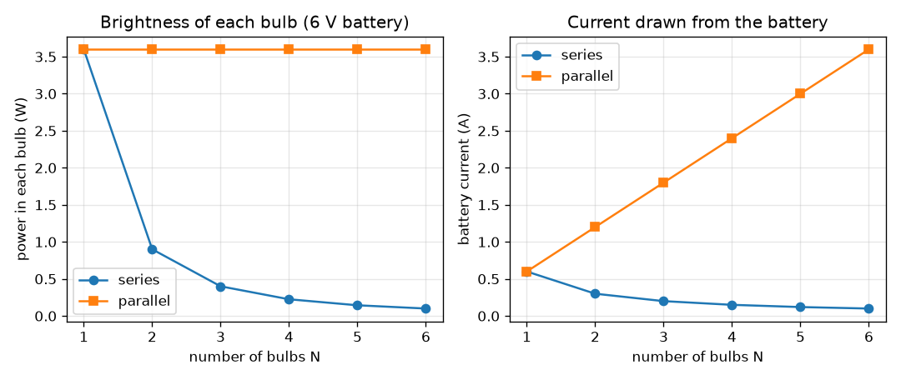
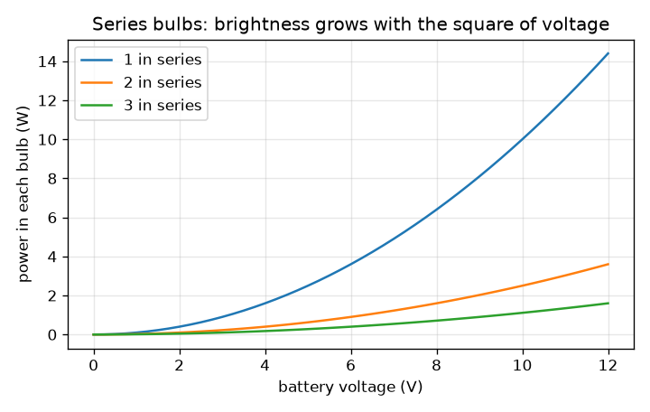

# సెషన్ 1: ఒక బ్యాటరీ, ఒక స్విచ్ మరియు బల్బులు: శ్రేణి మరియు సమాంతరం

[Session 1 — हिन्दी](README.hi.md)

*స్థాయి 1 (భావనాత్మక ఇంటరాక్టివ్ నమూనా) · సుమారు 60 నిమిషాలు · opencircuitlab*

> ఇది సరళీకరించిన ఒక విద్యా నమూనా (educational model). ఇది ధృవీకరించబడిన డిజైన్ సాధనం కాదు; నిజమైన నిర్మాణాలు, విద్యుత్ ఇన్‌స్టాలేషన్‌లు, వాహనాలు, పారిశ్రామిక ప్రక్రియలు లేదా వైద్య నిర్ణయాల కోసం దీనిని ఉపయోగించకూడదు.

**ముందస్తు జ్ఞానం (Prerequisites)**

- పాఠశాల భౌతికశాస్త్రం నుండి ఓమ్ నియమం (Ohm's law), V = I R.
- మీరు PRIMER.md చదివి `python start.py 1` ఒకసారి రన్ చేశారు.

**అభ్యాస లక్ష్యాలు (Learning objectives).** ఈ సెషన్ తర్వాత మీరు చేయగలరు:

- శ్రేణి (series) గొలుసులో వోల్టేజ్ పంచుకోబడుతున్నా కరెంట్ ప్రతిచోటా ఒకేలా ఎందుకు ఉంటుందో వివరించడం.
- సమాంతరంగా (parallel) ఉన్న బల్బులు ప్రతి ఒక్కటీ పూర్తి బ్యాటరీ వోల్టేజ్ ఎందుకు పొందుతాయో, కరెంట్‌లు ఎందుకు కలుస్తాయో వివరించడం.
- రెండు వైరింగ్‌లలో N ఒకేలాంటి బల్బులకు కరెంట్, వోల్టేజ్, పవర్‌లను చేతితో మరియు Pythonలో లెక్కించడం.
- బల్బు ప్రకాశాన్ని దానిలోని పవర్‌తో సంబంధం కలపడం.

## A. వాస్తవ ప్రపంచ సమస్య
పాత పండుగ దీపాలు ఒక పొడవైన గొలుసుగా వైర్ చేయబడ్డాయి: ఒక బల్బు కాలిపోతే మొత్తం వరుస చీకటి అయ్యేది, మరిన్ని బల్బులు కలిపితే అన్నీ మసకబారేవి. ఒకే బ్యాటరీపై రెండు బల్బులు ఉన్న టార్చ్ వేరే విధంగా ప్రవర్తిస్తుంది. ఒకే బ్యాటరీ ఒక వైరింగ్‌లో బల్బులను మసకగా, మరొకదానిలో ప్రకాశవంతంగా ఎందుకు వెలిగిస్తుంది, ఆ ప్రకాశానికి బ్యాటరీ ఏ మూల్యం చెల్లిస్తుంది? (తక్కువ వోల్టేజ్ విద్యా సర్క్యూట్‌లు మాత్రమే: మెయిన్స్ విద్యుత్‌తో ఎప్పుడూ ప్రయోగం చేయవద్దు.)

## B. భావన మరియు సిద్ధాంతం
బ్యాటరీ ఒక మూసిన లూప్ చుట్టూ ఆవేశాన్ని నెడుతుంది. శ్రేణి గొలుసులో ఒకే మార్గం ఉంటుంది, కాబట్టి అదే కరెంట్ ప్రతి బల్బు గుండా ఒకదాని తర్వాత ఒకటిగా వెళ్తుంది; నిరోధాలు (resistances) కలుస్తాయి, బ్యాటరీ వోల్టేజ్ బల్బుల మధ్య పంచుకోబడుతుంది. సమాంతర సమూహంలో ప్రతి బల్బు నేరుగా బ్యాటరీకి అడ్డంగా కలపబడి ఉంటుంది, కాబట్టి ప్రతి ఒక్కటీ పూర్తి వోల్టేజ్ పొంది తన సొంత కరెంట్‌ను మోస్తుంది; బ్యాటరీ ఆ కరెంట్‌లన్నింటినీ కలిపి సరఫరా చేయాలి. బల్బులోని పవర్ P = V I = I^2 R = V^2 / R, ప్రకాశం దానికి అనులోమానుపాతంలో ఉంటుందని తీసుకుంటాం. స్విచ్ అనేది కేవలం ఒక ఖాళీ: తెరిచి ఉంటే లూప్ లేదు, కరెంట్ లేదు.

| చిహ్నం | అర్థం | యూనిట్ |
|---|---|---|
| V | బ్యాటరీ వోల్టేజ్ | V |
| R | ఒక బల్బు నిరోధం (నమూనా విలువ 10) | ohm |
| N | ఒకేలాంటి బల్బుల సంఖ్య | యూనిట్ లేదు |
| I | బ్యాటరీ నుండి తీసుకునే కరెంట్ | A |
| P | ఒక బల్బులోని పవర్ (వేడి మరియు వెలుతురు) | W |

**ఊహలు (Assumptions)**

- బ్యాటరీ ఆదర్శమైనది (ideal): కరెంట్ ప్రవహించినప్పుడు దాని వోల్టేజ్ తగ్గదు.
- బల్బు ఒక స్థిరమైన 10 ohm నిరోధకం. నిజమైన ఫిలమెంట్ చాలా వేడెక్కి దాని నిరోధం చాలా రెట్లు పెరుగుతుంది, కాబట్టి నిజమైన ప్రకాశం ఈ నమూనా నుండి భిన్నంగా ఉంటుంది.
- తీగలకు నిరోధం లేదు.

$$ I=\frac{V}{R}\qquad P=VI=I^2R=\frac{V^2}{R} $$

$$ \text{series: } R_{\mathrm{tot}}=NR,\quad I=\frac{V}{NR},\quad V_{\mathrm{bulb}}=\frac{V}{N},\quad P_{\mathrm{bulb}}=\frac{V^2}{N^2R} $$

$$ \text{parallel: } R_{\mathrm{tot}}=\frac{R}{N},\quad I=\frac{NV}{R},\quad V_{\mathrm{bulb}}=V,\quad P_{\mathrm{bulb}}=\frac{V^2}{R} $$

## C. దృశ్య వివరణ
మొదటి చిత్రం 6 V బ్యాటరీపై 1 నుండి 6 బల్బులకు రెండు వైరింగ్‌లను పోలుస్తుంది. ఎడమవైపు, ప్రతి బల్బులోని పవర్ సమాంతరంలో 3.6 W వద్ద ఉంటుంది కానీ శ్రేణిలో 1/N^2 గా తగ్గుతుంది (రెండు బల్బులకు 0.9 W, మూడింటికి 0.4 W). కుడివైపు, బ్యాటరీ కరెంట్ శ్రేణిలో తగ్గుతుంది (ఒక బల్బుకు 0.6 A, నాలుగింటికి 0.15 A), సమాంతరంలో పెరుగుతుంది (నాలుగింటికి 2.4 A): సమాంతరంలోని ప్రకాశానికి బ్యాటరీ మూల్యం చెల్లిస్తుంది. రెండవ చిత్రం, శ్రేణి గొలుసులో ప్రకాశం బ్యాటరీ వోల్టేజ్ వర్గంతో పెరుగుతుందని చూపిస్తుంది.

*6 V పై 1 నుండి 6 బల్బులకు, శ్రేణిలో మరియు సమాంతరంలో, ప్రతి బల్బు పవర్ మరియు బ్యాటరీ కరెంట్.*

*శ్రేణి బల్బులు: ప్రతి బల్బులోని పవర్ బ్యాటరీ వోల్టేజ్ వర్గంతో పెరుగుతుంది.*

## D. ఇంటరాక్టివ్ సిమ్యులేషన్
పాఠాన్ని రన్ చేయండి (`python start.py 1`), తర్వాత లైవ్ యాప్‌ను తెరవండి: [సెషన్ 1: శ్రేణిలో మరియు సమాంతరంలో బల్బులు](https://krunalpanchal1995.github.io/pan-iit-oss/opencircuitlab/session-01/) (లేదా ఈ ఫోల్డర్‌లోని `app.html`). బల్బుల సంఖ్యను, వైరింగ్‌ను ఎంచుకుని, బ్యాటరీ వోల్టేజ్‌ను లాగండి. ప్రతి బల్బు కింద ఉన్న వోల్టేజ్ లేబుల్, వెలుగు, బ్యాటరీ కరెంట్‌ను గమనించండి. గ్రాఫ్ వ్యూ తెరిచి N కి వ్యతిరేకంగా ప్రకాశం యొక్క రెండు వక్రాలను చూడండి.

**సవాలు.** మూడు బల్బులను శ్రేణిలో వైర్ చేసి ప్రతి ఒక్కటీ కనీసం 1 W పొందేలా చేయండి.

## E. సాధించిన ఉదాహరణ మరియు ప్రయోగం
**సమస్య.** ఒక 6 V బ్యాటరీ ఒక్కొక్కటి 10 ohm ఉన్న మూడు బల్బులకు శక్తిని ఇస్తుంది. (a) శ్రేణి వైరింగ్ మరియు (b) సమాంతర వైరింగ్‌కు కరెంట్, ప్రతి బల్బుకు అడ్డంగా వోల్టేజ్, దాని పవర్ కనుగొనండి.

1. శ్రేణి: R_total = 3 * 10 = 30 ohm, కాబట్టి I = 6 / 30 = 0.2 A, ప్రతి బల్బులో అదే.
2. ప్రతి బల్బుకు అడ్డంగా వోల్టేజ్ = I R = 0.2 * 10 = 2 V (మూడూ కలిసి 6 V, అలాగే ఉండాలి).
3. ప్రతి బల్బులో పవర్ = V I = 2 * 0.2 = 0.4 W; మొత్తం 1.2 W, ఇది బ్యాటరీ వోల్టేజ్ గుణకారం కరెంట్‌కు సమానం, 6 * 0.2.
4. సమాంతరం: ప్రతి బల్బు 6 V చూస్తుంది, కాబట్టి దాని కరెంట్ 6 / 10 = 0.6 A, పవర్ 6 * 0.6 = 3.6 W.
5. బ్యాటరీ మొత్తం 3 * 0.6 = 1.8 A మరియు 10.8 W సరఫరా చేస్తుంది. సమాంతరం ప్రతి బల్బుకు శ్రేణి కంటే 9 రెట్లు పవర్ ఇస్తుంది, ఎందుకంటే వోల్టేజ్ 3 రెట్లు ఎక్కువ, పవర్ వర్గంతో పోతుంది.

**సమాధానం.** శ్రేణి: ఒక్కో బల్బుకు 0.2 A, 2 V, 0.4 W. సమాంతరం: బ్యాటరీ నుండి 1.8 A, ఒక్కో బల్బుకు 6 V, 3.6 W.

**ప్రయోగం.** ఒక 4.5 V బ్యాటరీ ప్యాక్ మరియు రెండు ఒకేలాంటి చిన్న టార్చ్ బల్బులతో, మొదట శ్రేణిలో తర్వాత సమాంతరంలో వైర్ చేసి వాటి ప్రకాశాన్ని కంటితో పోల్చండి; ప్రతి అమరికలో ఒక బల్బును విప్పి మరొకటి ఏమి చేస్తుందో చూడండి. మల్టీమీటర్ (multimeter) ఉంటే బ్యాటరీ కరెంట్‌ను కొలవండి. నమూనా యొక్క గుణాత్మక ఫలితాన్ని ఆశించండి (శ్రేణిలో మసకగా, పంచుకోబడి; సమాంతరంలో ప్రకాశవంతంగా; ఒక బల్బు విఫలమైతే శ్రేణి గొలుసు మాత్రమే ఆగిపోతుంది). సంఖ్యలు భిన్నంగా ఉంటాయి: చల్లని ఫిలమెంట్‌కు వేడిదాని కంటే చాలా తక్కువ నిరోధం ఉంటుంది, కాబట్టి స్విచ్ ఆన్ చేసిన క్షణంలో నిజమైన కరెంట్ నమూనాది కంటే ఎక్కువ.

## F. మూల్యాంకనం మరియు డిజైన్ సవాలు
**ప్రశ్న రకం A: భావనాత్మక.** పండుగ బల్బుల శ్రేణి వరుసలో, ఒక బల్బు ఫిలమెంట్ తెగిపోయి విఫలమవుతుంది. మిగతా అన్ని బల్బులు ఎందుకు ఆరిపోతాయి, సమాంతర వరుసలో అవి ఎందుకు వెలుగుతూనే ఉంటాయి?

సూచన

కరెంట్‌కు మూసిన లూప్ కావాలి. ప్రతి వైరింగ్‌లో ఎన్ని లూప్‌లు ఉన్నాయి?

దశలవారీ పరిష్కారం

శ్రేణి వరుసలో కరెంట్‌కు ఒకే మార్గం ఉంటుంది. తెగిన ఫిలమెంట్ ఆ మార్గంలో ఒక ఖాళీ, కాబట్టి కరెంట్ ప్రతిచోటా సున్నా, ప్రతి బల్బు చీకటి అవుతుంది. సమాంతర వరుసలో ప్రతి బల్బుకు బ్యాటరీకి అడ్డంగా నేరుగా సొంత మార్గం ఉంటుంది. ఒక మార్గంలోని ఖాళీ ఇతరులను ప్రభావితం చేయదు, కాబట్టి అవి పూర్తి వోల్టేజ్ పొంది వెలుగుతూనే ఉంటాయి (బ్యాటరీ కొంచెం తక్కువ కరెంట్ సరఫరా చేస్తుంది, అంతే).

**ప్రశ్న రకం B: సంఖ్యాత్మక.** ఒక 9 V బ్యాటరీ మూడు 10 ohm బల్బులకు శక్తిని ఇస్తుంది. శ్రేణి వైరింగ్ మరియు సమాంతర వైరింగ్‌కు ప్రతి బల్బులో కరెంట్ మరియు పవర్ కనుగొనండి.

సూచన

శ్రేణి: R_total = N R. సమాంతరం: ప్రతి బల్బుకు పూర్తి 9 V. తర్వాత P = V I.

దశలవారీ పరిష్కారం

శ్రేణి: R_total = 30 ohm, I = 9 / 30 = 0.3 A, ప్రతి బల్బు 3 V పొందుతుంది, P = 3 * 0.3 = 0.9 W. సమాంతరం: ప్రతి బల్బు 9 V పొందుతుంది, ఒక్కో బల్బుకు I = 0.9 A, P = 9 * 0.9 = 8.1 W, బ్యాటరీ కరెంట్ 2.7 A. సరిచూపు: 3 బల్బులకు సమాంతరం శ్రేణి కంటే 9 రెట్లు ప్రకాశవంతం (N^2 = 9), మరియు 0.9 * 9 = 8.1.

**ప్రశ్న రకం C: గ్రాఫ్ మరియు సిమ్యులేషన్ వ్యాఖ్యానం.** 6 V వద్ద ప్రకాశం గ్రాఫ్‌పై, 4 బల్బులు సమాంతరంలో ఉన్నప్పటి కంటే 4 బల్బులు శ్రేణిలో ఉన్నప్పుడు ప్రతి బల్బు ఎన్ని రెట్లు మసకగా ఉంటుంది? వక్రాల నుండి రెండు విలువలను చదవండి.

సూచన

N = 4 వద్ద నీలం మరియు ఆకుపచ్చ వక్రాలను కనుగొనండి.

దశలవారీ పరిష్కారం

N = 4 వద్ద ఆకుపచ్చ (సమాంతర) వక్రం 3.6 W వద్ద, నీలం (శ్రేణి) వక్రం 0.225 W వద్ద ఉన్నాయి. నిష్పత్తి 3.6 / 0.225 = 16 = N^2. నీలం వక్రం 1 / N^2 లాగా తగ్గుతుంది, ఆకుపచ్చది చదునుగా ఉంటుంది.

**ప్రశ్న రకం D: డిజైన్ మరియు ఆప్టిమైజేషన్ (optimisation) సవాలు.** డిజైన్: ఒక చిన్న 6 V బ్యాటరీ గరిష్ఠంగా 1 A సరఫరా చేయగలదు. మీరు మూడు 10 ohm బల్బులను వెలిగించాలి, ప్రతి ఒక్కటీ కనీసం 0.3 W పొందాలి. మూడు వైరింగ్‌లను పోల్చండి: అన్నీ శ్రేణి, అన్నీ సమాంతరం, ఒక సమాంతర జంటతో శ్రేణిలో ఒక బల్బు. ఏవి అనుమతించబడతాయి, మీరు దేనిని ఎంచుకుంటారు?

సూచన

ప్రతి వైరింగ్‌కు బ్యాటరీ కరెంట్ మరియు ప్రతి బల్బులో పవర్ లెక్కించండి.

దశలవారీ పరిష్కారం

అన్నీ శ్రేణి: I = 0.2 A, ఒక్కో బల్బుకు 0.4 W: అనుమతించబడుతుంది. అన్నీ సమాంతరం: I = 1.8 A, ఇది 1 A పరిమితి కంటే ఎక్కువ: అనుమతించబడదు. సమాంతర జంటతో శ్రేణిలో ఒక బల్బు: R = 10 + 5 = 15 ohm, I = 0.4 A; ఒంటరి బల్బు 4 V మరియు 1.6 W పొందుతుంది, జంటలోని ప్రతి బల్బు 2 V మరియు 0.4 W: అనుమతించబడుతుంది, మొత్తం మీద ఎక్కువ ప్రకాశవంతం, కానీ అసమానంగా. అన్నీ శ్రేణి అత్యంత సరళమైనది, సమాన ప్రకాశం ఇస్తుంది; మిశ్రమ వైరింగ్ ఎక్కువ వెలుగు ఇస్తుంది, కానీ బల్బులు అసమానం, ఒంటరి బల్బు విఫలమైతే మొత్తం సర్క్యూట్ ఆరిపోతుంది. ఊహ: ఆదర్శ బ్యాటరీ మరియు స్థిరమైన బల్బు నిరోధం.

[RUBRIC.md](../../RUBRIC.md)తో మిమ్మల్ని మీరు స్కోర్ చేసుకోండి. కాగితంపై చేయడానికి [కార్యాచరణ పత్రం](activity_sheet.md) ప్రింట్ చేయండి.

## సాధారణ అపోహలు
| సాధారణ అపోహ | నిజానికి సరైనది |
|---|---|
| శ్రేణి గొలుసులో మొదటి బల్బు కరెంట్‌ను వాడేస్తుంది, కాబట్టి చివరి బల్బు మసకగా ఉంటుంది. | శ్రేణి గొలుసులో కరెంట్ ప్రతిచోటా ఒకటే. బల్బులు పంచుకునేది వోల్టేజ్‌ను, కరెంట్‌ను కాదు. |
| పెద్ద బ్యాటరీ వోల్టేజ్ అంటే సమాంతరంలో మాత్రమే పెద్ద కరెంట్. | రెండు వైరింగ్‌లలోనూ వోల్టేజ్‌తో కరెంట్ పెరుగుతుంది (I = V / R_total); తేడా R_total లో ఉంటుంది. |
| సమాంతరంలోని బల్బులు ఉచిత ప్రకాశం. | ప్రతి బల్బు తన పూర్తి కరెంట్‌ను తీసుకుంటుంది, కాబట్టి ప్రతి బల్బుతో బ్యాటరీ కరెంట్ పెరుగుతుంది, బ్యాటరీ త్వరగా అయిపోతుంది. |
| శ్రేణిలో ఎక్కువ బల్బులు అంటే ఎల్లప్పుడూ ఎక్కువ వెలుగు. | మొత్తం వెలుగు పవర్ V^2 / (N R) నిజానికి N తో తగ్గుతుంది; ప్రతి బల్బు వోల్టేజ్‌లో 1/N మరియు పవర్‌లో 1/N^2 మాత్రమే పొందుతుంది. |

## పదకోశం (Glossary)
- **శ్రేణి (series)**: ఒకే మార్గంలో ఒకదాని తర్వాత ఒకటిగా కలపబడిన భాగాలు
- **సమాంతరం (parallel)**: పక్కపక్కనే, ప్రతి ఒక్కటీ అవే రెండు బిందువులకు అడ్డంగా నేరుగా కలపబడిన భాగాలు
- **కరెంట్ (current) (I)**: ఆవేశ ప్రవాహం, ఆంపియర్‌లలో (A) కొలుస్తారు
- **వోల్టేజ్ (voltage) (V)**: కరెంట్‌ను నడిపించే తోపు, వోల్ట్‌లలో (V) కొలుస్తారు
- **నిరోధం (resistance) (R)**: ఒక భాగం కరెంట్‌ను ఎంత బలంగా వ్యతిరేకిస్తుంది, ohm లో
- **పవర్ (power) (P)**: సెకనుకు వేడి మరియు వెలుతురుగా మారే శక్తి, వాట్‌లలో (W)

## ముగింపు
1. [exercises.md](exercises.md)లోని మూడు కోడింగ్ పనులు చేయండి.
2. మీ మార్పుల తర్వాత `python start.py 1` మళ్ళీ రన్ చేయండి. అది చెక్‌పాయింట్‌తో (checkpoint) ముగుస్తుంది; అది `PASS` అని ప్రింట్ చేసినప్పుడు మీరు పూర్తి చేశారు. (చెక్‌పాయింట్ మాత్రమే: `python start.py check 1`.)

తర్వాత: [సెషన్ 2](../session-02/README.md)
