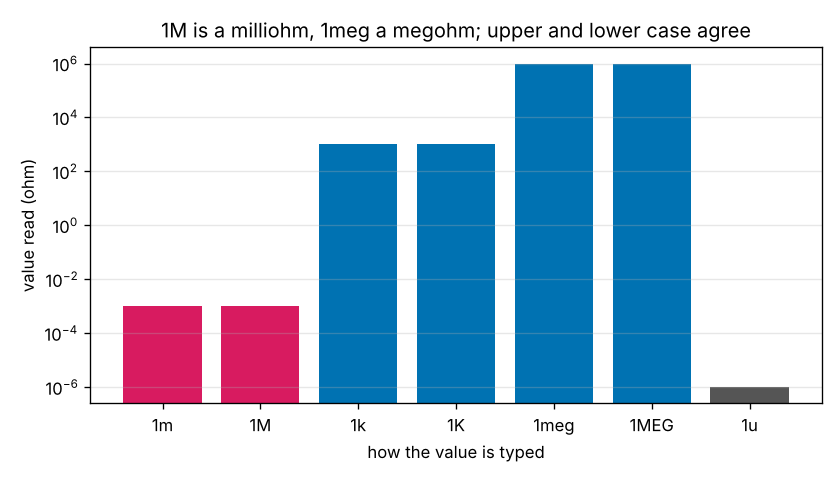
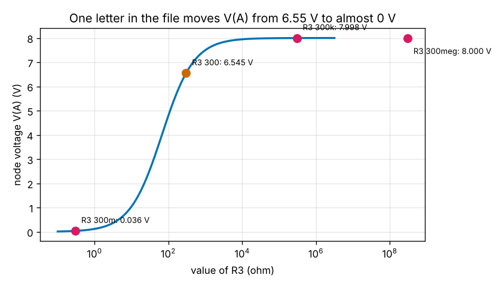
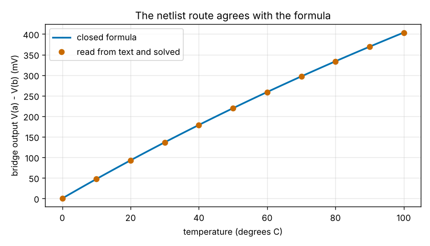

# Session 4: Read a netlist: text in, voltages out

*Level 3 (simulation and validation) · about 90 minutes · opencircuitlab*

> This is a simplified educational model. It is not a validated design tool and must not be used for real structures, electrical installations, vehicles, industrial processes or medical decisions.

**Prerequisites**

- Session 3: `solve_network` and the Wheatstone bridge.
- Splitting a string and a simple regular expression (explained in Section B).

**Learning objectives.** After this session you can:

- Read a value with a scale suffix (k, meg, m, u, ...) and avoid the 1M trap, where M means milli.
- Turn the lines of a netlist into the lists the Session 3 solver needs, and refuse a broken line with its line number.
- Validate the reader against hand results (the two-loop circuit from text) and with a write-and-read round trip on random networks.
- Write a checker that reports every problem in a file at once, with errors for unsolvable files and warnings for suspicious values.
- Recognise the failure cases: unreadable values, repeated names, floating parts, missing ground, and typos that still solve.

## A. Real-world problem
Every circuit in Sessions 1 to 3 was a Python list of tuples. Real circuit simulators read a *netlist*, a text file with one line per part, such as `R1 top1 A 100`: resistor R1 between the nodes top1 and A, 100 ohm. Text is easy to write, to share by e-mail and to keep with a project, and it is easy to get wrong. A technician sends the file of the Pt1000 bridge with the words 'it does not work'. One letter in it (`1M` instead of `1meg` or `1k`) makes a resistor a thousand million times too small, and the simulator may solve the file without a murmur. How do we read a file reliably, and how do we find every mistake in it, not only the first? (Low-voltage educational circuits only; this is a simplified model, not a design tool for real equipment.)

## B. Concept and theory
A netlist line has four fields: a name whose first letter gives the kind of part (R resistor, V voltage source, I current source), two nodes, and a value. The node `0` (or `gnd`) is the reference; other nodes may have any name, and the reader numbers them 1, 2, 3 in the order they first appear. Values use the scale letters of SPICE: t, g, meg, k, m, u, n, p, f for 10^12, 10^9, 10^6, 10^3, 10^-3, 10^-6, 10^-9, 10^-12 and 10^-15. They are not case sensitive, so **M also means milli**: for a million write `meg`. Letters after the scale are a unit and are ignored (`5V`, `2mA`, `1kohm`), and `1F` is one femto because f is a scale letter. A line starting with `*` is a comment, `;` starts a comment at the end of a line, and `.end` stops the reading. Reading means three jobs: split the line into fields, convert the value with one regular expression (a number, then letters), and put the part in the right list for the Session 3 solver. A reader should refuse what it does not understand and say where: `line 7: the name 'R2' is already used`. A good reader and writer are inverses: writing a circuit as text and reading it back must give the same circuit, which we test on random networks (the round trip). A checker (a *lint*) is a second program that reads the whole file without stopping and lists every problem, sorted into errors (the file cannot be solved: unreadable value, repeated name, both ends of a part on one node, no ground, a floating group of nodes) and warnings (the file is valid but suspicious: a resistor below 0.1 ohm or above 100 megohm). A solver cannot tell a wrong value from a right one, so the checker and a hand estimate are the only protection. Finally a meter has its own resistance R_m, so it reads V_th R_m / (R_th + R_m) instead of V_th: the meter *loads* the circuit.

| Symbol | Meaning | Unit |
|---|---|---|
| name | first letter gives the kind: R, V or I | no unit |
| node | a point where parts meet; 0 or gnd is the reference | no unit |
| value | a number with an optional scale letter, e.g. 4.7k | ohm, V or A |
| meg, k, m, u | scale letters: 10^6, 10^3, 10^-3, 10^-6 | no unit |
| R_th, V_th | Thevenin resistance and voltage of the circuit seen by the meter | ohm and V |
| R_m | input resistance of the meter | ohm |

**Assumptions**

- Linear resistors, ideal sources, direct current only, as in Session 3.
- The reader knows R, V and I lines only; commands such as `.tran` are refused, not ignored.
- The Pt1000 bridge uses the straight-line model of Session 3.

$$ \text{value}=\text{number}\times 10^{e},\quad e=3\ (\texttt{k}),\ 6\ (\texttt{meg}),\ -3\ (\texttt{m}\ \text{or}\ \texttt{M}),\ -6\ (\texttt{u}) $$

$$ \text{parse\_netlist}(\text{to\_netlist}(\text{circuit}))=\text{circuit}\quad\text{(round trip)} $$

$$ V_{\mathrm{read}}=V_{\mathrm{th}}\,\frac{R_m}{R_{\mathrm{th}}+R_m},\qquad \text{loading error}=\frac{R_{\mathrm{th}}}{R_{\mathrm{th}}+R_m} $$

## C. Visual explanation
The first figure shows how the same digits are read with different suffixes: `1m` and `1M` are both a milliohm, `1k` and `1K` both a kiloohm, `1meg` and `1MEG` a megohm. The second figure takes the two-loop circuit of Session 2 and changes only the suffix after the 300 ohm of R3: from V(A) = 6.545 V at 300 to 0.036 V at 300m, 7.998 V at 300k and 8.000 V at 300meg (the circles). The third figure checks the netlist route against the closed bridge formula from 0 to 100 degrees C: the circles, each made by writing a file, reading it and solving it, lie on the formula.

*The same digits with different suffixes: 1m and 1M agree, 1meg is a million times larger.*

*V(A) of the two-loop circuit against the value of R3, with the same digits typed with four suffixes.*

*Bridge output against temperature: the formula (line) and files read and solved (circles).*

## D. Interactive simulation
Run the lesson (`python start.py 4`), then open the live app: [Session 4: reading a netlist](https://krunalpanchal1995.github.io/pan-iit-oss/opencircuitlab/session-04/) (or `app.html` in this folder). The first view shows the five-line file, the value the reader makes of each line and the node voltages. The file starts with the typo `R3 A 0 300m`. Move the suffix slider through m, none, k and meg and watch V(A) change; the second view shows where each reading sits on the curve of V(A) against R3, and the third compares the four suffixes side by side. Change the sources and the digits too.

**Challenge.** The file was meant to hold R3 = 300 ohm but was typed as 300m. Without touching the sources, change the suffix so that V(A) is back within 0.01 V of 6.5455 V.

## E. Worked example and experiment
**Problem.** A student writes the file `V1 in 0 12`, `R1 in out 10k`, `R2 out 0 1M` and expects a divider that gives about 12 V at `out`. Read the file by hand, give V(out) and the current of V1 as written, then the same for the intended 1meg, and say what the checker reports.

1. Values: `12` is 12 V, `10k` is 10 000 ohm and `1M` is 0.001 ohm, because M means milli. The intended 1 megohm is `1meg`.
2. Nodes: `0` is the reference, `in` becomes node 1 and `out` node 2 (order of appearance).
3. As written the divider is V(out) = 12 x 0.001 / (10 000 + 0.001) = 1.2e-6 V (1.2 microvolt) and the source supplies 12 / 10 000.001 = 1.2 mA.
4. With `1meg`: V(out) = 12 x 1 000 000 / 1 010 000 = 11.88 V and the current is 12 / 1 010 000 = 11.88 microampere.
5. The checker reports one warning on line 3: R2 is only 1m ohm (M means milli; for mega write meg). The file is valid, so it is a warning and not an error.

**Answer.** As written: 1.2 microvolt and 1.2 mA. As intended: 11.88 V and 11.88 microampere. The checker warns about line 3.

**Experiment.** Take a 9 V battery pack, a 10 kohm resistor and a 1 Mohm resistor (colour code brown-black-green for 1 Mohm: it is hard to tell from 100 kohm by eye!). Build the divider, read the output with a meter set to the 10 V range and compare with 8.9 V. Then replace both resistors by 1 Mohm: the divider should give 4.5 V, but a meter with a 1 to 10 Mohm input resistance pulls the reading down, which is the loading effect of this session. The model has ideal parts and an ideal meter.

## Real-world application and mini-project: Debug the technician's bridge file
The technician's file of the Pt1000 bridge at 100 degrees C (5 V supply, Pt1000 = 1385 ohm) is the string `TECH_NETLIST` in the lesson. It has three mistakes. Use `check_netlist`, `corrected_bridge`, `bridge_output`, `loading_error` and `smallest_meter` from the lesson.

**Deliverable:** A script that prints every problem of the technician's file with its line number and level; solves the repaired bridge from text and compares it with the closed formula; shows what the output would have been with the typo left in; and prints the reading and the loading error for meters of 1k, 10k, 100k and 1meg and the smallest meter from the 1-2-5 list that loses at most 1 percent. It also saves a graph of the bridge output against temperature made from files.

**Success looks like:** The checker finds the warning on line 6 (R4 = 1M is 1 milliohm) and the errors on line 7 (name R2 used twice) and line 8 (nodes c and d floating). The repaired bridge gives 403.56 mV, the same as the formula. With the typo node b is at 0 V, not 2.5 V. A 10 kohm meter reads 364.20 mV (a 9.8 percent loading error), a 100 kohm meter loses 1.07 percent, and the smallest meter that loses at most 1 percent is 200 kohm.

## F. Assessment and design challenge
**Question type A: Conceptual.** The checker reports the line `R4 b 0 1M` (1 milliohm) as a warning, not an error, although it is almost certainly a typo for `1meg`. Why is a warning the right level, and give one real part that has a resistance of about a milliohm?

Hint

What does the program know about what you meant? Which resistors in a real circuit carry a lot of current?

Step-by-step solution

A resistor of 1 milliohm is a perfectly legal circuit: the file can be solved and the answer is correct for what was written. The program cannot know the intention, only that the value is unusual, so it says so and lets the person decide. An error is for a file that cannot be solved or has no meaning (unreadable value, floating node, repeated name). Real milliohm resistors exist: a current-sense shunt of 1 to 10 milliohm is placed in the path of a large current so that the tiny voltage across it can be measured. A checker that refused them would be wrong for a motor driver.

**Question type B: Numerical.** The repaired bridge has V_th = 403.56 mV and R_th = 1080.7 ohm as seen by the meter. A meter should take away at most 0.5 percent of the reading. What input resistance does it need, and which meter from the list 1k, 2k, 5k, ... 100meg is the smallest that works? Give a sanity check.

Hint

The meter reads V_th R_m / (R_th + R_m). The fraction lost is R_th / (R_th + R_m).

Step-by-step solution

Fraction lost = R_th / (R_th + R_m) <= 0.005, so R_m >= 199 R_th = 199 x 1080.7 = 215 kohm. From the list, 200k loses 0.54 percent (just too much) and 500k loses 0.22 percent, so 500 kohm is the smallest that works. Sanity check: `loading_error(500e3)` gives 0.0022 and `smallest_meter(0.005)` returns 500000. Real handheld meters have 10 Mohm, far above this, but a cheap analogue meter at 20 kohm per volt on a 5 V range (100 kohm) would already lose about 1 percent.

**Question type C: Graph and simulation interpretation.** In Figure 2 the same digits 300 give V(A) = 0.036 V with the suffix m, 6.545 V with no suffix and 7.998 V with k. Both wrong suffixes are one letter away from the intended file. Which typo is more dangerous, and why?

Hint

Which of the two results would you notice as wrong without any tool?

Step-by-step solution

300k is more dangerous. A reading of 0.036 V from a circuit built on 10 V and 4 V sources looks absurd and is noticed at once, but 7.998 V looks plausible: it is only 22 percent away from the right answer and lies between the two sources' voltages. An error you cannot see by eye needs a tool (a checker that flags unusual values, a second reading by someone else, a comparison with a hand calculation). The solver gives no warning in either case, because both files are valid circuits.

**Question type D: Design and optimisation challenge.** Design: you have to write the checker for a classroom where students type netlists by hand. Choose five rules, say which are errors and which are warnings, and name one mistake your checker can never find.

Hint

Ask of every rule: can the file still be solved? Is the file still a possible circuit that someone might want?

Step-by-step solution

Errors (the file cannot be solved or has no meaning): an unreadable value; a repeated part name; a part with both ends on the same node; a floating group of nodes; no ground node. Warnings (valid but suspicious): a resistor below 0.1 ohm or above 100 megohm (the 1M trap); a voltage source over, say, 50 V in a low-voltage course; two sources in parallel with the same value. Report every problem in one run, with the line number, so the student fixes ten mistakes in one go. What no checker can find is a plausible wrong value: 330 typed instead of 220 gives a valid circuit and a believable answer. The remedy is a hand estimate of the expected result before running, and a second pair of eyes. Assumption: the course uses ideal parts and DC only.

Score yourself with [RUBRIC.md](../../RUBRIC.md). Print the [activity sheet](activity_sheet.md) to work on paper.

## Common misconceptions
| Common misconception | What is actually true |
|---|---|
| Writing 1M gives a megohm resistor. | In SPICE-style netlists M means milli, in upper and lower case: 1M is 0.001 ohm. A megohm is 1meg (or 1e6). This one letter is the most common mistake in hand-written netlists. |
| If the program solves the file without an error, the circuit is the one I meant. | A solver only checks that the circuit can be solved. A wrong but valid value, such as R3 = 300k instead of 300, gives a smooth, plausible answer (7.998 V instead of 6.545 V). Check against a hand estimate. |
| Capital letters matter: node A and node a are different. | In a netlist the names of parts, nodes and suffixes are not case sensitive: A and a are the same node, K and k are both kilo. (Only the meaning of the letter m or M is surprising.) |
| A part with an unknown ending, like 1x, is an error. | Letters that do not start a scale word are read as the unit and ignored: 5V, 2mA, 1kohm and even 1x are all accepted. The reader only refuses numbers it cannot read at all, such as 1..2 or 1k2. |

## Glossary
- **netlist**: a text file that describes a circuit with one line per part
- **node**: a point where parts are joined; the same name means the same point
- **suffix**: the letters after a number that scale it: k = 1000, m = 0.001, meg = 1000000
- **parser**: a program that turns text into a data structure, or refuses it with a message
- **round trip**: writing data out and reading it back; the result must equal the start
- **lint**: a check that warns about suspicious but legal input
- **loading**: the change in a reading caused by the meter that makes it

## Finish
1. Do the three coding tasks in [exercises.md](exercises.md).
2. Run `python start.py 4` again after your changes. It ends with the checkpoint; when it prints `PASS`, you are done. (Checkpoint only: `python start.py check 4`.)

Next: [Session 5: A nonlinear part: the diode and Newton's method](../session-05/README.md).
