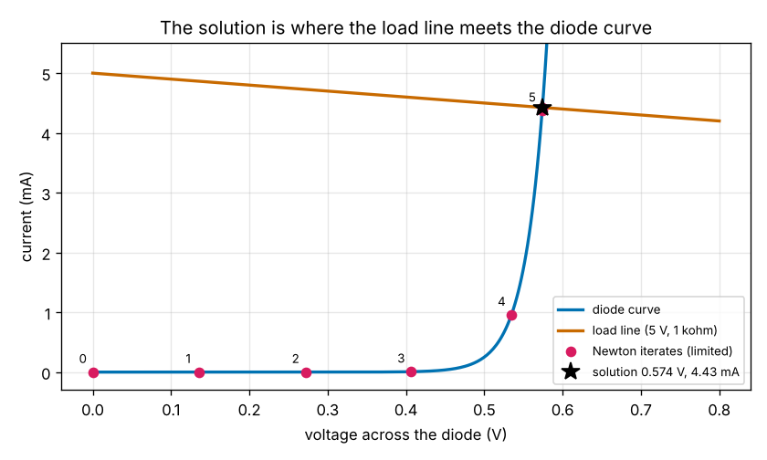
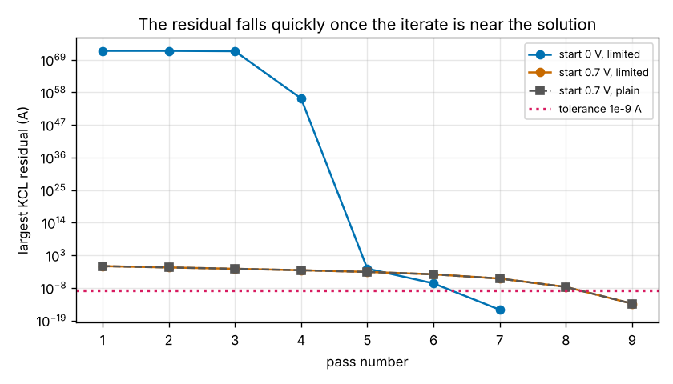
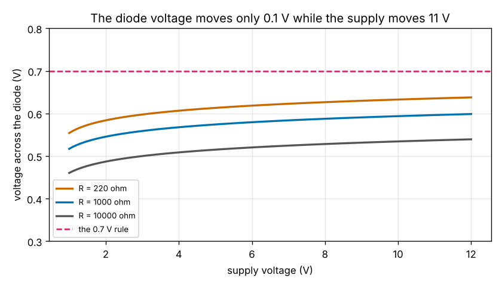

# Session 5: A nonlinear part: the diode and Newton's method

*Level 3 (simulation and validation) · about 90 minutes · opencircuitlab*

> This is a simplified educational model. It is not a validated design tool and must not be used for real structures, electrical installations, vehicles, industrial processes or medical decisions.

**Prerequisites**

- Session 3: `solve_network`, nodal analysis and KCL.
- The idea of a tangent line (the slope of a curve at a point); it is explained in Section B.

**Learning objectives.** After this session you can:

- Explain why a diode cannot be a fixed entry of G, and write its companion model (a resistor and a current source) from the Shockley law.
- Wrap a Newton loop around the Session 3 solver and stop it on the KCL residual and the voltage change.
- Validate against an independent method (bisection) and against power balance on a small network.
- Recognise the failure cases: the plain loop from 0 V, a poor start, too few passes, a floating part, and a reversed diode.
- Choose a resistor for a diode indicator from the E12 series over a supply range, and judge the 0.7 V rule.

## A. Real-world problem
Every part so far obeyed Ohm's law, so one matrix equation G v = i solved the whole circuit. A diode does not: its current grows exponentially with the voltage across it, so there is no single conductance to put into G. Yet a 5 V supply, a 1 kohm resistor and a diode is the simplest indicator circuit there is. How much current flows and what voltage does the diode drop? We keep the linear solver of Session 3 and put a loop around it: at each pass replace the diode by the resistor and current source that match it at the present voltage, solve, and repeat until Kirchhoff's current law holds. That is Newton's method, and it sits inside every circuit simulator. (Low-voltage educational circuits only; this is a simplified model, not a design tool for real equipment.)

## B. Concept and theory
A silicon diode follows the Shockley law I = I_s (exp(V / (n V_T)) - 1) for the voltage V from anode to cathode. Here I_s = 1e-12 A is the leakage current, n = 1 an ideality factor and V_T = 25.852 mV the thermal voltage at 300 K. Below 0.4 V almost nothing flows, and every 60 mV more multiplies the current by ten. The slope g = dI/dV = (I + I_s) / (n V_T) is the conductance at that voltage. The tangent line at V_0 is I = g V + i_eq with i_eq = I(V_0) - g V_0: a resistor 1/g in parallel with a current source i_eq. This is the companion model of the diode, and it is linear, so `solve_network` can use it. One pass is: linearise every diode at its working voltage, solve, and measure the KCL residual of the solution with the true diode law (the sum of the currents leaving each node; zero when KCL holds). If the residual is below 1e-9 A and every diode voltage agrees with the one it was linearised at, stop; otherwise the solution becomes the next working voltage. For a diode in series with R the unknown is one voltage, and a pass is V_new = (V_s / R - i_eq) / (1 / R + g). The loop has a trap. At 0 V the diode is almost an open circuit, so the first solve puts nearly all of V_s across it; the next pass linearises at 5 V, where g is about 1e61 S, and the solver reports a singular matrix. The cure used by circuit simulators is a limiter: a rising step dV in the working voltage is shortened to n V_T ln(1 + dV / (n V_T)). To check the answer by a second method the series circuit can be solved by bisection (halve an interval in which the sign of the current mismatch changes), which shares no code with the Newton loop.

| Symbol | Meaning | Unit |
|---|---|---|
| I, V | diode current and voltage (anode to cathode) | A and V |
| I_s | saturation (leakage) current, 1e-12 A | A |
| n V_T | ideality factor times thermal voltage, 25.852 mV | V |
| g | slope of the diode curve at a voltage | S |
| i_eq | current of the companion source | A |
| V_0 | working voltage where the diode is linearised | V |
| residual | amount by which KCL fails at a node | A |

**Assumptions**

- One ideal Shockley model with I_s = 1e-12 A and n = 1 at 300 K, and a conductance of 1e-12 S added across every diode (as SPICE does).
- Ideal sources and linear resistors, direct current only.
- No series resistance inside the diode and no heating.

$$ I=I_s\left(e^{V/(nV_T)}-1\right),\qquad g=\frac{dI}{dV}=\frac{I+I_s}{nV_T},\qquad i_{\mathrm{eq}}=I(V_0)-g\,V_0 $$

$$ V_{\mathrm{new}}=\frac{V_s/R-i_{\mathrm{eq}}}{1/R+g}\quad\text{(one Newton step, diode in series with R)} $$

$$ \Delta V_{\mathrm{limited}}=nV_T\ln\!\left(1+\frac{\Delta V}{nV_T}\right)\quad\text{(rising steps only)} $$

## C. Visual explanation
The first figure shows the load line (what the 1 kohm resistor allows) and the diode curve; the solution, 0.574 V and 4.43 mA, is where they meet. The magenta dots are the working voltages of the seven passes: they walk along the flat part of the curve in steps of about 0.13 V (the limiter) and then jump to the knee. The second figure shows the residual of each pass: above 1e71 A while the proposals are absurd, then 3e-2, 3e-7 and 4e-16 A once the working point is near the answer. The third figure shows the diode voltage against the supply for three resistors: it moves by about 0.1 V while the supply moves by 11 V, which is why the 0.7 V rule works to a few percent.

*Load line and diode curve, with the working voltages of the Newton passes.*

*Residual of each pass (log scale) with the limiter, and from a start of 0.7 V with and without it.*

*Diode voltage against the supply voltage for three resistors, and the 0.7 V rule.*

## D. Interactive simulation
Run the lesson (`python start.py 5`), then open the live app: [Session 5: the diode and Newton's method](https://krunalpanchal1995.github.io/pan-iit-oss/opencircuitlab/session-05/) (or `app.html` in this folder). The first view shows the diode curve, the load line and the numbered working points of the loop. The second view shows the residual of each pass, and the third the diode voltage against the supply. Use the preset buttons to see the limiter at work, the plain loop failing from 0 V, a good start from 0.7 V and a slow start from 1 V. Then change the supply and the resistor.

**Challenge.** Switch the limiter off and pick a starting guess (steps of 0.05 V) from which the plain loop converges in at most 6 passes for the 5 V, 1 kohm circuit.

## E. Worked example and experiment
**Problem.** For the 5 V, 1 kohm and diode circuit, make one Newton step by hand from the starting guess V_0 = 0.6 V. Find the tangent (g and i_eq), the new diode voltage, and the KCL residual before and after. Compare with the exact answer.

1. The current at 0.6 V: I = 1e-12 (exp(0.6 / 0.025852) - 1) = 12.01 mA.
2. The slope there: g = (I + I_s) / (n V_T) = 0.01201 / 0.025852 = 0.4646 S.
3. The companion source: i_eq = I - g V_0 = 0.01201 - 0.4646 x 0.6 = -0.2667 A.
4. The new voltage: V = (V_s / R - i_eq) / (1 / R + g) = (0.005 + 0.2667) / (0.001 + 0.4646) = 0.5837 V.
5. The residual before is (0.6 - 5) / 1000 + 12.01 mA = +7.61 mA; after the step it is (0.5837 - 5) / 1000 + I(0.5837) = +1.97 mA. The exact answer (bisection) is 0.5742 V: the step cut the error from 25.8 mV to 9.5 mV, and the loop converges in 5 passes from 0.6 V.

**Answer.** g = 0.4646 S, i_eq = -0.2667 A, new voltage 0.5837 V (exact 0.5742 V); the residual falls from 7.61 mA to 1.97 mA.

**Experiment.** Build the circuit with a 5 V USB supply, a 1 kohm resistor and a silicon switching diode such as the 1N4148 (stripe on the cathode side). Measure the voltage across the diode with a meter: it should read between 0.6 V and 0.72 V. Repeat with 10 kohm: the diode voltage should fall by roughly 60 to 120 mV for the factor of ten in current. The model's I_s = 1e-12 A is a round number, so it predicts 0.574 V at 1 kohm, a little below a real 1N4148; fitting I_s and n to your two readings is a good exercise. Do not use a red LED for the measurement without changing the model: it drops about 1.8 V.

## Real-world application and mini-project: Choose the resistor of a diode indicator
A 5 V supply that may be anywhere from 4.5 V to 5.5 V lights a diode (an indicator) through a series resistor from the E12 series (1.0, 1.2, 1.5, 1.8, 2.2, 2.7, 3.3, 3.9, 4.7, 5.6, 6.8, 8.2 times a power of ten). The current must be at least 3 mA at 4.5 V (so that it is visible) and at most 10 mA at 5.5 V (so that it is safe). Among the resistors that work, take the largest: it wastes the least power. Use `indicator_table`, `choose_indicator_resistor`, `series_diode_exact` and `constant_drop_error` from the lesson.

**Deliverable:** A script that prints, for every E12 resistor from 10 ohm to 82 kohm, the current at 4.5 V and at 5.5 V, the diode voltage and the power in the resistor at 5.5 V, marks which resistors pass, picks the largest passing one, compares its currents with the 0.7 V rule, and saves a graph of the diode voltage against the supply.

**Success looks like:** The passing resistors are 560, 680, 820 and 1000 ohm and 1.2 kohm; 470 ohm fails the 10 mA limit (10.43 mA) and 1.5 kohm fails the 3 mA limit (2.63 mA). The choice is 1.2 kohm: 3.28 mA at 4.5 V, 4.11 mA at 5.5 V and 20 mW in the resistor. The 0.7 V rule would predict 3.17 mA and 4.00 mA, about 3 percent too low.

## F. Assessment and design challenge
**Question type A: Conceptual.** Why can the diode not be put into the matrix equation G v = i of Session 3 with a fixed conductance, and what exactly does the companion model (a resistor and a current source) replace at each pass?

Hint

What is the conductance of a resistor, and what is the conductance (slope of I against V) of a diode at 0.3 V and at 0.6 V?

Step-by-step solution

A resistor has one conductance g = 1/R whatever the voltage, so its stamp is a fixed entry of G. The slope of the diode curve is not fixed: it is about 1e-9 S at 0.3 V and 0.46 S at 0.6 V, a factor of 1e8. The equation for the unknown voltages is not linear, so one solve of G v = i cannot give the answer. The companion model replaces the diode, at the present working voltage V0, by the tangent line of its curve: a resistor 1/g with g = dI/dV at V0, in parallel with a current source i_eq = I(V0) - g V0. That pair is linear, so the Session 3 solver can handle it; the answer is only as good as the tangent, so the process is repeated at the new voltage until KCL holds with the true diode law.

**Question type B: Numerical.** Do one plain Newton step for the 5 V, 1 kohm circuit from the starting guess 0.5 V instead of 0.6 V. Give g, i_eq, the new diode voltage and the KCL residual before and after. What do you notice, and what does it predict for the number of passes?

Hint

I(0.5 V) = 1e-12 (exp(0.5 / 0.025852) - 1). Use Vd = (Vs/R - i_eq) / (1/R + g).

Step-by-step solution

I(0.5) = 0.251 mA and g = 0.2510 mA / 25.852 mV = 9.708 mS, so i_eq = 0.251 mA - 9.708 mS x 0.5 V = -4.603 mA. Then Vd = (5 mA + 4.603 mA) / (1 mS + 9.708 mS) = 0.897 V. The residual before is (0.5 - 5) / 1000 + 0.251 mA = -4.25 mA; after the step the true current at 0.897 V is 1163 A, so the residual is +1163 A: the step overshoots wildly. The exponential curve is convex, so its tangent lies below the curve and meets the load line beyond the true solution. From above the loop can only lower the voltage by about VT = 26 mV per pass, so it needs many more passes: 18 in all from 0.5 V (against 5 from 0.6 V), as the lesson's table shows.

**Question type C: Graph and simulation interpretation.** In Figure 2 the residual of the first four passes is above 1e71 A and only the fifth is below 1 A, yet the loop ends after 7 passes at 4e-16 A. Does this mean the first passes were wrong? What does the residual measure and what is the limiter doing?

Hint

Which voltage does the linear solve of pass 1 put across the diode, and what does the true diode law say about the current at that voltage?

Step-by-step solution

The residual is measured on the solution the linear solve proposes, using the true diode law. At pass 1 the diode is linearised at 0 V, where it is almost an open circuit, so the proposed solution has nearly 5 V across the diode, at which the true current would be 1e72 A: KCL is violated enormously. The limiter refuses to believe the proposal: the next working point is only 0.136 V. The passes are not wrong, they are cautious steps up the curve (the numbers on the dots in the first graph of the app). Once the working point is near the knee (pass 5, 0.5346 V) the tangent is a good model and the residual collapses quadratically: 3e-2, 3e-7, 4e-16 A.

**Question type D: Design and optimisation challenge.** Design: a colleague's simulator uses plain Newton from 0 V and reports 'singular matrix' for the 5 V, 1 kohm diode circuit. Propose two repairs, say how you would test them, and name a risk of each.

Hint

Use the lesson's table of starting points, and think about what the diode voltage is for most circuits.

Step-by-step solution

Repair 1, the limiter of this session: never move the working voltage up by more than n VT ln(1 + dv / n VT). It converges from every start tried (0, 0.3, 0.7, 1.0, -2 V; 7 passes from 0 V) and it works for any circuit with junctions. Risk: from a start above the solution it is slow (21 passes from 1.0 V) and for strange circuits it can crawl. Repair 2, a better start: begin at 0.6 V, where the tangent is good; plain Newton then needs 5 passes. Risk: it depends on a guess that suits a silicon diode, not an LED (about 1.8 V) and the plain loop from 0.3 V still fails, so a poor guess brings the failure back. A third idea, not built here, is to ramp the supply from 0 to 5 V in steps and use each answer as the next start. Test: compare with the bisection answer for supplies 0.5 to 24 V and resistors 100 ohm to 10 kohm (seven cases in the checkpoint), and watch the pass count. Assumption: one diode with the model Is = 1e-12 A and n = 1.

Score yourself with [RUBRIC.md](../../RUBRIC.md). Print the [activity sheet](activity_sheet.md) to work on paper.

## Common misconceptions
| Common misconception | What is actually true |
|---|---|
| A diode is a resistor with a large value. | Its resistance depends on the current: the slope resistance n VT / I is 26 ohm at 1 mA and 5.8 ohm at 4.4 mA, and almost infinite below 0.3 V. That is exactly why one fixed conductance cannot describe it. |
| A diode always drops 0.7 V. | It drops 0.46 V at 54 microampere (1 V, 10 kohm) and 0.66 V at 113 mA (12 V, 100 ohm): about 60 mV for every factor of ten in current. The 0.7 V rule is good to a few percent for currents of a milliampere or so. |
| If Newton's method fails, the circuit has no solution. | This circuit has exactly one solution, and bisection finds it. The plain loop fails because the first tangent is a poor guide, and a limiter or a better start repairs it. A failing loop says something about the loop. |
| A residual below 1e-9 A always means the answer is right. | An absolute tolerance is blind to small currents. A reversed diode carries 1e-12 A, and a loop that only tests the residual stops at 2e-10 A, which is 200 times too large. The loop therefore also checks that the voltage agrees with the voltage it was linearised at. |

## Glossary
- **Shockley law**: the diode current I = Is (exp(V / n VT) - 1)
- **thermal voltage**: VT = kT/q, 25.852 mV at 300 K
- **companion model**: the resistor and current source that match a nonlinear part at one working voltage
- **Newton's method**: repeat: replace the curve by its tangent, solve, move to the answer
- **KCL residual**: by how much the sum of currents leaving a node fails to be zero
- **limiter**: a rule that shortens a step in diode voltage so the tangent stays honest
- **bisection**: find a root by repeatedly halving an interval where the sign changes

## Finish
1. Do the three coding tasks in [exercises.md](exercises.md).
2. Run `python start.py 5` again after your changes. It ends with the checkpoint; when it prints `PASS`, you are done. (Checkpoint only: `python start.py check 5`.)

Next: the [roadmap](../../promo/roadmap.md). Session 6 is yours to build.
