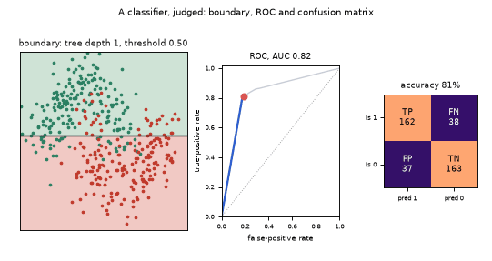
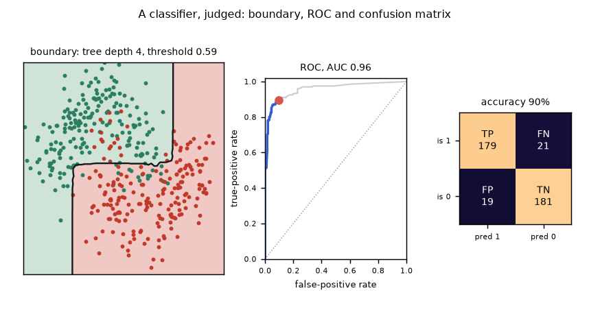
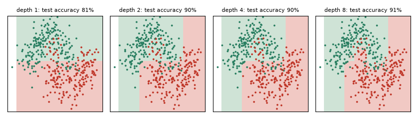

# What you are building toward

Three linked panels on one problem. On the left, the decision region of a bagged-tree classifier grows more detailed as the trees get deeper, and then its boundary moves as a threshold slides. In the middle, the ROC curve is traced out one threshold at a time with a marker on the current operating point. On the right, a confusion-matrix heat map updates live. Your goal over the coming sessions: build this dashboard yourself, from your own forest and your own ROC code.

*Target: decision region, ROC curve and confusion matrix updating together*

*One frame of the Target: boundary, ROC and confusion matrix at one threshold*

*The same data at tree depths 1, 2, 4 and 8: the boundary gains detail with depth*

These results come from a private reference build. The code is not published; the roadmap shows the path so you can build your own.

Live links:

- [Math Visual Studio: statistics, estimation and regression (Atlas S26)](https://krunalpanchal1995.github.io/studio/#atlas?ch=S26&ex=1)
