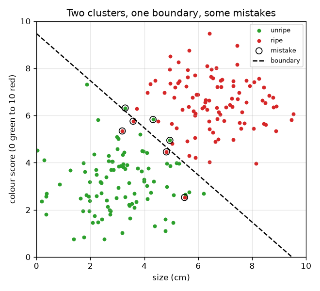
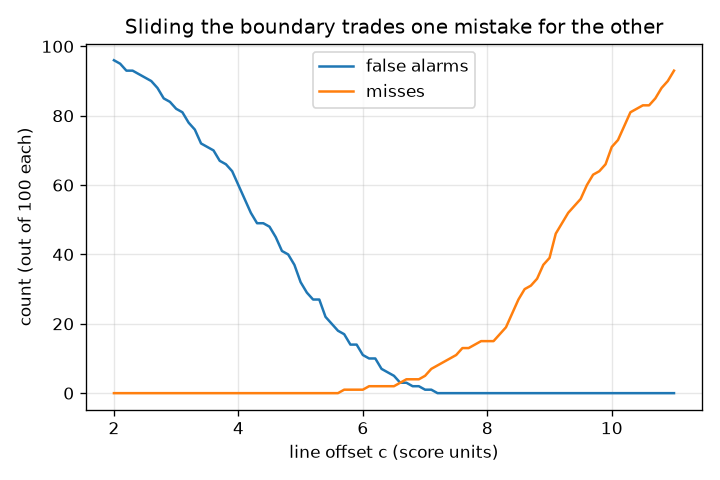

# सत्र 1: एक नियम जो दो समूहों को अलग करता है

*स्तर 1 (वैचारिक इंटरैक्टिव मॉडल) · लगभग 60 मिनट · openclassifier*

> यह एक सरलीकृत शैक्षिक मॉडल है। यह कोई प्रमाणित डिज़ाइन उपकरण नहीं है और इसका उपयोग वास्तविक संरचनाओं, विद्युत स्थापनाओं, वाहनों, औद्योगिक प्रक्रियाओं या चिकित्सा संबंधी निर्णयों के लिए नहीं किया जाना चाहिए।

**पूर्वापेक्षाएँ (Prerequisites)**

- प्रकीर्ण आलेख (scatter plot) पढ़ना (x क्षैतिज दिशा में, y ऊपर की ओर)।
- आपने PRIMER.md पढ़ लिया है और `python start.py 1` एक बार चला लिया है।

**सीखने के उद्देश्य (Learning objectives)।** इस सत्र के बाद आप:

- वर्गीकारक (classifier) को एक ऐसे नियम के रूप में समझा सकेंगे जो मापों को हाँ/नहीं के निर्णय में बदलता है।
- दो समूहों (clusters) के बीच एक सीधी निर्णय सीमा (decision boundary) खींच और खिसका सकेंगे।
- किसी नियम की दो प्रकार की गलतियाँ, झूठे अलार्म (false alarms) और चूक (misses), गिन सकेंगे।
- ऐसा ग्राफ़ पढ़ सकेंगे जो दिखाता है कि सीमा खिसकाने से एक गलती दूसरी गलती के बदले कैसे बदलती है।

## A. वास्तविक दुनिया की समस्या
एक पैकिंग लाइन को पके फल दुकान पर भेजने हैं और कच्चे फल रोककर रखने हैं। एक कैमरा हर फल के लिए दो संख्याएँ मापता है: सेंटीमीटर में उसका आकार और 0 (हरा) से 10 (गहरा लाल) तक का रंग स्कोर। मशीन को कोई नहीं बताता कि पका होने का क्या अर्थ है; हम उसे एक नियम देते हैं। नियम कैसा दिखना चाहिए, हम उसे कैसे खींचें, और हम उसके गलत होने के तरीकों को कैसे गिनें? (बनाए गए आँकड़ों के साथ सामान्य शिक्षा।)

## B. अवधारणा और सिद्धांत
वर्गीकारक एक नियम है जो मापों को एक वर्ग (class) से जोड़ता है। हर फल एक बिंदु (x, y) = (आकार, रंग) है। सबसे सरल नियम एक संख्या के बारे में एक प्रश्न पूछता है: क्या आकार t से ऊपर है? एक बेहतर नियम दोनों संख्याओं को मिलाता है: वह किसी फल को पका कहता है जब x cos(a) + y sin(a), c से बड़ा हो। जिन बिंदुओं पर उत्तर पलटता है उनका समुच्चय निर्णय सीमा है, यहाँ एक सीधी रेखा; कोण a बताता है कि रेखा किस दिशा की ओर है और c बताता है कि वह मूल बिंदु (origin) से कितनी दूर है। 'पका' को धनात्मक वर्ग (positive class) कहिए। एक नियम दो अलग तरीकों से गलत हो सकता है: झूठा अलार्म (false positive) एक कच्चे फल को पका कहता है, और चूक (false negative) एक पके फल को कच्चा कहती है। इन्हें अलग-अलग गिना जाता है क्योंकि आमतौर पर इनकी कीमत अलग होती है। सीमा को पके समूह की ओर खिसकाने से झूठे अलार्म हटते हैं पर चूकें बनती हैं, और इसका उल्टा भी।

| प्रतीक | अर्थ | इकाई |
|---|---|---|
| x | फल का आकार | cm |
| y | रंग स्कोर (0 हरा से 10 लाल) | स्कोर इकाइयाँ |
| a | सीमा की अभिलंब (normal) दिशा का कोण | डिग्री |
| c | मूल बिंदु से सीमा का विस्थापन (offset) | स्कोर इकाइयाँ |
| FA | झूठे अलार्म: कच्चे फल जिन्हें पका कहा गया | गिनती |
| miss | पके फल जिन्हें कच्चा कहा गया | गिनती |

**मान्यताएँ (Assumptions)**

- फलों के आँकड़े बनाए गए हैं; वास्तविक फलों के बारे में कोई दावा नहीं।
- सीमा एक सीधी रेखा है और ठीक रेखा पर स्थित फल को कच्चा कहा जाता है।
- केवल दो वर्ग।

$$ \text{called ripe}\iff x\cos a+y\sin a>c $$

$$ \text{size-only rule}:\ \text{called ripe}\iff x>t $$

$$ \text{accuracy}=\frac{\text{number correct}}{\text{number of fruit}} $$

## C. दृश्य व्याख्या
पहला चित्र 100 कच्चे और 100 पके फलों को दो आंशिक रूप से एक-दूसरे पर चढ़े समूहों के रूप में एक धराशायी (dashed) सीमा के साथ दिखाता है; छल्ले उन फलों को चिह्नित करते हैं जिन्हें नियम गलत बताता है। दूसरा चित्र सीमा खिसकने पर झूठे अलार्म और चूकें गिनता है: c बढ़ने पर झूठे अलार्म घटते हैं और चूकें बढ़ती हैं, और c = 6.6 के पास दोनों गिनतियाँ बराबर होती हैं।

*दो आंशिक रूप से एक-दूसरे पर चढ़े समूह, एक धराशायी सीमा, और उन फलों के चारों ओर छल्ले जिन्हें नियम गलत बताता है।*

*सीमा खिसकने पर झूठे अलार्म और चूकें: एक घटती है जबकि दूसरी बढ़ती है।*

## D. इंटरैक्टिव सिमुलेशन
पाठ चलाइए (`python start.py 1`), फिर लाइव ऐप खोलिए: [सत्र 1: फलों को छाँटिए](https://krunalpanchal1995.github.io/pan-iit-oss/openclassifier/session-01/) (या इसी फ़ोल्डर में `app.html`)। कोण और विस्थापन के स्लाइडर खिसकाइए और धराशायी सीमा तथा छल्लों से चिह्नित गलतियों को देखिए। विस्थापन के सापेक्ष दोनों गिनतियाँ देखने के लिए ट्रेड-ऑफ़ ग्राफ़ पर जाइए, और चारों परिणाम देखने के लिए टैली दृश्य पर जाइए।

**चुनौती।** ऐसी सीमा खोजिए जो सभी बारह फलों को सही छाँटे (कोई झूठा अलार्म नहीं और कोई चूक नहीं)।

## E. हल किया गया उदाहरण और प्रयोग
**समस्या।** बारह फल: कच्चे (2, 2), (3, 4), (4, 2), (3.5, 6), (5, 3), (6, 4.5) और पके (4.5, 7), (6, 8), (7, 6), (8, 9), (7.5, 4), (5.5, 5.5)। a = 45 डिग्री और c = 7 वाली रेखा का उपयोग कीजिए। कौन से फल गलत वर्गीकृत हैं, और सटीकता (accuracy) क्या है?

1. 45 डिग्री पर cos = sin = 0.7071, इसलिए नियम है 0.7071 (x + y) > 7, अर्थात x + y > 9.899।
2. कच्चे फलों के योग x + y: 4, 7, 6, 9.5, 8, 10.5। केवल 10.5 ((6, 4.5) वाला फल) 9.899 से ऊपर है, इसलिए यह एक झूठा अलार्म है।
3. पके फलों के योग: 11.5, 14, 13, 17, 11.5, 11। सभी 9.899 से ऊपर हैं, इसलिए कोई चूक नहीं है।
4. सही = 12 - 1 - 0 = 11, इसलिए सटीकता = 11 / 12 = 0.917।

**उत्तर।** एक झूठा अलार्म ((6, 4.5) वाला फल), कोई चूक नहीं, सटीकता 0.917।

**प्रयोग।** बारह बिंदुओं को वर्गांकित कागज़ पर छापिए, रेखा x + y = 9.9 पर एक रूलर रखिए और गलत तरफ़ के बिंदु गिनिए; आपको वही एक फल मिलना चाहिए। मॉडल बनाम वास्तविकता: असली फल बारह साफ़ बिंदु नहीं होते, पकापन कोई ऐसी संख्या नहीं जिसे आप ठीक-ठीक माप सकें, और कैमरा शोर (noise) जोड़ता है, इसलिए एक असली रेखा इस खिलौना रेखा से अधिक गलतियाँ करती है।

## F. मूल्यांकन और डिज़ाइन चुनौती
**प्रश्न प्रकार A: वैचारिक।** हम केवल 'गलतियाँ' गिनने के बजाय झूठे अलार्म और चूकों को अलग-अलग क्यों गिनते हैं? एक उदाहरण दीजिए जहाँ एक दूसरी से बदतर हो।

संकेत

सोचिए कि हर गलती की पैकिंग लाइन को क्या कीमत चुकानी पड़ती है।

चरण-दर-चरण हल

दोनों गलत निर्णय हैं, पर उनकी कीमत अलग है। कच्चे फल को दुकान भेजना (झूठा अलार्म) ग्राहक का भरोसा खोता है; पके फल को रोकना (चूक) एक अच्छा फल बर्बाद करता है। धुएँ के अलार्म के लिए चूक (आग, पर अलार्म नहीं) झूठे अलार्म से कहीं बदतर है। गलतियों की कुल संख्या इसे छिपा देती है, इसलिए हम दोनों बताते हैं।

**प्रश्न प्रकार B: संख्यात्मक।** हल किए गए उदाहरण के बारह फलों के लिए, केवल-आकार नियम 'पका यदि आकार > 5' का उपयोग कीजिए (अर्थात a = 0 डिग्री, c = 5)। झूठे अलार्म, चूकें और सटीकता गिनिए।

संकेत

कच्चे और पके फलों के आकारों की सूची बनाइए और चिह्नित कीजिए कि कौन से 5 से ऊपर हैं।

चरण-दर-चरण हल

कच्चे आकार: 2, 3, 4, 3.5, 5, 6; केवल 6 ही 5 से ऊपर है, इसलिए 1 झूठा अलार्म (ठीक 5 आकार 5 से ऊपर नहीं है)। पके आकार: 4.5, 6, 7, 8, 7.5, 5.5; केवल 4.5 ही 5 से ऊपर नहीं है, इसलिए 1 चूक। सही = 12 - 2 = 10, सटीकता = 10 / 12 = 0.833। जाँच: रंग का भी उपयोग करने से (45 डिग्री रेखा) परिणाम बेहतर था, केवल 1 गलती के साथ।

**प्रश्न प्रकार C: ग्राफ़ और सिमुलेशन की व्याख्या।** 45 डिग्री सीमा के साथ 200 यादृच्छिक फलों के ट्रेड-ऑफ़ ग्राफ़ में, विस्थापन c के 2 से 11 तक बढ़ने पर दोनों गिनतियों का क्या होता है? वे कहाँ एक-दूसरे को काटती हैं?

संकेत

बड़ा c रेखा को पके समूह की ओर ले जाता है।

चरण-दर-चरण हल

झूठे अलार्म लगातार घटते हैं (c = 2 पर 96, 0 चूकों के साथ) क्योंकि कम फलों को पका कहा जाता है, और चूकें 0 से बढ़ती हैं। वक्र c = 6.6 के पास काटते हैं, जहाँ दोनों गिनतियाँ लगभग बराबर हैं। c = 6.7 पर नियम 200 में से 3 झूठे अलार्म और 4 चूकें करता है।

**प्रश्न प्रकार D: डिज़ाइन और अनुकूलन चुनौती।** डिज़ाइन: दुकान कहती है कि झूठा अलार्म (शेल्फ़ पर कच्चा फल) चूक से बदतर है। क्या आपको सीमा को c = 6.7 से बाएँ या दाएँ खिसकाना चाहिए? आप क्या छोड़ते हैं? आप कैसे तय करेंगे कि कितनी दूर?

संकेत

ट्रेड-ऑफ़ वक्रों का उपयोग कीजिए: हर गिनती किस ओर जाती है?

चरण-दर-चरण हल

इसे दाएँ खिसकाइए (बड़ा c): कम झूठे अलार्म, अधिक चूकों की कीमत पर, जिसका यहाँ अर्थ है अधिक पके फल रोके जाना। कितनी दूर, यह तय करने के लिए हर गलती को एक लागत दीजिए (उदाहरण के लिए झूठे अलार्म की लागत 3 और चूक की लागत 1), c अक्ष के साथ 3 x FA + 1 x miss गणना कीजिए और सबसे निचला बिंदु लीजिए। मान्यता: नमूना वास्तविक लाइन का प्रतिनिधि है; केवल 200 फलों के साथ ठीक-ठीक सर्वोत्तम c अनिश्चित है।

[RUBRIC.md](../../RUBRIC.md) से स्वयं को अंक दीजिए। कागज़ पर काम करने के लिए [गतिविधि पत्रक](activity_sheet.md) प्रिंट कीजिए।

## आम भ्रांतियाँ
| आम भ्रांति | वास्तव में क्या सच है |
|---|---|
| सबसे अच्छा वर्गीकारक वह है जो किसी भी प्रकार की सबसे कम गलतियाँ करे। | यह इस पर निर्भर करता है कि हर गलती की कीमत क्या है। समान कुल वाले दो नियमों में झूठे अलार्म और चूकें बहुत अलग हो सकती हैं। |
| निर्णय सीमा कोई ऐसी चीज़ है जो आँकड़ों में मौजूद होती है। | यह नियम द्वारा किया गया एक चुनाव है। अलग नियम उन्हीं बिंदुओं से होकर अलग सीमाएँ खींचते हैं। |
| एक लक्षण (feature) काफ़ी है यदि वह अच्छा हो। | केवल आकार का उपयोग करने से 200 फलों में 22 गलतियाँ हुईं; रंग जोड़ने से यह घटकर 7 रह गईं। |

## शब्दावली
- **वर्गीकारक (classifier)**: एक नियम जो मापों को वर्ग लेबल में बदलता है
- **निर्णय सीमा (decision boundary)**: उन बिंदुओं का समुच्चय जहाँ नियम का उत्तर पलटता है
- **झूठा अलार्म (false positive)**: किसी ऋणात्मक मामले को धनात्मक कहना
- **चूक (false negative)**: किसी धनात्मक मामले को ऋणात्मक कहना
- **सटीकता (accuracy)**: उन मामलों का अंश जिन्हें नियम सही बताता है

## समापन
1. [exercises.md](exercises.md) में दिए तीन कोडिंग कार्य कीजिए।
2. अपने बदलावों के बाद `python start.py 1` फिर से चलाइए। यह चेकपॉइंट (checkpoint) पर समाप्त होता है; जब यह `PASS` छापे, तो आपका काम पूरा है। (केवल चेकपॉइंट: `python start.py check 1`।)

अगला: [सत्र 2](../session-02/README.md)
