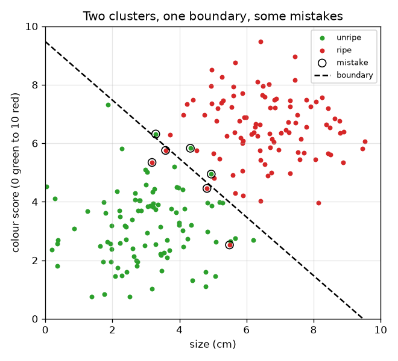
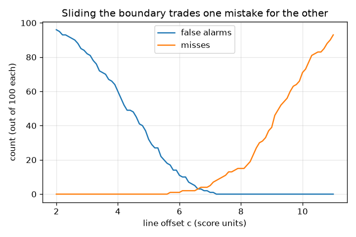

# Session 1: A rule that splits two groups

[Session 1 — हिन्दी](README.hi.md) · [Session 1 — മലയാളം](README.ml.md) · [Session 1 — தமிழ்](README.ta.md) · [Session 1 — తెలుగు](README.te.md)

*Level 1 (conceptual interactive model) · about 60 minutes · openclassifier*

> This is a simplified educational model. It is not a validated design tool and must not be used for real structures, electrical installations, vehicles, industrial processes or medical decisions.

**Prerequisites**

- Reading a scatter plot (x across, y up).
- You have read PRIMER.md and run `python start.py 1` once.

**Learning objectives.** After this session you can:

- Explain a classifier as a rule that turns measurements into a yes/no decision.
- Draw and move a straight decision boundary between two clusters.
- Count the two kinds of mistake, false alarms and misses, for a rule.
- Read a graph that shows how sliding the boundary trades one mistake for the other.

## A. Real-world problem
A packing line must send ripe fruit to the shop and keep unripe fruit back. A camera measures two numbers for each fruit: its size in centimetres and a colour score from 0 (green) to 10 (deep red). Nobody tells the machine what ripe means; we give it a rule. How should the rule look, how do we draw it, and how do we count the ways it goes wrong? (General education with made-up data.)

## B. Concept and theory
A classifier is a rule that maps measurements to a class. Each fruit is a point (x, y) = (size, colour). The simplest rule asks one question about one number: is the size above t? A better rule mixes both numbers: it calls a fruit ripe when x cos(a) + y sin(a) is greater than c. The set of points where the answer flips is the decision boundary, here a straight line; the angle a sets the direction at right angles to the line (its normal) and c says how far the line sits from the origin along that direction. Call 'ripe' the positive class. A rule can go wrong in two different ways: a false alarm (false positive) calls an unripe fruit ripe, and a miss (false negative) calls a ripe fruit unripe. They are counted separately because they usually cost different amounts. Sliding the boundary towards the ripe cluster removes false alarms but creates misses, and the other way round.

| Symbol | Meaning | Unit |
|---|---|---|
| x | fruit size | cm |
| y | colour score (0 green to 10 red) | score units |
| a | angle of the boundary's normal direction | degrees |
| c | offset of the boundary from the origin, measured along the normal direction | score units |
| FA | false alarms: unripe fruit called ripe | count |
| miss | ripe fruit called unripe | count |

**Assumptions**

- The fruit data are made up; no claim about real fruit.
- The boundary is a straight line and a fruit exactly on the line is called unripe.
- Only two classes.

$$ \text{called ripe}\iff x\cos a+y\sin a>c $$

$$ \text{size-only rule}:\ \text{called ripe}\iff x>t $$

$$ \text{accuracy}=\frac{\text{number correct}}{\text{number of fruit}} $$

## C. Visual explanation
The first figure shows 100 unripe and 100 ripe fruit as two overlapping clusters with a dashed boundary; rings mark the fruit the rule gets wrong. The second figure counts false alarms and misses as the boundary slides: false alarms fall and misses rise as c grows, and the two counts are equal near c = 6.6.

*Two overlapping clusters, a dashed boundary, and rings around the fruit the rule gets wrong.*

*False alarms and misses as the boundary slides: one falls while the other rises.*

## D. Interactive simulation
Run the lesson (`python start.py 1`), then open the live app: [Session 1: sort the fruit](https://krunalpanchal1995.github.io/pan-iit-oss/openclassifier/session-01/) (or `app.html` in this folder). Move the angle and offset sliders and watch the dashed boundary and the ringed mistakes. Switch to the trade-off graph to see both counts against the offset, and to the tally view to see the four outcomes.

**Challenge.** Find a boundary that sorts all twelve fruit correctly (no false alarms and no misses).

## E. Worked example and experiment
**Problem.** Twelve fruit: unripe (2, 2), (3, 4), (4, 2), (3.5, 6), (5, 3), (6, 4.5) and ripe (4.5, 7), (6, 8), (7, 6), (8, 9), (7.5, 4), (5.5, 5.5). Use the line with a = 45 degrees and c = 7. Which fruit are misclassified, and what is the accuracy?

1. At 45 degrees cos = sin = 0.7071, so the rule is 0.7071 (x + y) > 7, that is x + y > 9.899.
2. Sums x + y for the unripe fruit: 4, 7, 6, 9.5, 8, 10.5. Only 10.5 (the fruit at (6, 4.5)) is above 9.899, so it is a false alarm.
3. Sums for the ripe fruit: 11.5, 14, 13, 17, 11.5, 11. All are above 9.899, so there are no misses.
4. Correct = 12 - 1 - 0 = 11, so accuracy = 11 / 12 = 0.917.

**Answer.** One false alarm (the fruit at (6, 4.5)), no misses, accuracy 0.917.

**Experiment.** Print the twelve points on squared paper, lay a ruler on the line x + y = 9.9 and count the points on the wrong side; you should find the same single fruit. Model versus reality: real fruit are not twelve clean points, ripeness is not a number you can measure exactly, and a camera adds noise, so a real line makes more mistakes than this toy one.

## F. Assessment and design challenge
**Question type A: Conceptual.** Why do we count false alarms and misses separately instead of just counting 'mistakes'? Give an example where one is worse than the other.

Hint

Think about what each mistake costs the packing line.

Step-by-step solution

Both are wrong decisions, but they cost different things. Sending an unripe fruit to the shop (false alarm) loses a customer's trust; keeping a ripe fruit back (miss) wastes a good fruit. For a smoke alarm a miss (fire, no alarm) is far worse than a false alarm. The total number of mistakes hides this, so we report both.

**Question type B: Numerical.** For the twelve fruit of the worked example, use the size-only rule 'ripe if size > 5' (that is a = 0 degrees, c = 5). Count the false alarms, the misses and the accuracy.

Hint

List the sizes of the unripe fruit and the ripe fruit and mark which are above 5.

Step-by-step solution

Unripe sizes: 2, 3, 4, 3.5, 5, 6; only 6 is above 5, so 1 false alarm (size exactly 5 is not above 5). Ripe sizes: 4.5, 6, 7, 8, 7.5, 5.5; only 4.5 is not above 5, so 1 miss. Correct = 12 - 2 = 10, accuracy = 10 / 12 = 0.833. Sanity check: using colour as well (the 45 degree line) did better, with only 1 mistake.

**Question type C: Graph and simulation interpretation.** In the trade-off graph for 200 random fruit with the 45 degree boundary, what happens to the two counts as the offset c increases from 2 to 11? Where do they cross?

Hint

A larger c moves the line towards the ripe cluster.

Step-by-step solution

False alarms fall steadily (96 at c = 2, with 0 misses) because fewer fruit are called ripe, and misses rise from 0. The curves cross near c = 6.6, where the two counts are about equal. At c = 6.7 the rule makes 3 false alarms and 4 misses out of 200.

**Question type D: Design and optimisation challenge.** Design: the shop says a false alarm (unripe fruit on the shelf) is worse than a miss. Should you move the boundary left or right of c = 6.7? What do you give up? How would you decide how far?

Hint

Use the trade-off curves: which way does each count move?

Step-by-step solution

Move it right (larger c): fewer false alarms, at the price of more misses, which here means more ripe fruit kept back. To decide how far, give each mistake a cost (for example a false alarm costs 3 and a miss costs 1), compute 3 x FA + 1 x miss along the c axis and take the lowest point. Assumption: the sample is typical of the real line; with only 200 fruit the exact best c is uncertain.

Score yourself with [RUBRIC.md](../../RUBRIC.md). Print the [activity sheet](activity_sheet.md) to work on paper.

## Common misconceptions
| Common misconception | What is actually true |
|---|---|
| The best classifier is the one with the fewest mistakes of any kind. | That depends on what each mistake costs. Two rules with the same total can have very different false alarms and misses. |
| A decision boundary is something the data contains. | It is a choice made by the rule. Different rules draw different boundaries through the same points. |
| One feature is enough if it is a good one. | In this session's 200-fruit data, size alone made 22 mistakes; adding colour cut that to 7. |

## Glossary
- **classifier**: a rule that turns measurements into a class label
- **decision boundary**: the set of points where the rule's answer flips
- **false alarm (false positive)**: calling a negative case positive
- **miss (false negative)**: calling a positive case negative
- **accuracy**: the fraction of cases the rule gets right

## Finish
1. Do the three coding tasks in [exercises.md](exercises.md).
2. Run `python start.py 1` again after your changes. It ends with the checkpoint; when it prints `PASS`, you are done. (Checkpoint only: `python start.py check 1`.)

Next: [Session 2](../session-02/README.md)
